# 10. 被動語態

> 來源：[筆記平台 · 英文](https://hhtim.github.io/notes-platform/english/#/lesson/grammar-passive)　第 10 課 / 共 21 課 · 約 38 分鐘

**be＋過去分詞與主動改被動三步驟、各時態的被動對照表、happen／occur／arrive 為什麼不能被動、授與動詞的兩種被動、be made to do 與 be seen to do，以及主動被動二選一和 be based on、be required to 這類固定搭配；47 題課中練習。**

### 讀完這課你會

*   用 be＋過去分詞寫被動句
*   寫出各時態的被動，知道哪些動詞不能改
*   處理授與動詞與 make 的被動
*   判斷句子填空該用主動還是被動

*【被動的形狀，be＋過去分詞】*

## 被動語態：把「被做的那一方」放到句首

一般的句子是**主動語態**：主詞是做事的人。`The manager approved the budget.`（經理核准了預算）的主詞 `The manager` 就是做「核准」的人。**被動語態**反過來，把被做的那一方（預算）搬到句首當主詞：`The budget was approved by the manager.`（預算被經理核准了）。

*   **主動語態**：一般的字序，主詞是做這個動作的人。
*   **被動語態**：被做的那一方變成句子的主題；做事的人可以省略，也可以放在 `by` 後面。[出處](https://dictionary.cambridge.org/grammar/british-grammar/passive-voice)

> 被動語態＝be 動詞＋過去分詞；時態由 be 決定，過去分詞不變

被動用 be 動詞加過去分詞組成，句子從原本的受詞開始。[出處](https://learnenglish.britishcouncil.org/free-resources/grammar/b1-b2/passives) 過去分詞就是動詞三態的第三個（`approve → approved → approved`、`write → wrote → written`），不規則的寫法在〈完成式三態：現在完成式對過去式〉的表裡。

#### 主動改被動的三個步驟

*圖：* 主動改被動：受詞變主詞、動詞改成 be＋過去分詞、原主詞放進 by 片語或省略。The manager approved the budget. → The budget was approved (by the manager).

*   **步驟一：原本的受詞搬到句首當主詞**。所以主動句一定要有受詞，才改得成被動（下面「要有受詞才能改被動」那段會再講）。
*   **步驟二：動詞改成 be＋過去分詞**。be 的時態跟原本的動詞一樣（原句是過去式，be 就用 `was`／`were`），單複數配**新的主詞**。
*   **步驟三：原本的主詞放到 `by` 後面，或直接省略**。代名詞放到 `by` 後面要改成受格：`by him`、`by them`。

#### by 片語什麼時候可以省略

*   **保留 `by`**：做事的人重要時。
*   **省略 `by`**：做事的人不重要、不知道或很明顯時。這種不寫做事的人的被動句非常常見。[出處](https://dictionary.cambridge.org/grammar/british-grammar/passives-with-and-without-an-agent)

被動常用在這幾種時候：[出處](https://learnenglish.britishcouncil.org/free-resources/grammar/b1-b2/passives)

*   不想說是誰做的
*   想讓句子從最重要的資訊開始
*   比較正式的書面文字

所以職場公告、規章、電子郵件裡常見被動。

| 例句 | 意思 | 看哪裡 |
| --- | --- | --- |
| `The budget was approved by the board.` | 預算由董事會核准了。 | 誰核准很重要，保留 `by` |
| `Your application has been received.` | 您的申請已收到。 | 收件的人不重要，省略 |
| `The office is cleaned every evening.` | 辦公室每天晚上會有人打掃。 | 做事的人很明顯（清潔人員），省略 |
| `All invoices must be paid within 30 days.` | 所有請款單須在 30 天內付清。 | 規章的寫法，省略 |
| `The new logo was designed by an outside agency.` | 新標誌是外面的設計公司做的。 | 強調是誰做的，保留 `by` |
| `Two laptops were stolen from the storage room.` | 儲藏室有兩台筆電被偷了。 | 不知道是誰，省略 |
| `Lunch will be provided.` | 會提供午餐。 | 重點是有午餐，省略 |
| `The contract was signed by both parties on Monday.` | 合約週一由雙方簽署。 | 保留 `by`＋時間照放 |

**🧩 小練習：** The quarterly report ______ by the finance team every March.

- (A) is prepared
- (B) prepares
- (C) is preparing
- (D) prepare

看答案

**答案：(A)** 整句：季度報告每年三月由財務團隊準備。  
報告是「被準備」的，空格後面又接 `by the finance team`，要用被動 `is prepared`。`prepares`、`is preparing` 是主動，後面得接受詞；`prepare` 主詞單數也沒加 s。

**🧩 小練習：** All visitors are ______ to wear a badge inside the factory.

- (A) require
- (B) requiring
- (C) required
- (D) requires

看答案

**答案：(C)** 整句：依規定，所有訪客在工廠內都必須配戴識別證。  
空格前面已經有 `are`，訪客是「被要求」的一方，`are` 後面接過去分詞 `required`。

**🧩 小練習：** 主動句 The manager approved the budget. 改成被動，哪一句正確？

- (A) The budget approved by the manager.
- (B) The budget is approved by the manager.
- (C) The manager was approved the budget.
- (D) The budget was approved by the manager.

看答案

**答案：(D)** 整句：經理核准了預算。  
受詞 `the budget` 搬到句首、動詞改成 be＋過去分詞、原主詞放到 `by` 後面。原句是過去式，be 也要用過去式 `was`；`is approved` 把時態改掉了。`The budget approved` 少了 be。

**🧩 小練習：** Our office ______ every evening, so please take your belongings home before you leave.

- (A) cleans
- (B) is cleaned
- (C) is cleaning
- (D) cleaned

看答案

**答案：(B)** 整句：我們辦公室每天晚上都有人打掃，所以離開前請把個人物品帶回家。  
辦公室不會自己打掃，是「被打掃」；`every evening` 是習慣，用現在簡單式的被動 `is cleaned`。打掃的人很明顯，省略 `by` 片語。

**🧩 小練習：** The winners of the design contest ______ next Monday.

- (A) will announce
- (B) announced
- (C) will be announced
- (D) have announced

看答案

**答案：(C)** 整句：設計比賽的得獎者將在下週一公布。  
得獎者是「被宣布」的一方，而且 `next Monday` 是未來，用未來式的被動 `will be announced`。`will announce` 是主動，後面要接宣布的內容。

**🧩 小練習：** Your application ______ yesterday, and you will hear from us within a week.

- (A) received
- (B) receives
- (C) was receiving
- (D) was received

看答案

**答案：(D)** 整句：您的申請已在昨天收到，一週內我們會與您聯絡。  
申請書是「被收到」的；`yesterday` 是過去，用 `was received`。其他三個都是主動，意思變成「申請書收到了某樣東西」。

**🧩 小練習：** 在 The contract was signed by both parties. 這句裡，做「簽」這個動作的是誰？

- (A) both parties
- (B) The contract
- (C) was signed
- (D) by

看答案

**答案：(A)** 整句：這份合約由雙方簽署。  
被動句的主詞 `The contract` 是被簽的東西；做事的人放在 `by` 後面，是 `both parties`（雙方）。

**🧩 小練習：** The large meeting room ______ for the client presentation tomorrow morning.

- (A) has booked
- (B) has been booked
- (C) is booking
- (D) booked

看答案

**答案：(B)** 整句：大會議室已經訂好了，給明天早上的客戶簡報用。  
會議室是「被預訂」的，用現在完成式的被動 `has been booked`（已經訂好了）。`has booked`、`is booking`、`booked` 都是主動，變成會議室去訂東西。

*【時態，只換 be】*

## 各時態的被動：be 換時態，過去分詞不動

要換時態，只換 be 的形式，過去分詞保持不變。[出處](https://learnenglish.britishcouncil.org/free-resources/grammar/b1-b2/passives) 所以只要會〈時間軸怎麼看：簡單式三態〉、〈進行式三態〉、〈完成式三態：現在完成式對過去式〉裡 be 和 have 的變化，被動就會了。被動的各時態，用法跟主動的同一個時態一樣。[出處](https://dictionary.cambridge.org/grammar/british-grammar/passive-forms)

| 時態 | 被動的形狀 | 例句 | 意思 |
| --- | --- | --- | --- |
| 現在簡單式 | `am / is / are`＋過去分詞 | `The office is cleaned every evening.` | 辦公室每晚有人打掃。 |
| 過去簡單式 | `was / were`＋過去分詞 | `The order was shipped yesterday.` | 訂單昨天寄出了。 |
| 未來（will） | `will be`＋過去分詞 | `The results will be announced on Friday.` | 結果週五公布。 |
| 未來（be going to） | `am / is / are going to be`＋過去分詞 | `The old printers are going to be replaced.` | 舊印表機會被換掉。 |
| 現在進行式 | `am / is / are being`＋過去分詞 | `The east wing is being renovated.` | 東側大樓正在整修。 |
| 過去進行式 | `was / were being`＋過去分詞 | `The elevator was being repaired at 9 a.m.` | 早上九點電梯正在修。 |
| 現在完成式 | `have / has been`＋過去分詞 | `Three engineers have been hired since May.` | 五月以來聘了三位工程師。 |
| 過去完成式 | `had been`＋過去分詞 | `The samples had been tested before the client arrived.` | 客戶到之前樣品已經測過了。 |
| 未來完成式 | `will have been`＋過去分詞 | `The bridge will have been completed by 2028.` | 到 2028 年橋會完工。 |
| 助動詞 | 助動詞＋`be`＋過去分詞 | `All reports must be submitted by Friday.` | 所有報告必須在週五前交。 |

*   **助動詞**：`can`、`will`、`might` 這類都是加 `be` 再加過去分詞，例如 `Reservations can be accepted up to 24 hours before arrival.`
*   **be going to**：`The doors are going to be locked at ten o'clock.`[出處](https://learnenglish.britishcouncil.org/free-resources/grammar/english-grammar-reference/active-passive-voice)
*   **完成進行式**（`has been being`＋過去分詞）的被動很少用，改寫成主動：[出處](https://dictionary.cambridge.org/grammar/british-grammar/passive-forms)  
    ✗ `The house has been being renovated ...` → ✓ `They have been renovating the house for almost a year.`

現在進行式、現在完成式、未來、助動詞這幾列的形狀見出處：[劍橋](https://dictionary.cambridge.org/grammar/british-grammar/passive-forms)、[英國文化協會](https://learnenglish.britishcouncil.org/free-resources/grammar/b1-b2/passives)。其餘各列（例如未來完成式 `will have been`＋過去分詞）照「只換 be、過去分詞不變」同一個規則推出來。

否定和疑問也只動 be（或助動詞）：`The invoice hasn't been paid yet.`（請款單還沒付）、`Was the package delivered on time?`（包裹準時送到了嗎？）、`When will the new system be installed?`（新系統什麼時候裝？）。

**多益怎麼考**：閱讀測驗第五部分「句子填空」共 30 題，每題一個句子少一個字或片語，從四個選項選最適合的。[出處](https://www.ets.org/pdfs/toeic/toeic-listening-reading-test-examinee-handbook.pdf) 被動題常見的出法是把同一個動詞的主動、被動、不同時態放在一起。解題順序建議：先看主詞是做事的還是被做的（決定主動或被動），再找時間線索（決定 be 用哪個時態）。

**🧩 小練習：** The east wing of the building ______ at the moment, so please use the west entrance.

- (A) is renovating
- (B) has renovated
- (C) is being renovated
- (D) renovates

看答案

**答案：(C)** 整句：大樓東側目前正在整修，請走西側入口。  
大樓是「被整修」的；`at the moment`（此刻）用進行式，合起來是現在進行式的被動 `is being renovated`。

**🧩 小練習：** The factory in Kaohsiung ______ in 2019.

- (A) was built
- (B) built
- (C) has been built
- (D) is built

看答案

**答案：(A)** 整句：高雄的工廠是 2019 年蓋的。  
工廠是「被蓋」的；`in 2019` 是明確的過去時間，用過去簡單式的被動 `was built`。明確的過去時間不配現在完成式，所以不是 `has been built`。

**🧩 小練習：** Three new engineers ______ since January.

- (A) were hired
- (B) are hired
- (C) hired
- (D) have been hired

看答案

**答案：(D)** 整句：從一月到現在已經聘了三位新工程師。  
工程師是「被聘」的；`since January` 從過去算到現在，用現在完成式的被動 `have been hired`。

**🧩 小練習：** When the inspector arrived, the samples had already ______.

- (A) tested
- (B) been tested
- (C) being tested
- (D) be tested

看答案

**答案：(B)** 整句：檢查員到的時候，樣品已經測試完了。  
樣品是「被測試」的，而且在檢查員到之前就測完了（過去完成式）。`had` 後面接 `been`＋過去分詞：`had been tested`。`had already tested` 是主動，變成樣品去測東西。

**🧩 小練習：** The new pricing policy ______ at next week's board meeting.

- (A) will discuss
- (B) was discussed
- (C) has been discussed
- (D) will be discussed

看答案

**答案：(D)** 整句：新的定價政策將在下週的董事會上討論。  
政策是「被討論」的；`next week's` 是未來，用 `will be discussed`。

**🧩 小練習：** While the elevator ______, employees had to use the stairs.

- (A) was being repaired
- (B) was repairing
- (C) is repaired
- (D) has repaired

看答案

**答案：(A)** 整句：電梯在維修的那段期間，員工只能走樓梯。  
電梯是「被修」的；後半句 `had to` 是過去，`while` 講過去一段正在進行的時間，用過去進行式的被動 `was being repaired`。

**🧩 小練習：** All expense reports must ______ by Friday.

- (A) submit
- (B) submitted
- (C) be submitted
- (D) be submitting

看答案

**答案：(C)** 整句：所有費用報告都必須在週五前繳交。  
報告是「被交」的；助動詞 `must` 的被動是 `must be`＋過去分詞。`must submit` 是主動，後面要接受詞；`must submitted` 少了 be。

**🧩 小練習：** The signed documents are going to ______ to the client tomorrow.

- (A) send
- (B) be sent
- (C) sent
- (D) sending

看答案

**答案：(B)** 整句：簽好的文件明天會寄給客戶。  
文件是「被寄」的；`be going to` 的被動是 `be going to be`＋過去分詞：`are going to be sent`。

**🧩 小練習：** The results of the employee survey ______ yet.

- (A) haven't announced
- (B) aren't announcing
- (C) didn't announce
- (D) haven't been announced

看答案

**答案：(D)** 整句：員工意見調查的結果還沒公布。  
這題看語態：結果是「被公布」的，四個選項裡只有 `haven't been announced` 是被動，其他三個都是主動，變成結果去公布東西。

**🧩 小練習：** A new security system ______ in the parking garage next month.

- (A) installed
- (B) is installing
- (C) will be installed
- (D) has been installed

看答案

**答案：(C)** 整句：停車場下個月會裝一套新的保全系統。  
系統是「被安裝」的，`next month` 是未來：`will be installed`。`has been installed` 是「已經裝好」，跟 `next month` 對不上。

*【誰能改被動，及物動詞】*

## 要有受詞才能改被動：happen、occur、arrive 不行

步驟一說「受詞搬到句首」，所以**沒有受詞的動詞就改不了被動**。〈詞性與句子骨架：五大句型與「這格填什麼詞性」〉講過及物動詞（後面一定要接受詞的動詞）和不及物動詞（後面不接受詞的動詞）。

*   **及物動詞**：才有主動和被動兩種形式。[出處](https://learnenglish.britishcouncil.org/free-resources/grammar/english-grammar-reference/active-passive-voice)
*   **不及物動詞**：沒有受詞，不能改成被動。[出處](https://dictionary.cambridge.org/grammar/british-grammar/passive-forms)  
    ✗ `The parcel was arrived ...` → ✓ `The parcel arrived in the post this morning.`
*   **典型錯誤**：✗ `She was died.` → ✓ `She died.`[出處](https://dictionary.cambridge.org/grammar/british-grammar/passive-typical-errors)

職場句子常見的三個：

*   `happen`（發生）：最常當不及物用的動詞之一。[出處](https://dictionary.cambridge.org/grammar/british-grammar/verb-patterns-with-and-without-objects)  
    ✗ `What was happened?` → ✓ `What happened?`
*   `occur`（發生，比 happen 正式）：辭典標 `[ I ]`，也就是不及物，例如 `An accident involving over ten vehicles has occurred in the east-bound lane.`[出處](https://dictionary.cambridge.org/dictionary/english/occur)  
    ✗ `An error was occurred.` → ✓ `An error occurred.`
*   `arrive`（抵達）：也是最常當不及物用的動詞，要接地點得先加介系詞，例如 `arrive at the airport`。[出處](https://dictionary.cambridge.org/grammar/british-grammar/verb-patterns-with-and-without-objects)

另外兩種也要注意：[出處](https://dictionary.cambridge.org/grammar/british-grammar/passive-forms)

*   **連綴動詞**（`be`、`become`、`seem` 這種後面接「說明主詞」的補語的動詞）不改被動，例如 `She has finally become a doctor.`
*   **狀態動詞**（〈進行式三態〉講過）有一些**通常**也不用被動：✗ `Lunch was being had.` → ✓ `They were having lunch.`

反過來，能改被動的有兩種：及物動詞，以及一部分「動詞＋介系詞」的句子。後者改被動時，介系詞跟著動詞走：

*   `The holiday hasn't been paid for yet.`（假期的錢還沒付）[出處](https://dictionary.cambridge.org/grammar/british-grammar/passive-forms)
*   `The meeting was called off.`（會議取消了）
*   `He was looked after by his grandmother.`[出處](https://learnenglish.britishcouncil.org/free-resources/grammar/english-grammar-reference/active-passive-voice)

| 對 | 錯 | 為什麼 |
| --- | --- | --- |
| `A system error occurred last night.` | `A system error was occurred last night.` | `occur` 不及物 |
| `What happened to the shipment?` | `What was happened to the shipment?` | `happen` 不及物 |
| `The delegation arrived at noon.` | `The delegation was arrived at noon.` | `arrive` 不及物 |
| `Mr. Ito became the branch manager.` | `Mr. Ito was become the branch manager.` | `become` 是連綴動詞 |
| `The launch party was called off.` | — | `call off`（取消）後面接受詞，可以被動 |
| `New staff are looked after by a mentor.` | — | `look after`（照顧）可以被動，`after` 留著 |

**🧩 小練習：** A serious error ______ during the data transfer last night.

- (A) was occurred
- (B) occurred
- (C) has occurred
- (D) is occurred

看答案

**答案：(B)** 整句：昨晚資料轉移時發生了嚴重的錯誤。  
`occur` 是不及物動詞，不能改被動，`was occurred`、`is occurred` 都不存在。`last night` 是明確的過去時間，用過去簡單式 `occurred`，不用現在完成式。

**🧩 小練習：** The guests from Osaka ______ at the hotel shortly after 8 p.m.

- (A) were arrived
- (B) have been arrived
- (C) are arrived
- (D) arrived

看答案

**答案：(D)** 整句：從大阪來的客人晚上八點過後不久就到了飯店。  
`arrive` 是不及物動詞，沒有被動，所以三個 be＋`arrived` 的選項都錯，用過去式 `arrived`。

**🧩 小練習：** What ______ to the shipment that was supposed to arrive on Monday?

- (A) was happened
- (B) has been happened
- (C) happened
- (D) is happened

看答案

**答案：(C)** 整句：原本應該週一到的那批貨怎麼了？  
`happen` 不及物，沒有被動。問過去的事用過去式 `happened`。

**🧩 小練習：** 下面哪一個動詞可以改成被動語態？

- (A) approve
- (B) arrive
- (C) happen
- (D) occur

看答案

**答案：(A)** `approve`（核准）是及物動詞，要說核准「什麼」，所以有被動 `be approved`。其他三個都是不及物動詞。

**🧩 小練習：** The outdoor product launch ______ because of the typhoon warning.

- (A) called off
- (B) was called off
- (C) was calling off
- (D) has called off

看答案

**答案：(B)** 整句：戶外產品發表會因為颱風警報取消了。  
發表會是「被取消」的；`call off` 改被動，`off` 跟著動詞留下：`was called off`。其他三個是主動，後面都少了受詞。

**🧩 小練習：** New employees ______ by a mentor during their first month.

- (A) are looked
- (B) look after
- (C) are looking after
- (D) are looked after

看答案

**答案：(D)** 整句：新進員工在第一個月由一位導師負責照顧。  
`look after`（照顧）改被動，`after` 不能丟：`are looked after`。`are looked` 少了 `after`，意思不通；另外兩個是主動，新進員工變成去照顧人。

**🧩 小練習：** Ms. Park ______ the head of the sales department last year.

- (A) became
- (B) was become
- (C) has been become
- (D) is became

看答案

**答案：(A)** 整句：朴小姐去年當上業務部主管。  
`become` 是連綴動詞，後面的 `the head of the sales department` 是說明主詞的補語，不是受詞，不能改被動。`last year` 用過去式 `became`。

*【兩種特別的被動】*

## 授與動詞的兩種被動；make 改被動要補 to

#### 授與動詞：人當主詞、東西當主詞都可以

**授與動詞**是後面可以接兩個受詞（人和東西）的動詞，例如 `give`、`send`、`offer`、`show`，也就是〈詞性與句子骨架：五大句型與「這格填什麼詞性」〉的 S＋V＋O＋O。兩個受詞都可以拿來當被動句的主詞，看要強調哪一個：[出處](https://dictionary.cambridge.org/grammar/british-grammar/passive-forms)

*   東西當主詞：`A present was given to each child.`
*   人（間接受詞）當主詞：`Each child was given a present.`、`She was sent a cheque for a thousand euros.`[出處](https://learnenglish.britishcouncil.org/free-resources/grammar/english-grammar-reference/active-passive-voice)

| 主動 | 人當主詞 | 東西當主詞 |
| --- | --- | --- |
| `We sent the client the invoice.` | `The client was sent the invoice.` | `The invoice was sent to the client.` |
| `They offered Ms. Lin a position.` | `Ms. Lin was offered a position.` | `A position was offered to Ms. Lin.` |
| `HR gave each new hire a laptop.` | `Each new hire was given a laptop.` | `A laptop was given to each new hire.` |

看兩個寫法的差別：**人當主詞時，東西直接跟在過去分詞後面**（`was sent the invoice`）；**東西當主詞時，`give`、`send`、`offer`、`show` 這類動詞在人前面加 `to`**（`was sent to the client`），跟上面 `A present was given to each child` 的寫法一樣。

#### make 改被動要補 to；let 不改被動

**使役動詞**是「叫別人做某件事」的動詞，例如 `make`（強迫）、`let`（讓）。`let` 和 `make` 在主動句裡接不帶 to 的原形動詞[出處](https://dictionary.cambridge.org/grammar/british-grammar/verb-patterns-verb-infinitive-or-verb-ing)；但 `make` 改成被動時，一定要用帶 to 的不定詞，例如 `The people were made to wait outside while the committee reached its decision.`[出處](https://dictionary.cambridge.org/grammar/british-grammar/make)

*   主動：`The manager made us work overtime.`（經理叫我們加班。）
*   被動：`We were made to work overtime.`（我們被要求加班。）

`let`（允許）這個意思不用被動，改用 `be allowed to`：[出處](https://dictionary.cambridge.org/grammar/british-grammar/let-let-s)

*   ✗ `We weren't let (to) take photographs` → ✓ `We weren't allowed to take photographs ...`

**感官動詞**（`see`、`hear` 這類看到、聽到的動詞）在主動句裡也接不帶 to 的原形：`We saw their car drive past the house yesterday.`[出處](https://dictionary.cambridge.org/grammar/british-grammar/see) 改成被動時有兩種寫法：[出處](https://www.oxfordlearnersdictionaries.com/definition/english/see_1)

*   原形前面補 to（`somebody/something is seen to do something`）：`He was seen to enter the building about the time the crime was committed.`
*   接 -ing：`She was seen running away from the scene of the crime.`

例如：`Mr. Ross was seen to leave the office at midnight.`（有人看到 Ross 先生半夜離開辦公室），也可以說 `was seen leaving`。

#### have＋東西＋過去分詞：請別人做

職場常見的另一個被動形狀：`have`＋東西＋過去分詞，表示「請別人替我們做某件事」：我們請人或交代人替我們做的事，重點在事情本身而不是誰做的。[出處](https://dictionary.cambridge.org/grammar/british-grammar/have-something-done)

*   `We had the brochures translated into Japanese.`（我們請人把型錄翻成日文。）
*   `I'm having my laptop repaired this week.`（我這週把筆電送修。）

**🧩 小練習：** Each new employee ______ a laptop on the first day.

- (A) will give
- (B) will be given
- (C) gives
- (D) is giving

看答案

**答案：(B)** 整句：每位新進員工第一天都會拿到一台筆電。  
新進員工是「被給」筆電的一方，人當主詞，東西 `a laptop` 直接接在過去分詞後面：`will be given a laptop`。主動的三個意思變成員工送出筆電。

**🧩 小練習：** 主動句 We sent the client the invoice. 用「東西」當主詞改成被動，哪一句正確？

- (A) The invoice was sent the client.
- (B) The invoice sent to the client.
- (C) The invoice was sent to the client.
- (D) The client was sent to the invoice.

看答案

**答案：(C)** 整句：我們把發票寄給了客戶。  
`send` 的被動以東西當主詞時，人前面加 `to`：`was sent to the client`。`The invoice sent` 少了 be；`The client was sent to the invoice.` 把人和東西的關係弄反了。

**🧩 小練習：** 主動句 The company gave each winner a bonus. 用「人」當主詞改成被動，哪一句正確？

- (A) Each winner was given to a bonus.
- (B) Each winner gave a bonus.
- (C) Each winner was gave a bonus.
- (D) Each winner was given a bonus.

看答案

**答案：(D)** 整句：公司給了每位得獎者一筆獎金。  
人當主詞，東西直接接在 `was given` 後面，不加 `to`。`was gave` 用錯了，be 後面要過去分詞 `given`。

**🧩 小練習：** The warehouse staff were made ______ late to finish the inventory count.

- (A) to stay
- (B) stay
- (C) staying
- (D) stayed

看答案

**答案：(A)** 整句：倉庫人員被迫留到很晚，把庫存盤點完。  
`make` 改被動，原形動詞前面要補 `to`：`were made to stay`。主動句才是 `made them stay`。

**🧩 小練習：** Interns ______ to use the executive parking lot.

- (A) are not let
- (B) do not let
- (C) are not allowed
- (D) are not letting

看答案

**答案：(C)** 整句：實習生不可以使用高階主管專用停車場。  
「被允許」的被動用 `be allowed to`；`let` 這個意思不用被動，所以沒有 `are not let to`。

**🧩 小練習：** We had the product brochures ______ into Japanese for the trade fair.

- (A) translate
- (B) translating
- (C) to translate
- (D) translated

看答案

**答案：(D)** 整句：我們請人把產品型錄翻成日文，準備參加商展。  
型錄是請人「被翻譯」的，用 `have`＋東西＋過去分詞：`had the brochures translated`。

**🧩 小練習：** Ms. Lin ______ a position in the Tokyo office, and she accepted it right away.

- (A) was offered
- (B) offered
- (C) was offering
- (D) has offered

看答案

**答案：(A)** 整句：林小姐獲得東京辦公室的一個職位邀約，她馬上就接受了。  
林小姐是「被提供」職位、然後接受的一方：`was offered a position`（人當主詞，東西直接接後面）。主動的寫法變成她把職位給別人，跟「她接受了」對不上。

**🧩 小練習：** Mr. Ross was seen ______ the office at midnight.

- (A) leave
- (B) to leave
- (C) left
- (D) leaves

看答案

**答案：(B)** 整句：有人看到Ross 先生半夜離開辦公室。  
主動是 `saw him leave`；改成被動 `was seen` 後面接帶 to 的不定詞 `to leave`（接 -ing 的 `leaving` 也對，但不在選項裡）。`was seen leave` 少了 to。

*【多益常見，二選一與固定搭配】*

## 主動還是被動？看主詞、看空格後面有沒有受詞

選項裡同時有主動和被動時，兩個問題問完通常就有答案：

*   **主詞是做事的，還是被做的**？報告、訂單、會議室、產品這類東西，通常是被做的一方。
*   **空格後面有沒有受詞**？及物動詞的主動後面一定接受詞（〈詞性與句子骨架：五大句型與「這格填什麼詞性」〉）；空格後面直接是介系詞、時間詞或句號，又是及物動詞時，多半是被動。這是解題建議，例外是授與動詞的被動（`was given a laptop`）後面還會接一個東西。

| 例句 | 主動還是被動 | 看哪裡 |
| --- | --- | --- |
| `Mr. Davis signed the contract this morning.` | 主動 | 主詞是人，後面有受詞 `the contract` |
| `The contract was signed this morning.` | 被動 | 主詞是合約，後面直接接時間 |
| `The marketing team launched a new campaign.` | 主動 | 後面有受詞 `a new campaign` |
| `A new campaign was launched last month.` | 被動 | 後面直接接時間 |
| `The conference room has been reserved for 2 p.m.` | 被動 | 會議室是被訂的 |
| `Our accountant has reviewed the figures.` | 主動 | 後面有受詞 `the figures` |

#### be＋過去分詞＋介系詞或 to：要整組背

*   形容詞配哪個介系詞沒有文法規則可循，最好一起背。[出處](https://learnenglish.britishcouncil.org/free-resources/grammar/a1-a2/adjectives-prepositions)
*   有一批動詞很常用被動，後面接 to＋原形：`be supposed to`、`be expected to`、`be asked to`、`be told to`、`be scheduled to`、`be allowed to`、`be invited to`、`be ordered to`。[出處](https://learnenglish.britishcouncil.org/free-resources/grammar/english-grammar-reference/active-passive-voice)

| 搭配 | 意思 | 例句 | 出處 |
| --- | --- | --- | --- |
| `be satisfied with` | 對……滿意 | `Are you satisfied with the new supplier?` | [出處](https://dictionary.cambridge.org/dictionary/english/satisfied) |
| `be involved in` | 參與…… | `Ms. Rivera is involved in the merger talks.` | [出處](https://learnenglish.britishcouncil.org/free-resources/grammar/a1-a2/adjectives-prepositions) |
| `be based on` | 以……為根據 | `The new design is based on customer feedback.` | [出處](https://dictionary.cambridge.org/dictionary/english/based) |
| `be located in` | 位於…… | `Our headquarters is located in Taipei.` | [出處](https://dictionary.cambridge.org/dictionary/english/located) |
| `be required to` | 被要求、必須…… | `All staff are required to complete the training.` | [出處](https://dictionary.cambridge.org/dictionary/english/require) |
| `be expected to` | 預計……；應該要…… | `The shipment is expected to arrive on Thursday.` | [出處](https://learnenglish.britishcouncil.org/free-resources/grammar/english-grammar-reference/active-passive-voice) |
| `be scheduled to` | 排定…… | `The keynote speech is scheduled to begin at 9 a.m.` | [出處](https://learnenglish.britishcouncil.org/free-resources/grammar/english-grammar-reference/active-passive-voice) |
| `be asked to` | 被請求…… | `Participants are asked to bring a photo ID.` | [出處](https://learnenglish.britishcouncil.org/free-resources/grammar/english-grammar-reference/active-passive-voice) |
| `be supposed to` | 照規定或約定應該…… | `You are supposed to submit the form by noon.` | [出處](https://learnenglish.britishcouncil.org/free-resources/grammar/english-grammar-reference/active-passive-voice) |

`be involved` 也可以接 `with`，同樣是「參與」，例如 `She's been involved with animal rights for many years.`[出處](https://dictionary.cambridge.org/dictionary/english/involve)

**🧩 小練習：** The conference room ______ for the board meeting this afternoon.

- (A) has reserved
- (B) is reserving
- (C) has been reserved
- (D) reserves

看答案

**答案：(C)** 整句：會議室已經訂好了，給今天下午的董事會用。  
會議室是被訂的一方，空格後面也沒有受詞，用被動 `has been reserved`。

**🧩 小練習：** Mr. Davis ______ the contract before he left for the airport.

- (A) signed
- (B) was signed
- (C) has been signed
- (D) is signed

看答案

**答案：(A)** 整句：Davis 先生去機場前簽了合約。  
主詞是人、空格後面有受詞 `the contract`，用主動。`before he left` 是過去，用 `signed`。

**🧩 小練習：** The new product line ______ to customers at the trade show next month.

- (A) will introduce
- (B) introduced
- (C) was introduced
- (D) will be introduced

看答案

**答案：(D)** 整句：新產品線將在下個月的商展上向顧客推出。  
產品是「被推出」的，空格後面直接接 `to customers`、沒有受詞；`next month` 是未來：`will be introduced`。

**🧩 小練習：** The marketing team ______ a new advertising campaign last month.

- (A) was launched
- (B) launched
- (C) has been launched
- (D) is launched

看答案

**答案：(B)** 整句：行銷團隊上個月推出了新的廣告活動。  
團隊是做事的一方，空格後面有受詞 `a new advertising campaign`，用主動；`last month` 用過去式。

**🧩 小練習：** Customers who are not satisfied ______ their purchase may return it within 30 days.

- (A) at
- (B) for
- (C) with
- (D) on

看答案

**答案：(C)** 整句：對購買的商品不滿意的顧客，可以在 30 天內退貨。  
`be satisfied with`：對……滿意。

**🧩 小練習：** All employees are required ______ the online safety training by June 30.

- (A) completing
- (B) to complete
- (C) complete
- (D) completed

看答案

**答案：(B)** 整句：所有員工都必須在 6 月 30 日前完成線上安全訓練。  
`be required to`＋原形：被要求做某事。

**🧩 小練習：** The new office layout is based ______ suggestions from the staff.

- (A) on
- (B) in
- (C) at
- (D) with

看答案

**答案：(A)** 整句：新的辦公室配置是根據員工的建議規劃的。  
`be based on`：以……為根據。

**🧩 小練習：** Ms. Rivera has been involved ______ the project since it began.

- (A) at
- (B) on
- (C) to
- (D) in

看答案

**答案：(D)** 整句：Rivera 小姐從專案一開始就參與其中。  
`be involved in`＋事情：參與某件事。

**🧩 小練習：** Our new headquarters is located ______ downtown Taipei.

- (A) on
- (B) in
- (C) to
- (D) for

看答案

**答案：(B)** 整句：我們的新總部位於台北市中心。  
`be located in`＋城市或區域：位於某地。

**🧩 小練習：** The shipment from Busan is expected ______ on Thursday.

- (A) arriving
- (B) arrive
- (C) to arrive
- (D) arrived

看答案

**答案：(C)** 整句：從釜山來的那批貨預計週四到。  
`be expected to`＋原形：預計會……。

**🧩 小練習：** Participants ______ to bring a photo ID to the seminar.

- (A) are asked
- (B) asking
- (C) has asked
- (D) asks

看答案

**答案：(A)** 整句：參加者請攜帶附照片的身分證件來參加研討會。  
參加者是「被請求」帶證件的一方：`are asked to`。`asking` 不是有時態的動詞，句子少了主要動詞；`has asked`、`asks` 是單數的形狀，主詞 `Participants` 是複數，而且都是主動，變成參加者去要求別人。

**🧩 小練習：** The keynote speech is scheduled ______ at 9 a.m. in the main hall.

- (A) beginning
- (B) begins
- (C) began
- (D) to begin

看答案

**答案：(D)** 整句：主題演講排定上午九點在主廳開始。  
`be scheduled to`＋原形：排定在某時做某事。

*【長得很像的，過去分詞當形容詞】*

## interested 和 interesting

過去分詞（-ed 形）和現在分詞（-ing 形）也能當形容詞，這時看起來像被動，其實是在說明主詞的樣子：-ing 形容詞描述造成的效果，-ed 形容詞描述人的感受。[出處](https://dictionary.cambridge.org/grammar/british-grammar/adjectives-forms) 例如 `We are interested in your proposal.`（我們有興趣）對 `Your proposal is interesting.`（提案有意思）。完整的對照與練習在〈分詞與分詞構句〉。

**🧩 小練習：** We are very ______ with the results of the pilot project.

- (A) satisfying
- (B) satisfied
- (C) satisfaction
- (D) satisfies

看答案

**答案：(B)** 整句：我們對試辦計畫的結果非常滿意。  
主詞 `We` 是「感到滿意」的人，用 -ed 形 `satisfied`，接 `with`；satisfying 說的是讓人滿意的東西，satisfaction 是名詞，satisfies 是動詞。

**🧩 小練習：** Sales for the third quarter were ______, so the team is reviewing its strategy.

- (A) disappointed
- (B) disappoint
- (C) disappointment
- (D) disappointing

看答案

**答案：(D)** 整句：第三季的業績令人失望，所以團隊正在檢討策略。  
業績是「令人失望」的那一方，用 -ing 形 `disappointing`。

### 重點整理

*   被動語態＝be＋過去分詞；主動改被動三步：受詞搬到句首、動詞改 be＋過去分詞（時態不變，單複數配新主詞）、原主詞放 `by` 後面或省略。
*   做事的人不重要、不知道或很明顯時省略 `by` 片語；公告、規章、電子郵件常用沒有 `by` 的被動。
*   時態只換 be：`is done`、`was done`、`will be done`、`is being done`、`has been done`、`had been done`、助動詞＋`be done`。
*   要有受詞才能改被動（及物動詞，和一部分動詞＋介系詞）：`happen`、`occur`、`arrive`、`die` 和連綴動詞 `become` 都沒有被動；`call off`、`look after` 這類動詞片語可以，介系詞或副詞留著。
*   授與動詞兩種被動：人當主詞（`was given a laptop`）、東西當主詞時，`give`、`send`、`offer`、`show` 這類在人前面加 `to`（`was sent to the client`）。`make` 改被動要補 to（`be made to work`）；`let` 改用 `be allowed to`。
*   主動被動二選一：看主詞是做事的還是被做的、空格後面有沒有受詞。固定搭配整組背：`be satisfied with`、`be involved in`、`be based on`、`be located in`、`be required / expected / scheduled / asked to`。
*   -ed 形容詞說人的感受（`interested`），-ing 形容詞說東西帶來的效果（`interesting`）。

## 隨堂測驗

**Q1. The annual report ______ by the accounting department last week. 空格填什麼？**

- (A) was prepared
- (B) prepared
- (C) has been prepared
- (D) is prepared

看答案

**答案：(A)** 報告是被準備的，後面有 by 片語，用被動；last week 是明確的過去時間，用過去式的被動 was prepared，不用現在完成式。

**Q2. 下面哪一個動詞不能改成被動語態？**

- (A) occur
- (B) approve
- (C) deliver
- (D) send

看答案

**答案：(A)** occur（發生）是不及物動詞，沒有受詞可以搬到句首，所以沒有 was occurred 這種寫法；其他三個都是及物動詞。

**Q3. The network cables on the third floor ______ right now, so the internet may be slow. 空格填什麼？**

- (A) are being replaced
- (B) are replacing
- (C) have replaced
- (D) replace

看答案

**答案：(A)** 網路線是被更換的；right now 用進行式，現在進行式的被動是 are being＋過去分詞。其他三個是主動，變成網路線去換東西。

**Q4. Ms. Kao ______ a promotion by the board last month. 空格填什麼？**

- (A) was offered
- (B) offered
- (C) was offering
- (D) has been offered

看答案

**答案：(A)** 高小姐是被董事會提供升遷的一方，人當主詞，東西 a promotion 直接接在 was offered 後面；last month 是明確的過去時間，不用現在完成式。

**Q5. The sales staff were made ______ the proposal after the client complained. 空格填什麼？**

- (A) to rewrite
- (B) rewrite
- (C) rewriting
- (D) rewritten

看答案

**答案：(A)** make 在主動句接原形（made them rewrite），改成被動要補 to：were made to rewrite。

**Q6. All applications must ______ by May 31. 空格填什麼？**

- (A) be received
- (B) receive
- (C) received
- (D) be receiving

看答案

**答案：(A)** 申請書是被收到的；助動詞的被動是助動詞＋be＋過去分詞：must be received。

**Q7. Our clients were ______ by the long delays. 空格填什麼？**

- (A) frustrated
- (B) frustrating
- (C) frustration
- (D) frustratingly

看答案

**答案：(A)** 主詞 Our clients 是感到挫折的人，用 -ed 形容詞 frustrated，後面 by 帶出原因；frustrating 說的是讓人挫折的事情，frustration 是名詞，frustratingly 是副詞。

**Q8. The price of each package is based ______ its weight. 空格填什麼？**

- (A) on
- (B) in
- (C) at
- (D) for

看答案

**答案：(A)** be based on：以……為根據。

**Q9. Five new warehouses ______ since 2020. 空格填什麼？**

- (A) have been built
- (B) were built
- (C) have built
- (D) are built

看答案

**答案：(A)** 倉庫是被蓋的；since 2020 從過去算到現在，用現在完成式的被動 have been built。have built 是主動，變成倉庫去蓋東西。

**Q10. 主動句 They will repair the elevator tomorrow. 改成被動，哪一句正確？**

- (A) The elevator will be repaired tomorrow.
- (B) The elevator will repair tomorrow.
- (C) The elevator will been repaired tomorrow.
- (D) The elevator will be repair tomorrow.

看答案

**答案：(A)** 受詞 the elevator 搬到句首，will 的被動是 will be＋過去分詞 repaired；做事的人 they 不重要，省略 by 片語。

