# 11. 助動詞

> 來源：[筆記平台 · 英文](https://hhtim.github.io/notes-platform/english/#/lesson/grammar-modals)　第 11 課 / 共 21 課 · 約 40 分鐘

**情態助動詞後接原形的共同規則，can／could／be able to、may／might、must 與 have to、「不必」don't have to 對「禁止」mustn't、should／ought to／had better，推測強弱與 must／should／could have＋過去分詞，以及 Would you mind -ing 這類職場請求；52 題課中練習。**

### 讀完這課你會

*   記住助動詞的共同規則
*   分清能力、許可、義務與建議的助動詞
*   用 must be、might have 說推測
*   在書信裡寫出禮貌的請求

*【共同規則，後面接原形】*

## 助動詞的共同規則：原形、not、搬到前面

這課的**助動詞**指 `can`、`could`、`may`、`might`、`must`、`shall`、`should`、`will`、`would` 這一類，英文叫 modal verbs，〈時間軸怎麼看：簡單式三態〉叫它們**情態助動詞**；`do`、`have`、`be` 也是助動詞，但不屬於情態助動詞。這課說「助動詞」都是指情態助動詞，用來說能力、可能、義務、建議這些「說話的人怎麼看這件事」：一件事是確定、可能還是不可能，以及談能力、請求許可、提出請求和提議。[出處](https://learnenglish.britishcouncil.org/free-resources/grammar/english-grammar-reference/modal-verbs)

> 助動詞＋原形動詞；不加 to、不加 -s、不加 -ed、不跟 do 一起用

形式規則：

*   **後面接原形動詞**；**不隨時態或人稱變化**，所以第三人稱單數也不加 -s：✗ `She cans`、`She can speaks` → ✓ `She can speak Japanese.`[出處](https://dictionary.cambridge.org/grammar/british-grammar/modality-forms)
*   **後面不接 to：**✗ `We might to buy` → ✓ `We might buy a new sofa.`[出處](https://dictionary.cambridge.org/grammar/british-grammar/infinitives-with-and-without-to)
*   **否定直接在後面加 not，不用 don't／doesn't／didn't：**✗ `We don't can hear` → ✓ `We can't hear very well at the back.`[出處](https://dictionary.cambridge.org/grammar/british-grammar/modality-forms)
*   **疑問句把助動詞和主詞對調，不用 do／does／did：**✗ `Do you could help me?` → ✓ `Could you help me?`[出處](https://dictionary.cambridge.org/grammar/british-grammar/modality-forms)
*   **兩個情態助動詞不能連用**（後面接 `have`、`be` 沒問題，例如 `must have been`）**：**✗ `can might be` → ✓ `Windsurfing can be difficult.`[出處](https://dictionary.cambridge.org/grammar/british-grammar/modality-forms) 要講「將來能夠」，把 `can` 換成 `be able to`：✗ `She won't can concentrate.` → ✓ `She won't be able to concentrate.`[出處](https://dictionary.cambridge.org/grammar/british-grammar/be-expressions-be-able-to-be-due-to)

否定的縮寫：`cannot`（寫成一個字）／`can't`、`couldn't`、`won't`（＝will not）、`wouldn't`、`shouldn't`、`mustn't`。[出處](https://dictionary.cambridge.org/grammar/british-grammar/modality-forms)

`ought to`、`need` 叫「半助動詞」（semi-modal）：有些地方像助動詞、有些地方像一般動詞，例如 `ought to` 後面要接 to。[出處](https://dictionary.cambridge.org/grammar/british-grammar/modality-forms)

**多益怎麼考**：閱讀測驗第五部分「句子填空」共 30 題，每題從四個選項選一個字或片語填進句子。[出處](https://www.ets.org/pdfs/toeic/toeic-listening-reading-test-examinee-handbook.pdf) 助動詞題常見的出法是空格在助動詞後面、選項是同一個動詞的四種形狀，這時直接選原形。〈詞性與句子骨架：五大句型與「這格填什麼詞性」〉也提過：`will`、`must` 後面填原形動詞。

**🧩 小練習：** The new ordering system will ______ us to track every shipment in real time.

- (A) allow
- (B) allows
- (C) allowed
- (D) allowing

看答案

**答案：(A)** 整句：新的訂貨系統將讓我們能即時追蹤每一批貨。  
`will` 後面接原形 `allow`，不加 -s、-ed、-ing。

**🧩 小練習：** All visitors must ______ their badges at all times.

- (A) to wear
- (B) wear
- (C) wearing
- (D) wore

看答案

**答案：(B)** 整句：所有訪客都必須隨時配戴識別證。  
`must` 後面接原形 `wear`，不加 to。

**🧩 小練習：** We ______ finish the project on time without more funding.

- (A) don't can
- (B) can't to
- (C) not can
- (D) can't

看答案

**答案：(D)** 整句：沒有更多經費，我們無法準時完成專案。  
助動詞的否定直接加 not：`can't`（`cannot`），後面接原形，不用 `don't` 幫忙。

**🧩 小練習：** ______ you help me carry these boxes to the storage room?

- (A) Does
- (B) Could
- (C) Are
- (D) Have

看答案

**答案：(B)** 整句：你可以幫我把這些箱子搬到儲藏室嗎？  
空格後面是 `you`＋原形 `help`，請別人幫忙用 `Could you ...?`。`Does` 不配 `you`；`Are`、`Have` 後面不接原形。

**🧩 小練習：** Our team will ______ meet the deadline if we get two more engineers.

- (A) can
- (B) could
- (C) be able to
- (D) able to

看答案

**答案：(C)** 整句：如果再多兩位工程師，我們團隊就能趕上期限。  
`will` 後面不能再接 `can`、`could`（兩個情態助動詞不能連用），改用 `be able to`。`able` 是形容詞，前面要有 `be`。

**🧩 小練習：** Ms. Wu ______ attend the meeting tomorrow because she has a doctor's appointment.

- (A) doesn't might
- (B) might not to
- (C) might not
- (D) not might

看答案

**答案：(C)** 整句：吳小姐明天可能不會參加會議，因為她跟醫生有約診。  
否定把 not 放在助動詞後面：`might not attend`，不加 to，也不用 `doesn't`。

**🧩 小練習：** Ms. Sato ______ speak three languages, so she often helps with overseas clients.

- (A) cans
- (B) can to
- (C) is can
- (D) can

看答案

**答案：(D)** 整句：佐藤小姐會說三種語言，所以常幫忙處理海外客戶。  
助動詞不隨人稱變化，第三人稱單數也是 `can`，後面直接接原形 `speak`。

*【能力，can、could、be able to】*

## 能力：can、could、be able to

*   **`can`：現在或未來的能力**。例如 `I can sing one song in Polish.`[出處](https://dictionary.cambridge.org/grammar/british-grammar/can)
*   **`could`：過去「一般」的能力**（過去一段時間都會），通常用 `could`／`couldn't`，例如 `She could paint before she started school.`[出處](https://learnenglish.britishcouncil.org/free-resources/grammar/b1-b2/past-ability)
*   **過去「某一次」做成功了：用 `was / were able to` 或 `managed to`，不用 `could`**。肯定句講過去實際做到的事，那是事實不是可能性，通常用 was/were able to：✗ `Only one person could beat the record.` → ✓ `Only one person was able to beat the record.`[出處](https://dictionary.cambridge.org/grammar/british-grammar/be-expressions-be-able-to-be-due-to)
*   **過去某一次沒做到：`couldn't`、`wasn't / weren't able to` 都可以**，後者比較正式。[出處](https://dictionary.cambridge.org/grammar/british-grammar/be-expressions-be-able-to-be-due-to)
*   **`be able to` 是比 `can` 正式的說法**，也用在 `can` 放不進去的地方（另一個助動詞後面）：`I am very sorry but I am not able to give you that information.`。[出處](https://dictionary.cambridge.org/grammar/british-grammar/be-expressions-be-able-to-be-due-to)

例外：`could` 配 `see`、`hear`、`remember` 這類感官或想法的動詞時，可以講過去某一次：`We could hear voices inside.`[出處](https://dictionary.cambridge.org/grammar/british-grammar/could)

| 例句 | 意思 | 看哪裡 |
| --- | --- | --- |
| `Ms. Sato can speak three languages.` | 佐藤小姐會講三種語言。 | 現在的能力 |
| `When he was a student, he could type very fast.` | 他學生時代打字很快。 | 過去一般的能力 |
| `Despite the storm, we were able to finish the installation.` | 雖然有暴風雨，我們還是把安裝做完了。 | 過去某一次做到 |
| `We managed to sign the deal before the deadline.` | 我們總算在期限前簽下這筆生意。 | 過去某一次做到（很不容易） |
| `I couldn't reach the supplier yesterday.` | 我昨天聯絡不上供應商。 | 過去某一次沒做到 |
| `You will be able to log in after IT sets up your account.` | IT 設好帳號後你就能登入。 | `will` 後面用 `be able to` |

**🧩 小練習：** Despite the heavy traffic yesterday, we ______ reach the airport on time.

- (A) could
- (B) were able to
- (C) can
- (D) are able to

看答案

**答案：(B)** 整句：雖然昨天交通很塞，我們還是準時趕到了機場。  
過去「某一次」做到了，肯定句用 `were able to`，不用 `could`。`yesterday` 是過去，所以不是 `can`、`are able to`。

**🧩 小練習：** When I was younger, I ______ work twelve hours a day without getting tired.

- (A) can
- (B) will be able to
- (C) could
- (D) am able to

看答案

**答案：(C)** 整句：我年輕的時候，一天工作十二個小時也不會累。  
`When I was younger` 講過去一段時間的一般能力，用 `could`。

**🧩 小練習：** Unfortunately, we ______ contact the supplier yesterday because their office was closed.

- (A) can't
- (B) mustn't
- (C) needn't
- (D) couldn't

看答案

**答案：(D)** 整句：很可惜，我們昨天聯絡不上供應商，因為他們辦公室沒開。  
過去某一次沒做到，用 `couldn't`。`mustn't`（禁止）、`needn't`（不必）意思不對，也不是過去式。

**🧩 小練習：** I'm sorry, but I ______ give you that information over the phone.

- (A) am not able to
- (B) not able to
- (C) don't able to
- (D) am not able

看答案

**答案：(A)** 整句：很抱歉，我無法在電話上提供您那項資訊。  
`be able to` 的否定是 `am not able to`＋原形；少了 `am` 或少了 `to` 都不行。

**🧩 小練習：** You'll ______ access the shared drive after IT sets up your account.

- (A) can
- (B) could
- (C) able
- (D) be able to

看答案

**答案：(D)** 整句：等資訊部幫你設定好帳號，你就能使用共用磁碟了。  
`'ll`（`will`）後面不能接 `can`、`could`，用 `be able to`。

**🧩 小練習：** ______ you hear me clearly, or should I speak louder?

- (A) Are
- (B) Can
- (C) Does
- (D) Have

看答案

**答案：(B)** 整句：你聽得清楚我說話嗎？還是我要講大聲一點？  
問「聽不聽得到」，`hear` 常配 `can`：`Can you hear me?`。`Does` 不配 `you`；`Are`、`Have` 後面不接原形。

*【許可與可能，may、might、can、could】*

## 許可與可能：may、might、can、could

#### 請求許可

請求與給予許可：

*   **can**：用來請求和給予許可。
*   **could**：只用來請求、不用來給予，比 `can` 正式有禮貌。
*   **may**：請求和給予許可最正式的說法。[出處](https://learnenglish.britishcouncil.org/free-resources/grammar/b1-b2/modals-permission-obligation)

所以別人問 `Could I leave early today?`，答應時：✗ `Yes, you could.` → ✓ `Yes, you can.`[出處](https://dictionary.cambridge.org/grammar/british-grammar/could)

| 例句 | 意思 | 語氣 |
| --- | --- | --- |
| `Can I sit here?` | 我可以坐這嗎？ | 一般 |
| `Could I borrow your charger for a moment?` | 可以借一下你的充電器嗎？ | 比較客氣 |
| `May I see your passport, please?` | 請出示護照。 | 最正式 |
| `Customers may request a refund within 30 days.` | 顧客可在 30 天內申請退款。 | 規章寫法（給予許可） |

#### 說「有可能」

表示可能的三個字：

*   **may**：表示現在或未來的「弱的可能」。[出處](https://dictionary.cambridge.org/grammar/british-grammar/may)
*   **might**：最常用來表示弱的可能。[出處](https://dictionary.cambridge.org/grammar/british-grammar/might)
*   **could**：也可以表示現在或未來的可能，例如 `The storm could get worse.`[出處](https://dictionary.cambridge.org/grammar/british-grammar/could)

三個意思一樣，`may` 比 `might`、`could` 正式。[出處](https://learnenglish.britishcouncil.org/free-resources/grammar/b1-b2/modals-deductions-about-present)

*   `The flight may be delayed because of the storm.`（班機可能因為暴風雨延誤。）
*   `Sales might increase next quarter, but nobody is sure yet.`（下一季業績可能會成長，但還沒人說得準。）
*   `This could be a good opportunity for our team.`（這可能是我們團隊的好機會。）

`might` 不表示能力：✗ `I might hear ...` → ✓ `I could hear the noise of an engine.`[出處](https://dictionary.cambridge.org/grammar/british-grammar/might)

**🧩 小練習：** A: Could I leave thirty minutes early today? B: Yes, you ______.

- (A) could
- (B) can
- (C) might
- (D) would

看答案

**答案：(B)** 整句：A：我今天可以提早三十分鐘走嗎？B：可以。  
`could` 只用來請求許可、不用來給予許可；答應時用 `Yes, you can.`。

**🧩 小練習：** The flight ______ be delayed because of the storm, so check its status before you leave home.

- (A) mustn't
- (B) needn't
- (C) may
- (D) had better

看答案

**答案：(C)** 整句：班機可能會因為暴風雨延誤，出門前先查一下航班狀態。  
還不確定、只是有可能，用 `may`。`mustn't`（禁止）、`needn't`（不必）、`had better`（最好）意思都不通。

**🧩 小練習：** ______ I ask you a few questions about your previous job?

- (A) Could
- (B) Does
- (C) Am
- (D) Have

看答案

**答案：(A)** 整句：我可以問您幾個關於上一份工作的問題嗎？  
客氣地請求許可：`Could I ...?`。`Does` 不配 `I`；`Am`、`Have` 後面不接原形 `ask`。

**🧩 小練習：** Sales ______ increase next quarter, but nobody is sure yet.

- (A) must
- (B) will certainly
- (C) can't
- (D) might

看答案

**答案：(D)** 整句：下一季業績也許會成長，但還沒有人能確定。  
後半句說「還沒人確定」，只能用弱的可能 `might`；`must`、`will certainly`、`can't` 都是很確定的說法，跟後半句矛盾。

**🧩 小練習：** Employees ______ use the gym on the fifth floor free of charge; it's one of our company benefits.

- (A) must not
- (B) had better not
- (C) can
- (D) shouldn't

看答案

**答案：(C)** 整句：員工可以免費使用五樓的健身房，這是公司福利之一。  
是公司福利，所以是「可以」用：`can`。其他三個都是禁止或勸阻，跟「福利」矛盾。

*【義務，必須、不必、禁止】*

## must、have to、don't have to、mustn't、need

這一段很容易搞混：**「不必」和「禁止」中文都有個「不」，英文完全是兩回事。**

| 說法 | 意思 | 例句 |
| --- | --- | --- |
| `must` | 必須（強烈的義務，常是說話的人或規定的一方要求） | `All passengers must present a valid photo ID.` |
| `have to` | 必須（義務來自外部：公司、規定、情況） | `We have to wear a uniform at the front desk.` |
| `don't have to` | **不必**（要做也可以，但沒有義務） | `You don't have to wear a tie on Fridays.` |
| `needn't`、`don't need to` | **不必** | `You needn't print the slides; we'll show them on screen.` |
| `must not`、`mustn't` | **禁止**（不准做） | `Visitors must not park in the staff car park.` |
| `had to` | 過去必須（`must` 沒有過去式） | `Last year, all staff had to attend a fire safety course.` |

*   **`must` 與 `have to`：**`have to` 表示義務來自說話的人以外；`must` 表示強烈的義務或必要，常是說話的人或寫下規定的一方要求的。[出處](https://learnenglish.britishcouncil.org/free-resources/grammar/b1-b2/modals-permission-obligation) 兩者差別很細；做題時先看時態，再分「不必」和「禁止」，比較有把握。
*   **過去用 `had to`**：講過去的義務用 had to，不用 must：✗ `Last year, teachers must make a report ...` → ✓ `Last year, teachers had to make a report on each child every week.`[出處](https://dictionary.cambridge.org/grammar/british-grammar/must) 未來的義務常用 `will have to`。[出處](https://dictionary.cambridge.org/grammar/british-grammar/must)
*   **`have to` 的否定和疑問要用 do：**`We don't have to pay for the food.`、`Do we have to take our shoes off?`。[出處](https://dictionary.cambridge.org/grammar/british-grammar/have-got-to-and-have-to)
*   **不必**：講「沒有義務」，用 need not、don't/doesn't/didn't have to，或一般動詞 need 的否定 don't/doesn't need。[出處](https://dictionary.cambridge.org/grammar/british-grammar/must) don't have to 表示沒有義務，想做可以做，但不是強制的。[出處](https://learnenglish.britishcouncil.org/free-resources/grammar/b1-b2/modals-permission-obligation)
*   **禁止**：用 must not 講不被允許的事，常出現在公告、規章。[出處](https://dictionary.cambridge.org/grammar/british-grammar/must) `can't` 和 `mustn't` 都表示禁止，`can't` 特別用在規定不是自己訂的時候，例如 `Oh, we can't park here.`[出處](https://learnenglish.britishcouncil.org/free-resources/grammar/b1-b2/modals-permission-obligation)

#### need 的兩種用法

`need` 有兩種身分。[出處](https://dictionary.cambridge.org/grammar/british-grammar/need)

*   **當助動詞**（半助動詞）：幾乎都用在否定 `needn't`＋原形，表示「不必」，沒有 -s、不用 do：`You needn't take off your shoes.`。這種用法沒有過去式，過去的「不必」要說 `didn't need to` 或 `didn't have to`。
*   **當一般動詞**：`need to`＋原形，隨人稱和時態變化（`she needs to`、`they needed to`），否定和疑問用 do：`You don't need to mention this to your father.`。後面接名詞或 -ing 時也只能用一般動詞的 need：`You don't need an umbrella.`、`My hair doesn't need cutting ...`。
*   `needn't have`＋過去分詞：事情做了，但其實不必做，例如 `You needn't have waited for me.`

**🧩 小練習：** You ______ wear a suit on Fridays; casual clothes are fine.

- (A) don't have to
- (B) mustn't
- (C) must
- (D) have to

看答案

**答案：(A)** 整句：週五不必穿西裝，穿便服就可以。  
後半句說便服也可以，表示「不必」穿西裝：`don't have to`。`mustn't` 是「禁止」，變成週五不准穿西裝。

**🧩 小練習：** Visitors ______ smoke anywhere inside the factory. It is against the law.

- (A) don't have to
- (B) must not
- (C) needn't
- (D) may

看答案

**答案：(B)** 整句：訪客在工廠內任何地方都不准抽菸。這是違法的。  
違法，表示「禁止」：`must not`。`don't have to`、`needn't` 是「不必」，意思差很多。

**🧩 小練習：** Last year, all staff ______ attend a fire safety course.

- (A) must
- (B) musted
- (C) had to
- (D) have to

看答案

**答案：(C)** 整句：去年所有員工都必須參加消防安全課程。  
`Last year` 是過去；`must` 沒有過去式，過去的義務用 `had to`。

**🧩 小練習：** You ______ bring your own laptop to the training session, but you may if you prefer. We will provide one for each participant.

- (A) mustn't
- (B) must
- (C) had better
- (D) needn't

看答案

**答案：(D)** 整句：你不必自己帶筆電來上課，不過想帶也可以。我們會為每位學員準備一台。  
公司會提供、想帶也可以（`you may if you prefer`），所以是「不必」帶：`needn't`。`mustn't` 是禁止，跟「想帶也可以」矛盾；`must`、`had better` 也跟「可帶可不帶」矛盾。

**🧩 小練習：** Does Mr. Ho ______ work this Saturday?

- (A) have to
- (B) must
- (C) has to
- (D) needs to

看答案

**答案：(A)** 整句：何先生這週六得上班嗎？  
`have to` 的疑問句用 `Does`，後面接原形 `have to`（不是 `has to`）。`Does ... must` 不行；`Does` 後面的動詞用原形，所以也不是 `needs to`。

**🧩 小練習：** Ms. Tan ______ to renew her work permit before it expires next month.

- (A) need
- (B) needn't
- (C) must
- (D) needs

看答案

**答案：(D)** 整句：譚小姐需要在工作證下個月到期之前辦好續期。  
空格後面有 `to`，是一般動詞的 `need to`，第三人稱單數要加 s：`needs to`。`needn't`、`must` 後面不接 to。

**🧩 小練習：** My laptop doesn't need ______; it's only a year old.

- (A) replace
- (B) replacing
- (C) replaces
- (D) to replace

看答案

**答案：(B)** 整句：我的筆電不需要換，才用了一年而已。  
東西「需要被處理」可以用 `need`＋-ing（例如 `My hair doesn't need cutting`）。`doesn't need to replace` 變成筆電去換東西。

**🧩 小練習：** You ______ have printed all those copies. The meeting has been cancelled.

- (A) needn't
- (B) mustn't
- (C) don't have to
- (D) had better not

看答案

**答案：(A)** 整句：你其實不必印那些影本的。會議已經取消了。  
印了，但其實不必印：`needn't have`＋過去分詞。`don't have to` 後面不接 `have printed`；`mustn't have`、`had better not have` 都不是這個意思。

**🧩 小練習：** We ______ forget to send the invoice today; the client is waiting for it.

- (A) don't have to
- (B) needn't
- (C) mustn't
- (D) aren't able

看答案

**答案：(C)** 整句：我們今天絕對不能忘了寄發票，客戶正在等。  
「絕對不能忘」是禁止：`mustn't forget`。`don't have to`、`needn't` 變成「不必忘記」，不通；`aren't able` 後面少了 to。

*【建議，should、ought to、had better】*

## 建議：should、ought to、had better

*   **`should`：常用的建議**。例如 `You should tell him what you think.`[出處](https://dictionary.cambridge.org/grammar/british-grammar/should)
*   **`ought to`：意思跟 should 差不多，比較正式、比較少用**。後面要接 to；否定是 `ought not to`，不用 do。[出處](https://dictionary.cambridge.org/grammar/british-grammar/ought-to)
*   **`had better`：語氣強，常帶「不然會有麻煩」的意味**。用來給建議，也可以用來威脅。[出處](https://dictionary.cambridge.org/dictionary/english/had-better) 形式永遠是 had（口語常縮成 'd better），後面接原形不加 to（✗ `I'd better to go now.`）；否定是 had better not。[出處](https://dictionary.cambridge.org/grammar/british-grammar/had-better)
*   **`had better` 不用來講規定**：had better 是針對眼前情況給建議，講義務或規定要用 have to、must：✗ `You'd better hold ...` → ✓ `You have to (or must) hold a full, valid driving licence to hire a car.`[出處](https://dictionary.cambridge.org/grammar/british-grammar/had-better)

| 例句 | 意思 | 看哪裡 |
| --- | --- | --- |
| `You should back up your files every week.` | 你應該每週備份檔案。 | 一般建議 |
| `We ought to review the contract before we sign it.` | 簽約前我們應該先看過合約。 | 比較正式 |
| `You shouldn't reply to that email in anger.` | 別在氣頭上回那封信。 | 否定建議 |
| `We'd better leave now, or we'll miss the train.` | 我們最好現在走，不然趕不上火車。 | 不照做有壞結果 |
| `You'd better not be late for the client meeting.` | 你跟客戶開會最好別遲到。 | `had better not` |
| `Should I call the client first?` | 我該先打電話給客戶嗎？ | 問建議 |

**🧩 小練習：** You look exhausted. You ______ take a break before the next meeting.

- (A) must to
- (B) should
- (C) ought
- (D) had

看答案

**答案：(B)** 整句：你看起來累壞了。下一場會議前你應該休息一下。  
給建議用 `should`＋原形。`must to` 多了 to；`ought` 後面要接 to；`had take` 不成句。

**🧩 小練習：** We ______ leave now, or we'll miss the last train.

- (A) 'd better to
- (B) have better
- (C) had better to
- (D) 'd better

看答案

**答案：(D)** 整句：我們最好現在就走，不然會趕不上末班車。  
`had better`（縮寫 `'d better`）後面接原形，不加 to；也沒有 `have better`。

**🧩 小練習：** You ______ not to sign the contract until the lawyer has read it.

- (A) should
- (B) ought
- (C) had better
- (D) must

看答案

**答案：(B)** 整句：在律師看過合約之前，你不應該簽約。  
空格後面是 `not to`，只有 `ought` 的否定 `ought not to` 有 to；`should not`、`had better not`、`must not` 後面都直接接原形。

**🧩 小練習：** You'd better ______ late for the client meeting this afternoon.

- (A) don't be
- (B) not to be
- (C) not be
- (D) be not

看答案

**答案：(C)** 整句：今天下午跟客戶開會，你最好不要遲到。  
`had better` 的否定是 `had better not`＋原形：`'d better not be late`。

**🧩 小練習：** You ______ hold a valid driver's license to drive a company car.

- (A) 'd better
- (B) ought
- (C) have to
- (D) should to

看答案

**答案：(C)** 整句：開公司車必須持有有效的駕照。  
這是規定（義務），用 `have to`；`had better` 不用來講規定。`ought` 少了 to，`should to` 多了 to。

**🧩 小練習：** I think we ______ hire more part-time staff for the holiday season.

- (A) should
- (B) had better to
- (C) must to
- (D) ought

看答案

**答案：(A)** 整句：我覺得我們應該為假日旺季多請一些兼職人員。  
`I think` 後面提建議，`should`＋原形。其他三個形式都錯：`had better`、`must` 不接 to，`ought` 要接 to。

*【will、would、shall】*

## will、would、shall

*   **`will`**：未來、預測、當場決定，〈時間軸怎麼看：簡單式三態〉講過。否定是 `won't`，不用 don't，例如 `They won't tell us very much until January.`[出處](https://dictionary.cambridge.org/grammar/british-grammar/will)

*   **`would`：**[出處](https://dictionary.cambridge.org/grammar/british-grammar/would)

    *   比 will 客氣的請求：`Would you make dinner?` 比 `Will you make dinner?` 間接。
    *   從過去某一點看未來：`When I broke my leg, I thought I would never dance again.`
    *   轉述別人說過的 will：`Tom said that he would pay for the food.`
    *   客氣地提供東西（提議）：`Would you like some help?`[出處](https://learnenglish.britishcouncil.org/free-resources/grammar/english-grammar-reference/modal-verbs)

*   **`shall`**：現在主要用在 `Shall I ...?`、`Shall we ...?`，提議幫忙或提出建議，例如 `Shall I carry your bag?` shall 大多配 I、we，疑問句 `Shall ...?` 幾乎只配 I、we。[出處](https://dictionary.cambridge.org/grammar/british-grammar/shall) 合約、公告裡的 `shall` 是非常正式的命令，例如 `This door shall be kept closed at all times.`[出處](https://dictionary.cambridge.org/grammar/british-grammar/shall)

| 例句 | 意思 | 看哪裡 |
| --- | --- | --- |
| `Shall I send you the slides after the meeting?` | 會後要我把簡報寄給你嗎？ | 提議幫忙 |
| `Shall we start? Everyone is here.` | 我們開始吧？大家都到了。 | 提議 |
| `Would you like some coffee while you wait?` | 等的時候要不要喝杯咖啡？ | 客氣地提供 |
| `I never thought I would become a manager.` | 我從沒想過自己會當上經理。 | 過去看未來 |
| `The CEO won't attend the conference next week.` | 執行長下週不出席大會。 | `won't` |

**🧩 小練習：** ______ I send you the slides after the meeting?

- (A) Does
- (B) Am
- (C) Shall
- (D) Have

看答案

**答案：(C)** 整句：會議結束後要我把簡報檔寄給您嗎？  
提議幫對方做事：`Shall I ...?`。`Does` 不配 `I`；`Am`、`Have` 後面不接原形。

**🧩 小練習：** When I joined the company, I never thought I ______ become a manager.

- (A) will
- (B) would
- (C) shall
- (D) am

看答案

**答案：(B)** 整句：剛進公司的時候，我從沒想過自己會當上經理。  
站在過去（剛進公司時）看未來，用 `would`；整句是過去，不用 `will`。

**🧩 小練習：** ______ you like some coffee while you wait for Mr. Chen?

- (A) Would
- (B) Will
- (C) Shall
- (D) Are

看答案

**答案：(A)** 整句：等陳先生的時候，要不要來杯咖啡？  
客氣地提供東西：`Would you like ...?`。

**🧩 小練習：** The CEO ______ attend the conference next week because she will be in Tokyo.

- (A) doesn't will
- (B) won't to
- (C) isn't will
- (D) won't

看答案

**答案：(D)** 整句：執行長下週不會參加研討會，因為她會在東京。  
`will` 的否定是 `won't`＋原形，不用 `doesn't`、`isn't` 幫忙，也不加 to。

*【推測，有多確定】*

## 推測的強弱：must be、may be、might be、can't be

助動詞也能用來「猜」一件事是不是真的：根據手上的資訊猜某件事是否為真，選哪個助動詞表示有多確定。[出處](https://learnenglish.britishcouncil.org/free-resources/grammar/b1-b2/modals-deductions-about-present)

*圖：* 推測的強弱：這張圖的左右是「有多確定」，不是時間。左邊很確定是、中間只是有可能、右邊很確定不是。He must be in a meeting. ／ He might have missed the email. ／ It can't be true.

#### 現在的推測

*   **`must`：很確定是**，或那是唯一合理的可能：`This must be her house. I can see her car in the garage.`[出處](https://learnenglish.britishcouncil.org/free-resources/grammar/b1-b2/modals-deductions-about-present)
*   **`may`、`might`、`could`：有可能，但不確定。**[出處](https://learnenglish.britishcouncil.org/free-resources/grammar/b1-b2/modals-deductions-about-present)
*   **`can't`：很確定不是。**[出處](https://learnenglish.britishcouncil.org/free-resources/grammar/b1-b2/modals-deductions-about-present) 推測時 `must` 的否定是 `can't`／`cannot`，不是 `mustn't`；`mustn't` 是禁止。[出處](https://dictionary.cambridge.org/grammar/british-grammar/must)

#### 過去的推測：助動詞＋have＋過去分詞

助動詞加 have 再加過去分詞，可以回頭講過去。[出處](https://learnenglish.britishcouncil.org/free-resources/grammar/english-grammar-reference/modals-have)

*   `must have`＋過去分詞：很確定過去發生了。
*   `might have`／`may have`＋過去分詞：過去有可能發生了；`could have` 也可以，但比較少用。
*   `can't have`／`couldn't have`＋過去分詞：很確定過去沒發生，例如 `She can't have driven there. Her car keys are still here.`[出處](https://learnenglish.britishcouncil.org/free-resources/grammar/b1-b2/modals-deductions-about-past)

#### 過去的後悔與批評：should have、could have

*   **`should have`＋過去分詞：本來應該做、但沒做**，常帶後悔，例如 `They should have made a reservation.`[出處](https://dictionary.cambridge.org/grammar/british-grammar/should) 否定 `shouldn't have`＋過去分詞：做了、但不該做。
*   **`could have`＋過去分詞：本來可以做、但沒做**，常用來批評或表示可惜，例如 `You could have called to say you would be late.`（你沒打電話，我覺得你應該打）；也可以講過去其實有可能、但沒發生的事，例如 `I could have been a lawyer.`[出處](https://dictionary.cambridge.org/grammar/british-grammar/could)

「如果當時……就會……」這種跟過去事實相反的句子，在〈假設語氣〉繼續講。

| 例句 | 意思 | 看哪裡 |
| --- | --- | --- |
| `The lights are off. Everyone must have gone home.` | 燈都關了，大家一定都回家了。 | 很確定（過去） |
| `Mr. Lee isn't at his desk. He might be in a meeting.` | 李先生不在位子上，可能在開會。 | 有可能（現在） |
| `That can't be the final price. It's double last year's.` | 那不可能是最後的價格，是去年的兩倍。 | 很確定不是（現在） |
| `The package may have been sent to the wrong address.` | 包裹可能寄錯地址了。 | 有可能（過去，被動） |
| `She can't have left yet. Her coat is still here.` | 她不可能已經走了，外套還在。 | 很確定沒發生（過去） |
| `We should have booked the hotel earlier.` | 我們早該訂飯店的。 | 後悔：該做沒做 |
| `You could have told me the meeting was moved.` | 會議改時間你大可以跟我說一聲。 | 批評：可以做卻沒做 |

**🧩 小練習：** Mr. Lee isn't at his desk. He ______ be in a meeting, but I'm not sure.

- (A) might
- (B) must
- (C) can't
- (D) needn't

看答案

**答案：(A)** 整句：李先生不在座位上。他可能在開會，但我不確定。  
後面說「我不確定」，用表示「有可能」的 `might`。`must`、`can't` 都是很確定的推測，跟「不確定」矛盾。

**🧩 小練習：** All the lights in the office are off. Everyone ______ have gone home.

- (A) can't
- (B) must
- (C) mustn't
- (D) needn't

看答案

**答案：(B)** 整句：辦公室的燈全關了，大家一定都回家了。  
燈都關了，很確定大家已經走了：`must have gone`。

**🧩 小練習：** That ______ be Ms. Park's car. She sold her car last month.

- (A) must
- (B) had better
- (C) should
- (D) can't

看答案

**答案：(D)** 整句：那不可能是朴小姐的車。她上個月把車賣了。  
她上個月把車賣了，很確定「不是」她的車：`can't be`。推測時用 `can't` 當 `must` 的否定。`must`、`should` 都說「應該是」，跟賣掉了矛盾；`had better` 是建議，不用來推測。

**🧩 小練習：** You ______ be exhausted after such a long flight from New York.

- (A) can't
- (B) mustn't
- (C) must
- (D) needn't

看答案

**答案：(C)** 整句：從紐約搭了那麼久的飛機，你一定累壞了。  
坐了那麼久的飛機，很確定對方很累：`must be`。

**🧩 小練習：** The package still hasn't arrived. It ______ have been sent to the wrong address, but I'm not sure.

- (A) may
- (B) can't
- (C) had better
- (D) needn't

看答案

**答案：(A)** 整句：包裹到現在還沒到。可能是寄錯地址了，但我不確定。  
說了 I'm not sure，只能用表示「可能」的 `may have been sent`。`can't have` 是很確定沒寄錯，跟「不確定」矛盾；`had better` 是建議，`needn't have` 是「不必做卻做了」，都不是推測。

**🧩 小練習：** Ms. Diaz ______ read my email; she replied to it an hour ago.

- (A) can't have
- (B) must have
- (C) mustn't have
- (D) needn't have

看答案

**答案：(B)** 整句：Diaz 小姐一定看過我的信了，她一個小時前就回了。  
她已經回信了，很確定她讀過：`must have read`。

**🧩 小練習：** She ______ left yet; her coat is still on her chair.

- (A) must have
- (B) should have
- (C) can't have
- (D) needn't have

看答案

**答案：(C)** 整句：她不可能已經走了，她的外套還在椅子上。  
外套還在，很確定她還沒走：`can't have left`。`must have left` 跟「外套還在」矛盾。

**🧩 小練習：** We ______ booked the hotel earlier. Now all the rooms near the venue are full.

- (A) should have
- (B) must have
- (C) needn't have
- (D) will have

看答案

**答案：(A)** 整句：我們早該提早訂飯店的。現在會場附近的房間都滿了。  
早該訂、但沒訂，現在後悔：`should have booked`。`must have booked` 是推測「一定訂了」，跟現在沒房間的處境對不上；`needn't have booked` 是「訂了但其實不必」，也對不上。

**🧩 小練習：** I'm not sure where the signed contract is. I ______ left it in the meeting room.

- (A) must have
- (B) needn't have
- (C) might have
- (D) mustn't have

看答案

**答案：(C)** 整句：我不確定簽好的合約放在哪裡。我可能把它留在會議室了。  
不確定，只是猜「可能」：`might have left`。`must have` 太確定，跟 `I'm not sure` 矛盾。

**🧩 小練習：** You ______ told me the meeting was moved to Room 5. I waited in Room 3 for an hour!

- (A) must have
- (B) can't have
- (C) needn't have
- (D) could have

看答案

**答案：(D)** 整句：你本來可以跟我說一聲會議改到 5 號會議室的。我在 3 號會議室等了一個小時！  
對方沒說、害我白等，批評「你本來可以說一聲」：`could have told`。

*【職場書信，禮貌的請求】*

## 禮貌的請求：Could you…?、Would you mind -ing?

請別人做事的幾種說法：[出處](https://dictionary.cambridge.org/grammar/british-grammar/requests)

*   常加 `please` 讓請求更客氣：`Could you call a taxi for me, please?`、`Would you mind collecting my suit from the dry cleaner's, please?`
*   `can you`、`will you` 也能用來請求，但比較隨便。
*   正式的信和電子郵件：`I would be grateful if you could send me more information about the course.`

*   **`Would you mind`＋-ing**：用 would you mind＋-ing 客氣地請人做事，比 do you mind 更客氣也更常用；後面不接 to＋原形（✗ `Would you mind to get me a newspaper?`）。[出處](https://dictionary.cambridge.org/grammar/british-grammar/mind)
*   **`Would you mind if I`＋過去式**：客氣地請求許可，例如 `Would you mind if I turned on this light?`[出處](https://dictionary.cambridge.org/grammar/british-grammar/mind)
*   **回答 `Would you mind ...?`：**`mind` 是「介意」，答應要說 `No, not at all.`（不介意）；不方便時通常用 `I'm afraid ...` 開頭。[出處](https://dictionary.cambridge.org/grammar/british-grammar/mind)

| 例句 | 意思 | 語氣 |
| --- | --- | --- |
| `Can you send me the file?` | 你可以把檔案寄給我嗎？ | 隨便，同事之間 |
| `Could you send me the updated price list, please?` | 可以麻煩寄更新的價目表給我嗎？ | 客氣 |
| `Would you mind sending me the updated price list?` | 能不能麻煩您寄更新的價目表給我？ | 很客氣 |
| `Would you mind if I rescheduled our call to Thursday?` | 我們的通話改到週四，您介意嗎？ | 客氣地請求許可 |
| `I would be grateful if you could confirm the reservation by Friday.` | 若您能在週五前確認訂位，將不勝感激。 | 正式書信 |

**🧩 小練習：** Would you mind ______ the door? The air conditioning is on.

- (A) to close
- (B) close
- (C) closing
- (D) closed

看答案

**答案：(C)** 整句：你介意把門關上嗎？冷氣開著。  
`Would you mind` 後面接 -ing：`closing`，不接 `to close`。

**🧩 小練習：** ______ you send me the updated price list, please?

- (A) Could
- (B) Shall
- (C) Are
- (D) Have

看答案

**答案：(A)** 整句：可以請你把最新的價目表寄給我嗎？  
請別人做事的客氣說法：`Could you ...?`。`Shall you ...?` 不是請人做事的說法；`Are`、`Have` 後面不接原形。

**🧩 小練習：** I would be grateful if you ______ confirm the reservation by Friday.

- (A) can to
- (B) would to
- (C) could
- (D) will can

看答案

**答案：(C)** 整句：如果您能在週五前確認訂位，我會非常感謝。  
正式書信的固定寫法：`I would be grateful if you could`＋原形。助動詞後面不加 to，兩個助動詞也不能連用。

**🧩 小練習：** Would you mind if I ______ the window? It's a little warm in here.

- (A) will open
- (B) opened
- (C) to open
- (D) opening

看答案

**答案：(B)** 整句：你介意我開窗嗎？這裡有點熱。  
客氣地請求許可：`Would you mind if I`＋過去式 `opened`。`if` 子句不用 `will`；`if I` 後面要有時態的動詞，不是 `to open` 或 `opening`。

**🧩 小練習：** A: Would you mind waiting a few minutes? Ms. Lin is on the phone. B: ______ I'm happy to wait.

- (A) Yes, I would.
- (B) Yes, of course I mind.
- (C) I'm afraid I would.
- (D) No, not at all.

看答案

**答案：(D)** 整句：A：您介意稍等幾分鐘嗎？林小姐在講電話。B：一點也不介意，我很樂意等。  
`mind` 是「介意」，答應要說「不介意」：`No, not at all.`。其他三個都是「我介意」，和後面的 `I'm happy to wait` 矛盾。

### 重點整理

*   助動詞＋原形；不加 to、-s、-ed；否定加 not（`can't`、`won't`、`mustn't`），疑問把助動詞搬到主詞前，不用 do；兩個情態助動詞不連用（`will be able to`）。
*   能力：`can` 現在、`could` 過去一般能力；過去某一次做成功用 `was / were able to` 或 `managed to`。
*   許可：`can`、`could`（只用來請求）、`may`（最正式）；可能：`may`、`might`、`could`。
*   義務：`must`、`have to`，過去用 `had to`。不必：`don't have to`、`needn't`、`don't need to`；禁止：`mustn't`、`can't`。`need` 當助動詞只用 `needn't`＋原形，當一般動詞是 `need to`＋原形。
*   建議：`should`、`ought to`（較正式，有 to）、`had better`（語氣強，不加 to，否定 `had better not`，不用來講規定）。
*   推測：`must be`（很確定是）、`may / might / could be`（有可能）、`can't be`（很確定不是）；過去加 have＋過去分詞。`should have`＋過去分詞＝該做沒做（後悔）；`could have`＋過去分詞＝可以做卻沒做（批評）。
*   禮貌請求：`Could you ...?`、`Would you mind`＋-ing、`Would you mind if I`＋過去式、`I would be grateful if you could ...`；答應 `Would you mind` 要說 `No, not at all.`。

## 隨堂測驗

**Q1. The new scheduling software will ______ us save a lot of time. 空格填什麼？**

- (A) help
- (B) helps
- (C) to help
- (D) helping

看答案

**答案：(A)** 助動詞 will 後面接原形動詞 help，不加 -s、to 或 -ing。

**Q2. You ______ wear a tie to the office; our dress code is casual. 空格填什麼？**

- (A) don't have to
- (B) mustn't
- (C) must
- (D) had to

看答案

**答案：(A)** 服裝規定是便服，表示「不必」打領帶：don't have to。mustn't 是「禁止」，意思變成不准打領帶。

**Q3. Passengers ______ leave their bags unattended in the terminal. 空格填什麼？**

- (A) must not
- (B) don't have to
- (C) needn't
- (D) may

看答案

**答案：(A)** 公告講不准做的事，用 must not（禁止）；don't have to 和 needn't 是「不必」。

**Q4. Yesterday, the IT team ______ fix the bug after six hours of work. 空格填什麼？**

- (A) was able to
- (B) could
- (C) can
- (D) is able to

看答案

**答案：(A)** 過去某一次做成功了，肯定句用 was able to，不用 could；yesterday 是過去，所以不是 can 或 is able to。

**Q5. That ______ be the right price. It's ten times higher than last year's. 空格填什麼？**

- (A) can't
- (B) must
- (C) had better
- (D) will

看答案

**答案：(A)** 價格高得離譜，很確定「不是」正確價格：can't be。推測時用 can't 當 must 的否定。must、will 都說「就是這個價」，跟高得離譜矛盾；had better 是建議，不用來推測。

**Q6. We ______ ordered more paper. Now the printer is empty and the supply store is closed. 空格填什麼？**

- (A) should have
- (B) must have
- (C) will have
- (D) needn't have

看答案

**答案：(A)** 本來應該訂、但沒訂，現在後悔：should have＋過去分詞。must have 是推測「一定訂了」，跟紙用完的處境對不上；will have 是未來完成；needn't have 是「不必做卻做了」。

**Q7. Would you mind ______ me the file before the meeting? 空格填什麼？**

- (A) sending
- (B) to send
- (C) send
- (D) sent

看答案

**答案：(A)** Would you mind 後面接 -ing，不接 to＋原形。

**Q8. You'd better ______ the client before the price changes. 空格填什麼？**

- (A) call
- (B) to call
- (C) calling
- (D) called

看答案

**答案：(A)** had better（'d better）後面接原形，不加 to。

**Q9. When I joined the company, I never imagined I ______ become a director. 空格填什麼？**

- (A) would
- (B) will
- (C) shall
- (D) can

看答案

**答案：(A)** 站在過去（剛進公司時）看未來，用 would；整句是過去，不用 will 或 can。

**Q10. The lights in the lab are still on at midnight. Someone ______ be working late. 空格填什麼？**

- (A) must
- (B) can't
- (C) mustn't
- (D) needn't

看答案

**答案：(A)** 半夜燈還開著，很確定有人在加班：must be。

