# 19. 假設語氣

> 來源：[筆記平台 · 英文](https://hhtim.github.io/notes-platform/english/#/lesson/grammar-conditionals)　第 19 課 / 共 21 課 · 約 50 分鐘

**條件句四型對照表與四張時間軸圖：零條件、第一類 if＋現在式、第二類 if＋過去式與 If I were、第三類 had＋過去分詞與 would have，混合條件句，書信常見的 Should you／Were I／Had we 倒裝，unless、provided that、otherwise、without、but for，以及 wish、if only、It's time；60 題課中練習。**

### 讀完這課你會

*   分清四種條件句
*   寫對 `If I were` 與 `would have`＋過去分詞
*   認得 `Should you`、`Had we known` 這類倒裝
*   用對 unless、wish、It's time

*【真的還是假的，現在還是過去】*

## 條件句四型總覽

條件句由兩段組成：講條件的 **if 子句**（條件子句），和講結果的**主要子句**。例如 `If a lot of people come, we'll have to get extra chairs.`，前半是條件子句、後半是主要子句。[出處](https://dictionary.cambridge.org/grammar/british-grammar/conditionals)

這課的重點是：**if 子句用什麼時態，透露說話的人覺得這件事有多可能**——想像的情況是有可能，還是不可能。[出處](https://dictionary.cambridge.org/grammar/british-grammar/conditionals) 三個例子排成一排：

*   `If you win the next match, will you be in the semi-final?`：現在式＋will，說話的人覺得「贏」有可能。
*   `If I won a million pounds, I would give this job up tomorrow!`：過去式＋would，覺得「中一百萬」不太可能。
*   `If we had won the competition, we would have had a free trip to Moscow.`：過去完成式＋would have，條件不可能——事情已經沒發生了。[出處](https://dictionary.cambridge.org/grammar/british-grammar/conditionals)

| 類型 | 講什麼 | if 子句 | 主要子句 | 例句 |
| --- | --- | --- | --- | --- |
| 零條件 | 一般事實、規則（每次都這樣） | 現在式 | 現在式 | `If a payment is late, the system sends a reminder.` |
| 第一類 | 未來真的有可能發生 | 現在式 | `will`／`can`／`may`／`might`＋原形 | `If the client approves the design, we will start production.` |
| 第二類 | 與現在事實相反，或未來不太可能 | 過去式（be 動詞可用 `were`） | `would`／`could`／`might`＋原形 | `If we had more staff, we would finish faster.` |
| 第三類 | 與過去事實相反 | `had`＋過去分詞 | `would`／`could`／`might`＋`have`＋過去分詞 | `If we had planned ahead, we would have met the deadline.` |

*   四型照可能性排：零條件是真的、第一類有可能、第二類比較不可能、第三類不可能。零條件有些書叫 real conditionals。[出處](https://dictionary.cambridge.org/grammar/british-grammar/conditionals-if)
*   零條件講一般為真的事，特別是法律和規則。[出處](https://learnenglish.britishcouncil.org/free-resources/grammar/b1-b2/conditionals-zero-first-second)

換個角度，把「真的／假的」和「現在／過去」排成兩乘兩：

|   | 真的（事實，或真的有可能） | 假的（想像的、跟事實相反） |
| --- | --- | --- |
| 現在、未來 | 零條件、第一類：`If it rains tomorrow, we will move the event indoors.` | 第二類：`If I were the manager, I would change the schedule.`（我不是經理） |
| 過去 | 過去的事實：`If my father had a day off, we always went to see my granddad.`（每次發生都這樣） | 第三類：`If we had known, we would have called you.`（我們當時不知道） |

左下那格：講過去的真實情況時，兩邊都可以用過去簡單式或過去進行式。[出處](https://dictionary.cambridge.org/grammar/british-grammar/conditionals-if)

**為什麼「現在」要用過去式**：第二類的過去式表示跟現實有距離，不是表示過去的時間。[出處](https://dictionary.cambridge.org/grammar/british-grammar/conditionals-if) 所以條件句的時態要「往過去推一格」：現在的假設用過去式，過去的假設用過去完成式。

> 時態往過去推一格＝假的：現在的假設用過去式，過去的假設用 had＋過去分詞。

suggest、It is important that 後面接原形動詞的用法，文法書也歸在假設語氣（subjunctive），見〈名詞子句〉。

**兩段的順序與逗號**：if 子句通常在前，也可以放後面；放前面時書面上一般加逗號，放後面一般不加。[出處](https://dictionary.cambridge.org/grammar/british-grammar/conditionals)

**這課的圖怎麼看**：沿用時間軸，**實心古銅點**＝真的會發生或真的有可能發生的事；**虛線空心圓**＝想像的、跟事實相反的事；**灰色細弧線箭頭**＝「如果……就……」，從條件指到結果（不是時態課那種一路算到參考點的古銅箭頭）；左上角的灰藍小字寫實際的事實。

**🧩 小練習：** If the weather had been better, we would have held the event outdoors. 實際上那天的天氣怎麼樣？

- (A) 天氣很好
- (B) 天氣不好
- (C) 還不知道
- (D) 明天才會知道

看答案

**答案：(B)** 整句：如果天氣好一點，我們當時就會把活動辦在戶外。  
had been＋would have held 是第三類，跟過去事實相反：「如果天氣好就會辦在戶外」，表示實際上天氣不好、活動辦在室內。

**🧩 小練習：** If we had more staff, we could finish the project faster. 這句在說什麼？

- (A) 過去人手不夠
- (B) 未來一定會加人
- (C) 這是一般的規則
- (D) 現在人手不夠

看答案

**答案：(D)** 整句：如果我們有更多人手，就能更快完成這個專案。  
if＋過去式（had）、主要子句 could＋原形，是第二類，跟現在的事實相反：現在其實沒有更多人手。過去式在這裡不代表過去的時間。

**🧩 小練習：** If the client approves the design, we will start production. 說話的人覺得客戶核准的可能性如何？

- (A) 有可能核准
- (B) 已經核准了
- (C) 不太可能核准
- (D) 已經拒絕了

看答案

**答案：(A)** 整句：如果客戶核准設計，我們就會開始生產。  
if＋現在式、主要子句 will，是第一類：說話的人覺得這件事真的有可能發生。

**🧩 小練習：** 下面哪一句是零條件（一般事實或規則）？

- (A) If the invoice is paid tomorrow, we will ship the goods.
- (B) If the invoice were paid, we would ship the goods.
- (C) If an invoice is not paid within 30 days, the system sends a reminder.
- (D) If the invoice had been paid, we would have shipped the goods.

看答案

**答案：(C)** 零條件兩邊都用現在式，講每次都這樣的規則：發票 30 天沒付，系統就寄提醒。If the invoice is paid tomorrow, we will ship… 是第一類；If the invoice were paid, we would ship… 是第二類；If the invoice had been paid, we would have shipped… 是第三類。

*【真的會發生，零條件與第一類】*

## 零條件與第一類：if＋現在式

**零條件**：if／when＋現在簡單式，主要子句也是現在簡單式，例如 `If I drink too much coffee, I can't sleep at night.`。[出處](https://learnenglish.britishcouncil.org/free-resources/grammar/b1-b2/conditionals-zero-first-second)

**第一類**：講想像中的未來情況會有什麼結果，而且覺得這個情況滿有可能發生。if 子句用現在簡單式，例如 `If the taxi doesn't come soon, I'll drive you myself.`

*   助動詞（will 這類）放在主要子句，不放在條件子句：✗ `If a lawyer will read the document…`。[出處](https://dictionary.cambridge.org/grammar/british-grammar/conditionals-if)

if、unless、when、as soon as 這類時間與條件子句講未來時用現在式，will 只放主要子句（見〈完成進行式、未來的各種說法與時態總整理〉）；主要子句也可以是 can、might、be going to，或是 `please…` 這種祈使句。

*圖：* 第一類：條件在未來、真的有可能發生，兩個點都是實心。If the client approves the design next week, we will start production.

if 子句偶爾也看得到 will 或 would，但意思不同：表示「願意做某事」，或指後來的結果，例如 `If you would all stop shouting, I will try and explain the situation!`。[出處](https://dictionary.cambridge.org/grammar/british-grammar/conditionals-if) 一般講「如果發生某事」，if 子句用現在式。

職場例句：

*   `If a customer returns a defective item, the store replaces it free of charge.`（客戶退回瑕疵品，店家免費換新。）零條件
*   `If the shipment arrives on time tomorrow, we will start assembly on Thursday.`（貨明天準時到的話，週四開始組裝。）
*   `If sales improve next quarter, the company may hire more staff.`（下一季業績變好的話，公司可能會加人。）
*   `If you have any questions, please contact our billing department.`（有任何問題，請聯絡帳務部。）
*   `We will send the report by e-mail if it is ready before 5 p.m.`（報告五點前好的話，我們會用電子郵件寄。）

**🧩 小練習：** If the shipment ______ on time tomorrow, we will start assembly on Thursday.

- (A) will arrive
- (B) arrives
- (C) arrived
- (D) had arrived

看答案

**答案：(B)** 整句：如果貨明天準時到，我們週四就會開始組裝。  
主要子句是 will start，第一類：if 子句用現在式 arrives。will 不放在 if 子句；arrived、had arrived 跟 tomorrow 對不上。

**🧩 小練習：** If the client signs the contract this week, we ______ production next month.

- (A) began
- (B) had begun
- (C) will begin
- (D) would have begun

看答案

**答案：(C)** 整句：如果客戶這週簽約，我們下個月就會開始生產。  
if 子句是現在式 signs、講這週的事，第一類：主要子句用 will begin。began、had begun 是過去的事，跟 next month 衝突；would have begun 是第三類，講已經沒發生的過去。

**🧩 小練習：** If a customer ______ a defective product, the store replaces it free of charge.

- (A) returns
- (B) returned
- (C) had returned
- (D) will have returned

看答案

**答案：(A)** 整句：顧客退回瑕疵品的話，店家會免費更換。  
主要子句是現在式 replaces，講店家的規定（每次都這樣），零條件：if 子句也用現在式 returns。

**🧩 小練習：** Please call me immediately if the printer ______ again while I'm at the client meeting.

- (A) will break down
- (B) broke down
- (C) breaks down
- (D) had broken down

看答案

**答案：(C)** 整句：我在跟客戶開會的時候，如果印表機又故障，請立刻打電話給我。  
主要子句是祈使句（Please call me），if 子句講等一下開會時可能發生的事，用現在式 breaks down。will 不放在 if 子句；broke down、had broken down 是過去的事，跟「我在開會的時候」對不上。

**🧩 小練習：** If you ______ any questions about your invoice, please contact our billing department.

- (A) will have
- (B) had had
- (C) having
- (D) have

看答案

**答案：(D)** 整句：如果您對發票有任何問題，請聯絡我們的帳務部門。  
講對方之後可能會有的問題，if 子句用現在式 have，主要子句是祈使句。had had 是過去完成式，講過去沒發生的事。

**🧩 小練習：** We ______ the report by e-mail if it is ready before 5 p.m. today.

- (A) will send
- (B) sent
- (C) would have sent
- (D) had sent

看答案

**答案：(A)** 整句：如果報告今天下午五點前準備好，我們會用電子郵件寄出。  
if 子句放後面、用現在式 is，講今天稍晚真的可能發生的事：第一類，主要子句用 will send。

**🧩 小練習：** Unless the weather ______ worse, the outdoor reception will take place as planned.

- (A) will get
- (B) got
- (C) had got
- (D) gets

看答案

**答案：(D)** 整句：除非天氣變差，否則戶外招待會會照原定計畫舉行。  
unless（除非）跟 if 一樣是條件詞，子句講未來用現在式 gets，will 只放主要子句。

*【與現在事實相反，或不太可能】*

## 第二類：if＋過去式，would＋原形；If I were

**第二類**：講現在或未來的想像情況會有什麼可能的結果，例如 `If people complained, things would change.`（大家現在沒抱怨）。

*   if 子句用過去簡單式，主要子句用 should／would／might／could＋原形。
*   would 放在主要子句，不放在條件子句：✗ `If you would decide to take the exam…`。[出處](https://dictionary.cambridge.org/grammar/british-grammar/conditionals-if)
*   第二類的主要子句不用 shall 或 will：✗ `you will earn` → ✓ `If you worked harder, you would earn more money.`[出處](https://dictionary.cambridge.org/grammar/british-grammar/conditionals-typical-errors)

**If I were**：if 後面接 be 動詞時：

*   `if I were`、`if he were`、`if she were`、`if it were` 是合文法的說法。
*   口語也常聽到用 was，尤其是 he／she。were 和 was 都有人用。[出處](https://learnenglish.britishcouncil.org/free-resources/grammar/b1-b2/conditionals-zero-first-second)
*   給建議的固定說法：`If I were you, I wouldn't mention it.`

**第一類還是第二類**：同一件事兩種都能說，差別在說話的人覺得多可能。用第一類時，覺得想像的情況比用第二類時更可能發生：[出處](https://dictionary.cambridge.org/grammar/british-grammar/conditionals-if)

*   `If the flight's late, we'll miss our connection.`：班機誤點滿有可能
*   `If there were more buses, we would leave the car at home.`：公車不太可能變多

所以做題時要找句子裡透露可能性的線索，例如 `but we don't`、`unfortunately`、`it is very unlikely`，或另一半子句已經給的時態。

比較正式、覺得不太可能的事，還可以說 `if＋were to`：`If the Prime Minister were to resign, there would have to be a general election within 30 days.`。[出處](https://dictionary.cambridge.org/grammar/british-grammar/conditionals-other-expressions-unless-should-as-long-as)

*圖：* 第二類：條件和結果都是想像的（虛線空心圓），條件落在「現在」，用過去式表示跟現實有距離。If we had more staff, we would finish the project faster.

職場例句：

*   `If we had a bigger budget, we would hire two more engineers.`（預算多一點的話，我們會再請兩位工程師。）
*   `If our office were closer to the station, more candidates would apply.`（辦公室離車站近一點，應徵的人會更多。）
*   `If I were you, I would ask the supplier for a discount.`（我是你的話，會跟供應商要折扣。）
*   `If we hired more drivers, we could deliver on weekends too.`（多請幾位司機的話，週末也能送貨。）
*   `She would accept the offer if the salary were higher.`（薪水高一點的話，她就會接受。）

**🧩 小練習：** If we ______ a bigger budget, we would hire two more engineers, but our budget is fixed.

- (A) will have
- (B) would have
- (C) had
- (D) having

看答案

**答案：(C)** 整句：如果我們預算多一點，就會再請兩位工程師，但我們的預算是固定的。  
but our budget is fixed 表示跟現在的事實相反，主要子句是 would hire，第二類：if 子句用過去式 had。if 子句不用 would have（✗ If we would have a bigger flat），will 也不放在 if 子句。

**🧩 小練習：** If our office were closer to the train station, more candidates ______ for our open positions.

- (A) would apply
- (B) will apply
- (C) had applied
- (D) applying

看答案

**答案：(A)** 整句：如果我們辦公室離火車站近一點，就會有更多人來應徵我們的職缺。  
if 子句用 were，跟現在的事實相反（辦公室其實不近），第二類：主要子句用 would＋原形 apply。第二類的主要子句不用 will。

**🧩 小練習：** If I ______ you, I would ask the supplier for a volume discount.

- (A) am
- (B) will be
- (C) have been
- (D) were

看答案

**答案：(D)** 整句：如果我是你，我會向供應商爭取大量採購的折扣。  
我不可能是你，跟現在的事實相反，給建議的固定說法 If I were you。am、will be、have been 都把它當成真的可能。

**🧩 小練習：** If the company ______ its prices, it would lose many loyal customers. Fortunately, there are no plans to do so.

- (A) will raise
- (B) raised
- (C) would raise
- (D) raising

看答案

**答案：(B)** 整句：如果公司漲價，就會失去很多忠實顧客。幸好目前沒有漲價的計畫。  
沒有漲價的計畫，是不太可能的事；主要子句 would lose，第二類：if 子句用過去式 raised。will、would 都不放在 if 子句。

**🧩 小練習：** If we hired more drivers, we ______ deliver orders on weekends too.

- (A) will
- (B) could
- (C) had
- (D) have

看答案

**答案：(B)** 整句：如果我們多請一些司機，週末也能送貨。  
if 子句是過去式 hired（講現在其實沒做的事），第二類：主要子句用 could／would／might＋原形，選項裡只有 could。will 不用在第二類的主要子句；had、have 後面不能接原形 deliver。

**🧩 小練習：** She would accept the job offer if the salary ______ higher.

- (A) will be
- (B) would be
- (C) were
- (D) being

看答案

**答案：(C)** 整句：如果薪水高一點，她就會接受這份工作。  
主要子句是 would accept，第二類：if 子句用過去式，be 動詞用 were。will be、would be 都不放在 if 子句。

**🧩 小練習：** Our team ______ more productive if we had a quieter office.

- (A) will be
- (B) is
- (C) would be
- (D) had been

看答案

**答案：(C)** 整句：如果我們有比較安靜的辦公室，團隊的效率會更好。  
if 子句放後面、用過去式 had（現在其實沒有安靜的辦公室），第二類：主要子句用 would be。is、will be 把它當成真的；had been 是過去完成式。

**🧩 小練習：** The flight is fully booked, and it is very unlikely that a seat will open up. But if a seat ______ available, I would take it immediately.

- (A) became
- (B) will become
- (C) would become
- (D) becoming

看答案

**答案：(A)** 整句：這班飛機已經客滿，而且很不可能會有空位釋出。不過萬一真的有空位，我會馬上訂下來。  
前一句說很不可能，主要子句是 would take，第二類：if 子句用過去式 became（講的是未來，用過去式表示不太可能）。

*【與過去事實相反】*

## 第三類：if＋had＋過去分詞，would have＋過去分詞

**第三類**：想像一個不同的過去（某件事其實發生了或沒發生），以及不同的結果，例如 `If I had played better, I would have won.`（我沒打好，也沒贏）。if 子句用過去完成式（had＋過去分詞），主要子句用 should／would／might／could＋have＋過去分詞。[出處](https://dictionary.cambridge.org/grammar/british-grammar/conditionals-if)

**would have 只放主要子句**：would have＋過去分詞用在主要子句，不用在條件子句：

*   ✗ `If he would have stayed…`。口語有人這樣說，但很多人認為是錯的。[出處](https://dictionary.cambridge.org/grammar/british-grammar/conditionals-if)
*   ✗ `If the weather would not have been so bad` → ✓ `If the weather hadn't been so bad, I could have gone to meet them.`[出處](https://dictionary.cambridge.org/grammar/british-grammar/conditionals-typical-errors)

**接〈助動詞〉那課**：could have＋過去分詞是「本來可以、但沒做」，也就是過去其實有可能、但沒發生的事，例如 `I could have been a lawyer.`。[出處](https://dictionary.cambridge.org/grammar/british-grammar/could) 第三類的主要子句就是把這個意思加上 if 條件：`If we had left ten minutes earlier, we could have caught the flight.`（本來趕得上，但沒趕上）。

縮寫 `'d` 要看位置：

*   if 子句裡的 `'d` 是 had：`If we'd moved to Scotland when I was a child…`[出處](https://learnenglish.britishcouncil.org/free-resources/grammar/b1-b2/conditionals-third-mixed)
*   主要子句 `I'd have…` 的 `'d` 是 would：`if it weren't for the traffic, I'd have been here an hour ago`[出處](https://dictionary.cambridge.org/grammar/british-grammar/but-for)

*圖：* 第三類：條件和結果都在過去，都是想像的（虛線空心圓），事實剛好相反。If we had planned ahead, we would have met the deadline last Friday.

職場例句：

*   `If we had known about the strike, we would have changed the delivery route.`（早知道有罷工，我們就會改送貨路線。）
*   `If the team had tested the software properly, the system would not have crashed.`（團隊當初好好測試，系統就不會當機。）
*   `We would have signed the contract if the client had agreed to our terms.`（客戶當時同意我們的條件，我們就簽約了。）
*   `Ms. Ito could have met the deadline if her computer hadn't broken down.`（電腦沒壞的話，伊藤小姐本來可以趕上期限。）
*   `If the supplier had sent the parts on time, we wouldn't have had to cancel the order.`（供應商準時出零件，我們就不必取消訂單。）

**🧩 小練習：** If we ______ about the strike earlier, we would have changed the delivery route.

- (A) have known
- (B) had known
- (C) would know
- (D) will know

看答案

**答案：(B)** 整句：如果我們早一點知道罷工的消息，當時就會改走別的送貨路線。  
主要子句是 would have changed，第三類：if 子句用 had＋過去分詞 had known。would、will 不放在 if 子句；have known 是現在完成式。

**🧩 小練習：** If the team had tested the software properly, the system ______ last Friday.

- (A) would not crash
- (B) would not have crash
- (C) would not have crashed
- (D) had not crashed

看答案

**答案：(C)** 整句：如果團隊當初有好好測試軟體，系統上週五就不會當機。  
if 子句是 had tested，結果發生在 last Friday（過去），第三類：would not have crashed。would not crash 是講現在或未來；would not have crash 的 have 後面要接過去分詞 crashed；had not crashed 不能當第三類的主要子句。

**🧩 小練習：** We ______ the contract last month if the client had agreed to our terms, but they refused.

- (A) would have signed
- (B) will sign
- (C) had signed
- (D) would have been signed

看答案

**答案：(A)** 整句：如果客戶當時同意我們的條件，我們上個月就會簽約了，但他們拒絕了。  
客戶當時拒絕了，last month 是過去，跟過去事實相反：would have signed。had signed 是過去完成式，不能當主要子句的結果；would have been signed 是被動，但簽約的是 We，後面還有受詞 the contract。

**🧩 小練習：** If Mr. Chen ______ the 8 a.m. train, he would have arrived in time for the presentation. Unfortunately, he missed it.

- (A) would catch
- (B) has caught
- (C) will catch
- (D) had caught

看答案

**答案：(D)** 整句：如果陳先生當時趕上早上八點的火車，就能及時趕到簡報現場。可惜他沒趕上。  
他其實沒趕上（he missed it），主要子句 would have arrived，第三類：if 子句用 had caught。

**🧩 小練習：** If the supplier had sent the parts on time, we ______ the order yesterday.

- (A) won't cancel
- (B) wouldn't have cancelled
- (C) wouldn't have been cancelled
- (D) hadn't cancelled

看答案

**答案：(B)** 整句：如果供應商當時準時寄零件，我們昨天就不會取消訂單。  
if 子句是 had sent，結果在 yesterday，第三類：wouldn't have cancelled（就不會取消）。wouldn't have been cancelled 是被動，但取消的是 we，後面還有受詞 the order；hadn't cancelled 是過去完成式，不能當主要子句的結果；won't cancel 是未來。

**🧩 小練習：** 下面哪一句是對的（與過去的事實相反）？

- (A) If I would have known about the meeting, I would have attended.
- (B) If I knew about the meeting, I will attend.
- (C) If I had known about the meeting, I would have attended.
- (D) If I have known about the meeting, I would attend.

看答案

**答案：(C)** 第三類：if＋had known，主要子句 would have attended。would have 不放在 if 子句；另外兩句的兩半時態對不起來。

**🧩 小練習：** We missed the last flight to Seoul. If we had left the office ten minutes earlier, we ______ it.

- (A) could catch
- (B) could have been caught
- (C) could have caught
- (D) must have caught

看答案

**答案：(C)** 整句：我們錯過了飛往首爾的最後一班飛機。如果我們早十分鐘離開辦公室，本來趕得上的。  
班機已經錯過了，講「本來趕得上」：第三類的 could have caught。could catch 講的是現在或未來；could have been caught 是被動，後面卻還有受詞 it；must have caught 是推測「一定趕上了」，跟錯過班機矛盾。

**🧩 小練習：** If the weather ______ so bad yesterday, the outdoor ceremony would have gone ahead.

- (A) won't be
- (B) isn't
- (C) wouldn't have been
- (D) hadn't been

看答案

**答案：(D)** 整句：如果昨天天氣沒那麼差，戶外典禮就會照常舉行了。  
昨天天氣其實很差，第三類：if 子句用 hadn't been。✗ if the weather would not have been so bad。

*【過去的條件，現在的結果】*

## 混合條件句：If＋had＋過去分詞，would＋原形（now）

過去發生或沒發生的事，結果常常延續到現在。要強調這一點，用 if＋過去完成式、主要子句用 would，例如 `If I hadn't met Charles, I wouldn't be here now.`（我遇見了 Charles，所以現在在這裡）。[出處](https://dictionary.cambridge.org/grammar/british-grammar/conditionals-if)

混合條件句有兩種：

*   **過去的條件、現在的結果**：If＋過去完成式，would＋原形：`If I hadn't got the job in Tokyo, I wouldn't be with my current partner.`
*   **現在的條件、過去的結果**：If＋過去簡單式，would have＋過去分詞：`It's really important. If it wasn't, I wouldn't have called you on your holiday.`[出處](https://learnenglish.britishcouncil.org/free-resources/grammar/b1-b2/conditionals-third-mixed)

判斷方法：兩半各自看時間。if 子句有 last year、five years ago 這類過去的時間、主要子句有 now、today、still，就是「過去的條件、現在的結果」這一種：if 那半用 had＋過去分詞，主要子句用 would＋原形。

*圖：* 混合條件句：條件在過去，結果落在現在。If I had accepted the offer five years ago, I would be working in Tokyo now.

職場例句：

*   `If we had hired more staff last year, we wouldn't be so busy now.`（去年多請人的話，現在就不會這麼忙。）
*   `If Ms. Park hadn't moved to Singapore, she would still be working in our Taipei office.`（朴小姐沒調去新加坡的話，現在還會在台北辦公室。）
*   `If our company had invested in solar panels ten years ago, our electricity bills would be much lower today.`（十年前裝太陽能板的話，現在電費會低很多。）
*   `If Ken weren't so careful, he wouldn't have noticed the error in the contract.`（要不是 Ken 這麼細心，他不會發現合約的錯。）現在的條件、過去的結果

**🧩 小練習：** If we had hired more staff last year, we ______ so busy now.

- (A) won't be
- (B) weren't
- (C) wouldn't be
- (D) hadn't been

看答案

**答案：(C)** 整句：如果我們去年多請一些人，現在就不會這麼忙。  
if 子句是去年的事（had hired），結果是 now：混合條件句，主要子句用 would＋原形 wouldn't be。weren't、hadn't been 不能當主要子句的結果；won't be 把它當成真的未來。

**🧩 小練習：** If Ms. Park hadn't accepted the job in Singapore, she ______ in our Taipei office today.

- (A) would still be working
- (B) will still be working
- (C) had still worked
- (D) still worked

看答案

**答案：(A)** 整句：如果朴小姐當初沒有接受新加坡的工作，她今天應該還在我們台北辦公室上班。  
過去的條件（hadn't accepted）、今天的結果：would＋原形，這裡是進行式 would still be working。will still be working 把它當成真的會發生，配不上跟事實相反的 hadn't accepted；had still worked、still worked 不能當這裡的結果。

**🧩 小練習：** If I ______ the instructions more carefully yesterday, I wouldn't have to redo the whole report now.

- (A) would read
- (B) will read
- (C) had read
- (D) have read

看答案

**答案：(C)** 整句：如果我昨天把說明看得更仔細，現在就不必把整份報告重做。  
yesterday 是過去、跟事實相反（昨天沒看仔細），if 子句用 had read；結果在 now，所以主要子句是 wouldn't have to。would、will 不放在 if 子句。

**🧩 小練習：** He ______ the regional manager now if he had finished his MBA five years ago.

- (A) will be
- (B) is
- (C) had been
- (D) would be

看答案

**答案：(D)** 整句：如果他五年前就念完 MBA，現在應該已經是區域經理了。  
條件在五年前（had finished），結果在 now：would be。is、will be 把它當成事實。

**🧩 小練習：** If Ken weren't such a careful reader, he ______ the error in the contract last week.

- (A) wouldn't have noticed
- (B) won't notice
- (C) wouldn't have been noticed
- (D) hadn't noticed

看答案

**答案：(A)** 整句：如果 Ken 看東西不是那麼仔細，上週就不會發現合約裡的錯誤。  
另一種混合條件句：現在的條件（Ken 一向細心，weren't 跟現在事實相反）、過去的結果（last week）：would have＋過去分詞 wouldn't have noticed。wouldn't have been noticed 是被動，後面卻還有受詞 the error；won't notice 是未來；hadn't noticed 不能當主要子句的結果。

**🧩 小練習：** If our company had invested in solar panels ten years ago, our electricity bills ______ much lower today.

- (A) will be
- (B) would be
- (C) were
- (D) had been

看答案

**答案：(B)** 整句：如果我們公司十年前就投資太陽能板，今天的電費會低很多。  
過去的條件（ten years ago）、今天的結果：would be。were、had been 不能當這裡的結果；will be 把它當成真的。

*【書信常見，省略 if 的倒裝】*

## Should you…、Were I…、Had we known…

條件句也可以不用 if，改用**倒裝**（把主詞和助動詞的位置對調），句子會更正式；第一類、第二類、第三類都能這樣做。[出處](https://learnenglish.britishcouncil.org/free-resources/grammar/c1/inversion-conditionals) 倒裝的其他句型見〈倒裝、省略與多益文法題解題順序〉。

| 類型 | 怎麼改 | if 版 | 倒裝版 |
| --- | --- | --- | --- |
| 第一類 | 拿掉 if，用 `Should`＋主詞＋原形 | `If you have any questions, …` | `Should you have any questions, …` |
| 第二類 | 拿掉 if，用 `Were`＋主詞＋to 不定詞；be 動詞直接換成 `Were` | `If the company moved, …`／`If I were in your position, …` | `Were the company to move, …`／`Were I in your position, …` |
| 第三類 | 拿掉 if，把 `had` 搬到主詞前面 | `If we had known, …` | `Had we known, …` |

*   **Should**：把 if 換成助動詞 should，動詞改回原形。情況會顯得比較不可能一點，常用來客氣地請求或提供協助：

    *   `Should you have any questions, I will be happy to help.`[出處](https://learnenglish.britishcouncil.org/free-resources/grammar/c1/inversion-conditionals)
    *   商業書信的口吻：`Should you wish to cancel your order, please contact our customer service department…`[出處](https://dictionary.cambridge.org/grammar/british-grammar/conditionals-other-expressions-unless-should-as-long-as)

*   **Were**：把 if 換成 were，動詞改成 to 不定詞：`Were the Sun to disappear, Earth would no longer be able to support life.`

    *   原本就是 be 動詞時，不需要不定詞，直接把 be 換成 were 再倒裝：`Were California a country, it would be one of the world's largest economies.`[出處](https://learnenglish.britishcouncil.org/free-resources/grammar/c1/inversion-conditionals)

*   **Had**：拿掉 if，把主詞和助動詞 had 對調：`Had we lost that match, it would've been a disaster.`[出處](https://learnenglish.britishcouncil.org/free-resources/grammar/c1/inversion-conditionals)

*   **否定：not 放在主詞後面**：`Should you not consent…`、`Had I not been busy this morning, I would have attended the meeting.`[出處](https://learnenglish.britishcouncil.org/free-resources/grammar/c1/inversion-conditionals)

> Should you＋原形（第一類）、Were＋主詞＋to 不定詞／Were I（第二類）、Had＋主詞＋過去分詞（第三類）。

多益的書信、公告常用 `Should you have any questions, please…` 這類句子收尾。題目常見的出法是空格放在句首、選項是 Should／Had／Were／If 這類字：先看主詞後面接什麼（原形 → Should；過去分詞 → Had；to 不定詞，或者主詞後面沒有動詞、直接接名詞、形容詞或 in your position 這類片語 → Were），再看主要子句的時態對不對得上。

職場例句：

*   `Should you need further information, please visit our website.`（如需更多資訊，請上我們的網站。）
*   `Should the meeting room be unavailable, we will hold the session online.`（會議室若沒空，就改線上進行。）
*   `Were I in your position, I would accept the offer.`（我若是你，會接受這份工作。）
*   `Were the company to relocate its headquarters, many employees would have to move.`（公司若遷總部，很多員工得搬家。）
*   `Had we known about the traffic, we would have taken the train.`（早知道會塞車，我們就搭火車了。）
*   `Had the manager not approved the budget, the project would have been cancelled.`（經理當初沒核准預算的話，專案就取消了。）

**🧩 小練習：** ______ you have any questions about your order, please contact our customer service team.

- (A) Should
- (B) Had
- (C) Were
- (D) Would

看答案

**答案：(A)** 整句：如果您對訂單有任何問題，請聯絡我們的客服團隊。  
後面是原形 have、主要子句是祈使句，第一類的倒裝：Should you have…（＝If you have…）。Had 後面要過去分詞；Were 後面要 to 不定詞；Would you have… 會變成問句。

**🧩 小練習：** Should you ______ to change your reservation, please call us at least 24 hours in advance.

- (A) wished
- (B) wishing
- (C) wish
- (D) to wish

看答案

**答案：(C)** 整句：如果您想更改預約，請至少提前 24 小時來電。  
Should＋主詞＋原形：Should you wish。should 是助動詞，後面接原形。

**🧩 小練習：** ______ we known about the traffic, we would have taken the train instead.

- (A) Should
- (B) Had
- (C) Were
- (D) Did

看答案

**答案：(B)** 整句：要是我們早知道會塞車，當時就會改搭火車了。  
後面是過去分詞 known、主要子句是 would have taken，第三類的倒裝：Had we known（＝If we had known）。

**🧩 小練習：** ______ I in your position, I would accept the offer without hesitation.

- (A) Had
- (B) Should
- (C) Did
- (D) Were

看答案

**答案：(D)** 整句：如果我站在你的立場，我會毫不猶豫接受這個工作機會。  
原句是 If I were in your position，be 動詞直接換成 Were 再倒裝：Were I in your position。Had、Should、Did 後面都缺動詞。

**🧩 小練習：** Had the shipment arrived on time, we ______ the order to the client yesterday.

- (A) will deliver
- (B) would have delivered
- (C) delivered
- (D) would have been delivered

看答案

**答案：(B)** 整句：如果貨當時準時到，我們昨天就會把訂單交給客戶了。  
Had the shipment arrived 是第三類的倒裝（＝If the shipment had arrived），結果在 yesterday：would have delivered。would have been delivered 是被動，但送貨的是 we，後面還有受詞 the order；will deliver、delivered 都把它當成真的。

**🧩 小練習：** Were the company ______ its headquarters, many employees would have to move.

- (A) to relocate
- (B) relocate
- (C) relocated
- (D) relocating

看答案

**答案：(A)** 整句：如果公司要把總部搬走，很多員工就得跟著搬家。  
第二類的倒裝（不是 be 動詞時）：Were＋主詞＋to 不定詞，to relocate。

**🧩 小練習：** ______ the budget, the project would have been cancelled.

- (A) Hadn't the manager approved
- (B) Should the manager not approve
- (C) Had the manager not approved
- (D) The manager had not approved

看答案

**答案：(C)** 整句：要是經理當時沒有核准預算，這個專案就會被取消了。  
第三類倒裝的否定：not 放在主詞後面，Had the manager not approved。Should 的倒裝是第一類，對不上 would have been；The manager had not approved 是完整的句子，跟後面的句子之間少了連接詞。

**🧩 小練習：** Should the main conference room ______ unavailable, we will hold the training session online.

- (A) is
- (B) being
- (C) been
- (D) be

看答案

**答案：(D)** 整句：如果大會議室不能用，我們就改成線上舉辦訓練課程。  
Should＋主詞＋原形：be 動詞的原形是 be。

*【不用 if 也能講條件】*

## unless、provided that、otherwise、without、but for

unless（除非）、as long as 與 provided that（只要）、in case（以防萬一）的意思見〈連接詞與連接副詞〉。下面是它們跟條件句時態有關的用法，以及 otherwise、without、but for。

*   **unless 不用在已經不可能的條件：**✗ `Unless the government had raised food prices…` → ✓ `If the government had not raised food prices, there would not have been so many protests.`；unless 也不跟 if 連用（unless if）。[出處](https://dictionary.cambridge.org/grammar/british-grammar/conditionals-other-expressions-unless-should-as-long-as) 所以第三類（跟過去事實相反）用 if…not，不用 unless。

*   **as long as、provided (that)、providing (that)、on condition that**：用來加上特定的條件、設限制：

    *   providing 在口語比較常見，provided 比較正式、多用在書面。[出處](https://dictionary.cambridge.org/grammar/british-grammar/conditionals-other-expressions-unless-should-as-long-as)
    *   as long as 後面講未來時用現在簡單式：`You are allowed to go as long as you let us know when you arrive.`[出處](https://dictionary.cambridge.org/grammar/british-grammar/as-long-as)

*   **otherwise、or（不然）**：or 和 otherwise 常帶條件的意思：`We'd better send it express, otherwise it'll take days.`（＝If we do not send it express, it will take days.）[出處](https://dictionary.cambridge.org/grammar/british-grammar/conditionals-other-expressions-unless-should-as-long-as)

    *   otherwise 跟 unless、if 不同：它後面接的是「不然會怎樣」的結果，不是條件。
    *   也能配第三類：`They had to leave early, otherwise the children would have been up too late.`[出處](https://dictionary.cambridge.org/dictionary/english/otherwise)

*   **without＋名詞／-ing**：without＋-ing 也可以表示「如果某人沒做某事」：`I couldn't get the picture out of the frame without breaking the glass.`[出處](https://dictionary.cambridge.org/grammar/british-grammar/without)

    *   接名詞也常配第三類的主要子句：`Thanks for your help – I couldn't have done it without you.`[出處](https://dictionary.cambridge.org/dictionary/english/without)

*   **but for＋名詞**：帶出某件事沒發生的原因：`But for the traffic, I would have been here an hour ago.`，可以改寫成 `if it weren't for the traffic`。[出處](https://dictionary.cambridge.org/grammar/british-grammar/but-for)

> without／but for＋名詞＝「要不是……」，主要子句照樣用 would（have）。

**🧩 小練習：** Visitors may not enter the laboratory ______ they are accompanied by a member of staff.

- (A) provided that
- (B) unless
- (C) in case
- (D) otherwise

看答案

**答案：(B)** 整句：除非有員工陪同，否則訪客不得進入實驗室。  
「除非有員工陪同，否則訪客不得進入實驗室」：unless（＝if…not）。provided that 會變成「只要有員工陪同就不准進」，意思反了；in case（以防萬一）不通；otherwise 不能直接帶出子句。

**🧩 小練習：** Late registrations for the workshop will be accepted ______ seats are still available.

- (A) provided that
- (B) unless
- (C) otherwise
- (D) in case

看答案

**答案：(A)** 整句：只要還有空位，工作坊就會接受逾期報名。  
「只要還有空位，就接受逾期報名」：provided that 加上一個條件。unless 會變成「還有空位反而不收逾期報名」，意思相反；in case 是「以防萬一」；otherwise 不能直接帶出子句。

**🧩 小練習：** Please submit your expense report by noon; ______, it will not be processed until next week.

- (A) unless
- (B) provided
- (C) otherwise
- (D) in case

看答案

**答案：(C)** 整句：請在中午前交出費用報告；不然的話，要等到下週才會處理。  
分號後面接「不然的話」：otherwise（＝if you do not submit it by noon）。unless、provided、in case 後面要接子句，不能這樣單獨加逗號。

**🧩 小練習：** ______ your help, we could not have finished the project on time.

- (A) Unless
- (B) Without
- (C) Otherwise
- (D) Provided

看答案

**答案：(B)** 整句：要不是有你幫忙，我們不可能準時完成這個專案。  
your help 是名詞，前面要介系詞：Without your help（要不是有你幫忙），主要子句是第三類的 could not have finished。Unless、Provided 後面要接子句。

**🧩 小練習：** ______ the heavy snow, the conference would have started on time.

- (A) Unless
- (B) Otherwise
- (C) Provided that
- (D) But for

看答案

**答案：(D)** 整句：要不是下大雪，會議就會準時開始了。  
But for＋名詞：要不是大雪，會議就準時開始了。Unless、Provided that 後面要接子句；Otherwise 不接名詞。

**🧩 小練習：** 下面哪一句是錯的？

- (A) Unless we had found a new supplier, the factory would have stopped production.
- (B) If we hadn't found a new supplier, the factory would have stopped production.
- (C) We will miss the deadline unless we hire more staff.
- (D) Unless the price drops, we will keep our current supplier.

看答案

**答案：(A)** 已經找到新供應商了，「沒找到」是不可能的條件，這種情況不用 unless，要用 if…not：If we hadn't found…。另外兩句 unless 講未來可能的事，正確。

**🧩 小練習：** You can borrow the company car ______ you return it with a full tank.

- (A) unless
- (B) as long as
- (C) in case
- (D) otherwise

看答案

**答案：(B)** 整句：只要你加滿油再還車，就可以借公司車。  
「只要加滿油還回來，就可以借」：as long as。unless 意思相反；in case 是「以防萬一」。

*【希望事情不是這樣】*

## wish、if only、It's time：時態一樣往過去推一格

wish 後面的 that 子句，動詞形式跟 if 條件子句很像：[出處](https://dictionary.cambridge.org/grammar/british-grammar/wish)

*   講現在和未來用過去式：`I wish we had a bigger car.`
*   希望過去不一樣，用過去完成式：`I wish I hadn't said that.`

| 希望哪個時間不一樣 | wish／if only 後面 | 例句 |
| --- | --- | --- |
| 現在 | 過去式（could＋原形也可以） | `I wish I had more time.`（其實沒有） |
| 過去 | had＋過去分詞 | `I wish I had read the contract more carefully.`（當時沒仔細看） |
| 別人的行為讓人不滿 | would＋原形 | `I wish you'd stop making so much noise!` |

*   **wish＋would：**

    *   wish＋would(n't) 表示對某人或某事做或不做的事感到不滿。[出處](https://learnenglish.britishcouncil.org/free-resources/grammar/b1-b2/wishes-wish-if-only)
    *   would 用在說話的人希望「別人或別的事」改變的時候。[出處](https://learnenglish.britishcouncil.org/free-resources/grammar/c1/unreal-time)

*   **對未來的祝福用 hope，不用 wish**：希望未來某事發生、或希望過去某事已經發生，用 hope 不用 wish：

    *   ✗ `I wish the weather's fine tomorrow.` → ✓ `I hope the weather's fine tomorrow.`[出處](https://dictionary.cambridge.org/grammar/british-grammar/wish)
    *   例外是祝福的固定句型 wish＋人＋名詞：`I wish you success in your new job.`[出處](https://dictionary.cambridge.org/grammar/british-grammar/wish)

*   **if only**：意思跟 I wish 一樣，但更強烈：[出處](https://dictionary.cambridge.org/grammar/british-grammar/if-only)

    *   現在用過去式：✗ `If only he knows` → ✓ `If only he knew the truth.`
    *   過去用過去完成式：`If only he had listened…`
    *   希望別人改變用 would。

*   **It's time＋過去式**：用過去式講現在這一刻：

    *   ✗ `It's time I go to bed.` → ✓ `It's eleven-thirty. It's time I went to bed.`[出處](https://dictionary.cambridge.org/grammar/british-grammar/past-verb-forms-referring-to-the-present)
    *   It's high time 意思是「早該做了」，例如 `It's time we took responsibility for our planet.`[出處](https://learnenglish.britishcouncil.org/free-resources/grammar/c1/unreal-time)

> wish／if only／It's time＋過去式＝現在不是這樣；wish／if only＋had＋過去分詞＝過去不是這樣。

**🧩 小練習：** I wish I ______ more time to prepare for tomorrow's presentation.

- (A) have
- (B) had
- (C) will have
- (D) having

看答案

**答案：(B)** 整句：真希望我有更多時間準備明天的簡報。  
希望「現在」有更多時間（其實沒有），wish 後面用過去式 had。wish 後面不用 have、will have 這類形式。

**🧩 小練習：** I wish I ______ the client's e-mail before yesterday's meeting.

- (A) have read
- (B) would read
- (C) will read
- (D) had read

看答案

**答案：(D)** 整句：真希望我在昨天開會之前就看過客戶的電子郵件。  
後悔「過去」沒看，wish＋過去完成式 had read。

**🧩 小練習：** If only we ______ the tickets earlier — now they're all sold out.

- (A) had booked
- (B) have booked
- (C) will book
- (D) would book

看答案

**答案：(A)** 整句：要是我們早點訂票就好了——現在全都賣完了。  
票已經賣完，後悔過去沒早點訂：If only＋過去完成式 had booked。would book 是希望別人或未來改變，跟「已經賣完」對不上。

**🧩 小練習：** It's already the end of the quarter. It's time we ______ a decision about the new office.

- (A) make
- (B) will make
- (C) made
- (D) making

看答案

**答案：(C)** 整句：已經到季末了。新辦公室的事，我們該做出決定了。  
It's time＋主詞＋過去式，講的是現在：It's time we made a decision。✗ It's time I go。

**🧩 小練習：** I ______ you have a safe and pleasant trip to Osaka next week.

- (A) hope
- (B) wish
- (C) wished
- (D) hoping

看答案

**答案：(A)** 整句：希望你下週去大阪的旅途平安愉快。  
希望未來的事順利，用 hope。wish 後面接子句時是講「不是事實」的事，對未來的祝福不用 wish＋子句。

**🧩 小練習：** I wish my colleague ______ playing music so loudly in the office. It's very distracting.

- (A) stops
- (B) will stop
- (C) has stopped
- (D) would stop

看答案

**答案：(D)** 整句：真希望我同事別在辦公室把音樂放那麼大聲。很讓人分心。  
對同事的行為不滿、希望他改變：wish＋would＋原形，would stop。

**🧩 小練習：** The sales figures are disappointing. If only our new product ______ more popular with young customers.

- (A) is
- (B) were
- (C) will be
- (D) has been

看答案

**答案：(B)** 整句：銷售數字令人失望。要是我們的新產品更受年輕顧客歡迎就好了。  
希望「現在」不一樣（產品現在不受歡迎），if only＋過去式，be 動詞用 were。if only 不接現在式（✗ If only he knows）。

*【看一半，判斷另一半】*

## 綜合練習

做題順序：先看題目給了哪一半。給了 if 子句，就看它的時態（現在式、過去式、had＋過去分詞）決定主要子句；給了主要子句（will、would、would have），就倒回去決定 if 子句。最後找句子裡的時間詞（tomorrow、yesterday、now）和事實線索（but we don't、unfortunately）確認。

**🧩 小練習：** If the bank ______ our loan application next week, we will open a new branch in the spring.

- (A) approved
- (B) approves
- (C) had approved
- (D) approving

看答案

**答案：(B)** 整句：如果銀行下週核准我們的貸款申請，我們春天就會開一家新分行。  
主要子句是 will open、時間是 next week，第一類：if 子句用現在式 approves。

**🧩 小練習：** If our sales team ______ harder last quarter, we would have reached our target.

- (A) has worked
- (B) would work
- (C) had worked
- (D) works

看答案

**答案：(C)** 整句：如果我們的業務團隊上一季更努力一點，當時就能達到目標了。  
主要子句是 would have reached、時間是 last quarter，第三類：if 子句用 had worked。

**🧩 小練習：** ______ you require any further assistance, please do not hesitate to contact me.

- (A) Were
- (B) Had
- (C) Should
- (D) Unless

看答案

**答案：(C)** 整句：如果您還需要任何協助，請隨時與我聯絡，不用客氣。  
後面是原形 require、主要子句是祈使句，第一類的倒裝：Should you require…。Unless you require… 是「如果你不需要協助，請聯絡我」，意思反了。

**🧩 小練習：** If I were the department manager, I ______ the weekly meeting to Friday afternoon.

- (A) would move
- (B) will move
- (C) move
- (D) had moved

看答案

**答案：(A)** 整句：如果我是部門經理，我會把每週例會改到週五下午。  
if 子句是 If I were（我不是經理），第二類：主要子句用 would＋原形 would move。

**🧩 小練習：** We would have saved a lot of money if we ______ the flight tickets in advance.

- (A) buy
- (B) would buy
- (C) have bought
- (D) had bought

看答案

**答案：(D)** 整句：如果我們當時提早買機票，就能省下很多錢了。  
主要子句是 would have saved，第三類：if 子句用 had bought。would 不放在 if 子句。

### 重點整理

*   零條件：if＋現在式，主要子句現在式（規則、每次都這樣）；第一類：if＋現在式，主要子句 will／can／may＋原形（未來真的有可能）。will、would 一般不放在 if 子句。
*   第二類：if＋過去式（be 用 were），主要子句 would／could／might＋原形，講現在的假設或不太可能的未來；過去式在這裡表示「跟現實有距離」。
*   第三類：if＋had＋過去分詞，主要子句 would／could／might have＋過去分詞，講跟過去事實相反；would have 只放主要子句。
*   混合條件句：過去的條件、現在的結果用 if＋had＋過去分詞，主要子句 would＋原形（看 now、today、still）。
*   省略 if 的倒裝比較正式：Should you＋原形（第一類）、Were＋主詞＋to 不定詞／Were I（第二類）、Had＋主詞＋過去分詞（第三類）；否定把 not 放在主詞後面。
*   unless 不用在已經不可能的條件；without／but for＋名詞＝要不是；otherwise＝不然；wish、if only、It's time 後面時態往過去推一格，對未來的期望用 hope。

## 隨堂測驗

**Q1. If the shipment ______ by Friday, we will contact the supplier and ask for a refund. 空格填什麼？**

- (A) doesn't arrive
- (B) won't arrive
- (C) didn't arrive
- (D) hadn't arrived

看答案

**答案：(A)** 主要子句是 will contact，第一類：if 子句講未來也用現在式 doesn't arrive，will 只放主要子句。

**Q2. If we ______ a larger warehouse, we could keep more stock, but we don't. 空格填什麼？**

- (A) had
- (B) will have
- (C) would have
- (D) having

看答案

**答案：(A)** but we don't 表示跟現在的事實相反，第二類：if 子句用過去式 had。will、would 都不放在 if 子句。

**Q3. If the team had checked the figures last week, the report ______ so many errors. 空格填什麼？**

- (A) wouldn't have contained
- (B) won't contain
- (C) hadn't contained
- (D) wouldn't have been contained

看答案

**答案：(A)** if 子句是 had checked（與過去事實相反），第三類：主要子句用 would have＋過去分詞 wouldn't have contained。wouldn't have been contained 是被動，後面卻還有受詞 so many errors。

**Q4. ______ you need to reschedule your appointment, please call our office during business hours. 空格填什麼？**

- (A) Should
- (B) Had
- (C) Were
- (D) Did

看答案

**答案：(A)** 後面是原形 need、主要子句是祈使句，第一類的倒裝：Should you need（＝If you need）。Had 後面要過去分詞，Were 後面要 to 不定詞。

**Q5. Had we known about the delay, we ______ the client much earlier. 空格填什麼？**

- (A) would have informed
- (B) will inform
- (C) would have been informed
- (D) had informed

看答案

**答案：(A)** Had we known 是第三類的倒裝（＝If we had known），主要子句用 would have informed。would have been informed 是被動，後面卻還有受詞 the client。

**Q6. If Ms. Lee hadn't moved to the sales department last year, she ______ our team leader now. 空格填什麼？**

- (A) would be
- (B) will be
- (C) is
- (D) had been

看答案

**答案：(A)** 過去的條件（hadn't moved last year）、現在的結果（now）：混合條件句，主要子句用 would＋原形 would be。

**Q7. I wish I ______ the contract more carefully before I signed it. 空格填什麼？**

- (A) had read
- (B) have read
- (C) will read
- (D) would read

看答案

**答案：(A)** 後悔過去的事（簽約前沒仔細看），wish＋過去完成式 had read。

**Q8. Our prices haven't changed in five years. It's time we ______ our pricing strategy. 空格填什麼？**

- (A) reviewed
- (B) review
- (C) will review
- (D) reviewing

看答案

**答案：(A)** It's time＋主詞＋過去式，講的是現在早該做的事：It's time we reviewed。

**Q9. The company picnic will be held in the park ______ it rains heavily. 空格填什麼？**

- (A) unless
- (B) provided that
- (C) in case
- (D) as long as

看答案

**答案：(A)** 「除非下大雨，否則野餐照常在公園辦」：unless。provided that、as long as 會變成「只要下大雨才辦」，in case 是「以防萬一」，意思都不通。

**Q10. If I ______ you, I would ask the contractor for a written quote first. 空格填什麼？**

- (A) were
- (B) am
- (C) will be
- (D) have been

看答案

**答案：(A)** 我不可能是你，跟現在的事實相反，給建議的固定說法 If I were you，主要子句用 would ask。

