# 21. 英文面試：自我介紹、講專案與常見問答

> 來源：[筆記平台 · 英文](https://hhtim.github.io/notes-platform/english/#/lesson/english-interview)　第 21 課 / 共 21 課 · 約 45 分鐘

**兩分鐘自我介紹、用 STAR 講專案、技術名詞怎麼念怎麼說、常見問題的回答方向，以及聽不懂時怎麼請對方重說。**

### 讀完這課你會

*   用 Present–Past–Future 講兩分鐘自我介紹
*   用 STAR 把專案講成英文故事
*   念對 cache、queue 這類技術名詞
*   回答常見問題，聽不懂時請對方重說

*【開場：Tell me about yourself】*

## 兩分鐘自我介紹：Present–Past–Future

自我介紹照 present-past-future 三段講，不要只是重述履歷：[出處](https://career.uconn.edu/types-of-questions/)

*   Present：先簡短講現在在做什麼
*   Past：講怎麼走到這裡，突顯你練出來的技能，說明它們怎麼用在這份工作
*   Future：帶到未來的目標

這跟〈行為面試與專題表達〉的三段（現在做什麼、兩件代表作、為什麼是這裡）是同一個形狀。

| 段落 | 常用句型 | 範例（虛構） |
| --- | --- | --- |
| Present 現在 | `I'm a … with … years of experience.`<br>`I work on …` | `I'm a backend engineer with three years of experience. I work on a batch reconciliation system built with Spring Boot.` |
| Past 代表作 | `Two things I'm proud of. First, I … Second, I …` | `First, I cut our month-end batch from six hours to two and a half by adding indexes and running independent steps in parallel. Second, I helped move six services to Kubernetes. I migrated the first one and turned what I learned into a template for the team.` |
| Future 為什麼是這裡 | `Next, I want to … That's why I applied for this role.` | `Next, I want to work on systems with higher transaction volume and stricter correctness requirements. That's why I applied for this role.` |

三個時態各管一段（選法見〈時間軸怎麼看：簡單式三態〉與〈完成式三態：現在完成式對過去式〉）：

*   Present：現在式（`I work on`）或現在完成式（`I've worked on … for three years`）
*   Past：講已經做完的事，用過去式（`cut`、`helped`、`migrated`）
*   Future：`want to`、`I'm looking for` 這類說法

範例大約 90 個字，念起來不到一分鐘。留下的時間給每件代表作多講一句做法或數字，不要多塞第三件。

**🧩 小練習：** 英文自我介紹照 present-past-future，第一句最適合講什麼？

- (A) 在哪裡出生、念哪所小學
- (B) 現在的職位與負責的系統
- (C) 為什麼想來這家公司
- (D) 從大學到現在每一份工作，照時間順序講

<details><summary>看答案</summary>

**答案：(B)** 先簡短講現在在做什麼。為什麼想來放最後；照時間把每份工作講一遍就是在重述履歷。

</details>

**🧩 小練習：** Past 那一段講代表作，動詞用哪個時態最自然？

```
First, I ___ our month-end batch from six hours to two and a half.
```

- (A) cut，過去式
- (B) am cutting，現在進行式
- (C) will cut，未來式
- (D) cutting，只寫 -ing

<details><summary>看答案</summary>

**答案：(A)** 已經做完的一件事，用過去式。cut 的過去式跟原形同形；cutting 沒有時態，句子會少了主要動詞。

</details>

**🧩 小練習：** 哪一句最適合放在 Future 那一段收尾？

- (A) `Next, I want to work on larger systems. That's why I applied.`
- (B) `I was born in Taichung, and I grew up there with my parents and two brothers.`
- (C) `I have three years of experience, mostly with Java, Spring Boot and Oracle.`
- (D) `I graduated from university in 2020.`

<details><summary>看答案</summary>

**答案：(A)** Future 要把下一步跟這個職位接起來。年資放 Present，畢業屬於過去經歷；出生地跟職位無關。

</details>

**🧩 小練習：** 回答 `Tell me about yourself` 要避免什麼？

- (A) 提到現在的工作
- (B) 提到未來的目標
- (C) 講超過三十秒
- (D) 只是重述履歷

<details><summary>看答案</summary>

**答案：(D)** 整句：請介紹一下你自己。  
不要只是重述履歷，也不要講太私人的事；要講經驗與技能怎麼對上這份工作。

</details>

**🧩 小練習：** 哪一句最像 Present 段的開頭？

- (A) `I'm a backend engineer with three years of experience.`
- (B) `I'm backend engineer with three years experience.`
- (C) `I'm a backend engineer with three years experiences.`
- (D) `I'm a backend engineer since three years, working on payments.`

<details><summary>看答案</summary>

**答案：(A)** 說職業要加 a／an（〈名詞、冠詞與數量詞〉）；年資常說 three years of experience，experience 指「累積的知識與技能」時不可數，不加 s；since 後面接起點，不接一段時間。

</details>

**🧩 小練習：** 範例大約 90 個字，念起來不到一分鐘。時間還有剩，想多講一點，比較好的做法是？

- (A) 補上從大學開始的每一份工作
- (B) 多講興趣與家庭
- (C) 每件代表作多講一句做法或數字
- (D) 加第三、第四件代表作，各講一句

<details><summary>看答案</summary>

**答案：(C)** 兩件代表作是你希望被追問的地方，把它們講具體比多塞幾件好；照時間補每份工作就變成念履歷。

</details>

*【講專案：STAR】*

## 用 STAR 把一個 Java 後端專案講成英文故事

STAR 是 Situation、Task、Action、Result 的縮寫。

*   由來：美國的人才評鑑顧問公司 DDI 自稱在 1974 年隨 Targeted Selection 推出 STAR；DDI 拆成三段：ST（情境或任務）、A（行動）、R（結果）。[出處](https://www.ddi.com/solutions/behavioral-interviewing/star-method)
*   現在職涯中心教的多半拆成四段。
*   時間分配建議：情境 20%、任務 10%、行動 60%、結果 10%，回答的大部分放在你的行動。[出處](https://capd.mit.edu/resources/the-star-method-for-behavioral-interviews/)〈行為面試與專題表達〉也照這個比例。



*圖：* 建議的時間分配；這只是參考，不必算得剛好。

另外兩個重點直接影響英文怎麼講：[出處](https://capd.mit.edu/resources/the-star-method-for-behavioral-interviews/)

*   講自己的貢獻用 I：用 we 會讓雇主很難看清楚你的技能
*   結果要突顯可以量化的成果

下面用〈行為面試與專題表達〉那個轉帳重複處理的虛構故事：

| 段落 | 英文（虛構範例） | 中文意思 |
| --- | --- | --- |
| Situation | `Last year, our transfer API processed the same transfer twice. A client timed out and resent the request, and our service handled both.` | 去年轉帳 API 把同一筆處理了兩次：呼叫端逾時重送，服務兩次都處理了。 |
| Task | `I owned that API, so it was my job to fix it and make sure it never happened again.` | 我負責那支 API，要修好並確保不再發生。 |
| Action | `First, I reversed the duplicate transfer to stop the damage. Then I added an idempotency key. I had the client send a unique request ID, and I stored it with a unique constraint, so a repeated ID returned the original result instead of creating a new transfer. I also wrote tests that sent the same request twice.` | 先把重複的那筆沖正止血；再加冪等鍵：我讓呼叫端送唯一的請求編號，存進有唯一限制的欄位，重複的編號就回傳原本的結果，不會再建一筆。也寫了同一個請求送兩次的測試。 |
| Result | `It hasn't happened since, and "every external API needs an idempotency key" is now on our team's review checklist.` | 之後沒再發生，「對外 API 一律要冪等鍵」進了團隊的檢查清單。 |

幾個寫法上的重點：

*   故事已經發生，Situation 到 Action 用過去式
*   Result 講「到現在為止」的狀態，用現在完成式 `hasn't happened since` 很自然，`since` 一路算到現在（〈完成式三態：現在完成式對過去式〉）
*   Action 用 `First, … Then, … I also …` 把步驟串起來，每一步主詞都是 I
*   講專案常用的動詞：`designed`、`implemented`、`migrated`、`reduced`、`cut`、`added`、`wrote`、`led`
*   有數字時用 `from … to …`：`reduced the batch time from six hours to two and a half`

**🧩 小練習：** 講團隊專案時，哪一句最能講清楚你的貢獻？

- (A) `I added an idempotency key.`
- (B) `We fixed the bug and we added some tests.`
- (C) `The bug was fixed and some tests were added.`
- (D) `Our team did a lot of work on it.`

<details><summary>看答案</summary>

**答案：(A)** 用 we 會讓雇主看不清楚你的技能。被動語態把做事的人藏起來，效果跟 we 一樣；I added an idempotency key 講清楚了誰、做了什麼。

</details>

**🧩 小練習：** STAR 哪一段應該講最久？

- (A) Situation
- (B) Task
- (C) Action
- (D) Result

<details><summary>看答案</summary>

**答案：(C)** 建議的分配是 20%、10%、60%、10%，回答的大部分放在行動。

</details>

**🧩 小練習：** 哪一句 Result 比較好？

- (A) `The result was very good.`
- (B) `Everyone on the team was really happy with how it turned out.`
- (C) `It became much better than before.`
- (D) `The batch now takes 2.5 hours, not six.`

<details><summary>看答案</summary>

**答案：(D)** 結果要突顯可以量化的成果。其他三句都沒有可以檢驗的內容。

</details>

**🧩 小練習：** Situation 這句的空格填什麼？

```
Last year, our transfer API ___ the same transfer twice.
```

- (A) has processed
- (B) processes
- (C) is processing
- (D) processed

<details><summary>看答案</summary>

**答案：(D)** 整句：去年，我們的轉帳 API 把同一筆轉帳處理了兩次。  
Last year 是明確的過去時間，用過去式；現在完成式不跟這類時間詞連用（〈完成式三態：現在完成式對過去式〉）。

</details>

**🧩 小練習：** Result 想說「從那之後就沒再發生」，哪一句對？

- (A) `It didn't happen since.`
- (B) `It doesn't happen since.`
- (C) `It hasn't happened since two years.`
- (D) `It hasn't happened since.`

<details><summary>看答案</summary>

**答案：(D)** since 一路算到現在，配現在完成式。since 後面要接起點（since last year），兩年這種一段時間要用 for。

</details>

**🧩 小練習：** DDI 自稱 STAR 是哪一年隨 Targeted Selection 推出的？

- (A) 1954 年
- (B) 1974 年
- (C) 1994 年
- (D) 2004 年

<details><summary>看答案</summary>

**答案：(B)** 1974 年隨 Targeted Selection 推出。這是 DDI 自己的說法。

</details>

**🧩 小練習：** Action 想說「我把月結批次從六小時縮到兩個半小時」，哪一句最自然？

- (A) `I reduced the batch from six hours become two and a half hours.`
- (B) `I reduced the batch time six hours to two and a half.`
- (C) `I reduced the batch time from six hours to two and a half.`
- (D) `I made the batch reduce from six hours to two and a half.`

<details><summary>看答案</summary>

**答案：(C)** 數字變化用 from … to …，兩個介系詞都不能少。become 多了一個動詞；reduce 直接接受詞（reduced the batch time），不用 make … reduce 繞一圈。

</details>

*【技術名詞：先念對】*

## 容易念錯的技術名詞

工程師常看到這些字，卻很少聽到。看下表的方法：

*   音標有兩個時，第一個是英式、第二個是美式；只有一個表示兩者相同
*   粗體是重音所在的音節
*   點每個字的出處連結，字典頁上有發音按鈕可以直接聽

| 字 | 音標 | 容易犯的錯 |
| --- | --- | --- |
| `cache` | /kæʃ/[出處](https://www.oxfordlearnersdictionaries.com/definition/english/cache_1) | 念成兩個音節。它跟 cash 同音 |
| `queue` | /kjuː/[出處](https://www.oxfordlearnersdictionaries.com/definition/english/queue_1) | 整個字只念一個音節 /kjuː/，跟字母 Q 同音 |
| `schema` | /ˈ**skiː**mə/[出處](https://www.oxfordlearnersdictionaries.com/definition/english/schema) | sch 念 /sk/，不念 /ʃ/ |
| `suite` | /swiːt/[出處](https://www.oxfordlearnersdictionaries.com/definition/english/suite) | （test suite）跟 sweet 同音，不念 suit |
| `integer` | /ˈ**ɪn**tɪdʒə(r)/、/ˈ**ɪn**tɪdʒər/[出處](https://www.oxfordlearnersdictionaries.com/definition/english/integer) | g 念 /dʒ/，不念 /g/ |
| `router` | 英 /ˈ**ruː**tə(r)/；美 /ˈ**ruː**tər/ 或 /ˈ**raʊ**tər/[出處](https://www.oxfordlearnersdictionaries.com/definition/english/router1) | 兩種念法都對，美式常聽到 /raʊ/ |
| `data` | 英 /ˈ**deɪ**tə/、/ˈ**dɑː**tə/；美 /ˈ**deɪ**tə/、/ˈ**dæ**tə/[出處](https://www.oxfordlearnersdictionaries.com/definition/english/data) | 英美各兩種，/deɪ/ 兩邊都有 |
| `archive` | /ˈ**ɑː**kaɪv/、/ˈ**ɑːr**kaɪv/[出處](https://www.oxfordlearnersdictionaries.com/definition/english/archive_1) | ch 念 /k/，後面是 /aɪv/ |
| `asynchronous` | /eɪˈ**sɪŋ**krənəs/[出處](https://www.oxfordlearnersdictionaries.com/definition/english/asynchronous) | 開頭 a 念 /eɪ/，重音在 syn |
| `concurrent` | /kənˈ**kʌ**rənt/、/kənˈ**kɜː**rənt/[出處](https://www.oxfordlearnersdictionaries.com/definition/english/concurrent) | 重音在第二音節 |
| `consistency` | /kənˈ**sɪs**tənsi/[出處](https://www.oxfordlearnersdictionaries.com/definition/english/consistency) | 重音在第二音節 |
| `eventual` | /ɪˈ**ven**tʃuəl/[出處](https://www.oxfordlearnersdictionaries.com/definition/english/eventual) | 重音在 ven，t 念 /tʃ/ |
| `latency` | /ˈ**leɪ**tənsi/[出處](https://www.oxfordlearnersdictionaries.com/definition/english/latency) | la 念 /leɪ/，不念 /læ/ |
| `throughput` | /ˈ**θruː**pʊt/[出處](https://www.oxfordlearnersdictionaries.com/definition/english/throughput) | th 是咬舌的 /θ/，through 跟 true 不同 |
| `deploy` | /dɪˈ**plɔɪ**/[出處](https://www.oxfordlearnersdictionaries.com/definition/english/deploy) | 重音在後面 |
| `legacy` | /ˈ**le**ɡəsi/[出處](https://www.oxfordlearnersdictionaries.com/definition/english/legacy_2) | 重音在前面，g 念 /ɡ/ |
| `width` | /wɪdθ/、/wɪtθ/[出處](https://www.oxfordlearnersdictionaries.com/definition/english/width) | 結尾要有 th 的 /θ/，不要只念成 wid |
| `idempotent` | 美 /ˈaɪ dəmˈpoʊt nt/，也有人念 /ˈɪd əm-/[出處](https://www.dictionary.com/browse/idempotent) | 有兩個重音：開頭的 /aɪ/ 和 po |

「容易犯的錯」那一欄是本課依音標整理的提醒，不是字典的說法。

**🧩 小練習：** `cache` 的念法跟哪個字一樣？

- (A) catch
- (B) cake
- (C) cachet
- (D) cash

<details><summary>看答案</summary>

**答案：(D)** 音標 /kæʃ/，一個音節，跟 cash 同音。cachet 是另一個字，有兩個音節。

</details>

**🧩 小練習：** `schema` 開頭的 sch 念什麼？

- (A) /ʃ/，像 she
- (B) /s/，像 see
- (C) /sk/，像 ski
- (D) /tʃ/，像 cheese

<details><summary>看答案</summary>

**答案：(C)** 音標 /ˈskiːmə/：sch 念 /sk/，重音在第一音節。

</details>

**🧩 小練習：** JUnit 的 test `suite`，suite 怎麼念？

- (A) 跟 suit 一樣
- (B) 跟 shoot 一樣
- (C) 念兩個音節 su-ite
- (D) 跟 sweet 一樣

<details><summary>看答案</summary>

**答案：(D)** 音標 /swiːt/，跟 sweet 同音。

</details>

**🧩 小練習：** `asynchronous` 的重音在哪？

- (A) syn：a-SYN-chro-nous
- (B) a：A-syn-chro-nous
- (C) chro：a-syn-CHRO-nous
- (D) nous：a-syn-chro-NOUS

<details><summary>看答案</summary>

**答案：(A)** 音標 /eɪˈsɪŋkrənəs/，重音記號在 sɪŋ 前面；開頭的 a 念 /eɪ/。

</details>

**🧩 小練習：** `router` 下面哪個說法對？

- (A) 英式 /ruː/；美式 /ruː/、/raʊ/ 都有
- (B) 只能念 /ˈruːtər/，美式的 /raʊ/ 是常見錯誤
- (C) 只能念 /ˈraʊtər/
- (D) 念 /ˈrʌtər/

<details><summary>看答案</summary>

**答案：(A)** 美式音標有兩個。遇到兩種都對的字，跟著面試官的念法走就好。

</details>

**🧩 小練習：** `integer` 中間的 g 念什麼？

- (A) /ɡ/，像 go
- (B) /dʒ/，像 job
- (C) 不發音
- (D) /ʒ/，像 vision

<details><summary>看答案</summary>

**答案：(B)** 音標 /ˈɪntɪdʒə(r)/：g 念 /dʒ/，重音在第一音節。

</details>

*【技術名詞：再講清楚】*

## 用一兩句英文解釋技術名詞

面試官常會說 `Can you explain what … means?`。好的回答是一句定義加一個例子。下表左欄的英文是本課自編的口語說法，右欄是正式的意思。

| 名詞 | 一句話說法（自編） | 正式的意思 |
| --- | --- | --- |
| `idempotent`（冪等） | `An idempotent request has the same effect whether you send it once or many times. For example, retrying a payment with the same request ID shouldn't charge the customer twice.` | 多個相同請求對伺服器的預期效果，跟只送一個相同[出處](https://www.rfc-editor.org/rfc/rfc9110.html#section-9.2.2) |
| `race condition`（競爭條件） | `A race condition happens when two threads work on the same data at the same time and the result depends on which one runs first. For example, two threads read a balance of 100 and both write back their own update, so one update is lost.` | Java 裡這類問題也叫 thread interference：不同執行緒對同一份資料的兩個操作交錯執行時發生[出處](https://docs.oracle.com/javase/tutorial/essential/concurrency/interfere.html) |
| `eventual consistency`（最終一致性） | `With eventual consistency, a read right after a write might return old data, but all copies catch up after a short time.` | 最終一致的讀取，結果可能沒反映剛完成的寫入[出處](https://docs.aws.amazon.com/amazondynamodb/latest/developerguide/HowItWorks.ReadConsistency.html) |
| `latency` / `throughput` | `Latency is how long one request takes. Throughput is how much work the system finishes in a period of time.` | latency：送出指令後、資料開始傳之前的延遲[出處](https://www.oxfordlearnersdictionaries.com/definition/english/latency)；throughput：一段時間內完成的工作量[出處](https://www.oxfordlearnersdictionaries.com/definition/english/throughput) |
| `legacy system` | `It's a legacy system: it's old, but replacing it would be too risky or expensive, so we still maintain it.` | 已經買不到、但因為換掉太難或太貴而仍在使用的電腦系統[出處](https://www.oxfordlearnersdictionaries.com/definition/english/legacy_2) |
| `deprecated` | `That method is deprecated, so we moved to the new API before it gets removed.` | deprecate 的電腦用法：被認為過時、最好避免，即使還能用[出處](https://www.oxfordlearnersdictionaries.com/definition/english/deprecate)；別跟 depreciate（貶值）搞混[出處](https://www.oxfordlearnersdictionaries.com/definition/english/depreciate) |
| `scalable` / `bottleneck` | `The database was the bottleneck, so we added a cache to make the service more scalable.` | scalable：能調整以應付未來更大需求的電腦、網路或軟體[出處](https://www.oxfordlearnersdictionaries.com/definition/english/scalable)；bottleneck：原意是道路變窄、車流變慢的地方，另一個意思是拖慢發展或進度的任何東西[出處](https://www.oxfordlearnersdictionaries.com/definition/english/bottleneck) |

冪等與最終一致性在面試集〈系統設計：訊息佇列與最終一致性〉有完整的中文說明。

**🧩 小練習：** 面試官問 `What does idempotent mean?`，哪個回答最好？

- (A) `It means the API always responds quickly, even under heavy load.`
- (B) `Repeating the same request has the same effect as sending it once.`
- (C) `It means the request never fails, so the client doesn't need to retry.`
- (D) `It means only one user can call it at a time.`

<details><summary>看答案</summary>

**答案：(B)** 整句：冪等是什麼意思？  
多個相同請求的效果跟一個相同。冪等不保證快、不保證不失敗，也不是限制同時只有一個人呼叫。

</details>

**🧩 小練習：** 哪一句在描述 race condition？

- (A) `The service is slow because the database is far away.`
- (B) `The data is old because the cache hasn't been refreshed for a few minutes.`
- (C) `The API returned an error because the input was invalid.`
- (D) `Two threads updated the same balance and one update was lost.`

<details><summary>看答案</summary>

**答案：(D)** 兩個執行緒對同一份資料交錯操作，結果看誰先誰後，就是競爭條件。快取沒更新是另一回事。

</details>

**🧩 小練習：** 用 eventual consistency 的系統，剛寫完馬上讀，可能怎樣？

- (A) 一定讀到剛寫的值
- (B) 讀取會失敗，要等所有副本都寫完才能再讀
- (C) 寫入會被還原
- (D) 可能讀到舊的值，過一下就會一致

<details><summary>看答案</summary>

**答案：(D)** 最終一致的讀取，結果可能沒反映剛完成的寫入。不會報錯，只是可能是舊的。

</details>

**🧩 小練習：** 「這個方法已經過時、不建議再用」，英文用哪個字？

- (A) depreciated
- (B) deprecated
- (C) decreased
- (D) degraded

<details><summary>看答案</summary>

**答案：(B)** deprecate 有被認為過時的意思；depreciate 是「貶值」，常被混用但意思不同。

</details>

**🧩 小練習：** `Latency` 和 `throughput` 的差別，哪一句講得對？

- (A) `Latency is how long one request takes; throughput is how much work gets done in a period of time.`
- (B) `Latency and throughput are the same thing.`
- (C) `Latency is how many requests the system handles per second; throughput is how long one request takes.`
- (D) `Throughput is the delay before data starts to move.`

<details><summary>看答案</summary>

**答案：(A)** latency 是延遲，throughput 是一段時間的工作量。說 latency 是每秒處理幾個請求的那句把兩個定義對調了；說 throughput 是資料開始傳之前的延遲，是把 latency 的定義安錯了地方。

</details>

**🧩 小練習：** 面試時說 `We still maintain a legacy system.`，legacy 在這裡的意思是？

- (A) 前任主管留下的遺產
- (B) 最新、最受重視的系統
- (C) 授權已經過期、依法不能再繼續使用的系統
- (D) 老舊、但換掉太難或太貴而繼續用的系統

<details><summary>看答案</summary>

**答案：(D)** 整句：我們還在維護一套老舊系統。  
legacy 當形容詞：老舊、但因為換掉太難或太貴而仍在使用。

</details>

*【常見問題】*

## Why this company、weakness、conflict 與反問

面試常見的問題：[出處](https://careerservices.fas.harvard.edu/resources/interviewing/)

*   開場：`Tell me about yourself.`、`Why do you want to work here?`、`Why should we hire you?`
*   行為題：`Tell me about a time when you handled a difficult situation with a co-worker.`、`Tell me about a time you made a mistake or failed at something.`

下面四題各給回答方向與範本，範本是自編的，方括號是要換成你自己的內容。

#### Why this company?

這題最看你事前的研究：提到讓你有共鳴的具體面向，例如組織的價值觀、最近的專案或成長機會，再說明它們跟你的技能、興趣與目標怎麼接上。[出處](https://career.uconn.edu/types-of-questions/)

`I read that your team is [moving payments to an event-driven design]. I've spent the last year [building idempotent APIs and working with message queues], so I'd like to help with that, and I'd learn a lot from a team working at your scale.`

#### What is your greatest weakness?

誠實回答，講行為不講個性，並講你正在怎麼改進。[出處](https://careerservices.fas.harvard.edu/resources/interviewing/)

挑哪一項來講：[出處](https://career.uconn.edu/types-of-questions/)

*   weakness：挑一個這份工作不是非用不可、但也不是毫不相干的技能或特質
*   strengths 相反：挑跟職位相關的技能，準備用過的例子
*   strengths 避免 `hard working`、`dedicated` 這類籠統的特質

`I used to read from my slides when I presented to large groups, so it was hard to keep people interested. Now I volunteer to give our team's monthly tech talk, and I practice with a colleague first.`

#### Tell me about a conflict with a co-worker.

這是行為題，用 STAR。英文的重點是講「意見不同」而不是「吵架」，常用 `We disagreed on …`、`Instead of arguing, I …`、`We agreed to …`。範例沿用〈行為面試與專題表達〉的對帳欄位故事：

`We disagreed on a new field in the reconciliation file. The upstream team wanted a string, and I thought it should be a number. Instead of arguing, I listed how each option would affect the three downstream systems. We agreed to use a number with a conversion step for compatibility, and we finished the spec on time.`

#### Do you have any questions for us?

反問可以問：[出處](https://careerservices.fas.harvard.edu/resources/interviewing/)

*   `What do you see as the challenges for the person taking this job?`
*   `Describe your ideal candidate to fill this position.`
*   `What do you enjoy most about working here?`

工程職位可以再問（自編）：

*   `How does the team review and release code?`
*   `What does a typical first month look like for this role?`

反問清單的內容見〈行為面試與專題表達〉。

**🧩 小練習：** 回答 `Why do you want to work here?`，哪一句比較好？

- (A) `I've built idempotent APIs, and your team is rebuilding payments.`
- (B) `Because your company is famous and everyone in Taiwan knows its name.`
- (C) `Because the salary is good and the office is close to my home.`
- (D) `Because I need a job.`

<details><summary>看答案</summary>

**答案：(A)** 整句：你為什麼想來這裡工作？  
提到讓你有共鳴的具體面向（例如最近的專案），再接上你的技能。名氣、薪水、需要工作都不是這家公司特有的理由。

</details>

**🧩 小練習：** 回答 weakness，哪一句最好？

- (A) `I'm a perfectionist, so I sometimes work too hard and too late.`
- (B) `I'm not a confident person.`
- (C) `I don't have any weaknesses.`
- (D) `I used to read from my slides; now I practice first.`

<details><summary>看答案</summary>

**答案：(D)** 要講行為、不講個性，並講正在怎麼改進。「不夠有自信」是個性；說沒有缺點等於沒回答。

</details>

**🧩 小練習：** 回答衝突題，哪一句開頭最好？

- (A) `My co-worker was always wrong, so I had to fight with him.`
- (B) `We disagreed on a new field in the reconciliation file.`
- (C) `I never have conflicts with anyone.`
- (D) `Conflict is bad, so I always avoid it.`

<details><summary>看答案</summary>

**答案：(B)** 用 disagreed on 描述意見不同的具體事情，接著講你怎麼處理。說對方總是錯、或說從沒有衝突，都沒辦法展示處理能力。

</details>

**🧩 小練習：** 回答 strengths，要避免哪種說法？

- (A) 跟應徵職位直接相關、職缺上寫到的技能
- (B) hard working 這類籠統特質
- (C) 舉出過去實際用過這個技能的具體例子
- (D) 可以帶到不同工作、不限一份職務的技能

<details><summary>看答案</summary>

**答案：(B)** 要避免 hard working、dedicated 這類籠統的特質。其他三項都是建議要做的。

</details>

**🧩 小練習：** 面試尾聲對方問 `Do you have any questions for us?`，哪個回應最好？

- (A) `Not really. I think you've already covered everything I wanted to know.`
- (B) `How many days off do I get?`
- (C) `What do you see as the challenges for the person taking this job?`
- (D) `What does your company do?`

<details><summary>看答案</summary>

**答案：(C)** 整句：你有什麼問題想問我們嗎？  
問這個職位的挑戰，是建議的反問例子之一。公司做什麼應該事前查好；只問假期容易讓人覺得只在乎福利；直接說沒有問題浪費了這個機會。

</details>

**🧩 小練習：** 下面哪一句英文最自然？

- (A) `We had a disagree about the field type.`
- (B) `We were disagree on the field type.`
- (C) `We disagreed the field type.`
- (D) `We disagreed on the field type.`

<details><summary>看答案</summary>

**答案：(D)** disagree 是動詞，名詞是 disagreement；were disagree 是 be 動詞加原形動詞，錯；disagree 不直接接受詞，要加 on 或 about。

</details>

**🧩 小練習：** weakness 範本 `I used to read from my slides when I presented to large groups.`，`used to` 在這裡表示？

- (A) 我已經習慣這樣做，現在仍然如此
- (B) 我被拿來用
- (C) 我以前會這樣，現在不再這樣
- (D) 我將會這樣做

<details><summary>看答案</summary>

**答案：(C)** 整句：以前我對一大群人簡報時，都是照著投影片念。  
used to＋原形動詞講過去的習慣，暗示現在已經不同，所以後面接 Now I …。「習慣於」是 be used to＋名詞或動名詞，形式不同，見〈不定詞與動名詞〉。

</details>

**🧩 小練習：** 講正在改進的做法，哪一句時態最合適？

- (A) `Now I practiced with a colleague first.`
- (B) `Now I practice with a colleague first.`
- (C) `Now I had practiced with a colleague first.`
- (D) `Now I will practiced with a colleague first.`

<details><summary>看答案</summary>

**答案：(B)** 現在的習慣用現在簡單式（〈時間軸怎麼看：簡單式三態〉）。will 後面要原形；now 配過去式或過去完成式互相矛盾。

</details>

*【卡住的時候】*

## 聽不懂、沒聽清楚、需要想一下

聽不懂就問，比猜錯題目答一大段好。請對方重說或講清楚，可以用這幾個說法：

| 情況 | 說法 | 意思與用法 |
| --- | --- | --- |
| 沒聽清楚 | `Sorry, could you repeat the question?` | sorry 的感嘆詞用法之一：請對方重說沒聽清楚的話；英式英文較常用[出處](https://www.oxfordlearnersdictionaries.com/definition/english/sorry_2) |
| 沒聽清楚（短） | `Pardon?` | 因為沒聽到或沒聽懂，請對方重說[出處](https://www.oxfordlearnersdictionaries.com/definition/english/pardon_1) |
| 聽到了但不懂 | `Could you rephrase that?` | rephrase：換句話說，讓意思更清楚[出處](https://www.oxfordlearnersdictionaries.com/definition/english/rephrase) |
| 確認理解 | `Just to clarify, do you mean the read path or the write path?` | clarify：讓事情更清楚易懂[出處](https://www.oxfordlearnersdictionaries.com/definition/english/clarify) |
| 需要想一下 | `That's a good question. Let me think for a moment.` | （自編） |
| 沒碰過 | `I haven't used it in production, but here's how I would approach it.` | （自編） |

要避開的是非正式（informal）的 `Come again?`[出處](https://www.oxfordlearnersdictionaries.com/definition/english/come)，以及只說一個 `What?`。請別人做事用 `Could you …?` 比 `Can you …?` 客氣，這在〈助動詞〉講過。

**🧩 小練習：** 面試官語速很快，你沒聽清楚問題。哪一句最合適？

- (A) `What? Your English is too fast.`
- (B) `Come again? I didn't catch that.`
- (C) `Sorry, could you repeat that?`
- (D) `Repeat.`

<details><summary>看答案</summary>

**答案：(C)** sorry 可以用來請對方重說沒聽清楚的話，加上 could you 更客氣。Come again? 是非正式說法；What? 太直接，後半句還把問題推給對方。

</details>

**🧩 小練習：** 每個字都聽到了，但不確定題目在問什麼。最合適的是？

- (A) `Could you speak louder?`
- (B) `Could you rephrase that?`
- (C) `I can't hear you.`
- (D) `Pardon me for being late.`

<details><summary>看答案</summary>

**答案：(B)** rephrase 是換句話說讓意思更清楚，正好對上「聽到了但不懂」。大聲一點、聽不到是解決沒聽清楚的問題。

</details>

**🧩 小練習：** 面試官問 `How would you make this faster?`，你不確定指的是讀還是寫。哪一句最好？

- (A) `I don't understand your question. Can you ask something else?`
- (B) 直接挑一個猜，講完再問對方是不是要問這個
- (C) `Just to clarify, do you mean the read path or the write path?`
- (D) `That's not a good question.`

<details><summary>看答案</summary>

**答案：(C)** 整句：你會怎麼讓它變快？  
用 Just to clarify 把兩種可能說出來，對方只要選一個；只說不懂，對方不知道你卡在哪。

</details>

**🧩 小練習：** 被問到沒在正式環境用過的技術，哪個回答最好？

- (A) `Yes, I'm an expert in it. I've used it in every project I've worked on.`
- (B) `I haven't used it in production, but here's my approach.`
- (C) `No.`
- (D) `I don't know anything about it, sorry.`

<details><summary>看答案</summary>

**答案：(B)** 誠實說明經驗範圍，再展示你的思路。在面試裡扭曲事實有風險，可能跟履歷對不起來。

</details>

**🧩 小練習：** 下面哪一句請求最客氣？

- (A) `Could you say that again, please?`
- (B) `Say it again. I didn't hear the question.`
- (C) `Can you say it again?`
- (D) `You say again?`

<details><summary>看答案</summary>

**答案：(A)** can you 也能用來請求，但比較隨便（〈助動詞〉）；could you 加 please 最客氣。祈使句與省略助動詞的問法都太直接。

</details>

*【常見錯誤】*

## 時態、冠詞與中式英文

下面是面試時容易說錯的地方，「為什麼」那一欄附上對應的文法：

| 不自然 | 自然 | 為什麼 |
| --- | --- | --- |
| `I have joined the company in 2021.` | `I joined the company in 2021.` | 明確的過去時間（in 2021、last year、two years ago）配過去式，見〈完成式三態：現在完成式對過去式〉 |
| `I work here since 2021.` | `I've worked here since 2021.` | 從過去一路到現在，用現在完成式 |
| `I am backend engineer.` | `I'm a backend engineer.` | 說職業要加 a／an，見〈名詞、冠詞與數量詞〉 |
| `We discussed about the design.` | `We discussed the design.` | discuss 直接接受詞；discuss about 仍被多數人、老師與考試視為錯誤[出處](https://www.oxfordlearnersdictionaries.com/definition/english/discuss)；也見〈詞性與句子骨架：五大句型與「這格填什麼詞性」〉 |
| `I got many feedbacks.` | `I got a lot of feedback.` | feedback 不可數[出處](https://www.oxfordlearnersdictionaries.com/definition/english/feedback)；information 也是[出處](https://www.oxfordlearnersdictionaries.com/definition/english/information) |
| `I'm responsible to the payment API.` | `I'm responsible for the payment API.` | 句型是 `responsible for somebody/something`、`responsible for doing something`[出處](https://www.oxfordlearnersdictionaries.com/definition/english/responsible) |
| `I have 3 years experiences.` | `I have three years of experience.` | experience 指做一件事一段時間累積的知識與技能時不可數[出處](https://www.oxfordlearnersdictionaries.com/definition/english/experience_1) |
| `I graduated NTU at 2020.` | `I graduated from NTU in 2020.` | graduate 後面接 from（`She graduated from Harvard this year.`）；年份前用 in[出處](https://www.oxfordlearnersdictionaries.com/definition/english/graduate_2) |

美式另有 `graduated college`（不加 from）的說法，但面試用 graduated from 最保險。

**🧩 小練習：** 這句哪裡不自然？

```
I have joined the company in 2021.
```

- (A) joined 要改成 join
- (B) in 要改成 at，年份前面用 at
- (C) 沒有問題，現在完成式可以配年份
- (D) in 2021 要配過去式 joined

<details><summary>看答案</summary>

**答案：(D)** 整句：我是 2021 年進公司的。  
現在完成式不跟明確的過去時間連用：I joined the company in 2021。

</details>

**🧩 小練習：** 「我從 2021 年開始在這裡工作（到現在）」，哪一句對？

- (A) `I work here since 2021.`
- (B) `I've worked here since 2021.`
- (C) `I worked here since 2021.`
- (D) `I'm working here from 2021 until now.`

<details><summary>看答案</summary>

**答案：(B)** since 一路算到現在，配現在完成式。現在式與過去式都沒有「一路到現在」的意思。

</details>

**🧩 小練習：** 這句哪裡不自然？

```
We discussed about the retry policy yesterday.
```

- (A) discuss 直接接受詞，about 要拿掉
- (B) yesterday 要改成 last day
- (C) discussed 要改成 have discussed
- (D) retry policy 要加 s

<details><summary>看答案</summary>

**答案：(A)** 整句：我們昨天討論了重試策略。  
discuss about 仍被多數人視為錯誤，改說 discussed the retry policy 或 had a discussion about。yesterday 配過去式沒問題。

</details>

**🧩 小練習：** 哪一句對？

- (A) `The reviewers gave me many feedbacks.`
- (B) `The reviewers gave me a feedback.`
- (C) `The reviewers gave me a lot of useful feedback.`
- (D) `The reviewers gave me several useful feedbacks on my code.`

<details><summary>看答案</summary>

**答案：(C)** feedback 不可數：不加 s、不加 a，也不用 many、several；用 a lot of、some。

</details>

**🧩 小練習：** 「我負責支付 API」，哪一句對？

- (A) `I'm responsible for the payment API.`
- (B) `I'm responsible to the payment API.`
- (C) `I'm responsible of the payment API.`
- (D) `I'm responsible about the payment API.`

<details><summary>看答案</summary>

**答案：(A)** 句型是 responsible for somebody/something。

</details>

**🧩 小練習：** 這句哪裡不自然？

```
I am Java developer at a bank.
```

- (A) at 要改成 in，在銀行工作用 in
- (B) developer 前面少了 a
- (C) Java 要小寫
- (D) am 要改成 was

<details><summary>看答案</summary>

**答案：(B)** 整句：我在一家銀行當 Java 開發人員。  
說職業用 a／an：I'm a Java developer at a bank。work at a bank 是常見說法，at 沒問題。

</details>

**🧩 小練習：** 「我 2020 年從台大畢業」，哪一句最自然？

- (A) `I graduated NTU at 2020.`
- (B) `I have graduated from NTU in 2020.`
- (C) `I graduated from NTU in 2020.`
- (D) `I was graduate from NTU in 2020.`

<details><summary>看答案</summary>

**答案：(C)** graduate 接 from（She graduated from Harvard this year）；年份前用 in；in 2020 是明確的過去時間，不用現在完成式；was graduate 把名詞當動詞用了。

</details>

### 重點整理

*   自我介紹照 present-past-future：現在的職位與系統（現在式或現在完成式）→ 兩件代表作（過去式、有數字）→ 下一步與為什麼是這個職位。不要重述履歷。
*   STAR 是 DDI 自稱在 1974 年提出的；時間分配建議情境 20%、任務 10%、行動 60%、結果 10%。行動用 I 不用 we，結果要能量化。故事用過去式，Result 講到現在用現在完成式（hasn't happened since）。
*   念法：cache /kæʃ/、queue /kjuː/、schema /ˈskiːmə/、suite /swiːt/、integer 的 g 念 /dʒ/、asynchronous 重音在 syn、router 美式兩種都對。解釋名詞用「一句定義＋一個例子」；deprecated 不是 depreciated。
*   Why this company 講具體的專案或價值觀再接上自己；weakness 講行為不講個性，並說怎麼改；conflict 用 We disagreed on …；反問可用 What do you see as the challenges for the person taking this job?
*   沒聽清楚：Sorry, could you repeat the question?；聽到但不懂：Could you rephrase that?；確認：Just to clarify, do you mean …?；避開 Come again?（非正式）與單獨一個 What?。
*   常見錯誤：明確的過去時間配過去式；since 配現在完成式；職業加 a／an；discuss 不加 about；feedback、information、經驗的 experience 不可數；responsible for；graduated from … in 年份。

## 隨堂測驗

**Q1. 「Tell me about yourself」建議照 present-past-future 講。順序是？**

- (A) 現在在做什麼 → 怎麼走到這裡、練出哪些技能 → 未來的目標
- (B) 出生地與求學經歷 → 從第一份到現在的每一份工作 → 現在的職位
- (C) 未來的目標 → 現在在做什麼 → 過去的經歷
- (D) 興趣 → 家庭 → 為什麼想來這家公司

<details><summary>看答案</summary>

**答案：(A)** 先簡短講現在在做什麼，再講怎麼走到這裡，最後帶到未來的目標；也不要只是重述履歷。

</details>

**Q2. STAR 四段的時間分配，行動（Action）大約佔多少？**

- (A) 60%
- (B) 10%
- (C) 20%
- (D) 35%

<details><summary>看答案</summary>

**答案：(A)** 建議的分配是 Situation 20%、Task 10%、Action 60%、Result 10%，回答的大部分放在行動。

</details>

**Q3. 講團隊專案時，為什麼建議用 I 而不是 we？**

- (A) 用 we 會讓雇主看不清楚你自己的技能
- (B) 用 we 文法上是錯的，英文面試不能這樣說
- (C) 用 I 聽起來比較謙虛，比較有禮貌
- (D) 面試官只想聽個人專案，不想聽團隊專案

<details><summary>看答案</summary>

**答案：(A)** 用 we 會讓雇主很難看清楚你的技能。團隊專案可以講，但要講你的貢獻。

</details>

**Q4. STAR 的 Result 想說「從那之後就沒再發生」，哪一句對？**

- (A) It hasn't happened since.
- (B) It didn't happen since.
- (C) It doesn't happen since.
- (D) It hasn't happened since two years.

<details><summary>看答案</summary>

**答案：(A)** since 一路算到現在，配現在完成式；since 後面接起點，一段時間要用 for。

</details>

**Q5. cache 和 schema 的念法分別是？**

- (A) /kæʃ/、/ˈskiːmə/
- (B) /ˈkæʃeɪ/、/ˈʃiːmə/
- (C) /kætʃ/、/ˈskiːmə/
- (D) /kæʃ/、/ˈʃiːmə/

<details><summary>看答案</summary>

**答案：(A)** cache 一個音節，跟 cash 同音；schema 的 sch 念 /sk/。

</details>

**Q6. 面試官問 What does idempotent mean?，哪個回答最好？**

- (A) Repeating the same request has the same effect as sending it once.
- (B) It means the API always responds quickly, even under heavy load.
- (C) It means the request never fails, so the client doesn't need to retry.
- (D) It means only one user can call the API at a time.

<details><summary>看答案</summary>

**答案：(A)** 多個相同請求對伺服器的預期效果跟一個相同。冪等不保證快、不保證不失敗，也不限制同時呼叫的人數。

</details>

**Q7. 回答 What is your greatest weakness?，哪一個方向最好？**

- (A) 講一個行為上的缺點，以及現在怎麼改
- (B) 說自己是完美主義者，其實是優點
- (C) 說自己沒有缺點
- (D) 講一個個性上的缺點，例如不夠有自信

<details><summary>看答案</summary>

**答案：(A)** 要講行為、不講個性，並講你正在怎麼改進。

</details>

**Q8. 每個字都聽到了，但不確定面試官在問什麼。最合適的是？**

- (A) Could you rephrase that?
- (B) Come again?
- (C) Could you speak a little louder, please?
- (D) What?

<details><summary>看答案</summary>

**答案：(A)** rephrase 是換句話說讓意思更清楚。Come again? 是非正式說法；講大聲一點解決的是沒聽清楚，不是聽不懂。

</details>

**Q9. 哪一句沒有錯？**

- (A) We discussed the design and I got a lot of feedback.
- (B) We discussed about the design and I got many feedbacks.
- (C) We discussed about the design and I got a lot of feedback.
- (D) We discussed the design and I got many feedbacks.

<details><summary>看答案</summary>

**答案：(A)** discuss about 仍被多數人與考試視為錯誤；feedback 不可數，不加 s、不用 many。

</details>

**Q10. 「我 2021 年進公司，從那時候一直做到現在」，哪一組最自然？**

- (A) I joined the company in 2021. I've worked here since then.
- (B) I have joined the company in 2021. I work here since then.
- (C) I joined the company in 2021. I work here since then.
- (D) I have joined the company in 2021. I've worked here since then.

<details><summary>看答案</summary>

**答案：(A)** in 2021 是明確的過去時間，配過去式 joined；since then 一路算到現在，配現在完成式。

</details>
