# 05. 分散式鎖與 Redis

> 來源：[筆記平台 · 資料庫](https://hhtim.github.io/notes-platform/database/#/lesson/distributed-lock)　第 5 課 / 共 9 課 · 約 19 分鐘

**從單機鎖為什麼跨機器失效，到 Redis 單實例鎖的正確寫法、鎖過期與時鐘兩個難題、Redlock 與 Kleppmann–antirez 辯論、fencing token 擋在哪一端，以及何時該換 etcd 或 ZooKeeper。**

### 讀完這課你會

*   說出鎖搬到多台機器為什麼會失效
*   寫出單一 Redis 鎖的正確寫法
*   講清鎖過期與時鐘跳動兩個難題
*   說出 Redlock 的爭議與替代方案

*【先講「鎖」】*

## 鎖就是廁所門閂

一個人進去、把門閂上，其他人只能在外面等。等他出來、門閂打開，下一個才進得去。

程式裡也一樣：同一份資料（例如帳戶餘額）同一時間只准一個執行流程改，避免兩個請求同時扣款、扣成一次。

*圖：* 同一台機器裡的鎖，就是一塊記在記憶體裡的旗子。A 舉起來，B 就看得到，只能等。

*【問題來了】*

## 變成三台機器，門閂就管不到別人了

為了撐流量，同一套程式會複製成好幾台一起跑。可是每台機器的記憶體是各自獨立的——**第一台舉的旗子，第二台看不到**。程式語言內建的鎖（Java 的 `synchronized`、`ReentrantLock` 這類）只管得到自己那個行程，跨機器等於沒鎖。

*圖：* 鎖放在各自的記憶體裡，三台之間互相看不見，等於沒鎖。

*【解法】*

## 分散式鎖＝大家去同一個櫃檯拿鑰匙

把鎖搬出去，放到一個所有機器都看得到的地方。誰先拿到那把唯一的鑰匙，誰才能動手。這個「櫃檯」在文獻裡叫分散式鎖管理器（Distributed Lock Manager，簡稱 DLM）。不同行程必須互斥地操作共用資源時，分散式鎖是很有用的基本工具[出處](https://redis.io/docs/latest/develop/clients/patterns/distributed-locks/)。

Redis 常被拿來當這個櫃檯，因為它夠快（一趟來回通常不到一毫秒）、指令簡單，而且很多系統本來就有裝。

*圖：* 鎖搬到共用的地方，三台就有了共同的裁判。

*【單一 Redis 的正確寫法】*

## 一行指令就是一把鎖，但有三個地方不能省

Redis 上鎖用一條指令：

`SET 訂單123 a8f3c2… NX PX 30000`（`a8f3c2…` 是這次上鎖專用的隨機值）

`NX` 的意思是「這個鍵目前不存在，才寫得進去」，所以第一個寫進去的請求贏，其他人會收到失敗；`PX 30000` 是「30000 毫秒（30 秒）後這個鍵自動消失」（`EX` 是同一件事但以秒計）[出處](https://redis.io/docs/latest/commands/set/)。

第二個參數是**這次上鎖專用的隨機值**，像領號碼牌，等一下還鎖要憑它。這個值在所有用戶端、所有上鎖請求之間都必須唯一，產生法有兩種：

*   從 `/dev/urandom` 取 20 個位元組。
*   用微秒精度的 UNIX 時間戳接上用戶端 ID。[出處](https://redis.io/docs/latest/develop/clients/patterns/distributed-locks/)

## 三個不能省的地方

1.  **上鎖要一條指令完成，不能拆成兩步**。早期寫法是先 `SETNX`（不存在才寫）再 `EXPIRE`（設過期）。兩步之間如果程式掛掉，就留下一把永遠不會過期的鎖，後面全部卡死。`SET` 一條指令同時帶 `NX` 與 `PX`，要嘛整個成功、要嘛整個失敗，這叫原子操作（atomic operation，中間不會被別的指令插進來）。`SET` 的選項可以取代 `SETNX`、`SETEX`、`PSETEX`，這些舊指令未來可能被移除[出處](https://redis.io/docs/latest/commands/set/)。

2.  **值要每次隨機，不能用機器名字**。假設值寫成「伺服器 1」：同一台機器上的請求甲鎖過期了、請求乙接著拿到鎖，值一樣是「伺服器 1」。甲這時做完回來，比對值「是自己的」、順手一刪——刪掉的是乙的鎖。值每次隨機，甲拿的是 `a8f3…`、乙拿的是 `7c19…`，甲回來比對不符就刪不掉。這就是值必須在所有上鎖請求之間唯一的原因[出處](https://redis.io/docs/latest/develop/clients/patterns/distributed-locks/)。

3.  **釋放時要「比對值＋刪除」一氣呵成**。只用 `DEL` 不安全，因為一個用戶端可能刪掉另一個用戶端的鎖。Redis 8.4.0 起有專用指令 `DELEX 訂單123 IFEQ a8f3c2…`，值等於 `IFEQ` 後面那個才刪[出處](https://redis.io/docs/latest/commands/delex/)。更舊的版本用 Lua 腳本（一小段送進 Redis 裡整段一起跑的程式）做同一件事：`if redis.call("get",KEYS[1]) == ARGV[1] then return redis.call("del",KEYS[1]) else return 0 end`[出處](https://redis.io/docs/latest/develop/clients/patterns/distributed-locks/)。分成「先 GET 比對、再 DEL」兩條指令會有同樣的插隊問題：比對完到刪除之間鎖可能剛好過期並被別人拿走。

過期時間的取捨：這段時間叫鎖的有效時間（lock validity time），既是自動釋放的時間，也是持有者在別人可能再拿到鎖之前，能用來完成工作的時間[出處](https://redis.io/docs/latest/develop/clients/patterns/distributed-locks/)。設太短，工作沒做完鎖就沒了；設太長，持有者當機後大家要多等很久。

*【核心難題】*

## 鎖過期了，工作卻還沒做完

上面第三個地方只擋住「刪錯鎖」，擋不住更根本的問題：**鎖已經到期換人拿走，原持有者卻還在動資料**。程式以為還鎖著，其實別人已經進來了。造成這種情況的不一定是程式寫得慢——Martin Kleppmann（分散式系統研究者，《Designing Data-Intensive Applications》作者）舉的例子是垃圾回收暫停（GC pause，程式語言自動清理記憶體時整支程式停住）：GC 暫停比租約到期時間還長，而用戶端沒有察覺已經到期，就可能繼續做出不安全的變更[出處](https://martin.kleppmann.com/2016/02/08/how-to-do-distributed-locking.html)。網路延遲、機器被暫停、磁碟卡住，都會有同樣效果。

**續約（extending the lock**）是常見的補救：把有效時間設短一點，工作進行中在背景定期延長。做法是送一段 Lua 腳本：鍵存在、而且值仍然是這個用戶端上鎖時給的隨機值，才延長它的 TTL；TTL（time to live）就是剩餘存活時間[出處](https://redis.io/docs/latest/develop/clients/patterns/distributed-locks/)。Java 的 Redisson 這類程式庫內建了這個機制。

但續約有極限。續約靠的是持有者「還活著、還來得及送指令」，而讓鎖過期的原因（GC 暫停、網路斷線）正好會讓續約也送不出去。所以續約可以用，但不能假設只要拿到鎖的行程還活著，鎖就一直是它的[出處](https://redis.io/docs/latest/develop/clients/patterns/distributed-locks/)。真正把這個洞補起來的是後面會講的 fencing token。

*【另一個難題】*

## Redis 的到期看的是牆上時鐘

鎖的過期靠 Redis 機器上的時間。Redis 用的是牆上時鐘（wall clock，機器上「現在幾點幾分」的那個時間，會被管理員手動改、也會被網路校時程式調整），不是單向往前走的計時器（monotonic clock，只會增加、不會被調回去的計數器）。所以牆上時鐘一偏移，一把鎖可能被多個行程同時取得[出處](https://redis.io/docs/latest/develop/clients/patterns/distributed-locks/)。

具體來說：時間被往前調 30 秒，一把還剩 20 秒的鎖會立刻消失，下一個請求馬上拿到，兩個持有者並存；時間被往後調，鎖會比預期多活一段，大家白等。禁止管理員手動設定伺服器時間、並正確設定 NTP 可以緩解，但實際上仍有機會發生並破壞一致性[出處](https://redis.io/docs/latest/develop/clients/patterns/distributed-locks/)。NTP（Network Time Protocol）是讓機器跟標準時間對時的網路協定。

Redis 作者 antirez（Salvatore Sanfilippo）的建議是兩件事：不要手動跳改時間，以及使用不會直接跳改時間、而是把調整量分散在較長時間內慢慢補的 ntpd[出處](http://antirez.com/news/101)。這叫時間平滑調整（slewing），是校時程式的一個設定。

*【Redis 的四種擺法】*

## 從一台，到一整排

這四種是「Redis 本身怎麼架」，跟鎖是兩件事，但擺法會影響鎖安不安全。

*圖：* **單機（Standalone）**：就一台。開發、測試環境常這樣。

*圖：* **主從複製（Master–Replica）**：多幾份備份，讀取可以分流，但換主機要靠人。

*圖：* **哨兵（Sentinel）**：多養一組看門的程序，專門盯著主機有沒有活著，掛了自動換人。建議至少三個哨兵，放在會各自獨立故障的機器上[出處](https://redis.io/docs/latest/operate/oss_and_stack/management/sentinel/)。

*圖：* **叢集（Cluster）**：資料被分成 16384 個號碼段（hash slot，雜湊槽），分給好幾組主從各管一段；鍵名經 CRC16（一種把任意字串算成固定長度數字的檢查碼演算法）運算後對 16384 取餘數決定去哪一槽[出處](https://redis.io/docs/latest/operate/oss_and_stack/management/scaling/)。

*【四種擺法一次看完】*

## 差別在「容量」和「掛了誰救」

| 擺法 | 能裝多少資料 | 主機掛了 | 維運麻煩度 | 什麼時候用 |
| --- | --- | --- | --- | --- |
| 單機 | 一台的量 | 全停 | 最低 | 本機開發、測試 |
| 主從複製 | 一台的量 | 要人工切換 | 低 | 想多一份備份、讀取想分流 |
| 哨兵 | 一台的量 | 自動換人（依設定，數秒到一分鐘） | 中 | 資料塞得下一台，但不能停 |
| 叢集 | 加機器就能加 | 自動換人（每組各自換） | 高 | 一台裝不下，或流量很大 |

哨兵多久判定主機掛了，由 `down-after-milliseconds` 決定：一個實例超過這麼多毫秒沒有回應（不回 PING 或回錯誤），哨兵就開始認為它掛了；範例設定檔用 5000 到 60000 毫秒[出處](https://redis.io/docs/latest/operate/oss_and_stack/management/sentinel/)。

雲端的代管服務把自動換主機那一段包起來了。Google Cloud 的 Memorystore for Redis 分成 Basic Tier（沒有複本、不會自動換主機，適合能承受冷重啟（cold restart，機器重開後快取從空的開始）與整個快取清空的用途）與 Standard Tier（有複本、主機故障時自動切到複本）[出處](https://docs.cloud.google.com/memorystore/docs/redis/redis-tiers)。AWS 的 ElastiCache 則分成兩種操作方式：Serverless（無伺服器，不用自己選節點）與自建節點叢集（node-based cluster）；自建時可以選單一可用區或多可用區（Multi-AZ），以及開不開 cluster mode（開了才能水平擴充）[出處](https://docs.aws.amazon.com/AmazonElastiCache/latest/dg/WhatIs.html)。

*【最重要的一段】*

## 換成哨兵或叢集，鎖還是會破

很多人以為「架成哨兵就安全了」。**剛好相反**——自動換主機這件事，正是鎖出事的時候。

因為主機把資料複製給從機是**非同步**的：主機先回應「好，鎖給你」，才慢慢把這筆送去從機。中間那零點幾秒如果主機掛了，那筆鎖就消失了。這個競態條件（race condition，結果取決於誰先誰後的情況）分四步：用戶端 A 在主機拿到鎖 → 主機在這筆寫入傳到從機之前當掉 → 從機被升為主機 → 用戶端 B 拿到同一個資源的鎖，違反安全性[出處](https://redis.io/docs/latest/develop/clients/patterns/distributed-locks/)。

*圖：* 叢集也一樣——每一組主從內部都是同樣的複製方式，同樣會發生。這不是設定錯了，是這種複製方式本來就這樣。

這不是鎖專屬的問題，是 Redis 複製的本性。

*   哨兵：Sentinel 加 Redis 這套分散式系統不保證故障期間已確認的寫入會被保留，因為 Redis 使用非同步複製。[出處](https://redis.io/docs/latest/operate/oss_and_stack/management/sentinel/)
*   叢集：Redis Cluster 不保證強一致性，會丟寫入的第一個原因同樣是非同步複製。[出處](https://redis.io/docs/latest/operate/oss_and_stack/management/scaling/)

什麼時候可以接受：如果在特殊情況下（例如故障期間）多個用戶端同時持有鎖也沒關係，就可以用複製為基礎的方案[出處](https://redis.io/docs/latest/develop/clients/patterns/distributed-locks/)。

*【Redis 的答案】*

## Redlock：向五台獨立的 Redis 同時要鎖

既然一組主從會在換主機時丟鎖，Redis 提出的做法是**不用複製**，改用 N 台（範例是 5 台）**互相獨立**的 Redis 主機，各自跑在不同的電腦或虛擬機上，讓它們以大致獨立的方式故障。這套演算法叫 Redlock，取鎖的步驟是[出處](https://redis.io/docs/latest/develop/clients/patterns/distributed-locks/)：

*   第一步：記下目前時間（毫秒）。
*   第二步：用同一個鍵名、同一個隨機值，**並行**向全部 N 台送上鎖指令；對每台設一個很短的等待上限（例如鎖 10 秒，等待只給 5〜50 毫秒），避免被一台掛掉的機器拖住。
*   第三步：算出取鎖總共花了多久。**只有**在「過半數（N/2+1，五台就是至少三台）答應」**而且**「花的時間小於鎖的有效時間」兩個條件都成立時，才算拿到鎖。
*   第四步：拿到後，實際有效時間＝原本的有效時間減掉取鎖花掉的時間。
*   第五步：沒拿到（不夠多台答應，或有效時間已經是負的），就去全部 N 台解鎖，連自己以為沒鎖成功的那幾台也一起解。

Redlock 有三個目標：

*   安全性：任一時刻只有一個用戶端能持有鎖。
*   活性 A：不會死鎖，持有者當機或斷線後鎖終究會被釋放。
*   活性 B：容錯，只要多數 Redis 節點活著，用戶端就能取得與釋放鎖。[出處](https://redis.io/docs/latest/develop/clients/patterns/distributed-locks/)

Redlock 也有自己的時間假設：各行程之間沒有同步的時鐘，但每個行程的本機時間以大致相同的速率前進，誤差相對於鎖的自動釋放時間很小[出處](https://redis.io/docs/latest/develop/clients/patterns/distributed-locks/)。另外，一台 Redis 當掉重開後如果沒有把鎖寫進磁碟，那台會「忘記」自己發過的鎖，讓另一個用戶端又湊到三台；對策是延後重啟（delayed restart）——重開後先等超過最長 TTL 的時間再加入，或把持久化設成 `fsync=always`（每次寫入都同步到磁碟，效能會掉）[出處](https://redis.io/docs/latest/develop/clients/patterns/distributed-locks/)。

各語言的 Redlock 實作有二十多個，Java 的是 Redisson[出處](https://redis.io/docs/latest/develop/clients/patterns/distributed-locks/)。代價是要多養五台獨立的 Redis，而且它們不能拿來當一般快取用的那組。

*【一場公開辯論】*

## Kleppmann 說不安全，antirez 說沒那麼糟

2016 年 Martin Kleppmann 發表「How to do distributed locking」分析 Redlock，Redis 作者 antirez 隔天以「Is Redlock safe?」回應。Redis 的鎖頁面也把兩篇都列為延伸閱讀[出處](https://redis.io/docs/latest/develop/clients/patterns/distributed-locks/)。面試被問到分散式鎖，能講出兩邊各說了什麼，比背 Redlock 的五個步驟更有分量。

**【Kleppmann（質疑方）】**

#### 拿鎖是為了效率，還是為了正確？

他先把用鎖的目的分成兩種：

*   **效率**（Efficiency）：拿鎖讓你不必白白把同一件工作做兩次。
*   **正確性**（Correctness）：拿鎖防止並行的行程互相踩到腳、弄壞系統狀態。[出處](https://martin.kleppmann.com/2016/02/08/how-to-do-distributed-locking.html)。

為了效率，單一 Redis 就夠，鎖偶爾破了頂多多做一次；為了正確性，他的結論是不要用 Redlock，改用正規的共識系統，例如 ZooKeeper[出處](https://martin.kleppmann.com/2016/02/08/how-to-do-distributed-locking.html)。

**【Kleppmann（質疑方）】**

#### Redlock 對時間的假設太危險

他的核心批評：這個演算法對計時與系統時鐘做了危險的假設（基本上假設一個網路延遲有上限、操作執行時間有上限的同步系統），假設不成立時就會違反安全性[出處](https://martin.kleppmann.com/2016/02/08/how-to-do-distributed-locking.html)。Redis 建議的延後重啟也一樣，依賴對時間的合理準確量測，時鐘一跳就會失效[出處](https://martin.kleppmann.com/2016/02/08/how-to-do-distributed-locking.html)。

**【antirez（回應方）】**

#### 只要時鐘「走得差不多快」就夠了

他反駁說 Redlock 不需要各機器時間一致，只需要各自的時鐘以接近的速率前進，例如能夠以最多 10% 的誤差數出 5 秒[出處](http://antirez.com/news/101)。至於時鐘被大幅跳改，他認為那是不該做的操作，等級跟手動改壞 Raft（一種讓多台機器對「誰說了算、寫入順序是什麼」達成一致的共識演算法）的日誌檔一樣，並建議用平滑校時的 ntpd[出處](http://antirez.com/news/101)。

**【antirez（回應方）】**

#### 承認一點，其餘不接受

他承認 Kleppmann 關於單調時鐘的看法有道理：Redis 與 Redlock 的實作應該改用單調時鐘，避免系統時鐘被更動造成的問題[出處](http://antirez.com/news/101)。但其餘論點他不認為影響 Redlock 的安全性，也不接受「需要互斥保證時不該用 Redlock」這個結論[出處](http://antirez.com/news/101)。

辯論的落點可以這樣記：兩人都同意「鎖過期但持有者還在動資料」是真問題；分歧在於 Redlock 依賴的時間假設在真實機房裡算不算合理。Redis 後來把 Kleppmann 的兩點——要做 fencing token、Redis 到期用牆上時鐘——直接寫進了鎖頁面的免責聲明[出處](https://redis.io/docs/latest/develop/clients/patterns/distributed-locks/)。

*【補洞的正解】*

## Fencing token：真正擋住重複的是資料那一端

回到「鎖過期但工作沒做完」。Kleppmann 提出的解法叫 fencing token（圍籬號碼牌；fencing 是「用圍籬把東西擋在外面」）：一個每次有用戶端取得鎖時就會增加的數字（例如由鎖服務遞增）[出處](https://martin.kleppmann.com/2016/02/08/how-to-do-distributed-locking.html)。

用戶端寫資料時把號碼一起帶上，**被保護的資料那一端**只接受比它看過的最大號碼更大的請求。

他的例子：A 拿到 33 號後卡住，鎖過期，B 拿到 34 號並寫入；A 醒來帶著 33 號來寫，儲存伺服器記得已經處理過更高號碼（34）的寫入，就拒絕 33 號的請求[出處](https://martin.kleppmann.com/2016/02/08/how-to-do-distributed-locking.html)。

*圖：* 就算鎖破了、兩個人同時拿著，最後一關是資料庫只認號碼大的那個。擋人的動作發生在資料庫端，不在鎖服務端。

兩件事要分清楚。**第一，Redis 不會替鎖發這種號碼**。Kleppmann 指出這是 Redlock 的第一個大問題：它沒有任何產生 fencing token 的機制[出處](https://martin.kleppmann.com/2016/02/08/how-to-do-distributed-locking.html)。就算自己用 `INCR` 在 Redis 做一個計數器，它跟鎖一樣是非同步複製，換主機時號碼可能倒退，倒退後資料庫端會連正當持有者一起擋掉——安全性保住了，但服務會卡住。要一個永不倒退的號碼，得靠後面講的 etcd、ZooKeeper 這類系統（兩套專門存設定與做協調的小型資料庫，寫入要多數節點同意才算成功）。ZooKeeper 會在每次更新上蓋一個反映全部交易順序的編號，這種編號就能當 fencing token[出處](https://zookeeper.apache.org/doc/current/zookeeperOver.html)。

**第二，保障在資料那一端，不在鎖那一端**。鎖服務再可靠，只要持有者可能在鎖過期後還在動資料，就必須由被保護的資料庫、檔案系統或服務自己檢查號碼。所以要實作 fencing token，耗時很久的行程尤其需要，而且任何分散式鎖系統都適用[出處](https://redis.io/docs/latest/develop/clients/patterns/distributed-locks/)。

antirez 的看法是號碼不一定要遞增：Redlock 每把鎖本來就帶一個大隨機值，可以拿它做「比對再寫」（Check and Set）：開始操作共用資源時，把它的狀態設成這個 token，之後只有在寫入時 token 仍然相同，才執行讀取—修改—寫入[出處](http://antirez.com/news/101)。這需要資料端支援這種條件寫入，而且它擋的是「兩個持有者交錯寫」，做法不同、但檢查一樣發生在資料那一端。

*【那到底怎麼辦】*

## 先問一句：鎖破了會怎樣？

這題沒有「一定要怎樣」的答案，取決於重複做一次的後果有多嚴重——也就是 Kleppmann 的效率與正確性之分。

**【為了效率：重做一次沒差】**

#### 單一 Redis 就好

例如「同一支排程不要同時跑兩份」「按鈕連點兩下擋掉」。真的漏了，頂多多跑一次，資料不會壞。照前面的正確寫法（隨機值、一條指令上鎖、比對後釋放）就夠，偶爾出現競態可以接受的應用，用單一實例就行[出處](https://redis.io/docs/latest/develop/clients/patterns/distributed-locks/)。

**【不能重複，但想留著 Redis】**

#### 鎖照用，資料端加 fencing token

鎖只當「減少碰撞」的工具，真正的防線放在資料端：唯一索引、版本號欄位、只接受更大號碼的檢查。號碼要由不會倒退的地方發；Redis 自己發的號碼換主機會倒退，倒退時資料端會連正當持有者一起擋下，服務卡住但資料不會壞。

**【為了正確性：絕對不能重複】**

#### 換有共識演算法的系統

改用 etcd 或 ZooKeeper（寫入要多數節點同意才算成功，所以換主機不會把已答應的東西弄丟）。

*   etcd：以一致且容錯的方式保存中繼資料，寫入走 Raft 共識協定，常見用法包括領導者選舉與分散式鎖。[出處](https://etcd.io/docs/v3.5/learning/why/)
*   ZooKeeper：給分散式應用程式用的開源協調服務，只要多數伺服器活著就能服務，保證更新按送出順序套用。[出處](https://zookeeper.apache.org/doc/current/zookeeperOver.html)

代價是寫入比 Redis 慢、要多維護一套。

**【常被忽略】**

#### 其實資料庫就能擋

唯一索引、`SELECT ... FOR UPDATE`（讀的時候順便把那幾列鎖住，直到交易結束）、樂觀鎖版本號（每列帶一個版本數字，更新時比對沒變才寫入）。只有一個資料庫的情況下，這常比自己架分散式鎖更穩也更省事——而且它本身就是「檢查在資料端」的 fencing 思路。UPDATE 鎖住整列的排他鎖跟樂觀鎖差在哪，面試集〈系統設計：短網址的高併發〉講號段模式時有一句對照。

*【回到現實】*

## 放登入資訊沒問題，想當鎖要三思

一個常見的用法：把登入者的身分與權限暫存在 Redis（雲端上就是 Memorystore、ElastiCache 這類代管服務）。**這個用途沒有上面的問題**——換主機時真的掉了幾筆，使用者頂多重新登入一次。Spring Security 怎麼把安全內容從容器的工作階段換到 Redis 這類外部儲存，見〈Spring Security 認證與授權〉。

要留意的是**哪天想拿 Redis 來當鎖**的時候，例如「同一份文件不要被兩個人同時送出審核」。先問鎖破了會怎樣：只是多送一次審核通知，單一 Redis 加正確寫法就夠；會造成兩筆正式紀錄，就先看資料庫的唯一索引擋不擋得住，擋得住就不用架鎖；擋不住又絕對不能錯，才考慮 etcd 或 ZooKeeper。

### 重點整理

*   機器變多，各自記憶體裡的鎖就互相看不到，等於沒鎖；分散式鎖是把鎖搬到一個大家都看得到的地方。
*   單一 Redis 當鎖的正確寫法：`SET 鍵 隨機值 NX PX 毫秒` 一條指令上鎖；值每次隨機、在所有請求間唯一；釋放用 `DELEX … IFEQ`（8.4 起）或 Lua 腳本「比對值再刪」。
*   鎖過期但工作沒做完是核心難題：續約能減少發生，但不能假設行程活著鎖就還在；Redis 到期用牆上時鐘，時間被調動可能讓兩個人同時持有。
*   主從、哨兵、叢集都是非同步複製，換主機的瞬間鎖會憑空消失；單機則是掛了全停。Redlock 用五台獨立 Redis 過半同意來避開複製，但仍依賴時鐘走速一致的假設。
*   Kleppmann 認為 Redlock 對時間的假設危險、正確性需求應改用 ZooKeeper 這類共識系統；antirez 認為只要時鐘走速誤差有限就安全，但承認應改用單調時鐘。
*   fencing token 是一個只會變大的號碼，擋人的檢查發生在資料那一端；Redis 沒有可靠的發號機制，號碼要由 etcd、ZooKeeper 這類不會倒退的系統發。
*   先問「重複做一次會怎樣」：為了效率用單一 Redis；為了正確性用資料庫的唯一索引或有共識演算法的系統。

## 隨堂測驗

**Q1. 用 Redis 當鎖時，SET 的值為什麼要每次上鎖產生一個隨機字串，而不能寫機器名字？**

- (A) 同一台機器的兩個請求會寫出相同的值——前一個請求的鎖過期、後一個拿到鎖之後，前一個回來比對值仍然相符，會刪掉別人的鎖
- (B) Redis 規定值不能重複，重複會回傳錯誤
- (C) 隨機字串比較短，省記憶體
- (D) 機器名字裡有中文，Redis 存不下

看答案

**答案：(A)** 值必須在所有用戶端、所有上鎖請求之間唯一，釋放鎖時才認得出這把鎖是不是自己這次上的。

**Q2. 為什麼上鎖要用 SET 鍵 值 NX PX 30000 一條指令，而不是先 SETNX 再 EXPIRE 兩條？**

- (A) 兩條指令之間程式如果掛掉，會留下一把沒有過期時間的鎖，後面全部卡死；一條指令要嘛整個成功、要嘛整個失敗
- (B) 兩條指令會多花一倍的網路流量，太慢
- (C) SETNX 已經從 Redis 移除，不能用了
- (D) EXPIRE 只能設秒，不能設毫秒

看答案

**答案：(A)** 重點是原子操作：NX 與 PX 放在同一條 SET 裡，中間不會有別的事情插進來。SETNX 目前還在，只是未來可能被移除。

**Q3. 釋放鎖時，為什麼不能直接 DEL，而要用 DELEX 鍵 IFEQ 隨機值（或舊版的 Lua 腳本）？**

- (A) 直接 DEL 可能刪到別人的鎖——自己的鎖已經過期、換人拿到了；比對值與刪除必須在 Redis 裡一次完成，分兩條指令中間會被插隊
- (B) DEL 只能刪沒有過期時間的鍵
- (C) DELEX 比 DEL 快
- (D) Lua 腳本會自動幫鎖續約

看答案

**答案：(A)** 只用 DEL 不安全，因為一個用戶端可能刪掉另一個用戶端的鎖。先 GET 再 DEL 兩條指令，比對完到刪除之間鎖可能剛好過期並被別人拿走。

**Q4. 鎖設了 30 秒過期，但工作跑了 40 秒。關於「續約」（背景定期延長過期時間）的說法，哪一個對？**

- (A) 續約能減少鎖提早消失的機會，但讓鎖過期的原因（GC 暫停、網路斷線）同樣會讓續約送不出去，不能假設「行程活著鎖就還在」
- (B) 只要有續約，鎖就保證不會在工作做完前消失
- (C) 續約是 Redis 內建功能，鍵只要被讀取就會自動延長
- (D) 續約會讓其他人永遠拿不到鎖，所以官方禁止

看答案

**答案：(A)** 續約可以用，但不能假設只要拿到鎖的行程還活著，鎖就一直是它的。真正補這個洞的是 fencing token。

**Q5. Redis 機器的系統時間被管理員往前調了 30 秒，一把還剩 20 秒的鎖會怎樣？**

- (A) 立刻過期消失，下一個請求馬上拿到，兩個持有者並存——因為 Redis 的到期用牆上時鐘，不是單向前進的計時器
- (B) 沒有影響，Redis 的過期是用自己內部的計數器算的
- (C) 鎖會多活 30 秒，因為 Redis 會自動補償時間差
- (D) Redis 會拒絕啟動，直到時間調回去

看答案

**答案：(A)** Redis 的 TTL 到期機制沒有使用單調時鐘，牆上時鐘一偏移，一把鎖可能被多個行程同時取得。

**Q6. fencing token（每次拿鎖就變大的號碼）真正擋住重複寫入的動作，發生在哪裡？**

- (A) 被保護的資料那一端（資料庫、檔案系統）——它只接受比看過的最大號碼更大的請求，遲到的舊號碼被拒絕
- (B) Redis 那一端——Redis 發鎖時順便發號，並拒絕舊號碼的用戶端連線
- (C) 用戶端那一端——程式自己比較號碼，發現過期就不送請求
- (D) 網路那一端——負載平衡器依號碼丟棄舊封包

看答案

**答案：(A)** Kleppmann 的例子：儲存伺服器記得已處理過 34 號，所以拒絕 33 號。Redlock 沒有產生 fencing token 的機制，號碼要由不會倒退的地方發。

**Q7. 為什麼把 Redis 架成哨兵或叢集之後，鎖還是會在換主機的瞬間憑空消失？Redlock 又是怎麼避開這件事的？**

- (A) 主機複製給從機是非同步的，鎖剛給出去、還沒複製過去主機就掛了，新主機沒看過那把鎖；Redlock 不用複製，改向五台互相獨立的 Redis 要鎖、過半答應才算
- (B) 哨兵會定期清掉所有鍵；Redlock 把鎖存進磁碟避開
- (C) 叢集不支援 SET NX；Redlock 改用 Lua 腳本上鎖
- (D) 設定檔寫錯才會發生；Redlock 是官方的設定檔範本

看答案

**答案：(A)** 這是四步的競態條件，結果違反安全性；哨兵與叢集都使用非同步複製，不保證已確認的寫入被保留。

**Q8. 「同一份文件絕對不能產生兩筆正式送審紀錄」，而且重複會造成正式資料錯誤。依 Kleppmann 的「效率 vs 正確性」區分，最合適的做法是？**

- (A) 先看資料庫的唯一索引或版本號擋不擋得住；擋不住又絕對不能錯，改用 etcd 或 ZooKeeper 這類有共識演算法的系統，而不是單靠 Redis 的鎖
- (B) 把 Redis 鎖的過期時間設成一天，工作一定做得完
- (C) 多架幾台 Redis 做主從複製，就不會丟鎖
- (D) 在程式裡上鎖前先睡一秒，錯開兩個請求

看答案

**答案：(A)** Kleppmann 的結論是：需要鎖來保證正確性時，不要用 Redlock，改用正規的共識系統，例如 ZooKeeper。為了效率（重做一次沒差）才適合單一 Redis。

