# 06. 索引是怎麼運作的

> 來源：[筆記平台 · 資料庫](https://hhtim.github.io/notes-platform/database/#/lesson/db-index-internals)　第 6 課 / 共 9 課 · 約 55 分鐘

**B+ 樹為什麼又矮又胖、叢集索引與二級索引、回表與覆蓋索引、複合索引的最左前綴、讓索引失效的寫法、EXPLAIN 逐欄看、慢查詢日誌與不該建索引的欄位——用 20 萬筆交易明細在 MySQL 8.4 實跑**

### 讀完這課你會

*   說出 InnoDB 的索引為什麼是 B+ 樹
*   分清叢集索引、二級索引與回表
*   判斷查詢用不用得到複合索引
*   讀懂 EXPLAIN、找出慢查詢

*【書後面的索引，不用一頁一頁翻】*

## 索引是什麼：沒有索引時怎麼找

想在一本八百頁的法規書裡找「洗錢防制」，最笨的方法是從第一頁翻到最後一頁；聰明的方法是翻到書後面的索引，查到「洗錢防制……第 512 頁」，直接翻過去。資料庫的**索引**（index）就是書後面那份索引：照某個欄位排好序、另外存的一份目錄。索引用來快速找到某個欄位是特定值的資料列。沒有索引時，MySQL 必須從第一列開始，讀完整張表才找得到相關的資料列；表越大，代價越高。[出處](https://dev.mysql.com/doc/refman/8.4/en/mysql-indexes.html)

例子是銀行的交易明細表：20 萬筆交易、2,000 個帳號（每個帳號 100 筆），日期分散在 2025-01-01 到 2026-10-02；95% 是 ATM、5% 是臨櫃。最常見的查詢是「某個帳號、某段日期的交易」，所以替（帳號, 日期）建一個索引。以下用 MySQL 8.4.11：

```
CREATE TABLE tx (
  id         BIGINT AUTO_INCREMENT PRIMARY KEY,   -- 主鍵：叢集索引
  account_no CHAR(10)      NOT NULL,              -- 帳號，字串
  tx_date    DATE          NOT NULL,              -- 交易日
  amount     DECIMAL(12,2) NOT NULL,
  channel    VARCHAR(10)   NOT NULL,              -- 交易管道
  memo       VARCHAR(50),
  KEY idx_acct_date (account_no, tx_date)         -- 複合索引：帳號＋日期
);
SET SESSION cte_max_recursion_depth = 300000;
INSERT INTO tx (account_no, tx_date, amount, channel, memo)
WITH RECURSIVE seq(n) AS (SELECT 1 UNION ALL SELECT n + 1 FROM seq WHERE n < 200000)
SELECT LPAD(n % 2000, 10, '0'),                                   -- 2,000 個帳號，每個 100 筆
       DATE_ADD('2025-01-01', INTERVAL (n * 7919) % 640 DAY),     -- 分散在 2025-01-01 到 2026-10-02
       (n * 104729) % 100000,
       IF(n % 20 = 0, '臨櫃', 'ATM'),                              -- 5% 臨櫃、95% ATM
       CONCAT('交易', n)
FROM seq;
ANALYZE TABLE tx;
```

同一張表，問兩個問題，看 `EXPLAIN`（叫最佳化器把「打算怎麼執行」印出來，最後一段會逐欄講）的差別：

```
mysql> EXPLAIN SELECT * FROM tx WHERE tx_date = '2026-03-01';
+----+-------------+-------+------------+------+---------------+------+---------+------+--------+----------+-------------+
| id | select_type | table | partitions | type | possible_keys | key  | key_len | ref  | rows   | filtered | Extra       |
+----+-------------+-------+------------+------+---------------+------+---------+------+--------+----------+-------------+
|  1 | SIMPLE      | tx    | NULL       | ALL  | NULL          | NULL | NULL    | NULL | 199374 |    10.00 | Using where |
+----+-------------+-------+------------+------+---------------+------+---------+------+--------+----------+-------------+

mysql> EXPLAIN SELECT * FROM tx WHERE account_no = '0000001234';
+----+-------------+-------+------------+------+---------------+---------------+---------+-------+------+----------+-----------------------+
| id | select_type | table | partitions | type | possible_keys | key           | key_len | ref   | rows | filtered | Extra                 |
+----+-------------+-------+------------+------+---------------+---------------+---------+-------+------+----------+-----------------------+
|  1 | SIMPLE      | tx    | NULL       | ref  | idx_acct_date | idx_acct_date | 40      | const |  100 |   100.00 | Using index condition |
+----+-------------+-------+------------+------+---------------+---------------+---------+-------+------+----------+-----------------------+
```

第一個只給日期，`type` 是 `ALL`：全表掃描，估計要看 199,374 列（`rows` 是估計值，實際是 20 萬；這個估計值每次建表可能略有不同）；第二個用到了索引，估計只要看 100 列。差了兩千倍。

索引不是越多越好。替每個可能用到的欄位都建索引很誘人，但：

*   不必要的索引浪費空間，也浪費 MySQL 決定要用哪個索引的時間。
*   索引會增加 INSERT、UPDATE、DELETE 的成本，因為每個索引都要跟著更新。[出處](https://dev.mysql.com/doc/refman/8.4/en/optimization-indexes.html)

查得快、寫得慢，是索引的基本取捨。

**🧩 小練習：** 一張沒有任何索引的表，執行 `SELECT * FROM t WHERE email = 'a@b.com'`，MySQL 怎麼找？

- (A) 直接跳到 email 等於 a@b.com 的那一列
- (B) 從第一列開始讀完整張表，一列一列比對
- (C) 先把整張表依 email 排序再二分搜尋
- (D) 回傳錯誤，沒有索引不能查詢

<details><summary>看答案</summary>

**答案：(B)** 沒有索引就只能全表掃描，從第一列開始讀完整張表。沒有索引照樣能查，只是慢。

</details>

**🧩 小練習：** EXPLAIN 的 `type` 欄出現 `ALL`，代表什麼？

- (A) 用到了表上所有的索引
- (B) 查詢結果會回傳所有欄位
- (C) 查詢一定會回傳整張表
- (D) 全表掃描，每一列都要看

<details><summary>看答案</summary>

**答案：(D)** ALL 是存取方式：把整張表讀過一遍。跟 SELECT \* 選了幾個欄位、最後回傳幾列無關（WHERE 還是會篩掉大部分）。

</details>

**🧩 小練習：** 替一張每秒寫入上千筆的交易表多加 5 個索引，最直接的副作用是什麼？

- (A) 每次寫入都要多更新 5 份索引
- (B) 所有的查詢一定都會跟著變慢
- (C) 資料表從此不能再新增任何欄位
- (D) 主鍵索引會被其他新索引取代而失效

<details><summary>看答案</summary>

**答案：(A)** 每個索引都要跟著更新，所以寫入成本增加，還浪費空間。查詢不一定變慢，但最佳化器挑索引也要多花時間。

</details>

**🧩 小練習：** 上面 `WHERE tx_date = '2026-03-01'` 的 EXPLAIN，`rows` 是 199374，但表裡其實有 200,000 列。為什麼不一樣？

- (A) rows 是依統計資訊估的，不是實際數
- (B) 少掉的幾百列已被刪掉、還沒清掉
- (C) EXPLAIN 只檢查了前面的一部分列
- (D) 少掉的那幾百列，交易日期是 NULL

<details><summary>看答案</summary>

**答案：(A)** 對 InnoDB 而言 rows 是估計值，不一定準。要看實際列數用 EXPLAIN ANALYZE（最後一段）。

</details>

**🧩 小練習：** 書後索引的比喻裡，資料庫索引的哪一點最像「索引是照筆畫排好的」？

- (A) 依欄位值排好序，能定位也能找範圍
- (B) 索引裡另外存了每一列的全部內容
- (C) 一張資料表的索引永遠只能有一份
- (D) 索引會依照查詢的頻率自動重新排序

<details><summary>看答案</summary>

**答案：(A)** 排好序是重點：等號查詢能直接定位，範圍查詢（BETWEEN、大於、小於）也能讀連續的一段。二級索引只存索引欄位與主鍵，不是整列內容；一張表也可以有很多個索引。

</details>

**🧩 小練習：** 下面哪一個查詢，最不需要擔心「有沒有索引」？

- (A) 200 萬筆交易依帳號查
- (B) 每天上百萬次的登入帳號查詢
- (C) 一張只有 30 列的幣別對照表
- (D) 依交易編號查單筆交易

<details><summary>看答案</summary>

**答案：(C)** 索引對小表的查詢比較不重要：30 列一頁就放得下，掃一遍比查索引還省事。

</details>

*【又矮又胖的樹】*

## B+ 樹：為什麼不是二元搜尋樹

〈樹與二元搜尋樹〉講過，二元搜尋樹每個節點最多兩個孩子，平衡時查詢 O(log n)，高度大約 log₂ n：100 萬筆要約 20 層。對記憶體裡的 `TreeMap` 這不成問題，但資料庫的索引在磁碟上，每往下走一層就可能讀一次磁碟，20 層就是 20 次 I/O。

InnoDB 的做法是讓每個節點變得很「胖」。除了空間索引，InnoDB 的索引都是 B-tree 資料結構，索引記錄存在 B-tree 的葉節點頁裡，索引頁預設大小是 16KB。[出處](https://dev.mysql.com/doc/refman/8.4/en/innodb-physical-structure.html) B-tree 不是二元樹：

*   B-tree 的節點可以有很多個孩子，二元樹每個節點最多兩個孩子。
*   B-tree 隨時保持排序，等號比對與範圍（大於、小於、BETWEEN）都能快速查找。[出處](https://dev.mysql.com/doc/refman/8.4/en/glossary.html#glos_b_tree)

MySQL 統稱 B-tree；面試常說的 **B+ 樹**是它的一種變形：資料（索引記錄）只放在最下面一層葉節點，上面幾層只放「往哪邊走」的分界值，葉節點一頁接一頁串起來。這樣範圍查詢找到起點之後，沿著葉節點往右讀就好，不用再回到上層。



*圖：* 二級索引 `idx_acct_date` 的 B+ 樹示意（根與中間節點的分界值只是示意，葉節點的內容是實際資料）。一個節點是一頁 16KB，可以放幾百個分界值，所以分支非常多、樹非常矮。

到底有多矮？在範例表上讀 InnoDB 的索引統計：

```
mysql> SELECT index_name, stat_name, stat_value FROM mysql.innodb_index_stats
    ->  WHERE database_name = 'bank' AND table_name = 'tx' AND stat_name IN ('n_leaf_pages', 'size');
+---------------+--------------+------------+
| index_name    | stat_name    | stat_value |
+---------------+--------------+------------+
| PRIMARY       | n_leaf_pages |        942 |
| PRIMARY       | size         |        995 |
| idx_acct_date | n_leaf_pages |        449 |
| idx_acct_date | size         |        545 |
+---------------+--------------+------------+
```

20 萬列的主鍵索引只有 942 個葉節點頁（一頁平均放兩百多列），二級索引 449 頁。上層節點只存分界值和指向下一層的指標，一頁能放的數量以「幾百到上千」計，所以兩三層就能管到幾百、幾千個葉節點；換成二元搜尋樹，20 萬筆至少要 18 層（2¹⁸ ≈ 26 萬）。這就是「又矮又胖」：每多一層，能管的資料就乘上幾百倍，所以樹很矮（粗估幾億筆約三、四層）。（每頁能放幾個是用頁大小與欄位長度粗估的，實際看列格式。）

為什麼不用雜湊？雜湊索引只能等號比對，限制包括不能用在 `<`、`>` 這類範圍比較、不能幫 `ORDER BY`，而且只能用整個鍵去查。[出處](https://dev.mysql.com/doc/refman/8.4/en/index-btree-hash.html) 交易明細最常查「某段日期」，雜湊做不到。

**🧩 小練習：** 二元搜尋樹存 100 萬筆，就算完全平衡，高度大約多少？

- (A) 3 層
- (B) 20 層
- (C) 1,000 層
- (D) 100 萬層

<details><summary>看答案</summary>

**答案：(B)** 每層最多兩倍，2²⁰ 約 105 萬，所以大約 20 層。B+ 樹每個節點有幾百個孩子，三四層就夠。

</details>

**🧩 小練習：** 為什麼資料庫索引在乎「樹的高度」？

- (A) 每多一層就可能多讀一頁、多一次 I/O
- (B) 高度越高，索引裡存的資料就越不準確
- (C) 高度會限制一個索引裡最多能放幾個欄位
- (D) 高度決定了這個索引能不能做範圍查詢

<details><summary>看答案</summary>

**答案：(A)** 索引在磁碟上以頁為單位存，從根走到葉要讀的頁數大約就是高度。範圍查詢能不能做看的是有沒有排序，不是高度。

</details>

**🧩 小練習：** B-tree 跟二元樹最大的結構差別是什麼？

- (A) 一個節點可以有很多個孩子
- (B) B-tree 的資料完全不需要排序
- (C) B-tree 的鍵只能存數字型別
- (D) 同樣筆數時 B-tree 一定比較高

<details><summary>看答案</summary>

**答案：(A)** B-tree 的節點可以有很多個孩子，二元樹每個節點最多兩個。B-tree 一樣保持排序，而且因為分支多，反而比較矮。

</details>

**🧩 小練習：** B+ 樹把資料只放在葉節點、葉節點一頁接一頁串起來，最大的好處是什麼？

- (A) 插入新資料時完全不必排序
- (B) 整棵樹可以不需要根節點
- (C) 每個節點只需要存一個值就好
- (D) 範圍查詢找到起點後往右讀就好

<details><summary>看答案</summary>

**答案：(D)** 例如「某帳號 3 月的交易」：從根走到 3 月 1 日附近的葉節點，之後一路往右讀到 3 月底，不必每筆都從根重找。

</details>

**🧩 小練習：** InnoDB 索引頁預設多大？

- (A) 4KB
- (B) 16KB
- (C) 64KB
- (D) 1MB

<details><summary>看答案</summary>

**答案：(B)** 索引頁預設大小是 16KB，由 innodb_page_size 在初始化時決定。範例表實跑 SELECT @@innodb_page_size 也是 16384。

</details>

**🧩 小練習：** 交易明細最常查「帳號 X 在某段日期的交易」。為什麼雜湊索引不適合？

- (A) 雜湊只能等號比對，查不了日期範圍
- (B) 雜湊索引不能用在字串型別的欄位
- (C) 雜湊索引查等號時比 B-tree 還慢
- (D) MySQL 完全沒有任何雜湊索引

<details><summary>看答案</summary>

**答案：(A)** 雜湊把鍵打散，沒有順序，範圍與排序都幫不上忙（〈雜湊表：HashMap 怎麼做到幾乎一步找到〉講過同一件事）。MEMORY 引擎有雜湊索引，InnoDB 一般用 B-tree。

</details>

**🧩 小練習：** 範例表的主鍵索引有 942 個葉節點頁、20 萬列。平均一頁大約放幾列？

- (A) 大約 2 列
- (B) 大約 20 列
- (C) 大約 200 列
- (D) 大約 2,000 列

<details><summary>看答案</summary>

**答案：(C)** 200,000 ÷ 942 ≈ 212。一列連 memo 大約幾十位元組，16KB 的頁放兩百多列合理。

</details>

*【資料住在主鍵那棵樹裡】*

## 叢集索引、二級索引與回表

InnoDB 的每張表都有一棵特別的樹：每張 InnoDB 表都有一個特別的索引叫叢集索引，用來存放資料列，通常就是主鍵；沒有主鍵就用第一個欄位全部 NOT NULL 的唯一索引；兩者都沒有，InnoDB 自己產生一個隱藏的 `GEN_CLUST_INDEX`。[出處](https://dev.mysql.com/doc/refman/8.4/en/innodb-index-types.html) **叢集**（clustered）的意思是資料列本身就聚在這棵樹的葉節點裡：找到葉節點就找到整列。

其他的索引都叫**二級索引**（secondary index）。二級索引的每一筆記錄，都帶著那一列的主鍵欄位，以及這個二級索引指定的欄位；InnoDB 用這個主鍵值到叢集索引裡找出那一列。[出處](https://dev.mysql.com/doc/refman/8.4/en/innodb-index-types.html) 這第二趟「拿主鍵回叢集索引找整列」，中文習慣叫**回表**。



*圖：* 走二級索引查整列要找兩棵樹：先在 idx_acct_date 找到符合的 id，再拿每個 id 到叢集索引取整列。葉節點的值是範例表的實際資料。

所以 `WHERE account_no = '0000001234'` 找到 100 個 id 之後，還要回叢集索引找 100 次。EXPLAIN 的 Extra 寫的 `Using index condition`，意思是先讀索引記錄、測試過，才決定要不要讀整列：能用索引欄位判斷的條件先在索引裡判斷，不符合的就不回表，這叫索引條件下推（Index Condition Pushdown）。[出處](https://dev.mysql.com/doc/refman/8.4/en/explain-output.html#explain-extra-information)[出處](https://dev.mysql.com/doc/refman/8.4/en/index-condition-pushdown-optimization.html)

兩個實務結論：

*   **主鍵要短**。每個二級索引都帶著主鍵，主鍵很長的話，二級索引會用掉更多空間，所以短的主鍵比較有利。[出處](https://dev.mysql.com/doc/refman/8.4/en/innodb-index-types.html) 範例表用 8 位元組的 BIGINT，`key_len` 是 8。
*   **每張表都要有主鍵**。如果沒有天然唯一又不為空的欄位，就加一個自動遞增欄位。[出處](https://dev.mysql.com/doc/refman/8.4/en/innodb-index-types.html) 為什麼不建議用 UUID 當主鍵，見〈資料庫面試題：索引、交易隔離與鎖〉那題。

**🧩 小練習：** InnoDB 的資料列本身存在哪裡？

- (A) 每個二級索引的葉節點都各存一份
- (B) 叢集索引（通常是主鍵）的葉節點
- (C) 獨立的資料檔，跟索引完全分開
- (D) 只在記憶體裡

<details><summary>看答案</summary>

**答案：(B)** 叢集索引就是存放資料列的那棵樹。二級索引的葉節點只有索引欄位和主鍵。

</details>

**🧩 小練習：** 範例表 `idx_acct_date` 的每一筆索引記錄，存了哪些欄位？

- (A) 只有 account_no 和 tx_date 兩欄
- (B) 整列的所有欄位都存了一份
- (C) 索引的兩欄，再加上主鍵 id
- (D) account_no、tx_date 和 amount

<details><summary>看答案</summary>

**答案：(C)** 二級索引的記錄包含索引指定的欄位與那一列的主鍵欄位，InnoDB 用主鍵回叢集索引找整列。amount 不在索引裡。

</details>

**🧩 小練習：** 一張表沒有宣告主鍵，但有一個 `UNIQUE (national_id)`，而且 national_id 是 `NOT NULL`。InnoDB 用什麼當叢集索引？

- (A) 自動產生一個隱藏的 GEN_CLUST_INDEX
- (B) national_id 那個唯一索引
- (C) 表上第一個建立的任意索引
- (D) 不建叢集索引

<details><summary>看答案</summary>

**答案：(B)** 沒有主鍵時，InnoDB 用第一個所有欄位都 NOT NULL 的 UNIQUE 索引；連這個都沒有，才產生隱藏的 GEN_CLUST_INDEX。

</details>

**🧩 小練習：** `SELECT * FROM tx WHERE account_no = '0000001234'` 走 idx_acct_date，找到 100 個符合的索引記錄。之後還要做什麼？

- (A) 什麼都不用，索引裡已經有全部欄位
- (B) 重新做一次全表掃描來確認結果
- (C) 把找到的 100 列先依金額排序
- (D) 拿 100 個 id 回叢集索引取整列

<details><summary>看答案</summary>

**答案：(D)** SELECT \* 要 amount、channel、memo，這些不在二級索引裡，只能用 id 回叢集索引拿。只要索引裡的欄位時才不必回表。

</details>

**🧩 小練習：** 為什麼主鍵要短？

- (A) 主鍵會被複製進每一個二級索引
- (B) 短的主鍵比較不容易出現重複值
- (C) 主鍵太長會讓 SELECT 回傳錯誤
- (D) 主鍵的長度會限制表能存幾列

<details><summary>看答案</summary>

**答案：(A)** 主鍵越長，二級索引越占空間。一張表有五個二級索引，主鍵就被複製進五棵樹。

</details>

**🧩 小練習：** EXPLAIN 的 Extra 出現 `Using index condition`，意思是什麼？

- (A) 只用索引就回答查詢，完全不讀資料列
- (B) 先用索引欄位測條件，符合才讀整列
- (C) 索引條件寫錯了，被最佳化器忽略
- (D) 這個查詢同時用了兩個不同的索引

<details><summary>看答案</summary>

**答案：(B)** 這是索引條件下推：能在索引記錄上判斷的條件先判斷，省掉不必要的回表。「完全不讀資料列」是 Using index（覆蓋索引）。

</details>

**🧩 小練習：** 用主鍵查一列（`WHERE id = 12345`）跟用二級索引查一列，要走幾棵樹？

- (A) 主鍵一棵；二級索引兩棵
- (B) 兩種都只要走一棵樹
- (C) 主鍵兩棵，二級索引一棵
- (D) 兩種都要走兩棵樹

<details><summary>看答案</summary>

**答案：(A)** 主鍵就是叢集索引，找到葉節點就有整列；二級索引先找到 id，再回叢集索引一次。範例表 WHERE id = 12345 的 type 是 const。

</details>

*【先比第一欄，再比第二欄】*

## 複合索引與最左前綴

`idx_acct_date (account_no, tx_date)` 是一個**複合索引**（composite index，多個欄位一起建的索引）。它的排序方式就像電話簿：先依第一欄排，第一欄一樣的再依第二欄排。MySQL 可以用複合索引的**最左前綴**（leftmost prefix），也就是從第一欄開始、連續往右的那幾欄。[出處](https://dev.mysql.com/doc/refman/8.4/en/multiple-column-indexes.html)



*圖：* 複合索引的排序（實際資料）：同一個帳號的記錄連在一起，帳號裡面再依日期排。條件從第一欄開始給，才找得到「連續的一段」。

在範例表實跑，看 `type`、`key_len`（用到的索引長度）、`rows`：

| WHERE 條件 | type | key_len | rows | 為什麼 |
| --- | --- | --- | --- | --- |
| `account_no = '0000001234'` | ref | 40 | 100 | 用到第一欄 |
| `account_no = '0000001234' AND tx_date BETWEEN '2026-03-01' AND '2026-03-31'` | range | 43 | 13 | 兩欄都用到 |
| 同上，但 WHERE 裡兩個條件的順序對調 | range | 43 | 13 | WHERE 裡寫的順序不重要，最佳化器會自己對 |
| `tx_date = '2026-03-01'`（SELECT \*） | ALL | NULL | 199374 | 沒有第一欄，不是最左前綴 |
| `account_no IN ('0000001234', '0000001235')` | range | 40 | 200 | IN 也能用第一欄，查兩段 |

`key_len` 告訴你用了幾欄。看 key_len 的值，就能判斷 MySQL 實際用了複合索引的幾個部分。[出處](https://dev.mysql.com/doc/refman/8.4/en/explain-output.html)

這張表的字元集是 utf8mb4（一個字最多 4 位元組），`CHAR(10)` 佔 10 × 4 ＝ 40；`DATE` 佔 3 位元組[出處](https://dev.mysql.com/doc/refman/8.4/en/storage-requirements.html)，所以 40 是只用到帳號、43 是帳號加日期。兩欄都宣告 `NOT NULL`；可以是 NULL 的欄位會再多 1（實跑：把帳號改成可為 NULL 的 `CHAR(10)`，key_len 變成 41）。

#### 範圍條件之後的欄位用不到

複合索引遇到範圍條件就停下來：

*   比較運算子是 `=`、`<=>` 或 `IS NULL`：最佳化器繼續用下一欄。
*   運算子是 >、<、>=、<=、!=、<>、BETWEEN 或 LIKE：最佳化器用這一欄，但不再考慮後面的欄位。[出處](https://dev.mysql.com/doc/refman/8.4/en/range-optimization.html)

所以如果索引是 (account_no, tx_date, channel)，`account_no = ? AND tx_date > ? AND channel = 'ATM'` 只會用前兩欄定位，channel 只能在讀出來之後再篩。建複合索引時，**等號的欄位放前面、範圍的欄位放後面**。

#### 例外：跳躍掃描（skip scan）

少了第一欄也不是一定用不到。MySQL 8.0.13 起有跳躍掃描：如果查詢只用到索引裡的欄位，最佳化器可以對第一欄的每個值各做一次範圍掃描。實跑只選索引裡的欄位：

```
mysql> EXPLAIN SELECT account_no, tx_date FROM tx WHERE tx_date = '2026-03-01';
… type: range   key: idx_acct_date   key_len: 43   rows: 24921   Extra: Using where; Using index for skip scan
```

跳躍掃描的條件之一是查詢只參照索引裡的欄位，所以上面 `SELECT *` 的版本還是 ALL。[出處](https://dev.mysql.com/doc/refman/8.4/en/range-optimization.html#range-access-skip-scan) 第一欄的值越少，跳躍掃描越划算；帳號有 2,000 個時它仍要估 2 萬多列，不能拿它取代正確的索引設計。

（上面這一行是把實跑的 EXPLAIN 表格摘成一行，欄位值照抄。）

**🧩 小練習：** 索引是 `(a, b, c)`。下面哪個 WHERE 用得到這個索引的**前兩欄**？

- (A) `b = 1 AND c = 2`
- (B) `a = 1 AND b = 2`
- (C) `a = 1 AND c = 2`
- (D) `c = 2`

<details><summary>看答案</summary>

**答案：(B)** 從第一欄開始、連續往右才是最左前綴。a = 1 AND c = 2 中間跳過 b，只用得到 a；沒有 a 的都不是最左前綴。

</details>

**🧩 小練習：** 索引是 `(a, b, c)`，條件是 `a = 1 AND c = 3`。實際能用索引定位的是哪幾欄？

- (A) a、b、c 三欄
- (B) a 和 c
- (C) 都用不到
- (D) 只有 a

<details><summary>看答案</summary>

**答案：(D)** 缺了 b，c 就不在連續的前綴裡，只能用 a 定位，c 在讀出索引記錄後再篩。EXPLAIN 的 key_len 只會算到 a。

</details>

**🧩 小練習：** 範例表上，`WHERE tx_date BETWEEN '2026-03-01' AND '2026-03-31' AND account_no = '0000001234'`（日期寫在前面）的 type 與 key_len 是什麼？

- (A) ALL、NULL，因為日期寫在前面
- (B) ref、40，只用到帳號
- (C) range、43，兩欄都用到
- (D) range、3，只用到日期

<details><summary>看答案</summary>

**答案：(C)** WHERE 裡條件寫的先後不影響，最佳化器看的是有沒有給齊最左前綴。實跑跟日期寫在後面的版本一樣：range、43、13 列。

</details>

**🧩 小練習：** 範例表的 key_len 為什麼只用帳號時是 40？

- (A) 帳號這個欄位剛好有 40 個字元
- (B) 一個索引最多只能用 40 位元組
- (C) utf8mb4 每字算 4 位元組，10 × 4
- (D) 40 是帳號的數量 2,000 除以 50

<details><summary>看答案</summary>

**答案：(C)** key_len 是位元組數。CHAR(M) 佔 M × w，w 是字元集裡最長的字元位元組數，utf8mb4 是 4；再加 DATE 的 3 就是 43。

</details>

**🧩 小練習：** 某查詢的 EXPLAIN 顯示用了 idx_acct_date，key_len 是 40。可以推出什麼？

- (A) 只用 account_no 定位，tx_date 沒用到
- (B) account_no 和 tx_date 兩欄都用到了
- (C) 只用到 tx_date，沒用到 account_no
- (D) 這個查詢其實沒有用到任何索引

<details><summary>看答案</summary>

**答案：(A)** 40 剛好是 account_no 的長度，43 才是兩欄。key_len 是判斷「用了複合索引幾欄」最直接的線索。

</details>

**🧩 小練習：** 索引是 `(account_no, tx_date, channel)`，條件 `account_no = 'X' AND tx_date > '2026-01-01' AND channel = 'ATM'`。哪幾欄用來縮小索引範圍？

- (A) 三欄全部都用來定位
- (B) account_no 和 tx_date
- (C) 只有 account_no 一欄
- (D) 只有最後的 channel 一欄

<details><summary>看答案</summary>

**答案：(B)** 等號的 account_no 之後是範圍條件 tx_date > ...，遇到範圍運算子就不再考慮後面的欄位，channel 只能在讀出來後再篩。

</details>

**🧩 小練習：** 承上，如果最常見的查詢是「帳號等於、管道等於、日期一段範圍」，複合索引的欄位順序怎麼排比較好？

- (A) (tx_date, account_no, channel)
- (B) (channel, tx_date, account_no)
- (C) (tx_date, channel, account_no)
- (D) (account_no, channel, tx_date)

<details><summary>看答案</summary>

**答案：(D)** 等號條件的欄位放前面、範圍條件的放最後，三欄才都用得到定位。日期放前面的話，後面兩欄都用不到。

</details>

**🧩 小練習：** 範例表上 `SELECT * FROM tx WHERE tx_date = '2026-03-01'` 是 ALL，但 `SELECT account_no, tx_date FROM tx WHERE tx_date = '2026-03-01'` 卻用了索引。為什麼？

- (A) 第二個查詢的 SQL 寫得比較短
- (B) 只要索引裡的欄位，能跳躍掃描
- (C) 第二個查詢用的日期跟第一個不一樣
- (D) 第一個查詢的語法其實有寫錯的地方

<details><summary>看答案</summary>

**答案：(B)** 跳躍掃描的條件之一是查詢只參照索引裡的欄位。SELECT \* 要 amount、memo，就不符合。

</details>

**🧩 小練習：** 範例表上 `WHERE account_no IN ('0000001234', '0000001235')` 的 type 是什麼？

- (A) ALL
- (B) const
- (C) index
- (D) range

<details><summary>看答案</summary>

**答案：(D)** IN 列出幾個值，最佳化器對每個值各查一段，算 range；實跑 key_len 40、估 200 列。

</details>

*【要的東西索引裡都有】*

## 覆蓋索引：不必回表

回表很花時間：每個 id 都要回叢集索引走一趟。如果查詢要的欄位**全都在索引裡**，就不必回表。這叫**覆蓋索引**（covering index）：索引包含查詢要取的全部欄位，查詢不必把索引值當指標去找整列，直接從索引結構回傳值，省下磁碟 I/O。而且因為 InnoDB 的二級索引也包含主鍵欄位，主鍵 id 不用另外加進索引也算在內。[出處](https://dev.mysql.com/doc/refman/8.4/en/glossary.html#glos_covering_index)

```
mysql> EXPLAIN SELECT id, account_no, tx_date FROM tx WHERE account_no = '0000001234';
… type: ref   key: idx_acct_date   key_len: 40   rows: 100   Extra: Using where; Using index
```

跟開頭 `SELECT *` 的版本比，條件一樣，Extra 從 `Using index condition` 變成 `Using index`：只靠索引樹就拿到全部欄位，不讀資料列。[出處](https://dev.mysql.com/doc/refman/8.4/en/explain-output.html#explain-extra-information) 統計也是：`SELECT account_no, COUNT(*) FROM tx GROUP BY account_no` 實跑是 `type: index`、`Extra: Using index`，把整棵 idx_acct_date（449 頁）掃一遍，比掃 942 頁的叢集索引小。

設計上的意思：常跑的查詢只要少數幾欄時，把那幾欄放進索引，就能省掉回表。但別為了覆蓋把很多欄位都塞進索引，索引越寬，寫入與空間成本越高。還有一個邊角：被某筆交易改過的表，在那筆交易結束前，InnoDB 不能用這個技巧。[出處](https://dev.mysql.com/doc/refman/8.4/en/glossary.html#glos_covering_index)

**🧩 小練習：** 範例表上，下面哪個查詢會出現 `Using index`（覆蓋索引）？

- (A) `SELECT * FROM tx WHERE account_no = 'X'`
- (B) `SELECT amount FROM tx WHERE account_no = 'X'`
- (C) `SELECT tx_date FROM tx WHERE account_no = 'X'`
- (D) `SELECT memo FROM tx WHERE account_no = 'X'`

<details><summary>看答案</summary>

**答案：(C)** tx_date 在 idx_acct_date 裡；amount、memo 不在，要回表；SELECT \* 更不用說。

</details>

**🧩 小練習：** `SELECT id FROM tx WHERE account_no = 'X'`，索引只有 (account_no, tx_date)，算不算覆蓋索引？

- (A) 算，二級索引本來就帶著主鍵
- (B) 不算，id 沒有寫在索引定義裡
- (C) 要看 id 那一欄是不是 NULL
- (D) 不算，取主鍵一定要回表

<details><summary>看答案</summary>

**答案：(A)** InnoDB 的二級索引本來就帶著主鍵欄位，所以 id 不用回表就拿得到。

</details>

**🧩 小練習：** Extra 裡的 `Using index` 和 `Using index condition` 差在哪？

- (A) 兩個寫法的意思完全一樣
- (B) 前者有用到索引，後者沒用到
- (C) Using index condition 比較快
- (D) 前者不回表；後者先篩、仍要回表

<details><summary>看答案</summary>

**答案：(D)** 前者是覆蓋索引，完全不讀資料列；後者是索引條件下推，減少回表次數但仍會回表。

</details>

**🧩 小練習：** 某報表每分鐘跑一次 `SELECT account_no, tx_date, amount FROM tx WHERE account_no = ?`。想讓它不必回表，最直接的做法是？

- (A) 把索引改成三欄，加上 amount
- (B) 把 amount 欄位改成 CHAR 型別儲存
- (C) 另外再建一個只有 amount 的單欄索引
- (D) 把查詢改寫成 SELECT \* 讓它全部讀出

<details><summary>看答案</summary>

**答案：(A)** 三個要用的欄位都進同一個索引，就是覆蓋索引。另建 amount 的索引沒辦法跟 idx_acct_date 一起覆蓋。代價是索引變寬、寫入多一點成本。

</details>

**🧩 小練習：** `SELECT account_no, COUNT(*) FROM tx GROUP BY account_no` 實跑的 type 是 `index`、Extra 是 `Using index`。type 是 index 代表什麼？

- (A) 只讀了一筆索引記錄就結束
- (B) 掃完整棵索引，但不讀資料列
- (C) 用索引做了一次等號查找
- (D) 索引壞掉，最佳化器改走全表

<details><summary>看答案</summary>

**答案：(B)** index 是「掃整棵索引樹」；配上 Using index 表示是覆蓋的，掃 449 頁的二級索引，比掃叢集索引的 942 頁小。

</details>

*【好好的索引，為什麼沒用上】*

## 索引失效的寫法

索引存在，不代表查詢用得到。下面每一種都在範例表上實跑，同一個索引 `idx_acct_date`：

| 寫法 | type | key_len | rows | 改成 |
| --- | --- | --- | --- | --- |
| `WHERE YEAR(tx_date) = 2026` | ALL | NULL | 199374 | 範圍條件，或建函式索引 |
| `WHERE account_no = '0000001234' AND YEAR(tx_date) = 2026` | ref | 40 | 100 | `tx_date >= '2026-01-01' AND tx_date < '2027-01-01'`：range、43、51 列 |
| `WHERE account_no = 1234`（數字） | ALL | NULL | 199374 | `account_no = '0000001234'`（字串）：ref |
| `WHERE account_no LIKE '%1234'` | ALL | NULL | 199374 | 開頭固定的 `LIKE '00000012%'`：range |
| `WHERE account_no = '0000001234' OR amount > 99990` | ALL | NULL | 199374 | amount 也有索引時可能變 index_merge，或拆成 UNION |
| `WHERE account_no != '0000001234'` | ALL | NULL | 199374 | 不是寫錯，是要讀的列太多 |

#### 一、對欄位套函式

索引存的是 `tx_date` 的原值，排好的是日期，不是「年份」。`YEAR(tx_date) = 2026` 要先對每一列算出年份才能比，排序幫不上忙。第二列更值得注意：帳號那欄照樣用得到（ref、key_len 40），但日期那欄沒用來縮小範圍，100 列全讀出來再算年份；改成範圍條件後 key_len 變 43、估計只要 51 列。真的要用函式查，MySQL 8.0.13 起可以建**函式索引**（functional key part，對運算式本身建索引）[出處](https://dev.mysql.com/doc/refman/8.4/en/create-index.html#create-index-functional-key-parts)，實跑：

```
mysql> ALTER TABLE tx ADD INDEX idx_year ((YEAR(tx_date)));
mysql> EXPLAIN SELECT * FROM tx WHERE YEAR(tx_date) = 2026;
… type: ref   key: idx_year   key_len: 2   rows: 99687
```

用上了，但估計要讀一半的表，其實不划算，下面「選擇性」會講。

#### 二、隱式型別轉換

帳號是字串欄位，拿數字 1234 去比，MySQL 要把每一列的字串轉成數字再比。字串欄位跟數字比較時，MySQL 不能用該欄的索引快速查找，因為有很多不同的字串都會轉成數值 1，例如 '1'、' 1'、'1a'。[出處](https://dev.mysql.com/doc/refman/8.4/en/type-conversion.html) 反過來，數字欄位跟字串比沒有這個問題：實跑 `WHERE id = '12345'` 仍是 const。程式裡用 `PreparedStatement` 時，參數型別要跟欄位一致（字串欄位用 `setString`）。

#### 三、前導萬用字元

`LIKE` 的參數是不以萬用字元開頭的常數字串時，才能用索引。[出處](https://dev.mysql.com/doc/refman/8.4/en/index-btree-hash.html) 開頭固定，就像電話簿知道姓氏開頭；開頭是 `%`，就不知道從哪裡翻起。要查「帳號結尾是 1234」這種需求，常見做法是另外存一個反轉的欄位或末四碼欄位來建索引（設計建議）。

#### 四、OR 混到沒索引的欄位

要用索引，WHERE 的每一個 AND 群組都要用到索引的前綴。[出處](https://dev.mysql.com/doc/refman/8.4/en/index-btree-hash.html) `account_no = ? OR amount > ?` 的右半邊沒有索引，為了找出「金額大的」還是得掃全表，那乾脆整張掃。兩邊各自都有索引時，最佳化器可能用 **Index Merge**（index_merge）：分別掃兩個索引、再把結果合起來。[出處](https://dev.mysql.com/doc/refman/8.4/en/index-merge-optimization.html) 實跑時先加 `idx_amount` 再看同一句，type 變成 `index_merge`、Extra 是 `Using sort_union(idx_acct_date,idx_amount); Using where`。

#### 五、要讀的列太多：選擇性

`!=`、`NOT IN` 常落在這裡，但它其實不是「失效」，是最佳化器判斷不划算：查詢要讀大部分的列時，循序讀比透過索引快。[出處](https://dev.mysql.com/doc/refman/8.4/en/mysql-indexes.html) 走索引的每一列都要回表、在叢集索引裡跳來跳去；全表掃描是照順序一頁一頁讀。用 `channel` 實測：替它建索引，再用 `EXPLAIN ANALYZE`（真的執行一次，附實際時間）比較走索引與強制不走索引：

```
mysql> ALTER TABLE tx ADD INDEX idx_channel (channel);
mysql> EXPLAIN ANALYZE SELECT COUNT(memo) FROM tx WHERE channel = 'ATM';
-> Aggregate: count(tx.memo)  (cost=20684 rows=1) (actual time=86.6..86.6 rows=1 loops=1)
    -> Index lookup on tx using idx_channel (channel='ATM')  (cost=10715 rows=99687) (actual time=0.152..82.6 rows=190000 loops=1)

mysql> EXPLAIN ANALYZE SELECT COUNT(memo) FROM tx IGNORE INDEX (idx_channel) WHERE channel = 'ATM';
-> Aggregate: count(tx.memo)  (cost=40124 rows=1) (actual time=29..29 rows=1 loops=1)
    -> Filter: (tx.`channel` = 'ATM')  (cost=20186 rows=199374) (actual time=0.0292..24.7 rows=190000 loops=1)
        -> Table scan on tx  (cost=20186 rows=199374) (actual time=0.0228..14.7 rows=200000 loops=1)

mysql> EXPLAIN ANALYZE SELECT COUNT(memo) FROM tx WHERE channel = '臨櫃';
-> Aggregate: count(tx.memo)  (cost=4502 rows=1) (actual time=5.54..5.54 rows=1 loops=1)
    -> Index lookup on tx using idx_channel (channel='臨櫃')  (cost=2624 rows=18780) (actual time=0.22..5.32 rows=10000 loops=1)

mysql> EXPLAIN ANALYZE SELECT COUNT(memo) FROM tx IGNORE INDEX (idx_channel) WHERE channel = '臨櫃';
-> Aggregate: count(tx.memo)  (cost=40124 rows=1) (actual time=21.4..21.4 rows=1 loops=1)
    -> Filter: (tx.`channel` = '臨櫃')  (cost=20186 rows=199374) (actual time=0.0213..21.2 rows=10000 loops=1)
        -> Table scan on tx  (cost=20186 rows=199374) (actual time=0.0187..14.9 rows=200000 loops=1)
```

同一個索引，查佔 95% 的「ATM」要 86.6 毫秒，比全表掃描的 29 毫秒慢大約三倍；查只佔 5% 的「臨櫃」，走索引 5.5 毫秒、全表 21.4 毫秒，索引快。（時間每次執行略有不同，比例差不多。）還能看到最佳化器自己估錯了：它估 ATM 約 99,687 列，實際是 190,000 列，所以選了比較慢的走法。**能篩掉大部分資料的欄位，索引才有用**；這種「篩得多少」叫**選擇性**（selectivity）。

#### 六、排序用不到索引：Using filesort

`WHERE account_no = ? ORDER BY tx_date` 用索引就已經照日期排好，連反過來的 `ORDER BY tx_date DESC` 也只是倒著讀（Extra：`Backward index scan`）；`ORDER BY amount` 不在索引順序裡，Extra 出現 `Using filesort`，表示 MySQL 要多做一趟排序。[出處](https://dev.mysql.com/doc/refman/8.4/en/explain-output.html#explain-extra-information) 100 列排一下無所謂；結果很多列又要排序時就是警訊。

**🧩 小練習：** 範例表上，`WHERE YEAR(tx_date) = 2026` 的 type 是什麼？

- (A) range
- (B) ref
- (C) const
- (D) ALL

<details><summary>看答案</summary>

**答案：(D)** 索引排的是日期原值，不是 YEAR() 的結果；而且沒有第一欄 account_no。實跑 ALL、估 199374 列。

</details>

**🧩 小練習：** `WHERE account_no = '0000001234' AND YEAR(tx_date) = 2026` 實跑是 ref、key_len 40。這代表什麼？

- (A) 帳號用來定位，日期沒用來縮小範圍
- (B) 整個 idx_acct_date 索引都失效了
- (C) 帳號和日期兩欄都用來定位
- (D) 只有日期那一欄有用到索引

<details><summary>看答案</summary>

**答案：(A)** 40 只是 account_no 的長度。YEAR() 包住 tx_date，日期部分只能讀出 100 列後再算。改成日期範圍條件後變 range、43、51 列。

</details>

**🧩 小練習：** 把 `YEAR(tx_date) = 2026` 改寫成哪一種，才能讓 tx_date 用到索引？

- (A) `DATE_FORMAT(tx_date, '%Y-%m-%d') LIKE '2026-%'`
- (B) `tx_date LIKE '2026%'`
- (C) `CAST(tx_date AS CHAR) BETWEEN '2026' AND '2027'`
- (D) `tx_date >= '2026-01-01' AND tx_date < '2027-01-01'`

<details><summary>看答案</summary>

**答案：(D)** 讓欄位保持原樣、把運算放到常數那一邊，就是範圍條件。另外三種一樣是對欄位做運算或轉成字串再比，用不到日期的排序。

</details>

**🧩 小練習：** 範例表的 account_no 是 `CHAR(10)`。`WHERE account_no = 1234` 會怎樣？

- (A) MySQL 自動把 1234 轉成 '0000001234'，照樣用索引
- (B) 編譯錯誤
- (C) 字串欄位跟數字比較，用不到索引，實跑變全表掃描
- (D) 只會找到帳號剛好是 '1234' 的列

<details><summary>看答案</summary>

**答案：(C)** 字串跟數字比時是把每一列的字串轉成數字，'0000001234'、'1234'、' 1234' 都會等於 1234，索引的字串順序幫不上忙。

</details>

**🧩 小練習：** id 是 BIGINT。`WHERE id = '12345'`（字串）會怎樣？

- (A) 照樣用主鍵，實跑是 const
- (B) 全表掃描，跟字串欄位一樣
- (C) 找不到任何資料，回傳空集合
- (D) 執行時報型別不符的錯誤

<details><summary>看答案</summary>

**答案：(A)** 問題出在「字串欄位跟數字比」：一個數字對應很多種字串。數字欄位拿字串常數比，常數轉成數字只有一種結果，索引照用。

</details>

**🧩 小練習：** 下面哪一個 LIKE 用得到 account_no 的索引？

- (A) `LIKE '%1234'`
- (B) `LIKE '%0012%'`
- (C) `LIKE '00000012%'`
- (D) `LIKE CONCAT('%', ?)`

<details><summary>看答案</summary>

**答案：(C)** 要以常數開頭、不以萬用字元起頭。實跑 '00000012%' 是 range；'%1234' 是 ALL。

</details>

**🧩 小練習：** `WHERE account_no = 'X' OR amount > 99990`，只有 idx_acct_date，沒有 amount 的索引。為什麼整個變全表掃描？

- (A) OR 在 MySQL 裡完全不能用索引
- (B) 金額那邊沒索引，本來就得掃全表
- (C) 帳號條件的寫法有錯，被忽略了
- (D) DECIMAL 欄位不能拿來比較大小

<details><summary>看答案</summary>

**答案：(B)** OR 的每一邊都要有索引可用，最佳化器才可能分別查再合併（index_merge）。實跑加了 idx_amount 之後就變成 index_merge。

</details>

**🧩 小練習：** 範例表替 channel 建了索引（ATM 佔 95%）。實跑 `WHERE channel = 'ATM'` 走索引 86.6 毫秒、強制全表 29 毫秒。為什麼索引反而慢？

- (A) 這個索引在建立時就壞掉了
- (B) 中文欄位的索引在 MySQL 不能用
- (C) 要讀 95% 的列，回表亂跳不如整張讀
- (D) 全表掃描有快取，走索引時沒有

<details><summary>看答案</summary>

**答案：(C)** 選擇性太低：要讀大部分的列時，循序讀比透過索引快。同一個索引查只佔 5% 的「臨櫃」就比全表快（5.5 對 21.4 毫秒）。

</details>

**🧩 小練習：** 範例表上，`WHERE account_no = '0000001234' ORDER BY amount` 的 Extra 出現什麼？

- (A) Using index condition; Backward index scan
- (B) Using index condition; Using filesort
- (C) Using where; Backward index scan
- (D) Using where; Using temporary; Using filesort

<details><summary>看答案</summary>

**答案：(B)** 索引照帳號、日期排，不照金額，所以要另外排序（filesort）。改成 ORDER BY tx_date 就不用。

</details>

**🧩 小練習：** 範例表上，`WHERE account_no = '0000001234' ORDER BY tx_date DESC LIMIT 5` 需要額外排序嗎？

- (A) 需要，DESC 一定要另外 filesort
- (B) 需要，有 LIMIT 就會觸發排序
- (C) 不需要，因為結果只有 5 列
- (D) 不需要，倒著讀索引就是由新到舊

<details><summary>看答案</summary>

**答案：(D)** 帳號固定時，索引裡的日期已經排好，倒著讀就是降冪；實跑 Extra 是 Using where; Backward index scan，沒有 filesort。

</details>

*【看懂最佳化器打算怎麼做】*

## EXPLAIN 逐欄看

EXPLAIN 每一列代表查詢裡的一張表（這裡都只有一張，所以只有一列）。最常看的幾欄（id、select_type、table、partitions、ref 在多表與子查詢時才有變化，這裡略過）：[出處](https://dev.mysql.com/doc/refman/8.4/en/explain-output.html)

| 欄位 | 意思 | 先看什麼 |
| --- | --- | --- |
| type | 存取方式（又叫 join type） | **最重要**，見下表 |
| possible_keys | 「MySQL 可以選來找列的索引」；NULL 表示沒有相關的索引 | NULL 時檢查 WHERE 的欄位要不要建索引 |
| key | 實際選用的索引 | NULL 就是沒用索引 |
| key_len | 用到的索引長度（位元組） | 判斷複合索引用了幾欄 |
| rows | 「MySQL 認為必須檢查的列數」，對 InnoDB「是估計值，不一定準確」 | 越小越好；要實際數字用 EXPLAIN ANALYZE |
| filtered | 估計有多少百分比的列會通過條件，100 表示沒篩掉 | rows × filtered ÷ 100 ≈ 留下幾列 |
| Extra | 額外資訊 | Using index（好）；Using filesort、Using temporary（警訊） |

type 由好到差大致是 const（主鍵或唯一索引對常數，最多一列）、eq_ref（JOIN 時每列只對到一列）、ref（非唯一索引的等號查找）、range（索引上的一段或幾段範圍）、index（整棵索引掃一遍）、ALL（全表掃描），前面各段都跑過例子。

ALL 不是第一張表時通常非常糟，一般可以加索引避開。[出處](https://dev.mysql.com/doc/refman/8.4/en/explain-output.html#explain-join-types) Extra 方面，要讓查詢盡量快，就留意 `Using filesort` 與 `Using temporary`。[出處](https://dev.mysql.com/doc/refman/8.4/en/explain-output.html#explain-extra-information)

#### EXPLAIN ANALYZE：真的跑一次

EXPLAIN 是「打算怎麼做」加估計值；`EXPLAIN ANALYZE` 真的執行查詢，附上實際時間與列數，輸出一律是樹狀格式（TREE，描述得比傳統格式更精確）。[出處](https://dev.mysql.com/doc/refman/8.4/en/explain.html)

```
mysql> EXPLAIN ANALYZE SELECT * FROM tx WHERE account_no = '0000001234' AND tx_date >= '2026-01-01';
-> Index range scan on tx using idx_acct_date over (account_no = '0000001234' AND '2026-01-01' <= tx_date),
   with index condition: ((tx.account_no = '0000001234') and (tx.tx_date >= DATE'2026-01-01'))
   (cost=23.2 rows=51) (actual time=0.157..0.348 rows=51 loops=1)
```

括號裡前半是估計（cost、rows=51），後半 `actual` 是實際：第一列 0.157 毫秒出來、全部 0.348 毫秒、實際 51 列。（原始輸出是一行，這裡為了閱讀斷成三行。）估計列數跟實際差很多時，就是統計資訊不準，可以先跑 `ANALYZE TABLE` 更新。注意 `EXPLAIN ANALYZE` 會真的執行，拿來看 `UPDATE`、`DELETE` 時要小心。

**🧩 小練習：** EXPLAIN 的 `possible_keys` 是 NULL，代表什麼？

- (A) 沒有相關、可用的索引
- (B) 這個查詢不會回傳任何結果
- (C) 表上的索引全部都被停用了
- (D) 查詢用到了表上所有的索引

<details><summary>看答案</summary>

**答案：(A)** possible_keys 是 NULL 表示沒有相關的索引，該檢查 WHERE 用到的欄位適不適合建索引。

</details>

**🧩 小練習：** 下面四種 type，哪一個通常最快？

- (A) ALL
- (B) index
- (C) range
- (D) const

<details><summary>看答案</summary>

**答案：(D)** const 最多只讀一列；range 讀一段；index 掃整棵索引；ALL 掃整張表。

</details>

**🧩 小練習：** 某查詢 EXPLAIN 的 rows 是 1000、filtered 是 10.00。大約有幾列會通過 WHERE 條件留下來？

- (A) 1000 列
- (B) 10 列
- (C) 100 列
- (D) 10000 列

<details><summary>看答案</summary>

**答案：(C)** filtered 是百分比：1000 × 10% ≈ 100。兩個都是估計值。

</details>

**🧩 小練習：** EXPLAIN 和 EXPLAIN ANALYZE 最大的差別是什麼？

- (A) ANALYZE 只能用在 SELECT 以外的語句
- (B) 兩者完全一樣，只是輸出格式不同
- (C) ANALYZE 會真的執行，給實際時間與列數
- (D) EXPLAIN 會改資料，ANALYZE 不會

<details><summary>看答案</summary>

**答案：(C)** EXPLAIN 只列計畫與估計；EXPLAIN ANALYZE 執行一次並量測，所以看 UPDATE、DELETE 時要小心。

</details>

**🧩 小練習：** 要讓查詢快，Extra 欄的哪兩個值要特別留意？

- (A) Using index 與 Using where
- (B) Using filesort 與 Using temporary
- (C) Using index condition 與 Backward index scan
- (D) Using where 與 NULL

<details><summary>看答案</summary>

**答案：(B)** filesort 是多一趟排序、temporary 是要建暫存表，都是額外工作。Using index 反而是好事。

</details>

**🧩 小練習：** EXPLAIN ANALYZE 裡 `(cost=23.2 rows=51) (actual time=0.157..0.348 rows=51 loops=1)`，「0.348」是什麼？

- (A) 估計的執行成本
- (B) 第一列出來的時間
- (C) 總共讀了幾頁資料
- (D) 全部完成的時間

<details><summary>看答案</summary>

**答案：(D)** actual time 的兩個數字是「第一列出來的時間..全部完成的時間」，單位毫秒。cost 是估計成本，不是時間。

</details>

*【先找到慢的那一條】*

## 慢查詢日誌，以及什麼欄位不該建索引

正式環境裡要先知道「哪一條慢」，才談得上 EXPLAIN。**慢查詢日誌**（slow query log）記下執行超過 `long_query_time` 秒、而且至少檢查了 `min_examined_row_limit` 列的 SQL。幾個預設值：

*   日誌預設是關的。
*   `long_query_time` 最小 0、預設 10 秒，可以設到微秒。
*   沒用到索引的查詢預設不記，要另外開 `log_queries_not_using_indexes`。[出處](https://dev.mysql.com/doc/refman/8.4/en/slow-query-log.html)

實跑把門檻調成 0.01 秒：

```
mysql> SET GLOBAL long_query_time = 0.01;     -- 只影響之後新開的連線
mysql> SET GLOBAL slow_query_log = ON;

（另開一個連線執行）
mysql> SELECT COUNT(*) FROM tx WHERE memo LIKE '%999%';      -- 560
mysql> SELECT COUNT(*) FROM tx WHERE account_no = '0000001234';  -- 100

$ cat /var/lib/mysql/b2440b729d67-slow.log
# Time: 2026-10-02T10:53:22.456920Z
# User@Host: root[root] @ localhost []  Id:    27
# Query_time: 0.018389  Lock_time: 0.000002 Rows_sent: 1  Rows_examined: 200000
use bank;
SET timestamp=1790938402;
SELECT COUNT(*) FROM tx WHERE memo LIKE '%999%';
```

只記下了第一條：它檢查了 200,000 列、花 0.018 秒；走索引的第二條很快，沒有被記。（日誌開頭還有幾行伺服器版本與欄位標題，這裡省略。）看日誌時先看 `Rows_examined` 跟 `Rows_sent` 的差距：檢查 20 萬列只回傳 1 列，就是該想索引的地方。範例要另開連線，是因為改 GLOBAL 值不影響任何現有連線的 SESSION 值，連下指令的那個連線也一樣。[出處](https://dev.mysql.com/doc/refman/8.4/en/set-variable.html) 日誌很長時，用 `mysqldumpslow` 彙整同類的查詢。[出處](https://dev.mysql.com/doc/refman/8.4/en/slow-query-log.html) 正式環境的門檻不要設這麼低，0.01 秒只是為了在範例表上示範。

#### 什麼欄位不該建索引

| 情況 | 為什麼 |
| --- | --- |
| 選擇性很低的欄位（性別、狀態旗標、95% 都是 ATM 的管道） | 查常見值時要讀大部分的列，循序讀比較快；上面實測走索引慢三倍。少數值常被查時（例如只查「臨櫃」）才可能值得 |
| 很少出現在 WHERE、JOIN、ORDER BY 的欄位 | 索引是給查詢用的；沒人用它查，只剩寫入成本與空間 |
| 很小的表 | 索引對小表的查詢比較不重要 |
| 大量寫入、很少查詢的表（例如原始日誌） | 每個索引都要跟著更新，寫入成本高 |
| 已經被其他複合索引的最左前綴涵蓋的欄位 | 有 (account_no, tx_date) 時，另外建 (account_no) 是重複的 |

報表要處理大部分甚至全部列時，索引同樣不重要[出處](https://dev.mysql.com/doc/refman/8.4/en/mysql-indexes.html)。第二、四列是「索引增加寫入成本」的直接推論[出處](https://dev.mysql.com/doc/refman/8.4/en/optimization-indexes.html)；第五列是最左前綴的推論。建不建，最後還是用 EXPLAIN 與實際量測決定。

交易隔離、鎖跟索引也有關係：鎖是加在索引記錄上的，WHERE 用不到索引時會鎖住更多列，見〈交易隔離層級與鎖〉。面試速查版見〈資料庫面試題：索引、交易隔離與鎖〉。

**🧩 小練習：** MySQL 8.4 剛裝好、什麼都沒設定時，慢查詢日誌是開還是關？long_query_time 是幾秒？

- (A) 開，1 秒
- (B) 開，10 秒
- (C) 關，0 秒
- (D) 關，10 秒

<details><summary>看答案</summary>

**答案：(D)** 慢查詢日誌預設關閉；long_query_time 預設 10。實跑 SELECT @@slow_query_log, @@long_query_time 也是 0 與 10。

</details>

**🧩 小練習：** 慢查詢日誌裡一筆紀錄 `Rows_examined: 200000`、`Rows_sent: 1`。最值得懷疑的是什麼？

- (A) 用戶端的網路連線太慢
- (B) 回傳給用戶端的資料太多
- (C) 這筆查詢等鎖等了太久
- (D) 為了 1 列掃了 20 萬列

<details><summary>看答案</summary>

**答案：(D)** 檢查的列數遠大於回傳的列數，是全表掃描的典型跡象。鎖等待看的是 Lock_time。

</details>

**🧩 小練習：** 替下面哪個欄位建索引最可能沒什麼用？（交易明細表，20 萬筆）

- (A) 「是否成功」旗標（98% 是成功）
- (B) 帳號（2,000 種值，常用來查）
- (C) 交易序號（每筆不同，常查單筆）
- (D) 交易日期（常用來查一段範圍）

<details><summary>看答案</summary>

**答案：(A)** 查「成功的」要讀 98% 的列，選擇性太低，走索引不如全表掃描。另外三個都能篩掉大部分資料。

</details>

**🧩 小練習：** 已經有索引 `(account_no, tx_date)`，同事想再建一個 `(account_no)`。你怎麼看？

- (A) 應該建，單欄索引一定比較快
- (B) 應該建，不然帳號條件用不到索引
- (C) 應該把原本的複合索引刪掉
- (D) 多半不必，它已是現有索引的最左前綴

<details><summary>看答案</summary>

**答案：(D)** WHERE account_no = ? 用現有索引的第一欄就行（實跑 ref、key_len 40）。重複的索引多佔空間、多一份寫入。

</details>

**🧩 小練習：** 在一個連線裡執行 `SET GLOBAL long_query_time = 0.01`，同一個連線接著跑慢的 SQL，會被記錄嗎？

- (A) 一定會，GLOBAL 值立刻對所有連線生效
- (B) 不一定，目前連線的 SESSION 值沒變
- (C) 不會，long_query_time 只能寫在設定檔
- (D) 會，而且之前跑過的慢查詢也會補記

<details><summary>看答案</summary>

**答案：(B)** 改 GLOBAL 值不影響任何現有連線的 SESSION 值，連下指令的那個連線也不例外。實跑 SET GLOBAL 之後同一連線查 @@SESSION.long_query_time 還是 10。要讓目前連線也套用，再下 SET SESSION long_query_time。

</details>

### 重點整理

*   沒有索引就只能全表掃描（EXPLAIN 的 type: ALL）。索引查得快、但每個索引都增加寫入成本與空間。
*   InnoDB 的索引是 B-tree（B+ 樹）：一頁 16KB、一個節點能有幾百個孩子，所以樹很矮（粗估幾億筆約三、四層）；資料只在葉節點、葉節點串成一串，範圍查詢沿著葉節點讀。
*   資料列住在叢集索引（主鍵）的葉節點；二級索引的記錄是「索引欄位＋主鍵」，查其他欄位要拿主鍵回叢集索引，叫回表。主鍵要短，每張表都要有主鍵。
*   複合索引照最左前綴用：從第一欄開始、連續往右；WHERE 裡的書寫順序無所謂；遇到範圍條件，後面的欄位就不再用來定位。key_len 看用了幾欄。
*   查詢的欄位全在索引裡（含主鍵）就是覆蓋索引，Extra 顯示 Using index，不必回表。
*   索引失效：對欄位套函式、字串欄位比數字、LIKE '%x'、OR 的另一邊沒索引；要讀大部分列時最佳化器會選全表，這是選擇性問題。ORDER BY 跟索引順序不同會出現 Using filesort。
*   EXPLAIN 盯 type、key、key_len、rows、Extra；EXPLAIN ANALYZE 真的執行、給實際時間。慢查詢日誌預設關、門檻 10 秒，看 Rows_examined 跟 Rows_sent 的差距。

## 隨堂測驗

**Q1. InnoDB 的索引為什麼用多路的 B-tree（B+ 樹），而不用二元搜尋樹？**

- (A) 節點有幾百個孩子，樹很矮、讀的頁數少
- (B) 二元搜尋樹沒有辦法讓資料保持排序
- (C) B-tree 不需要任何排序就能快速查找
- (D) 二元搜尋樹的節點不能存放字串型別的鍵

<details><summary>看答案</summary>

**答案：(A)** 索引在磁碟上以 16KB 的頁為單位，每往下一層就可能多讀一頁。B-tree 的節點可以有很多孩子，所以樹又矮又胖；二元樹每節點只有兩個孩子，百萬筆要約 20 層。

</details>

**Q2. 交易表的主鍵是 id，另有二級索引 (account_no, tx_date)。SELECT \* FROM tx WHERE account_no = 'X' 走這個二級索引時，為什麼還要回表？**

- (A) 二級索引只有索引欄位和主鍵
- (B) 二級索引的資料可能過期，要回表確認一次
- (C) 回表是為了替查詢結果依主鍵排序
- (D) MySQL 規定每個查詢都要讀叢集索引一次

<details><summary>看答案</summary>

**答案：(A)** 資料列住在叢集索引的葉節點；二級索引的記錄只有 account_no、tx_date 與 id，amount、memo 這些要用 id 回叢集索引拿。

</details>

**Q3. 複合索引是 (account_no, tx_date)。下面哪個 WHERE 會變成全表掃描（type: ALL）？**

- (A) tx_date = '2026-03-01'（SELECT \*）
- (B) account_no = 'X'
- (C) tx_date = '2026-03-01' AND account_no = 'X'
- (D) account_no IN ('X', 'Y')

<details><summary>看答案</summary>

**答案：(A)** 只給第二欄不是最左前綴；WHERE 裡兩欄的書寫順序不重要，IN 也能用第一欄。實跑只給日期是 ALL。

</details>

**Q4. EXPLAIN 顯示 key: idx_acct_date、key_len: 40（帳號 CHAR(10)、utf8mb4；日期 DATE）。代表什麼？**

- (A) 只用帳號定位，日期沒用到
- (B) 帳號與日期兩欄都用來定位了
- (C) 只用到日期那一欄，帳號沒用到
- (D) 這個查詢總共用了 40 次索引

<details><summary>看答案</summary>

**答案：(A)** key_len 是用到的索引長度：CHAR(10) 在 utf8mb4 是 40 位元組，再加 DATE 的 3 位元組才是 43。看 key_len 就知道複合索引用了幾欄。

</details>

**Q5. EXPLAIN 的 Extra 出現 Using index，代表什麼？**

- (A) 只讀索引、不讀資料列
- (B) 這個查詢一定用了主鍵索引
- (C) 索引條件下推，符合的還要回表讀
- (D) 表上所有的索引都被用到了

<details><summary>看答案</summary>

**答案：(A)** Using index 表示只從索引樹取得欄位資訊，不必額外讀實際的列。InnoDB 二級索引帶著主鍵，所以只要索引欄位加 id 的查詢也能覆蓋。Using index condition 才是先篩再回表。

</details>

**Q6. tx_date 有索引（第二欄，前面帳號也給了）。哪一種寫法能讓日期也用索引縮小範圍？**

- (A) tx_date >= '2026-01-01' AND tx_date < '2027-01-01'
- (B) YEAR(tx_date) = 2026
- (C) DATE_FORMAT(tx_date, '%Y-%m-%d') LIKE '2026-%'
- (D) CAST(tx_date AS CHAR) BETWEEN '2026' AND '2027'

<details><summary>看答案</summary>

**答案：(A)** 把欄位留原樣、運算放常數那邊，就是範圍條件；實跑 key_len 從 40 變 43。對欄位套函式或轉成字串再比，排好的日期順序就用不上。

</details>

**Q7. account_no 是 CHAR(10)。WHERE account_no = 1234（數字）為什麼用不到索引？**

- (A) 很多不同字串都等於 1234，排序幫不上忙
- (B) 數字比字串小，所以這個條件會被忽略
- (C) MySQL 不允許字串欄位跟數字直接比較
- (D) 1234 少了前面的 0，所以一定查不到資料

<details><summary>看答案</summary>

**答案：(A)** 字串欄位跟數字比較時，MySQL 不能用該欄的索引快速查找，因為 '1'、' 1'、'1a' 這些都會轉成 1。實跑是全表掃描；反過來數字欄位比字串常數則沒問題。

</details>

**Q8. 替 95% 的值都是 ATM 的 channel 欄位建索引，查 channel = 'ATM' 時實跑走索引比全表掃描還慢。主要原因是什麼？**

- (A) 要讀大部分的列，回表亂跳不如循序讀
- (B) channel 是中文欄位，所以不能建立索引
- (C) 全表掃描時 MySQL 自動用了平行執行
- (D) 索引需要先把結果排序完才能使用

<details><summary>看答案</summary>

**答案：(A)** 選擇性太低：要讀大部分列時，循序讀比透過索引快。同一個索引查只佔 5% 的「臨櫃」就比全表快。

</details>

**Q9. EXPLAIN 和 EXPLAIN ANALYZE 的差別是什麼？**

- (A) ANALYZE 會真的執行，給實際時間與列數
- (B) ANALYZE 只是把輸出格式換成 JSON
- (C) EXPLAIN 會真的執行，ANALYZE 反而不會
- (D) 兩個都不執行，只是 ANALYZE 比較詳細

<details><summary>看答案</summary>

**答案：(A)** EXPLAIN 只列計畫與估計值；EXPLAIN ANALYZE 真的跑一次，輸出固定是 TREE 格式，帶 actual time 與 rows。拿來看 UPDATE、DELETE 要小心。

</details>

**Q10. MySQL 8.4 的慢查詢日誌，預設狀態是什麼？**

- (A) 預設關閉，long_query_time 預設 10 秒
- (B) 預設開啟，門檻是 1 秒
- (C) 預設開啟，門檻是 10 秒
- (D) 預設關閉，沒用索引的查詢一律都會記

<details><summary>看答案</summary>

**答案：(A)** 慢查詢日誌預設關閉；long_query_time 最小 0、預設 10 秒；沒用到索引的查詢預設不記，要開 log_queries_not_using_indexes。

</details>
