# 08. 快取放哪裡、怎麼失效

> 來源：[筆記平台 · 資料庫](https://hhtim.github.io/notes-platform/database/#/lesson/db-cache-redis)　第 8 課 / 共 9 課 · 約 60 分鐘

**快取放哪一層、三種讀寫模式、失效順序與延遲雙刪、雪崩穿透擊穿、熱 key 與大 key、資料結構、持久化與淘汰、兩層快取與 Spring Cache，redis-cli 全程實跑。**

### 讀完這課你會

*   說出快取放哪一層與四種讀寫模式
*   講出為什麼先更新資料庫再刪快取
*   防住雪崩、穿透、擊穿與熱 key
*   選出 Redis 資料結構與淘汰策略

*【先決定放哪一層】*

## 快取是什麼、放在哪裡

**快取**（cache）是把常被讀的資料多放一份在更快的地方，讓大多數讀取不必回到資料庫。查得到叫**命中**（cache hit），查不到叫**未命中**（cache miss）。就像櫃檯把最常被問的匯率抄在白板上：問的人看白板就好，白板上沒有才打電話問總行。

資料庫快取有三種放法：[出處](https://docs.aws.amazon.com/whitepapers/latest/database-caching-strategies-using-redis/types-of-database-caching.html)

*   資料庫內建的快取。
*   應用程式裡的**本地快取**（local cache）：比其他放法都快，因為省掉了取資料的網路往返；主要缺點是每個節點各有一份自己的快取、彼此不相連，機器一多很難讓每台的內容一致。
*   獨立一層的**遠端快取**（remote cache，例如 Redis）：專門的伺服器，所有應用程式共用，平均延遲在一毫秒以內。

本地與遠端合用叫兩層快取，因為增加了複雜度，通常只在需要時才用。瀏覽器與 CDN 這兩層 HTTP 快取（依 `Cache-Control` 標頭自動處理）見〈網路與 HTTP 面試題：三向交握、TLS、REST 對 gRPC〉，面試時「HTTP 快取跟應用層快取怎麼分工」怎麼答，見〈系統設計：快取一致性與熱點〉的同名那題。



*圖：* 每一層都是「更小、更近」的副本；資料庫才是正本。

快取裡的資料遲早會舊，所以每一把 key 都要有**存活時間**（time to live，TTL）：設定的時間過了，key 就從快取刪掉，之後必須回到原始資料庫，拿到更新後的資料。TTL 依兩個原則決定：[出處](https://docs.aws.amazon.com/whitepapers/latest/database-caching-strategies-using-redis/cache-validity.html)

*   底層資料多常變動。
*   回給應用程式的是舊資料、不是更新後的資料，風險有多大。

下面用 Docker 跑的 Redis 8.10.2 實際操作（`EX` 是秒、`PX` 是毫秒，`TTL` 看還剩幾秒）：

```
$ redis-cli INFO server | grep redis_version
redis_version:8.10.2

$ redis-cli SET rate:USD 31.5 EX 300
OK

$ redis-cli GET rate:USD
"31.5"

$ redis-cli TTL rate:USD
(integer) 300

$ redis-cli GET rate:JPY
(nil)

$ redis-cli SET otp:0912 482913 PX 300
OK

# 等 0.5 秒

$ redis-cli GET otp:0912
(nil)

$ redis-cli DEL rate:USD
(integer) 1

$ redis-cli GET rate:USD
(nil)
```

一次性驗證碼設 300 毫秒，等 0.5 秒之後就讀不到了，這就是 TTL 到期。

> 快取是更近、更小的副本，資料庫才是正本；每一把 key 都要有 TTL，長短看「多常變」與「讀到舊的有多糟」

**🧩 小練習：** 應用程式向 Redis 查 `rate:JPY`，回應是 `(nil)`。這叫什麼、下一步通常做什麼？

- (A) 命中，直接把 nil 回給使用者
- (B) 未命中，回資料庫拿再回填
- (C) Redis 壞了，要重開才能用
- (D) TTL 設太長，要縮短

<details><summary>看答案</summary>

**答案：(B)** 快取裡沒有這把 key 就是未命中。正確的下一步是回資料庫拿，必要時再回填快取；nil 不代表資料不存在。

</details>

**🧩 小練習：** 執行 `SET rate:USD 31.5 EX 300` 之後馬上 `TTL rate:USD`，回應最可能是？

- (A) (integer) -1
- (B) (integer) 0
- (C) (integer) 300
- (D) "31.5"

<details><summary>看答案</summary>

**答案：(C)** EX 300 是存活 300 秒，TTL 回傳剩下的秒數，剛設好時就是 300（實跑結果）。實測沒設存活時間的 key 回 -1，不存在的 key 回 -2。

</details>

**🧩 小練習：** 三台應用程式各自在記憶體裡放一份本地快取。主要缺點是？

- (A) 各台各一份、彼此不相連，很難一致
- (B) 本地快取比 Redis 慢
- (C) 本地快取不能設 TTL，只能手動清
- (D) 本地快取只能存字串，不能存物件

<details><summary>看答案</summary>

**答案：(A)** 本地快取省掉網路往返所以最快，代價是各節點各管各的；機器越多，越難讓每一台同時看到新值。

</details>

**🧩 小練習：** 匯率每天只更新幾次、讀到幾分鐘前的值也能接受；帳戶餘額每筆交易都會變、讀錯會出事。TTL 該怎麼設？

- (A) 匯率長一點，餘額很短或不快取
- (B) 兩個都設一樣長，比較好管理
- (C) 餘額設長一點，因為它讀得比較多
- (D) 兩個都不要設 TTL，靠手動刪

<details><summary>看答案</summary>

**答案：(A)** TTL 看兩件事：資料多常變，以及讀到舊值的風險。匯率變得慢、風險低；餘額變得快、讀錯就是帳務問題。

</details>

**🧩 小練習：** 「本地快取＋遠端快取」兩層合用，該怎麼看？

- (A) 所有系統一開始就該做兩層
- (B) 會增加複雜度，需要時才用
- (C) 兩層一定比只用一層還慢
- (D) 只有資料庫內建的快取才能做兩層

<details><summary>看答案</summary>

**答案：(B)** 它會增加複雜度，所以通常只在需要時才用。多一層就多一個要失效的地方。

</details>

*【誰負責把資料放進快取】*

## 三種讀寫模式：Cache-Aside、Read/Write-Through、Write-Behind

四個名字的差別，在於「誰負責把資料放進快取」與「寫的時候快取和資料庫誰先」。

*   **Cache-Aside**（旁路快取，也叫 lazy loading）：應用程式自己管，是最常見的快取策略。讀取時先查快取，命中就回傳；未命中就查資料庫，把查到的資料放進快取，再回傳給呼叫者。優點是快取只放真的被要過的資料；缺點是第一次讀要多跑一趟。[出處](https://docs.aws.amazon.com/whitepapers/latest/database-caching-strategies-using-redis/caching-patterns.html)
*   **Read-Through**（讀穿）：未命中時由快取元件自己去資料庫載入。以 Oracle Coherence 為例：應用程式向快取要 X、X 不在快取裡，Coherence 自動委派給 CacheStore，從底層資料來源載入 X，放進快取再回傳。[出處](https://docs.oracle.com/en/middleware/standalone/coherence/14.1.1.0/develop-applications/caching-data-sources.html) Spring Cache 的 `@Cacheable` 在使用上就是這種感覺：你只寫查資料庫的方法，放進快取的事交給框架。
*   **Write-Through**（寫穿）：寫入時同步更新資料庫與快取：主資料庫更新之後，緊接著也更新快取裡的資料。優點是快取裡的資料比較新、命中率高，缺點是很少被讀的資料也會被寫進快取；它幾乎總是跟 lazy loading 一起用。[出處](https://docs.aws.amazon.com/whitepapers/latest/database-caching-strategies-using-redis/caching-patterns.html) 寫入要等資料成功存進資料來源才回傳，所以完全不會改善寫入效能。[出處](https://docs.oracle.com/en/middleware/standalone/coherence/14.1.1.0/develop-applications/caching-data-sources.html)
*   **Write-Behind**（寫回）：先寫快取就回應，修改過的快取項目在設定的延遲之後，非同步寫回資料來源。代價是在寫回佇列寫進磁碟之前，快取等於權威紀錄，業務規範必須允許資料只保存在叢集的記憶體裡、而不是磁碟上。[出處](https://docs.oracle.com/en/middleware/standalone/coherence/14.1.1.0/develop-applications/caching-data-sources.html) 快取掛在寫回之前，那段時間的修改就沒了，所以帳戶餘額不能用它；瀏覽次數這類丟一點沒關係的計數可以。



*圖：* Cache-Aside 裡快取只是應用程式順手放的副本：讀的時候回填，寫的時候刪掉，不在寫入時改快取。

| 模式 | 誰放資料 | 寫入時 | 適合 |
| --- | --- | --- | --- |
| Cache-Aside | 應用程式 | 寫資料庫，再刪快取 | 讀多寫少、能晚幾秒：匯率、商品頁 |
| Read-Through | 快取元件 | （只管讀） | 想把載入邏輯交給框架 |
| Write-Through | 快取元件 | 同步寫資料庫與快取，兩邊成功才回應 | 寫完立刻要讀到 |
| Write-Behind | 快取元件 | 先寫快取就回應，晚點批次寫回 | 丟一點沒關係的計數 |

面試被問「這四個差在哪」怎麼答，見〈系統設計：快取一致性與熱點〉的「三種讀寫模式」那題。

> Cache-Aside 讀時回填、寫時刪；Write-Through 寫兩邊、寫不會變快；Write-Behind 寫得快但可能丟，餘額不能用

**🧩 小練習：** 程式碼長這樣：先 `redis.get`，拿到 null 就查資料庫，再 `redis.set` 回去。這是哪一種模式？

- (A) Write-Through
- (B) Write-Behind
- (C) Cache-Aside
- (D) Read-Through

<details><summary>看答案</summary>

**答案：(C)** 應用程式自己查快取、自己查資料庫、自己回填，就是 Cache-Aside。Read-Through 是這些步驟由快取元件做。

</details>

**🧩 小練習：** Cache-Aside 的一個缺點是？

- (A) 快取裡會放進很多沒人讀的資料
- (B) 寫入一定比其他模式慢很多
- (C) 未命中的第一次讀要多跑一趟
- (D) 不能替 key 設定 TTL

<details><summary>看答案</summary>

**答案：(C)** 資料只在未命中後才載入，第一次的回應時間會多一點。「放進很多沒人讀的資料」是 Write-Through 的缺點。

</details>

**🧩 小練習：** 換成 Write-Through 之後，寫入速度會？

- (A) 變快，因為只要先寫快取
- (B) 不會變快，要等資料庫寫好
- (C) 變快一倍，因為兩邊同時寫
- (D) 不一定，要看 TTL

<details><summary>看答案</summary>

**答案：(B)** Write-Through 寫入要等資料來源存好才回傳，完全不會改善寫入效能。想讓寫入變快的是 Write-Behind。

</details>

**🧩 小練習：** 轉帳後的帳戶餘額，為什麼不能用 Write-Behind？

- (A) Write-Behind 讀不到資料
- (B) Write-Behind 不能設 TTL
- (C) Write-Behind 寫入太慢
- (D) 寫回前快取掛掉，那段修改就不見了

<details><summary>看答案</summary>

**答案：(D)** Write-Behind 讓快取暫時成為權威紀錄；還沒寫回前資料只在記憶體，掛掉就沒了。餘額這種資料不能接受。

</details>

**🧩 小練習：** 網站的「文章瀏覽次數」每次瀏覽都要加 1，偶爾少算幾次沒關係。哪種寫法最省資料庫？

- (A) 每次瀏覽都同步寫一次資料庫
- (B) 每次瀏覽都把快取刪掉重建
- (C) 先在快取累加，定期寫回
- (D) 乾脆不要記錄瀏覽次數

<details><summary>看答案</summary>

**答案：(C)** 這是 Write-Behind 的典型用途：寫得快、合併成批次，代價是快取掛掉會少算幾筆，計數可以接受。

</details>

**🧩 小練習：** Write-Through 幾乎總是跟哪一種模式一起用？

- (A) Write-Behind
- (B) Read-Through
- (C) 不用快取
- (D) Lazy loading

<details><summary>看答案</summary>

**答案：(D)** 資料過期或從沒放進去時，還是要靠 lazy loading 在未命中時回填，所以兩者常常一起出現。

</details>

*【改資料的時候，快取怎麼辦】*

## 失效順序：先更新資料庫、再刪快取，以及延遲雙刪

用 Cache-Aside 改資料時有兩個動作：更新資料庫、刪快取。順序很重要：**先更新資料存放區，再移除快取項目**。如果先移除快取項目，會有一小段時間，某個用戶端可能在資料存放區更新前就來讀，未命中之後把過時的資料撈回來。[出處](https://learn.microsoft.com/en-us/azure/architecture/patterns/cache-aside)



*圖：* 同樣兩個請求，順序一換，舊值從「留到 TTL 到期」變成「只在兩步之間短暫出現」。

用兩個 `Map` 模擬資料庫與快取，照固定的順序一步一步交錯執行，結果跟圖一樣：

```
import java.util.HashMap;
import java.util.Map;

// 用兩個 Map 模擬資料庫與快取，照固定順序交錯執行 A（更新匯率）與 B（讀匯率）的每一步
public class OrderRace {
    static Map<String, Double> db = new HashMap<>();
    static Map<String, Double> cache = new HashMap<>();

    static Double read(String key) {                  // B 的讀取：Cache-Aside
        Double v = cache.get(key);
        if (v == null) {
            v = db.get(key);                          // 未命中，查資料庫
            cache.put(key, v);                        // 回填快取
        }
        return v;
    }

    static void reset() {
        db.put("rate:USD", 31.5);
        cache.clear();
        cache.put("rate:USD", 31.5);
    }

    public static void main(String[] args) {
        reset();
        System.out.println("先刪快取、再更新資料庫：");
        cache.remove("rate:USD");                                  // A1 刪快取
        System.out.println("  B 讀到 " + read("rate:USD"));          // B 未命中，讀到舊值並回填
        db.put("rate:USD", 31.7);                                  // A2 更新資料庫
        System.out.println("  之後快取裡是 " + cache.get("rate:USD") + "，資料庫是 " + db.get("rate:USD"));

        reset();
        System.out.println("先更新資料庫、再刪快取：");
        db.put("rate:USD", 31.7);                                  // A1 更新資料庫
        System.out.println("  B 讀到 " + read("rate:USD"));          // B 命中舊值（短暫）
        cache.remove("rate:USD");                                  // A2 刪快取
        System.out.println("  下一個讀到 " + read("rate:USD") + "，快取裡是 " + cache.get("rate:USD"));
    }
}
```

執行結果：

```
先刪快取、再更新資料庫：
  B 讀到 31.5
  之後快取裡是 31.5，資料庫是 31.7
先更新資料庫、再刪快取：
  B 讀到 31.5
  下一個讀到 31.7，快取裡是 31.7
```

為什麼不是「更新資料庫，再**改**快取」？因為兩個人同時改時，資料庫可能是 A 後寫、快取卻是 B 後寫，兩邊就對不起來了；刪掉讓下一次讀取重新回填，比較不會留下錯的值。但對的順序也只是縮短舊值存在的時間，Cache-Aside 不保證資料存放區與快取之間的一致性。[出處](https://learn.microsoft.com/en-us/azure/architecture/patterns/cache-aside)

#### 延遲雙刪

**延遲雙刪**是業界慣用的補救：刪一次快取、更新資料庫、隔一小段時間（例如幾百毫秒）再刪一次。它的邏輯是：第二次刪，是要清掉「第一次刪和更新資料庫之間，被別人回填的舊值」；有讀寫分離時，也順便清掉從複本資料庫（還沒同步到新值）讀回來回填的舊值。它沒解決的事：延遲是猜的，讀取比猜的慢就漏掉；第二次刪也可能失敗；兩次刪之間仍讀得到舊值。所以它還是**最終一致**（過一段時間才一致），不是強一致。

不管哪種順序，最後一道保險都是 TTL：真的漏了，最多舊到 TTL 到期。讀多的路徑如果需要寫完立刻讀到，可以考慮換模式，改用 Write-Through。[出處](https://learn.microsoft.com/en-us/azure/architecture/patterns/cache-aside)

面試被問「先刪快取還是先更新資料庫」「延遲雙刪解決什麼、沒解決什麼」，答題講法見〈系統設計：快取一致性與熱點〉。

> 先更新資料庫、再刪快取；刪而不是改；延遲雙刪仍是最終一致；TTL 是最後一道保險

**🧩 小練習：** 照上面的模擬，「先刪快取、再更新資料庫」最後快取裡留下什麼？

- (A) 新值 31.7
- (B) 空字串，因為被刪了
- (C) null，要重新查
- (D) 舊值 31.5

<details><summary>看答案</summary>

**答案：(D)** B 在 A 刪快取之後、更新資料庫之前讀，讀到舊值又回填。實跑印出「快取裡是 31.5，資料庫是 31.7」。

</details>

**🧩 小練習：** 「先更新資料庫、再刪快取」也不是完全沒問題。哪一刻可能讀到舊值？

- (A) 刪快取之後的每一次讀取
- (B) 永遠不會讀到舊值
- (C) TTL 到期之後的第一次讀取
- (D) 更新資料庫後、刪快取前

<details><summary>看答案</summary>

**答案：(D)** 這兩步之間快取還是舊的，命中就回舊值；刪掉之後下一次讀取才會回填新值。所以它是縮短舊值的時間，不是消除。

</details>

**🧩 小練習：** 更新資料後，為什麼建議「刪快取」而不是「把新值寫進快取」？

- (A) 同時改時兩邊最後寫入者可能不同
- (B) 刪除比寫入省記憶體
- (C) Redis 不能覆寫已存在的 key
- (D) 寫快取會讓 TTL 歸零

<details><summary>看答案</summary>

**答案：(A)** A、B 同時改，資料庫可能是 B 最後寫、快取卻是 A 最後寫。刪掉讓下一次讀取從資料庫重新回填，最後總會跟資料庫一樣。

</details>

**🧩 小練習：** 延遲雙刪的「第二次刪」主要是要清掉什麼？

- (A) 第一次刪之後、被別人回填的舊值
- (B) 已經 TTL 到期的那些 key
- (C) 資料庫裡留下來的舊資料
- (D) 其他跟這筆無關的 key

<details><summary>看答案</summary>

**答案：(A)** 第一次刪完、資料庫還沒更新時，若有讀取未命中，會把舊值回填；隔一下再刪一次就是為了清掉它。

</details>

**🧩 小練習：** 做了延遲雙刪之後，資料一致性屬於哪一種？

- (A) 強一致：任何時刻都讀到最新值
- (B) 最終一致：過一陣子才會一致
- (C) 完全不一致，讀到什麼都可能
- (D) 要看 Redis 版本

<details><summary>看答案</summary>

**答案：(B)** 兩次刪之間、以及延遲猜得不夠長時，仍讀得到舊值；它只是讓舊值留得更短。

</details>

**🧩 小練習：** 如果所有刪快取的步驟都失敗了，舊值最多會留多久？

- (A) 直到 TTL 到期
- (B) 永遠，除非有人手動刪
- (C) 直到下次部署新版本
- (D) 直到 Redis 重新啟動

<details><summary>看答案</summary>

**答案：(A)** TTL 是最後一道保險：到期就刪、下次讀取回資料庫拿新的。所以快取的 key 一定要有 TTL。

</details>

**🧩 小練習：** 某個頁面「使用者改完設定，下一秒重新整理一定要看到新的」。比較合適的做法是？

- (A) 把 TTL 設成 1 小時
- (B) 做三次刪快取
- (C) 考慮改用 Write-Through
- (D) 關掉資料庫

<details><summary>看答案</summary>

**答案：(C)** Cache-Aside 不保證一致；需要寫後即讀的新鮮度時，可以考慮改用寫入時同步更新快取的 Write-Through。

</details>

*【快取沒接住，資料庫被打到】*

## 雪崩、穿透、擊穿

三個名字都是業界慣用語，共同點是「請求繞過快取，直接打到資料庫」，差在為什麼繞過：



*圖：* 差別在「為什麼沒接住」：一起到期、本來就沒有、熱門的那把剛好到期。

#### 雪崩：TTL 加隨機秒數

最佳實務是**替 TTL 加一點時間抖動**（jitter）：TTL ＝ 原本的秒數 ＋ 隨機產生的值。商品資料如果全部同時過期、應用程式又在高負載，後端資料庫就得吞下所有商品請求。[出處](https://docs.aws.amazon.com/whitepapers/latest/database-caching-strategies-using-redis/cache-validity.html) 對 Redis 本身，很多 key 在同一刻到期也可能成為延遲的來源。[出處](https://redis.io/docs/latest/operate/oss_and_stack/management/optimization/latency/) 例如 300 秒再加 0〜60 秒的隨機數，下面這次抽到 48。Redis 整台掛掉也算雪崩，那要靠主從與哨兵，見〈分散式鎖與 Redis〉。

```
$ redis-cli SET rate:EUR 34.1 EX 348
OK

$ redis-cli TTL rate:EUR
(integer) 348
```

#### 擊穿：只讓一個請求去重建

熱門的那把 key 一到期，幾千個請求同時未命中、同時查資料庫。**互斥重建**：用 `SET 鍵 值 NX EX 秒數` 搶一把短鎖，`NX` 是只在 key 不存在時才設[出處](https://redis.io/docs/latest/commands/set/)；搶到的去查資料庫回填，沒搶到的等一下重讀快取。鎖的值放每個請求自己產生的隨機字串，解鎖時才認得出「這是我的鎖」，不會刪到別人的；這點和另外兩個不能省的地方，見〈分散式鎖與 Redis〉。下面兩個請求各帶自己的隨機值先後搶，第二個拿到 `(nil)`，就是沒搶到；`GET` 看得到鎖還是第一個請求的：

```
$ redis-cli SET lock:rebuild:rate:EUR b4aaaafafbf39e68 NX EX 10
OK

$ redis-cli SET lock:rebuild:rate:EUR 2c315ead8ffe5557 NX EX 10
(nil)

$ redis-cli GET lock:rebuild:rate:EUR
"b4aaaafafbf39e68"
```

另一招是**邏輯過期**：快取值不設 TTL，另外記一個業務上的到期時間；到期後先把舊值回給使用者，背景只派一個任務去更新。代價是短暫看到舊值，匯率表可以、餘額不行。

#### 穿透：快取空結果，或先問 Bloom Filter

有人拿不存在的帳號狂查，快取永遠未命中、每次都打資料庫。第一招，把「查無此人」本身也用短 TTL 快取起來；第二招，用 **Bloom Filter**（布隆過濾器，用很少的記憶體記住「哪些東西加入過」）先擋掉「確定不存在」的。Bloom Filter 能保證某個元素不在集合裡，但對「在」只能給出估計。[出處](https://redis.io/docs/latest/develop/data-types/probabilistic/bloom-filter/) Redis 8 內建這個型別，`BF.RESERVE` 建立時要給誤判率（這裡 1%）與預期元素數。原理與名單怎麼維護見〈系統設計：短網址的高併發〉。

```
$ redis-cli SET acct:none:999 "" EX 60
OK

$ redis-cli GET acct:none:999
""

$ redis-cli BF.RESERVE bf:accounts 0.01 100000
OK

$ redis-cli BF.MADD bf:accounts A001 A002 A003
1) (integer) 1
2) (integer) 1
3) (integer) 1

$ redis-cli BF.EXISTS bf:accounts A002
(integer) 1

$ redis-cli BF.EXISTS bf:accounts Z999
(integer) 0
```

面試被問「雪崩、穿透、擊穿各是什麼、各怎麼防」，答題講法與 Caffeine 的邏輯過期設定，見〈系統設計：快取一致性與熱點〉。

> 雪崩：TTL 加隨機秒數；擊穿：SET NX 搶鎖只讓一個重建，或邏輯過期；穿透：快取空結果、Bloom Filter 先擋「確定不存在」

**🧩 小練習：** 早上 9:00 整批匯率一起寫進快取，全部 TTL 都是 3600 秒。10:00 資料庫 CPU 突然飆高。這是哪一種、怎麼防？

- (A) 穿透；在前面加 Bloom Filter
- (B) 擊穿；用互斥鎖只讓一個重建
- (C) 大 key；用 UNLINK 刪掉
- (D) 雪崩；TTL 加隨機秒數，錯開到期

<details><summary>看答案</summary>

**答案：(D)** 同一批同一刻到期就是雪崩。做法是 TTL 加抖動：原本的秒數再加一個隨機值。

</details>

**🧩 小練習：** 有人用腳本狂查 `acct:Z0001`、`acct:Z0002`……這些根本不存在的帳號。這是哪一種？

- (A) 雪崩
- (B) 穿透
- (C) 擊穿
- (D) 熱 key

<details><summary>看答案</summary>

**答案：(B)** 查的資料根本不存在，快取永遠未命中、每次都打資料庫，是穿透。解法是快取空結果或 Bloom Filter。

</details>

**🧩 小練習：** 雙十一首頁那把商品 key 剛好到期，同一秒幾千個請求都未命中。這是哪一種、怎麼防？

- (A) 穿透；把空結果也快取起來
- (B) 雪崩；替 TTL 加上隨機秒數
- (C) 大 key；把那把 key 拆小
- (D) 擊穿；互斥重建或邏輯過期

<details><summary>看答案</summary>

**答案：(D)** 一把熱門 key 到期、大量請求同時去重建，是擊穿。只讓一個請求查資料庫（SET NX 搶鎖），或先回舊值、背景更新。

</details>

**🧩 小練習：** 兩個請求各帶自己的隨機值，先後執行 `SET lock:rebuild:rate:EUR <隨機值> NX EX 10`，第二個拿到什麼？

- (A) (nil)，代表沒搶到
- (B) OK
- (C) (error)
- (D) (integer) 1

<details><summary>看答案</summary>

**答案：(A)** NX 只在 key 不存在時才設；第一個設好了，第二個就設不成，redis-cli 顯示 (nil)。實跑結果就是 OK 接著 (nil)。

</details>

**🧩 小練習：** 互斥重建的鎖為什麼要加 `EX 10`？

- (A) 讓搶鎖的速度比較快
- (B) 請求當掉時鎖會自己消失
- (C) 讓別人也能同時搶到鎖
- (D) Redis 規定 SET 一定要加 EX

<details><summary>看答案</summary>

**答案：(B)** 沒有存活時間的話，搶到的那個請求掛掉，鎖永遠不會被刪，其他請求就一直重建不了。鎖的其他細節見〈分散式鎖與 Redis〉。

</details>

**🧩 小練習：** `BF.EXISTS bf:accounts Z999` 回 `(integer) 0`。可以下什麼結論？

- (A) Z999 可能存在，要再查資料庫
- (B) 確定不在名單裡，可以直接擋下
- (C) Bloom Filter 壞了，要重建
- (D) Z999 一定存在，只是還沒載入

<details><summary>看答案</summary>

**答案：(B)** Bloom Filter 說「不在」是保證的；說「在」（回 1）才可能誤判。所以 0 可以直接擋下。

</details>

**🧩 小練習：** 接上題，`BF.EXISTS bf:accounts A002` 回 `(integer) 1`。正確的理解是？

- (A) A002 一定存在，不用再查
- (B) A002 一定不存在
- (C) 可能存在，還要往下查才能確定
- (D) A002 是熱 key，要拆開

<details><summary>看答案</summary>

**答案：(C)** 「在」只是估計，有誤判率（建立時設的 1%）；要確認還是得往下查。

</details>

*【一把太紅、一把太重】*

## 熱 key 與大 key

**大 key**（big key）是一把 key 的值很大，例如幾十萬個成員的 Set：

*   **危險**在 Redis 用單一執行緒處理指令，一個慢指令會讓其他用戶端全部排隊等。[出處](https://redis.io/docs/latest/operate/oss_and_stack/management/optimization/latency/)
*   **找它**用 `redis-cli --bigkeys`：它用 SCAN 一批一批掃，不會像 `KEYS *` 一次卡住整台。[出處](https://redis.io/docs/latest/develop/tools/cli/)
*   **刪它**用 `UNLINK` 而不是 `DEL`：UNLINK 在另一條執行緒做真正的記憶體回收，所以不會卡住，DEL 會。[出處](https://redis.io/docs/latest/commands/unlink/)

```
# 用 Lua 在伺服器裡一次塞 20 萬個成員進同一個 Set

$ redis-cli EVAL "for i=1,200000 do redis.call('SADD', KEYS[1], 'member:'..i) end return redis.call('SCARD', KEYS[1])" 1 big:blacklist
(integer) 200000

$ redis-cli MEMORY USAGE big:blacklist
(integer) 9234711

$ redis-cli --bigkeys

# Scanning the entire keyspace to find biggest keys as well as
# average sizes per key type.  You can use -i 0.1 to sleep 0.1 sec
# per 100 SCAN commands (not usually needed).

[00.00%] Biggest set    found so far "big:blacklist" with 200000 members

-------- summary -------

Sampled 1 keys in the keyspace!
Total key length in bytes is 13 (avg len 13.00)

Biggest    set found "big:blacklist" has 200000 members

# 後面還有六行，是各型別各有幾把 key 的統計，這裡省略
```

20 萬個成員的黑名單佔了約 9 MB（9,234,711 位元組）。`--bigkeys` 掃描時邊掃邊印「目前最大的」，key 多的時候掃描順序每次不同，看 `summary` 底下 `Biggest … found` 那一行就好：每種型別最大的那把是誰、有幾個成員。拆法：大 Set、大 Hash 按成員雜湊拆成幾十個小的；大 List 按時間切段；整包 JSON 塞進一把 String 的，改成存欄位。

**熱 key**（hot key）是短時間被集中讀取的少數 key。在 Redis Cluster 裡一把 key 只由一個節點服務，加機器分攤不了它（理由見〈系統設計：秒殺與限流〉）。找它用 `redis-cli --hotkeys`，它只在 `maxmemory-policy` 是 `*lfu` 時有效[出處](https://redis.io/docs/latest/develop/tools/cli/)，因為它靠 LFU 的存取次數計數；那個計數是機率式的計數器（Morris counter），只用幾個位元估算頻率[出處](https://redis.io/docs/latest/develop/reference/eviction/)，所以讀了 1,000 次只顯示 18 左右：

```
$ redis-cli CONFIG SET maxmemory-policy allkeys-lfu
OK

# 讀 rate:EUR 1,000 次、rate:JPY 只寫入不讀

$ redis-cli OBJECT FREQ rate:EUR
(integer) 18

$ redis-cli OBJECT FREQ rate:JPY
(integer) 5

$ redis-cli --hotkeys

# Scanning the entire keyspace to find hot keys as well as
# average sizes per key type.  You can use -i 0.1 to sleep 0.1 sec
# per 100 SCAN commands (not usually needed).

[00.00%] Hot key "rate:JPY" found so far with counter 5
[00.00%] Hot key "rate:EUR" found so far with counter 18

-------- summary -------

Sampled 2 keys in the keyspace!
hot key found with counter: 18	keyname: "rate:EUR"
hot key found with counter: 5	keyname: "rate:JPY"
```

`summary` 底下依計數由大到小列出，排第一的 `rate:EUR` 就是最熱的。

拆熱 key 有兩個方向。第一個是不讓讀取跑到 Redis：在應用程式記憶體放一份本地快取，大部分讀取在本機就解決，代價是各台短暫不一致。第二個是讓讀取不要擠在同一個節點：同一份值存成好幾把名字不同的 key。key 落在哪個槽是用名字算的（`HASH_SLOT = CRC16(key) mod 16384`，把 key 名字算成一個數字再除以 16384 取餘數），名字不同，算出來的槽多半就不同。[出處](https://redis.io/docs/latest/operate/oss_and_stack/reference/cluster-spec/) 用一台開了叢集模式的 Redis 8.10.2 算十把 key 的槽號（`CLUSTER KEYSLOT` 只算、不存資料）：

```
$ redis-cli CLUSTER KEYSLOT product:1001
(integer) 181

$ redis-cli CLUSTER KEYSLOT product:1001:0
(integer) 15655

$ redis-cli CLUSTER KEYSLOT product:1001:1
(integer) 11526

$ redis-cli CLUSTER KEYSLOT product:1001:2
(integer) 7525

$ redis-cli CLUSTER KEYSLOT product:1001:3
(integer) 3396

# :4 到 :9 依序是 15779、11650、7649、3520、15407、11278
```

十把落在十個不同的槽。叢集穩定時，一個槽只由一個節點服務[出處](https://redis.io/docs/latest/operate/oss_and_stack/reference/cluster-spec/)，假設三台主節點各管三分之一的槽（0〜5460、5461〜10922、10923〜16383），這十把會分到三台上，分別是 2、2、6 把，不一定平均，但不再全壓在一台。讀的時候隨機挑一把，壓力就拆開了；代價是更新時十把都要刪。只有一台 Redis、沒有叢集時，這招沒用：十把都在同一台，壓力一樣集中，這時要靠本地快取。

面試被問「熱 key 怎麼發現、怎麼拆」「大 key 為什麼危險」，答題講法見〈系統設計：快取一致性與熱點〉。

> 大 key 卡住單執行緒：--bigkeys 找、UNLINK 刪、拆小；熱 key 一把只住一個節點：--hotkeys（要 LFU）找，本地快取或複製多份拆

**🧩 小練習：** 一個 20 萬成員、約 9 MB 的 Set 要刪掉，又不想讓其他請求卡住。用哪個指令？

- (A) DEL big:blacklist
- (B) FLUSHALL
- (C) UNLINK big:blacklist
- (D) EXPIRE big:blacklist 0

<details><summary>看答案</summary>

**答案：(C)** UNLINK 先把 key 拿掉，真正的記憶體回收交給另一條執行緒，不會卡住；DEL 會。FLUSHALL 會清掉全部資料。

</details>

**🧩 小練習：** 為什麼一個很大的 key 會讓「其他人的」請求也變慢？

- (A) 大 key 會讓網路連線變慢
- (B) 大 key 會被自動複製很多份
- (C) 指令單執行緒，慢指令讓大家等
- (D) 大 key 會讓所有 TTL 失效

<details><summary>看答案</summary>

**答案：(C)** Redis 用單一執行緒處理指令，一個請求很慢，所有其他用戶端都得等它。對大 key 做全部讀取、取交集或刪除，就是這種慢指令。

</details>

**🧩 小練習：** 想在正式環境找出大 key，下面哪個做法比較安全？

- (A) `redis-cli --bigkeys`
- (B) `KEYS *` 再一把一把看大小
- (C) 重開 Redis 看哪個載入最久
- (D) FLUSHALL 之後重新寫入

<details><summary>看答案</summary>

**答案：(A)** --bigkeys 用 SCAN 分批掃；KEYS \* 一次列出全部，key 多的時候會卡住整台，是常見的延遲來源。

</details>

**🧩 小練習：** 把淘汰策略改回 `noeviction` 再跑 `redis-cli --hotkeys`，會怎樣？

- (A) 照常列出熱 key 與計數
- (B) 改成列出大 key
- (C) 報錯：沒在追蹤存取頻率
- (D) 自動把策略改成 LFU 再掃

<details><summary>看答案</summary>

**答案：(C)** --hotkeys 靠 LFU 的計數。實跑在 noeviction 下回 Error: ERR An LFU maxmemory policy is not selected, access frequency not tracked.

</details>

**🧩 小練習：** Redis Cluster 有 6 台，`product:1001` 被每秒十萬次讀取，加到 12 台之後，這把 key 的壓力會？

- (A) 平均分到 12 台
- (B) 減半
- (C) 自動複製到每一台
- (D) 還是落在同一台

<details><summary>看答案</summary>

**答案：(D)** 一把 key 只由一個節點服務。要分散就用本地快取擋讀，或複製成多把不同名字的 key、讀時隨機挑。

</details>

*【依資料的長相選】*

## Redis 資料結構：一個值、一筆紀錄、一串、一群、一份排行

Redis 不只能存字串。選結構看「值的形狀」：[出處](https://redis.io/docs/latest/develop/data-types/)

*   **String**：最基本的型別，一串位元組。
*   **Hash**：以欄位—值配對組成的紀錄型別，像 Java 的 `HashMap`。
*   **List**：依插入順序排列的字串串列。
*   **Set**：無序、不重複的字串集合。
*   **Sorted Set**：不重複的字串，依各自的分數維持順序。
*   **Bitmap**：不是獨立的型別，是定義在 String 上的一組位元操作，每個帳號一個位元記今天有沒有登入[出處](https://redis.io/docs/latest/develop/data-types/strings/bitmaps/)。
*   **HyperLogLog**：估算不重複的個數，最多用 12 KB 記憶體，有一點誤差[出處](https://redis.io/docs/latest/develop/data-types/probabilistic/hyperloglogs/)。

```
$ redis-cli INCR counter:login:2025-10-02
(integer) 1

$ redis-cli INCR counter:login:2025-10-02
(integer) 2

$ redis-cli HSET acct:A001 name Tim balance 12000 currency TWD
(integer) 3

$ redis-cli HGET acct:A001 balance
"12000"

$ redis-cli HINCRBY acct:A001 balance -500
(integer) 11500

$ redis-cli LPUSH tx:A001 tx1 tx2 tx3 tx4
(integer) 4

$ redis-cli LTRIM tx:A001 0 2
OK

$ redis-cli LRANGE tx:A001 0 -1
1) "tx4"
2) "tx3"
3) "tx2"

$ redis-cli SADD login:2025-10-02 A001 A002 A001
(integer) 2

$ redis-cli SCARD login:2025-10-02
(integer) 2

$ redis-cli SISMEMBER login:2025-10-02 A003
(integer) 0

$ redis-cli ZADD rank:product 120 P1 340 P2 95 P3
(integer) 3

$ redis-cli ZREVRANGE rank:product 0 1 WITHSCORES
1) "P2"
2) "340"
3) "P1"
4) "120"

$ redis-cli SETBIT login:bits:2025-10-02 1001 1
(integer) 0

$ redis-cli GETBIT login:bits:2025-10-02 1001
(integer) 1

$ redis-cli BITCOUNT login:bits:2025-10-02
(integer) 1

$ redis-cli PFADD uv:campaign u1 u2 u3 u2 u1
(integer) 1

$ redis-cli PFCOUNT uv:campaign
(integer) 3

$ redis-cli TYPE acct:A001
hash
```

| 資料長相 | 選 | 上面實跑的例子 |
| --- | --- | --- |
| 一個值、計數器 | String | `INCR` 今天的登入次數：1、2 |
| 一筆有很多欄位的紀錄，常只改一欄 | Hash | `HINCRBY` 只改 balance：12000 → 11500 |
| 有順序、要「最近 N 筆」 | List | `LPUSH` 加 `LTRIM 0 2` 只留最新三筆 |
| 不重複、要問「在不在」 | Set | A001 加兩次，`SCARD` 還是 2 |
| 要排名、要依分數排序 | Sorted Set | `ZREVRANGE` 取前兩名：P2、P1 |
| 大量「是／否」 | Bitmap | 帳號 1001 那個位元設成 1 |
| 只要「大約幾個不重複」 | HyperLogLog | u1、u2、u3、u2、u1 估出 3 |

NoSQL 的鍵值設計觀念見〈NoSQL 與資料庫設計〉；面試被問「資料結構各適合什麼」「Redis 為什麼快、是不是單執行緒」，答題講法與 I/O 執行緒的版本界線，見〈系統設計：快取一致性與熱點〉。

> 一個值 String、一筆紀錄 Hash、有順序 List、去重 Set、排名 Sorted Set、大量是否 Bitmap、大約幾個 HyperLogLog

**🧩 小練習：** 要存一個帳戶的 name、balance、currency 三個欄位，而且常常只改 balance。最適合哪個結構？

- (A) String，整包 JSON 存進去
- (B) Hash
- (C) List
- (D) Set

<details><summary>看答案</summary>

**答案：(B)** Hash 是欄位—值的紀錄，可以用 HINCRBY 或 HSET 只改一欄；整包 JSON 每次改一欄都要讀出、改、整包寫回。

</details>

**🧩 小練習：** 依序 `LPUSH tx:A001 tx1 tx2 tx3 tx4`，再 `LTRIM tx:A001 0 2`，`LRANGE tx:A001 0 -1` 會列出？

- (A) tx4、tx3、tx2
- (B) tx1、tx2、tx3
- (C) tx2、tx3、tx4
- (D) tx1、tx2、tx3、tx4

<details><summary>看答案</summary>

**答案：(A)** LPUSH 從左邊放，最後放的 tx4 在最前面；LTRIM 0 2 只留前三個。實跑結果就是 tx4、tx3、tx2，適合做「最近三筆交易」。

</details>

**🧩 小練習：** `SADD login:2025-10-02 A001 A002 A001` 之後 `SCARD` 回多少？

- (A) 3
- (B) 2
- (C) 1
- (D) 0

<details><summary>看答案</summary>

**答案：(B)** Set 不重複，A001 只算一次。SADD 本身也回 2，表示實際新增了兩個。

</details>

**🧩 小練習：** 要做「熱門商品排行，取銷量前十名」，最適合哪個結構？

- (A) List，依插入順序
- (B) Set，不重複
- (C) Hash，欄位放銷量
- (D) Sorted Set

<details><summary>看答案</summary>

**答案：(D)** Sorted Set 依分數維持順序，取前幾名直接拿。List 只照插入順序，Set 沒有順序。

</details>

**🧩 小練習：** 活動頁只想知道「大約有幾個不重複的訪客」，可以接受一點誤差，又不想存每個人的 ID。選哪個？

- (A) HyperLogLog
- (B) Set
- (C) List
- (D) Hash

<details><summary>看答案</summary>

**答案：(A)** HyperLogLog 最多用 12 KB 估算不重複的個數；Set 要存每一個 ID，訪客越多越大。

</details>

**🧩 小練習：** 對 `acct:A001`（用 HSET 建的）執行 `TYPE acct:A001`，回應是？

- (A) string
- (B) list
- (C) set
- (D) hash

<details><summary>看答案</summary>

**答案：(D)** TYPE 回傳 key 的資料結構；用 HSET 建的就是 hash（實跑結果）。

</details>

*【Redis 重開或記憶體滿了】*

## 持久化 RDB 對 AOF，與淘汰策略

#### 持久化：重開之後資料還在不在

Redis 的資料在記憶體，重開就沒了，除非開持久化（把資料寫到磁碟）。幾種選擇：[出處](https://redis.io/docs/latest/operate/oss_and_stack/management/persistence/)

*   **RDB**：在指定的間隔對資料集做某一時刻的快照。
*   **AOF**：記錄伺服器收到的每一個寫入操作，啟動時重播，重建原本的資料集。
*   完全不持久化：做快取時有時會這樣用。
*   RDB 加 AOF 一起開。

用兩台 Redis 實際比較重開前後：

```
# 第一台：不持久化（--save "" --appendonly no）

$ redis-cli CONFIG GET appendonly
1) "appendonly"
2) "no"

$ redis-cli CONFIG GET appendfsync
1) "appendfsync"
2) "everysec"

$ redis-cli SET stock:P1 100
OK

# 重新啟動這台 Redis（docker restart）

$ redis-cli GET stock:P1
(nil)

# 第二台：開 AOF（--appendonly yes，appendfsync 用預設）

$ redis-cli CONFIG GET appendonly
1) "appendonly"
2) "yes"

$ redis-cli CONFIG GET appendfsync
1) "appendfsync"
2) "everysec"

$ redis-cli SET stock:P1 100
OK

# 重新啟動這台 Redis（docker restart）

$ redis-cli GET stock:P1
"100"
```

差在會丟多少：

*   RDB：不適合需要把資料遺失機會降到最低的情況，快照之間的修改會丟。
*   AOF 預設的 `appendfsync everysec`：每秒 fsync 一次，出事時可能丟掉一秒的資料。[出處](https://redis.io/docs/latest/operate/oss_and_stack/management/persistence/)

實跑那台在寫入後等了 1.5 秒才重開，所以資料還在。怎麼選：純快取（匯率、商品頁）可以不開，掛了從資料庫回填，但要防雪崩；當鎖、當預扣庫存這種丟了會出帳務問題的，至少開 AOF。

#### 淘汰：記憶體滿了丟誰

`maxmemory` 設上限，`maxmemory-policy` 決定滿了怎麼辦。常見的幾種：[出處](https://redis.io/docs/latest/develop/reference/eviction/)

*   `noeviction`：不淘汰，嘗試寫入新資料時回錯誤。
*   `allkeys-lru`：淘汰最近最少用的（LRU）。沒有特別理由偏好別種時，這是好的預設選項。
*   `volatile-` 開頭的：只淘汰有設 TTL 的；沒有任何 key 設 TTL 時，行為等同 `noeviction`。

用兩台剛啟動的 Redis，上限都設 2 MB，各逐筆寫入 3,000 把 1 KB 的 key：

```
# 第一台：剛啟動、沒有資料，先看預設的淘汰策略，再改成 allkeys-lru

$ redis-cli CONFIG GET maxmemory-policy
1) "maxmemory-policy"
2) "noeviction"

$ redis-cli INFO memory | grep used_memory_human
used_memory_human:1.41M

$ redis-cli CONFIG SET maxmemory 2mb
OK

$ redis-cli CONFIG SET maxmemory-policy allkeys-lru
OK

# 用一個迴圈逐筆寫入 3,000 把 key，每把的值是 1 KB（1,024 個 x），統計 3,000 個回應
3000 OK

# 還剩幾把（db0 那行的 keys）和淘汰了幾把（evicted_keys），用同一個指令一起讀
$ redis-cli INFO keyspace stats | grep -E "^db0|evicted_keys"
evicted_keys:2572
db0:keys=428,expires=0,avg_ttl=0,subexpiry=0

$ redis-cli STRLEN cache:1
(integer) 0

# 第二台：剛啟動、沒有資料，淘汰策略設成 noeviction（跟預設一樣，明寫出來）

$ redis-cli CONFIG GET maxmemory-policy
1) "maxmemory-policy"
2) "noeviction"

$ redis-cli INFO memory | grep used_memory_human
used_memory_human:1.41M

$ redis-cli CONFIG SET maxmemory 2mb
OK

$ redis-cli CONFIG SET maxmemory-policy noeviction
OK

# 用同一個迴圈寫入 3,000 把 key，統計 3,000 個回應
440 OK
2560 OOM command not allowed when used memory > 'maxmemory'.

$ redis-cli INFO keyspace stats | grep -E "^db0|evicted_keys"
evicted_keys:0
db0:keys=440,expires=0,avg_ttl=0,subexpiry=0

$ redis-cli STRLEN cache:1
(integer) 1024

$ redis-cli STRLEN cache:3000
(integer) 0
```

看兩台的差別：`allkeys-lru` 那台 3,000 筆全部寫成功，還在的 428 把加上被淘汰的 2,572 把剛好是 3,000，最早寫的 `cache:1` 已經不在；`noeviction` 那台只寫進 440 筆，其餘 2,560 筆都回 OOM 錯誤，已經在的 key 一把都沒丟。兩個數要用同一個指令讀：這台頂著上限，實跑時分開下 `DBSIZE` 和 `INFO stats`，中間又淘汰了十幾把，加起來就超過 3,000。

剩下幾把每次不一樣。Redis 的 LRU 是近似的：隨機抽樣少量 key，淘汰其中最久沒被存取的[出處](https://redis.io/docs/latest/develop/reference/eviction/)，再加上 Redis 自己用的記憶體會小幅浮動，每台機器、每次啟動剩下的筆數不同。`noeviction` 那台也一樣：這次從第 430 筆開始回 OOM，中途又有 11 筆寫成功（三次實跑都是 11 筆，出現的位置每次不同），所以總共 440 筆。開源版的預設就是 `noeviction`（兩台剛啟動時的 `CONFIG GET` 都看得到），拿來當快取時要記得改。

面試被問「RDB 對 AOF」「記憶體滿了怎麼辦」，答題講法見〈系統設計：快取一致性與熱點〉。

> 純快取可以不持久化；丟了會出事的至少 AOF（預設最多丟一秒）；當快取用，淘汰策略從預設的 noeviction 改成 allkeys-lru

**🧩 小練習：** 一台用 `--save "" --appendonly no` 啟動的 Redis，`SET stock:P1 100` 之後重開，`GET stock:P1` 回什麼？

- (A) (nil)
- (B) "100"
- (C) (error)
- (D) "0"

<details><summary>看答案</summary>

**答案：(A)** 沒開 RDB 也沒開 AOF，資料只在記憶體，重開就沒了。實跑結果是 (nil)。

</details>

**🧩 小練習：** 開了 AOF、`appendfsync` 是預設的 `everysec`，機器突然斷電。最多可能丟掉多少寫入？

- (A) 不會丟任何資料
- (B) 約最後一秒的寫入
- (C) 最後一次快照之後的所有寫入
- (D) 全部資料都會不見

<details><summary>看答案</summary>

**答案：(B)** everysec 每秒 fsync 一次，出事時可能丟掉一秒的資料。「最後一次快照之後」是 RDB 的情況。

</details>

**🧩 小練習：** 只拿 Redis 放匯率、商品頁這種資料庫裡都有的快取。持久化怎麼設比較合理？

- (A) RDB 和 AOF 都開，appendfsync 設 always
- (B) 可以不開，掛了從資料庫回填，但要防雪崩
- (C) 一定要開 AOF，不然違反規定
- (D) 只開 AOF，把 RDB 關掉

<details><summary>看答案</summary>

**答案：(B)** 做快取時有時會完全不持久化。資料庫才是正本，掛了可以回填；要注意重開後整批未命中造成的雪崩。

</details>

**🧩 小練習：** 預扣庫存放在 Redis，丟了會造成超賣。持久化最少要怎麼設？

- (A) 不持久化
- (B) 只靠 TTL
- (C) 至少開 AOF
- (D) 每天手動備份一次

<details><summary>看答案</summary>

**答案：(C)** 這已經不是可以重建的快取，丟了就是帳務問題；AOF 記錄每個寫入，everysec 最多丟一秒。要更安全可以 RDB 加 AOF 一起開。

</details>

**🧩 小練習：** Redis 開源版沒改設定時，記憶體到達 maxmemory 之後寫入新資料會？

- (A) 自動淘汰最舊的 key
- (B) 自動擴充記憶體上限
- (C) 回 OOM 錯誤
- (D) 先把資料寫到磁碟再繼續

<details><summary>看答案</summary>

**答案：(C)** 預設是 noeviction。實跑那台 2 MB 上限，3,000 筆只有 440 筆寫進去，其餘 2,560 筆都回 OOM command not allowed，evicted_keys 是 0。

</details>

**🧩 小練習：** 淘汰策略設成 `volatile-lru`，但所有 key 都沒設 TTL。記憶體滿了會？

- (A) 淘汰最近最少用的 key
- (B) 等同 noeviction
- (C) 隨機淘汰一些 key
- (D) 淘汰最大的那幾把 key

<details><summary>看答案</summary>

**答案：(B)** volatile 系列只淘汰設了 TTL 的 key；沒有 key 設 TTL 時，行為等同 noeviction。

</details>

**🧩 小練習：** 實跑的 `allkeys-lru` 那台，寫完 3,000 把之後 `STRLEN cache:1` 回 0。代表？

- (A) cache:1 的值被清成空字串
- (B) 寫入 cache:1 的時候失敗了
- (C) 它被淘汰，已經不在了
- (D) Redis 當機了

<details><summary>看答案</summary>

**答案：(C)** STRLEN 對不存在的 key 回 0。最早寫入、之後沒再用到的 cache:1 被 LRU 淘汰了；那台的 evicted_keys 是 2,572。

</details>

*【兩層與框架】*

## 兩層快取怎麼失效，與 Spring Cache 一眼

#### 兩層快取

兩層是「每台應用程式自己的記憶體」加「大家共用的 Redis」。難的是散在幾十台機器上的本地那一層：資料改了，Redis 刪一次就好，每一台的本地快取卻要各自刪。



*圖：* 兩層快取難在本地那一層散在每一台機器上：要嘛 TTL 設短認了，要嘛發通知叫每一台自己刪。

*   **短 TTL 認了**：本地層只留幾秒到幾十秒。這是最簡單的做法：對本地快取的資訊設一個固定的最大存活時間，過了就不再視為有效。[出處](https://redis.io/docs/latest/develop/reference/client-side-caching/)
*   **廣播失效**：較複雜的做法，用 Pub/Sub 送失效訊息給正在聽的用戶端。改資料的那台除了刪 Redis，再對一個頻道發布「哪把 key 失效了」，每台應用程式都訂閱這個頻道，收到就刪自己記憶體裡那一份。[出處](https://redis.io/docs/latest/develop/reference/client-side-caching/)
*   **用戶端追蹤**（client tracking）：Redis 6 起直接支援用戶端快取，由 Redis 替你記住哪個用戶端讀過哪把 key，key 被改時主動通知它們刪。[出處](https://redis.io/docs/latest/develop/reference/client-side-caching/)

面試被問「兩層快取資料改了怎麼讓兩層都失效」，三種做法的答題講法、代價與 Caffeine 的設定寫法，見〈系統設計：快取一致性與熱點〉。

#### Spring Cache 一眼

Spring 的快取抽象用註解宣告快取：[出處](https://docs.spring.io/spring-framework/reference/integration/cache/annotations.html)

*   `@Cacheable`：觸發放入快取。
*   `@CacheEvict`：觸發移除。
*   `@CachePut`：不干擾方法執行地更新快取。

擊穿那段的「只讓一個請求去重建」，在 Spring 裡是 `sync = true`。預設快取抽象不鎖任何東西，同一個值可能被算好幾次；`sync` 會在算值時鎖住那筆快取項目，結果只有一條執行緒在算，其他的等到項目更新進快取。[出處](https://docs.spring.io/spring-framework/reference/integration/cache/annotations.html) 下面用 Spring Framework 7.0.9 實跑（快取先用記憶體裡的 `ConcurrentMapCacheManager`；換成 Redis 時，改用 Spring Data Redis 提供的 CacheManager，註解寫法不變）：

```
import java.util.ArrayList;
import java.util.List;
import java.util.concurrent.CountDownLatch;
import java.util.concurrent.atomic.AtomicInteger;
import org.springframework.cache.CacheManager;
import org.springframework.cache.annotation.CacheEvict;
import org.springframework.cache.annotation.Cacheable;
import org.springframework.cache.annotation.EnableCaching;
import org.springframework.cache.concurrent.ConcurrentMapCacheManager;
import org.springframework.context.annotation.AnnotationConfigApplicationContext;
import org.springframework.context.annotation.Bean;
import org.springframework.context.annotation.Configuration;

public class SpringCacheDemo {
    @Configuration
    @EnableCaching
    static class Config {
        @Bean CacheManager cacheManager() { return new ConcurrentMapCacheManager(); }   // 用記憶體裡的 Map 當快取
        @Bean RateService rateService() { return new RateService(); }
    }

    static class RateService {
        final AtomicInteger dbHits = new AtomicInteger();   // 模擬「查了幾次資料庫」
        double dbValue = 31.5;

        @Cacheable(cacheNames = "rates", key = "#pair")
        public double findRate(String pair) {
            dbHits.incrementAndGet();
            sleep(200);                                     // 模擬資料庫要 200 毫秒
            return dbValue;
        }

        @Cacheable(cacheNames = "ratesSync", key = "#pair", sync = true)
        public double findRateSync(String pair) {
            dbHits.incrementAndGet();
            sleep(200);
            return dbValue;
        }

        @CacheEvict(cacheNames = "rates", key = "#pair")
        public void updateRate(String pair, double v) { dbValue = v; }   // 更新資料庫後刪快取

        public double findViaSelf(String pair) { return findRate(pair); }  // 同一個物件裡自己呼叫

        public int hits() { return dbHits.get(); }          // 透過方法讀，代理會轉給真正的物件
        public void resetHits() { dbHits.set(0); }

        static void sleep(long ms) {
            try { Thread.sleep(ms); } catch (InterruptedException e) { Thread.currentThread().interrupt(); }
        }
    }

    static int concurrentLoads(RateService s, boolean sync, String pair) throws InterruptedException {
        s.resetHits();
        CountDownLatch start = new CountDownLatch(1);
        List<Thread> ts = new ArrayList<>();
        for (int i = 0; i < 8; i++) {
            Thread t = new Thread(() -> {
                try { start.await(); } catch (InterruptedException e) { return; }
                if (sync) s.findRateSync(pair); else s.findRate(pair);
            });
            t.start();
            ts.add(t);
        }
        start.countDown();                                  // 8 條執行緒同時查同一把冷的 key
        for (Thread t : ts) t.join();
        return s.hits();
    }

    public static void main(String[] args) throws Exception {
        try (var ctx = new AnnotationConfigApplicationContext(Config.class)) {
            RateService s = ctx.getBean(RateService.class);
            s.findRate("USD");
            s.findRate("USD");
            System.out.println("查兩次 USD，資料庫被查 " + s.hits() + " 次");

            s.updateRate("USD", 31.7);
            System.out.println("更新後再查：" + s.findRate("USD") + "，資料庫累計 " + s.hits() + " 次");

            s.resetHits();
            s.findViaSelf("JPY");
            s.findViaSelf("JPY");
            System.out.println("自己呼叫自己查兩次 JPY，資料庫被查 " + s.hits() + " 次");

            int noSync = concurrentLoads(s, false, "EUR");
            int withSync = concurrentLoads(s, true, "GBP");
            System.out.println("8 條執行緒同時查冷的 key：沒加 sync 查資料庫 " + (noSync > 1 ? "超過 1 次" : noSync + " 次")
                    + "；加 sync = true 查資料庫 " + withSync + " 次");
        }
    }
}
```

執行結果（編譯時要加 `-parameters`，`key = "#pair"` 才找得到參數名稱；用 Spring Boot 建置會自動加）：

```
查兩次 USD，資料庫被查 1 次
更新後再查：31.7，資料庫累計 2 次
自己呼叫自己查兩次 JPY，資料庫被查 2 次
8 條執行緒同時查冷的 key：沒加 sync 查資料庫 超過 1 次；加 sync = true 查資料庫 1 次
```

第三行是最常見的坑：同一個物件裡自己呼叫自己的 `@Cacheable` 方法，快取不會生效：在預設的代理模式下，只有從外面經過代理進來的呼叫才會被攔截，自己呼叫自己在執行時不會真的用到快取，就算被呼叫的方法標了 `@Cacheable`。[出處](https://docs.spring.io/spring-framework/reference/integration/cache/annotations.html) 跟 `@Transactional` 自己呼叫自己會失效是同一個原因，見〈Spring 面試快答：IoC、Bean、AOP 與交易〉。程式裡還有一個同源的細節：`hits()` 要寫成方法，因為從外面拿到的是代理物件，直接讀它的欄位會拿到代理自己的空欄位。

> 兩層失效三招：本地短 TTL、Pub/Sub 廣播、用戶端追蹤；Spring：@Cacheable 放、@CacheEvict 刪、sync = true 防擊穿，自己呼叫自己不會生效

**🧩 小練習：** 兩層快取（本地＋Redis），資料改了只刪 Redis。接下來一段時間內可能發生什麼？

- (A) 有舊本地快取的機器繼續回舊值
- (B) 所有機器都會立刻讀到新值
- (C) Redis 會自動通知每台機器
- (D) 資料庫會被鎖住直到同步完

<details><summary>看答案</summary>

**答案：(A)** 本地快取在每台機器各自的記憶體裡，刪 Redis 碰不到它們。除非用 Pub/Sub 或用戶端追蹤主動通知，否則只能等本地 TTL 到期。

</details>

**🧩 小練習：** 兩層快取最簡單、不用額外元件的失效做法是？

- (A) 每次讀取前都清空本地快取
- (B) 本地層只設很短的 TTL
- (C) 整個系統不要用 Redis
- (D) 每台機器都接資料庫的觸發器

<details><summary>看答案</summary>

**答案：(B)** 最簡單的做法就是對本地快取設固定的最大存活時間，代價是那段時間內可能讀到舊值。

</details>

**🧩 小練習：** 照上面的實跑，同一個 `@Cacheable` 方法用相同參數從外面呼叫兩次，資料庫被查幾次？

- (A) 1 次
- (B) 2 次
- (C) 0 次
- (D) 看 TTL

<details><summary>看答案</summary>

**答案：(A)** 第一次未命中，查資料庫並放進快取；第二次命中，方法本體不會執行。實跑印出「資料庫被查 1 次」。

</details>

**🧩 小練習：** 同一個物件裡，`findViaSelf` 直接呼叫自己的 `@Cacheable findRate`，呼叫兩次，資料庫被查幾次？

- (A) 1 次，快取照常生效
- (B) 2 次
- (C) 0 次，因為已經快取了
- (D) 會丟出例外

<details><summary>看答案</summary>

**答案：(B)** Spring 的快取靠代理攔截外部呼叫；同一個物件內部的呼叫不經過代理。實跑印出「資料庫被查 2 次」。

</details>

**🧩 小練習：** 8 條執行緒同時查同一把冷的 key，要讓資料庫只被查一次，`@Cacheable` 要加什麼？

- (A) `unless = "#result == null"`
- (B) `condition = "true"`
- (C) `sync = true`
- (D) `key = "#root"`

<details><summary>看答案</summary>

**答案：(C)** sync 讓快取元件鎖住那筆項目，只有一條執行緒去算，其他等它放好。實跑沒加 sync 查了超過 1 次，加了只查 1 次。

</details>

**🧩 小練習：** 更新匯率的方法執行後，要把那筆快取刪掉，該用哪個註解？

- (A) `@Cacheable`
- (B) `@EnableCaching`
- (C) `@Transactional`
- (D) `@CacheEvict`

<details><summary>看答案</summary>

**答案：(D)** @CacheEvict 觸發移除，就是 Cache-Aside「寫完刪快取」那一步。實跑 updateRate 之後再查，讀到新值 31.7。

</details>

### 重點整理

*   快取是更近、更小的副本，資料庫是正本；本地快取最快但各台不一致，Redis 是共用的遠端快取；每把 key 都要有 TTL，長短看資料多常變與讀到舊的有多糟。
*   Cache-Aside 由應用程式讀時回填、寫時刪；Read-Through 由快取元件載入；Write-Through 寫兩邊、寫不會變快；Write-Behind 先寫快取再批次寫回，餘額不能用。
*   先更新資料庫、再刪快取（刪而不是改）；延遲雙刪補「中間被回填的舊值」，仍是最終一致；TTL 是最後一道保險，要寫後即讀改用 Write-Through。
*   雪崩：TTL 加隨機秒數；擊穿：`SET NX EX` 搶鎖只讓一個重建，或邏輯過期；穿透：快取空結果、Bloom Filter 先擋「確定不存在」。
*   大 key 卡住單執行緒：`--bigkeys` 找、`UNLINK` 刪、拆小；熱 key 只住一個節點：`--hotkeys`（要 LFU）找，本地快取或複製多份拆。
*   Redis 本體：資料結構看值的形狀（String、Hash、List、Set、Sorted Set、Bitmap、HyperLogLog）。持久化：純快取可不開；丟了會出事至少 AOF（everysec 最多丟一秒）。淘汰：預設 noeviction 滿了回 OOM，當快取改 allkeys-lru；volatile 系列在沒有 TTL 時等同 noeviction。
*   兩層失效：本地短 TTL、Pub/Sub 廣播、用戶端追蹤。Spring：`@Cacheable` 放、`@CacheEvict` 刪、`sync = true` 防擊穿；自己呼叫自己不經過代理，快取不生效。

## 隨堂測驗

**Q1. 用 Cache-Aside 更新匯率時，兩個動作的建議順序是？**

- (A) 先更新資料庫、再刪快取
- (B) 先刪快取、再更新資料庫
- (C) 先更新快取、再更新資料庫
- (D) 兩個同時做，順序不重要

<details><summary>看答案</summary>

**答案：(A)** 先更新資料庫再移除快取項目；先刪快取的話，空檔裡未命中的讀取會把舊資料撈回快取。

</details>

**Q2. 轉帳後的帳戶餘額，下面哪一種快取寫法最不能用？**

- (A) Write-Behind
- (B) Write-Through
- (C) Cache-Aside 加短 TTL
- (D) 乾脆不快取

<details><summary>看答案</summary>

**答案：(A)** Write-Behind 先寫快取、延後寫回資料庫，寫回前快取掛掉那段修改就不見；寫回之前快取等於權威紀錄，業務規範要允許資料只在記憶體。

</details>

**Q3. 延遲雙刪做完之後，資料一致性是哪一種？**

- (A) 仍是最終一致，舊值留得較短
- (B) 強一致，任何時刻都讀到新值
- (C) 完全不一致，讀到什麼都有可能
- (D) 延遲夠長就變成強一致

<details><summary>看答案</summary>

**答案：(A)** 第二次刪是清掉中間被回填的舊值，但延遲是猜的、第二次刪也可能失敗；要寫後即讀，可以考慮改用 Write-Through。

</details>

**Q4. 一大批 key 在同一刻到期，資料庫被瞬間打滿。建議的做法是？**

- (A) TTL 加一個隨機的抖動，讓到期時間錯開
- (B) 把 TTL 全部拿掉，永遠不過期
- (C) 每次讀取都先刪快取
- (D) 改用 Write-Behind

<details><summary>看答案</summary>

**答案：(A)** 這是雪崩。TTL 等於原本的秒數加上隨機值，降低同時到期造成的資料庫壓力。

</details>

**Q5. BF.EXISTS 對某個帳號回 0，對另一個帳號回 1。下面哪一句對？**

- (A) 回 0 的確定不存在；回 1 的只是可能存在
- (B) 回 1 的確定存在；回 0 的可能存在
- (C) 兩個都要查資料庫才知道
- (D) 兩個都確定存在

<details><summary>看答案</summary>

**答案：(A)** Bloom Filter 能保證某個元素不在集合裡，對「在」只能給出估計。

</details>

**Q6. 要刪掉一個 20 萬成員的 Set，又不想卡住其他用戶端，用哪個指令？**

- (A) UNLINK
- (B) DEL
- (C) KEYS 加 DEL
- (D) FLUSHALL

<details><summary>看答案</summary>

**答案：(A)** UNLINK 在另一條執行緒做真正的記憶體回收，不會卡住；DEL 會。Redis 單執行緒處理指令，一個慢指令會讓其他用戶端都等。

</details>

**Q7. redis-cli --hotkeys 在什麼情況下才有效？**

- (A) 淘汰策略是 LFU 系列時
- (B) 任何淘汰策略都能用
- (C) 只有開了 AOF 持久化時
- (D) 只有 Redis Cluster 才能用

<details><summary>看答案</summary>

**答案：(A)** 它只在 maxmemory-policy 是 \*lfu 時有效；實測在 noeviction 下回錯誤，說存取頻率沒在追蹤。

</details>

**Q8. Redis 開源版沒改設定，記憶體到達 maxmemory 後寫入新資料會怎樣？**

- (A) 寫入被拒絕，回 OOM 錯誤
- (B) 自動淘汰最近最少用的 key
- (C) 自動把多的資料寫到磁碟
- (D) Redis 自動重開並清空資料

<details><summary>看答案</summary>

**答案：(A)** 預設是 noeviction；拿來當快取要改成 allkeys-lru。實測 2 MB 上限寫 3,000 筆，只有 440 筆寫進去，其餘 2,560 筆回 OOM，evicted_keys 是 0。

</details>

**Q9. 只拿 Redis 放匯率、商品頁這類資料庫裡都有的資料，持久化怎麼設比較合理？**

- (A) 可以不開，掛了從資料庫回填，但要防雪崩
- (B) 一定要 RDB 加 AOF，appendfsync always
- (C) 只靠 TTL 就能保證資料不丟
- (D) 每次寫入都手動 BGSAVE

<details><summary>看答案</summary>

**答案：(A)** 做快取時有時會完全不持久化；資料庫才是正本。當鎖、當預扣庫存這種丟了會出事的，至少開 AOF。

</details>

**Q10. 同一個類別裡，方法 A 直接呼叫自己的 @Cacheable 方法 B，快取會生效嗎？**

- (A) 不會，自己呼叫自己不經過代理
- (B) 會，跟從外面呼叫一樣
- (C) 會，但只快取第一次
- (D) 看 CacheManager 是哪一種

<details><summary>看答案</summary>

**答案：(A)** 預設的代理模式只攔截從外面經過代理進來的呼叫，自己呼叫自己不會真的用到快取；實跑查了 2 次資料庫。

</details>
