# 09. SQL 進階：JOIN、子查詢、GROUP BY 與視窗函式

> 來源：[筆記平台 · 資料庫](https://hhtim.github.io/notes-platform/database/#/lesson/sql-advanced)　第 9 課 / 共 9 課 · 約 60 分鐘

**看一段 SQL 算得出回傳幾列：JOIN 與 NULL 的坑、NOT IN 陷阱、GROUP BY、視窗函式、五種經典題與遞迴 CTE，MySQL 8.4 全程實跑。**

### 讀完這課你會

*   算出 JOIN 會回傳幾列
*   分清子查詢、IN、EXISTS 與 NOT IN 的坑
*   用視窗函式寫出每組第 N 名與累計
*   用 CTE 拆長查詢、走階層資料

*【先把要查的資料準備好】*

## 一組銀行的小資料表

〈SQL 三種子語言：DDL、DML、DQL〉已經講過 SELECT、WHERE、GROUP BY、HAVING 的基本寫法，以及查詢的概念處理順序（FROM／JOIN → WHERE → GROUP BY → HAVING → SELECT → ORDER BY → LIMIT）。以下用一組銀行資料：分行（有上下層關係）、帳戶、交易明細、登入紀錄、手機號碼異動紀錄。下面是建表與資料的全文，可以直接貼進 MySQL 8.4 跑：

```
CREATE TABLE branches (
    branch_id  INT PRIMARY KEY,
    name       VARCHAR(20) NOT NULL,
    parent_id  INT NULL                       -- 上一層單位；總行沒有上一層
);

CREATE TABLE accounts (
    account_id INT PRIMARY KEY,
    owner      VARCHAR(20) NOT NULL,
    branch_id  INT NULL,                      -- 還沒指派分行時是 NULL
    opened_on  DATE NOT NULL
);

CREATE TABLE transactions (
    tx_id           INT PRIMARY KEY,
    account_id      INT NOT NULL,
    tx_time         DATETIME NOT NULL,
    tx_type         VARCHAR(10) NOT NULL,     -- DEPOSIT、WITHDRAW、TRANSFER
    amount          INT NOT NULL,             -- 存入為正、轉出與提款為負
    counterparty_id INT NULL                  -- 轉帳的對方帳號；存提款沒有對方，是 NULL
);

CREATE TABLE logins (
    account_id INT NOT NULL,
    login_at   DATETIME NOT NULL
);

CREATE TABLE phone_updates (
    update_id  INT PRIMARY KEY,
    account_id INT NOT NULL,
    phone      VARCHAR(20) NOT NULL,
    updated_at DATETIME NOT NULL
);

INSERT INTO branches VALUES
  (1, '總行', NULL), (2, '北區營運處', 1), (3, '南區營運處', 1),
  (4, '台北分行', 2), (5, '新竹分行', 2), (6, '高雄分行', 3),
  (7, '信義簡易分行', 4);

INSERT INTO accounts VALUES
  (101, '王小明', 4, '2026-01-05'), (102, '陳小美', 4, '2026-02-10'),
  (103, '林大同', 5, '2026-03-15'), (104, '張美玲', 6, '2026-04-20'),
  (105, '李志明', NULL, '2026-05-25'), (106, '黃小華', 6, '2026-06-30');

INSERT INTO transactions VALUES
  ( 1, 101, '2026-10-01 09:00', 'DEPOSIT',   5000, NULL),
  ( 2, 101, '2026-10-01 14:30', 'TRANSFER', -1200, 102),
  ( 3, 102, '2026-10-01 14:30', 'TRANSFER',  1200, 101),
  ( 4, 101, '2026-10-02 10:00', 'WITHDRAW',  -800, NULL),
  ( 5, 103, '2026-10-02 11:00', 'DEPOSIT',   3000, NULL),
  ( 6, 102, '2026-10-03 09:15', 'DEPOSIT',   3000, NULL),
  ( 7, 104, '2026-10-03 16:00', 'DEPOSIT',   8000, NULL),
  ( 8, 103, '2026-10-04 08:00', 'TRANSFER', -3000, 104),
  ( 9, 104, '2026-10-04 08:00', 'TRANSFER',  3000, 103),
  (10, 101, '2026-10-05 12:00', 'DEPOSIT',   3000, NULL),
  (11, 105, '2026-10-05 13:00', 'DEPOSIT',    500, NULL),
  (12, 102, '2026-10-05 18:00', 'WITHDRAW',  -200, NULL);

INSERT INTO logins VALUES
  (101, '2026-10-01 08:00'), (101, '2026-10-02 09:00'), (101, '2026-10-03 07:30'),
  (101, '2026-10-03 21:00'), (101, '2026-10-05 08:00'),
  (102, '2026-10-01 12:00'), (102, '2026-10-03 12:00'), (102, '2026-10-04 12:00'),
  (102, '2026-10-05 12:00'), (102, '2026-10-06 12:00'),
  (103, '2026-10-02 10:00'), (103, '2026-10-04 10:00');

INSERT INTO phone_updates VALUES
  (1, 101, '0912-000-001', '2026-09-01 10:00'), (2, 101, '0912-000-002', '2026-09-20 10:00'),
  (3, 102, '0922-000-001', '2026-09-05 09:00'),
  (4, 103, '0933-000-002', '2026-08-01 08:00'), (5, 103, '0933-000-001', '2026-09-10 12:00'),
  (6, 103, '0933-000-009', '2026-09-10 12:00');
```

這組資料有幾個細節，後面都會用到：李志明（105）還沒指派分行，`branch_id` 是 NULL；黃小華（106）一筆交易都沒有；「信義簡易分行」（7）底下沒有任何帳戶；存提款沒有對方帳號，`counterparty_id` 是 NULL；王小明 10 月 3 日登入了兩次；林大同的兩筆手機異動時間一模一樣。所有輸出都是在 Docker 的 MySQL 8.4.11 實跑的結果，預設的 `sql_mode` 是：

```
ONLY_FULL_GROUP_BY,STRICT_TRANS_TABLES,NO_ZERO_IN_DATE,NO_ZERO_DATE,
ERROR_FOR_DIVISION_BY_ZERO,NO_ENGINE_SUBSTITUTION
```

*【兩張表怎麼接、接不上的怎麼辦】*

## 四種 JOIN 與 NULL 的坑

JOIN（連接）是把兩張表依條件配對成一列。INNER JOIN 只留兩邊都配得到的；LEFT JOIN 留下左表全部，右表配不到就補 NULL；RIGHT JOIN 反過來；FULL OUTER JOIN 兩邊都留。先看最常用的兩種：

```
SELECT a.account_id, a.owner, b.name AS branch
FROM accounts a
JOIN branches b ON a.branch_id = b.branch_id
ORDER BY a.account_id;
```

```
+------------+-----------+--------------+
| account_id | owner     | branch       |
+------------+-----------+--------------+
|        101 | 王小明    | 台北分行     |
|        102 | 陳小美    | 台北分行     |
|        103 | 林大同    | 新竹分行     |
|        104 | 張美玲    | 高雄分行     |
|        106 | 黃小華    | 高雄分行     |
+------------+-----------+--------------+
5 rows in set (0.00 sec)
```

```
SELECT a.account_id, a.owner, b.name AS branch
FROM accounts a
LEFT JOIN branches b ON a.branch_id = b.branch_id
ORDER BY a.account_id;
```

```
+------------+-----------+--------------+
| account_id | owner     | branch       |
+------------+-----------+--------------+
|        101 | 王小明    | 台北分行     |
|        102 | 陳小美    | 台北分行     |
|        103 | 林大同    | 新竹分行     |
|        104 | 張美玲    | 高雄分行     |
|        105 | 李志明    | NULL         |
|        106 | 黃小華    | 高雄分行     |
+------------+-----------+--------------+
6 rows in set (0.00 sec)
```

INNER JOIN 少了李志明，因為他的 `branch_id` 是 NULL，跟任何分行都配不上；LEFT JOIN 把他留下來，分行欄補 NULL。LEFT JOIN 在 ON 或 USING 找不到配對的右表資料列時，會用一列所有欄位都是 NULL 的資料列當作右表。[出處](https://dev.mysql.com/doc/refman/8.4/en/join.html) RIGHT JOIN 只是左右對調：

```
SELECT b.branch_id, b.name AS branch, a.owner
FROM accounts a
RIGHT JOIN branches b ON a.branch_id = b.branch_id
ORDER BY b.branch_id, a.account_id;
```

```
+-----------+--------------------+-----------+
| branch_id | branch             | owner     |
+-----------+--------------------+-----------+
|         1 | 總行               | NULL      |
|         2 | 北區營運處         | NULL      |
|         3 | 南區營運處         | NULL      |
|         4 | 台北分行           | 王小明    |
|         4 | 台北分行           | 陳小美    |
|         5 | 新竹分行           | 林大同    |
|         6 | 高雄分行           | 張美玲    |
|         6 | 高雄分行           | 黃小華    |
|         7 | 信義簡易分行       | NULL      |
+-----------+--------------------+-----------+
9 rows in set (0.00 sec)
```

RIGHT JOIN 跟 LEFT JOIN 的運作方式相同；為了讓程式碼能在不同資料庫之間移植，建議用 LEFT JOIN 取代 RIGHT JOIN。[出處](https://dev.mysql.com/doc/refman/8.4/en/join.html) 實務上把要全部保留的那張表寫在左邊就好。

#### FULL OUTER JOIN：MySQL 沒有，要自己拼

MySQL 8.4 的 JOIN 語法裡，外連接只有 `{LEFT|RIGHT} [OUTER] JOIN` 兩種，沒有 FULL OUTER JOIN。[出處](https://dev.mysql.com/doc/refman/8.4/en/join.html) 實跑直接是語法錯誤：

```
SELECT a.owner, b.name AS branch
FROM accounts a
FULL OUTER JOIN branches b ON a.branch_id = b.branch_id;
```

```
ERROR 1064 (42000) at line 1: You have an error in your SQL syntax; check the manual that corresponds to your MySQL server version for the right syntax to use near 'FULL OUTER JOIN branches b ON a.branch_id = b.branch_id' at line 3
```

常見的替代寫法是 LEFT JOIN 的結果，再用 UNION ALL 補上「右表有、左表沒有」的那些列：

```
SELECT a.owner, b.name AS branch
FROM accounts a LEFT JOIN branches b ON a.branch_id = b.branch_id
UNION ALL
SELECT a.owner, b.name AS branch
FROM accounts a RIGHT JOIN branches b ON a.branch_id = b.branch_id
WHERE a.account_id IS NULL;
```

```
+-----------+--------------------+
| owner     | branch             |
+-----------+--------------------+
| 王小明    | 台北分行           |
| 陳小美    | 台北分行           |
| 林大同    | 新竹分行           |
| 張美玲    | 高雄分行           |
| 李志明    | NULL               |
| 黃小華    | 高雄分行           |
| NULL      | 總行               |
| NULL      | 北區營運處         |
| NULL      | 南區營運處         |
| NULL      | 信義簡易分行       |
+-----------+--------------------+
10 rows in set (0.00 sec)
```

PostgreSQL 支援 FULL OUTER JOIN：先做內連接，再把左表配不到的列補上右表的 NULL、右表配不到的列補上左表的 NULL。[出處](https://www.postgresql.org/docs/18/queries-table-expressions.html) 同一段 `FULL OUTER JOIN` 在 PostgreSQL 18 實跑，一樣是 10 列（沒有 ORDER BY，所以列的順序跟上面不同）：

```
 owner  |    branch    
--------+--------------
 王小明 | 台北分行
 陳小美 | 台北分行
 林大同 | 新竹分行
 張美玲 | 高雄分行
 李志明 | 
 黃小華 | 高雄分行
        | 北區營運處
        | 總行
        | 南區營運處
        | 信義簡易分行
(10 rows)
```

#### LEFT JOIN 的條件：放 ON 還是放 WHERE

題目：列出每個帳戶的提款筆數，沒提款過的也要出現、顯示 0。直覺的寫法是 LEFT JOIN 之後在 WHERE 篩提款：

```
SELECT a.account_id, COUNT(t.tx_id) AS withdraw_count
FROM accounts a
LEFT JOIN transactions t ON t.account_id = a.account_id
WHERE t.tx_type = 'WITHDRAW'
GROUP BY a.account_id
ORDER BY a.account_id;
```

```
+------------+----------------+
| account_id | withdraw_count |
+------------+----------------+
|        101 |              1 |
|        102 |              1 |
+------------+----------------+
2 rows in set (0.00 sec)
```

只剩兩列，其他四個帳戶不見了。把條件搬進 ON：

```
SELECT a.account_id, COUNT(t.tx_id) AS withdraw_count
FROM accounts a
LEFT JOIN transactions t ON t.account_id = a.account_id
                        AND t.tx_type = 'WITHDRAW'
GROUP BY a.account_id
ORDER BY a.account_id;
```

```
+------------+----------------+
| account_id | withdraw_count |
+------------+----------------+
|        101 |              1 |
|        102 |              1 |
|        103 |              0 |
|        104 |              0 |
|        105 |              0 |
|        106 |              0 |
+------------+----------------+
6 rows in set (0.00 sec)
```

差在處理的時間點：

*   放在 ON 子句的條件，在連接之前處理。
*   放在 WHERE 子句的條件，在連接之後處理。
*   這對內連接沒差，對外連接影響很大。[出處](https://www.postgresql.org/docs/18/queries-table-expressions.html)

放在 WHERE 時，沒提款的帳戶在連接時補了一列 NULL，接著 `t.tx_type = 'WITHDRAW'` 對 NULL 的結果不是 TRUE，那一列就被濾掉。

這裡的 UNKNOWN（不知道）是 SQL 邏輯運算的第三種結果：SQL 的所有邏輯運算子結果都是 TRUE、FALSE 或 NULL（UNKNOWN），在 MySQL 實作成 1、0 與 NULL，所以 MySQL 顯示成 NULL。[出處](https://dev.mysql.com/doc/refman/8.4/en/logical-operators.html) 這種條件叫 null-rejected：條件對「補 NULL 的那些列」算出來是 FALSE 或 UNKNOWN 時，MySQL 最佳化器乾脆把外連接改成內連接。[出處](https://dev.mysql.com/doc/refman/8.4/en/outer-join-simplification.html)



*圖：* 外連接的右表條件放 ON，才會「先配對、配不到補 NULL」；放 WHERE 會把補上的 NULL 列再篩掉。

同一個結果裡還有第二個坑：`COUNT(*)` 數的是列數，`COUNT(欄位)` 只數非 NULL 的值：`COUNT()`、`MIN()`、`SUM()` 這類聚合函式會忽略 NULL 值，例外是 `COUNT(*)`，它數的是列，不是個別欄位的值。[出處](https://dev.mysql.com/doc/refman/8.4/en/problems-with-null.html)

```
SELECT a.account_id, COUNT(*) AS star, COUNT(t.tx_id) AS tx
FROM accounts a
LEFT JOIN transactions t ON t.account_id = a.account_id
                        AND t.tx_type = 'WITHDRAW'
GROUP BY a.account_id
ORDER BY a.account_id;
```

```
+------------+------+----+
| account_id | star | tx |
+------------+------+----+
|        101 |    1 |  1 |
|        102 |    1 |  1 |
|        103 |    1 |  0 |
|        104 |    1 |  0 |
|        105 |    1 |  0 |
|        106 |    1 |  0 |
+------------+------+----+
6 rows in set (0.00 sec)
```

沒提款的帳戶，LEFT JOIN 補上了一列 NULL，`COUNT(*)` 數到它是 1；`COUNT(t.tx_id)` 遇到 NULL 不算，是 0。外連接之後要數「右表有幾筆」，一律數右表的欄位。

#### 一對多再接一對多：加總會變大

題目：算每個帳戶的交易淨額。如果順手把登入紀錄也接進來（例如之後想一起算登入次數），結果會是：

```
SELECT a.account_id, SUM(t.amount) AS balance
FROM accounts a
JOIN transactions t ON t.account_id = a.account_id
JOIN logins l       ON l.account_id = a.account_id
GROUP BY a.account_id
ORDER BY a.account_id;
```

```
+------------+---------+
| account_id | balance |
+------------+---------+
|        101 |   30000 |
|        102 |   20000 |
|        103 |       0 |
+------------+---------+
3 rows in set (0.00 sec)
```

對照只查交易的正確答案：

```
SELECT account_id, SUM(amount) AS balance
FROM transactions
GROUP BY account_id
ORDER BY account_id;
```

```
+------------+---------+
| account_id | balance |
+------------+---------+
|        101 |    6000 |
|        102 |    4000 |
|        103 |       0 |
|        104 |   11000 |
|        105 |     500 |
+------------+---------+
5 rows in set (0.00 sec)
```

王小明的淨額 6000 變成 30000，剛好是 5 倍。原因是他有 4 筆交易、5 筆登入，兩個一對多接在一起，每筆交易都跟 5 筆登入各配成一列，共 20 列，每筆金額都被加了 5 次。林大同 0 乘多少都是 0，看起來對，其實一樣是錯的寫法；張美玲和李志明沒有登入紀錄，被內連接直接刪掉。要同時算兩種一對多的東西，先各自 GROUP BY 成「一個帳戶一列」，再接回帳戶表。

#### 自己接自己，以及 NULL 永遠配不上

同一張表可以接兩次，用不同的別名分開。下面把每筆轉出接到「轉出人」與「收款人」，交易表的 `counterparty_id` 接帳戶表兩次：

```
SELECT t.tx_id, f.owner AS from_owner, c.owner AS to_owner, -t.amount AS amount
FROM transactions t
JOIN accounts f ON f.account_id = t.account_id
JOIN accounts c ON c.account_id = t.counterparty_id
WHERE t.amount < 0
ORDER BY t.tx_id;
```

```
+-------+------------+-----------+--------+
| tx_id | from_owner | to_owner  | amount |
+-------+------------+-----------+--------+
|     2 | 王小明     | 陳小美    |   1200 |
|     8 | 林大同     | 張美玲    |   3000 |
+-------+------------+-----------+--------+
2 rows in set (0.00 sec)
```

存提款的 `counterparty_id` 是 NULL，用 `=` 去配對永遠配不上：在 SQL 裡，NULL 跟任何值比較都不會是 TRUE，連跟 NULL 比也一樣。[出處](https://dev.mysql.com/doc/refman/8.4/en/problems-with-null.html)

> INNER 只留配得到的、LEFT 留左表全部；外連接的右表條件放 ON；外連接後數右表用 COUNT(右表欄位)；兩個一對多同時接會放大加總；NULL 用 = 永遠配不上

**🧩 小練習：** 下面這段回傳幾列？

```
SELECT a.owner, t.tx_id
FROM accounts a
JOIN transactions t ON t.account_id = a.account_id;
```

- (A) 13
- (B) 6
- (C) 12
- (D) 72

<details><summary>看答案</summary>

**答案：(C)** 內連接只留配得到的：12 筆交易各配到一個帳戶，是 12 列；黃小華沒有交易，不出現。72 是兩表直接相乘（CROSS JOIN）的列數。

</details>

**🧩 小練習：** 上一題的 `JOIN` 改成 `LEFT JOIN`，回傳幾列？

- (A) 12
- (B) 13
- (C) 6
- (D) 18

<details><summary>看答案</summary>

**答案：(B)** LEFT JOIN 保留左表全部：12 列配對好的，加上黃小華配不到、補一列 NULL，共 13 列。實跑 COUNT(\*) 是 13。

</details>

**🧩 小練習：** 下面這段回傳幾列？

```
SELECT b.name, a.owner
FROM branches b
LEFT JOIN accounts a ON a.branch_id = b.branch_id;
```

- (A) 7
- (B) 6
- (C) 10
- (D) 9

<details><summary>看答案</summary>

**答案：(D)** 分行有 7 個：總行、北區、南區、信義簡易分行沒有帳戶，各補一列 NULL（4 列）；台北分行 2 個帳戶（2 列）、新竹 1 列、高雄 2 列。4＋2＋1＋2＝9。實跑 COUNT(\*) 是 9。

</details>

**🧩 小練習：** 下面這段回傳哪幾個帳戶？

```
SELECT a.account_id
FROM accounts a
LEFT JOIN branches b ON a.branch_id = b.branch_id
WHERE b.name <> '台北分行';
```

- (A) 103、104、106
- (B) 103、104、105、106
- (C) 101、102
- (D) 全部 6 個

<details><summary>看答案</summary>

**答案：(A)** LEFT JOIN 之後李志明的分行名稱是 NULL，NULL <> '台北分行' 的結果是 UNKNOWN，不是 TRUE，所以被 WHERE 濾掉。想留下他要加 OR b.name IS NULL。實跑回 103、104、106。

</details>

**🧩 小練習：** 想找出「一筆交易都沒有的帳戶」，哪個寫法對？

- (A) `LEFT JOIN transactions t ON … WHERE t.tx_id = NULL`
- (B) `JOIN transactions t ON … WHERE t.tx_id IS NULL`
- (C) `LEFT JOIN transactions t ON … AND t.tx_id IS NULL`（條件寫在 ON）
- (D) `LEFT JOIN transactions t ON … WHERE t.tx_id IS NULL`

<details><summary>看答案</summary>

**答案：(D)** LEFT JOIN 讓沒交易的帳戶補一列 NULL，再用 IS NULL 挑出來，實跑回 106。= NULL 永遠不成立（0 列）；內連接根本沒有補 NULL 的列（0 列）；把 IS NULL 放進 ON 只是讓所有帳戶都配不到，6 個帳戶全部回來。找「沒有對應資料」的列，標準寫法就是 LEFT JOIN … WHERE 右表.id IS NULL。

</details>

**🧩 小練習：** 「每個帳戶的提款筆數」寫成下面這樣，回傳幾列？

```
SELECT a.account_id, COUNT(t.tx_id)
FROM accounts a
LEFT JOIN transactions t ON t.account_id = a.account_id
WHERE t.tx_type = 'WITHDRAW'
GROUP BY a.account_id;
```

- (A) 6
- (B) 2
- (C) 1
- (D) 0

<details><summary>看答案</summary>

**答案：(B)** 提款條件放在 WHERE，沒提款的帳戶補上的 NULL 列被濾掉，LEFT JOIN 等於內連接，只剩 101、102 兩列。要 6 列就把條件搬進 ON。

</details>

**🧩 小練習：** 條件搬進 ON 之後（`… ON t.account_id = a.account_id AND t.tx_type = 'WITHDRAW'`），同樣 GROUP BY，黃小華那列的 `COUNT(*)` 與 `COUNT(t.tx_id)` 各是多少？

- (A) 1 和 0
- (B) 0 和 0
- (C) 1 和 1
- (D) 0 和 NULL

<details><summary>看答案</summary>

**答案：(A)** 黃小華配不到提款，補了一列 NULL：COUNT(\*) 數列數，是 1；COUNT(t.tx_id) 不數 NULL，是 0。實跑 106 那列是 star = 1、tx = 0。

</details>

**🧩 小練習：** 帳戶接交易（王小明 4 筆）又接登入（王小明 5 筆），再 `SUM(t.amount)`。王小明的結果為什麼從 6000 變成 30000？

- (A) MySQL 對 SUM 做了四捨五入
- (B) 每筆交易配到 5 筆登入，被加了 5 次
- (C) 登入紀錄的 amount 也被加了進去
- (D) 內連接把負數的交易濾掉了

<details><summary>看答案</summary>

**答案：(B)** 兩個一對多接在一起，列數是 4 × 5 = 20，每筆交易的金額出現 5 次。實跑 101 是 30000，正確答案 6000。先各自 GROUP BY 再接，才不會放大。

</details>

**🧩 小練習：** 在 MySQL 8.4 想要 FULL OUTER JOIN 的結果，哪個做法可行？

- (A) 直接寫 FULL OUTER JOIN，MySQL 8.4 支援
- (B) 寫 FULL JOIN，MySQL 只是不認 OUTER 這個字
- (C) LEFT JOIN 再 UNION ALL 右表多出來的列
- (D) 改用 CROSS JOIN 再加 WHERE

<details><summary>看答案</summary>

**答案：(C)** MySQL 8.4 的 JOIN 語法沒有 FULL OUTER JOIN，實跑是 ERROR 1064 語法錯誤。LEFT JOIN 再 UNION ALL「RIGHT JOIN … WHERE 左表.主鍵 IS NULL」可以拼出一樣的 10 列。PostgreSQL 才有原生的 FULL OUTER JOIN。

</details>

**🧩 小練習：** 下面這段回傳幾列？

```
SELECT t.tx_id, c.owner
FROM transactions t
JOIN accounts c ON c.account_id = t.counterparty_id;
```

- (A) 12
- (B) 4
- (C) 8
- (D) 0

<details><summary>看答案</summary>

**答案：(B)** 只有 4 筆轉帳有對方帳號；8 筆存提款的 counterparty_id 是 NULL，用 = 配對永遠不成立，內連接把它們刪掉。實跑 COUNT(\*) 是 4。

</details>

*【查詢裡再放查詢】*

## 子查詢對 JOIN、EXISTS 對 IN，以及 NOT IN 的 NULL 陷阱

子查詢在〈SQL 三種子語言：DDL、DML、DQL〉看過最簡單的一種：算出一個值給外層比較。這種只回一個值的叫純量子查詢：

```
SELECT tx_id, account_id, amount
FROM transactions
WHERE tx_type = 'DEPOSIT'
  AND amount > (SELECT AVG(amount) FROM transactions WHERE tx_type = 'DEPOSIT')
ORDER BY tx_id;
```

```
+-------+------------+--------+
| tx_id | account_id | amount |
+-------+------------+--------+
|     1 |        101 |   5000 |
|     7 |        104 |   8000 |
+-------+------------+--------+
2 rows in set (0.00 sec)
```

存款平均是 3750，高於平均的是 5000 和 8000 兩筆。純量子查詢只能回一列一欄；子查詢回了好幾列，MySQL 會直接報錯（實跑把子查詢改成 `SELECT amount FROM transactions WHERE account_id = 101`，得到 `ERROR 1242 (21000): Subquery returns more than 1 row`）。

#### 「有存款的帳戶」：JOIN、IN、EXISTS 三種寫法

```
SELECT a.account_id, a.owner
FROM accounts a
JOIN transactions t ON t.account_id = a.account_id
WHERE t.tx_type = 'DEPOSIT'
ORDER BY a.account_id;
```

```
+------------+-----------+
| account_id | owner     |
+------------+-----------+
|        101 | 王小明    |
|        101 | 王小明    |
|        102 | 陳小美    |
|        103 | 林大同    |
|        104 | 張美玲    |
|        105 | 李志明    |
+------------+-----------+
6 rows in set (0.00 sec)
```

```
SELECT account_id, owner
FROM accounts
WHERE account_id IN (SELECT account_id FROM transactions WHERE tx_type = 'DEPOSIT')
ORDER BY account_id;
```

```
+------------+-----------+
| account_id | owner     |
+------------+-----------+
|        101 | 王小明    |
|        102 | 陳小美    |
|        103 | 林大同    |
|        104 | 張美玲    |
|        105 | 李志明    |
+------------+-----------+
5 rows in set (0.00 sec)
```

```
SELECT a.account_id, a.owner
FROM accounts a
WHERE EXISTS (SELECT 1 FROM transactions t
              WHERE t.account_id = a.account_id AND t.tx_type = 'DEPOSIT')
ORDER BY a.account_id;
```

```
+------------+-----------+
| account_id | owner     |
+------------+-----------+
|        101 | 王小明    |
|        102 | 陳小美    |
|        103 | 林大同    |
|        104 | 張美玲    |
|        105 | 李志明    |
+------------+-----------+
5 rows in set (0.00 sec)
```

JOIN 版多了一列王小明：他有兩筆存款，配對出兩列。這題問的是「哪些帳戶」，不是「哪些存款」，所以要嘛加 DISTINCT，要嘛用 IN 或 EXISTS；後兩者只回答「有沒有」，不會因為對到多筆就重複。

IN 接子查詢時，是 `= ANY` 的別名[出處](https://dev.mysql.com/doc/refman/8.4/en/any-in-some-subqueries.html)；EXISTS 則是子查詢只要回傳任何一列，EXISTS 就是 TRUE、NOT EXISTS 就是 FALSE，而且 MySQL 會忽略這種子查詢的 SELECT 清單，所以寫 `SELECT 1` 或 `SELECT *` 都一樣。[出處](https://dev.mysql.com/doc/refman/8.4/en/exists-and-not-exists-subqueries.html)

哪種寫法比較快，要看執行計畫，見〈索引是怎麼運作的〉的 EXPLAIN 一段。

#### NOT IN 遇到 NULL：一列都不回

題目反過來：找出「從來沒當過轉帳對象」的帳戶。轉帳對象是 101、102、103、104，答案應該是 105 和 106：

```
SELECT account_id, owner
FROM accounts
WHERE account_id NOT IN (SELECT counterparty_id FROM transactions);
```

```
Empty set (0.00 sec)
```

一列都沒有。子查詢回傳的 `counterparty_id` 裡有 8 個 NULL（存提款），NOT IN 碰到 NULL 就壞了。把同樣的判斷拆開來看：

```
SELECT 105 NOT IN (102, 101, 104, 103)       AS no_null,
       105 NOT IN (102, 101, 104, 103, NULL) AS with_null,
       102 NOT IN (102, 101, 104, 103, NULL) AS found_102;
```

```
+---------+-----------+-----------+
| no_null | with_null | found_102 |
+---------+-----------+-----------+
|       1 |      NULL |         0 |
+---------+-----------+-----------+
1 row in set (0.00 sec)
```

105 不在 (102, 101, 104, 103) 裡，結果是 1（TRUE）；清單多一個 NULL，結果變成 NULL。

為了符合 SQL 標準，IN() 不只在左邊是 NULL 時回傳 NULL，在清單裡找不到相符的值、而且清單裡有 NULL 時，也回傳 NULL[出處](https://dev.mysql.com/doc/refman/8.4/en/comparison-operators.html)；NOT IN 就是 NOT (IN)，NOT NULL 還是 NULL。WHERE 只留結果是 TRUE 的列，NULL 不算，所以每一列都被濾掉。

PostgreSQL 也是同樣的規則：沒有相等的值、而且右邊至少有一列是 null 時，NOT IN 的結果是 null，不是 true；PostgreSQL 18 實跑同一段一樣是 0 列。[出處](https://www.postgresql.org/docs/18/functions-subquery.html)



*圖：* TRUE AND UNKNOWN 還是 UNKNOWN；清單裡只要有一個 NULL，NOT IN 就不可能是 TRUE。

兩種修法：子查詢自己排除 NULL，或改用 NOT EXISTS。NOT EXISTS 只看「有沒有配得到的列」，NULL 配不到任何帳號，不會干擾：

```
SELECT account_id, owner
FROM accounts
WHERE account_id NOT IN (SELECT counterparty_id FROM transactions
                         WHERE counterparty_id IS NOT NULL)
ORDER BY account_id;
```

```
+------------+-----------+
| account_id | owner     |
+------------+-----------+
|        105 | 李志明    |
|        106 | 黃小華    |
+------------+-----------+
2 rows in set (0.00 sec)
```

```
SELECT a.account_id, a.owner
FROM accounts a
WHERE NOT EXISTS (SELECT 1 FROM transactions t WHERE t.counterparty_id = a.account_id)
ORDER BY a.account_id;
```

```
+------------+-----------+
| account_id | owner     |
+------------+-----------+
|        105 | 李志明    |
|        106 | 黃小華    |
+------------+-----------+
2 rows in set (0.00 sec)
```

> 只問「有沒有」用 IN 或 EXISTS，JOIN 會因為多筆配對而重複；NOT IN 的子查詢裡只要有一個 NULL 就一列都不回，改用 NOT EXISTS 或先排除 NULL

**🧩 小練習：** 下面這段回傳幾列？

```
SELECT account_id
FROM accounts
WHERE account_id NOT IN (SELECT counterparty_id FROM transactions);
```

- (A) 2
- (B) 4
- (C) 6
- (D) 0

<details><summary>看答案</summary>

**答案：(D)** 子查詢的 counterparty_id 有 8 個 NULL，NOT IN 對每個帳戶的結果都是 NULL，不是 TRUE，WHERE 全部濾掉。實跑是 Empty set。

</details>

**🧩 小練習：** 把上一題的 `NOT IN` 改成 `IN`，回傳哪幾個帳戶？

- (A) 沒有任何帳戶，一樣被 NULL 弄壞
- (B) 101、102、103、104
- (C) 105、106 兩個
- (D) 全部 6 個帳戶都回來

<details><summary>看答案</summary>

**答案：(B)** IN 只要有一個相等就是 TRUE，清單裡的 NULL 不影響找得到的情況：101〜104 都當過轉帳對象。NULL 只會讓「找不到」的那些變成 NULL 而不是 FALSE，對 WHERE 來說結果一樣是不留。

</details>

**🧩 小練習：** 「從沒當過轉帳對象的帳戶」，哪個寫法對？

- (A) `WHERE account_id NOT IN (SELECT counterparty_id FROM transactions)`
- (B) `WHERE account_id <> ANY (SELECT counterparty_id FROM transactions WHERE counterparty_id IS NOT NULL)`
- (C) `WHERE NOT EXISTS (SELECT 1 FROM transactions t WHERE t.counterparty_id = a.account_id)`
- (D) `WHERE account_id NOT IN (SELECT DISTINCT counterparty_id FROM transactions)`

<details><summary>看答案</summary>

**答案：(C)** NOT EXISTS 只看有沒有配得到的列，NULL 不干擾，實跑回 105、106。加 DISTINCT 只是把 8 個 NULL 縮成 1 個，NOT IN 照樣一列不回。NOT IN 是 <> ALL 的別名，不是 <> ANY；<> ANY 就算排除了 NULL，也是只要跟清單裡任一個不相等就成立，每個帳戶都會回來。

</details>

**🧩 小練習：** 「有存款的帳戶」用 `accounts JOIN transactions … WHERE tx_type = 'DEPOSIT'` 寫，回傳 6 列；用 `IN (子查詢)` 寫，回傳 5 列。差的那一列是怎麼來的？

- (A) IN 漏掉了一個帳戶，所以少一列
- (B) 李志明的存款只有 500，被 IN 濾掉了
- (C) JOIN 多算了一筆交易都沒有的黃小華
- (D) 王小明兩筆存款，配出兩列

<details><summary>看答案</summary>

**答案：(D)** JOIN 是一筆存款一列，王小明兩筆就出現兩次；IN 只問帳戶在不在清單裡，一個帳戶最多一列。只問「哪些帳戶」時用 IN、EXISTS，或 JOIN 加 DISTINCT。

</details>

**🧩 小練習：** `WHERE amount > (SELECT amount FROM transactions WHERE account_id = 101)` 在 MySQL 8.4 會怎樣？

- (A) 跟子查詢裡最大的那筆比
- (B) 報錯：子查詢回傳超過一列
- (C) 跟子查詢的第一列比
- (D) 跟每一列都比，全部大於才留

<details><summary>看答案</summary>

**答案：(B)** 放在 > 右邊的子查詢必須只回一個值；101 有 4 筆交易，實跑得到 ERROR 1242 (21000): Subquery returns more than 1 row。要跟全部比用 > ALL (子查詢)，要跟最大的比就在子查詢裡寫 MAX。

</details>

**🧩 小練習：** EXISTS 子查詢寫成 `SELECT 1`、`SELECT *` 或 `SELECT tx_id`，結果有差嗎？

- (A) 沒差，MySQL 會忽略 EXISTS 子查詢的 SELECT 清單
- (B) SELECT \* 比較慢，會把所有欄位讀出來
- (C) SELECT 1 會讓 EXISTS 永遠是 TRUE
- (D) SELECT tx_id 遇到 NULL 時 EXISTS 會變成 NULL

<details><summary>看答案</summary>

**答案：(A)** 子查詢只要回傳任何一列，EXISTS 就是 TRUE；MySQL 會忽略這種子查詢的 SELECT 清單，所以寫什麼都一樣。

</details>

**🧩 小練習：** 下面這段相關子查詢（子查詢用到外層的 t）回傳幾列？

```
SELECT t.account_id, t.tx_id
FROM transactions t
WHERE t.tx_time = (SELECT MAX(x.tx_time)
                   FROM transactions x
                   WHERE x.account_id = t.account_id);
```

- (A) 12
- (B) 6
- (C) 5
- (D) 1

<details><summary>看答案</summary>

**答案：(C)** 每筆交易都拿去跟「同一個帳戶最晚的交易時間」比，只有最晚那筆留下：101 的 10、102 的 12、103 的 8、104 的 9、105 的 11。黃小華沒有交易，不會出現。實跑 5 列。

</details>

*【先分組，再問每一組的事】*

## GROUP BY 與 HAVING 的幾個規則

GROUP BY 把同一個值的列併成一組，NULL 也自成一組：

```
SELECT branch_id, COUNT(*) AS accounts
FROM accounts
GROUP BY branch_id
ORDER BY branch_id;
```

```
+-----------+----------+
| branch_id | accounts |
+-----------+----------+
|      NULL |        1 |
|         4 |        2 |
|         5 |        1 |
|         6 |        2 |
+-----------+----------+
4 rows in set (0.00 sec)
```

**規則一：SELECT 裡的欄位，要嘛在 GROUP BY 裡，要嘛包在聚合函式裡**。MySQL 8.4 預設開著 `ONLY_FULL_GROUP_BY`，會拒絕這種查詢：SELECT 清單、HAVING 條件或 ORDER BY 清單參考到沒聚合、又不在 GROUP BY 裡、也不在功能上依賴於它們的欄位。[出處](https://dev.mysql.com/doc/refman/8.4/en/group-by-handling.html) 一個分行有好幾個戶名，挑哪一個？資料庫不替你猜：

```
SELECT branch_id, owner, COUNT(*) AS accounts
FROM accounts
GROUP BY branch_id;
```

```
ERROR 1055 (42000) at line 1: Expression #2 of SELECT list is not in GROUP BY clause and contains nonaggregated column 'bank.accounts.owner' which is not functionally dependent on columns in GROUP BY clause; this is incompatible with sql_mode=only_full_group_by
```

「功能上依賴」的意思是：知道 GROUP BY 的欄位，就能唯一決定那個欄位。依帳戶的主鍵分組時，戶名一定只有一個，所以可以直接寫：

```
SELECT a.account_id, a.owner, COUNT(t.tx_id) AS tx
FROM accounts a
LEFT JOIN transactions t ON t.account_id = a.account_id
GROUP BY a.account_id
ORDER BY a.account_id;
```

```
+------------+-----------+----+
| account_id | owner     | tx |
+------------+-----------+----+
|        101 | 王小明    |  4 |
|        102 | 陳小美    |  3 |
|        103 | 林大同    |  2 |
|        104 | 張美玲    |  2 |
|        105 | 李志明    |  1 |
|        106 | 黃小華    |  0 |
+------------+-----------+----+
6 rows in set (0.00 sec)
```

**規則二：WHERE 篩列、HAVING 篩組，聚合條件只能寫在 HAVING**。HAVING 子句可以參考聚合函式，WHERE 子句不行。[出處](https://dev.mysql.com/doc/refman/8.4/en/select.html) 把 SUM 寫進 WHERE 是錯誤：

```
SELECT account_id, SUM(amount) AS deposits
FROM transactions
WHERE SUM(amount) >= 5000
GROUP BY account_id;
```

```
ERROR 1111 (HY000) at line 1: Invalid use of group function
```

```
SELECT account_id, SUM(amount) AS deposits
FROM transactions
WHERE tx_type = 'DEPOSIT'
GROUP BY account_id
HAVING SUM(amount) >= 5000
ORDER BY account_id;
```

```
+------------+----------+
| account_id | deposits |
+------------+----------+
|        101 |     8000 |
|        104 |     8000 |
+------------+----------+
2 rows in set (0.00 sec)
```

WHERE 先把非存款的列排除，GROUP BY 再分組，HAVING 最後留下總和至少 5000 的組。**規則三，跨資料庫的差異：HAVING 能不能用 SELECT 的別名**。MySQL 可以，這是 MySQL 對標準的延伸[出處](https://dev.mysql.com/doc/refman/8.4/en/group-by-handling.html)：

```
SELECT account_id, SUM(amount) AS deposits
FROM transactions
WHERE tx_type = 'DEPOSIT'
GROUP BY account_id
HAVING deposits >= 5000
ORDER BY account_id;
```

```
+------------+----------+
| account_id | deposits |
+------------+----------+
|        101 |     8000 |
|        104 |     8000 |
+------------+----------+
2 rows in set (0.00 sec)
```

同一段在 PostgreSQL 18 是錯誤，HAVING 不認得別名，要把 `SUM(amount)` 再寫一次：

```
ERROR:  column "deposits" does not exist
LINE 5: HAVING deposits >= 5000
               ^
```

面試寫 SQL 時，HAVING 直接寫聚合函式最保險，兩邊都能跑。最後是 COUNT 的兩種變化：

```
SELECT account_id,
       COUNT(*)                     AS logins,
       COUNT(DISTINCT DATE(login_at)) AS login_days
FROM logins
GROUP BY account_id
ORDER BY account_id;
```

```
+------------+--------+------------+
| account_id | logins | login_days |
+------------+--------+------------+
|        101 |      5 |          4 |
|        102 |      5 |          5 |
|        103 |      2 |          2 |
+------------+--------+------------+
3 rows in set (0.00 sec)
```

```
SELECT COUNT(*) AS all_rows, COUNT(counterparty_id) AS with_counterparty
FROM transactions;
```

```
+----------+-------------------+
| all_rows | with_counterparty |
+----------+-------------------+
|       12 |                 4 |
+----------+-------------------+
1 row in set (0.00 sec)
```

王小明登入 5 次，但 10 月 3 日登入兩次，算「登入天數」要用 `COUNT(DISTINCT DATE(login_at))`，是 4。`COUNT(DISTINCT expr)` 回傳不同的非 NULL 值的個數；`COUNT(expr)` 只數非 NULL，所以 12 筆交易裡有對方帳號的是 4 筆。[出處](https://dev.mysql.com/doc/refman/8.4/en/aggregate-functions.html)

> SELECT 的欄位要在 GROUP BY 裡、被聚合，或由分組欄位唯一決定；聚合條件寫 HAVING 不寫 WHERE；HAVING 用別名只有 MySQL 認，直接寫聚合函式最保險

**🧩 小練習：** 下面這段回傳幾列？

```
SELECT branch_id, COUNT(*)
FROM accounts
GROUP BY branch_id;
```

- (A) 3
- (B) 6
- (C) 5
- (D) 4

<details><summary>看答案</summary>

**答案：(D)** 分行編號有 4、5、6 三種，加上李志明的 NULL 自成一組，共 4 列。實跑最上面那組 branch_id 是 NULL、數量 1。

</details>

**🧩 小練習：** 下面這段在 MySQL 8.4 預設設定下會怎樣？

```
SELECT branch_id, owner, COUNT(*)
FROM accounts
GROUP BY branch_id;
```

- (A) 每個分行回一列，戶名由 MySQL 自動挑第一個
- (B) 每個帳戶回一列，因為 owner 也被拿來分組
- (C) 報錯：owner 沒聚合也不在 GROUP BY
- (D) 戶名欄全部顯示 NULL，其他欄照常

<details><summary>看答案</summary>

**答案：(C)** 預設開著 ONLY_FULL_GROUP_BY：owner 沒有聚合、不在 GROUP BY、也不由 branch_id 唯一決定，實跑 ERROR 1055。想要任一個戶名可以用 ANY_VALUE(owner)，想要全部可以用 GROUP_CONCAT。

</details>

**🧩 小練習：** `GROUP BY a.account_id`（帳戶表的主鍵），SELECT 裡同時寫 `a.owner`。在 MySQL 8.4 會怎樣？

- (A) 可以跑：知道主鍵就能唯一決定戶名
- (B) 報錯：owner 一定要加進 GROUP BY
- (C) 可以跑，但戶名會是 NULL
- (D) 只有關掉 ONLY_FULL_GROUP_BY 才能跑

<details><summary>看答案</summary>

**答案：(A)** owner 在功能上依賴於主鍵 account_id，MySQL 允許這種欄位不寫進 GROUP BY。實跑每個帳戶一列、戶名正確；PostgreSQL 18 也接受。

</details>

**🧩 小練習：** 想找「存款總和至少 5000 的帳戶」，哪個寫法對？

- (A) `WHERE tx_type = 'DEPOSIT' AND SUM(amount) >= 5000 GROUP BY account_id`
- (B) `WHERE tx_type = 'DEPOSIT' GROUP BY account_id HAVING SUM(amount) >= 5000`
- (C) `GROUP BY account_id HAVING tx_type = 'DEPOSIT' AND SUM(amount) >= 5000`
- (D) `WHERE SUM(amount) >= 5000 GROUP BY account_id HAVING tx_type = 'DEPOSIT'`

<details><summary>看答案</summary>

**答案：(B)** 篩個別列（是不是存款）放 WHERE，篩分組後的結果（總和）放 HAVING。SUM 寫進 WHERE 實跑是 ERROR 1111 Invalid use of group function；tx_type 沒有分組、也不在 SELECT 裡，HAVING 找不到這個欄位，實跑是 ERROR 1054 Unknown column 'tx_type' in 'having clause'。

</details>

**🧩 小練習：** `… GROUP BY account_id HAVING deposits >= 5000`（`deposits` 是 SELECT 裡 `SUM(amount)` 的別名），在 MySQL 8.4 與 PostgreSQL 18 各會怎樣？

- (A) 兩邊都能跑，別名在 HAVING 是標準 SQL
- (B) 兩邊都報錯
- (C) MySQL 能跑，PostgreSQL 報錯
- (D) MySQL 報錯，PostgreSQL 能跑

<details><summary>看答案</summary>

**答案：(C)** HAVING 用別名是 MySQL 對標準 SQL 的延伸。實跑結果：MySQL 回 101、104；PostgreSQL 18 回 ERROR: column "deposits" does not exist。

</details>

**🧩 小練習：** 下面這段，王小明（101）那列的 `COUNT(DISTINCT DATE(login_at))` 是多少？

```
SELECT account_id, COUNT(*), COUNT(DISTINCT DATE(login_at))
FROM logins
GROUP BY account_id;
```

- (A) 5
- (B) 4
- (C) 3
- (D) 1

<details><summary>看答案</summary>

**答案：(B)** 王小明登入 5 次，10 月 3 日兩次，日期去重後是 10/1、10/2、10/3、10/5 四天。實跑 logins = 5、login_days = 4。

</details>

**🧩 小練習：** `SELECT COUNT(*), COUNT(counterparty_id) FROM transactions;` 回傳？

- (A) 12 和 4
- (B) 12 和 12
- (C) 4 和 4
- (D) 12 和 8

<details><summary>看答案</summary>

**答案：(A)** COUNT(\*) 數列數 12；COUNT(欄位) 不數 NULL，有對方帳號的只有 4 筆轉帳。

</details>

**🧩 小練習：** 下面這段回傳哪幾個帳戶？

```
SELECT account_id, COUNT(*)
FROM transactions
WHERE tx_type = 'DEPOSIT'
GROUP BY account_id
HAVING COUNT(*) >= 2;
```

- (A) 101
- (B) 101、104
- (C) 101、102、103、104、105
- (D) 沒有任何帳戶

<details><summary>看答案</summary>

**答案：(A)** 存款筆數：101 兩筆，其他帳戶都只有一筆，HAVING COUNT(\*) >= 2 只留 101。實跑 1 列。

</details>

*【不併列，也能算整組的事】*

## 視窗函式：ROW_NUMBER、RANK、DENSE_RANK、SUM OVER、LAG

GROUP BY 會把一組併成一列；視窗函式（window function）對「跟目前這列有關的一群列」做計算，但每一列都留著。視窗函式不像聚合函式那樣把列併起來，而是對每一列各產生一個結果。[出處](https://dev.mysql.com/doc/refman/8.4/en/window-functions-usage.html) 寫法是函式後面接 `OVER (…)`：`PARTITION BY` 決定怎麼分組（不寫就是全部一組），`ORDER BY` 決定組內順序。

#### 三種排名：同分怎麼辦

```
SELECT tx_id, account_id, amount,
       ROW_NUMBER() OVER (ORDER BY amount DESC, tx_id) AS rn,
       RANK()       OVER (ORDER BY amount DESC)        AS rnk,
       DENSE_RANK() OVER (ORDER BY amount DESC)        AS dense
FROM transactions
WHERE tx_type = 'DEPOSIT'
ORDER BY amount DESC, tx_id;
```

```
+-------+------------+--------+----+-----+-------+
| tx_id | account_id | amount | rn | rnk | dense |
+-------+------------+--------+----+-----+-------+
|     7 |        104 |   8000 |  1 |   1 |     1 |
|     1 |        101 |   5000 |  2 |   2 |     2 |
|     5 |        103 |   3000 |  3 |   3 |     3 |
|     6 |        102 |   3000 |  4 |   3 |     3 |
|    10 |        101 |   3000 |  5 |   3 |     3 |
|    11 |        105 |    500 |  6 |   6 |     4 |
+-------+------------+--------+----+-----+-------+
6 rows in set (0.00 sec)
```

三筆 3000 同分：

*   **`ROW_NUMBER`** 硬是給 3、4、5，同分誰前誰後由 ORDER BY 決定，這裡加了 `tx_id` 當第二排序鍵；沒有 ORDER BY，列的編號不確定[出處](https://dev.mysql.com/doc/refman/8.4/en/window-function-descriptions.html)；有 ORDER BY 但同分時，同分的列以不指定的順序編號[出處](https://www.postgresql.org/docs/18/tutorial-window.html)，所以要自己補一個能分出先後的欄位。
*   **`RANK`** 給同分的列相同名次，名次＝比它大的筆數＋1，所以 500 是第 6 名。
*   **`DENSE_RANK`** 同分給相同名次，但下一個名次只加一，500 是第 4 名。[出處](https://dev.mysql.com/doc/refman/8.4/en/window-function-descriptions.html)

PostgreSQL 也一樣：rank 有間隔，dense_rank 等於是在數有幾組同分。[出處](https://www.postgresql.org/docs/18/functions-window.html)

#### 聚合函式加上 OVER：每列都看得到整組的總和

```
SELECT tx_id, account_id, amount,
       SUM(amount) OVER (PARTITION BY account_id) AS account_total,
       COUNT(*)    OVER (PARTITION BY account_id) AS account_tx
FROM transactions
WHERE account_id IN (101, 102)
ORDER BY account_id, tx_id;
```

```
+-------+------------+--------+---------------+------------+
| tx_id | account_id | amount | account_total | account_tx |
+-------+------------+--------+---------------+------------+
|     1 |        101 |   5000 |          6000 |          4 |
|     2 |        101 |  -1200 |          6000 |          4 |
|     4 |        101 |   -800 |          6000 |          4 |
|    10 |        101 |   3000 |          6000 |          4 |
|     3 |        102 |   1200 |          4000 |          3 |
|     6 |        102 |   3000 |          4000 |          3 |
|    12 |        102 |   -200 |          4000 |          3 |
+-------+------------+--------+---------------+------------+
7 rows in set (0.00 sec)
```

同樣是 `SUM(amount)`，接了 `OVER (PARTITION BY account_id)` 就不併列：7 列都還在，每列旁邊多了自己帳戶的總和與筆數。要「每筆交易占帳戶總額幾成」這種題目，就是靠這個。



*圖：* GROUP BY 把一組變成一列；視窗函式保留每一列，把整組的結果「貼」在每列旁邊。

#### ORDER BY 進了 OVER：預設框架會把同分的列算在一起

OVER 裡寫了 ORDER BY，SUM 就變成「從頭加到目前這列」的累加。但「目前這列」到哪裡為止有個細節：沒寫框架（frame，算這一列時要納入哪幾列）時，有 ORDER BY 的預設框架是從分組的第一列到目前這列，**包含目前這列的所有同分列**（依 ORDER BY 相等的列），等於 `RANGE BETWEEN UNBOUNDED PRECEDING AND CURRENT ROW`。[出處](https://dev.mysql.com/doc/refman/8.4/en/window-functions-frames.html) 交易 2 和 3 剛好同一時間（14:30）：

```
SELECT tx_id, tx_time, amount,
       SUM(amount) OVER (ORDER BY tx_time)                 AS by_range,
       SUM(amount) OVER (ORDER BY tx_time
                         ROWS BETWEEN UNBOUNDED PRECEDING AND CURRENT ROW) AS by_rows
FROM transactions
WHERE tx_id <= 4
ORDER BY tx_time, tx_id;
```

```
+-------+---------------------+--------+----------+---------+
| tx_id | tx_time             | amount | by_range | by_rows |
+-------+---------------------+--------+----------+---------+
|     1 | 2026-10-01 09:00:00 |   5000 |     5000 |    5000 |
|     2 | 2026-10-01 14:30:00 |  -1200 |     5000 |    3800 |
|     3 | 2026-10-01 14:30:00 |   1200 |     5000 |    5000 |
|     4 | 2026-10-02 10:00:00 |   -800 |     4200 |    4200 |
+-------+---------------------+--------+----------+---------+
4 rows in set (0.00 sec)
```

`by_range` 在交易 2 那列就已經是 5000，因為同時間的交易 3 被當成同分列一起加了進去；`by_rows` 用 `ROWS` 一列一列算，交易 2 那列才是 3800。做累計餘額時，要嘛 ORDER BY 加上能分出先後的欄位（例如 `tx_time, tx_id`），要嘛明寫 `ROWS BETWEEN UNBOUNDED PRECEDING AND CURRENT ROW`。

#### LAG：拿上一列的值

```
SELECT tx_id, account_id, DATE(tx_time) AS tx_date, amount,
       LAG(amount)        OVER w AS prev_amount,
       LAG(DATE(tx_time)) OVER w AS prev_date
FROM transactions
WHERE account_id IN (101, 103)
WINDOW w AS (PARTITION BY account_id ORDER BY tx_time, tx_id)
ORDER BY account_id, tx_time, tx_id;
```

```
+-------+------------+------------+--------+-------------+------------+
| tx_id | account_id | tx_date    | amount | prev_amount | prev_date  |
+-------+------------+------------+--------+-------------+------------+
|     1 |        101 | 2026-10-01 |   5000 |        NULL | NULL       |
|     2 |        101 | 2026-10-01 |  -1200 |        5000 | 2026-10-01 |
|     4 |        101 | 2026-10-02 |   -800 |       -1200 | 2026-10-01 |
|    10 |        101 | 2026-10-05 |   3000 |        -800 | 2026-10-02 |
|     5 |        103 | 2026-10-02 |   3000 |        NULL | NULL       |
|     8 |        103 | 2026-10-04 |  -3000 |        3000 | 2026-10-02 |
+-------+------------+------------+--------+-------------+------------+
6 rows in set (0.00 sec)
```

`LAG(expr)` 回傳同一個分組裡往前 N 列的值，沒有那一列時回傳 default；N 或 default 沒給時，預設是 1 和 NULL，所以每個帳戶的第一筆是 NULL；寫成 `LAG(amount, 1, 0)` 第一筆就是 0。往後看用 LEAD。這裡也示範了 `WINDOW w AS (…)`：同一個視窗用好幾次時，取個名字只寫一次。[出處](https://dev.mysql.com/doc/refman/8.4/en/window-function-descriptions.html)

#### 視窗函式不能放 WHERE

```
SELECT tx_id, account_id, amount,
       ROW_NUMBER() OVER (PARTITION BY account_id ORDER BY tx_time DESC) AS rn
FROM transactions
WHERE ROW_NUMBER() OVER (PARTITION BY account_id ORDER BY tx_time DESC) = 1;
```

```
ERROR 3593 (HY000) at line 1: You cannot use the window function 'row_number' in this context.'
```

視窗函式只能出現在 SELECT 清單與 ORDER BY 子句。[出處](https://dev.mysql.com/doc/refman/8.4/en/window-functions-usage.html) 原因跟處理順序有關：視窗函式在 WHERE、GROUP BY、HAVING 之後才算，它看到的是 FROM 子句產生、再經過 WHERE、GROUP BY、HAVING 篩過的虛擬資料表，所以在 GROUP BY、HAVING 和 WHERE 子句裡不能用。[出處](https://www.postgresql.org/docs/18/tutorial-window.html) 要拿排名去篩，就把它包進子查詢或 CTE，在外層篩，下一段的經典題全部都是這個模式。

> 視窗函式每列都留著；ROW_NUMBER 同分硬排、RANK 同分同名次會跳號、DENSE_RANK 不跳號；OVER 裡有 ORDER BY 時預設把同分列一起加；LAG 第一列預設 NULL；要篩排名就包一層子查詢

**🧩 小練習：** 依存款金額由大到小排名（8000、5000、3000、3000、3000、500），500 那筆的 `RANK()` 與 `DENSE_RANK()` 各是多少？

- (A) 6 和 4
- (B) 4 和 4
- (C) 6 和 6
- (D) 4 和 6

<details><summary>看答案</summary>

**答案：(A)** RANK 同分同名次，名次＝比它大的筆數＋1：前面有 5 筆，500 是第 6；DENSE_RANK 不跳號：8000、5000、3000 三種金額之後就是第 4。實跑 rnk = 6、dense = 4。

</details>

**🧩 小練習：** `ROW_NUMBER() OVER (ORDER BY amount DESC)`（沒有第二排序鍵），三筆 3000 誰拿到 3？

- (A) tx_id 最小的那筆，因為主鍵小的先排
- (B) 最早存入的那筆，照時間先後
- (C) 每次執行都一定一樣，固定是同一筆
- (D) 不保證，同分的先後由資料庫決定

<details><summary>看答案</summary>

**答案：(D)** 沒有 ORDER BY 時編號不確定；有 ORDER BY 但同分時，同分的列以不指定的順序編號。要固定就自己加第二排序鍵，例如 amount DESC, tx_id。

</details>

**🧩 小練習：** 同樣兩個帳戶的 7 筆交易，`GROUP BY account_id` 回傳幾列？`SUM(amount) OVER (PARTITION BY account_id)` 回傳幾列？

- (A) 7 和 7
- (B) 2 和 2
- (C) 7 和 2
- (D) 2 和 7

<details><summary>看答案</summary>

**答案：(D)** GROUP BY 把每個帳戶併成一列，是 2 列；視窗函式不併列，7 列都留著，每列旁邊多一欄帳戶總和。

</details>

**🧩 小練習：** 下面這段，交易 2（跟交易 3 同樣是 10/1 14:30）那列的 `s` 是多少？

```
SELECT tx_id, SUM(amount) OVER (ORDER BY tx_time) AS s
FROM transactions
WHERE tx_id <= 4;
```

- (A) 3800
- (B) 5000
- (C) -1200
- (D) 4200

<details><summary>看答案</summary>

**答案：(B)** 有 ORDER BY 的預設框架包含目前這列的所有同分列，交易 2 和 3 時間相同，兩筆一起加：5000 − 1200 + 1200 = 5000。實跑 by_range 是 5000；改用 ROWS 才是 3800。

</details>

**🧩 小練習：** 想找「每個帳戶最新一筆交易」，下面哪個寫法能在 MySQL 8.4 跑？

- (A) `WHERE ROW_NUMBER() OVER (PARTITION BY account_id ORDER BY tx_time DESC) = 1`
- (B) `… HAVING ROW_NUMBER() OVER (PARTITION BY account_id ORDER BY tx_time DESC) = 1`
- (C) 在子查詢裡算 `ROW_NUMBER() … AS rn`，外層 `WHERE rn = 1`
- (D) `SELECT …, rn = ROW_NUMBER() OVER (…)` 再 `WHERE rn = 1`（同一層）

<details><summary>看答案</summary>

**答案：(C)** 視窗函式只能放在 SELECT 清單與 ORDER BY，放 WHERE 實跑是 ERROR 3593；同一層 SELECT 的別名在 WHERE 也還不能用。包一層子查詢或 CTE，外層再篩。

</details>

**🧩 小練習：** `LAG(amount) OVER (PARTITION BY account_id ORDER BY tx_time, tx_id)`，林大同（103）第一筆交易那列是多少？

- (A) NULL
- (B) 0
- (C) 3000
- (D) -3000

<details><summary>看答案</summary>

**答案：(A)** 每個分組的第一列前面沒有資料，LAG 沒給預設值時回傳 NULL。實跑 103 的第一筆 prev_amount 是 NULL。

</details>

**🧩 小練習：** 承上，改成 `LAG(amount, 1, 0)`，林大同第二筆交易（tx 8）那列是多少？

- (A) 0
- (B) NULL
- (C) -3000
- (D) 3000

<details><summary>看答案</summary>

**答案：(D)** 第三個參數只在「前面沒有那一列」時才用；第二筆的前一筆是 tx 5 的 3000。實跑 tx 5 那列是 0、tx 8 那列是 3000。

</details>

**🧩 小練習：** `SELECT DISTINCT SUM(amount) OVER () FROM transactions;` 回傳什麼？

- (A) 每個帳戶各自的總和，共 5 列
- (B) 一列：全部交易的總和 21500
- (C) 12 列，每列是自己的金額
- (D) 報錯，OVER () 裡一定要寫東西

<details><summary>看答案</summary>

**答案：(B)** OVER () 沒有 PARTITION BY，整張表是一組，每一列都是全部總和 21500；DISTINCT 把 12 個相同的值併成一列。

</details>

*【面試現場最常出現的幾種題型】*

## 經典題：每組第 N 名、連續登入、累計餘額、去重保留最新、第二高

#### 每組第 N 名：子查詢裡排名，外層篩

題目：每個帳戶金額最大的兩筆存入（存款或轉入）。

```
SELECT account_id, tx_id, amount
FROM (
    SELECT account_id, tx_id, amount,
           ROW_NUMBER() OVER (PARTITION BY account_id ORDER BY amount DESC, tx_id) AS rn
    FROM transactions
    WHERE amount > 0
) ranked
WHERE rn <= 2
ORDER BY account_id, rn;
```

```
+------------+-------+--------+
| account_id | tx_id | amount |
+------------+-------+--------+
|        101 |     1 |   5000 |
|        101 |    10 |   3000 |
|        102 |     6 |   3000 |
|        102 |     3 |   1200 |
|        103 |     5 |   3000 |
|        104 |     7 |   8000 |
|        104 |     9 |   3000 |
|        105 |    11 |    500 |
+------------+-------+--------+
8 rows in set (0.00 sec)
```

林大同與李志明只有一筆存入，就只出現一列，不會補空列。換成 RANK 或 DENSE_RANK 的差別在同分：「前兩名」如果要把同分的都算進去，用 `DENSE_RANK() <= 2`；只要剛好兩列，用 ROW_NUMBER 加第二排序鍵。標準寫法是在子查詢算 row_number，外層 `WHERE pos < 3`。[出處](https://www.postgresql.org/docs/18/tutorial-window.html)

#### 連續登入：日期減掉序號，連續的會得到同一個值

題目：找出連續登入至少 3 天的帳戶與期間。關鍵是先把日期去重，再讓每個帳戶的日期依序編號；日期減掉編號，連續的日期會得到同一個「組別日期」：

```
WITH days AS (
    SELECT DISTINCT account_id, DATE(login_at) AS d
    FROM logins
),
grouped AS (
    SELECT account_id, d,
           DATE_SUB(d, INTERVAL ROW_NUMBER() OVER (PARTITION BY account_id ORDER BY d) DAY) AS grp
    FROM days
)
SELECT account_id, grp, d
FROM grouped
ORDER BY account_id, d;
```

```
+------------+------------+------------+
| account_id | grp        | d          |
+------------+------------+------------+
|        101 | 2026-09-30 | 2026-10-01 |
|        101 | 2026-09-30 | 2026-10-02 |
|        101 | 2026-09-30 | 2026-10-03 |
|        101 | 2026-10-01 | 2026-10-05 |
|        102 | 2026-09-30 | 2026-10-01 |
|        102 | 2026-10-01 | 2026-10-03 |
|        102 | 2026-10-01 | 2026-10-04 |
|        102 | 2026-10-01 | 2026-10-05 |
|        102 | 2026-10-01 | 2026-10-06 |
|        103 | 2026-10-01 | 2026-10-02 |
|        103 | 2026-10-02 | 2026-10-04 |
+------------+------------+------------+
11 rows in set (0.00 sec)
```



*圖：* 連續的日期與連續的編號一起往前走，差值固定；斷掉一天，差值就換一個，自然分成不同組。

再依 `(account_id, grp)` 分組、數天數，留下至少 3 天的：

```
WITH days AS (
    SELECT DISTINCT account_id, DATE(login_at) AS d
    FROM logins
),
grouped AS (
    SELECT account_id, d,
           DATE_SUB(d, INTERVAL ROW_NUMBER() OVER (PARTITION BY account_id ORDER BY d) DAY) AS grp
    FROM days
)
SELECT account_id, MIN(d) AS start_day, MAX(d) AS end_day, COUNT(*) AS streak
FROM grouped
GROUP BY account_id, grp
HAVING COUNT(*) >= 3
ORDER BY account_id;
```

```
+------------+------------+------------+--------+
| account_id | start_day  | end_day    | streak |
+------------+------------+------------+--------+
|        101 | 2026-10-01 | 2026-10-03 |      3 |
|        102 | 2026-10-03 | 2026-10-06 |      4 |
+------------+------------+------------+--------+
2 rows in set (0.00 sec)
```

第一步的 `DISTINCT` 不能省。王小明 10 月 3 日登入兩次，如果直接拿登入紀錄編號，那天會佔掉兩個編號，後面的差值整個錯位。實跑不去重的版本，王小明變成「10/1 到 10/5 連續 4 天」，10 月 4 日他根本沒登入。PostgreSQL 的日期可以直接減整數，寫成 `d - (ROW_NUMBER() OVER (…))::int`，PostgreSQL 18 實跑結果一樣是這兩列。

#### 累計餘額：SUM OVER 加上能分出先後的排序

```
SELECT account_id, tx_id, DATE(tx_time) AS tx_date, amount,
       SUM(amount) OVER (PARTITION BY account_id ORDER BY tx_time, tx_id) AS balance
FROM transactions
WHERE account_id IN (101, 102)
ORDER BY account_id, tx_time, tx_id;
```

```
+------------+-------+------------+--------+---------+
| account_id | tx_id | tx_date    | amount | balance |
+------------+-------+------------+--------+---------+
|        101 |     1 | 2026-10-01 |   5000 |    5000 |
|        101 |     2 | 2026-10-01 |  -1200 |    3800 |
|        101 |     4 | 2026-10-02 |   -800 |    3000 |
|        101 |    10 | 2026-10-05 |   3000 |    6000 |
|        102 |     3 | 2026-10-01 |   1200 |    1200 |
|        102 |     6 | 2026-10-03 |   3000 |    4200 |
|        102 |    12 | 2026-10-05 |   -200 |    4000 |
+------------+-------+------------+--------+---------+
7 rows in set (0.00 sec)
```

每個帳戶各自從頭加起（PARTITION BY account_id），依時間與交易編號排序，交易 2 和 3 同時間也不會被當成同分列一起加。

#### 去重保留最新一筆

題目：手機號碼異動表每次異動都留一列，只保留每個帳戶最新的那筆。林大同有兩筆時間相同，所以排序要再加 `update_id DESC`，不然留哪一筆是不確定的：

```
SELECT update_id, account_id, phone, updated_at
FROM (
    SELECT p.*,
           ROW_NUMBER() OVER (PARTITION BY account_id
                              ORDER BY updated_at DESC, update_id DESC) AS rn
    FROM phone_updates p
) x
WHERE rn = 1
ORDER BY account_id;
```

```
+-----------+------------+--------------+---------------------+
| update_id | account_id | phone        | updated_at          |
+-----------+------------+--------------+---------------------+
|         2 |        101 | 0912-000-002 | 2026-09-20 10:00:00 |
|         3 |        102 | 0922-000-001 | 2026-09-05 09:00:00 |
|         6 |        103 | 0933-000-009 | 2026-09-10 12:00:00 |
+-----------+------------+--------------+---------------------+
3 rows in set (0.00 sec)
```

真的要刪掉舊資料時，MySQL 可以把同一張表的排名結果當成衍生資料表（FROM 裡的子查詢），再用多表 DELETE 接回去刪：

```
DELETE p
FROM phone_updates p
JOIN (
    SELECT update_id,
           ROW_NUMBER() OVER (PARTITION BY account_id
                              ORDER BY updated_at DESC, update_id DESC) AS rn
    FROM phone_updates
) x ON x.update_id = p.update_id
WHERE x.rn > 1;
SELECT update_id, account_id, phone FROM phone_updates ORDER BY account_id;
```

```
Query OK, 3 rows affected (0.00 sec)
+-----------+------------+--------------+
| update_id | account_id | phone        |
+-----------+------------+--------------+
|         2 |        101 | 0912-000-002 |
|         3 |        102 | 0922-000-001 |
|         6 |        103 | 0933-000-009 |
+-----------+------------+--------------+
3 rows in set (0.00 sec)
```

PostgreSQL 沒有 `DELETE p FROM … JOIN` 這種寫法，要用 `DELETE FROM phone_updates p USING (子查詢) x WHERE …`，PostgreSQL 18 實跑一樣留下 2、3、6 三列。刪資料前先用同樣的子查詢 SELECT 一次，確認要刪的是哪幾列，這跟〈SQL 三種子語言：DDL、DML、DQL〉講的「先 SELECT 看範圍」是同一個原則。

#### 第二高：三種寫法，以及「沒有第二名」時要回什麼

「第二大的存款金額」跟常見的「第二高的薪水」是同一種題目。三種寫法：

```
SELECT MAX(amount) AS second_max
FROM transactions
WHERE tx_type = 'DEPOSIT'
  AND amount < (SELECT MAX(amount) FROM transactions WHERE tx_type = 'DEPOSIT');
```

```
+------------+
| second_max |
+------------+
|       5000 |
+------------+
1 row in set (0.00 sec)
```

```
SELECT DISTINCT amount
FROM transactions
WHERE tx_type = 'DEPOSIT'
ORDER BY amount DESC
LIMIT 1 OFFSET 1;
```

```
+--------+
| amount |
+--------+
|   5000 |
+--------+
1 row in set (0.00 sec)
```

```
SELECT amount
FROM (
    SELECT amount, DENSE_RANK() OVER (ORDER BY amount DESC) AS dr
    FROM transactions
    WHERE tx_type = 'DEPOSIT'
) x
WHERE dr = 2;
```

```
+--------+
| amount |
+--------+
|   5000 |
+--------+
1 row in set (0.00 sec)
```

答案都是 5000。差別在邊界：如果根本沒有第二名呢？只看李志明（只有一筆存款）時，`LIMIT 1 OFFSET 1` 回的是空結果，不是 NULL：

```
SELECT DISTINCT amount
FROM transactions
WHERE tx_type = 'DEPOSIT' AND account_id = 105
ORDER BY amount DESC
LIMIT 1 OFFSET 1;
```

```
Empty set (0.00 sec)
```

題目若要求「沒有就回 NULL」，把整段包成純量子查詢放進 SELECT，子查詢沒有列時就是 NULL：

```
SELECT (SELECT DISTINCT amount
        FROM transactions
        WHERE tx_type = 'DEPOSIT' AND account_id = 105
        ORDER BY amount DESC
        LIMIT 1 OFFSET 1) AS second_max;
```

```
+------------+
| second_max |
+------------+
|       NULL |
+------------+
1 row in set (0.00 sec)
```

另外注意 `DISTINCT`：存款金額有三筆 3000，找「第四高的金額」（答案是 500）時，不加 DISTINCT 的 `ORDER BY amount DESC LIMIT 1 OFFSET 3` 實跑拿到的是 3000，因為它跳過的是 8000、5000、3000 三列，不是三種金額；加了 DISTINCT 才是 500。DENSE_RANK 篩 `dr = 3` 則會回三列 3000，要的是一個值就再加 DISTINCT。LIMIT 帶兩個參數時，第一個是要回傳的第一列的位移，第二個是最多回傳幾列。[出處](https://dev.mysql.com/doc/refman/8.4/en/select.html)

> 每組第 N 名＝子查詢裡 ROW_NUMBER／DENSE_RANK，外層篩；連續日期＝去重後「日期減序號」分組；累計＝SUM OVER 加分得出先後的排序；去重＝ROW_NUMBER 依時間倒序留 1；第二高＝DISTINCT 加 LIMIT OFFSET，沒有時要 NULL 就包成純量子查詢

更多手寫題與寫錯版本的實跑結果，見面試集〈SQL 手寫題：第 N 高、連續天數、每組前幾名與去重〉。

**🧩 小練習：** 「每個帳戶金額最大的兩筆存入」的查詢回傳幾列？（王小明、陳小美、張美玲各有 2 筆以上存入；林大同、李志明各 1 筆；黃小華沒有）

- (A) 10
- (B) 6
- (C) 8
- (D) 12

<details><summary>看答案</summary>

**答案：(C)** 三個帳戶各 2 列、兩個帳戶各 1 列，共 8 列；黃小華沒有任何交易，不會出現。ROW_NUMBER 篩 rn <= 2 不會替不足的帳戶補列。

</details>

**🧩 小練習：** 同一個查詢把 `rn <= 2` 改成 `rn <= 1`，回傳幾列？

- (A) 6
- (B) 5
- (C) 1
- (D) 4

<details><summary>看答案</summary>

**答案：(B)** 每個有存入的帳戶留最大的一筆：101、102、103、104、105，共 5 列。實跑 5 列。

</details>

**🧩 小練習：** 連續登入的技巧裡，林大同（103）的兩天 10/2 與 10/4，算出來的「日期 − 編號」一樣嗎？

- (A) 一樣，都是 10/1，所以算連續
- (B) 不一樣，分成兩段各 1 天
- (C) 一樣，都是 10/2，所以算連續
- (D) 算不出來，因為只有兩天

<details><summary>看答案</summary>

**答案：(B)** 10/2 編號 1 → 10/1；10/4 編號 2 → 10/2。差值不同代表中間斷過，各自一組。實跑 103 的 grp 是 2026-10-01 與 2026-10-02。

</details>

**🧩 小練習：** 連續登入的查詢如果省略第一步的 `DISTINCT`，直接拿 `logins` 每一列編號，王小明會被算成？

- (A) 10/1〜10/3 連續 3 天，跟去重之後的結果完全一樣
- (B) 沒有任何一段達到 3 天
- (C) 10/1〜10/5 連續 4 天，算錯了
- (D) 10/1〜10/5 連續 5 天，每一天都算進去

<details><summary>看答案</summary>

**答案：(C)** 10/3 有兩列，佔掉編號 3、4，10/5 拿到編號 5，10/5 − 5 = 9/30，跟前三天的 9/30 撞在一起，四列被分成同一組，可是 10/4 他根本沒登入。實跑不去重的版本就是 2026-10-01 到 2026-10-05、streak 4。

</details>

**🧩 小練習：** 累計餘額的查詢裡，王小明交易 4 那列（10/2 提款 800）的 `balance` 是多少？

- (A) 3000
- (B) 3800
- (C) -800
- (D) 6000

<details><summary>看答案</summary>

**答案：(A)** 5000 − 1200 − 800 = 3000。PARTITION BY account_id 讓每個帳戶各自從頭加，ORDER BY tx_time, tx_id 讓每列只加到自己為止。

</details>

**🧩 小練習：** 「去重保留最新一筆」排序寫 `ORDER BY updated_at DESC, update_id DESC`。林大同的 5 號與 6 號時間相同，留下哪一筆？

- (A) 5 號
- (B) 兩筆都留
- (C) 6 號
- (D) 4 號，因為它最早

<details><summary>看答案</summary>

**答案：(C)** 時間相同時再比 update_id，由大到小，6 號排第一、拿到 rn = 1。沒有第二排序鍵的話，留哪一筆不確定。實跑留下 6 號（0933-000-009）。

</details>

**🧩 小練習：** 只看李志明的存款，`SELECT DISTINCT amount … ORDER BY amount DESC LIMIT 1 OFFSET 1` 回傳什麼？把它包成 `SELECT (這段) AS second_max` 又回傳什麼？

- (A) 都是 NULL，沒有第二名就回 NULL
- (B) 前者 500，後者 NULL
- (C) 前者空結果，後者一列 NULL
- (D) 都是空結果，一列都沒有

<details><summary>看答案</summary>

**答案：(C)** 李志明只有一筆 500，跳過一列後什麼都沒有：直接查是 Empty set；包成純量子查詢時，子查詢沒有列，值就是 NULL，外層照樣回一列。

</details>

**🧩 小練習：** 下面這段回傳幾列？

```
SELECT amount FROM (
  SELECT amount, DENSE_RANK() OVER (ORDER BY amount DESC) AS dr
  FROM transactions WHERE tx_type = 'DEPOSIT'
) x
WHERE dr = 3;
```

- (A) 1
- (B) 3
- (C) 0
- (D) 6

<details><summary>看答案</summary>

**答案：(B)** DENSE_RANK 依金額排：8000 是 1、5000 是 2、三筆 3000 都是 3。篩 dr = 3 會回三列 3000；要的是一個值就加 DISTINCT。實跑 3 列。

</details>

*【把長查詢拆成有名字的幾段】*

## CTE 與遞迴 CTE

CTE（common table expression，共用資料表運算式）就是用 `WITH 名稱 AS (查詢)` 先替一段查詢取名字，後面像資料表一樣用。它是只存在於單一陳述式範圍內、有名字的暫時結果集，在那個陳述式裡可以被參考好幾次。[出處](https://dev.mysql.com/doc/refman/8.4/en/with.html) 上一段的連續登入已經用過兩個 CTE 串起來；下面的 `deposits` 被用了兩次，一次接帳戶、一次算平均：

```
WITH deposits AS (
    SELECT account_id, SUM(amount) AS total
    FROM transactions
    WHERE tx_type = 'DEPOSIT'
    GROUP BY account_id
)
SELECT a.owner, b.name AS branch, d.total
FROM deposits d
JOIN accounts a ON a.account_id = d.account_id
LEFT JOIN branches b ON b.branch_id = a.branch_id
WHERE d.total > (SELECT AVG(total) FROM deposits)
ORDER BY d.total DESC, a.owner;
```

```
+-----------+--------------+-------+
| owner     | branch       | total |
+-----------+--------------+-------+
| 張美玲    | 高雄分行     |  8000 |
| 王小明    | 台北分行     |  8000 |
+-----------+--------------+-------+
2 rows in set (0.00 sec)
```

存款總和的平均是 4500，高於平均的是張美玲與王小明。不用 CTE 也寫得出來，但同一段子查詢要寫兩次，讀的人也得自己比對兩段是不是一樣。

#### 遞迴 CTE：走一棵樹

CTE 可以參考自己，就是遞迴 CTE，常見用途是產生序列，以及走訪階層或樹狀資料。結構是兩段用 UNION ALL 接起來：第一段（非遞迴部分）給起點，第二段（遞迴部分）拿上一輪的結果再往下找一層，直到找不到新的列為止。[出處](https://dev.mysql.com/doc/refman/8.4/en/with.html) 分行表的 `parent_id` 就是一棵樹，從總行往下走：

```
WITH RECURSIVE tree AS (
    SELECT branch_id, name, parent_id, 1 AS lvl, name AS path
    FROM branches
    WHERE parent_id IS NULL
    UNION ALL
    SELECT b.branch_id, b.name, b.parent_id, t.lvl + 1, CONCAT(t.path, ' > ', b.name)
    FROM branches b
    JOIN tree t ON b.parent_id = t.branch_id
)
SELECT branch_id, lvl, path FROM tree ORDER BY path;
```

```
ERROR 1406 (22001) at line 1: Data too long for column 'path' at row 1
```

出錯了：CTE 結果欄位的型別，只從非遞迴部分的欄位型別推斷。起點的 `path` 來自 `name`，是 VARCHAR(20)；往下串到「總行 > 北區營運處 > 台北分行 > 信義簡易分行」超過 20 個字，嚴格模式下就是這個錯誤。修法是在非遞迴部分用 CAST 把欄位放寬：[出處](https://dev.mysql.com/doc/refman/8.4/en/with.html)

```
WITH RECURSIVE tree AS (
    SELECT branch_id, name, parent_id, 1 AS lvl, CAST(name AS CHAR(200)) AS path
    FROM branches
    WHERE parent_id IS NULL
    UNION ALL
    SELECT b.branch_id, b.name, b.parent_id, t.lvl + 1, CONCAT(t.path, ' > ', b.name)
    FROM branches b
    JOIN tree t ON b.parent_id = t.branch_id
)
SELECT branch_id, lvl, path FROM tree ORDER BY path;
```

```
+-----------+------+--------------------------------------------------------------+
| branch_id | lvl  | path                                                         |
+-----------+------+--------------------------------------------------------------+
|         1 |    1 | 總行                                                         |
|         2 |    2 | 總行 > 北區營運處                                            |
|         4 |    3 | 總行 > 北區營運處 > 台北分行                                 |
|         7 |    4 | 總行 > 北區營運處 > 台北分行 > 信義簡易分行                  |
|         5 |    3 | 總行 > 北區營運處 > 新竹分行                                 |
|         3 |    2 | 總行 > 南區營運處                                            |
|         6 |    3 | 總行 > 南區營運處 > 高雄分行                                 |
+-----------+------+--------------------------------------------------------------+
7 rows in set (0.00 sec)
```

PostgreSQL 18 對同一個問題直接拒絕執行，訊息也點明要在非遞迴部分轉型：

```
ERROR:  recursive query "tree" column 5 has type character varying(20) in non-recursive term but type character varying overall
LINE 2:     SELECT branch_id, name, parent_id, 1 AS lvl, name AS pat...
                                                         ^
HINT:  Cast the output of the non-recursive term to the correct type.
```

在 PostgreSQL 要寫 `CAST(name AS TEXT)`（只寫 `VARCHAR(200)` 還是會被說型別不一致），實跑結果跟上面 MySQL 的 7 列相同。

#### 遞迴 CTE 產生日期序列，以及停不下來的時候

題目：10 月 1 日到 7 日，每天各有幾次登入，沒人登入的日子也要列出來。資料表裡沒有「沒人登入的日期」，所以先用遞迴 CTE 產生七天，再 LEFT JOIN 登入紀錄：

```
WITH RECURSIVE dates AS (
    SELECT DATE '2026-10-01' AS d
    UNION ALL
    SELECT d + INTERVAL 1 DAY FROM dates WHERE d < '2026-10-07'
)
SELECT dates.d, COUNT(l.account_id) AS logins
FROM dates
LEFT JOIN logins l ON DATE(l.login_at) = dates.d
GROUP BY dates.d
ORDER BY dates.d;
```

```
+------------+--------+
| d          | logins |
+------------+--------+
| 2026-10-01 |      2 |
| 2026-10-02 |      2 |
| 2026-10-03 |      3 |
| 2026-10-04 |      2 |
| 2026-10-05 |      2 |
| 2026-10-06 |      1 |
| 2026-10-07 |      0 |
+------------+--------+
7 rows in set (0.00 sec)
```

10 月 7 日沒人登入，LEFT JOIN 補了一列 NULL，`COUNT(l.account_id)` 是 0；寫成 `COUNT(*)` 會變成 1，跟 JOIN 那段的坑一樣。遞迴部分一定要有停止條件（這裡的 `WHERE d < '2026-10-07'`）。忘了寫的話，MySQL 預設遞迴超過 1000 層就中止：`cte_max_recursion_depth` 預設是 1000。[出處](https://dev.mysql.com/doc/refman/8.4/en/with.html)

```
WITH RECURSIVE n AS (
    SELECT 1 AS i
    UNION ALL
    SELECT i + 1 FROM n
)
SELECT COUNT(*) FROM n;
```

```
ERROR 3636 (HY000) at line 1: Recursive query aborted after 1001 iterations. Try increasing @@cte_max_recursion_depth to a larger value.
```

還有一個常見的錯：遞迴 CTE 一定要寫 `WITH RECURSIVE`。忘了 RECURSIVE 很可能得到 `ERROR 1146 (42S02): Table 'cte_name' doesn't exist`[出處](https://dev.mysql.com/doc/refman/8.4/en/with.html)，實跑把上面的計數改成三層、拿掉 RECURSIVE，得到的就是 `ERROR 1146 (42S02): Table 'bank.n' doesn't exist`。PostgreSQL 的寫法一樣是 `WITH RECURSIVE`，加上 RECURSIVE，WITH 查詢就能參考自己的輸出。[出處](https://www.postgresql.org/docs/18/queries-with.html)

> CTE＝先替子查詢取名字、可以用好幾次；遞迴 CTE＝起點 UNION ALL 往下一層，一定要有停止條件、一定要寫 RECURSIVE；MySQL 的欄位型別看起點，字串會變長就先 CAST 放寬

**🧩 小練習：** 分行樹的遞迴 CTE 裡，「信義簡易分行」的層級 `lvl` 是多少？

- (A) 3
- (B) 2
- (C) 5
- (D) 4

<details><summary>看答案</summary>

**答案：(D)** 總行 1、北區營運處 2、台北分行 3、信義簡易分行 4。每往下一層，遞迴部分把 lvl 加 1。實跑 branch_id 7 那列 lvl = 4。

</details>

**🧩 小練習：** 遞迴 CTE 起點寫 `name AS path`（`name` 是 VARCHAR(20)），遞迴部分用 CONCAT 往後串。在 MySQL 8.4 預設設定下，路徑超過 20 個字時會怎樣？

- (A) 自動放寬成 VARCHAR(255)
- (B) 報錯：path 欄位太長
- (C) 超過的部分直接截掉，不報錯
- (D) 整個遞迴只跑第一層就停

<details><summary>看答案</summary>

**答案：(B)** 欄位型別只看非遞迴部分，path 是 VARCHAR(20)；預設的嚴格模式下超長就是 ERROR 1406 Data too long for column 'path'。非嚴格模式才會截斷。修法是在起點寫 CAST(name AS CHAR(200))。

</details>

**🧩 小練習：** 遞迴 CTE 的遞迴部分忘了寫停止條件（`SELECT i + 1 FROM n`），在 MySQL 8.4 會怎樣？

- (A) 一直跑到記憶體用完才停
- (B) 只跑一層就停，因為沒有條件
- (C) 遞迴超過 1000 層時中止並報錯
- (D) 自動在 100 層停下，不報錯也不警告

<details><summary>看答案</summary>

**答案：(C)** cte_max_recursion_depth 預設 1000，實跑得到 ERROR 3636 Recursive query aborted after 1001 iterations。真的需要更深可以調大這個變數，但先確認停止條件寫對了。

</details>

**🧩 小練習：** 日期序列 LEFT JOIN 登入紀錄後 GROUP BY 日期，10 月 7 日（沒人登入）那列，`COUNT(*)` 與 `COUNT(l.account_id)` 各是多少？

- (A) 0 和 0
- (B) 1 和 1
- (C) 0 和 NULL
- (D) 1 和 0

<details><summary>看答案</summary>

**答案：(D)** LEFT JOIN 替 10/7 補了一列 NULL：COUNT(\*) 數到那一列是 1，COUNT(l.account_id) 不數 NULL 是 0。實跑 COUNT(\*) 版本 10/7 是 1。

</details>

**🧩 小練習：** 下面這段在 MySQL 8.4 會怎樣？

```
WITH n AS (
    SELECT 1 AS i
    UNION ALL
    SELECT i + 1 FROM n WHERE i < 3
)
SELECT * FROM n;
```

- (A) 回傳 1、2、3 三列
- (B) 只回傳 1 一列
- (C) 無限遞迴直到 1000 層
- (D) 報錯：資料表 n 不存在

<details><summary>看答案</summary>

**答案：(D)** 參考自己的 CTE 一定要寫 WITH RECURSIVE；少了它，MySQL 把 FROM n 當成一張真的資料表去找。實跑 ERROR 1146 (42S02): Table 'bank.n' doesn't exist。

</details>

**🧩 小練習：** `WITH deposits AS (…)` 在主查詢裡同時被 JOIN 一次、又在子查詢 `(SELECT AVG(total) FROM deposits)` 裡用一次。可以嗎？

- (A) 可以，同一個陳述式裡能參考好幾次
- (B) 不行，一個 CTE 在一個陳述式裡只能用一次
- (C) 可以，但要寫成 WITH RECURSIVE
- (D) 不行，CTE 不能出現在 WHERE 的子查詢裡

<details><summary>看答案</summary>

**答案：(A)** CTE 在同一個陳述式裡可以被參考好幾次。實跑回張美玲與王小明兩列。

</details>

*【刷題清單，由易到難】*

## 動手練

每題先寫出答案，再想想三件事：有沒有 NULL 會讓結果變少、同分時要回幾列、沒有資料時該回空結果還是 NULL。

| 題號＋題名 | 考這課的哪一招 | 難度 |
| --- | --- | --- |
| [175. Combine Two Tables](https://leetcode.com/problems/combine-two-tables/) | LEFT JOIN，配不到的補 NULL | Easy |
| [183. Customers Who Never Order](https://leetcode.com/problems/customers-who-never-order/) | NOT EXISTS 或 LEFT JOIN … IS NULL；想想 NOT IN 遇到 NULL 會怎樣 | Easy |
| [196. Delete Duplicate Emails](https://leetcode.com/problems/delete-duplicate-emails/) | 去重保留一筆的 DELETE | Easy |
| [176. Second Highest Salary](https://leetcode.com/problems/second-highest-salary/) | 第二高，沒有時回 NULL | Medium |
| [178. Rank Scores](https://leetcode.com/problems/rank-scores/) | DENSE_RANK 同分不跳號 | Medium |
| [184. Department Highest Salary](https://leetcode.com/problems/department-highest-salary/) | 每組第一名，同分都要列出 | Medium |
| [180. Consecutive Numbers](https://leetcode.com/problems/consecutive-numbers/) | LAG／LEAD 或「序號相減」找連續 | Medium |
| [1204. Last Person to Fit in the Bus](https://leetcode.com/problems/last-person-to-fit-in-the-bus/) | SUM OVER 累加，再找最後一個沒超過的 | Medium |
| [185. Department Top Three Salaries](https://leetcode.com/problems/department-top-three-salaries/) | 每組前 N 名，DENSE_RANK 處理同分 | Hard |

### 重點整理

*   INNER JOIN 只留配得到的，LEFT JOIN 留左表全部、配不到補 NULL；MySQL 沒有 FULL OUTER JOIN，用 LEFT JOIN 加 UNION ALL 拼；RIGHT JOIN 改寫成 LEFT JOIN 比較好讀。
*   外連接的右表條件放 ON（連接前處理），放 WHERE（連接後處理）會把補 NULL 的列濾掉；外連接後數右表要用 COUNT(右表欄位)；兩個一對多同時接會放大加總。
*   NULL 跟任何值比較都不是 TRUE；NOT IN 的子查詢裡有一個 NULL 就一列都不回，改用 NOT EXISTS 或先排除 NULL；只問「有沒有」用 IN、EXISTS，JOIN 會重複。
*   SELECT 的欄位要在 GROUP BY 裡、被聚合，或由分組欄位唯一決定；聚合條件寫 HAVING；HAVING 用別名只有 MySQL 認。
*   視窗函式不併列；ROW_NUMBER 同分硬排（要加第二排序鍵）、RANK 跳號、DENSE_RANK 不跳號；OVER 裡有 ORDER BY 的預設框架會把同分列一起加；LAG 第一列預設 NULL；視窗函式不能放 WHERE，包一層子查詢再篩。
*   經典題的骨架：每組第 N 名與去重都是「子查詢排名、外層篩」；連續日期是去重後「日期減序號」；累計是 SUM OVER；第二高沒有時要 NULL 就包成純量子查詢。
*   CTE 替子查詢取名、可用多次；遞迴 CTE 要寫 RECURSIVE、要有停止條件（MySQL 預設 1000 層），欄位型別看起點，字串會變長先 CAST。

## 隨堂測驗

**Q1. 想列出每個分行在 3 月 1 日之後開的帳戶數（沒有的顯示 0），寫成 branches LEFT JOIN accounts ON a.branch_id = b.branch_id WHERE a.opened_on >= '2026-03-01' GROUP BY 分行。實跑只回 2 個分行。問題出在哪？**

- (A) 條件放 WHERE 把補 NULL 的分行濾掉，要搬進 ON
- (B) COUNT 應該改成 COUNT(\*) 才數得到沒有帳戶的分行
- (C) LEFT JOIN 要改成 RIGHT JOIN，分行才會全部保留
- (D) GROUP BY 少寫了 a.account_id

<details><summary>看答案</summary>

**答案：(A)** 外連接後，WHERE 對右表欄位的條件會把補 NULL 的列濾掉，等於變成內連接。條件搬進 ON 之後實跑回 7 個分行，沒有符合帳戶的是 0。改成 COUNT(\*) 反而會讓沒有帳戶的分行顯示 1。

</details>

**Q2. 黑名單表 blocked 的 account_id 欄裡有一列是 NULL。WHERE account_id NOT IN (SELECT account_id FROM blocked) 會回傳什麼？**

- (A) 一列都不回
- (B) 所有不在黑名單裡的帳戶
- (C) 只回黑名單裡那些帳戶
- (D) 報錯：子查詢不能有 NULL

<details><summary>看答案</summary>

**答案：(A)** 清單裡有 NULL 時，NOT IN 對「找不到相符值」的帳戶算出來是 NULL，不是 TRUE，WHERE 全部濾掉。改用 NOT EXISTS，或在子查詢加 WHERE account_id IS NOT NULL。

</details>

**Q3. branches LEFT JOIN accounts 後依分行 GROUP BY，用 COUNT(\*) 數帳戶。沒有任何帳戶的「信義簡易分行」會顯示多少？**

- (A) 1
- (B) 0
- (C) NULL
- (D) 那個分行不會出現

<details><summary>看答案</summary>

**答案：(A)** LEFT JOIN 替它補了一列 NULL，COUNT(\*) 數的是列數，所以是 1。要數帳戶就用 COUNT(a.account_id)，NULL 不算，才是 0。

</details>

**Q4. MySQL 8.4 預設開著 ONLY_FULL_GROUP_BY。想依分行分組，每組隨便列一個戶名當代表就好，哪個寫法能跑？**

- (A) SELECT branch_id, ANY_VALUE(owner), COUNT(\*) … GROUP BY branch_id
- (B) SELECT branch_id, owner, COUNT(\*) … GROUP BY branch_id
- (C) SELECT branch_id, owner, COUNT(\*) … GROUP BY branch_id HAVING owner IS NOT NULL
- (D) SELECT branch_id, FIRST(owner), COUNT(\*) … GROUP BY branch_id

<details><summary>看答案</summary>

**答案：(A)** 不在乎挑哪一個值時，可以用 ANY_VALUE() 參考沒聚合的欄位，不必關掉 ONLY_FULL_GROUP_BY；實跑每組回一個戶名。直接寫 owner 是 ERROR 1055；MySQL 沒有 FIRST() 這個聚合函式。

</details>

**Q5. 每個分行依存款總額排名，取前三名；同分要並列，而且名次不跳號（兩個第一之後是第二）。排名函式該用哪個？**

- (A) DENSE_RANK()
- (B) RANK()
- (C) ROW_NUMBER()
- (D) COUNT(\*) OVER ()

<details><summary>看答案</summary>

**答案：(A)** DENSE_RANK 同分同名次、下一個名次只加一；RANK 同分後會跳號（兩個第一之後是第三）；ROW_NUMBER 同分也硬排出先後，不會並列。

</details>

**Q6. 想列出每筆存款，以及它占「同一個帳戶存款總額」的比例，最簡單的寫法是？**

- (A) amount / SUM(amount) OVER (PARTITION BY account_id)
- (B) amount / SUM(amount) … GROUP BY account_id
- (C) amount / (SELECT SUM(amount) FROM transactions)
- (D) amount / COUNT(\*) OVER (PARTITION BY account_id ORDER BY tx_id)

<details><summary>看答案</summary>

**答案：(A)** 視窗函式不併列，每筆存款旁邊都看得到自己帳戶的總和。實跑王小明的兩筆存款是 0.6250 和 0.3750。GROUP BY 會把每個帳戶併成一列，看不到個別存款；整張表的總和不是同一個帳戶的；COUNT 算的是筆數。

</details>

**Q7. 交易表只有日期欄 tx_date，沒有時間。SUM(amount) OVER (PARTITION BY account_id ORDER BY tx_date) 算累計餘額，同一天有兩筆交易時，那兩列的累計值會怎樣？**

- (A) 兩列一樣，都是加完當天兩筆之後的值
- (B) 第一列只加到自己，第二列再加上第二筆
- (C) 第二列會是 NULL
- (D) 報錯，ORDER BY 的值不能重複

<details><summary>看答案</summary>

**答案：(A)** 有 ORDER BY 的預設框架包含目前這列的所有同分列（同一天的列互為同分），所以兩列都加到當天結束。要一列一列算，就加一個能分出先後的排序欄位，或明寫 ROWS BETWEEN UNBOUNDED PRECEDING AND CURRENT ROW。

</details>

**Q8. 找「連續 3 天以上有交易的帳戶」時，第一步為什麼要先 SELECT DISTINCT account_id, DATE(tx_time)？**

- (A) 同一天佔多個序號，相減就錯位
- (B) DISTINCT 會讓 ROW_NUMBER 跑得比較快
- (C) 沒有 DISTINCT，DATE() 函式會報錯
- (D) DISTINCT 會自動把日期依序排好

<details><summary>看答案</summary>

**答案：(A)** 日期減序號的技巧，前提是每天只有一列；同一天兩列會把後面的序號往後推，跟前面的日期撞成同一組。本課實測沒去重的版本，把王小明 10/1 到 10/5 算成連續 4 天，10/4 他其實沒登入。

</details>

**Q9. 題目要求「第二高的金額，沒有第二名時回傳一列 NULL」。哪個寫法符合？**

- (A) SELECT (SELECT DISTINCT amount FROM … ORDER BY amount DESC LIMIT 1 OFFSET 1) AS second_max
- (B) SELECT DISTINCT amount FROM … ORDER BY amount DESC LIMIT 1 OFFSET 1
- (C) SELECT amount FROM … ORDER BY amount DESC LIMIT 2
- (D) SELECT MAX(amount) FROM transactions WHERE amount < (SELECT MAX(amount) FROM transactions) LIMIT 1 OFFSET 1

<details><summary>看答案</summary>

**答案：(A)** 直接 LIMIT 1 OFFSET 1 沒有第二名時回空結果；包成純量子查詢，子查詢沒有列，值就是 NULL，外層照樣回一列。LIMIT 2 會回兩列；「小於最大值的最大值」本來就對，沒有時也會回 NULL，但後面多了 OFFSET 1，把唯一的那一列跳過，實跑變成空結果。

</details>

**Q10. 用遞迴 CTE 從總行往下列出所有分行。起點是 parent_id IS NULL 的總行，遞迴部分的 JOIN 條件該怎麼寫？**

- (A) JOIN tree t ON b.parent_id = t.branch_id
- (B) JOIN tree t ON b.branch_id = t.parent_id
- (C) JOIN tree t ON b.branch_id = t.branch_id
- (D) JOIN tree t ON b.parent_id IS NULL

<details><summary>看答案</summary>

**答案：(A)** 往下一層是找「上一層是我」的分行，也就是 b.parent_id = t.branch_id。反過來寫是往上找，總行沒有上一層，實跑只回總行 1 列；用 branch_id 對 branch_id 會一直配到自己，實跑遞迴超過 1000 層被中止。

</details>
