# 02. 陣列與字串

> 來源：[筆記平台 · 資料結構與演算法](https://hhtim.github.io/notes-platform/algo/#/lesson/algo-array-string)　第 2 課 / 共 15 課 · 約 57 分鐘

**陣列為什麼一步找到、插入為什麼要搬；ArrayList、String 不可變、StringBuilder、字元計數，與 asList、==、溢位三個陷阱。**

### 讀完這課你會

*   說出陣列各操作為什麼快或慢
*   分清 `int[]` 與 `ArrayList` 的代價
*   用 `StringBuilder` 與計數陣列處理字串
*   寫出反轉、迴文、原地修改等基本題

*【一排連在一起的格子】*

## 陣列在記憶體裡長什麼樣

把陣列想成一排編了號的置物櫃（正式名稱是陣列 array）：櫃子一個緊接一個，大小都一樣，從 0 開始編號。要拿 3 號櫃的東西，不用從 0 號一個一個數過去，直接走到 3 號就好。

最基本的陣列（靜態陣列）就是在記憶體裡保留的一段連續的格子（一格叫 word：電腦一次處理的固定長度資料）。陣列裡每一項的大小都一樣，所以讀寫第 i 格都是 O(1)（更精確的寫法是 Θ(1)）。[出處](https://ocw.mit.edu/courses/6-006-introduction-to-algorithms-spring-2020/c6d8f06c6f11e3342633dec85498f551_MIT6_006S20_r01.pdf) 每格一樣大，第 i 格的位置就能直接算出來：起點 + i × 每格大小。下圖用 `int`（固定是 32 位元，也就是 4 個位元組）[出處](https://docs.oracle.com/javase/specs/jls/se25/html/jls-4.html#jls-4.2)示意：



*圖：* 位址是示意用的數字。重點是「每格一樣大、一個接一個」，所以第幾格的位置算一次就知道，不用一格一格找。

Java 虛擬機不規定物件在記憶體裡的內部結構，[出處](https://docs.oracle.com/javase/specs/jvms/se25/html/jvms-2.html#jvms-2.7) 上面是演算法課用的記憶體模型，用來理解「為什麼索引是 O(1)」。物件陣列（例如 `String[]`）每一格放的是指向物件的參考（reference：記著物件放在哪裡，像門牌號碼），也就是把那一格的內容當成指向另一塊記憶體的位址。[出處](https://ocw.mit.edu/courses/6-006-introduction-to-algorithms-spring-2020/c6d8f06c6f11e3342633dec85498f551_MIT6_006S20_r01.pdf)

Java 陣列的四條規則：

*   **從 0 開始**：長度 n 的陣列用整數 0 到 n−1 當索引。[出處](https://docs.oracle.com/javase/specs/jls/se25/html/jls-10.html#jls-10.4)
*   **超出範圍會丟例外**：索引小於 0 或大於等於長度，會丟出 `ArrayIndexOutOfBoundsException`。[出處](https://docs.oracle.com/javase/specs/jls/se25/html/jls-10.html#jls-10.4)
*   **長度固定**：陣列物件一旦建立，長度就不會再變。要變長只能開一個新陣列。[出處](https://docs.oracle.com/javase/specs/jls/se25/html/jls-10.html#jls-10.2)
*   **有預設值**：陣列的每一格建立時就有預設值，`int` 是 0、物件參考是 `null`。[出處](https://docs.oracle.com/javase/specs/jls/se25/html/jls-4.html#jls-4.12.5)

```
import java.util.Arrays;

public class ArrayBasics {
    public static void main(String[] args) {
        int[] balances = new int[5];                 // 開 5 格，int 的預設值是 0
        System.out.println(Arrays.toString(balances));

        balances[0] = 1200;                          // 用索引直接寫入：O(1)
        balances[3] = 560;
        System.out.println(balances[3]);             // 用索引直接讀出：O(1)
        System.out.println(balances.length);         // 長度建立後就固定

        String[] names = new String[2];              // 參考型別的預設值是 null
        System.out.println(Arrays.toString(names));

        try {
            balances[5] = 99;                        // 最後一格是 length - 1 = 4
        } catch (ArrayIndexOutOfBoundsException e) {
            System.out.println(e.getMessage());
        }
    }
}
```

執行結果（Java 21）：

```
[0, 0, 0, 0, 0]
560
5
[null, null]
Index 5 out of bounds for length 5
```

**🧩 小練習：** 這段程式印出什麼？

```
int[] a = new int[3];
a[0] = 7;
System.out.println(a[1]);
```

- (A) 7
- (B) 0
- (C) null
- (D) 編譯錯誤，a[1] 還沒給值

<details><summary>看答案</summary>

**答案：(B)** int 陣列每一格建立時就有預設值 0，a[1] 沒被寫過，所以是 0。null 是物件參考的預設值，int 不會是 null。

</details>

**🧩 小練習：** 這段程式會怎樣？

```
int[] a = {4, 8, 15};
System.out.println(a[3]);
```

- (A) 印出 15
- (B) 印出 0
- (C) 編譯錯誤，編譯器看得出索引 3 超出範圍，不讓它過
- (D) 執行時丟出 ArrayIndexOutOfBoundsException

<details><summary>看答案</summary>

**答案：(D)** 長度 3 的索引只有 0、1、2。a[3] 超出範圍，編譯會過，執行到這行才丟例外。

</details>

**🧩 小練習：** 為什麼陣列用索引讀第 i 格是 O(1)？

- (A) 每格一樣大又一個接一個，第 i 格的位置用「起點 + i × 每格大小」直接算出來
- (B) 因為 Java 會把陣列內容全部放在快取記憶體裡
- (C) 因為陣列裡的資料一定是排好序的，可以用二分搜尋一路跳過去，永遠只要幾步
- (D) 因為 JVM 會先幫每一格建一個 HashMap 索引

<details><summary>看答案</summary>

**答案：(A)** 位置可以直接算出來，不用從頭走，所以不管 i 多大都是固定幾步。陣列不一定排好序，也沒有額外的索引表。

</details>

**🧩 小練習：** `String[] names = new String[3];` 建立後，`names[0]` 是什麼？

- (A) 空字串 ""
- (B) null
- (C) "0"
- (D) 編譯錯誤

<details><summary>看答案</summary>

**答案：(B)** 物件參考的預設值是 null，不是空字串。直接呼叫 names[0].length() 會丟 NullPointerException。

</details>

**🧩 小練習：** 一個 `int[5]` 已經放滿了，還要再放第 6 個，該怎麼做？

- (A) 直接寫 a[5] = x，陣列發現格子不夠時會自動長到需要的長度
- (B) 改 a.length = 6
- (C) 開一個更大的新陣列，把舊的 5 個複製過去，再放第 6 個
- (D) 呼叫 a.add(x)

<details><summary>看答案</summary>

**答案：(C)** 陣列長度建立後就不變，a.length 也不能改。只能開新陣列再複製，這正是 ArrayList 擴容時在做的事。

</details>

*【插在中間，後面的都要讓位】*

## 插入與刪除為什麼要搬動

置物櫃一個接一個、中間沒有空位。要在 1 號插入新的東西，就得把 1 號以後的全部往後挪一格；刪掉 0 號，後面的全部往前補一格，否則中間會留一個洞。



*圖：* 在第 1 格插入 15：從最後面的 40 開始往右搬，再搬 30、20，空出第 1 格才放進去。要從後面搬，從前面搬會把還沒搬的值蓋掉。

```
import java.util.Arrays;

public class ShiftDemo {
    // 在 index 插入 value：從最後一個開始，每個往右搬一格，空出 index 那格
    static int insertAt(int[] a, int size, int index, int value) {
        int moves = 0;
        for (int i = size; i > index; i--) {
            a[i] = a[i - 1];
            moves++;
        }
        a[index] = value;
        System.out.println("插入搬了 " + moves + " 格：" + Arrays.toString(a));
        return size + 1;
    }

    // 刪除 index：後面每個往左搬一格，補上空位
    static int removeAt(int[] a, int size, int index) {
        int moves = 0;
        for (int i = index; i < size - 1; i++) {
            a[i] = a[i + 1];
            moves++;
        }
        a[size - 1] = 0;                              // 最後一格清掉
        System.out.println("刪除搬了 " + moves + " 格：" + Arrays.toString(a));
        return size - 1;
    }

    public static void main(String[] args) {
        int[] a = {10, 20, 30, 40, 0, 0};            // 容量 6，目前放了 4 個
        int size = 4;
        size = insertAt(a, size, 1, 15);              // 插在第 1 格
        size = removeAt(a, size, 0);                  // 刪掉第 0 格
        size = insertAt(a, size, size, 50);           // 插在尾端：不用搬
        System.out.println("size = " + size);
    }
}
```

執行結果：

```
插入搬了 3 格：[10, 15, 20, 30, 40, 0]
刪除搬了 4 格：[15, 20, 30, 40, 0, 0]
插入搬了 0 格：[15, 20, 30, 40, 50, 0]
size = 5
```

插在第 1 格搬了 3 格、刪掉第 0 格搬了 4 格、插在尾端一格都不用搬。整理起來：陣列讀寫第 i 格是 O(1)（精確寫法是 Θ(1)），插入與刪除要把被修改那格之後的所有項目都移動。[出處](https://ocw.mit.edu/courses/6-006-introduction-to-algorithms-spring-2020/79a07dc1cb47d76dae2ffedc701e3d2b_MIT6_006S20_lec2.pdf)

| 操作 | 陣列（已有 n 個） | 為什麼 |
| --- | --- | --- |
| 讀、寫第 i 格 | O(1) | 位置直接算出來 |
| 在尾端放一個（還有空格） | O(1) | 不用搬 |
| 刪掉最後一個 | O(1) | 不用搬 |
| 插入或刪除第 i 格 | O(n) | i 後面的都要搬一格；最壞是 i = 0，插入時 n 格全搬 |
| 找某個值在哪（沒排序） | O(n) | 只能從頭一格一格比 |
| 找某個值在哪（已排序） | O(log n) | 可以用二分搜尋，見〈排序與二分搜尋〉 |

**🧩 小練習：** 陣列裡已有 n 個元素，要在**最前面**（第 0 格）插入一個，要搬幾格？

- (A) 0 格
- (B) 1 格
- (C) n/2 格
- (D) n 格

<details><summary>看答案</summary>

**答案：(D)** 原本的 n 個全部要往右一格，搬 n 格，是 O(n)。這是陣列插入的最壞情況。

</details>

**🧩 小練習：** 陣列裡已有 n 個元素，刪掉**最後一個**的時間複雜度是？

- (A) O(1)
- (B) O(n)
- (C) O(log n)
- (D) O(n²)

<details><summary>看答案</summary>

**答案：(A)** 最後一個後面沒有東西，不用搬，把大小減 1 就好。

</details>

**🧩 小練習：** 陣列內容是 10、20、30、40（後面還有空格），在第 2 格插入 25 之後，內容是？

- (A) 10、25、20、30、40
- (B) 10、20、25、30、40
- (C) 10、20、25、40
- (D) 25、10、20、30、40

<details><summary>看答案</summary>

**答案：(B)** 第 2 格原本是 30，30 和 40 往右搬一格，空出第 2 格放 25。原本的 30 沒有被蓋掉。

</details>

**🧩 小練習：** 陣列裡有 5 個元素，刪掉第 1 格（索引 1），要搬幾格？

- (A) 1 格
- (B) 4 格
- (C) 3 格
- (D) 5 格

<details><summary>看答案</summary>

**答案：(C)** 索引 2、3、4 這 3 個要往左補一格。刪第 i 格要搬 n − 1 − i 格：5 − 1 − 1 = 3。

</details>

**🧩 小練習：** 在**沒排序**的陣列裡找某個帳號在第幾格，時間複雜度是？

- (A) O(1)，因為陣列用索引一步就到
- (B) O(log n)
- (C) O(n)
- (D) O(n log n)

<details><summary>看答案</summary>

**答案：(C)** 索引一步到位是「知道第幾格」的時候。不知道在哪一格、資料又沒排序，只能從頭一格一格比。

</details>

**🧩 小練習：** 下面哪一個操作在陣列上是 O(1)？

- (A) 在第 0 格插入一個新值
- (B) 把第 i 格的值改成新的值
- (C) 刪掉第 0 格
- (D) 在沒排序的陣列裡找最大值

<details><summary>看答案</summary>

**答案：(B)** 改第 i 格只是覆蓋那一格，不用搬別人。插入或刪掉第 0 格要搬 n 格；找最大值要看過每一格。

</details>

**🧩 小練習：** 插入時要把元素往右搬，為什麼迴圈要**從最後面**開始搬？

- (A) 從後面搬比較快
- (B) 從前面搬會丟出 ArrayIndexOutOfBoundsException，因為索引會超出範圍
- (C) Java 規定陣列只能由後往前寫
- (D) 從前面開始搬，會先把下一格還沒搬的值蓋掉

<details><summary>看答案</summary>

**答案：(D)** 如果先做 a[2] = a[1]，原本 a[2] 的值就不見了。從後面開始，每次寫進去的那格都已經搬走了，才不會蓋掉資料。

</details>

*【固定長度，或自動長大】*

## int[] 對 ArrayList

`ArrayList` 是幫你把「陣列滿了就開更大的、搬過去」包好的類別，是 List 介面的可調整大小陣列實作，底下就是一個陣列。[出處](https://docs.oracle.com/en/java/javase/25/docs/api/java.base/java/util/ArrayList.html) 擴容為什麼平均下來是 O(1)（攤銷），見〈複雜度：程式跑多快、吃多少記憶體〉；List、Set、Map 怎麼挑見 Java 模組的〈集合與泛型〉。寫題目時會用到的差別：

|   | `int[]` | `ArrayList<Integer>` |
| --- | --- | --- |
| 長度 | 建立時決定，之後不變 | 自動長大 |
| 放什麼 | 基本型別直接放 | 只能放物件，`int` 要包成 `Integer` |
| 讀第 i 個 | `a[i]`，O(1) | `list.get(i)`，O(1) |
| 加在尾端 | 要自己管「目前放了幾個」 | `add(e)`，攤銷 O(1) |
| 插入、刪除中間 | 自己搬，O(n) | `add(i, e)`、`remove(i)`，一樣 O(n) |
| 適合 | 長度事先知道（12 個月、26 個字母） | 筆數事先不知道，一筆一筆收進來 |

插入、刪除中間時 `ArrayList` 也是自己搬，跟上一段一樣：[出處](https://docs.oracle.com/en/java/javase/25/docs/api/java.base/java/util/ArrayList.html)

*   `add(int index, E element)`：把目前在該位置的元素（如果有）與之後的元素都往右移。
*   `remove(int index)`：把之後的元素都往左移。

**最常踩的坑：`remove` 有兩個版本**。傳 `int` 進去是「刪掉這個索引」，傳物件進去是「刪掉第一個等於它的元素」（如果有的話）。[出處](https://docs.oracle.com/en/java/javase/25/docs/api/java.base/java/util/ArrayList.html) 清單裡放的是 `Integer` 時，`remove(20)` 會被當成索引 20，不是值 20：

```
import java.util.ArrayList;
import java.util.List;

public class ListDemo {
    public static void main(String[] args) {
        List<Integer> ids = new ArrayList<>();
        ids.add(30);                 // 加在尾端：攤銷 O(1)
        ids.add(10);
        ids.add(20);
        ids.add(0, 5);               // 插在最前面：後面全部往右移，O(n)
        System.out.println(ids + " size=" + ids.size());

        ids.remove(1);               // 傳 int：刪掉「索引 1」那格（值 30）
        System.out.println(ids);
        ids.remove(Integer.valueOf(20));   // 傳 Integer 物件：刪掉「值是 20」的那個
        System.out.println(ids);

        List<Integer> big = new ArrayList<>(100_000);   // 已知筆數就先開夠容量
        for (int i = 0; i < 100_000; i++) big.add(i);
        System.out.println(big.get(99_999));           // 用索引讀：O(1)
    }
}
```

執行結果：

```
[5, 30, 10, 20] size=4
[5, 10, 20]
[5, 10]
99999
```

**🧩 小練習：** 這段程式印出什麼？

```
List<Integer> ids = new ArrayList<>(List.of(5, 30, 10, 20));
ids.remove(1);
System.out.println(ids);
```

- (A) [5, 30, 10, 20]，因為清單裡沒有 1
- (B) [30, 10, 20]
- (C) [5, 10, 20]
- (D) [5, 30, 10]

<details><summary>看答案</summary>

**答案：(C)** 傳的是 int 1，所以呼叫的是 remove(int index)，刪掉索引 1 的 30。要刪「值是 1」要寫 remove(Integer.valueOf(1))。

</details>

**🧩 小練習：** 這段程式印出什麼？

```
List<Integer> list = new ArrayList<>(List.of(3, 1, 2));
list.remove(Integer.valueOf(1));
System.out.println(list);
```

- (A) [3, 2]
- (B) [3, 1]
- (C) [1, 2]
- (D) [3, 1, 2]

<details><summary>看答案</summary>

**答案：(A)** 傳的是 Integer 物件，呼叫 remove(Object)，刪掉第一個等於 1 的元素，剩 [3, 2]。

</details>

**🧩 小練習：** `List<int> list = new ArrayList<>();` 這行會怎樣？

- (A) 可以編譯，Java 會自動換成 Integer
- (B) 編譯錯誤，角括號裡只能放參考型別，要寫 Integer
- (C) 可以編譯，但執行時丟例外
- (D) 可以編譯，而且比 Integer 省記憶體，因為不用把每個數字包成物件

<details><summary>看答案</summary>

**答案：(B)** 泛型的型別參數只能是參考型別（類別、介面、陣列），int 要用包裝類別 Integer。放進去和拿出來時 Java 會自動包裝與拆開，但宣告要寫 Integer。

</details>

**🧩 小練習：** 一份對帳檔確定有 1,000,000 筆，要逐筆放進 `ArrayList`。怎麼寫可以減少擴容時的搬動？

- (A) 改用 LinkedList
- (B) 每放 1,000 筆就呼叫一次 trimToSize()，把容量整理成剛好的大小
- (C) 用 new ArrayList<>(1_000_000) 一開始就開夠容量
- (D) 放完之後再呼叫 Collections.sort

<details><summary>看答案</summary>

**答案：(C)** 已知筆數就先開夠容量，中途完全不用擴容。trimToSize 是把多的容量縮掉，反而會讓之後的 add 又要擴容。

</details>

**🧩 小練習：** `list` 是有 n 個元素的 `ArrayList`，`list.get(n / 2)` 的時間複雜度是？

- (A) O(n)，要從頭走到中間
- (B) O(log n)
- (C) O(n/2)
- (D) O(1)

<details><summary>看答案</summary>

**答案：(D)** ArrayList 底下是陣列，用索引直接算出位置，get 屬於常數時間的操作。從頭走到第 i 個的是 LinkedList。

</details>

**🧩 小練習：** 要記錄一年 12 個月每月的手續費收入，用哪個最直接？

- (A) long[] fees = new long[12];
- (B) ArrayList&lt;Long>，因為它會自動長大
- (C) HashMap&lt;Integer, Long>，用月份當鍵
- (D) 一個 String，用逗號隔開

<details><summary>看答案</summary>

**答案：(A)** 長度事先知道而且固定（12 個月），月份減 1 剛好就是索引 0〜11，陣列最直接，也不用把數字包成 Long 物件。

</details>

**🧩 小練習：** 對一個空的 `ArrayList` 重複做 n 次 `list.add(0, x)`（每次都插在最前面），總共的時間複雜度是？

- (A) O(n)，因為 add 是攤銷 O(1)
- (B) O(n log n)
- (C) O(n²)
- (D) O(1)

<details><summary>看答案</summary>

**答案：(C)** 第 k 次插在最前面要搬 k − 1 格，總共 0 + 1 + … + (n − 1) ≈ n²/2，是 O(n²)。攤銷 O(1) 只講加在尾端的 add(e)。

</details>

*【字串不能改，只能換一個新的】*

## String 不可變、StringBuilder 與 char[]

Java 的 `String` 像刻好的印章：刻好就不能改，想要不一樣的字只能刻一顆新的：字串是常數，建立之後值就不能改。[出處](https://docs.oracle.com/en/java/javase/25/docs/api/java.base/java/lang/String.html) 所以 `toUpperCase()`、`replace()` 這些方法都是回傳一個新字串，原本的不會變；沒接住回傳值，等於白做。



*圖：* a = a + "帳戶" 沒有改到原本的字串，而是做出一個新字串，再讓 a 改指向它。b 還指向舊的「銀行」。

**迴圈裡用 `+` 相加的代價**。字串相加的結果是一個新建立的 String 物件，只有整個運算式是編譯期常數（整個運算式在編譯時就算得出來）時例外。[出處](https://docs.oracle.com/javase/specs/jls/se25/html/jls-15.html#jls-15.18.1) 迴圈每一圈都做一個新字串，新字串要放進目前的全部內容，長度 1、2、3……n 加起來約 n²/2 個字元，總共 O(n²)。

`StringBuilder` 是可以改的字串：

*   主要操作是 `append` 與 `insert`，`append` 一律把字元加在尾端。
*   它有自己的容量，只要內容長度沒超過容量，就不需要配置新的內部緩衝區（內部用來放字元的陣列）；緩衝區不夠時會自動變大。[出處](https://docs.oracle.com/en/java/javase/25/docs/api/java.base/java/lang/StringBuilder.html)

API 文件沒有說它每次變多大；OpenJDK 25 的實作（`AbstractStringBuilder` 的 `newCapacity`）是不夠時約變成兩倍再多 2 格。[出處](https://github.com/openjdk/jdk/blob/jdk-25-ga/src/java.base/share/classes/java/lang/AbstractStringBuilder.java#L344) 每次按比例放大，所以跟 `ArrayList` 同一個道理，連續 append n 個字元整體是 O(n)。`StringBuffer` 與 `StringBuilder` 差在哪，在〈Java 基礎快答〉。

```
public class StringDemo {
    public static void main(String[] args) {
        String code = "twd";
        code.toUpperCase();                    // 回傳新字串，但沒接住
        System.out.println(code);              // 原本的字串沒變
        code = code.toUpperCase();             // 要接住回傳值才有用
        System.out.println(code);

        String a = "銀行";
        String b = a;                          // b 指向同一個字串物件
        a = a + "帳戶";                        // 做出一個新字串，a 改指向它
        System.out.println(a + " / " + b);     // b 還是舊的那個

        // 迴圈裡用 + 相加：每一圈都做出一個新字串，把目前的內容整段放進去
        String line = "";
        long copied = 0;                       // 數一數總共放了多少個字元
        for (int i = 0; i < 1_000; i++) {
            line = line + "x";
            copied += line.length();
        }
        System.out.println("用 +：" + line.length() + " 個字元，累計放了 " + copied + " 個字元");

        // StringBuilder：在同一個可變的緩衝區後面接，不夠才擴大
        StringBuilder sb = new StringBuilder();
        for (int i = 0; i < 1_000; i++) {
            sb.append('x');
        }
        String result = sb.toString();
        System.out.println("用 StringBuilder：" + result.length() + " 個字元");
        System.out.println(new StringBuilder("ABC123").reverse());
    }
}
```

執行結果：

```
twd
TWD
銀行帳戶 / 銀行
用 +：1000 個字元，累計放了 500500 個字元
用 StringBuilder：1000 個字元
321CBA
```

用 `+` 串 1,000 個字元，前後總共放了 500,500 個字元進新字串（1 + 2 + … + 1,000），這就是 n²/2。串十萬個就是約五十億個字元。

**要逐字處理時，換成 `char[]`。**`charAt(i)` 讀第 i 個字元，索引範圍是「0 到 `length()` − 1」，超出就丟 `IndexOutOfBoundsException`。`toCharArray()` 回傳一個新配置的字元陣列，所以它本身要 O(n) 時間與 O(n) 空間，換來的是可以原地交換、修改。[出處](https://docs.oracle.com/en/java/javase/25/docs/api/java.base/java/lang/String.html) 改完用 `new String(chars)` 變回字串。

中文字、表情符號有些要兩個 `char` 才能表示一個字（這種 char 稱為 surrogate），這課的題目都假設一個 `char` 就是一個字元；處理任意語言的文字時要另外小心。

**🧩 小練習：** 這段程式印出什麼？

```
String s = "abc";
s.toUpperCase();
System.out.println(s);
```

- (A) ABC
- (B) abc
- (C) Abc
- (D) 編譯錯誤

<details><summary>看答案</summary>

**答案：(B)** toUpperCase 回傳一個新字串，但沒有接住；s 指向的還是原本的 "abc"。要寫 s = s.toUpperCase()。

</details>

**🧩 小練習：** 這段程式印出什麼？

```
String x = "A";
String y = x;
x = x + "B";
System.out.println(y);
```

- (A) AB
- (B) B
- (C) A
- (D) null

<details><summary>看答案</summary>

**答案：(C)** x + "B" 做出新字串 "AB"，x 改指向它；y 還指向原本的 "A"。字串不可變，所以舊的 "A" 不會被改成 "AB"。

</details>

**🧩 小練習：** 這段程式的時間複雜度大約是？（只看字元的複製量）

```
String s = "";
for (int i = 0; i < n; i++) {
    s = s + "x";
}
```

- (A) O(n)
- (B) O(n²)
- (C) O(n log n)
- (D) O(1)

<details><summary>看答案</summary>

**答案：(B)** 每一圈都做出新字串，長度 1、2、…、n，總共約 n²/2 個字元，是 O(n²)。

</details>

**🧩 小練習：** 改成 `StringBuilder`，時間複雜度是？

```
StringBuilder sb = new StringBuilder();
for (int i = 0; i < n; i++) {
    sb.append('x');
}
String s = sb.toString();
```

- (A) O(n²)，因為緩衝區不夠時也要擴大
- (B) O(log n)
- (C) O(1)
- (D) O(n)

<details><summary>看答案</summary>

**答案：(D)** append 加在同一個緩衝區尾端，不夠時才擴大；OpenJDK 的實作每次約變兩倍，所以跟 ArrayList 一樣攤銷下來整體 O(n)。最後 toString 複製一次，也是 O(n)。

</details>

**🧩 小練習：** 這行印出什麼？

```
System.out.println(new StringBuilder("AB12").reverse());
```

- (A) AB12
- (B) BA21
- (C) 21BA
- (D) 12AB

<details><summary>看答案</summary>

**答案：(C)** reverse 把整串字元反過來：A、B、1、2 變成 2、1、B、A。12AB 是「前後兩半對調」，不是反轉。

</details>

**🧩 小練習：** `String s = "TWD";`，`s.charAt(s.length())` 會怎樣？

- (A) 回傳 'D'
- (B) 回傳空字元
- (C) 丟出例外，因為最後一個索引是 length() − 1
- (D) 回傳 'T'，超出長度的索引會自動從頭開始繞回第 0 個字元

<details><summary>看答案</summary>

**答案：(C)** 長度 3 的索引是 0〜2，s.length() 是 3，超出範圍，charAt 丟 IndexOutOfBoundsException（實際是它的子類別 StringIndexOutOfBoundsException）。

</details>

**🧩 小練習：** `char[] cs = s.toCharArray();`（s 長度 n）這一行的額外空間是？

- (A) O(1)，它只是回傳字串內部那個陣列
- (B) O(log n)
- (C) O(n)，它回傳一個新配置的字元陣列
- (D) O(n²)

<details><summary>看答案</summary>

**答案：(C)** toCharArray 回傳一個新配置的字元陣列，長度等於字串長度，所以是 O(n) 時間與空間。改這個陣列不會影響原本的字串。

</details>

**🧩 小練習：** 要把十萬筆交易組成一份 CSV 字串（每筆一行），哪種寫法比較好？

- (A) String csv = ""; 迴圈裡 csv = csv + line + "\\n";
- (B) 用 StringBuilder，迴圈裡 append(line).append('\\n')，最後 toString()
- (C) 每一行都 new String(line)，再用 == 檢查
- (D) 先把每行都轉成 char[]，再用 + 一行一行接起來，避免直接處理 String 物件

<details><summary>看答案</summary>

**答案：(B)** 用 + 每一圈都要做新字串、複製全部內容，十萬行是 O(n²) 的字元複製；StringBuilder 在同一個緩衝區後面接，整體 O(n)。

</details>

*【每個字元出現幾次】*

## 字元計數：int[26] 或 HashMap

很多字串題的第一步是「數每個字元出現幾次」：兩個字串是不是同一組字母重新排列（anagram，例如 listen 與 silent）、哪個字元第一個不重複、能不能湊出另一個字串。

只有小寫英文字母時，開一個 26 格的 `int` 陣列當計數器，`c - 'a'` 把字母換成 0〜25 的索引：`char` 在運算時會變成整數，'a' 到 'z' 是連續的 26 個值，所以 'a' − 'a' = 0、'c' − 'a' = 2。陣列用索引直接加一，每個字元 O(1)。

什麼字元都可能出現（中文、標點）時，26 格不夠，改用 `HashMap<Character, Integer>`：鍵是字元、值是次數。`merge(c, 1, Integer::sum)` 的意思是「沒有這個鍵就放 1，有就加 1」。HashMap 為什麼查詢平均 O(1)、什麼時候會變慢，在〈雜湊表：HashMap 怎麼做到幾乎一步找到〉。

```
import java.util.HashMap;
import java.util.Map;

public class CharCount {
    // 只有小寫英文字母時：開 26 格的計數陣列，c - 'a' 把字母換成 0〜25 的索引
    static int[] countLetters(String s) {
        int[] count = new int[26];
        for (char c : s.toCharArray()) {
            count[c - 'a']++;
        }
        return count;
    }

    // 兩個字串的字母組成一樣嗎（每個字母出現次數都相同）
    static boolean sameLetters(String s, String t) {
        if (s.length() != t.length()) return false;
        int[] count = new int[26];
        for (int i = 0; i < s.length(); i++) {
            count[s.charAt(i) - 'a']++;          // s 的字母加一
            count[t.charAt(i) - 'a']--;          // t 的字母減一
        }
        for (int c : count) {
            if (c != 0) return false;
        }
        return true;
    }

    // 什麼字元都可能出現（中文、符號）時：改用 HashMap 數
    static Map<Character, Integer> countAny(String s) {
        Map<Character, Integer> count = new HashMap<>();
        for (char c : s.toCharArray()) {
            count.merge(c, 1, Integer::sum);     // 沒有就放 1，有就加 1
        }
        return count;
    }

    public static void main(String[] args) {
        int[] c = countLetters("banana");
        System.out.println("a=" + c[0] + " b=" + c[1] + " n=" + c['n' - 'a']);
        System.out.println(sameLetters("listen", "silent") + " " + sameLetters("apple", "paple") + " " + sameLetters("abc", "abd"));
        System.out.println(countAny("台北台中").get('台'));
    }
}
```

執行結果：

```
a=3 b=1 n=2
true true false
2
```

`sameLetters` 時間 O(n)；計數陣列固定 26 格，跟字串多長無關，額外空間 O(1)。改用排序（兩個字串排好再比）也做得到，但是 O(n log n)。

**🧩 小練習：** `int i = 'c' - 'a';` 之後 i 是多少？

- (A) 2
- (B) 3
- (C) 99
- (D) 編譯錯誤，char 不能相減

<details><summary>看答案</summary>

**答案：(A)** char 在運算時會變成整數，a、b、c 是連續的值，相減得 2。這就是把字母換成計數陣列索引的方法。

</details>

**🧩 小練習：** 用上面的 `countLetters("hello")`，`count['l' - 'a']` 是多少？

- (A) 1
- (B) 2
- (C) 3
- (D) 11

<details><summary>看答案</summary>

**答案：(B)** hello 裡 l 出現兩次。'l' − 'a' = 11 是索引，不是次數。

</details>

**🧩 小練習：** `sameLetters("abc", "cab")` 回傳什麼？

- (A) false，因為順序不同
- (B) false，因為 c 的位置不同
- (C) 丟出例外
- (D) true

<details><summary>看答案</summary>

**答案：(D)** 它只比每個字母出現幾次：a、b、c 各一次，兩邊一樣，所以 true。順序不影響計數。

</details>

**🧩 小練習：** 要數一段中文客訴內容裡每個字出現幾次，用 `int[26]` 加 `c - 'a'` 會怎樣？

- (A) 可以，Java 會自動把中文對應到 26 格裡，只是幾個不同的字可能會算在同一格
- (B) 可以，只是速度比較慢
- (C) 不行，中文字減 'a' 的結果遠大於 25，索引會超出範圍；要改用 HashMap
- (D) 不行，char 不能放中文

<details><summary>看答案</summary>

**答案：(C)** 中文字的 char 值遠大於 'z'，減 'a' 後超過 25，存取 count[…] 會丟 ArrayIndexOutOfBoundsException。字元種類不固定時用 HashMap&lt;Character, Integer>。

</details>

**🧩 小練習：** 這段程式之後，`count.get('台')` 是多少？

```
Map<Character, Integer> count = new HashMap<>();
for (char c : "台北台中台南".toCharArray()) {
    count.merge(c, 1, Integer::sum);
}
```

- (A) 1
- (B) 2
- (C) 3
- (D) 6

<details><summary>看答案</summary>

**答案：(C)** 台出現三次：第一次沒有鍵，放 1；之後每次都用 Integer::sum 加 1，最後是 3。6 是整個字串的長度。

</details>

*【反轉、迴文、原地修改、二維走訪】*

## 常見手法入門

**反轉與迴文**。一個索引從左邊、一個從右邊，往中間走：反轉就是每次交換兩端，迴文（正著讀跟反著讀一樣，例如 level）就是每次比兩端。兩個都是時間 O(n)、額外空間 O(1)。這種「兩個索引一起走」的做法正式名稱是雙指標（two pointers），它還有很多變形，在〈雙指標、滑動視窗與前綴和〉。



*圖：* 原地反轉：left 從最左、right 從最右開始，交換後各往中間走一步（古銅是這一步要交換的兩格，灰藍底是已經換好的；正中間的 M 不用換）。left 不再小於 right 就停，5 格只換 2 次。

**原地修改**（in-place：不另外開一個陣列，直接改原本的陣列）。例如把 0 都移到後面：用一個 `write` 記錄「下一個非 0 的值要寫到哪一格」，`read` 從頭掃到尾，遇到非 0 就寫到 `write` 那格，最後剩下的格子補 0。時間 O(n)、額外空間 O(1)，非 0 的值也保持原本的先後順序。

```
import java.util.Arrays;

public class Techniques {
    // 反轉：左右兩個索引往中間走，一路交換。時間 O(n)、額外空間 O(1)
    static void reverse(char[] s) {
        int left = 0, right = s.length - 1;
        while (left < right) {
            char t = s[left];
            s[left] = s[right];
            s[right] = t;
            left++;
            right--;
        }
    }

    // 迴文：正著讀跟反著讀一樣。只比英文字母與數字、不分大小寫
    static boolean isPalindrome(String s) {
        int left = 0, right = s.length() - 1;
        while (left < right) {
            char a = s.charAt(left), b = s.charAt(right);
            if (!Character.isLetterOrDigit(a)) { left++; continue; }
            if (!Character.isLetterOrDigit(b)) { right--; continue; }
            if (Character.toLowerCase(a) != Character.toLowerCase(b)) return false;
            left++;
            right--;
        }
        return true;
    }

    // 原地修改：把 0 都移到後面，其他數字保持原本的先後順序
    static void moveZeros(int[] a) {
        int write = 0;                         // 下一個非 0 的值要寫到哪一格
        for (int read = 0; read < a.length; read++) {
            if (a[read] != 0) a[write++] = a[read];
        }
        while (write < a.length) a[write++] = 0;   // 剩下的格子補 0
    }

    public static void main(String[] args) {
        char[] s = "ATM".toCharArray();
        reverse(s);
        System.out.println(new String(s));
        System.out.println(isPalindrome("A man, a plan, a canal: Panama") + " " + isPalindrome("race a car"));

        int[] a = {0, 7, 0, 3, 5};
        moveZeros(a);
        System.out.println(Arrays.toString(a));
    }
}
```

執行結果：

```
MTA
true false
[7, 3, 5, 0, 0]
```

**二維陣列**就是「陣列的陣列」：`grid[r]` 是第 r 列（一個一維陣列），`grid[r][c]` 是第 r 列第 c 欄。列數是 `grid.length`，欄數是 `grid[0].length`（每列一樣長時）。一列一列走是外層 r、內層 c；要一欄一欄加總，就把兩層對調。往上下左右走一步時，先用方向陣列 `dirs`（往上下左右各走一步時，r、c 各要加多少）算出新位置，再檢查有沒有出界。

![3 列 4 欄的二維陣列 grid：列的索引 r 從 0 到 2 寫在左邊，欄的索引 c 從 0 到 3 寫在上面；grid[1][2] 是第 1 列第 2 欄的 4；一列一列走時，外層迴圈跑 r、內層跑 c](images/02_algo-array-string_5.svg)

*圖：* grid[r][c]：先寫列、再寫欄。古銅格是 grid[1][2]。灰藍箭頭是一列一列走的順序。

```
public class Grid {
    public static void main(String[] args) {
        // 3 家分行 × 4 季的業績：grid[分行][季]
        int[][] grid = {
            {5, 3, 8, 6},
            {2, 9, 4, 8},
            {1, 0, 6, 3}
        };
        int rows = grid.length, cols = grid[0].length;
        System.out.println(rows + " 列 " + cols + " 欄");

        for (int r = 0; r < rows; r++) {            // 一列一列走：外層列、內層欄
            int sum = 0;
            for (int c = 0; c < cols; c++) sum += grid[r][c];
            System.out.println("第 " + r + " 列合計 " + sum);
        }

        for (int c = 0; c < cols; c++) {            // 一欄一欄走：外層欄、內層列
            int sum = 0;
            for (int r = 0; r < rows; r++) sum += grid[r][c];
            System.out.print(sum + (c < cols - 1 ? " " : "\n"));
        }

        // 往上下左右走一步：用方向陣列 dirs，並先檢查有沒有出界
        int[][] dirs = {{-1, 0}, {1, 0}, {0, -1}, {0, 1}};
        int r = 0, c = 0, inside = 0;
        for (int[] d : dirs) {
            int nr = r + d[0], nc = c + d[1];
            if (nr >= 0 && nr < rows && nc >= 0 && nc < cols) inside++;
        }
        System.out.println("左上角的鄰居有 " + inside + " 個");
    }
}
```

執行結果：

```
3 列 4 欄
第 0 列合計 22
第 1 列合計 23
第 2 列合計 10
8 12 18 17
左上角的鄰居有 2 個
```

r 列 c 欄的表格每格看一次，時間是 O(r·c)；如果是 n × n 的表格，就是 O(n²)。這不代表演算法很慢：表格本身就有 n² 格，每格看一次已經是最少了。

**🧩 小練習：** 對 `char[] s = {'a', 'b', 'c', 'd'};` 執行上面的 `reverse`，**第一次交換之後**，陣列是？

- (A) b、a、c、d
- (B) d、c、b、a
- (C) d、b、c、a
- (D) a、c、b、d

<details><summary>看答案</summary>

**答案：(C)** 第一次交換 left = 0 與 right = 3，也就是 a 和 d，得到 d、b、c、a。第二次交換 b 和 c 之後才變成 d、c、b、a。

</details>

**🧩 小練習：** 把 `reverse` 的條件從 `left < right` 改成 `left <= right`，結果會怎樣？

- (A) 長度是奇數時會丟出例外
- (B) 會多換一次，把最後一對已經換好的兩格又換回原本的位置，結果變錯
- (C) 結果一樣；長度是奇數時多做一次「正中間那格跟自己交換」
- (D) 變成無窮迴圈

<details><summary>看答案</summary>

**答案：(C)** left 等於 right 時兩個索引指同一格，跟自己交換不會改變內容，之後 left 大於 right 就停了。長度是偶數時兩者根本不會相等。

</details>

**🧩 小練習：** 上面的 `isPalindrome("Abba")` 回傳什麼？

- (A) true，因為比較前都轉成小寫
- (B) false，因為 A 和 a 不一樣
- (C) false，因為長度是偶數
- (D) 丟出例外

<details><summary>看答案</summary>

**答案：(A)** 它用 Character.toLowerCase 比兩端：a 對 a、b 對 b，全部相同，回傳 true。

</details>

**🧩 小練習：** 上面的 `isPalindrome("race a car")` 回傳什麼？

- (A) true，因為空白會被跳過
- (B) false
- (C) true，因為頭尾都是 r
- (D) 丟出例外，因為有空白

<details><summary>看答案</summary>

**答案：(B)** 跳過空白後是 raceacar：r 對 r、a 對 a、c 對 c，接著 e 對 a 不同，回傳 false。頭尾相同不夠，要每一對都相同。

</details>

**🧩 小練習：** 對 `{0, 1, 0, 2}` 執行上面的 `moveZeros`，結果是？

- (A) [0, 0, 1, 2]
- (B) [2, 1, 0, 0]
- (C) [1, 0, 2, 0]
- (D) [1, 2, 0, 0]

<details><summary>看答案</summary>

**答案：(D)** 非 0 的 1、2 依原本順序寫到前兩格，剩下兩格補 0。它不會把非 0 的值倒過來。

</details>

**🧩 小練習：** `moveZeros` 的時間與額外空間各是多少？

- (A) 時間 O(n²)、空間 O(1)
- (B) 時間 O(n)、空間 O(1)
- (C) 時間 O(n)、空間 O(n)
- (D) 時間 O(n log n)、空間 O(1)

<details><summary>看答案</summary>

**答案：(B)** read 從頭到尾掃一次，write 最多也走到尾，總共 O(n)；只用了 read、write 兩個變數，沒有另開陣列。

</details>

**🧩 小練習：** 用同樣的「write 索引」寫法，把**已排序**陣列 `{1, 1, 2, 3, 3}` 的重複值去掉（每個值只留一個，留在前面幾格）。`write` 最後是多少？

```
int write = 1;
for (int read = 1; read < a.length; read++) {
    if (a[read] != a[write - 1]) a[write++] = a[read];
}
```

- (A) 5
- (B) 3
- (C) 2
- (D) 4

<details><summary>看答案</summary>

**答案：(B)** 不同的值是 1、2、3，依序寫到前三格，write 停在 3。排好序時重複的會排在一起，只要跟「已寫入的最後一個」比就好。

</details>

**🧩 小練習：** 上面 `Grid` 的 `grid`，`grid[2][0]` 是多少？

- (A) 8
- (B) 2
- (C) 1
- (D) 6

<details><summary>看答案</summary>

**答案：(C)** 先列後欄：第 2 列是 {1, 0, 6, 3}，第 0 欄是 1。8 是 grid[0][2]，順序寫反了。

</details>

**🧩 小練習：** `int[][] grid = new int[3][5];`，`grid.length` 與 `grid[0].length` 各是多少？

- (A) 5 與 3
- (B) 15 與 5
- (C) 3 與 5
- (D) 3 與 15

<details><summary>看答案</summary>

**答案：(C)** grid 是 3 個「長度 5 的陣列」組成的陣列：grid.length 是列數 3，grid[0].length 是第 0 列的長度 5。

</details>

**🧩 小練習：** 3 × 3 的表格裡，正中間那格 `(1, 1)` 往上下左右走一步，有幾個鄰居在表格內？

- (A) 2
- (B) 3
- (C) 8
- (D) 4

<details><summary>看答案</summary>

**答案：(D)** (0,1)、(2,1)、(1,0)、(1,2) 都在範圍內，4 個。角落只有 2 個、邊上 3 個；8 是連斜角也算的時候。

</details>

*【內建工具，與它們的陷阱】*

## 常用 API 與常見陷阱

**`Arrays.sort`：基本型別與物件用不同的演算法。**[出處](https://docs.oracle.com/en/java/javase/25/docs/api/java.base/java/util/Arrays.html)

| 陣列 | 排序法 | 特性 |
| --- | --- | --- |
| `int[]` 這類基本型別 | Vladimir Yaroslavskiy、Jon Bentley、Joshua Bloch 的雙軸快速排序（Dual-Pivot Quicksort） | O(n log(n)) 的效能 |
| 物件陣列 | 穩定、自適應、迭代的合併排序，改編自 Tim Peters 為 Python 寫的串列排序（TimSort） | 保證穩定：相等的元素不會因為排序而改變順序 |

穩定性的用處：交易先照時間排好，再照金額排，同金額的會保持時間順序。排序法本身在〈排序與二分搜尋〉。

**`Arrays.asList` 回傳固定大小的清單。**[出處](https://docs.oracle.com/en/java/javase/25/docs/api/java.base/java/util/Arrays.html)

*   清單由指定的陣列支撐：對陣列的修改會反映在清單上，對清單的修改也會反映在陣列上。
*   會改變大小的方法讓清單維持不變，並丟出 `UnsupportedOperationException`。

所以 `set` 可以、`add`、`remove` 不行。要能增刪就包一層 `new ArrayList<>(Arrays.asList(arr))`。另一個坑：`Arrays.asList` 的參數是物件，傳 `int[]` 進去時，整個 `int[]` 被當成「一個元素」，得到長度 1 的清單。

**`==` 比的是不是同一個物件，`equals` 比內容**。兩邊都是參考型別時，`==` 只在兩個運算元都是 null，或都指向同一個物件或陣列時才是 true。就算兩個不同的 String 物件內容相同，結果也是 false。[出處](https://docs.oracle.com/javase/specs/jls/se25/html/jls-15.html#jls-15.21.3)

`String.equals` 則是在引數不是 null、而且是代表相同字元序列的 String 物件時回傳 true。[出處](https://docs.oracle.com/en/java/javase/25/docs/api/java.base/java/lang/String.html)

讓人誤會的是，兩個一樣的字面值（直接寫在程式碼裡、用雙引號括起來的字串）用 `==` 比會是 true，因為字串字面值永遠指向同一個 String 實例。這是字面值共用同一個物件的規則，不是在比內容；執行時用串接算出來的字串是新建立的，所以彼此不同，從檔案、資料庫讀進來的字串也不會自動共用。[出處](https://docs.oracle.com/javase/specs/jls/se25/html/jls-3.html#jls-3.10.5) 比字串內容一律用 `equals`。

**整數溢位**（overflow：算出來的數字超過型別裝得下的範圍）。`int` 的範圍是 −2,147,483,648 到 2,147,483,647，上限就是 `Integer.MAX_VALUE`（2³¹−1）。[出處](https://docs.oracle.com/en/java/javase/25/docs/api/java.base/java/lang/Integer.html)

超過時不會報錯：整數運算子不會以任何方式表示溢位，結果會繞回負數。[出處](https://docs.oracle.com/javase/specs/jls/se25/html/jls-4.html#jls-4.2.2)

三種防法：

*   **金額加總用 `long`**。
*   **想在溢位時直接失敗，用 `Math.addExact`**：結果超出 int 範圍時丟出例外。[出處](https://docs.oracle.com/en/java/javase/25/docs/api/java.base/java/lang/Math.html)
*   **算兩個索引的中間值**：寫 `left + (right - left) / 2`，不寫 `(left + right) / 2`。

```
import java.util.Arrays;
import java.util.List;

public class Pitfalls {
    public static void main(String[] args) {
        // 1. Arrays.sort：基本型別與物件陣列都能排，預設由小到大
        int[] amounts = {300, 50, 1200, 50};
        Arrays.sort(amounts);
        System.out.println(Arrays.toString(amounts));
        String[] codes = {"USD", "JPY", "EUR"};
        Arrays.sort(codes);
        System.out.println(Arrays.toString(codes));

        // 2. Arrays.asList：固定大小，改得了值、加不了也刪不了
        String[] arr = {"A", "B", "C"};
        List<String> fixed = Arrays.asList(arr);
        fixed.set(0, "Z");                       // 可以：而且會寫回原陣列
        System.out.println(arr[0]);
        try {
            fixed.add("D");
        } catch (UnsupportedOperationException e) {
            System.out.println("add 丟出 UnsupportedOperationException");
        }
        int[] nums = {1, 2, 3};
        System.out.println(Arrays.asList(nums).size());   // 基本型別陣列被當成「一個元素」

        // 3. == 比的是不是同一個物件，equals 比內容
        String s1 = new String("TWD");
        String s2 = new String("TWD");
        System.out.println((s1 == s2) + " " + s1.equals(s2));
        System.out.println("TWD" == "TWD");      // 字面值會共用同一個物件

        // 4. 整數溢位：int 超過上限會悄悄繞回負數
        int max = Integer.MAX_VALUE;
        System.out.println(max + " " + (max + 1));
        long total = (long) max + 1;             // 先轉 long 再加
        System.out.println(total);
        try {
            Math.addExact(max, 1);               // 溢位就丟例外，不會悄悄算錯
        } catch (ArithmeticException e) {
            System.out.println("addExact：" + e.getMessage());
        }
        int left = 2_000_000_000, right = 2_100_000_000;
        System.out.println((left + right) / 2 + " " + (left + (right - left) / 2));
    }
}
```

執行結果：

```
[50, 50, 300, 1200]
[EUR, JPY, USD]
Z
add 丟出 UnsupportedOperationException
1
false true
true
2147483647 -2147483648
2147483648
addExact：integer overflow
-97483648 2050000000
```

最後一行：`left + right` 是 41 億，超過 int 上限，繞成負數再除以 2，得到 −97,483,648；改寫法的結果 2,050,000,000 才是對的。

**🧩 小練習：** 交易物件已經照時間排好，現在要再照金額排，並且希望同金額的交易保持時間先後。用 `Arrays.sort` 排物件陣列做得到嗎？

- (A) 做不到，Arrays.sort 不管什麼陣列一律用快速排序，同金額的交易順序會被打亂
- (B) 做不到，要自己寫泡沫排序
- (C) 只有基本型別陣列才做得到
- (D) 做得到，物件陣列的 Arrays.sort 保證穩定，相等的元素不會改變順序

<details><summary>看答案</summary>

**答案：(D)** 物件陣列的排序保證穩定。雙軸快速排序是用在基本型別陣列，基本型別也沒有「同金額的兩筆交易」要分辨順序的問題。

</details>

**🧩 小練習：** 這段程式會怎樣？

```
List<String> codes = Arrays.asList("USD", "JPY");
codes.add("EUR");
```

- (A) codes 變成 [USD, JPY, EUR]
- (B) 編譯錯誤
- (C) 執行時丟出 UnsupportedOperationException
- (D) 什麼都不做，codes 維持 [USD, JPY]，而且不會報錯，因為清單是固定大小

<details><summary>看答案</summary>

**答案：(C)** Arrays.asList 回傳固定大小的清單，會改變大小的方法會丟 UnsupportedOperationException。要能 add，先包成 new ArrayList<>(Arrays.asList(…))。

</details>

**🧩 小練習：** 這段程式印出什麼？

```
String[] arr = {"A", "B"};
List<String> list = Arrays.asList(arr);
list.set(1, "Z");
System.out.println(arr[1]);
```

- (A) Z
- (B) B
- (C) 丟出 UnsupportedOperationException
- (D) null

<details><summary>看答案</summary>

**答案：(A)** set 不改變大小，可以做；而且清單由原陣列支撐，改清單就是改陣列，arr[1] 變成 Z。

</details>

**🧩 小練習：** 這行印出什麼？

```
System.out.println(Arrays.asList(new int[]{1, 2, 3}).size());
```

- (A) 3
- (B) 1
- (C) 0
- (D) 編譯錯誤

<details><summary>看答案</summary>

**答案：(B)** asList 的參數是物件，int 不是物件，整個 int[] 被當成一個元素，得到 List&lt;int[]>，長度 1。換成 Integer[] 才會是 3。

</details>

**🧩 小練習：** 這段程式印出什麼？

```
String a = new String("TWD");
String b = new String("TWD");
System.out.println((a == b) + " " + a.equals(b));
```

- (A) true true
- (B) true false
- (C) false true
- (D) false false

<details><summary>看答案</summary>

**答案：(C)** new 了兩次，是兩個不同的物件，== 是 false；內容一樣，equals 是 true。

</details>

**🧩 小練習：** 這段程式印出什麼？

```
int balance = Integer.MAX_VALUE;
balance = balance + 1;
System.out.println(balance);
```

- (A) 2147483648
- (B) -2147483648
- (C) 丟出 ArithmeticException
- (D) 2147483647

<details><summary>看答案</summary>

**答案：(B)** int 超過上限不會報錯，會繞回最小值 −2,147,483,648。要在溢位時丟例外得改用 Math.addExact。

</details>

**🧩 小練習：** 一年的交易金額（每筆是 int，單位是元）要加總，`sum` 最好宣告成什麼型別？

- (A) int，因為每筆都是 int
- (B) short，比較省記憶體，反正 Java 加法會自動擴大成夠用的型別
- (C) char
- (D) long，加總的結果可能超過 int 的上限約 21 億

<details><summary>看答案</summary>

**答案：(D)** 每筆不超過 int，不代表加起來不超過。總和超過約 21 億就會溢位繞成負數，用 long 才裝得下。

</details>

**🧩 小練習：** 二分搜尋算中間索引，下面哪個寫法在 `left`、`right` 都很大時也不會溢位？

- (A) int mid = (left + right) / 2;
- (B) int mid = left + (right - left) / 2;
- (C) int mid = (left / 2) \* (right / 2);
- (D) int mid = (left + right) \* 0.5;

<details><summary>看答案</summary>

**答案：(B)** right − left 不會超過 right，加回 left 也不會超過 right，所以不會溢位。(left + right) 本身就可能先超過 int 上限。最後一個寫法乘以 0.5 得到 double，指定給 int 會編譯錯誤。

</details>

*【刷題清單，由易到難】*

## 動手練

每題寫完先講出時間與空間複雜度，再想想能不能不另開陣列（原地做）。

| 題號＋題名 | 考這課的哪一招 | 難度 |
| --- | --- | --- |
| [344. Reverse String](https://leetcode.com/problems/reverse-string/) | 左右兩個索引往中間走、原地交換 | Easy |
| [125. Valid Palindrome](https://leetcode.com/problems/valid-palindrome/) | 迴文判斷，跳過非英數字元、不分大小寫 | Easy |
| [242. Valid Anagram](https://leetcode.com/problems/valid-anagram/) | int[26] 字元計數；再想想字元不只英文字母時怎麼改 | Easy |
| [283. Move Zeroes](https://leetcode.com/problems/move-zeroes/) | write 索引的原地修改，保持原本順序 | Easy |
| [26. Remove Duplicates from Sorted Array](https://leetcode.com/problems/remove-duplicates-from-sorted-array/) | 已排序陣列的原地去重複 | Easy |
| [189. Rotate Array](https://leetcode.com/problems/rotate-array/) | 先寫另開陣列的 O(n) 空間版，再用「反轉三次」做到 O(1) 空間 | Medium |
| [54. Spiral Matrix](https://leetcode.com/problems/spiral-matrix/) | 二維陣列走訪，控制上下左右四個邊界 | Medium |

### 重點整理

*   陣列是一排一樣大、連在一起的格子，從 0 開始編號；第 i 格的位置直接算出來，讀寫 O(1)。長度建立後不變，int 預設 0、物件參考預設 null，索引超出 0〜length−1 丟 ArrayIndexOutOfBoundsException。
*   插入或刪除第 i 格，後面的都要搬一格，O(n)；尾端的放入與刪除 O(1)；沒排序時找值 O(n)。
*   ArrayList 是會自動長大的陣列：get O(1)、尾端 add 攤銷 O(1)、中間插入刪除 O(n)。remove(int) 刪索引、remove(Object) 刪值；已知筆數就先開夠容量。
*   String 不可變，toUpperCase 這類方法回傳新字串；迴圈裡用 + 相加是 O(n²) 的字元複製，改用 StringBuilder 是 O(n)。toCharArray 會複製出新陣列。
*   字元計數：只有小寫字母用 int[26] 加 c − 'a'；字元種類不固定用 HashMap 的 merge。
*   手法：左右兩個索引往中間走（反轉、迴文）、write 索引原地修改、二維陣列 grid[r][c] 先列後欄、走鄰居先檢查出界。
*   陷阱：Arrays.asList 固定大小（set 可以、add 不行，傳 int[] 會變成一個元素）；字串內容用 equals 比；int 加總用 long、中間值寫 left + (right − left) / 2。

## 隨堂測驗

**Q1. int[] a 的起點在位址 2000，每格 4 個位元組。照「起點 + i × 每格大小」，a[5] 在哪個位址？**

- (A) 2020
- (B) 2005
- (C) 2016
- (D) 2009

<details><summary>看答案</summary>

**答案：(A)** 2000 + 5 × 4 = 2020。忘了乘每格大小會算成 2005；把索引當成從 1 開始（a[5] 當成第 5 格）會算成 2016；把乘號當加號是 2009。位置直接算出來，所以讀第 i 格是 O(1)。

</details>

**Q2. 陣列已有 n 個元素，在第 0 格插入一個新值，時間複雜度是？**

- (A) O(n)
- (B) O(1)
- (C) O(log n)
- (D) 攤銷 O(1)

<details><summary>看答案</summary>

**答案：(A)** 原本的 n 個都要往右搬一格才能空出第 0 格。

</details>

**Q3. List&lt;Integer> ids = new ArrayList<>(List.of(10, 2, 7, 1)); ids.remove(Integer.valueOf(1)); ids.remove(1); 之後 ids 是？**

- (A) [10, 7]
- (B) [10, 2, 7]
- (C) [10, 1]
- (D) [2, 7, 1]

<details><summary>看答案</summary>

**答案：(A)** 第一次傳 Integer 物件，呼叫 remove(Object)，刪掉值 1，剩 [10, 2, 7]；第二次傳 int 1，呼叫 remove(int index)，刪掉索引 1 的 2，剩 [10, 7]。

</details>

**Q4. String s = " twd "; s.trim(); s = s.toUpperCase(); System.out.println("[" + s + "]"); 印出什麼？**

- (A) [ TWD ]
- (B) [TWD]
- (C) [ twd ]
- (D) [twd]

<details><summary>看答案</summary>

**答案：(A)** String 不可變：trim 回傳去掉前後空白的新字串，但沒接住，s 還是 " twd "；toUpperCase 有接住，所以印出 [ TWD ]，空白還在。

</details>

**Q5. 在迴圈裡用 s = s + "x" 串 n 次，跟改用 StringBuilder.append 串 n 次，時間複雜度各是多少？**

- (A) 用 + 是 O(n²)，StringBuilder 是 O(n)
- (B) 兩種都是 O(n)
- (C) 兩種都是 O(n²)
- (D) 用 + 是 O(n)，StringBuilder 是 O(n²)

<details><summary>看答案</summary>

**答案：(A)** 每次 + 都做出一個新字串、放進全部內容，長度加總約 n²/2；StringBuilder 在同一個緩衝區後面接，不夠才擴大。

</details>

**Q6. 只含小寫英文字母的字串要數每個字母出現幾次，用 int[26] 加 c - 'a' 當索引，額外空間是？**

- (A) O(1)，固定 26 格，跟字串長度無關
- (B) O(n)，因為字串有 n 個字元，每個字元都要在陣列裡占一格
- (C) O(26n)
- (D) O(log n)

<details><summary>看答案</summary>

**答案：(A)** 計數陣列固定 26 格，不會跟著字串變長。字元種類不固定時才改用 HashMap。

</details>

**Q7. List&lt;String> list = Arrays.asList("USD", "JPY"); 接著 list.set(0, "EUR"); 再 list.remove("JPY"); 會怎樣？**

- (A) set 成功，remove 丟出 UnsupportedOperationException
- (B) 兩行都成功，list 變成 [EUR]
- (C) set 就丟出 UnsupportedOperationException，remove 不會執行
- (D) 兩行都成功，但 list 維持 [USD, JPY]

<details><summary>看答案</summary>

**答案：(A)** Arrays.asList 回傳固定大小的清單：set 不改變大小，可以做，list 變成 [EUR, JPY]；remove 會改變大小，這類方法會讓清單維持不變並丟出 UnsupportedOperationException。

</details>

**Q8. String a = "TW"; String b = a + "D"; System.out.println((b == "TWD") + " " + b.equals("TWD")); 印出什麼？**

- (A) false true
- (B) true true
- (C) true false
- (D) false false

<details><summary>看答案</summary>

**答案：(A)** a 不是常數，a + "D" 是執行時才串接出來的字串，這種字串是新建立的，跟字面值 "TWD" 不是同一個物件，== 是 false；內容一樣，equals 是 true。

</details>

**Q9. int x = Integer.MIN_VALUE; x = x - 1; 之後 x 是？**

- (A) 2147483647
- (B) -2147483649
- (C) 丟出 ArithmeticException
- (D) -2147483648

<details><summary>看答案</summary>

**答案：(A)** 整數運算不會表示溢位，低於下限就繞回最大值 2,147,483,647；-2147483649 超出 int 範圍，int 裝不下。要溢位時丟例外得用 Math.subtractExact。

</details>

**Q10. 對 {0, 7, 0, 3} 用 write 索引原地把 0 移到後面（非 0 保持原順序），結果與額外空間是？**

- (A) [7, 3, 0, 0]，額外空間 O(1)
- (B) [3, 7, 0, 0]，額外空間 O(1)
- (C) [7, 3, 0, 0]，額外空間 O(n)
- (D) [0, 0, 7, 3]，額外空間 O(1)

<details><summary>看答案</summary>

**答案：(A)** 非 0 的 7、3 依序寫到前面，剩下補 0；只用 read、write 兩個變數，沒有另開陣列。

</details>
