# 03. 雜湊表：HashMap 怎麼做到幾乎一步找到

> 來源：[筆記平台 · 資料結構與演算法](https://hhtim.github.io/notes-platform/algo/#/lesson/algo-hash-table)　第 3 課 / 共 15 課 · 約 60 分鐘

**雜湊函式怎麼把鍵算成桶、碰撞與擴容、為什麼平均 O(1)、equals 與 hashCode 的陷阱，以及計數、查補數、分組、去重四招。**

### 讀完這課你會

*   說出雜湊表怎麼把鍵算成格子編號
*   說明 HashMap 何時擴容、為何平均 O(1)
*   正確寫 `equals` 與 `hashCode`
*   用計數、查補數、分組、去重把兩層迴圈降一層

*【置物櫃，鍵直接換成格子編號】*

## 雜湊表的想法：用算的找位置

想像車站的投幣置物櫃。如果你手上的收據寫著「17 號」，你會直接走到 17 號櫃子打開，不會從 1 號一路開過去。陣列也是這樣：知道索引，一步就拿到那一格。〈陣列與字串〉的置物櫃要你自己記得號碼；雜湊表多了一台「用名字算號碼」的機器（雜湊函式），你只要報名字。

麻煩在於，我們要找的東西通常不是用「17 號」這種小整數標示，而是帳號、身分證字號、商品編號這種字串。**雜湊表**（hash table）的想法是：準備一排格子（陣列），再準備一個**雜湊函式**（hash function，把任何一個鍵算成一個格子編號的公式）。要存就算出編號放進去，要找就用同一個公式算出編號直接去看。它分成兩步：先用雜湊函式把要找的鍵轉成陣列索引，再處理兩個以上不同的鍵算到同一個索引的情況，叫碰撞處理（collision resolution）。[出處](https://algs4.cs.princeton.edu/34hash/)

在 Java 裡，第一步分成兩半：每個物件都有 `hashCode()`，回傳一個 32 位元的整數，叫**雜湊碼**；`HashMap` 再拿這個整數算出要放進哪一格。`HashMap` 的每一格叫**桶**（bucket，因為一格裡可能裝不只一筆）。算法寫在 OpenJDK 原始碼裡：

*   `hash()` 方法回傳 `(h = key.hashCode()) ^ (h >>> 16)`，也就是把雜湊碼的高 16 位元用 XOR（逐位元比較，兩邊不同得 1、相同得 0）混進低 16 位元；鍵是 `null` 時直接當 0。[出處](https://github.com/openjdk/jdk/blob/jdk-25%2B36/src/java.base/share/classes/java/util/HashMap.java#L320-L339)
*   放進第幾個桶用 `(n - 1) & hash` 算（查找用的 `getNode` 裡就是 `tab[(n - 1) & hash]`），`n` 是桶的數量，而且一定要是 2 的次方。[出處](https://github.com/openjdk/jdk/blob/jdk-25%2B36/src/java.base/share/classes/java/util/HashMap.java#L235-L238)[getNode](https://github.com/openjdk/jdk/blob/jdk-25%2B36/src/java.base/share/classes/java/util/HashMap.java#L574-L577)

為什麼要 2 的次方、又為什麼要先把高位元混下來：

*   2 的次方時 `n - 1` 寫成二進位剛好全是 1：8 個桶時 `n - 1` 是 7，也就是 `111`，跟雜湊值做 AND（逐位元比較，兩邊都是 1 才得 1）就是留下最後 3 個位元，等於「除以 8 的餘數」，一個位元運算就算完。
*   代價是只看得到低位元，只差在高位元的雜湊碼一定會撞在一起，所以先用最便宜的 XOR 把高位元的影響帶下來。[出處](https://github.com/openjdk/jdk/blob/jdk-25%2B36/src/java.base/share/classes/java/util/HashMap.java#L320-L339)

下面這段程式用同樣的算法，算出幾個字串在 8 個桶裡會落在哪一格：

```
public class BucketIndex {
    // 跟 HashMap 內部的 hash() 同一招：把高 16 位元混進低 16 位元
    static int spread(int h) {
        return h ^ (h >>> 16);
    }

    public static void main(String[] args) {
        int n = 8;                                   // 桶的數量，HashMap 一律用 2 的次方
        for (String key : new String[]{"apple", "banana", "cherry", "Aa", "BB"}) {
            int h = key.hashCode();
            int index = (n - 1) & spread(h);         // n 是 2 的次方時，等於取餘數
            System.out.printf("%-6s hashCode=%-11d 桶=%d%n", key, h, index);
        }
    }
}
```

```
apple  hashCode=93029210    桶=1
banana hashCode=-1396355227 桶=0
cherry hashCode=-1361513063 桶=1
Aa     hashCode=2112        桶=0
BB     hashCode=2112        桶=0
```



*圖：* 雜湊函式把鍵換成桶的編號：先算 `hashCode()`，再混合高低位元、跟 7 做 AND。apple 與 cherry 算出同一個桶，這叫碰撞，下一段處理。

不管表裡已經有幾十筆還是幾百萬筆，算一次桶編號的步驟都一樣多，所以「算出該去哪」是 O(1)（常數時間：資料再多，步驟數也不變；記號怎麼讀見〈複雜度：程式跑多快、吃多少記憶體〉）。真正會變慢的是「那個桶裡擠了幾筆」，後面兩段會講。

**🧩 小練習：** 桶的數量是 8，某個鍵混合過的雜湊值是 21（二進位 10101），用 `(n - 1) & hash` 算，它落在幾號桶？

- (A) 2
- (B) 5
- (C) 8
- (D) 21

<details><summary>看答案</summary>

**答案：(B)** n − 1 是 7（二進位 111），21 & 7 留下最後三個位元 101，也就是 5，等於 21 除以 8 的餘數。

</details>

**🧩 小練習：** 下面這段程式印出什麼？

```
int n = 16;
int h = 50;            // 已經混合過的雜湊值
System.out.println((n - 1) & h);
```

- (A) 3
- (B) 15
- (C) 50
- (D) 2

<details><summary>看答案</summary>

**答案：(D)** 15 是二進位 1111，50 是 110010，AND 之後留下最後四個位元 0010，也就是 2，等於 50 除以 16 的餘數。

</details>

**🧩 小練習：** HashMap 的桶數為什麼永遠是 2 的次方？

- (A) n − 1 的二進位全是 1，AND 就等於取餘數
- (B) Java 規定所有陣列的長度都必須是 2 的次方才能配置
- (C) 桶數是 2 的次方時，不同的鍵就保證不會算到同一個桶
- (D) 2 的次方個桶比其他數量的桶更省記憶體空間

<details><summary>看答案</summary>

**答案：(A)** n 是 2 的次方時，n − 1 的二進位全是 1，AND 只留下低位元，剛好是除以 n 的餘數。碰撞照樣會發生，Java 陣列長度也沒有這種限制。

</details>

**🧩 小練習：** HashMap 的 `hash()` 為什麼要把雜湊碼的高 16 位元 XOR 到低 16 位元？

- (A) 讓雜湊碼一定變成正數，算桶編號時陣列索引才不會變負的
- (B) 讓同一個物件在每次重新執行程式時，都得到完全一樣的雜湊碼
- (C) 桶少時只用得到低位元，只差在高位元的雜湊碼會擠在一起
- (D) 讓之後呼叫 equals 比較兩個鍵時能跑得比較快一些

<details><summary>看答案</summary>

**答案：(C)** (n - 1) & hash 只取低位元，高位元不混下來就完全用不到。XOR 不會改變正負號（h >>> 16 的最高位元是 0），也跟 equals 無關。

</details>

**🧩 小練習：** 雜湊表找一個鍵，為什麼比「從頭到尾一筆一筆比」快？

- (A) 直接算出該去哪個桶，只比那個桶裡的幾筆
- (B) 它事先把所有鍵排好序，再用二分搜尋去找
- (C) 它同時派好幾條執行緒去搜每一個桶
- (D) 它把鍵壓縮成比較短的字串，比較起來比較快

<details><summary>看答案</summary>

**答案：(A)** 雜湊表的快來自「用算的找位置」：算桶編號是固定步驟，之後只比對同一個桶裡的鍵。它不排序、也不靠多執行緒。

</details>

*【兩把鑰匙指到同一格】*

## 碰撞：鏈結法與開放定址

鍵的種類幾乎是無限的，桶卻只有幾個、幾千個，所以**一定**會有兩個不同的鍵算到同一格，這叫**碰撞**（collision）。這是鴿籠原理（10 隻鴿子塞進 9 個籠子，至少有一個籠子擠兩隻）：桶數比鍵的可能種類少時，沒有任何雜湊函式能讓每個鍵各得一格，一定存在兩個鍵 a、b 使得 h(a) = h(b)。[出處](https://ocw.mit.edu/courses/6-006-introduction-to-algorithms-spring-2020/ce9e94705b914598ce78a00a70a1f734_MIT6_006S20_lec4.pdf) 上一段的 `"Aa"` 與 `"BB"` 就是現成的例子，兩個字串的 `hashCode()` 都是 2112。[出處](https://algs4.cs.princeton.edu/34hash/)

碰撞了要把第二筆放哪？有兩條路：

*   放到陣列裡別的位置：開放定址（open addressing）
*   放進另一個資料結構：鏈結法（chaining）[出處](https://ocw.mit.edu/courses/6-006-introduction-to-algorithms-spring-2020/ce9e94705b914598ce78a00a70a1f734_MIT6_006S20_lec4.pdf)

#### 鏈結法：每個桶掛一條串列

**鏈結法**（separate chaining）就像同一個置物櫃格子裡掛一串鑰匙圈：每個索引建一條鏈結串列，串起雜湊到這個索引的所有鍵值。找的時候分兩步：先雜湊找到可能含有這個鍵的串列，再沿著串列逐一找。[出處](https://algs4.cs.princeton.edu/34hash/) 鏈結串列本身怎麼運作，見〈鏈結串列〉。



*圖：* 鏈結法：同一個桶的鍵串成一條串列。這張圖是 `new HashMap<>(8)` 依序放進這六個鍵之後，內部陣列的排列；每個節點實際上存著雜湊值、鍵、值與指向下一個節點的 `next`。

#### 開放定址：被佔了就往下一格找

**開放定址**（open addressing）不掛串列，所有鍵都放在陣列本身。最簡單的一種叫**線性探測**（linear probing）：碰撞時就檢查表裡的下一格（把索引加一）。找的時候一路往下看，會遇到三種結果：鍵相同（找到）、空格（確定不在）、別的鍵（繼續看下一格）。[出處](https://algs4.cs.princeton.edu/34hash/) 因為每格只能放一筆，鍵的數量一定要少於格子數。



*圖：* 線性探測：被佔了就往右一格。這是演算法本身的示意（桶編號沿用上一張圖的算法），Java 的 `HashMap` 不是這樣存。

#### Java 的 HashMap 用鏈結法

兩種做法在 Java 裡都有：`IdentityHashMap` 是簡單的線性探測雜湊表，某些情況比 `HashMap` 快；`HashMap` 用的是鏈結法，不是線性探測。[出處](https://docs.oracle.com/en/java/javase/25/docs/api/java.base/java/util/IdentityHashMap.html)

原始碼的節點類別 `Node` 也看得到四個欄位：`hash`、`key`、`value` 與指向同桶下一筆的 `next`；新的鍵是接在串列尾端（`p.next = newNode(...)`）。[出處](https://github.com/openjdk/jdk/blob/jdk-25%2B36/src/java.base/share/classes/java/util/HashMap.java#L277-L291)[putVal](https://github.com/openjdk/jdk/blob/jdk-25%2B36/src/java.base/share/classes/java/util/HashMap.java#L624-L667) 〈Java 進階快答：JVM 記憶體、垃圾回收與類別載入〉那題「HashMap 的內部結構」講的「桶陣列＋鏈結串列」就是這個。

同一個桶裡怎麼分辨誰是誰？原始碼的查找迴圈是：先比雜湊值（`e.hash == hash`），一樣的話才用 `==` 或 `equals` 比鍵。[出處](https://github.com/openjdk/jdk/blob/jdk-25%2B36/src/java.base/share/classes/java/util/HashMap.java#L574-L592) 所以雜湊碼完全相同的 `"Aa"` 與 `"BB"` 還是兩筆：

```
import java.util.HashMap;
import java.util.Map;

public class Collision {
    public static void main(String[] args) {
        System.out.println("Aa".hashCode() + " " + "BB".hashCode());
        Map<String, Integer> map = new HashMap<>();
        map.put("Aa", 1);
        map.put("BB", 2);                            // 同一個桶，串在後面
        System.out.println(map.get("Aa") + " " + map.get("BB") + " size=" + map.size());
    }
}
```

```
2112 2112
1 2 size=2
```

**🧩 小練習：** 8 格的陣列用線性探測。依序放入 A（算到 3 號）、B（算到 3 號）、C（算到 4 號），C 最後放在幾號？

- (A) 3
- (B) 4
- (C) 5
- (D) 6

<details><summary>看答案</summary>

**答案：(C)** A 放 3；B 撞到 A，往下放 4；C 算到 4，被 B 佔了，往下看 5 是空的，放 5。

</details>

**🧩 小練習：** 接上題（3、4、5 號分別是 A、B、C，6 號是空的），要找一個算到 3 號但其實不在表裡的鍵 D，總共要看幾格才能確定它不在？

- (A) 1 格
- (B) 3 格
- (C) 8 格
- (D) 4 格

<details><summary>看答案</summary>

**答案：(D)** 從 3 號開始看：A、B、C 都不是 D，看到 6 號是空格才確定不在，3、4、5、6 共 4 格。

</details>

**🧩 小練習：** 用鏈結法的 HashMap，依序放入 P、Q、R 三個鍵，它們都算到 2 號桶。2 號桶的串列長怎樣？

- (A) P → Q → R → null
- (B) R → Q → P → null
- (C) 只剩 R，前兩個被覆蓋
- (D) P 在 2 號，Q、R 被擠到 3、4 號

<details><summary>看答案</summary>

**答案：(A)** 鍵不同就各占一個節點；HashMap 把新節點接在串列尾端，所以照放入順序排。被擠到別格是開放定址的做法。

</details>

**🧩 小練習：** Java 的 `HashMap` 怎麼處理碰撞？

- (A) 鏈結法：同桶的鍵串成串列，太長時改成樹
- (B) 線性探測：被佔了就放到下一個空的桶
- (C) 後放進來的鍵直接覆蓋同一個桶裡的舊鍵
- (D) 偵測到碰撞就丟出例外，要呼叫端換一個鍵

<details><summary>看答案</summary>

**答案：(A)** HashMap 用鏈結法（chaining），不用線性探測（線性探測是 IdentityHashMap 的做法）；串列太長時改成紅黑樹是 Java 8 加的，後面「平均與最壞」那段會講。

</details>

**🧩 小練習：** 下面這段程式印出什麼？（`"Aa"` 與 `"BB"` 的雜湊碼相同）

```
Map<String, Integer> map = new HashMap<>();
map.put("Aa", 1);
map.put("BB", 2);
map.put("Aa", 3);
System.out.println(map.get("Aa") + " " + map.size());
```

- (A) 1 2
- (B) 3 2
- (C) 3 3
- (D) 2 1

<details><summary>看答案</summary>

**答案：(B)** "Aa" 與 "BB" 雜湊碼一樣但 equals 不同，是兩筆；第二次 put("Aa", 3) 找到同一個鍵，只把值換成 3。所以值是 3、共 2 筆。

</details>

**🧩 小練習：** 負載因子 α 是「鍵的數量除以格子數」。用開放定址時，α 有什麼限制？

- (A) 一定要等於 1
- (B) 可以大於 1，只是會變慢
- (C) 一定要小於 1
- (D) 沒有任何限制

<details><summary>看答案</summary>

**答案：(C)** 開放定址每格只放一筆，鍵一定比格子少，所以 α 一定小於 1。鏈結法的 α 才可以大於 1（平均每條串列超過一筆）。

</details>

**🧩 小練習：** 兩個不同的鍵雜湊碼完全一樣，HashMap 怎麼知道它們是不同的鍵？

- (A) 比較兩個物件在記憶體裡的位址大小
- (B) 比較兩個鍵各自放進來的先後時間
- (C) 沒辦法分辨，後放進來的鍵會蓋掉先放的那筆
- (D) 雜湊值相同時，再用 equals 比鍵

<details><summary>看答案</summary>

**答案：(D)** 查找迴圈先比雜湊值，一樣才用 == 或 equals 比鍵本身；equals 回傳 false 就是不同的鍵，各自留在串列裡。

</details>

**🧩 小練習：** 為什麼再好的雜湊函式也一定會碰撞？

- (A) 鍵的種類遠多於桶數，總有兩個會同一格
- (B) Java 的 hashCode 演算法寫得不夠好
- (C) 因為桶數規定是 2 的次方，剛好容易撞
- (D) 因為負載因子設成 0.75，表永遠不夠大

<details><summary>看答案</summary>

**答案：(A)** 這是鴿籠原理：可能的鍵無限多，格子有限，不可能每個鍵各得一格。能做的只是讓鍵分散、讓碰撞少一點。

</details>

*【快滿了就換大一號的櫃子】*

## 負載因子與擴容

桶裡擠越多筆，找起來越慢。衡量「擠不擠」的數字叫**負載因子**（load factor）：鍵的數量 N 除以桶數 M，寫成 α = N/M。在鏈結法裡，α 就是平均每條串列有幾筆，查找與插入要比較的次數跟 N/M 成正比。[出處](https://algs4.cs.princeton.edu/34hash/) 所以只要讓 α 維持在一個常數以下，每個桶平均就只有一兩筆。

`HashMap` 有兩個參數：**初始容量**（桶數）與**負載因子**。

*   項目數超過「負載因子 × 目前容量」時，雜湊表會重新雜湊（rehash，也就是重建內部資料結構），桶數大約變成兩倍。
*   預設負載因子 0.75，在時間與空間成本之間取得不錯的平衡；調高會省空間，但會增加查找成本。[出處](https://docs.oracle.com/en/java/javase/25/docs/api/java.base/java/util/HashMap.html)
*   預設初始容量是 16（原始碼常數 `DEFAULT_INITIAL_CAPACITY = 1 << 4`）。[出處](https://github.com/openjdk/jdk/blob/jdk-25%2B36/src/java.base/share/classes/java/util/HashMap.java#L235-L250)

> 預設 HashMap：16 個桶 × 0.75 ＝ 門檻 12；放第 13 筆時「超過」門檻，桶數變 32

這個把桶陣列加大、重新分配的動作叫**擴容**。下面的程式用反射（reflection，在執行時讀出類別內部私有欄位的機制）讀 `HashMap` 內部桶陣列的長度，看它在第幾筆變大。因為要讀 `java.util` 裡的私有欄位，執行時要加 `--add-opens` 參數：

```
import java.lang.reflect.Field;
import java.util.HashMap;

// 執行：java --add-opens java.base/java.util=ALL-UNNAMED CapacityPeek
public class CapacityPeek {
    static int buckets(HashMap<?, ?> map) throws Exception {
        Field table = HashMap.class.getDeclaredField("table");   // 內部的桶陣列
        table.setAccessible(true);
        return ((Object[]) table.get(map)).length;
    }

    static void fill(String name, HashMap<Integer, Integer> map) throws Exception {
        int last = -1;
        for (int i = 1; i <= 100; i++) {
            map.put(i, i);
            if (buckets(map) != last) {
                last = buckets(map);
                System.out.println(name + " 放第 " + i + " 筆後：" + last + " 個桶");
            }
        }
    }

    public static void main(String[] args) throws Exception {
        fill("new HashMap<>()", new HashMap<>());
        fill("new HashMap<>(100)", new HashMap<>(100));
        fill("HashMap.newHashMap(100)", HashMap.newHashMap(100));
    }
}
```

```
new HashMap<>() 放第 1 筆後：16 個桶
new HashMap<>() 放第 13 筆後：32 個桶
new HashMap<>() 放第 25 筆後：64 個桶
new HashMap<>() 放第 49 筆後：128 個桶
new HashMap<>() 放第 97 筆後：256 個桶
new HashMap<>(100) 放第 1 筆後：128 個桶
new HashMap<>(100) 放第 97 筆後：256 個桶
HashMap.newHashMap(100) 放第 1 筆後：256 個桶
```

三件事從輸出看得出來：

*   **桶陣列是放第一筆時才建立的**，之後每次超過門檻（容量 × 0.75）就翻倍：12、24、48、96 這幾個門檻一過，第 13、25、49、97 筆就擴容。
*   **`new HashMap<>(100)` 的 100 是「桶數」不是「筆數」**。它會被調成 2 的次方 128（原始碼裡負責這件事的是 `tableSizeFor`），門檻 128 × 0.75 ＝ 96，所以放到第 97 筆還是擴容了一次。[出處](https://github.com/openjdk/jdk/blob/jdk-25%2B36/src/java.base/share/classes/java/util/HashMap.java#L374-L380)
*   **想「裝得下 N 筆、中途不擴容」**：初始容量大於「最多筆數 ÷ 負載因子」就不會重新雜湊。Java 19 起直接用 `HashMap.newHashMap(N)`，它給的初始容量通常大到放得下預期筆數而不必擴容，建構子的說明也改成建議用它。[出處](https://docs.oracle.com/en/java/javase/25/docs/api/java.base/java/util/HashMap.html#newHashMap(int))

#### 擴容後每個鍵去哪

擴容要把每一筆重新放到新陣列裡，這一次是 O(n)。但因為每次都翻倍，貴的那一次很久才遇到一次；把它的成本平均分攤到前面每一次 `put`，每次只多付一點點，這叫**攤銷**（amortized：把偶爾一次很貴的成本平均分攤到每次操作）O(1)，跟 `ArrayList` 長大的道理一樣：`ArrayList` 為什麼會長大見〈陣列與字串〉，攤銷怎麼算見〈複雜度：程式跑多快、吃多少記憶體〉。結論：雜湊表在桶數跟著筆數調整時，能做到期望的攤銷 O(1)。[出處](https://ocw.mit.edu/courses/6-006-introduction-to-algorithms-spring-2020/ce9e94705b914598ce78a00a70a1f734_MIT6_006S20_lec4.pdf)

桶數是 2 的次方還有一個好處：擴容時不必重算雜湊碼。因為用 2 的次方擴大，`resize()` 時每個桶的元素要嘛留在同一個索引，要嘛移動 2 的次方的距離。判斷方法是看 `hash & oldCap`：是 0 就留在原位，不是 0 就搬到「原位＋舊容量」。[出處](https://github.com/openjdk/jdk/blob/jdk-25%2B36/src/java.base/share/classes/java/util/HashMap.java#L675-L760)

```
public class Resize {
    static int spread(int h) {
        return h ^ (h >>> 16);
    }

    public static void main(String[] args) {
        int oldCap = 16, newCap = 32;
        for (String key : new String[]{"apple", "cherry", "kiwi", "lemon", "grape"}) {
            int h = spread(key.hashCode());
            int before = (oldCap - 1) & h;
            int after = (newCap - 1) & h;
            String move = (h & oldCap) == 0 ? "留在原位" : "原位＋16";
            System.out.printf("%-6s 16 桶時在 %2d，32 桶時在 %2d（%s）%n", key, before, after, move);
        }
    }
}
```

```
apple  16 桶時在  1，32 桶時在 17（原位＋16）
cherry 16 桶時在  1，32 桶時在  1（留在原位）
kiwi   16 桶時在  2，32 桶時在  2（留在原位）
lemon  16 桶時在  2，32 桶時在 18（原位＋16）
grape  16 桶時在 11，32 桶時在 11（留在原位）
```



*圖：* 擴容把每個桶拆成兩半：灰藍的留在原位，古銅的搬到「原位＋舊容量」。這是 `HashMap` 用預設容量放進這五個鍵、再放到第 13 筆觸發擴容後，內部陣列的排列。

**🧩 小練習：** 用 `new HashMap<>()` 建立後一筆一筆 `put` 不同的鍵，放第幾筆時第一次擴容（桶數從 16 變 32）？

- (A) 第 12 筆
- (B) 第 13 筆
- (C) 第 16 筆
- (D) 第 17 筆

<details><summary>看答案</summary>

**答案：(B)** 門檻是 16 × 0.75 = 12，要「超過」門檻才擴容，所以放到第 13 筆時才變成 32 個桶。

</details>

**🧩 小練習：** 某個 HashMap 目前有 64 個桶、負載因子 0.75。放到第幾筆時會擴容？

- (A) 第 33 筆
- (B) 第 64 筆
- (C) 第 49 筆
- (D) 第 65 筆

<details><summary>看答案</summary>

**答案：(C)** 門檻是 64 × 0.75 = 48，超過 48 筆，也就是放第 49 筆時擴容成 128 個桶。

</details>

**🧩 小練習：** 從 16 個桶擴容到 32 個桶。某個鍵原本在 5 號桶，它的雜湊值跟 16 做 AND 不是 0。擴容後它在幾號桶？

- (A) 5
- (B) 10
- (C) 31
- (D) 21

<details><summary>看答案</summary>

**答案：(D)** hash & oldCap 不是 0，就搬到「原位＋舊容量」：5 + 16 = 21。是 0 的才留在 5。

</details>

**🧩 小練習：** 程式要放 1,000 筆資料進 HashMap，希望中途完全不擴容。在 Java 21 上，下面哪個寫法做得到？

- (A) `HashMap.newHashMap(1000)`
- (B) `new HashMap<>(1000)`
- (C) `new HashMap<>(750)`
- (D) `new HashMap<>()`，之後再呼叫一次 `clear()`

<details><summary>看答案</summary>

**答案：(A)** 建構子的數字是桶數：1000 和 750 都會調成 1024 個桶，門檻 768，放第 769 筆還是會擴容。newHashMap 的參數才是「預期筆數」，Java 19 起可用。

</details>

**🧩 小練習：** 擴容要把全部的鍵搬一次，是 O(n)。為什麼還說 `put` 平均是 O(1)？

- (A) 擴容是交給背景執行緒去做的，不算在 put 的時間裡
- (B) 擴容不必移動任何節點，只要把原本的陣列加長就好
- (C) 翻倍讓搬家很少發生，總成本平攤到每次 put 只是常數
- (D) 一個 HashMap 從建立到丟棄，一生只會擴容一次

<details><summary>看答案</summary>

**答案：(C)** 這就是攤銷：放到 n 筆時，所有擴容搬過的總筆數大約是 n 的常數倍，除以 n 次 put，每次只分到常數。擴容是在 put 裡同步做的，節點也真的會重新接到新陣列。

</details>

**🧩 小練習：** 把負載因子從 0.75 調高到 0.95，會怎樣？

- (A) 查詢會變快，但整張表要吃掉更多記憶體
- (B) 比較省記憶體，但每個桶更擠、查詢變慢
- (C) 表就再也不會發生任何碰撞了
- (D) 擴容的次數會變多，put 變慢

<details><summary>看答案</summary>

**答案：(B)** 負載因子調高會省空間，但會增加查找成本。門檻變高，擴容反而比較晚、比較少。

</details>

**🧩 小練習：** `new HashMap<>(10)` 之後放 10 筆不同的鍵，過程中會發生擴容（桶陣列從第一次建立的大小再變大）嗎？

- (A) 會，放到第 8 筆就擴容
- (B) 會，放到第 10 筆就擴容
- (C) 不會，桶數會調成 16、門檻 12
- (D) 不會，因為建構子寫了 10 就只能放 10 筆

<details><summary>看答案</summary>

**答案：(C)** 10 會被調成 2 的次方 16，門檻 16 × 0.75 = 12，10 筆放得下。HashMap 沒有筆數上限，超過門檻就擴容。

</details>

*【平均很快，最壞很慢】*

## 為什麼平均 O(1)、最壞會變差

「`HashMap.get` 是 O(1)」這句話有前提：

*   `get` 與 `put` 是常數時間，前提是雜湊函式把元素適當分散到各個桶。[出處](https://docs.oracle.com/en/java/javase/25/docs/api/java.base/java/util/HashMap.html)
*   鍵大致平均分散時，串列長度是 n/m，也就是常數，所有操作都 O(1)。
*   很多鍵落在同一格時（例如雜湊函式回傳常數），串列長度就是 Θ(n)。[出處](https://ocw.mit.edu/courses/6-006-introduction-to-algorithms-spring-2020/ce9e94705b914598ce78a00a70a1f734_MIT6_006S20_lec4.pdf)

雜湊碼夠分散時，桶到底有多擠？負載因子 0.75、雜湊碼隨機時，每個桶平均約 0.5 筆，一個桶裡有幾筆的機率大約是：[出處](https://github.com/openjdk/jdk/blob/jdk-25%2B36/src/java.base/share/classes/java/util/HashMap.java#L176-L200)

*   0 筆：約 0.61
*   1 筆：約 0.30
*   2 筆：約 0.08
*   3 筆：約 0.01
*   8 筆：只剩約 0.00000006

大部分的桶是空的或只有一筆，找一次只要比一兩下，這就是「平均 O(1)」的意思。

#### 最壞情況與 Java 8 的補救

反過來，如果所有鍵的雜湊碼都一樣，全部擠進同一個桶，那個桶就是一條長串列，找一次要從頭比到尾，O(n)。這可能是意外（`hashCode()` 寫得太偷懶），也可能是惡意（攻擊者故意送一大堆雜湊碼相同的字串）。`hashCode()` 永遠回傳 17 是合法的，但所有鍵都會落在同一個位置，效能很差。[出處](https://algs4.cs.princeton.edu/34hash/)

Java 8 起加了補救：桶裡的項目超過門檻時，把串列換成平衡樹，在高碰撞的情況下，最壞效能從 O(n) 改善到 O(log n)。[出處](https://openjdk.org/jeps/180) 這棵樹是紅黑樹（一種會自己保持平衡的二元搜尋樹，〈樹與二元搜尋樹〉會講平衡為什麼重要）。這個動作叫**樹化**（把桶裡的串列換成紅黑樹，原始碼叫 treeify）。原始碼裡的三個門檻：

| 常數 | 值 | 意思 |
| --- | --- | --- |
| `TREEIFY_THRESHOLD` | 8 | 往一個已經至少有這麼多節點的桶再加一筆時，桶就轉成樹 |
| `MIN_TREEIFY_CAPACITY` | 64 | 桶陣列至少要這麼大才會樹化；不到的話，桶太擠時改成擴容 |
| `UNTREEIFY_THRESHOLD` | 6 | 擴容把樹拆成兩半時，剩這麼少就退回普通串列 |

[出處](https://github.com/openjdk/jdk/blob/jdk-25%2B36/src/java.base/share/classes/java/util/HashMap.java#L252-L275) 為什麼不一開始就用樹？樹節點大約是普通節點的兩倍大，雜湊碼分散時桶裡本來就只有零到一筆，用不到樹，所以只在桶裡的節點多到值得時才用。[出處](https://github.com/openjdk/jdk/blob/jdk-25%2B36/src/java.base/share/classes/java/util/HashMap.java#L176-L200)

還有一個容易漏掉的前提：樹要能排序。樹化只有在鍵的雜湊碼各不相同、或鍵可以比大小時，才提供最壞 O(log n)。[出處](https://github.com/openjdk/jdk/blob/jdk-25%2B36/src/java.base/share/classes/java/util/HashMap.java#L159-L176) 雜湊碼全部一樣、又沒實作 `Comparable` 的鍵，樹也幫不上忙。下面的程式數兩種鍵各要比較幾次，才確定一個不存在的鍵不在 5,000 筆的表裡：

```
import java.util.HashMap;
import java.util.Map;

public class WorstCase {
    static int compares = 0;                             // 數一數比了幾次

    // 雜湊碼全部一樣，但可以比大小
    record SameHashSortable(int id) implements Comparable<SameHashSortable> {
        @Override public int hashCode() { return 42; }
        @Override public boolean equals(Object o) {
            compares++;
            return o instanceof SameHashSortable k && k.id == id;
        }
        @Override public int compareTo(SameHashSortable other) {
            compares++;
            return Integer.compare(id, other.id);
        }
    }

    // 雜湊碼全部一樣，也不能比大小
    record SameHash(int id) {
        @Override public int hashCode() { return 42; }
        @Override public boolean equals(Object o) {
            compares++;
            return o instanceof SameHash k && k.id == id;
        }
    }

    public static void main(String[] args) {
        int n = 5_000;
        Map<SameHashSortable, Integer> a = new HashMap<>();
        Map<SameHash, Integer> b = new HashMap<>();
        for (int i = 0; i < n; i++) {
            a.put(new SameHashSortable(i), i);
            b.put(new SameHash(i), i);
        }
        compares = 0;
        a.get(new SameHashSortable(-1));
        System.out.println("同一桶、可比大小：比較 " + compares + " 次");
        compares = 0;
        b.get(new SameHash(-1));
        System.out.println("同一桶、不能比大小：比較 " + compares + " 次");
    }
}
```

```
同一桶、可比大小：比較 22 次
同一桶、不能比大小：比較 5001 次
```

22 次是沿著樹往下走十來層、每層大多呼叫一次 `equals` 和一次 `compareTo`（log₂ 5000 約 12.3）；5,001 次是整棵樹每個節點都要看過。面試被問「`HashMap.get` 多快」，完整的答法是：

> 平均 O(1)（雜湊碼夠分散）；全部撞在同一桶時最壞 O(n)；Java 8 起樹化，鍵可比大小時最壞降到 O(log n)

多執行緒共用時不能用 `HashMap`，`HashMap`、`Hashtable`、`ConcurrentHashMap` 怎麼選見〈Java 進階快答：JVM 記憶體、垃圾回收與類別載入〉；`ConcurrentHashMap` 怎麼做到讀不加鎖見〈Java 並行快答：執行緒池、鎖與並行集合〉。

**🧩 小練習：** 一個類別的 `hashCode()` 永遠回傳 42、也沒有實作 `Comparable`。拿它當鍵放了 n 筆之後，`get` 一個不存在的鍵，最壞要多久？

- (A) O(1)
- (B) O(log n)
- (C) O(n)
- (D) O(n²)

<details><summary>看答案</summary>

**答案：(C)** 全部擠在同一個桶，就算樹化了，鍵不能比大小，樹也沒辦法決定往哪邊找，只好每個節點都看過，跟實跑的 5,001 次一致。

</details>

**🧩 小練習：** 同上，但這個類別實作了 `Comparable`，而且桶已經樹化。`get` 最壞要多久？

- (A) O(1)
- (B) O(log n)
- (C) O(n)
- (D) O(n log n)

<details><summary>看答案</summary>

**答案：(B)** 鍵可以比大小，紅黑樹每往下一層就排除一半，最壞 O(log n)，比原本串列的 O(n) 好。

</details>

**🧩 小練習：** HashMap 目前有 32 個桶，某個桶已經有 8 個節點。再放一個也落在這個桶的新鍵，HashMap 接下來會做什麼？

- (A) 立刻把這個桶轉成紅黑樹
- (B) 先丟出例外，要求呼叫端換一個鍵
- (C) 把新鍵改放到隔壁還空著的桶
- (D) 不樹化，改成擴容到 64 個桶

<details><summary>看答案</summary>

**答案：(D)** 樹化前會先檢查桶陣列大小，不到 MIN_TREEIFY_CAPACITY（64）就改成擴容，讓鍵重新分散。

</details>

**🧩 小練習：** 某個桶已經樹化。後來擴容把它拆成兩半，其中一半只剩 5 個節點，那一半會怎樣？

- (A) 退回普通的串列
- (B) 繼續維持紅黑樹
- (C) 跟隔壁的桶合併
- (D) 觸發下一次擴容

<details><summary>看答案</summary>

**答案：(A)** 拆完剩的節點數小於等於 UNTREEIFY_THRESHOLD（6）就退回串列。這個門檻要比 TREEIFY_THRESHOLD 小、最多是 6，才能配合刪除時的縮小偵測。

</details>

**🧩 小練習：** HashMap 為什麼不一開始就把每個桶都做成樹？

- (A) 樹節點約兩倍大，而平常桶裡只有零到一筆
- (B) 樹的查找其實比串列慢，只有很擠時才勉強用
- (C) Java 8 以前的 JVM 不支援樹狀結構
- (D) 樹沒辦法存 null 鍵，所以只能少量使用

<details><summary>看答案</summary>

**答案：(A)** 樹節點大約是普通節點的兩倍大，只在節點多到值得時才用；平常桶裡幾乎都是零到一筆，串列就夠了。

</details>

**🧩 小練習：** 下面這個 `hashCode()` 寫法合法嗎？

```
@Override
public int hashCode() {
    return 1;
}
```

- (A) 不合法，編譯會失敗
- (B) 合法，但所有鍵擠在同一個桶，效能很差
- (C) 不合法，執行時 HashMap 會丟出例外
- (D) 合法，而且 HashMap 會自動改用別的雜湊函式補救

<details><summary>看答案</summary>

**答案：(B)** 契約只要求 equals 相等的物件雜湊碼相同，回傳常數符合契約，但每個鍵都撞在一起。HashMap 不會替你換雜湊函式，只會在桶太擠時樹化。

</details>

*【契約，雜湊型集合的地基】*

## equals 與 hashCode：自訂類別當鍵

前面看到，`HashMap` 先用雜湊碼決定桶、再用 `equals` 確認是不是同一個鍵。這兩步要配合得上，所以 `Object` 的文件訂了契約（完整說明見〈套件與 Object 類別〉）：

*   同一個物件在一次執行中多次呼叫 `hashCode()`，「只要 equals 比較用到的資訊沒被修改」，就要回傳同一個整數。
*   依 `equals` 相等的兩個物件，`hashCode()` 一定要相同。
*   反過來**不**要求：`equals` 不相等的物件，雜湊碼可以一樣；只是給不同的值可能提升雜湊表的效能。

[出處](https://docs.oracle.com/en/java/javase/25/docs/api/java.base/java/lang/Object.html#hashCode()) 覆寫 `equals` 時，通常必須一起覆寫 `hashCode`。[出處](https://docs.oracle.com/en/java/javase/25/docs/api/java.base/java/lang/Object.html#equals(java.lang.Object))

#### 陷阱一：只覆寫 equals

只覆寫 `equals` 的話，內容一樣的兩個物件用的還是 `Object` 預設的雜湊碼，通常各不相同，就會落到不同的桶，`HashMap` 根本不會走到 `equals` 那一步：

```
import java.util.HashSet;
import java.util.Objects;
import java.util.Set;

public class EqualsTrap {
    // 只覆寫 equals，忘了 hashCode
    static class Account {
        final String id;
        Account(String id) { this.id = id; }
        @Override public boolean equals(Object o) {
            return o instanceof Account a && a.id.equals(id);
        }
    }

    // 兩個都覆寫，用同樣的欄位
    static class FixedAccount {
        final String id;
        FixedAccount(String id) { this.id = id; }
        @Override public boolean equals(Object o) {
            return o instanceof FixedAccount a && a.id.equals(id);
        }
        @Override public int hashCode() {
            return Objects.hash(id);
        }
    }

    public static void main(String[] args) {
        Set<Account> set = new HashSet<>();
        set.add(new Account("A-001"));
        System.out.println(new Account("A-001").equals(new Account("A-001")));
        System.out.println(set.contains(new Account("A-001")));

        Set<FixedAccount> fixed = new HashSet<>();
        fixed.add(new FixedAccount("A-001"));
        System.out.println(fixed.contains(new FixedAccount("A-001")));
    }
}
```

```
true
false
true
```

`equals` 說它們相等，`contains` 卻找不到，這就是違反契約的下場。修法是用 `equals` 比的那幾個欄位算雜湊碼，可以用 `Objects.hash` 幫忙組。[出處](https://docs.oracle.com/en/java/javase/25/docs/api/java.base/java/lang/Object.html#hashCode()) 更省事的是 `record`：它的 `equals`、`hashCode`、`toString` 由所有元件欄位推導出來。[出處](https://docs.oracle.com/en/java/javase/25/docs/api/java.base/java/lang/Record.html)

```
import java.util.HashMap;
import java.util.Map;

public class RecordKey {
    record Point(int x, int y) {}                     // equals、hashCode 自動照兩個欄位產生

    public static void main(String[] args) {
        Map<Point, String> map = new HashMap<>();
        map.put(new Point(1, 2), "倉庫");
        System.out.println(map.get(new Point(1, 2)));
        System.out.println(new Point(1, 2).equals(new Point(1, 2)));
    }
}
```

```
倉庫
true
```

#### 陷阱二：鍵放進去之後被改掉

用可變物件當鍵要非常小心：物件當鍵期間，如果它的值被改到會影響 `equals` 比較，Map 的行為就沒有定義。[出處](https://docs.oracle.com/en/java/javase/25/docs/api/java.base/java/util/Map.html) 實際跑一次：

```
import java.util.HashMap;
import java.util.Map;
import java.util.Objects;

public class MutableKey {
    static class Point {
        int x, y;
        Point(int x, int y) { this.x = x; this.y = y; }
        @Override public boolean equals(Object o) {
            return o instanceof Point p && p.x == x && p.y == y;
        }
        @Override public int hashCode() { return Objects.hash(x, y); }
    }

    public static void main(String[] args) {
        Map<Point, String> map = new HashMap<>();
        Point p = new Point(1, 2);
        map.put(p, "倉庫");
        p.x = 9;                                      // 當鍵之後才改欄位
        System.out.println(map.get(p));               // 用改過的物件查
        System.out.println(map.get(new Point(1, 2))); // 用原本的值查
        System.out.println(map.size());
    }
}
```

```
null
null
1
```

資料還在（`size` 是 1），卻兩種方法都找不到：用改過的 `p` 查，算出的是 (9, 2) 的桶，資料不在那裡；用新的 (1, 2) 查，找對了桶，但桶裡那個鍵現在是 (9, 2)，`equals` 不相等。這筆資料就卡在舊桶裡。結論是**鍵要用不可變的物件**：`String`、`Integer`、欄位都不可變的 `record`。`String` 不可變，所以它的雜湊碼能算一次就存起來，見〈Java 進階快答：JVM 記憶體、垃圾回收與類別載入〉。

別忘了 `TreeMap`／`TreeSet` 走的是另一條路：靠 `compareTo` 或 `Comparator` 的結果是不是 0 判斷重複，跟 `equals`、`hashCode` 無關（〈集合與泛型〉）。

**🧩 小練習：** `Account` 只覆寫了 `equals`（比 `id`），沒有覆寫 `hashCode`。下面通常印出什麼？

```
Set<Account> set = new HashSet<>();
set.add(new Account("A-001"));
System.out.println(set.contains(new Account("A-001")));
```

- (A) true
- (B) false
- (C) 編譯錯誤
- (D) 丟出 NullPointerException

<details><summary>看答案</summary>

**答案：(B)** 兩個物件用的是 Object 預設的雜湊碼，通常不同，會被分到不同的桶，contains 連 equals 都沒機會呼叫，所以是 false。

</details>

**🧩 小練習：** 已知 `a.equals(b)` 是 true。依 `Object` 的契約，下面哪一句一定成立？

- (A) `a == b`
- (B) `a.compareTo(b) == 0`
- (C) `a.hashCode() == b.hashCode()`
- (D) `a.toString().equals(b.toString())`

<details><summary>看答案</summary>

**答案：(C)** 契約：equals 相等的兩個物件，hashCode 一定要相同。== 比的是同一個物件，compareTo 是 Comparable 的事，toString 內容一不一樣也跟 equals 無關，契約都沒有要求。

</details>

**🧩 小練習：** 已知 `a.hashCode() == b.hashCode()`。可以推出什麼？

- (A) `a.equals(b)` 一定是 true
- (B) `a.equals(b)` 一定是 false
- (C) `a == b`
- (D) 推不出來，要再用 equals 比

<details><summary>看答案</summary>

**答案：(D)** 雜湊碼相同可能只是碰撞（像 "Aa" 與 "BB"），也可能真的相等，契約對這個方向沒有任何要求。

</details>

**🧩 小練習：** 某類別的 `equals` 比的是 `id` 與 `name` 兩個欄位。下面哪一個 `hashCode` 違反契約？

- (A) `return Objects.hash(id, name, updatedAt);`
- (B) `return Objects.hash(id);`
- (C) `return 31 * id.hashCode() + name.hashCode();`
- (D) `return 7;`

<details><summary>看答案</summary>

**答案：(A)** id、name 相同但 updatedAt 不同的兩個物件 equals 相等，雜湊碼卻可能不同，違反契約。只用 id、用 id 與 name 自己組公式、或回傳常數都合法（回傳常數只是很慢）。

</details>

**🧩 小練習：** `Point` 跟上面 `MutableKey` 那個一樣（欄位可改、`hashCode` 用 x、y 算）。下面印出什麼？

```
Map<Point, String> map = new HashMap<>();
Point p = new Point(1, 2);
map.put(p, "A");
p.y = 5;
System.out.println(map.containsKey(p));
```

- (A) true
- (B) A
- (C) false
- (D) 丟出 ConcurrentModificationException

<details><summary>看答案</summary>

**答案：(C)** 改過的 p 算出 (1, 5) 的桶，資料還留在 (1, 2) 的桶，所以找不到。改鍵的欄位不算結構修改，也不會丟例外。

</details>

**🧩 小練習：** 下面印出什麼？

```
Map<int[], String> m = new HashMap<>();
m.put(new int[]{1, 2}, "x");
System.out.println(m.get(new int[]{1, 2}));
```

- (A) x
- (B) 編譯錯誤，陣列不能當鍵
- (C) 丟出例外
- (D) null

<details><summary>看答案</summary>

**答案：(D)** 陣列沒有覆寫 equals 與 hashCode，比的是「是不是同一個陣列物件」。兩次 new 出來的是不同物件，所以找不到。要用內容當鍵，可以改用 List.of(1, 2) 或 record。

</details>

**🧩 小練習：** 下面哪一種最適合拿來當 HashMap 的鍵？

- (A) 有 setter、放進去之後欄位還可以隨時改的一般類別
- (B) `record Point(int x, int y)`
- (C) `StringBuilder`
- (D) `int[]` 陣列

<details><summary>看答案</summary>

**答案：(B)** record 的欄位是 final、equals 與 hashCode 自動照欄位產生，最安全。可改的類別會卡在舊桶；StringBuilder 與陣列沒覆寫 equals，比的是同一個物件。

</details>

**🧩 小練習：** `TreeSet` 判斷兩個元素是不是重複，靠的是什麼？

- (A) `equals` 是否回傳 true
- (B) `hashCode` 是否相同
- (C) 比大小的結果是不是 0
- (D) 兩個參考是否 `==`

<details><summary>看答案</summary>

**答案：(C)** Tree 家族用 compareTo 或 Comparator 比大小，結果等於 0 就當作重複，跟 equals、hashCode 沒關係。

</details>

*【四個類別，一張對照表】*

## HashMap、HashSet、LinkedHashMap、TreeMap 怎麼選

| 類別 | 裡面是什麼 | 走訪順序 | 查、放、刪 | 適合 |
| --- | --- | --- | --- | --- |
| `HashMap` | 雜湊表（鏈結法，桶太擠時樹化） | 不保證 | 平均 O(1) | 只要用鍵快速查值 |
| `HashSet` | 裡面其實是一個 `HashMap`，元素當鍵 | 不保證 | 平均 O(1) | 去重、判斷「有沒有」 |
| `LinkedHashMap` | 雜湊表＋一條串起所有項目的雙向鏈結串列 | 放入順序（也可以改成最近存取順序） | 平均 O(1)，略慢於 `HashMap` | 要保留順序、做 LRU 快取 |
| `TreeMap` | 紅黑樹 | 依鍵排序 | 保證 O(log n) | 要排序、找「最接近的鍵」、範圍查詢 |

出處：[HashSet](https://docs.oracle.com/en/java/javase/25/docs/api/java.base/java/util/HashSet.html)、[LinkedHashMap](https://docs.oracle.com/en/java/javase/25/docs/api/java.base/java/util/LinkedHashMap.html)、[TreeMap](https://docs.oracle.com/en/java/javase/25/docs/api/java.base/java/util/TreeMap.html)

順序的基本觀念在〈集合與泛型〉。

同樣四個鍵放進三種 Map，走訪順序各不同：

```
import java.util.HashMap;
import java.util.LinkedHashMap;
import java.util.Map;
import java.util.TreeMap;

public class Orders {
    public static void main(String[] args) {
        String[] keys = {"pear", "apple", "mango", "kiwi"};
        Map<String, Integer> hash = new HashMap<>();
        Map<String, Integer> linked = new LinkedHashMap<>();
        Map<String, Integer> tree = new TreeMap<>();
        for (String k : keys) {
            hash.put(k, k.length());
            linked.put(k, k.length());
            tree.put(k, k.length());
        }
        System.out.println("HashMap       " + hash.keySet());
        System.out.println("LinkedHashMap " + linked.keySet());
        System.out.println("TreeMap       " + tree.keySet());
    }
}
```

```
HashMap       [apple, pear, kiwi, mango]
LinkedHashMap [pear, apple, mango, kiwi]
TreeMap       [apple, kiwi, mango, pear]
```

`HashMap` 那行是桶的順序，這次實跑長這樣，但 `HashMap` 不保證順序，也不保證順序長期不變，程式不能依賴它。[出處](https://docs.oracle.com/en/java/javase/25/docs/api/java.base/java/util/HashMap.html)

#### LinkedHashMap 做 LRU 快取

LRU（least recently used，「最久沒用的先丟」）是快取常見的淘汰規則。`LinkedHashMap` 有一個特別的建構子，把順序改成「最近存取順序」，這種 Map 很適合拿來做 LRU 快取；再覆寫 `removeEldestEntry`，就能在放入新項目時自動移除最舊的。[出處](https://docs.oracle.com/en/java/javase/25/docs/api/java.base/java/util/LinkedHashMap.html)

```
import java.util.LinkedHashMap;
import java.util.Map;

public class Lru {
    static class LruCache<K, V> extends LinkedHashMap<K, V> {
        private final int capacity;
        LruCache(int capacity) {
            super(16, 0.75f, true);                      // true：照「最近存取」排序
            this.capacity = capacity;
        }
        @Override protected boolean removeEldestEntry(Map.Entry<K, V> eldest) {
            return size() > capacity;                    // 超過容量就丟掉最久沒用的
        }
    }

    public static void main(String[] args) {
        LruCache<String, Integer> cache = new LruCache<>(3);
        cache.put("A", 1);
        cache.put("B", 2);
        cache.put("C", 3);
        cache.get("A");                                  // A 變成最近用過
        cache.put("D", 4);                               // 塞不下，丟掉最久沒用的 B
        System.out.println(cache.keySet());
    }
}
```

```
[C, A, D]
```

面試的 LRU 題（動手練清單裡的 146 題）常要求自己用雜湊表加雙向鏈結串列寫，其實就是 `LinkedHashMap` 內部的做法；雙向串列怎麼接，〈鏈結串列〉會畫。快取淘汰在系統層面的策略見〈系統設計：快取一致性與熱點〉。

#### TreeMap 找「最接近的鍵」

雜湊表只能回答「這個鍵在不在」，回答不了「比 x 小的最大鍵是誰」，因為它把鍵打散了。這種問題要用 `TreeMap`，例如依存款金額找利率級距：

```
import java.util.TreeMap;

public class TreeRange {
    public static void main(String[] args) {
        TreeMap<Integer, String> rate = new TreeMap<>(); // 存款金額門檻 → 利率級距
        rate.put(0, "1.0%");
        rate.put(100_000, "1.2%");
        rate.put(1_000_000, "1.5%");
        System.out.println(rate.floorKey(350_000));      // 小於等於 350,000 的最大門檻
        System.out.println(rate.floorEntry(350_000).getValue());
        System.out.println(rate.ceilingKey(350_000));    // 大於等於 350,000 的最小門檻
        System.out.println(rate.firstKey() + " " + rate.lastKey());
    }
}
```

```
100000
1.2%
1000000
0 1000000
```

**🧩 小練習：** 要依存款金額找「不超過這個金額的最大門檻」來決定利率級距，該用哪一個？

- (A) `HashMap` 的 `get`
- (B) `LinkedHashMap` 的放入順序
- (C) `TreeMap` 的 `floorKey`
- (D) `HashSet` 的 `contains`

<details><summary>看答案</summary>

**答案：(C)** 「小於等於 x 的最大鍵」要靠鍵有排序，TreeMap 的 floorKey 一次 O(log n) 找到；雜湊表把鍵打散，只能回答有沒有。

</details>

**🧩 小練習：** 要記錄使用者看過的商品：同一件只留一次，顯示時照「第一次看到」的順序，每次判斷看過沒要平均 O(1)。選哪個？

- (A) `HashSet`
- (B) `LinkedHashSet`
- (C) `TreeSet`
- (D) `ArrayList` 加上 `contains` 檢查

<details><summary>看答案</summary>

**答案：(B)** LinkedHashSet 去重、平均 O(1)，又保留放入順序。HashSet 不保證順序；TreeSet 依值排序；ArrayList 的 contains 要一個一個比，是 O(n)。

</details>

**🧩 小練習：** 把上面的 `LruCache` 容量改成 2。下面印出什麼？

```
LruCache<String, Integer> c = new LruCache<>(2);
c.put("A", 1);
c.put("B", 2);
c.get("A");
c.put("C", 3);
System.out.println(c.keySet());
```

- (A) [B, C]
- (B) [A, B, C]
- (C) [C, A]
- (D) [A, C]

<details><summary>看答案</summary>

**答案：(D)** get("A") 讓 A 變成最近用過，順序變 B、A；放 C 後超過 2 個，丟掉最舊的 B，剩 A、C，最近存取的排最後。

</details>

**🧩 小練習：** 預設的 `LinkedHashMap`（放入順序）。下面印出什麼？

```
Map<String, Integer> m = new LinkedHashMap<>();
m.put("a", 1);
m.put("b", 2);
m.put("a", 3);
System.out.println(m);
```

- (A) {a=3, b=2}
- (B) {b=2, a=3}
- (C) {a=1, b=2, a=3}
- (D) {a=1, b=2}

<details><summary>看答案</summary>

**答案：(A)** 鍵重新 put 不會影響順序，只換值。要讓存取改變順序，要用 accessOrder 為 true 的建構子。

</details>

**🧩 小練習：** `TreeMap` 的 `get` 有什麼效能保證？

- (A) 保證 O(log n)
- (B) 平均 O(1)，最壞 O(n)
- (C) 平均 O(log n)，最壞 O(n)
- (D) O(n)，因為要從最小的鍵開始走

<details><summary>看答案</summary>

**答案：(A)** 紅黑樹會自己保持平衡，保證 log(n) 時間，沒有平均與最壞之分。

</details>

**🧩 小練習：** 只要判斷「這個交易編號以前出現過沒」，不需要對應的值，也不在乎順序。最貼切的是哪個？

- (A) `TreeSet`
- (B) `LinkedList`
- (C) `ArrayDeque`
- (D) `HashSet`

<details><summary>看答案</summary>

**答案：(D)** HashSet 判斷有沒有平均 O(1)。TreeSet 也能做但每次 O(log n) 又多排序；LinkedList、ArrayDeque 找元素都要一個一個比。

</details>

*【四招，把兩層迴圈拆成一層】*

## 面試常用手法：計數、查補數、分組、去重

很多題目的暴力解長這樣：對每一個元素，再把其他元素全部掃一遍，兩層迴圈 O(n²)。雜湊表的招式是：**走過一次，把看過的東西記在雜湊表裡**，之後每次「以前有沒有看過某個值」都是平均 O(1)，整題就變成 O(n)。代價是多用 O(n) 的記憶體，這是典型的「用空間換時間」。以下的「平均 O(1)」都帶著上一段的前提（鍵的雜湊碼夠分散）。

#### 計數：getOrDefault 與 merge

數每個東西出現幾次，用這兩個方法：

*   `getOrDefault`：有這個鍵就回傳它的值，沒有就回傳給定的預設值。[出處](https://docs.oracle.com/en/java/javase/25/docs/api/java.base/java/util/Map.html#getOrDefault(java.lang.Object,V))
*   `merge`：鍵還沒有值（或值是 null）就放入給定的值，否則用給定的函式算出新值取代舊值。[出處](https://docs.oracle.com/en/java/javase/25/docs/api/java.base/java/util/Map.html#merge(K,V,java.util.function.BiFunction))

```
import java.util.Map;
import java.util.TreeMap;

public class Counting {
    public static void main(String[] args) {
        String text = "banana";

        Map<Character, Integer> a = new TreeMap<>();      // TreeMap 只是為了印出來照字母排
        for (char c : text.toCharArray()) {
            a.put(c, a.getOrDefault(c, 0) + 1);            // 寫法一：沒有就當 0
        }

        Map<Character, Integer> b = new TreeMap<>();
        for (char c : text.toCharArray()) {
            b.merge(c, 1, Integer::sum);                   // 寫法二：沒有就放 1，有就相加
        }

        System.out.println(a);
        System.out.println(b);
    }
}
```

```
{a=3, b=1, n=2}
{a=3, b=1, n=2}
```

這裡用 `TreeMap` 只為了讓輸出照字母排、每次都一樣；解題時用 `HashMap`，每次操作才是平均 O(1)。只有小寫英文字母時，也常直接用 `int[26]` 陣列計數，連雜湊都省了。

#### 查補數：兩數之和

「陣列裡哪兩個數加起來等於目標值」：暴力法是每一對都試。雜湊表解法是邊走邊記「看過的數字 → 它的索引」，每走到一個數 x，就查「目標值 − x」（叫**補數**）以前有沒有出現過。

```
import java.util.Arrays;
import java.util.HashMap;
import java.util.Map;

public class TwoSum {
    // 暴力法：每一對都試，O(n²)
    static int[] bruteForce(int[] nums, int target) {
        for (int i = 0; i < nums.length; i++)
            for (int j = i + 1; j < nums.length; j++)
                if (nums[i] + nums[j] == target) return new int[]{i, j};
        return new int[0];
    }

    // 雜湊表：邊走邊記「看過的數字 → 索引」，O(n)
    static int[] withMap(int[] nums, int target) {
        Map<Integer, Integer> seen = new HashMap<>();
        for (int i = 0; i < nums.length; i++) {
            int need = target - nums[i];                   // 要湊成 target 還缺多少（補數）
            if (seen.containsKey(need)) return new int[]{seen.get(need), i};
            seen.put(nums[i], i);                          // 先查再放，才不會跟自己配對
        }
        return new int[0];
    }

    public static void main(String[] args) {
        int[] nums = {3, 8, 11, 5, 7};
        System.out.println(Arrays.toString(bruteForce(nums, 12)));
        System.out.println(Arrays.toString(withMap(nums, 12)));
    }
}
```

```
[3, 4]
[3, 4]
```

| i | nums[i] | 補數 12 − nums[i] | seen 裡有嗎 | 之後的 seen |
| --- | --- | --- | --- | --- |
| 0 | 3 | 9 | 沒有 | {3=0} |
| 1 | 8 | 4 | 沒有 | {3=0, 8=1} |
| 2 | 11 | 1 | 沒有 | {3=0, 8=1, 11=2} |
| 3 | 5 | 7 | 沒有 | {3=0, 8=1, 11=2, 5=3} |
| 4 | 7 | 5 | **有，索引 3** | 回傳 [3, 4] |

暴力法最多比 n(n−1)/2 對；雜湊表版每個元素只查一次、放一次，平均 O(n) 時間、O(n) 額外空間。

#### 分組：computeIfAbsent

把東西依某個特徵分組，例如「字母相同、順序不同的字」（anagram，重組字）放同一組。`computeIfAbsent` 適合這種「一個鍵對多個值」的用法：`map.computeIfAbsent(key, k -> new HashSet<V>()).add(v);`，鍵還沒有值時才建立新的集合。[出處](https://docs.oracle.com/en/java/javase/25/docs/api/java.base/java/util/Map.html#computeIfAbsent(K,java.util.function.Function))

```
import java.util.ArrayList;
import java.util.Arrays;
import java.util.LinkedHashMap;
import java.util.List;
import java.util.Map;

public class GroupAnagrams {
    public static void main(String[] args) {
        String[] words = {"eat", "tea", "tan", "ate", "nat", "bat"};
        Map<String, List<String>> groups = new LinkedHashMap<>();  // 用 LinkedHashMap 讓印出順序固定
        for (String w : words) {
            char[] cs = w.toCharArray();
            Arrays.sort(cs);
            String key = new String(cs);                           // 字母排序後當組名："eat" → "aet"
            groups.computeIfAbsent(key, k -> new ArrayList<>()).add(w);
        }
        System.out.println(groups);
    }
}
```

```
{aet=[eat, tea, ate], ant=[tan, nat], abt=[bat]}
```

#### 去重：HashSet.add 的回傳值

`HashSet.add` 在元素已經存在時不改變集合、回傳 false，所以「放放看」本身就是「以前有沒有看過」的判斷。[出處](https://docs.oracle.com/en/java/javase/25/docs/api/java.base/java/util/HashSet.html#add(E))

```
import java.util.HashSet;
import java.util.LinkedHashSet;
import java.util.Set;

public class Dedupe {
    public static void main(String[] args) {
        String[] txIds = {"T9", "T3", "T9", "T5", "T3"};

        Set<String> seen = new HashSet<>();
        for (String id : txIds) {
            if (!seen.add(id)) {                                   // add 回傳 false＝本來就有
                System.out.println("第一個重複的交易：" + id);
                break;
            }
        }

        Set<String> unique = new LinkedHashSet<>();                // 去重又保留第一次出現的順序
        for (String id : txIds) unique.add(id);
        System.out.println(unique);
    }
}
```

```
第一個重複的交易：T9
[T9, T3, T5]
```

看到題目先問自己：「暴力解是不是在內層迴圈裡找『某個值有沒有出現過』？」是的話，多半能用雜湊表把內層迴圈換成一次查表。要注意兩件事：題目要求排序或「最接近的值」時，雜湊表幫不上忙（改用排序或 `TreeMap`）；題目要求 O(1) 額外空間時，也不能用。

**🧩 小練習：** 下面印出什麼？

```
Map<String, Integer> m = new HashMap<>();
for (String s : new String[]{"x", "y", "x"}) {
    m.merge(s, 1, Integer::sum);
}
System.out.println(m.get("x") + " " + m.get("z"));
```

- (A) 2 0
- (B) 1 null
- (C) 2 null
- (D) 2 1

<details><summary>看答案</summary>

**答案：(C)** x 出現兩次：第一次放 1，第二次 1 + 1 = 2。"z" 從沒放過，get 回傳 null；只有 getOrDefault 才會給預設值。

</details>

**🧩 小練習：** 下面印出什麼？

```
Map<String, Integer> m = new HashMap<>();
int v = m.getOrDefault("b", 0);
System.out.println(v + " " + m.containsKey("b"));
```

- (A) 0 true
- (B) 0 false
- (C) null false
- (D) 丟出 NullPointerException

<details><summary>看答案</summary>

**答案：(B)** getOrDefault 只是「找不到就回傳 0」，不會把 "b" 放進 Map，所以 containsKey 還是 false。要放進去得自己 put。

</details>

**🧩 小練習：** 用雜湊表解兩數之和，`nums = {2, 7, 11, 15}`、目標 9。走到 i = 1（值 7）時，`seen` 是 `{2=0}`。下一步該做什麼？

- (A) 先把 7 放進 seen，然後繼續往下看 i = 2 的 11 再說
- (B) 補數 2 已在 seen 裡，回傳 [0, 1]
- (C) 回頭把 i 之前的每一個元素都再掃一遍，找出加起來等於 9 的
- (D) 先把陣列排序，再用二分搜尋去找 2 在不在

<details><summary>看答案</summary>

**答案：(B)** 每走到一個數就先查補數。2 已經在 seen 裡、索引是 0，答案就是 [0, 1]，不必再往下走。

</details>

**🧩 小練習：** 兩數之和的雜湊表解法為什麼要「先查補數、再把自己放進去」？

- (A) 避免元素跟自己配對（目標 6、只有一個 3）
- (B) 這樣 HashMap 在整個過程中就不會觸發擴容
- (C) 讓回傳的兩個索引一定是由大到小排列好的
- (D) 避免兩個不同數字的雜湊碼在桶裡發生碰撞

<details><summary>看答案</summary>

**答案：(A)** 先放再查的話，走到唯一的 3 時會先放入 3，再查補數 3 就查到自己，回傳同一個索引兩次。

</details>

**🧩 小練習：** 雜湊表版的兩數之和，時間與額外空間各是多少（平均）？

- (A) 時間 O(n)，額外空間 O(1)
- (B) 時間 O(n log n)，額外空間 O(1)
- (C) 時間 O(n²)，額外空間 O(n)
- (D) 時間 O(n)，額外空間 O(n)

<details><summary>看答案</summary>

**答案：(D)** 走一次陣列，每步平均 O(1)，共 O(n)；最壞情況要把 n 個數都存進 seen，額外空間 O(n)。這就是用空間換時間。

</details>

**🧩 小練習：** 下面印出什麼？

```
Map<Integer, List<String>> byLen = new TreeMap<>();
for (String w : List.of("hi", "ok", "yes")) {
    byLen.computeIfAbsent(w.length(), k -> new ArrayList<>()).add(w);
}
System.out.println(byLen);
```

- (A) {2=[ok], 3=[yes]}
- (B) {2=[hi, ok], 3=[yes]}
- (C) {hi=2, ok=2, yes=3}
- (D) {2=[hi, ok], 3=[hi, ok, yes]}

<details><summary>看答案</summary>

**答案：(B)** 長度 2 第一次出現時建立新清單並加入 hi；第二次 computeIfAbsent 拿到同一個清單，加入 ok；長度 3 的鍵還沒有值，另建一個新清單只放 yes。

</details>

**🧩 小練習：** 下面這段想分組，卻寫錯了。它印出什麼？

```
Map<Integer, List<String>> m = new HashMap<>();
for (String w : List.of("hi", "ok")) {
    m.put(w.length(), new ArrayList<>());
    m.get(w.length()).add(w);
}
System.out.println(m);
```

- (A) {2=[hi, ok]}
- (B) {2=[hi]}
- (C) {2=[ok]}
- (D) {2=[]}

<details><summary>看答案</summary>

**答案：(C)** 每次都 put 一個新的空清單，把 hi 所在的舊清單蓋掉了，最後只剩 ok。這正是 computeIfAbsent（沒有才建立）要解決的問題。

</details>

**🧩 小練習：** 下面印出什麼？

```
Set<Integer> s = new HashSet<>();
System.out.println(s.add(5) + " " + s.add(5) + " " + s.size());
```

- (A) true true 2
- (B) true true 1
- (C) false false 1
- (D) true false 1

<details><summary>看答案</summary>

**答案：(D)** 第一次加入 5 成功回傳 true；第二次 5 已經在裡面，集合不變、回傳 false；大小是 1。

</details>

**🧩 小練習：** 下面哪一題最適合用雜湊表把 O(n²) 降成 O(n)？

- (A) 找出一個沒排序的陣列裡第 k 小的數
- (B) 判斷陣列裡有沒有兩個數相加等於 k
- (C) 判斷一串括號是不是每一個都正確配對
- (D) 找出地圖上兩點之間的最短路徑

<details><summary>看答案</summary>

**答案：(B)** 「有沒有兩數相加等於 k」就是查補數，邊走邊查一次平均 O(1)。第 k 小要靠排序或堆積，括號配對要靠堆疊，最短路徑要靠圖的搜尋。

</details>

**🧩 小練習：** 要判斷兩個只含小寫字母的字串是不是重組字（字母與次數都一樣、順序不同），下面哪個做法正確？

- (A) 比較兩個字串的 hashCode 是否相同
- (B) 只要兩個字串長度相同就算是
- (C) 數每個字母各出現幾次，再比兩份計數
- (D) 兩個字串各自排序後，只比第一個字母

<details><summary>看答案</summary>

**答案：(C)** 重組字的定義就是字母次數一樣，計數比較是 O(n)。hashCode 相同不代表相等（"Aa" 與 "BB"），而且重組字的 hashCode 通常不同；長度與第一個字母都不夠。

</details>

**🧩 小練習：** 「找出最長的連續整數序列長度」（例如 100, 4, 200, 1, 3, 2 → 1、2、3、4 共 4 個）。已經把所有數放進 HashSet，下一步怎麼做才能維持 O(n)？

- (A) 先把陣列排序，再從頭掃一遍數連續段
- (B) 對集合裡的每一個數都往上數，看能連到多長
- (C) 只從「x − 1 不在集合裡」的 x 開始往上數
- (D) 把集合轉成 TreeSet，再用最大值減最小值

<details><summary>看答案</summary>

**答案：(C)** 只從序列的起點開始數，每個數最多被數到一次，總共 O(n)。每個數都往上數會重複數同一段，最壞 O(n²)；排序是 O(n log n)；最大減最小不管中間有沒有斷掉。

</details>

*【刷題清單，先易後難】*

## 動手練

下面的題目連到 LeetCode 題目頁，題目敘述請到原站看。建議照順序做，每題先寫出暴力解、說出它的複雜度，再用本課的招式改寫。

| 題號＋題名 | 考這課的哪一招 | 難度 |
| --- | --- | --- |
| [1. Two Sum](https://leetcode.com/problems/two-sum/) | 查補數：邊走邊記「值 → 索引」，先查再放 | Easy |
| [217. Contains Duplicate](https://leetcode.com/problems/contains-duplicate/) | 去重：`HashSet.add` 回傳 false 就是重複 | Easy |
| [242. Valid Anagram](https://leetcode.com/problems/valid-anagram/) | 計數：數字母次數再比較（也可以用 `int[26]`） | Easy |
| [706. Design HashMap](https://leetcode.com/problems/design-hashmap/) | 自己用桶陣列＋鏈結法做一個雜湊表 | Easy |
| [49. Group Anagrams](https://leetcode.com/problems/group-anagrams/) | 分組：排序後的字串當鍵，`computeIfAbsent` | Medium |
| [347. Top K Frequent Elements](https://leetcode.com/problems/top-k-frequent-elements/) | 計數之後再挑出前 k 名（〈堆積與優先佇列〉會再用到） | Medium |
| [128. Longest Consecutive Sequence](https://leetcode.com/problems/longest-consecutive-sequence/) | `HashSet`＋只從序列起點開始數 | Medium |
| [146. LRU Cache](https://leetcode.com/problems/lru-cache/) | 雜湊表＋雙向鏈結串列，`LinkedHashMap` 的內部做法（學完〈鏈結串列〉再做） | Medium |

### 重點整理

*   雜湊表用雜湊函式把鍵算成桶的編號；HashMap 先把 `hashCode()` 的高 16 位元 XOR 到低位元，再用 `(n - 1) & hash` 取桶，桶數一律是 2 的次方。
*   碰撞一定會發生。開放定址（如線性探測）往下一格找；Java 的 HashMap 用鏈結法，同桶串成串列、新節點接尾端，先比雜湊值再用 equals 比鍵。
*   預設 16 個桶、負載因子 0.75：超過 12 筆（第 13 筆）擴容成 32。擴容是 O(n)，但翻倍讓 put 攤銷 O(1)；每個鍵不是留在原位就是搬到「原位＋舊容量」。要放 N 筆不擴容，Java 19 起用 `HashMap.newHashMap(N)`。
*   平均 O(1) 的前提是雜湊碼夠分散；全部撞同一桶最壞 O(n)。Java 8 起桶有 8 個節點再加一筆、且桶陣列至少 64 時樹化，鍵可比大小時最壞 O(log n)。
*   equals 相等，hashCode 一定要相同；只覆寫 equals 會讓 HashSet 找不到。鍵要用不可變的物件（String、Integer、record），鍵放進去後改欄位，資料會卡在舊桶。
*   只要快查用 HashMap／HashSet；要保留放入順序或做 LRU 用 LinkedHashMap；要排序、找最接近的鍵用 TreeMap（保證 O(log n)）。
*   面試四招：計數（`merge`、`getOrDefault`）、查補數（先查再放）、分組（`computeIfAbsent`）、去重（`add` 回傳 false），把內層迴圈換成一次查表，O(n²) 變 O(n)，代價是 O(n) 額外空間。

## 隨堂測驗

**Q1. 用預設建構子建立的 HashMap，一筆一筆放入不同的鍵。放第 13 筆時會發生什麼事？**

- (A) 超過門檻 12，桶陣列從 16 個擴容成 32 個
- (B) 那個桶剛好累積到 8 個節點，整個桶轉成紅黑樹
- (C) 超過預設容量上限，丟出 IllegalStateException
- (D) 什麼都不會發生，要放到第 17 筆才會擴容

<details><summary>看答案</summary>

**答案：(A)** 門檻是容量乘以負載因子：16 × 0.75 = 12，筆數「超過」門檻就擴容，所以第 13 筆時變成 32 個桶。HashMap 沒有筆數上限；樹化看的是單一個桶裡的節點數。

</details>

**Q2. Java 的 HashMap 怎麼處理兩個鍵算到同一個桶的情況？**

- (A) 鏈結法：同桶串成串列，太擠時改成紅黑樹
- (B) 線性探測：被佔了就往下一個桶找空位放進去
- (C) 後放進來的鍵直接取代同一個桶裡原本的那個鍵
- (D) 改用第二個雜湊函式重新計算，直到找到空的桶

<details><summary>看答案</summary>

**答案：(A)** HashMap 用鏈結法而不是線性探測（線性探測是 IdentityHashMap 的做法）；Java 8 起桶太擠時樹化。雜湊碼相同但 equals 不同的鍵會各自保留。

</details>

**Q3. 一個類別只覆寫了 equals（比帳號欄位），沒有覆寫 hashCode。把兩個帳號相同的物件先後拿去 HashSet 做 add 與 contains，通常會怎樣？**

- (A) contains 回傳 false：預設雜湊碼不同，分到不同的桶
- (B) contains 回傳 true：HashSet 判斷重複只看 equals
- (C) 編譯失敗：覆寫 equals 就必須同時覆寫 hashCode
- (D) 執行時丟出例外，提醒程式違反了 hashCode 契約

<details><summary>看答案</summary>

**答案：(A)** HashSet 先用雜湊碼找桶，桶不同就不會呼叫 equals。這是契約要求「equals 相等則 hashCode 必須相同」的原因；編譯器不會檢查這件事。

</details>

**Q4. 一個欄位可以修改的物件當成 HashMap 的鍵放進去之後，又改了參與 hashCode 計算的欄位。之後用同一個物件去 get，通常會得到什麼？**

- (A) null：用新的欄位值算出的是另一個桶，資料還留在舊的桶裡
- (B) 原本的值：HashMap 存的是物件參考，改欄位不影響
- (C) 原本的值：HashMap 偵測到欄位改變會自動搬到新的桶
- (D) 丟出 ConcurrentModificationException

<details><summary>看答案</summary>

**答案：(A)** 可變物件當鍵、又改到影響 equals 的值時，Map 的行為沒有定義。實務上資料卡在舊桶，用新值或舊值都查不到，所以鍵要用不可變的物件。

</details>

**Q5. 要依存款金額查利率級距：找出「小於等於這個金額的最大門檻」，門檻也要能依序列出。哪個最適合？**

- (A) TreeMap，用 floorKey 或 floorEntry
- (B) HashMap，用 get 把每一個可能的金額從大到小都試一遍
- (C) LinkedHashMap，照放入門檻的順序一個一個往下找
- (D) HashSet，用 contains 判斷門檻在不在

<details><summary>看答案</summary>

**答案：(A)** 「最接近的鍵」要靠排序，TreeMap 以紅黑樹為底，floorKey 保證 O(log n)。雜湊表把鍵打散，只能回答某個鍵在不在。

</details>

**Q6. 兩數之和用雜湊表解（邊走邊記看過的數字與索引），時間與額外空間大約各是多少？**

- (A) 時間平均 O(n)，額外空間 O(n)
- (B) 時間 O(n²)，額外空間 O(1)
- (C) 時間 O(n log n)，因為要先排序
- (D) 時間 O(log n)，額外空間 O(1)

<details><summary>看答案</summary>

**答案：(A)** 每個元素查一次補數、放一次，平均都是 O(1)，總共 O(n)；seen 最多存 n 筆。暴力法才是兩層迴圈的 O(n²)。

</details>

**Q7. 所有鍵的 hashCode 都回傳同一個常數，而且鍵沒有實作 Comparable。放了 n 筆之後，get 一個不存在的鍵最壞要多久？**

- (A) O(n)，就算桶樹化了，鍵不能比大小也只能每個節點都看
- (B) O(1)，因為 HashMap 的 get 一定是常數時間
- (C) O(log n)，因為 Java 8 起桶會樹化
- (D) O(n²)，因為每次比較都要重新計算雜湊碼

<details><summary>看答案</summary>

**答案：(A)** 平均 O(1) 的前提是雜湊碼夠分散。樹化只在雜湊碼不同或鍵可比大小時保證 O(log n)；全部相同又不能比大小，就得把整棵樹看過一遍。

</details>

**Q8. 用 LinkedHashMap 做 LRU 快取（超過容量就丟掉最久沒用的），需要哪兩個設定？**

- (A) accessOrder 傳 true，並覆寫 removeEldestEntry
- (B) 負載因子設成 1.0，並覆寫 equals 比較存取時間
- (C) 改用 TreeMap 依存取時間排序，再移除第一個鍵
- (D) 每次 get 後都手動 remove 再 put 回去，並把初始容量設成快取的大小

<details><summary>看答案</summary>

**答案：(A)** accessOrder 為 true 時順序變成最近存取順序，最久沒用的排在最前面；removeEldestEntry 回傳 true 就在放入新項目後移除它。這種 Map 很適合做 LRU 快取。

</details>

**Q9. 計數時寫 map.merge(c, 1, Integer::sum)，它做的事是什麼？**

- (A) c 沒有值就放入 1，有值就把舊值與 1 相加
- (B) 不管原本有沒有值，都把 c 的值設成 1
- (C) c 還沒有值就丟出例外，已經有值才相加
- (D) 把 1 加到 map 裡每一個鍵的值上

<details><summary>看答案</summary>

**答案：(A)** merge 的定義：鍵沒有值時放入給定的值，否則用給定的函式合併舊值與新值。Integer::sum 就是相加，所以等於 getOrDefault(c, 0) + 1 再 put。

</details>

**Q10. 寫 new HashMap<>(100) 之後放入 100 筆資料，過程中會擴容嗎？**

- (A) 會擴容一次：調成 128 個桶，第 97 筆時擴成 256
- (B) 不會：建構子寫 100 就保證放得下 100 筆資料
- (C) 會擴容三次：從預設的 16 個桶一路翻倍到 128
- (D) 不會擴容，但放超過 100 筆之後就再也放不進去

<details><summary>看答案</summary>

**答案：(A)** 建構子的數字是桶數，100 會被調成 2 的次方 128，門檻 128 × 0.75 = 96，所以第 97 筆時擴容。要「放得下 N 筆不擴容」，Java 19 起用 HashMap.newHashMap(N)。

</details>
