# 05. 堆疊與佇列

> 來源：[筆記平台 · 資料結構與演算法](https://hhtim.github.io/notes-platform/algo/#/lesson/algo-stack-queue)　第 5 課 / 共 15 課 · 約 55 分鐘

**疊盤子與排隊：Java 用 ArrayDeque 當堆疊與佇列，再練括號配對、逆波蘭式、單調堆疊與兩個堆疊做佇列。**

### 讀完這課你會

*   分清堆疊（後進先出）與佇列（先進先出）
*   用 `ArrayDeque` 當堆疊與佇列
*   寫出括號配對這類用堆疊模擬的題目
*   用單調堆疊找下一個更大的元素

*【一個開口，最後放的最先拿】*

## 堆疊：疊盤子

洗好的盤子一個一個往上疊，要用的時候只能從最上面拿。最後放上去的那個，最先被拿走。這種「只開一個口、後放的先拿」的資料結構叫**堆疊**（stack），規則叫**後進先出**（last-in-first-out，簡稱 LIFO），也叫下推堆疊（pushdown stack）。瀏覽器的「上一頁」就是堆疊：點連結時新頁面被放進堆疊，按「上一頁」就是把它拿出來。[出處](https://algs4.cs.princeton.edu/13stacks/)

堆疊只有三個基本動作，全都只碰最上面那一個（叫**頂端**，top）：

*   `push(x)`：把 x 放到頂端（「推進去」）。
*   `pop()`：拿走頂端那個，並把它回傳（「彈出來」）。
*   `peek()`：看一眼頂端是誰，不拿走。



*圖：* 堆疊只開一個口：最後放進去的 3 最先被拿出來（後進先出）。

因為三個動作都只碰頂端、不用往下翻，不管堆疊裡有 10 個還是 100 萬個元素，每個動作都是固定幾步完成，也就是 O(1)（複雜度的講法見〈複雜度：程式跑多快、吃多少記憶體〉）。精確一點說：`peek` 每次都是 O(1)；用陣列做堆疊時，`push` 偶爾會碰到陣列滿了、要換一個大陣列，那一次比較貴，平均下來是**攤銷 O(1)**（細節見下面「`ArrayDeque` 裡面長什麼樣」那一段）。反過來，堆疊**不提供**「直接拿第 k 個」：想拿最底下那個，得先把上面的全部彈出來。

> 堆疊＝只開一個口：push、pop、peek 都只碰頂端，peek 是 O(1)，用 ArrayDeque 進出是攤銷 O(1)

**🧩 小練習：** 依序把 A、B、C 三個盤子疊上去，然後拿走一個。拿走的是哪一個？

- (A) A
- (B) B
- (C) C
- (D) 看當時哪個在最前面，不一定

<details><summary>看答案</summary>

**答案：(C)** 堆疊後進先出：C 最後放上去，壓在最上面，所以最先被拿走。

</details>

**🧩 小練習：** 下面這段執行完，`peek()` 看到的是什麼？

```
stack.push(1);
stack.push(2);
stack.push(3);
stack.pop();
stack.push(4);
System.out.println(stack.peek());
```

- (A) 1
- (B) 2
- (C) 3
- (D) 4

<details><summary>看答案</summary>

**答案：(D)** push 三次後頂端是 3；pop 拿走 3，頂端回到 2；再 push 4，4 成為新的頂端。peek 只看不拿，印出 4。

</details>

**🧩 小練習：** 依序 push 5、6、7，接著 pop 兩次，這時頂端是誰？

- (A) 5
- (B) 6
- (C) 7
- (D) 堆疊已經空了

<details><summary>看答案</summary>

**答案：(A)** 兩次 pop 依序拿走 7 和 6，只剩最早放進去的 5，它就是頂端。

</details>

**🧩 小練習：** 依序 push 1、2、3，然後一直 pop 到空為止，彈出來的順序是？

- (A) 3、2、1
- (B) 1、2、3
- (C) 2、3、1
- (D) 1、3、2

<details><summary>看答案</summary>

**答案：(A)** 每次 pop 拿的都是當下的頂端：先 3、再 2、最後 1。整批放進去再整批拿出來，順序剛好反過來。

</details>

**🧩 小練習：** 1、2、3 依序 push 進堆疊，過程中可以隨時 pop。下面哪一種彈出順序**不可能**出現？

- (A) 1、2、3
- (B) 2、3、1
- (C) 3、2、1
- (D) 3、1、2

<details><summary>看答案</summary>

**答案：(D)** 要先彈出 3，1、2、3 必須都已經在堆疊裡，這時頂端下面是 2，接著不可能先拿到 1。1、2、3 是「放一個拿一個」；2、3、1 是放 1、放 2、拿 2、放 3、拿 3、拿 1。

</details>

**🧩 小練習：** 堆疊裡有 5 個元素，你只能用 `pop()`。最底下那個元素會在第幾次 pop 時拿到？

- (A) 第 1 次
- (B) 第 4 次
- (C) 第 5 次
- (D) 拿不到，堆疊不能碰底部

<details><summary>看答案</summary>

**答案：(C)** 上面壓著 4 個，前 4 次 pop 拿走它們，第 5 次才輪到最底下那個。這也說明堆疊不適合「常常要拿中間或底部」的需求。

</details>

**🧩 小練習：** 堆疊裡有 n 個元素，呼叫一次 `peek()` 的時間複雜度是？

- (A) O(n)
- (B) O(log n)
- (C) O(1)
- (D) O(n²)

<details><summary>看答案</summary>

**答案：(C)** peek 只看頂端那一格，不用往下翻，步數跟 n 無關，是 O(1)。

</details>

**🧩 小練習：** 下面這段印出什麼？（`stack` 是 `ArrayDeque`，印出時頂端在最左邊）

```
stack.push("a");
stack.push("b");
stack.pop();
stack.push("c");
stack.push("d");
stack.pop();
System.out.println(stack);
```

- (A) [a, c]
- (B) [c, a]
- (C) [d, c, a]
- (D) [c, d]

<details><summary>看答案</summary>

**答案：(B)** push a、b，pop 拿走 b；push c、d，pop 拿走 d，剩下 a（底）和 c（頂）。ArrayDeque 印出時從頂端開始，所以是 [c, a]。

</details>

*【兩個開口，先來的先走】*

## 佇列：排隊

銀行櫃檯排隊，先來的先辦，後來的排到隊伍最後面。這種「從一頭進、另一頭出、先來的先走」的資料結構叫**佇列**（queue），規則叫**先進先出**（first-in-first-out，簡稱 FIFO）。戲院排隊、收費站前排隊的車、電腦上等著被處理的工作，都是佇列。[出處](https://algs4.cs.princeton.edu/13stacks/)

排隊的最前面叫**前端**（head），最後面叫**尾端**（tail）。Java 的 `Queue` 介面用這三個動作：

*   `offer(x)`：x 排到尾端。
*   `poll()`：拿走前端那個並回傳。
*   `peek()`：看前端是誰，不拿走。



*圖：* 佇列兩頭各開一個口：從尾端進、從前端出，所以最早進來的 A 最先出去（先進先出）。

佇列的三個動作一樣只碰兩頭，不用動到中間：`peek` 是 O(1)，用 `ArrayDeque` 進出是攤銷 O(1)，理由跟堆疊一樣。堆疊與佇列的差別只有一句話：**拿的時候拿「最新的」還是「最舊的」**。

|   | 堆疊（stack） | 佇列（queue） |
| --- | --- | --- |
| 規則 | 後進先出：拿最新放進去的 | 先進先出：拿最早放進去的 |
| 生活比喻 | 疊盤子、瀏覽器上一頁、文書軟體的復原 | 排隊、客服依來電順序接聽、印表機依送出順序列印 |
| 放進去 | `push`：放到頂端 | `offer`：排到尾端 |
| 拿出來 | `pop`：拿頂端 | `poll`：拿前端 |
| 每個動作 | 都只碰端點：peek 是 O(1)，用 ArrayDeque 放進與拿出是攤銷 O(1) |   |

**🧩 小練習：** 依序 offer A、B、C 進佇列，接著 poll 兩次。第二次 poll 拿到的是？

- (A) B
- (B) A
- (C) C
- (D) null

<details><summary>看答案</summary>

**答案：(A)** 先進先出：第一次拿到最早來的 A，第二次輪到 B。

</details>

**🧩 小練習：** 下面這段印出什麼？

```
queue.offer(1);
queue.offer(2);
queue.offer(3);
queue.poll();
queue.offer(4);
System.out.println(queue.peek());
```

- (A) 1
- (B) 2
- (C) 3
- (D) 4

<details><summary>看答案</summary>

**答案：(B)** poll 拿走最早的 1，前端變成 2；4 排到尾端，不影響前端。peek 看前端，印出 2。

</details>

**🧩 小練習：** 下面這段印出什麼？（`queue` 是 `ArrayDeque`，印出時前端在最左邊）

```
queue.offer(10);
queue.offer(20);
queue.poll();
queue.offer(30);
System.out.println(queue);
```

- (A) [10, 20, 30]
- (B) [30, 20]
- (C) [20, 30]
- (D) [10, 30]

<details><summary>看答案</summary>

**答案：(C)** poll 拿走前端的 10，剩 20；30 排到尾端。由前到後是 [20, 30]。

</details>

**🧩 小練習：** 客服中心要讓來電「依打進來的順序」被接聽，等待中的來電最適合放在哪種結構？

- (A) 佇列
- (B) 堆疊
- (C) 只用一個變數記最新的來電
- (D) 每次接聽前把來電按電話號碼排序

<details><summary>看答案</summary>

**答案：(A)** 先打進來的先接，就是先進先出，用佇列。用堆疊會變成最後打進來的先接，先來的人一直等。

</details>

**🧩 小練習：** 文書軟體的「復原」（Ctrl+Z）每按一次就撤銷最近一次的動作。做過的動作最適合記在哪種結構？

- (A) 佇列
- (B) 依時間排序的陣列，每次從頭找
- (C) 雜湊表
- (D) 堆疊

<details><summary>看答案</summary>

**答案：(D)** 要撤銷的永遠是「最近一次」，也就是最後放進去的，後進先出，用堆疊：做一個動作 push 一次，按復原就 pop 一次。

</details>

**🧩 小練習：** 把 1、2、3 依序放進一個堆疊，也依序放進一個佇列，然後兩邊各拿出一個。拿出來的分別是？

- (A) 堆疊 3、佇列 1
- (B) 堆疊 1、佇列 3
- (C) 兩邊都是 1
- (D) 兩邊都是 3

<details><summary>看答案</summary>

**答案：(A)** 堆疊拿最新的 3，佇列拿最早的 1。放進去的順序一樣，拿出來的規則相反。

</details>

*【一個類別，兩種用法】*

## Java 怎麼寫：用 `ArrayDeque`，不要用 `Stack`

Java 有一個介面叫 `Deque`，是 double ended queue 的縮寫，通常念作 deck，中文叫**雙端佇列**：兩頭都能進、兩頭都能出。[出處](https://docs.oracle.com/en/java/javase/25/docs/api/java.base/java/util/Deque.html)

兩頭都能進出，只用一頭就是堆疊，一頭進另一頭出就是佇列，所以一個 `Deque` 兩種都能當。要堆疊時，Java 建議優先用 `Deque`，不要用舊的 `Stack` 類別。[出處](https://docs.oracle.com/en/java/javase/25/docs/api/java.base/java/util/Deque.html)

`Deque` 介面與它的實作提供的後進先出操作比 `Stack` 更完整、更一致，應該優先用它，寫法是 `Deque<Integer> stack = new ArrayDeque<Integer>();`。[出處](https://docs.oracle.com/en/java/javase/25/docs/api/java.base/java/util/Stack.html)

最常用的實作是 `ArrayDeque`：當堆疊用時可能比 `Stack` 快，當佇列用時可能比 `LinkedList` 快。[出處](https://docs.oracle.com/en/java/javase/25/docs/api/java.base/java/util/ArrayDeque.html)

```
import java.util.ArrayDeque;
import java.util.Deque;
import java.util.Queue;

public class DequeBasics {
    public static void main(String[] args) {
        // 當堆疊用：push、pop、peek 都在「頂端」（deque 的前端）
        Deque<Integer> stack = new ArrayDeque<>();
        stack.push(1);
        stack.push(2);
        stack.push(3);
        System.out.println(stack);          // [3, 2, 1]：頂端在最左邊
        System.out.println(stack.peek());   // 3：看頂端，不拿走
        System.out.println(stack.pop());    // 3：拿走頂端
        System.out.println(stack);          // [2, 1]

        // 當佇列用：offer 從尾端進、poll 從前端出
        Queue<String> queue = new ArrayDeque<>();
        queue.offer("A");
        queue.offer("B");
        queue.offer("C");
        System.out.println(queue);          // [A, B, C]：最左邊是下一個出去的
        System.out.println(queue.poll());   // A：最早進來的先出去
        System.out.println(queue.peek());   // B
        System.out.println(queue);          // [B, C]

        // 空的時候：poll、peek 回傳 null；pop、remove 丟例外
        Deque<Integer> empty = new ArrayDeque<>();
        System.out.println(empty.poll());   // null
        System.out.println(empty.peek());   // null
        try {
            empty.pop();
        } catch (java.util.NoSuchElementException e) {
            System.out.println("pop 空的 deque：" + e.getClass().getSimpleName());
        }
    }
}
```

執行結果：

```
[3, 2, 1]
3
3
[2, 1]
[A, B, C]
A
B
[B, C]
null
null
pop 空的 deque：NoSuchElementException
```

宣告型別寫介面（`Deque` 或 `Queue`）、`new` 的時候才寫實作，這是集合的一般寫法（見〈集合與泛型〉）。宣告成 `Queue` 有個好處：編譯器只讓你用佇列的方法，不會不小心呼叫到 `push`。

#### 兩頭都能進出：`push` 和 `offer` 進的不是同一頭

*   當堆疊用：元素從 deque 的開頭推進、彈出。`push` 等於 `addFirst`、`pop` 等於 `removeFirst`、`peek` 等於 `peekFirst`。
*   當佇列用：元素加在 deque 的尾端、從開頭移除。`offer` 等於 `offerLast`、`poll` 等於 `pollFirst`。
*   `peek` 兩種用法都是看開頭那個。[出處](https://docs.oracle.com/en/java/javase/25/docs/api/java.base/java/util/Deque.html)

所以同一個 deque 混著用 `push` 和 `offer`，元素會從兩頭進來，結果常常出乎意料：

```
Deque<Integer> d = new ArrayDeque<>();
d.push(1);    // 前端
d.offer(2);   // 尾端
d.push(3);    // 前端
System.out.println(d);          // [3, 1, 2]
System.out.println(d.poll());   // 3：poll 跟 pop 都從前端拿
```

> 一個 deque 只選一種用法：當堆疊就只用 push／pop／peek，當佇列就只用 offer／poll／peek

#### 每個動作都有兩個版本：丟例外，或回傳特殊值

`Queue` 的每個方法都有兩種形式：一種在操作失敗時丟出例外，另一種回傳特殊值（`null` 或 `false`，看是哪個操作）。拿與看的那兩對，差別只在佇列空的時候：`remove()` 丟出例外，`poll()` 回傳 `null`。[出處](https://docs.oracle.com/en/java/javase/25/docs/api/java.base/java/util/Queue.html)

| 動作 | 失敗時丟例外 | 失敗時回傳特殊值 |
| --- | --- | --- |
| 放進去 | `add(e)` | `offer(e)`：回傳 `false` |
| 拿出來 | `remove()` | `poll()`：空的時候回傳 `null` |
| 看一眼 | `element()` | `peek()`：空的時候回傳 `null` |

堆疊那一組的 `pop()` 屬於丟例外的那一邊：`ArrayDeque.pop()` 在 deque 空的時候丟 `NoSuchElementException`，而 `ArrayDeque.peek()` 空的時候回傳 `null`。[出處](https://docs.oracle.com/en/java/javase/25/docs/api/java.base/java/util/ArrayDeque.html) 這跟舊的 `Stack` 不一樣：`Stack.peek()` 在空的時候丟 `EmptyStackException`。[出處](https://docs.oracle.com/en/java/javase/25/docs/api/java.base/java/util/Stack.html) 解題時的習慣是先用 `isEmpty()` 檢查再拿，兩種寫法就都不會出事。

也因為 `null` 被拿來代表「空了」，`ArrayDeque` 直接禁止 null 元素，放 `null` 會丟 `NullPointerException`。[出處](https://docs.oracle.com/en/java/javase/25/docs/api/java.base/java/util/ArrayDeque.html) 就算 `LinkedList` 這種實作允許 `null`，也不應該把 null 放進佇列，因為 `poll` 也用 null 當特殊回傳值，表示佇列裡沒有元素。[出處](https://docs.oracle.com/en/java/javase/25/docs/api/java.base/java/util/Queue.html)

#### 為什麼不要用 `Stack` 和 `LinkedList`

*   **`Stack`**：它繼承 `Vector` 類別，加上五個操作，讓 vector 可以當堆疊用。[出處](https://docs.oracle.com/en/java/javase/25/docs/api/java.base/java/util/Stack.html) 繼承的結果是 `Vector` 的方法它全都有，例如用 `add(0, x)` 插到最底下，堆疊「只碰頂端」的規矩就守不住了。而 `Vector` 是同步的：多條執行緒同時用時會上鎖排隊，只有一條執行緒時用不到這層保護、還要多花時間上鎖；不需要執行緒安全時，建議改用 `ArrayList`。[出處](https://docs.oracle.com/en/java/javase/25/docs/api/java.base/java/util/Vector.html)
*   **`LinkedList`**：它也實作了 `Deque`，可以當堆疊和佇列，但 `ArrayDeque` 當佇列用時可能比它快（見上面）。它還允許放 `null`[出處](https://docs.oracle.com/en/java/javase/25/docs/api/java.base/java/util/LinkedList.html)，正好是上面說不該做的事。鏈結串列本身的結構見〈鏈結串列〉。

還有一個實際會踩到的差別：印出來的順序。`Stack` 的頂端是 `Vector` 的最後一個元素[出處](https://docs.oracle.com/en/java/javase/25/docs/api/java.base/java/util/Stack.html)，印出時從底部印到頂端；`ArrayDeque` 從頂端（開頭）印起：

```
Stack<Integer> old = new Stack<>();
Deque<Integer> deque = new ArrayDeque<>();
for (int i = 1; i <= 3; i++) {
    old.push(i);
    deque.push(i);
}
System.out.println("Stack 印出：" + old);        // [1, 2, 3]：頂端在最右邊
System.out.println("ArrayDeque 印出：" + deque); // [3, 2, 1]：頂端在最左邊

old.add(0, 99);   // Stack 繼承 Vector，可以插到任何位置，堆疊的規矩就破了
System.out.println("插到底部之後：" + old);       // [99, 1, 2, 3]

try {
    deque.push(null);
} catch (NullPointerException e) {
    System.out.println("ArrayDeque 不收 null：" + e.getClass().getSimpleName());
}
```

執行結果：

```
Stack 印出：[1, 2, 3]
ArrayDeque 印出：[3, 2, 1]
插到底部之後：[99, 1, 2, 3]
ArrayDeque 不收 null：NullPointerException
```

#### `ArrayDeque` 裡面長什麼樣：環狀陣列

OpenJDK 的原始碼裡，`ArrayDeque` 的元素放在一個陣列 `elements`，另外用兩個索引記位置：`head` 是「會被 `remove()` 或 `pop()` 拿走的那個元素」的索引，`tail` 是下一個加到尾端的元素要放的位置；整個陣列當成環狀陣列用。[出處](https://github.com/openjdk/jdk/blob/jdk-25-ga/src/java.base/share/classes/java/util/ArrayDeque.java) **環狀陣列**（circular array）就是把陣列頭尾接起來看：索引走到最後一格的下一步，繞回 0。



*圖：* 環狀陣列：head、tail 兩個索引往前走，到底就繞回 0，所以兩頭進出都不用搬動其他元素。

這樣設計的好處：從前端拿走一個，只要把 `head` 往後挪一格；從前端加一個，把 `head` 往前挪一格（到 0 再往前就繞到最後一格）。兩頭進出都不用搬動其他元素。如果用一般陣列、每次從索引 0 拿走元素，後面的全部要往前搬一格，那就是 O(n)（陣列搬動的成本見〈陣列與字串〉）。

陣列滿了怎麼辦？原始碼的 `grow` 方法換一個更大的陣列、把元素搬過去：容量小的時候加倍，否則增加 50%。[出處](https://github.com/openjdk/jdk/blob/jdk-25-ga/src/java.base/share/classes/java/util/ArrayDeque.java) 搬家那一次要搬全部元素，是 O(n)；但搬一次之後要再放很多個才會再滿，平均分攤到每次操作還是常數。這叫**攤銷**（把偶爾一次很貴的成本平均分攤到每次操作）O(1)。

大部分 `ArrayDeque` 操作在攤銷常數時間內完成。例外是下面這些，都是線性時間：`remove`、`removeFirstOccurrence`、`removeLastOccurrence`、`contains`、`iterator.remove()` 與批次操作。[出處](https://docs.oracle.com/en/java/javase/25/docs/api/java.base/java/util/ArrayDeque.html)（這裡的 `remove` 指 `remove(Object o)`，從中間找一個指定元素刪掉；不帶參數的 `remove()` 是拿前端，屬於常數時間那一邊。）

> ArrayDeque：兩頭進出攤銷 O(1)；contains、刪中間的指定元素是 O(n)；不收 null

**🧩 小練習：** 下面這段印出什麼？

```
Deque<Integer> d = new ArrayDeque<>();
d.push(1);
d.push(2);
System.out.println(d);
```

- (A) [2, 1]
- (B) [1, 2]
- (C) [2]
- (D) 2

<details><summary>看答案</summary>

**答案：(A)** push 從開頭加，2 在 1 的前面；ArrayDeque 從開頭印起，所以是 [2, 1]。

</details>

**🧩 小練習：** 把上一題的 `ArrayDeque` 換成 `Stack`，同樣 push 1、push 2，印出什麼？

```
Stack<Integer> s = new Stack<>();
s.push(1);
s.push(2);
System.out.println(s);
```

- (A) [1, 2]
- (B) [2, 1]
- (C) [2]
- (D) 編譯錯誤，Stack 不能印

<details><summary>看答案</summary>

**答案：(A)** Stack 底層是 Vector 的陣列，push 加在陣列尾巴，印出時從底部印到頂端，所以是 [1, 2]。同樣兩個動作，兩個類別印出來的順序相反。

</details>

**🧩 小練習：** 下面這段印出什麼？

```
Deque<Integer> d = new ArrayDeque<>();
d.push(1);
d.offer(2);
d.push(3);
System.out.println(d);
```

- (A) [3, 2, 1]
- (B) [1, 2, 3]
- (C) [3, 1, 2]
- (D) [2, 1, 3]

<details><summary>看答案</summary>

**答案：(C)** push 從開頭加、offer 從尾端加：1 先進來，2 接在 1 後面，3 插到最前面，由前到後是 [3, 1, 2]。

</details>

**🧩 小練習：** 接續上一題的 `d`（內容 [3, 1, 2]），呼叫 `d.poll()` 會拿到什麼？

- (A) 2
- (B) 1
- (C) null
- (D) 3

<details><summary>看答案</summary>

**答案：(D)** poll 從開頭拿，開頭是 3。poll 跟 pop 拿的是同一頭，差別只在空的時候一個回 null、一個丟例外。

</details>

**🧩 小練習：** 對一個空的 `ArrayDeque` 分別呼叫下面四個方法，哪一個會丟出例外？

- (A) poll()
- (B) peek()
- (C) pop()
- (D) isEmpty()

<details><summary>看答案</summary>

**答案：(C)** pop 等於 removeFirst，空的時候丟 NoSuchElementException。poll 與 peek 空的時候回傳 null，isEmpty 回傳 true。

</details>

**🧩 小練習：** 為什麼不該把 `null` 放進 deque？

- (A) 放進 null 會讓 deque 的容量直接變成 0，之後再也放不進東西
- (B) poll、peek 用 null 表示「空了」，放了 null 就分不清是拿到 null 還是空了
- (C) null 放進去會被自動轉成 0，取出來時值就變了
- (D) 放 null 會讓 deque 從堆疊的用法變成佇列的用法

<details><summary>看答案</summary>

**答案：(B)** null 被許多方法當成特殊回傳值，表示 deque 是空的。ArrayDeque 乾脆禁止，放 null 直接丟 NullPointerException。

</details>

**🧩 小練習：** 新寫的 Java 程式需要一個堆疊，建議怎麼宣告？

- (A) `Stack<Integer> s = new Stack<>();`
- (B) `Vector<Integer> s = new Vector<>();`
- (C) `List<Integer> s = new ArrayList<>();`
- (D) `Deque<Integer> s = new ArrayDeque<>();`

<details><summary>看答案</summary>

**答案：(D)** 應優先用 Deque 介面與它的實作，寫法就是 Deque&lt;Integer> stack = new ArrayDeque&lt;Integer>()，不用舊的 Stack。

</details>

**🧩 小練習：** 下面這段印出什麼？

```
Stack<Integer> s = new Stack<>();
s.push(1);
s.push(2);
s.add(0, 9);
System.out.println(s.peek());
```

- (A) 9
- (B) 2
- (C) 1
- (D) 編譯錯誤，Stack 沒有 add(int, E)

<details><summary>看答案</summary>

**答案：(B)** Stack 繼承 Vector，所以有 add(0, 9)，9 被插到最底下，頂端還是 2。程式能編譯也能跑，這正是 Stack 守不住堆疊規矩的地方。

</details>

**🧩 小練習：** 程式只有一條執行緒，需要一個佇列。`ArrayDeque` 和 `LinkedList` 該選哪個？

- (A) LinkedList，因為只有它實作了 Queue
- (B) ArrayDeque，當佇列用時可能比 LinkedList 快，而且不收 null
- (C) LinkedList，因為 ArrayDeque 的 poll 是 O(n)
- (D) 兩個都不行，要用 Stack

<details><summary>看答案</summary>

**答案：(B)** ArrayDeque 當佇列用時可能比 LinkedList 快；它的 poll 是攤銷常數時間。LinkedList 也實作了 Queue 與 Deque，只是允許 null，正好是佇列不該放的東西。

</details>

**🧩 小練習：** `ArrayDeque` 的 `offer` 為什麼說是「攤銷 O(1)」，而不是每次都 O(1)？

- (A) offer 每次都要從陣列開頭一格一格往後找空位
- (B) 環狀陣列每放進一個元素，就要把全部元素重新整理一次
- (C) 陣列滿了要換大陣列、全部搬過去，那次是 O(n)，平均到每次仍是常數
- (D) offer 有時候會失敗回傳 false，失敗的那次不算時間

<details><summary>看答案</summary>

**答案：(C)** 平常 offer 只是把元素放進 tail 那一格、tail 往後挪；偶爾陣列滿了才搬家。搬家很貴但很少發生，平均下來每次是常數，這就是攤銷。

</details>

**🧩 小練習：** 在有 n 個元素的 `ArrayDeque` 上呼叫 `contains(x)`，時間複雜度是？

- (A) O(1)
- (B) 攤銷 O(1)
- (C) O(log n)
- (D) O(n)

<details><summary>看答案</summary>

**答案：(D)** deque 只記兩頭的位置，要知道中間有沒有 x 只能一個一個看。contains 正是線性時間的例外之一。

</details>

**🧩 小練習：** 看上面的環狀陣列圖：容量 8，A、B、C 在索引 6、7、0，`tail` 指在 1。再 `offer("D")`，D 會放在哪個索引？

- (A) 索引 8
- (B) 索引 1
- (C) 索引 5
- (D) 先把 A、B、C 搬到索引 0、1、2，再放到 3

<details><summary>看答案</summary>

**答案：(B)** offer 從尾端加，放進 tail 指的那一格，也就是索引 1，然後 tail 往後挪到 2。環狀陣列不用先搬動其他元素。

</details>

*【右邊要配最近的左邊】*

## 面試經典一：括號配對

給一個只含 `()[]{}` 的字串，判斷括號是不是正確配對、正確巢狀（巢狀：一層包一層）。這是堆疊的經典練習題，例如 `[()]{}{[()()]()}` 要回答 true、`[(])` 要回答 false。[出處](https://algs4.cs.princeton.edu/13stacks/)

關鍵觀察：**每個右括號都要配「最近一個還沒配到的左括號」**。「最近的」就是「最後放進去的」，正好是堆疊的頂端。所以做法是：讀到左括號就 push；讀到右括號就 pop，看彈出來的是不是同一種左括號。

![括號配對的過程：字串是 ([]{})。讀到左括號就放進堆疊；讀到右括號就彈出頂端，看是不是同一種的左括號。六步之後堆疊清空，字串合法](images/05_algo-stack-queue_4.svg)

*圖：* 右括號永遠要配「最近一個還沒配到的左括號」，正好就是堆疊的頂端。

```
import java.util.ArrayDeque;
import java.util.Deque;

public class Brackets {
    static boolean isValid(String s) {
        Deque<Character> stack = new ArrayDeque<>();
        for (char c : s.toCharArray()) {
            if (c == '(' || c == '[' || c == '{') {
                stack.push(c);                       // 左括號：先記下來，等它的另一半
            } else {
                if (stack.isEmpty()) return false;   // 右括號來了，卻沒有左括號在等
                char open = stack.pop();             // 最近的那個左括號
                if (c == ')' && open != '(') return false;
                if (c == ']' && open != '[') return false;
                if (c == '}' && open != '{') return false;
            }
        }
        return stack.isEmpty();                      // 還有左括號沒配到，也不合法
    }

    public static void main(String[] args) {
        for (String s : new String[] {"([]{})", "([)]", "((", "())", ""}) {
            System.out.println("\"" + s + "\" → " + isValid(s));
        }
    }
}
```

執行結果：

```
"([]{})" → true
"([)]" → false
"((" → false
"())" → false
"" → true
```

不合法有三種情況，程式各擋一次：右括號配錯種類（`([)]`）、右括號來的時候堆疊是空的（`())`）、讀完了堆疊還有剩（`((`）。最後一種最常漏掉：只檢查「有沒有配錯」而忘了最後的 `stack.isEmpty()`，`((` 就會被當成合法。每個字元只 push 或 pop 一次，時間 O(n)；最壞情況全是左括號，堆疊放 n 個，空間 O(n)。

**🧩 小練習：** 用上面的方法檢查 `([]{})`，剛讀完前兩個字元 `([` 時，堆疊的頂端是？

- (A) (
- (B) [
- (C) ]
- (D) 堆疊是空的

<details><summary>看答案</summary>

**答案：(B)** 兩個都是左括號，依序 push，後放的 [ 在頂端。下一個字元 ] 來的時候，彈出來的就是它，剛好配對。

</details>

**🧩 小練習：** 下面哪一個字串括號配對正確？

- (A) ([)]
- (B) (()
- (C) )(
- (D) {[()]}

<details><summary>看答案</summary>

**答案：(D)** {[()]} 一層包一層，每個右括號彈出的都是同一種左括號，讀完堆疊是空的。([)] 交錯、(() 少一個右括號、)( 一開始就沒有左括號可配。

</details>

**🧩 小練習：** 檢查 `([)]` 時，程式在哪一刻判定不合法？

- (A) 讀到 ) 時，彈出來的是 [，種類對不上
- (B) 讀到 [ 時，因為前面已經有一個 (
- (C) 讀完整個字串，發現堆疊還有剩
- (D) 讀到 ] 時，堆疊是空的

<details><summary>看答案</summary>

**答案：(A)** push (、push [ 之後讀到 )，彈出頂端的 [，跟 ) 不是同一種，當場回傳 false，後面的 ] 根本沒讀到。

</details>

**🧩 小練習：** 如果把程式最後一行 `return stack.isEmpty();` 改成 `return true;`，哪一個字串會被**誤判**成合法？

- (A) ())
- (B) ([)]
- (C) ((
- (D) ([]{})

<details><summary>看答案</summary>

**答案：(C)** (( 讀完時兩個左括號都還在堆疊裡等，原本靠 isEmpty 擋下來；改成直接回傳 true 就放過了。()) 和 ([)] 在迴圈裡就已經回傳 false，不受影響；([]{}) 本來就合法。

</details>

**🧩 小練習：** 字串長度是 n，用這個方法檢查，堆疊裡最多會同時放幾個字元？

- (A) 1 個
- (B) n / 2 個
- (C) log n 個
- (D) n 個

<details><summary>看答案</summary>

**答案：(D)** 最壞情況整個字串都是左括號，每個都 push、沒有一個被彈出，堆疊放 n 個。所以空間複雜度是 O(n)。（這種字串最後會判定不合法，但判定之前堆疊已經放滿了。）

</details>

*【照規則一步一步做】*

## 面試經典二：用堆疊模擬

有一類題目，題目描述的過程本身就是「後進先出」，照著用堆疊模擬就解完了。兩個代表：退格字串與逆波蘭式計算。

#### 退格字串

模擬在鍵盤上打字，`#` 代表按一下退格鍵（刪掉前一個字；沒字可刪就什麼都不發生），問最後螢幕上的字。退格刪的永遠是「最後打的那個字」，所以打一個字 push、按退格 pop。

```
import java.util.ArrayDeque;
import java.util.Deque;

public class Backspace {
    // '#' 代表按一下退格鍵
    static String type(String keys) {
        Deque<Character> stack = new ArrayDeque<>();
        for (char c : keys.toCharArray()) {
            if (c == '#') {
                if (!stack.isEmpty()) stack.pop();   // 沒字可刪時按退格，什麼都不發生
            } else {
                stack.push(c);
            }
        }
        StringBuilder sb = new StringBuilder();
        while (!stack.isEmpty()) sb.append(stack.pollLast());  // 從底部（最早打的字）開始拿
        return sb.toString();
    }

    public static void main(String[] args) {
        System.out.println(type("ab#c"));     // ac
        System.out.println(type("a##b"));     // b
        System.out.println(type("xy#z#w"));   // xw
        System.out.println(type("ab#c").equals(type("ad#c")));  // true
    }
}
```

執行結果：

```
ac
b
xw
true
```

最後組字串時用 `pollLast()` 從底部拿，因為堆疊底部是最早打的字；如果用 `pop()` 從頂端拿，字會整串反過來。這裡用到 deque 兩頭都能拿的特性。

#### 逆波蘭式計算

平常寫的 `(3 + 4) * 2` 叫**中序式**（infix，運算子夾在兩個數中間），要靠括號和先乘除後加減決定順序。**逆波蘭式**（reverse Polish notation，也叫**後序式** postfix）把運算子寫在兩個數後面：`3 4 + 2 *`，不需要括號。做法：讀到數字就 push；讀到運算子就 pop 兩個數、算完把結果 push 回去；最後堆疊裡剩的那個就是答案。讀入後序式並算出值，是堆疊的經典練習題。[出處](https://introcs.cs.princeton.edu/java/43stack/)

```
import java.util.ArrayDeque;
import java.util.Deque;

public class Rpn {
    static int eval(String[] tokens) {
        Deque<Integer> stack = new ArrayDeque<>();
        for (String t : tokens) {
            switch (t) {
                case "+", "-", "*", "/" -> {
                    int b = stack.pop();   // 先拿出來的是右邊那個數
                    int a = stack.pop();
                    stack.push(switch (t) {
                        case "+" -> a + b;
                        case "-" -> a - b;
                        case "*" -> a * b;
                        default -> a / b;
                    });
                }
                default -> stack.push(Integer.parseInt(t));
            }
        }
        return stack.pop();
    }

    public static void main(String[] args) {
        System.out.println(eval("3 4 + 2 *".split(" ")));    // (3 + 4) * 2 = 14
        System.out.println(eval("5 1 2 + 4 * + 3 -".split(" ")));  // 5 + (1 + 2) * 4 - 3 = 14
        System.out.println(eval("8 2 -".split(" ")));         // 8 - 2 = 6
    }
}
```

執行結果：

```
14
14
6
```

最容易錯的是減法和除法的順序：**先 pop 出來的是右邊那個數**。`8 2 -` 先彈出 2、再彈出 8，要算 8 − 2，寫成 `b - a` 就會得到 −6。（程式用的是 Java 14 正式加入的 `switch` 箭頭寫法：符合的那個 `case` 只執行箭頭右邊、不會往下掉，一個 `case` 也可以列好幾個值，用逗號隔開。[出處](https://openjdk.org/jeps/361)）

另有 Dijkstra 的雙堆疊演算法：一個堆疊放數字、一個放運算子，直接計算加滿括號的中序式。[出處](https://algs4.cs.princeton.edu/13stacks/) 刷題時常見的是直接給逆波蘭式。

**🧩 小練習：** 用上面的退格規則，`abc##d` 打完之後螢幕上是什麼？

- (A) abd
- (B) ad
- (C) d
- (D) abcd

<details><summary>看答案</summary>

**答案：(B)** push a、b、c，兩次退格依序刪掉 c、b，剩 a；再打 d，結果是 ad。

</details>

**🧩 小練習：** `#a#b` 打完之後螢幕上是什麼？

- (A) ab
- (B) a
- (C) b
- (D) 空字串

<details><summary>看答案</summary>

**答案：(C)** 第一個 # 時沒有字可刪，什麼都不發生；打 a、退格刪掉 a；再打 b。只剩 b。

</details>

**🧩 小練習：** 把退格程式最後組字串那一行的 `stack.pollLast()` 換成 `stack.pop()`，`ab#c` 會得到什麼？

- (A) ac
- (B) ca
- (C) abc
- (D) c

<details><summary>看答案</summary>

**答案：(B)** 堆疊裡由底到頂是 a、c。pop 從頂端拿，先拿到 c 再拿到 a，組出來是 ca，整串反了。pollLast 從底部拿才是打字的順序。

</details>

**🧩 小練習：** 逆波蘭式 `2 3 4 * +` 的值是？

- (A) 20
- (B) 9
- (C) 14
- (D) 24

<details><summary>看答案</summary>

**答案：(C)** push 2、3、4；讀到 \* 彈出 4 和 3，算 3 × 4 = 12 推回去；讀到 + 彈出 12 和 2，算 2 + 12 = 14。對應中序式 2 + 3 × 4。

</details>

**🧩 小練習：** 逆波蘭式 `6 2 / 1 -` 的值是？

- (A) 2
- (B) -2
- (C) 6
- (D) 3

<details><summary>看答案</summary>

**答案：(A)** 讀到 / 時彈出 2、再彈出 6，算 6 ÷ 2 = 3；讀到 - 時彈出 1、再彈出 3，算 3 − 1 = 2。兩次都是「後彈出的在左邊」。

</details>

**🧩 小練習：** 計算 `10 4 -`，讀到減號時第一次 pop 拿到 4、第二次拿到 10。正確的結果是？

- (A) -6
- (B) 14
- (C) 4
- (D) 6

<details><summary>看答案</summary>

**答案：(D)** 先彈出的 4 是右邊的數，後彈出的 10 是左邊的數，算 10 − 4 = 6。寫反就會得到 −6。

</details>

**🧩 小練習：** 中序式 `(1 + 2) * 3` 寫成逆波蘭式是？

- (A) 1 2 3 + \*
- (B) 1 2 + 3 \*
- (C) + 1 2 \* 3
- (D) 1 + 2 3 \*

<details><summary>看答案</summary>

**答案：(B)** 先算 1 + 2，寫成 1 2 +；結果再乘 3，寫成「（前面的結果） 3 \*」。合起來是 1 2 + 3 \*。1 2 3 + \* 算的是 1 × (2 + 3)。

</details>

*【等一個比自己大的人出現】*

## 面試經典三：單調堆疊

題目長這樣：給一串數字，對每個位置找出「右邊第一個比它大的數」（下一個更大的元素）；或給每天的溫度，對每一天算出「要再等幾天才會更熱」（每日溫度）。天真的寫法是每個位置往右一個一個找，最壞 O(n²)。

換個角度：從左往右走，還沒找到答案的位置先放進堆疊**排隊等**。每來一個新數字，就看堆疊頂端那個等待者：新數字比它大，它就等到了答案，彈出來記下；一直彈到頂端比新數字大（或堆疊空了）為止，再把新數字放進去等。這樣堆疊裡的值由底到頂一路變小（或相等），所以叫**單調堆疊**（monotonic stack：裡面的值由底到頂只往同一個方向變的堆疊）。

「給每天的股價，算出每一天要等幾天股價才會超過當天」也是這一型，可以用一個放陣列索引的堆疊在線性時間內做完。[出處](https://algs4.cs.princeton.edu/13stacks/)



*圖：* 堆疊裡的溫度由底到頂一路變小；新的一天比頂端熱，頂端那天就等到了答案，彈出來記下天數。

```
import java.util.ArrayDeque;
import java.util.Arrays;
import java.util.Deque;

public class NextGreater {
    // 每個位置右邊第一個比它大的數；沒有就是 -1
    static int[] nextGreater(int[] a) {
        int[] ans = new int[a.length];
        Arrays.fill(ans, -1);
        Deque<Integer> stack = new ArrayDeque<>();   // 放索引；由底到頂，對應的值一路變小
        for (int i = 0; i < a.length; i++) {
            while (!stack.isEmpty() && a[stack.peek()] < a[i]) {
                ans[stack.pop()] = a[i];             // a[i] 就是那些等待者的答案
            }
            stack.push(i);
        }
        return ans;
    }

    // 每日溫度：要再等幾天才會更熱；等不到就是 0
    static int[] dailyTemperatures(int[] t) {
        int[] ans = new int[t.length];
        Deque<Integer> stack = new ArrayDeque<>();
        for (int i = 0; i < t.length; i++) {
            while (!stack.isEmpty() && t[stack.peek()] < t[i]) {
                int j = stack.pop();
                ans[j] = i - j;
            }
            stack.push(i);
        }
        return ans;
    }

    public static void main(String[] args) {
        System.out.println(Arrays.toString(nextGreater(new int[] {2, 1, 5, 3, 4})));
        System.out.println(Arrays.toString(dailyTemperatures(new int[] {23, 24, 21, 20, 25, 22})));
    }
}
```

執行結果：

```
[5, 5, -1, 4, -1]
[1, 3, 2, 1, 0, 0]
```

**為什麼是 O(n) 而不是 O(n²)**？雖然 `for` 裡面包著 `while`，但每個索引只會被 push 一次、最多被 pop 一次。整個程式跑完，`while` 裡的 pop 加起來最多 n 次，push 也是 n 次，總共 O(n)。看複雜度不能只數迴圈有幾層，要看每個元素總共被處理幾次。

**為什麼放索引不放值**？每日溫度要算「隔幾天」，需要位置；有了索引，值可以隨時用 `t[j]` 查回來，反過來就查不到。

> 單調堆疊：還沒找到答案的先進堆疊等；新來的比頂端大，頂端就等到了答案。每個元素進出各一次，O(n)

**🧩 小練習：** 對 `[4, 1, 2, 5]` 求「下一個更大的元素」（沒有就是 -1），結果是？

- (A) [5, 2, 5, 5]
- (B) [1, 2, 5, -1]
- (C) [5, 2, 5, -1]
- (D) [-1, 2, 5, -1]

<details><summary>看答案</summary>

**答案：(C)** 4 右邊第一個比它大的是 5；1 的是 2；2 的是 5；5 右邊沒有更大的，是 -1。

</details>

**🧩 小練習：** 每日溫度 `[30, 20, 25, 35]`，每一天要再等幾天才會更熱（等不到是 0）？

- (A) [3, 1, 1, 0]
- (B) [1, 1, 1, 0]
- (C) [3, 2, 1, 0]
- (D) [0, 1, 1, 0]

<details><summary>看答案</summary>

**答案：(A)** 30 要等到第 3 天之後的 35，等 3 天；20 隔天就是 25，等 1 天；25 隔天是 35，等 1 天；35 之後沒有更熱的，是 0。

</details>

**🧩 小練習：** 用上面的 `nextGreater` 處理 `[2, 1, 5, 3, 4]`，處理完索引 1（值 1）之後，堆疊裡由頂到底對應的**值**是？

- (A) 2、1
- (B) 1、2
- (C) 只有 1
- (D) 堆疊是空的

<details><summary>看答案</summary>

**答案：(B)** 2 先進堆疊；1 比頂端的 2 小，不彈出，直接 push。頂端是 1、下面是 2，值由底到頂一路變小。

</details>

**🧩 小練習：** 接續上一題，接著處理索引 2（值 5），`while` 迴圈會 pop 幾次？

- (A) 0 次
- (B) 1 次
- (C) 2 次
- (D) 3 次

<details><summary>看答案</summary>

**答案：(C)** 5 比頂端的 1 大，彈出（1 的答案是 5）；再比新頂端的 2 大，彈出（2 的答案也是 5）；堆疊空了，停。共 2 次，然後把 5 的索引 push 進去。

</details>

**🧩 小練習：** 單調堆疊的程式是 `for` 裡面包 `while`，時間複雜度卻是 O(n)。原因是？

- (A) while 迴圈每次最多跑一圈
- (B) 堆疊的大小永遠是常數
- (C) 因為用的是 ArrayDeque，所以 while 不算時間
- (D) 每個索引最多 push 一次、pop 一次，整個程式的 pop 加起來最多 n 次

<details><summary>看答案</summary>

**答案：(D)** 有時候一次 while 會連續 pop 好幾個，但被 pop 的元素不會再回來。全部加起來 push n 次、pop 最多 n 次，所以是 O(n)。

</details>

**🧩 小練習：** 每日溫度那題，堆疊裡放的是索引而不是溫度值。主要原因是？

- (A) 索引的數字比溫度小，放進堆疊比較省記憶體
- (B) 要算隔幾天就需要位置；有索引能查回溫度，反過來查不回位置
- (C) ArrayDeque 只能放 int 索引，不能放溫度這種值
- (D) 放溫度值會讓 while 迴圈多跑，時間複雜度變成 O(n²)

<details><summary>看答案</summary>

**答案：(B)** ans[j] = i − j 要用到兩個位置。溫度可能重複，光有值不知道是哪一天；有索引則隨時能用 t[j] 查回溫度。

</details>

**🧩 小練習：** 把題目改成「右邊第一個比它**小**的數」，程式最主要要改哪裡？

- (A) 改成從陣列最右邊往左走，while 的條件不變
- (B) 把堆疊換成佇列，讓最早放進去的先被比較
- (C) while 條件的 `<` 改成 `>`，堆疊的值變成由底到頂一路變大
- (D) 不用改，同一個程式算出來的就是下一個更小的

<details><summary>看答案</summary>

**答案：(C)** 新來的比頂端小，頂端就等到「下一個更小的」。比較方向一反，堆疊裡留下來的值也跟著反過來，由底到頂一路變大。

</details>

*【倒一次，順序就翻正】*

## 面試經典四：用兩個堆疊做佇列，順便做最小值堆疊

題目：只准用堆疊，做出一個佇列。堆疊拿的是最新的，佇列要拿最舊的，順序剛好相反。把元素 push 進一個堆疊再全部 pop 出來，順序會反過來；再做一次，順序就回來了。目標是每個佇列操作只花攤銷常數個堆疊操作。[出處](https://algs4.cs.princeton.edu/13stacks/)

做法：準備兩個堆疊 `in` 和 `out`。新來的一律 push 進 `in`；要拿的時候從 `out` 拿，`out` 空了才把 `in` 整批倒過去。



*圖：* 倒一次順序反過來：in 裡最早進來的 1 被壓在最底，倒進 out 之後跑到頂端。

```
import java.util.ArrayDeque;
import java.util.Deque;

public class TwoStackQueue {
    private final Deque<Integer> in = new ArrayDeque<>();    // 新來的都先放這裡
    private final Deque<Integer> out = new ArrayDeque<>();   // 要出去的從這裡拿

    void offer(int x) {
        in.push(x);
    }

    int poll() {
        if (out.isEmpty()) {
            while (!in.isEmpty()) out.push(in.pop());   // 倒過去，順序剛好翻正
        }
        return out.pop();
    }

    public static void main(String[] args) {
        TwoStackQueue q = new TwoStackQueue();
        q.offer(1);
        q.offer(2);
        q.offer(3);
        System.out.println(q.poll());   // 1
        q.offer(4);
        System.out.println(q.poll());   // 2
        System.out.println(q.poll());   // 3
        System.out.println(q.poll());   // 4
    }
}
```

執行結果：

```
1
2
3
4
```

注意 4 是在 `out` 還有 2、3 的時候進來的，它留在 `in`，等 2、3 都出去、`out` 空了才被倒過去，所以順序沒亂。如果 `out` 還有東西就倒，4 會壓在 2、3 上面先出去，就錯了。

**複雜度**：單看一次 `poll`，遇到要倒的時候得搬 `in` 裡全部的元素，最壞是 O(n)。但每個元素一輩子只會被搬一次（從 `in` 到 `out`），所以做 n 次操作總共 O(n)，平均每次攤銷 O(1)。面試時兩個都要講：**單次最壞 O(n)、攤銷 O(1)**。

#### 最小值堆疊

同一個「多開一個堆疊」的想法還能做出「隨時 O(1) 拿到目前最小值」的堆疊：維護兩個堆疊，一個放所有元素，另一個放最小值。[出處](https://algs4.cs.princeton.edu/13stacks/)

```
import java.util.ArrayDeque;
import java.util.Deque;

public class MinStack {
    private final Deque<Integer> all = new ArrayDeque<>();
    private final Deque<Integer> mins = new ArrayDeque<>();   // 頂端永遠是目前的最小值

    void push(int x) {
        all.push(x);
        if (mins.isEmpty() || x <= mins.peek()) mins.push(x);   // 一樣小也要記，否則 pop 時會少一份
    }

    int pop() {
        int x = all.pop();
        if (x == mins.peek()) mins.pop();
        return x;
    }

    int min() {
        return mins.peek();
    }

    public static void main(String[] args) {
        MinStack s = new MinStack();
        s.push(5);
        s.push(3);
        s.push(7);
        s.push(3);
        System.out.println(s.min());   // 3
        s.pop();                       // 拿走 3
        System.out.println(s.min());   // 3（還有一個 3）
        s.pop();                       // 拿走 7
        s.pop();                       // 拿走 3
        System.out.println(s.min());   // 5
    }
}
```

執行結果：

```
3
3
5
```

`x <= mins.peek()` 的等號不能省：如果兩個 3 只在 `mins` 記一次，第一個 3 被 pop 時 `mins` 的 3 也跟著被拿走，但 `all` 裡還有另一個 3，最小值就錯了。

**🧩 小練習：** 用上面的兩個堆疊佇列，offer 1、2、3 之後呼叫一次 `poll()`。呼叫完之後，`out` 由頂到底是？

- (A) 3、2
- (B) 1、2、3
- (C) 空的
- (D) 2、3

<details><summary>看答案</summary>

**答案：(D)** poll 時 out 是空的，把 in 的 3、2、1 依序彈出推進 out，out 由頂到底變成 1、2、3；彈出 1 之後剩 2、3，in 是空的。

</details>

**🧩 小練習：** 依序執行 offer 1、offer 2、poll、offer 3、poll、poll，三次 poll 拿到的依序是？

- (A) 1、2、3
- (B) 2、1、3
- (C) 1、3、2
- (D) 3、2、1

<details><summary>看答案</summary>

**答案：(A)** 不管內部怎麼倒，它對外就是佇列，先進先出。第一次 poll 把 1、2 倒進 out，拿到 1；3 進 in；第二次 poll 時 out 還有 2，直接拿；第三次 out 空了，把 3 倒過來拿。

</details>

**🧩 小練習：** 如果把 `poll()` 改成「不管 `out` 空不空，每次都先把 `in` 倒進 `out`」，會出什麼事？

- (A) 沒差，兩種寫法 poll 出來的順序都一樣
- (B) 順序不變，但每次 poll 都變成 O(n²)
- (C) 新元素會壓在 out 裡的舊元素上面先被拿走，順序就亂了
- (D) out 永遠是空的，每次 poll 都會丟出例外

<details><summary>看答案</summary>

**答案：(C)** 例如 out 還有 2、3 時進來 4，若立刻倒，4 會到 out 頂端，下一次 poll 拿到 4 而不是 2。只有 out 空了才倒，才能保證舊的全出去了。

</details>

**🧩 小練習：** 兩個堆疊做的佇列，單次 `poll` 最壞和攤銷的複雜度分別是？

- (A) 最壞 O(1)，攤銷 O(1)
- (B) 最壞 O(n)，攤銷 O(1)
- (C) 最壞 O(n)，攤銷 O(n)
- (D) 最壞 O(n²)，攤銷 O(n)

<details><summary>看答案</summary>

**答案：(B)** 碰到要倒的那一次得搬 in 裡全部元素，最壞 O(n)；但每個元素只會被搬一次，n 次操作總共 O(n)，平均每次攤銷 O(1)。

</details>

**🧩 小練習：** 用上面的 `MinStack` 依序 push 4、2、6、2，接著 pop 三次，這時 `min()` 回傳什麼？

- (A) 2
- (B) 6
- (C) 4
- (D) 堆疊空了，丟例外

<details><summary>看答案</summary>

**答案：(C)** 三次 pop 依序拿走 2、6、2，all 只剩 4。mins 記了 4、2、2，拿走兩個 2 之後頂端是 4。

</details>

*【後面的課會再用到】*

## 堆疊與佇列還在哪裡出現

*   **佇列是廣度優先搜尋（BFS）的骨架**。BFS（breadth-first search）是一層一層往外找：先看離起點一步的、再看兩步的。先發現的先處理，正好是先進先出。細節在〈圖：BFS、DFS 與拓樸排序〉。
*   **雙端佇列解滑動視窗最大值**。一個固定長度的視窗在陣列上往右滑，要隨時知道視窗裡的最大值。做法是用 deque 兩頭都能進出的特性：新元素從尾端進來前，把尾端比它小的都拿掉（跟單調堆疊同一個想法），滑出視窗的從前端拿掉。細節在〈雙指標、滑動視窗與前綴和〉。
*   **方法呼叫本身就是堆疊**。實作方法呼叫最自然的方式是用堆疊：呼叫一個方法時，把狀態推進堆疊；方法回傳時，從堆疊彈出狀態，恢復呼叫前所有變數的值。[出處](https://introcs.cs.princeton.edu/java/43stack/) 這就是〈遞迴與回溯〉的呼叫堆疊；JVM 怎麼替每條執行緒配這塊記憶體，見〈Java 進階快答：JVM 記憶體、垃圾回收與類別載入〉。注意這裡的「堆疊」跟 JVM 裡放物件的「堆」（heap）是兩回事。

**🧩 小練習：** 廣度優先搜尋（BFS）要「先發現的先處理」，一層一層往外找。它用哪種結構存放「發現了但還沒處理」的點？

- (A) 堆疊
- (B) 佇列
- (C) 單調堆疊
- (D) 兩個堆疊，一個放偶數層、一個放奇數層

<details><summary>看答案</summary>

**答案：(B)** 先發現的先處理就是先進先出，用佇列。換成堆疊，最後發現的先處理，會一路往深處鑽，變成另一種搜尋方式。

</details>

**🧩 小練習：** 滑動視窗最大值要在視窗兩頭都能加入或拿掉元素，最適合用哪種結構？

- (A) 堆疊
- (B) 只能從尾端進、前端出的佇列
- (C) 雙端佇列（deque）
- (D) 雜湊表

<details><summary>看答案</summary>

**答案：(C)** 新元素進來前要從尾端拿掉比它小的，滑出視窗的要從前端拿掉，兩頭都要進出，所以用 deque。

</details>

**🧩 小練習：** 方法 A 呼叫 B，B 又呼叫 C。C 執行完之後，程式回到哪裡繼續？

- (A) 回到 B 呼叫 C 的下一行
- (B) 回到 A 呼叫 B 的下一行
- (C) 回到 A 的第一行
- (D) 程式結束

<details><summary>看答案</summary>

**答案：(A)** 方法呼叫用堆疊記狀態：A、B、C 依序推進去，C 回傳時彈出 C，頂端是 B，所以回到 B 呼叫 C 的地方繼續。後呼叫的先回傳，後進先出。

</details>

*【刷題清單，先易後難】*

## 動手練

以下是 LeetCode 上考這課招式的題目，由易到難排。題目敘述請到題目頁看。

| 題號＋題名 | 考這課的哪一招 | 難度 |
| --- | --- | --- |
| [20. Valid Parentheses](https://leetcode.com/problems/valid-parentheses/) | 括號配對：右括號配頂端，最後堆疊要空 | Easy |
| [844. Backspace String Compare](https://leetcode.com/problems/backspace-string-compare/) | 用堆疊模擬退格 | Easy |
| [232. Implement Queue using Stacks](https://leetcode.com/problems/implement-queue-using-stacks/) | 兩個堆疊做佇列，out 空了才倒 | Easy |
| [496. Next Greater Element I](https://leetcode.com/problems/next-greater-element-i/) | 單調堆疊找下一個更大的元素 | Easy |
| [155. Min Stack](https://leetcode.com/problems/min-stack/) | 多開一個堆疊記最小值 | Medium |
| [150. Evaluate Reverse Polish Notation](https://leetcode.com/problems/evaluate-reverse-polish-notation/) | 逆波蘭式：先彈出的是右邊的數 | Medium |
| [739. Daily Temperatures](https://leetcode.com/problems/daily-temperatures/) | 單調堆疊放索引，算隔幾天 | Medium |
| [239. Sliding Window Maximum](https://leetcode.com/problems/sliding-window-maximum/) | 雙端佇列兩頭進出（搭配〈雙指標、滑動視窗與前綴和〉） | Hard |

### 重點整理

*   堆疊後進先出、佇列先進先出；所有動作都只碰端點：peek 是 O(1)，用 `ArrayDeque` 進出是攤銷 O(1)。
*   Java 用 `ArrayDeque`：當堆疊用 `push`／`pop`／`peek`，當佇列用 `offer`／`poll`／`peek`，一個 deque 只選一種用法。堆疊建議用 `Deque`，不用 `Stack`。
*   空的時候 `poll`／`peek` 回傳 `null`、`pop`／`remove` 丟例外；所以 `ArrayDeque` 不收 `null`。
*   `ArrayDeque` 是環狀陣列：兩頭進出攤銷 O(1)，`contains` 與刪中間的指定元素是 O(n)。
*   括號配對：右括號配頂端，三種不合法（配錯、堆疊空、最後有剩）。逆波蘭式：先彈出的是右邊的數。
*   單調堆疊：還沒找到答案的進堆疊等，每個元素進出各一次，O(n)；堆疊放索引。
*   兩個堆疊做佇列：out 空了才倒，單次最壞 O(n)、攤銷 O(1)。佇列是 BFS 的骨架，方法呼叫本身就是堆疊。

## 隨堂測驗

**Q1. 一個 ArrayDeque 依序執行 push(1)、push(2)、pop()、push(3)、push(4)、pop()，這時 peek() 會看到什麼？**

- (A) 3
- (B) 4
- (C) 2
- (D) 1

<details><summary>看答案</summary>

**答案：(A)** push 1、2 後 pop 拿走 2；push 3、4 後 pop 拿走 4，頂端剩 3。peek 只看不拿。

</details>

**Q2. 新程式要一個堆疊，建議用什麼？**

- (A) Deque 介面的實作，例如 ArrayDeque
- (B) Stack 類別，因為名字就叫堆疊
- (C) Vector，因為它是同步的
- (D) ArrayList，每次從索引 0 插入與移除

<details><summary>看答案</summary>

**答案：(A)** 應優先用 Deque 介面與它的實作，而不是舊的 Stack 類別；寫法是 new ArrayDeque。

</details>

**Q3. 對一個空的 ArrayDeque 呼叫 poll() 和 pop()，結果分別是？**

- (A) poll 回傳 null，pop 丟例外
- (B) 兩個都回傳 null，不會出錯
- (C) 兩個都丟出 NoSuchElementException
- (D) poll 丟出例外，pop 回傳 null

<details><summary>看答案</summary>

**答案：(A)** poll 屬於回傳特殊值的那一組，空的時候回傳 null；pop 等於 removeFirst，空的時候丟例外。也因為 null 代表空了，ArrayDeque 不收 null。

</details>

**Q4. Deque d = new ArrayDeque 之後執行 d.push(1)、d.offer(2)、d.push(3)，再呼叫 d.pollLast()，拿到的是？**

- (A) 2
- (B) 3
- (C) 1
- (D) null

<details><summary>看答案</summary>

**答案：(A)** push 從開頭加、offer 從尾端加，內容由前到後是 [3, 1, 2]。pollLast 拿尾端，是 2。

</details>

**Q5. 用堆疊檢查括號字串 {[}]，結果與原因是？**

- (A) 不合法：讀到 } 時彈出的是 [
- (B) 合法：左右括號的數量一樣多，每一種都剛好成對
- (C) 不合法：讀完之後堆疊裡還剩一個 { 沒配到
- (D) 合法：大括號把中括號整個包在裡面

<details><summary>看答案</summary>

**答案：(A)** push {、push [ 之後讀到 }，頂端是 [，不是同一種，當場判定不合法。只數數量會漏掉交錯的情況。

</details>

**Q6. 逆波蘭式 4 2 3 - \* 的值是？**

- (A) -4
- (B) 4
- (C) -2
- (D) 20

<details><summary>看答案</summary>

**答案：(A)** 讀到 - 時先彈出 3、再彈出 2，算 2 − 3 = −1；讀到 \* 時彈出 −1 與 4，算 4 × (−1) = −4。先彈出的是右邊的數。

</details>

**Q7. 每日溫度 [10, 12, 11, 15]，每一天要再等幾天才會更熱（等不到是 0）？**

- (A) [1, 2, 1, 0]
- (B) [1, 1, 1, 0]
- (C) [3, 2, 1, 0]
- (D) [1, 2, 0, 0]

<details><summary>看答案</summary>

**答案：(A)** 10 隔天就是 12；12 要等到 15，隔 2 天；11 隔天是 15；15 之後沒有更熱的。單調堆疊放索引，ans[j] = i − j。

</details>

**Q8. 單調堆疊解「下一個更大的元素」，for 迴圈裡包著 while 迴圈，整體時間複雜度是多少、為什麼？**

- (A) O(n)：每個索引最多進出堆疊各一次
- (B) O(n²)：for 裡面包 while，兩層迴圈就是平方
- (C) O(n log n)：每次 push 或 pop 都要花 log n 步整理堆疊
- (D) O(1)：堆疊操作都是常數，迴圈不影響

<details><summary>看答案</summary>

**答案：(A)** 看複雜度要看每個元素總共被處理幾次，不是數迴圈層數。被 pop 的元素不會再回來，pop 的總次數不超過 push 的總次數 n。

</details>

**Q9. 用兩個堆疊（in、out）做佇列，poll 時 out 空了才把 in 整批倒過去。關於 poll 的複雜度，哪一句對？**

- (A) 單次最壞 O(n)、攤銷 O(1)：每個元素只會被搬一次
- (B) 每次都是 O(1)：倒過去的動作不算在 poll 的時間裡
- (C) 每次都是 O(n)：不管 out 空不空，每次都要整批倒一次
- (D) 攤銷 O(n)：最壞情況是 O(n)，平均起來也就是 O(n)

<details><summary>看答案</summary>

**答案：(A)** 碰到要倒的那一次得搬全部，最壞 O(n)；但搬過的元素不會再搬，n 次操作總共 O(n)，平均每次攤銷 O(1)。

</details>

**Q10. 下面哪一個需求最適合用佇列？**

- (A) 印表機依照文件送出的順序列印
- (B) 瀏覽器按「上一頁」回到前一個頁面
- (C) 文書軟體按復原撤銷最近一次動作
- (D) 檢查程式碼裡的括號有沒有配對

<details><summary>看答案</summary>

**答案：(A)** 先送出的先印，是先進先出，用佇列。上一頁、復原、括號配對都是「處理最近的那個」，後進先出，用堆疊。

</details>
