# 07. 排序與二分搜尋

> 來源：[筆記平台 · 資料結構與演算法](https://hhtim.github.io/notes-platform/algo/#/lesson/algo-sorting-binary-search)　第 7 課 / 共 15 課 · 約 70 分鐘

**穩定性、簡單排序到合併與快速排序、Java 的 Arrays.sort 與 Comparator，再到不會寫錯的二分搜尋與在答案上二分。**

### 讀完這課你會

*   說出基本排序的想法與 O(n²)
*   寫出合併排序與快速排序並比較
*   說出排序穩定是什麼、Java 誰保證穩定
*   寫出不會出錯的二分搜尋

*【排好之後，很多事變簡單】*

## 排序為什麼重要，以及什麼叫「穩定」

排序（sorting）就是把一堆資料照某個順序排好：金額由小到大、時間由早到晚、姓名照字母。排好本身常常就是需求（對帳單照時間列），但更常見的是**排好之後，別的問題變簡單**。例如：

*   **找重複**：先排序，再把排好的陣列掃一次，重複的值會連在一起，整題是 O(n log n)。[出處](https://algs4.cs.princeton.edu/25applications/)
*   **找中位數**（一半的值不比它大、一半不比它小的那個）：排序後取中間那個就好，是線性對數時間，也就是 O(n log n)。[出處](https://algs4.cs.princeton.edu/25applications/)

這課後半的二分搜尋、〈雙指標、滑動視窗與前綴和〉講的雙指標，前提也都是「已經排好」。

#### 穩定性：相同的值，排完還維持原本的先後

排序如果能保留相等鍵值原本的相對順序，就叫**穩定**（stable）。例子：

*   交易依到達順序放進陣列，本來就照時間排好。
*   之後要依城市分開處理，就依城市排序。
*   排序不穩定的話，每個城市的交易排完不一定還照時間排。[出處](https://algs4.cs.princeton.edu/25applications/)

換成銀行的情境：四筆交易已經照時間排好，現在要依金額由小到大排，而且**同金額的要保持時間順序**（客服查帳時，同樣 500 元的兩筆，先發生的要在前面）。



*圖：* 穩定排序只保證一件事：比較起來相等的兩筆，排完還維持原本的先後。

下面用 Java 實際跑一次。`List.sort` 是穩定的（下面「Java 實際用什麼」一段有說明）；選擇排序是自己寫的，它不穩定，原因在下一段。

```
import java.util.ArrayList;
import java.util.Comparator;
import java.util.List;

public class Stability {
    record Tx(String id, int amount, String time) {}

    // 選擇排序：每一輪把剩下最小的換到前面（會遠距離交換，所以不穩定）
    static void selectionSort(List<Tx> a, Comparator<Tx> c) {
        for (int i = 0; i < a.size(); i++) {
            int min = i;
            for (int j = i + 1; j < a.size(); j++) {
                if (c.compare(a.get(j), a.get(min)) < 0) min = j;
            }
            Tx t = a.get(i); a.set(i, a.get(min)); a.set(min, t);
        }
    }

    public static void main(String[] args) {
        // 已經照時間排好的四筆交易
        List<Tx> byTime = List.of(
                new Tx("T1", 500, "09:00"),
                new Tx("T2", 300, "09:10"),
                new Tx("T3", 500, "09:20"),
                new Tx("T4", 100, "09:30"));
        Comparator<Tx> byAmount = Comparator.comparingInt(Tx::amount);

        List<Tx> a = new ArrayList<>(byTime);
        a.sort(byAmount);                       // List.sort：保證穩定
        System.out.println("List.sort：");
        a.forEach(t -> System.out.println("  " + t.id() + " " + t.amount() + " " + t.time()));

        List<Tx> b = new ArrayList<>(byTime);
        selectionSort(b, byAmount);             // 選擇排序：不穩定
        System.out.println("選擇排序：");
        b.forEach(t -> System.out.println("  " + t.id() + " " + t.amount() + " " + t.time()));
    }
}
```

執行結果：

```
List.sort：
  T4 100 09:30
  T2 300 09:10
  T1 500 09:00
  T3 500 09:20
選擇排序：
  T4 100 09:30
  T2 300 09:10
  T3 500 09:20
  T1 500 09:00
```

兩種排法的金額順序都對（100、300、500、500），差別只在最後兩筆：穩定的 `List.sort` 讓 09:00 的 T1 留在 09:20 的 T3 前面；選擇排序把 T3 換到前面去了。

穩定性還有一個實用的玩法：**想照兩個條件排，可以排兩次，先排次要的、再用穩定排序排主要的**。上面的例子就是這樣：先照時間（次要）排好，再穩定地照金額（主要）排，結果就是「金額為主、同金額照時間」。在 Java 裡也可以一次寫成 `thenComparing` 的比較器，下面會看到。

> 穩定＝比較起來相等的兩筆，排完還維持原本的先後；基本型別的值分不出誰是誰，穩不穩定沒差

**🧩 小練習：** 四筆交易已經照時間排好：A（200 元，09:00）、B（100 元，09:05）、C（200 元，09:10）、D（100 元，09:15）。用**穩定**排序依金額由小到大排，結果是？

- (A) D、B、A、C
- (B) B、D、A、C
- (C) B、D、C、A
- (D) A、C、B、D

<details><summary>看答案</summary>

**答案：(B)** 金額 100 的 B、D 排前面，200 的 A、C 排後面；穩定排序讓同金額的保持原本順序，所以 B 在 D 前、A 在 C 前。

</details>

**🧩 小練習：** 一個排序法被稱為「穩定」，它保證的是哪一件事？

- (A) 最壞情況也是 O(n log n)
- (B) 不需要額外的記憶體
- (C) 相等的元素排完後維持原本先後
- (D) 不管輸入長怎樣，比較次數都一樣

<details><summary>看答案</summary>

**答案：(C)** 穩定性只講「相等的元素誰先誰後」，跟速度、記憶體無關。插入排序穩定但最壞 O(n²)；合併排序穩定但要額外 O(n) 的空間。

</details>

**🧩 小練習：** 排一個 `int[]`，排序法穩不穩定會不會影響結果？

- (A) 不會，兩個相等的 int 分不出誰是誰
- (B) 會，不穩定的排序可能把 3 排在 2 前面
- (C) 會，不穩定的排序會讓相等的值消失
- (D) 不會，因為 int 陣列一定用合併排序

<details><summary>看答案</summary>

**答案：(A)** 穩定性要有意義，相等的元素必須「還帶著別的資料」（例如時間）。兩個 5 就是兩個 5，換了位置也看不出來。不穩定的排序一樣會把值排對。

</details>

**🧩 小練習：** 交易清單要「依分行分組，同一分行內照時間由早到晚」。手上的排序是穩定的，打算排兩次。兩次的順序該怎麼安排？

- (A) 先依分行排，再依時間排
- (B) 兩次的順序不影響結果
- (C) 只依分行排一次就夠了，同分行內自然會照時間
- (D) 先依時間排，再依分行排

<details><summary>看答案</summary>

**答案：(D)** 最後一次排的是主要條件。先依時間排好，再穩定地依分行排：分行相同的交易保持上一次排出來的時間順序。反過來做，最後會變成全部照時間排、分行打散。只排分行一次的話，同分行內的順序是原始輸入的順序，不一定照時間。

</details>

*【兩層迴圈，想法最直接】*

## 簡單排序：選擇、插入、氣泡

*   **選擇排序**（selection sort）：每一輪從還沒排的那段裡找出最小的，跟那段的第一格交換（一再「選出」剩下最小的，所以叫選擇排序），用約 n²/2 次比較與 n 次交換。[出處](https://algs4.cs.princeton.edu/21elementary/) 不管輸入長怎樣，每一輪都要把剩下的掃完才知道誰最小，所以就算本來就排好，也是 O(n²)。
*   **插入排序**（insertion sort）：像整理手上的牌，左邊一段永遠排好，每次拿右邊下一張，往左找到它的位置插進去，比它大的往右挪一格。
*   **氣泡排序**（bubble sort）：從頭到尾比相鄰兩格，前面比較大就交換。一輪走完，最大的會像氣泡一樣「浮」到最後一格；下一輪就少看一格。跟另外兩個一樣是兩層迴圈，最壞 O(n²)。



*圖：* 插入排序像整理手上的牌：左邊一段永遠排好，每次拿右邊下一張插進正確位置。

```
import java.util.Arrays;

public class InsertionSort {
    static void insertionSort(int[] a) {
        for (int i = 1; i < a.length; i++) {
            int key = a[i];                 // 這一輪要插進去的牌
            int j = i - 1;
            while (j >= 0 && a[j] > key) {  // 比 key 大的往右挪一格
                a[j + 1] = a[j];
                j--;
            }
            a[j + 1] = key;                 // 空出來的位置放 key
            System.out.println("i = " + i + "：" + Arrays.toString(a));
        }
    }

    public static void main(String[] args) {
        insertionSort(new int[] {5, 2, 4, 6, 1, 3});
    }
}
```

執行結果（每一輪結束印一次）：

```
i = 1：[2, 5, 4, 6, 1, 3]
i = 2：[2, 4, 5, 6, 1, 3]
i = 3：[2, 4, 5, 6, 1, 3]
i = 4：[1, 2, 4, 5, 6, 3]
i = 5：[1, 2, 3, 4, 5, 6]
```

#### 插入排序在「幾乎排好」時很快

順序顛倒的一對叫**反序對**（inversion：前面的比後面的大，例如 5 在 2 前面）。插入排序的次數可以用反序對算出來：

*   交換次數＝反序對的數目。
*   比較次數至少是反序對數，最多是反序對數加上陣列長度。[出處](https://algs4.cs.princeton.edu/21elementary/)

所以：

*   亂序的陣列有很多反序對，平均約 n²/4 次比較，是 O(n²)。
*   已經排好的陣列沒有反序對，最好的情況是 n−1 次比較、0 次交換，是 O(n)。[出處](https://algs4.cs.princeton.edu/21elementary/)
*   幾乎排好（只有少數幾筆跑錯位置）的陣列，反序對很少，花的時間接近 O(n)。每天新增幾筆交易到已排好的清單後面，就是這種情況。

這也是為什麼實際的排序程式庫常在小段上改用插入排序：

*   合併排序與快速排序的常見改良：小的子陣列改用插入排序。[出處](https://algs4.cs.princeton.edu/22mergesort/)
*   Java 的 TimSort：小陣列直接原地用二分插入排序。[出處](https://github.com/openjdk/jdk/blob/jdk-25-ga/src/java.base/share/classes/java/util/TimSort.java)

#### 穩不穩定

兩者對照：

*   插入排序：O(n²)、原地（in-place：只用常數個額外變數）、穩定。
*   選擇排序：O(n²)、原地、**不穩定**。[出處](https://ocw.mit.edu/courses/6-006-introduction-to-algorithms-spring-2020/78a3c3444de1ff837f81e52991c24a86_MIT6_006S20_lec5.pdf)

插入排序穩定，是因為它只在「左邊比 key 大」時才往右挪，遇到相等的就停下來，所以相等的不會互相越過。選擇排序不穩定，是因為它會「遠距離交換」：把後面的最小值換到前面時，原本在前面的那個被丟到後面，可能越過跟它相等的元素。上一段的 T1、T3 就是這樣被換開的。

> 選擇、插入、氣泡都是 O(n²)；插入排序穩定、幾乎排好時接近 O(n)；選擇排序不穩定、排好了也還是 O(n²)

**🧩 小練習：** 用選擇排序排 `[4, 2, 5, 1, 3]`，第一輪（找出最小的、換到索引 0）做完後，陣列是？

- (A) [1, 4, 2, 5, 3]
- (B) [1, 2, 5, 4, 3]
- (C) [2, 4, 5, 1, 3]
- (D) [1, 2, 3, 4, 5]

<details><summary>看答案</summary>

**答案：(B)** 最小的是索引 3 的 1，跟索引 0 的 4 交換，其他不動，得到 [1, 2, 5, 4, 3]。[1, 4, 2, 5, 3] 是把 1 插進最前面、其他往右挪，那是插入排序的動作。

</details>

**🧩 小練習：** 用上面的插入排序程式排 `[3, 7, 4, 9, 5]`，印出 `i = 2` 那一行時，陣列是？

- (A) [3, 7, 4, 9, 5]
- (B) [3, 4, 5, 7, 9]
- (C) [3, 4, 7, 9, 5]
- (D) [3, 4, 7, 5, 9]

<details><summary>看答案</summary>

**答案：(C)** i = 1 時 7 比 3 大，不動；i = 2 時拿 4，7 往右挪，4 放到 3 後面，得到 [3, 4, 7, 9, 5]。後面的 9、5 還沒處理。

</details>

**🧩 小練習：** 氣泡排序對 `[5, 1, 4, 2, 8]` 做完**第一輪**（從頭比到尾，前面比較大就交換）後，陣列是？

- (A) [1, 4, 2, 5, 8]
- (B) [1, 2, 4, 5, 8]
- (C) [1, 5, 4, 2, 8]
- (D) [5, 1, 4, 2, 8]

<details><summary>看答案</summary>

**答案：(A)** 5 和 1 換、5 和 4 換、5 和 2 換、5 和 8 不換，5 一路往後移到 8 前面：[1, 4, 2, 5, 8]。一輪只保證最大的到最後，前面還沒排好。

</details>

**🧩 小練習：** 對一個**已經排好**、長度 n 的陣列跑插入排序，總共比較幾次？

- (A) 0 次
- (B) 約 n²/2 次
- (C) 約 n log n 次
- (D) n − 1 次

<details><summary>看答案</summary>

**答案：(D)** 每一輪拿 key 跟左邊鄰居比一次，發現左邊沒有比它大就停，i 從 1 到 n − 1 共 n − 1 次比較、0 次移動。這就是最好情況的 n−1 次比較、0 次交換。

</details>

**🧩 小練習：** 對一個**已經排好**、長度 n 的陣列跑選擇排序，時間複雜度是？

- (A) O(n)，已排好就不用交換
- (B) O(n²)，每輪仍要掃完剩下的
- (C) O(log n)
- (D) O(n log n)，跟合併排序一樣

<details><summary>看答案</summary>

**答案：(B)** 選擇排序不會因為「已經排好」而提早停：第一輪要看 n − 1 個、第二輪 n − 2 個……加起來約 n²/2 次比較。這是它跟插入排序最大的差別。

</details>

**🧩 小練習：** 用插入排序排 `[2, 1, 3, 5, 4]`，元素總共要「往右挪一格」幾次？

- (A) 0 次
- (B) 1 次
- (C) 4 次
- (D) 2 次

<details><summary>看答案</summary>

**答案：(D)** 挪動次數等於反序對數。順序顛倒的只有 (2, 1) 和 (5, 4) 兩對：拿 1 時 2 挪一次，拿 4 時 5 挪一次，共 2 次。

</details>

**🧩 小練習：** 每天收盤後，一份已照金額排好的 10 萬筆清單，尾端會再加上當天新進的 20 筆（沒排好）。只能從這三種簡單排序選一個，該選哪個？

- (A) 插入排序，只有新的 20 筆要往前插
- (B) 選擇排序，交換最多 n 次，搬動資料的成本最低
- (C) 氣泡排序，因為最好寫
- (D) 三個最壞都是 O(n²)，選哪個都一樣慢

<details><summary>看答案</summary>

**答案：(A)** 插入排序的工作量跟反序對數成正比。前面 10 萬筆已排好，只有新加的 20 筆會產生反序對，花的時間接近 O(n)。選擇排序不管怎樣都要約 n²/2 次比較。

</details>

**🧩 小練習：** 用選擇排序排 `[2甲, 2乙, 1]`（甲、乙只是標記，兩個 2 一樣大），第一輪把最小的 1 換到最前面之後，結果是？

- (A) [1, 2甲, 2乙]
- (B) [1, 2乙, 2甲]
- (C) [2甲, 2乙, 1]
- (D) [1, 2甲, 2甲]

<details><summary>看答案</summary>

**答案：(B)** 1 在索引 2，跟索引 0 的 2甲 交換：2甲 被丟到最後，越過了 2乙，變成 [1, 2乙, 2甲]。第二輪兩個 2 一樣大，不再交換。原本甲在乙前，排完乙在甲前，這就是不穩定。

</details>

*【切成兩半，各自排好，再合起來】*

## 合併排序：分治的第一個例子

合併排序建立在**合併**（merging）這個動作上：把兩個排好的陣列合成一個更大的排好的陣列。排序的方法：

1.  把陣列切成兩半。
2.  （遞迴地）把兩半各自排好。
3.  把結果合併。[出處](https://algs4.cs.princeton.edu/22mergesort/)

這種「把大問題切成同樣形狀的小問題、各自解完再合起來」的做法叫**分治**（divide and conquer）。切到只剩一個元素時，一個元素本來就是排好的，這就是遞迴的終止條件（遞迴的寫法見〈遞迴與回溯〉）。



*圖：* 合併排序先切到不能再切，再一層一層把兩段排好的合起來；切 log n 層，每層合併共 n 筆。

#### 合併：兩根手指

合併又叫「兩根手指的演算法」（two finger algorithm）。[出處](https://ocw.mit.edu/courses/6-006-introduction-to-algorithms-spring-2020/6d1ae5278d02bbecb5c4428928b24194_MIT6_006S20_lec3.pdf) 兩段各放一根手指在最前面（也就是各自最小的那個），每次比兩根手指指的值，把小的那個放進結果、那根手指往右一格；有一段用完了，另一段剩下的直接照順序接上。〈雙指標、滑動視窗與前綴和〉講的雙指標，就是這兩根手指的延伸。



*圖：* 合併只看兩段的「目前最小」：兩根手指各指一段，每次拿小的那個，相等時拿左邊（這樣才穩定）。

```
import java.util.Arrays;

public class MergeSort {
    static void sort(int[] a, int[] tmp, int lo, int hi) {   // 排 a[lo..hi]
        if (lo >= hi) return;                             // 一個元素：已經排好
        int mid = lo + (hi - lo) / 2;
        sort(a, tmp, lo, mid);                            // 排左半
        sort(a, tmp, mid + 1, hi);                        // 排右半
        merge(a, tmp, lo, mid, hi);                       // 合併
    }

    static void merge(int[] a, int[] tmp, int lo, int mid, int hi) {
        for (int k = lo; k <= hi; k++) tmp[k] = a[k];     // 先複製一份
        int i = lo, j = mid + 1;                          // 兩疊各一根手指
        for (int k = lo; k <= hi; k++) {
            if (i > mid)              a[k] = tmp[j++];    // 左疊用完
            else if (j > hi)          a[k] = tmp[i++];    // 右疊用完
            else if (tmp[j] < tmp[i]) a[k] = tmp[j++];    // 右邊比較小才拿右邊
            else                      a[k] = tmp[i++];    // 相等時拿左邊：穩定
        }
        System.out.println("合併 [" + lo + ".." + hi + "]：" + Arrays.toString(Arrays.copyOfRange(a, lo, hi + 1)));
    }

    public static void main(String[] args) {
        int[] a = {38, 27, 43, 3, 9, 82, 10};
        sort(a, new int[a.length], 0, a.length - 1);
        System.out.println("結果：" + Arrays.toString(a));
    }
}
```

執行結果（每合併完一段印一次，`[lo..hi]` 是那段的索引範圍）：

```
合併 [0..1]：[27, 38]
合併 [2..3]：[3, 43]
合併 [0..3]：[3, 27, 38, 43]
合併 [4..5]：[9, 82]
合併 [4..6]：[9, 10, 82]
合併 [0..6]：[3, 9, 10, 27, 38, 43, 82]
結果：[3, 9, 10, 27, 38, 43, 82]
```

印出來的順序就是遞迴的順序：先把左半 [0..3] 整個做完（裡面先合 [0..1]、再合 [2..3]、再合成 [0..3]），才輪到右半。

#### 多快、多佔空間、穩不穩定

*   **時間 O(n log n)，最壞也是**。每層都把 n 個元素合併一次，花 O(n)；每切一次長度減半，共 log n 層（複雜度的推法見〈複雜度：程式跑多快、吃多少記憶體〉）。寫成遞迴式是 T(n) = 2T(n/2) + Θ(n)，解出來 T(n) = Θ(n log n)。[出處](https://ocw.mit.edu/courses/6-006-introduction-to-algorithms-spring-2020/1869dbf640ded6b31f1bd369d2001ef5_MIT6_006S20_r03.pdf) 不管輸入長怎樣，都保證這個速度。
*   **額外空間 O(n)**。這是合併排序主要的缺點。[出處](https://algs4.cs.princeton.edu/22mergesort/) 上面程式的 `tmp` 陣列就是這塊空間。
*   **穩定，但要寫對**。合併排序穩不穩定，看合併時相等的兩個先拿哪一個。[出處](https://ocw.mit.edu/courses/6-006-introduction-to-algorithms-spring-2020/1869dbf640ded6b31f1bd369d2001ef5_MIT6_006S20_r03.pdf) 上面的程式只有「右邊**嚴格**比較小」才拿右邊，相等時拿左邊，左邊的元素原本就在前面，所以穩定。

還有一個理論上的界線：任何靠比較的排序法，都無法保證用少於 lg(N!) ~ N lg N 次比較排好 N 個元素。所以合併排序在「只靠比大小」的排序裡已經是最好的等級。[出處](https://algs4.cs.princeton.edu/22mergesort/) 要比 n log n 更快，就得不靠比較，例如後面的計數排序。

> 合併排序：切 log n 層、每層合併 O(n)，最壞也是 O(n log n)；額外空間 O(n)；相等時拿左邊才穩定

**🧩 小練習：** 合併 `[1, 4, 7]` 與 `[2, 3, 9]`，結果的前三個依序是？

- (A) 1、4、7
- (B) 1、2、4
- (C) 2、3、9
- (D) 1、2、3

<details><summary>看答案</summary>

**答案：(D)** 比 1 和 2，拿 1；比 4 和 2，拿 2；比 4 和 3，拿 3。每次都拿兩根手指中比較小的那個，所以是 1、2、3，接著才是 4。

</details>

**🧩 小練習：** 上面的 MergeSort 程式排 `{38, 27, 43, 3, 9, 82, 10}`，**第一次**印出的合併是哪一段？

- (A) 合併 [0..1]：[27, 38]
- (B) 合併 [0..3]：[3, 27, 38, 43]
- (C) 合併 [4..5]：[9, 82]
- (D) 合併 [0..6]：[3, 9, 10, 27, 38, 43, 82]

<details><summary>看答案</summary>

**答案：(A)** 遞迴先一路往左切到 [0..0] 和 [1..1]，它們都只有一個元素、直接回傳，第一個真正發生的合併就是 [0..1]，得到 [27, 38]。

</details>

**🧩 小練習：** 合併排序需要多少額外空間（不算遞迴本身）？

- (A) O(1)
- (B) O(log n)
- (C) O(n)
- (D) O(n²)

<details><summary>看答案</summary>

**答案：(C)** 合併時要一塊跟原陣列一樣長的暫存區（程式裡的 tmp），所以是 O(n)。這是合併排序主要的缺點。

</details>

**🧩 小練習：** 8 個元素做合併排序，從整段開始一直對半切，切到每段只剩 1 個，總共要切幾層？

- (A) 8 層
- (B) 4 層
- (C) 2 層
- (D) 3 層

<details><summary>看答案</summary>

**答案：(D)** 8 → 4 → 2 → 1，切了 3 次，也就是 log₂ 8 = 3。每層都要把 8 個合併一次，總工作量約 8 × 3。

</details>

**🧩 小練習：** 合併兩段已排好、長度分別是 m 和 n 的陣列，**最多**要比較幾次？

- (A) m + n − 1 次
- (B) m × n 次
- (C) max(m, n) 次
- (D) log(m + n) 次

<details><summary>看答案</summary>

**答案：(A)** 每比一次就放一個進結果。最壞情況是兩段交錯到最後一刻才有一段用完，那時放了 m + n − 1 個，剩下最後一個不用比直接放。

</details>

**🧩 小練習：** 把 merge 裡的 `tmp[j] < tmp[i]` 改成 `tmp[j] <= tmp[i]`，會發生什麼事？

- (A) 相等時會把同一個值放進兩次，結果出錯
- (B) 會無窮迴圈，相等時兩根手指都不動
- (C) 數值順序仍對，但不再穩定
- (D) 變得比較快，因為少比一次

<details><summary>看答案</summary>

**答案：(C)** 相等時拿右邊或左邊，數值順序都對。但右邊的元素原本在後面，相等時先拿它，就讓它越過了左邊相等的元素，穩定性就沒了。每一輪都會放一個進結果、某根手指往右一格，不會重複放，也不會卡住。

</details>

*【挑一個基準，小的放左、大的放右】*

## 快速排序：分割之後各自遞迴

快速排序（quicksort）也是分治，但工夫花在「切」而不是「合」。它把陣列分割成兩部分，再各自獨立排序。關鍵是**分割**（partition）：挑一個元素當**基準值**（pivot），把陣列整理成下面三個條件都成立：[出處](https://algs4.cs.princeton.edu/23quicksort/)

*   pivot 站在某個位置 j，而那就是它排好後的最終位置。
*   a[lo] 到 a[j−1] 沒有一個比 a[j] 大。
*   a[j+1] 到 a[hi] 沒有一個比 a[j] 小。

分割完，pivot 就不用再動了，左右兩群各自遞迴排好，整個陣列自然排好，**不需要合併**。

分割有好幾種寫法，例如拿最左邊那格當 pivot、從兩頭往中間掃；下面的程式用另一種：**拿最後一格當 pivot**，一個索引 `j` 從左掃到右，另一個索引 `i` 記「比 pivot 小的那群」的下一格。`j` 遇到比 pivot 小的，就跟 `i` 那格交換、`i` 往右一格；掃完後把 pivot 換到 `i`。



*圖：* 分割一次，pivot 就站到最終位置；左邊都比它小、右邊都不比它小，兩邊再各自遞迴。

```
import java.util.Arrays;

public class QuickSort {
    static void sort(int[] a, int lo, int hi) {
        if (lo >= hi) return;
        int p = partition(a, lo, hi);       // pivot 放到最終位置 p
        sort(a, lo, p - 1);                 // 排 pivot 左邊
        sort(a, p + 1, hi);                 // 排 pivot 右邊
    }

    // 拿最後一格當 pivot；i 左邊（不含 i）都是比 pivot 小的
    static int partition(int[] a, int lo, int hi) {
        int pivot = a[hi];
        int i = lo;
        for (int j = lo; j < hi; j++) {
            if (a[j] < pivot) {
                swap(a, i, j);
                i++;
            }
        }
        swap(a, i, hi);                     // pivot 換到小的那群後面
        System.out.println("pivot " + pivot + " → 索引 " + i + "：" + Arrays.toString(a));
        return i;
    }

    static void swap(int[] a, int x, int y) { int t = a[x]; a[x] = a[y]; a[y] = t; }

    public static void main(String[] args) {
        int[] a = {7, 2, 1, 8, 6, 3, 5, 4};
        sort(a, 0, a.length - 1);
        System.out.println("結果：" + Arrays.toString(a));
    }
}
```

執行結果（每分割完一次印一次）：

```
pivot 4 → 索引 3：[2, 1, 3, 4, 6, 7, 5, 8]
pivot 3 → 索引 2：[2, 1, 3, 4, 6, 7, 5, 8]
pivot 1 → 索引 0：[1, 2, 3, 4, 6, 7, 5, 8]
pivot 8 → 索引 7：[1, 2, 3, 4, 6, 7, 5, 8]
pivot 5 → 索引 4：[1, 2, 3, 4, 5, 7, 6, 8]
pivot 6 → 索引 5：[1, 2, 3, 4, 5, 6, 7, 8]
結果：[1, 2, 3, 4, 5, 6, 7, 8]
```

第一次分割後 4 站到索引 3，從此不動；接著遞迴處理左邊 [2, 1, 3]（pivot 3、再來 pivot 1）與右邊 [6, 7, 5, 8]（pivot 8、5、6）。

#### 平均 O(n log n)，最壞 O(n²)

快速排序排 N 個元素，平均只要跟 N log N 成正比的時間；最壞情況約 N²/2 次比較，但先隨機洗牌可以避開。[出處](https://algs4.cs.princeton.edu/23quicksort/)

*   **好的情況**：pivot 剛好落在中間附近，每次切成差不多的兩半，跟合併排序一樣是 log n 層、每層 O(n)。
*   **壞的情況**：pivot 每次都是最大或最小。上面「拿最後一格」的寫法遇到**已經排好**的陣列就是這樣：每次分割只切掉 pivot 自己，剩 n − 1 個再分割，比較次數是 (n−1) + (n−2) + … + 1 ≈ n²/2，也就是 O(n²)，遞迴也會深到 n 層。
*   **怎麼避開**：排之前先隨機洗牌[出處](https://algs4.cs.princeton.edu/23quicksort/)；另一種做法是隨機挑 pivot。目的都是讓「pivot 每次都挑到最邊邊」幾乎不可能發生。

#### 原地、不穩定

快速排序只在原陣列裡交換，是原地的，只用一個很小的輔助堆疊，就是遞迴的呼叫堆疊，平均深度 O(log n)。[出處](https://algs4.cs.princeton.edu/23quicksort/) 代價是**不穩定**（選擇排序、堆積排序也不穩定）。[出處](https://algs4.cs.princeton.edu/25applications/) 原因跟選擇排序一樣：分割時的交換會把元素丟到很遠的地方，越過跟它相等的元素。

|   | 合併排序 | 快速排序 |
| --- | --- | --- |
| 工夫花在 | 合：兩段排好的合起來 | 切：分割，pivot 站到最終位置 |
| 平均時間 | O(n log n) | O(n log n) |
| 最壞時間 | O(n log n) | O(n²)（pivot 每次都挑到最邊邊） |
| 額外空間 | O(n) 暫存陣列 | 只有遞迴堆疊，平均 O(log n) |
| 穩定 | 是（相等時拿左邊） | 否 |

怎麼挑：

*   大多數實際情況：快速排序是首選。
*   穩定性重要、空間也夠：合併排序可能最好。[出處](https://algs4.cs.princeton.edu/25applications/)

Java 的選擇剛好就是這樣分的，見下一段。

> 快速排序：分割讓 pivot 站定，左右各自遞迴；平均 O(n log n)、最壞 O(n²)；原地、不穩定

**🧩 小練習：** 用上面的 `partition`（拿最後一格當 pivot）分割 `[5, 3, 8, 1, 6, 4]`，分割完 pivot 4 站在哪個索引？

- (A) 索引 2
- (B) 索引 0
- (C) 索引 5
- (D) 索引 3

<details><summary>看答案</summary>

**答案：(A)** 比 4 小的只有 3 和 1 兩個，它們會被換到最前面兩格，pivot 接在它們後面，就是索引 2。pivot 的最終位置＝比它小的元素個數。

</details>

**🧩 小練習：** 同一題，分割完整個陣列長什麼樣？

- (A) [1, 3, 4, 5, 6, 8]
- (B) [3, 1, 4, 5, 6, 8]
- (C) [3, 1, 4, 8, 6, 5]
- (D) [5, 3, 4, 1, 6, 8]

<details><summary>看答案</summary>

**答案：(B)** j 掃到 3（比 4 小）跟索引 0 的 5 交換：[3, 5, 8, 1, 6, 4]；掃到 1 跟索引 1 的 5 交換：[3, 1, 8, 5, 6, 4]；最後 pivot 跟索引 2 的 8 交換：[3, 1, 4, 5, 6, 8]。分割只保證左右兩群的大小關係，左邊的 3、1 還沒排。

</details>

**🧩 小練習：** 分割做完之後，下面哪一句**一定**成立？

- (A) 整個陣列已經排好，不必再遞迴
- (B) pivot 左邊那群已經由小到大排好
- (C) pivot 站在排好後的最終位置
- (D) pivot 一定落在陣列的正中間

<details><summary>看答案</summary>

**答案：(C)** pivot 站到最終位置，左邊沒有比它大的、右邊沒有比它小的，這就是分割的三個條件。左右兩群內部還是亂的，要再各自遞迴；pivot 在哪裡取決於有幾個比它小，不一定在中間。

</details>

**🧩 小練習：** 上面「拿最後一格當 pivot」的快速排序，遇到哪一種輸入會跑出 O(n²)？

- (A) 已經排好的陣列
- (B) 完全隨機的陣列
- (C) 只有 2 個元素的陣列
- (D) 沒有重複值的陣列

<details><summary>看答案</summary>

**答案：(A)** 已排好時，最後一格永遠是最大的，每次分割左邊剩 n − 1 個、右邊 0 個，比較次數 (n−1) + (n−2) + … ≈ n²/2。隨機陣列的 pivot 通常落在中間附近，平均 O(n log n)。

</details>

**🧩 小練習：** 用上面的 QuickSort 程式排 `[2甲, 2乙, 3]`（甲、乙只是標記，兩個 2 一樣大），結果是？

- (A) [2甲, 2乙, 3]
- (B) [3, 2甲, 2乙]
- (C) [2乙, 2甲, 3]
- (D) [3, 2乙, 2甲]

<details><summary>看答案</summary>

**答案：(C)** 第一次 pivot 是 3，兩個 2 都比它小，各自跟自己交換、原地不動，3 留在最後。接著分割 [2甲, 2乙]：pivot 是最後的 2乙，2甲 不比它小、不動，最後 pivot 2乙 跟索引 0 的 2甲 交換，變成 [2乙, 2甲, 3]。甲乙順序反了，所以快速排序不穩定。

</details>

**🧩 小練習：** 記憶體很緊、資料是一大筆 `int`、不在乎穩定性。合併排序和快速排序，哪個比較合適？

- (A) 合併排序，因為最壞也是 O(n log n)
- (B) 快速排序，原地交換，只多用遞迴堆疊
- (C) 合併排序，因為它不用遞迴，不佔堆疊空間
- (D) 兩個都要 O(n) 額外空間，沒差

<details><summary>看答案</summary>

**答案：(B)** 合併排序要 O(n) 的暫存陣列，快速排序只多用平均 O(log n) 的遞迴堆疊。int 相等的值分不出誰是誰，不穩定也沒關係。合併排序其實也是遞迴的。

</details>

**🧩 小練習：** 快速排序最壞時約比較 n²/2 次。n = 1,000 時大約是幾次？

- (A) 約 50 萬次
- (B) 約 1 萬次
- (C) 約 2,000 次
- (D) 約 100 萬次

<details><summary>看答案</summary>

**答案：(A)** 1,000² / 2 = 500,000。對照平均情況約 2n ln n ≈ 2 × 1,000 × 6.9 ≈ 1.4 萬次，最壞多了三十幾倍；n 越大差距越大。

</details>

*【基本型別一套，物件另一套】*

## Java 實際用什麼：`Arrays.sort`、`Collections.sort`、`List.sort`

面試寫程式時，除非題目要你自己實作排序，否則直接用內建的。重點是知道它們背後是什麼、保證了什麼。

#### 基本型別陣列：雙軸快速排序

`Arrays.sort(int[])` 用的是雙軸快速排序（Dual-Pivot Quicksort，Vladimir Yaroslavskiy、Jon Bentley、Joshua Bloch 設計）：

*   在所有資料上都是 O(n log(n))。
*   通常比傳統（單一 pivot）的快速排序快。[出處](https://docs.oracle.com/en/java/javase/25/docs/api/java.base/java/util/Arrays.html#sort(int%5B%5D))

**雙軸**就是一次挑兩個 pivot，把陣列分成三群。

「所有資料上都 O(n log n)」跟上一段「快速排序最壞 O(n²)」不衝突：OpenJDK 的 `DualPivotQuicksort` 原始碼在分割遞迴太深、執行時間開始變成平方等級時，會改用堆積排序。它還會視情況呼叫其他演算法：混合插入排序、合併有序段與堆積排序、計數排序與平行合併排序。[出處](https://github.com/openjdk/jdk/blob/jdk-25-ga/src/java.base/share/classes/java/util/DualPivotQuicksort.java) 也就是說，Java 的基本型別排序是「以快速排序為主、遇到壞情況就換手」的組合。堆積（heap）這種結構在〈堆積與優先佇列〉。

#### 物件：TimSort，保證穩定

物件陣列（例如 `Integer[]`、`String[]`、自訂類別）用的是另一套。`Arrays.sort(Object[])` 的保證：

*   **保證穩定**：相等的元素不會因為排序而改變順序。
*   **實作**：穩定、自適應（會利用輸入裡已經排好的部分）、迭代的合併排序，輸入部分排好時比 n lg(n) 次比較少得多。
*   **幾乎排好時**：大約只要 n 次比較。
*   **額外空間**：從幾乎排好時的一個小常數，到隨機順序時的 n/2 個物件參考。
*   **來源**：改編自 Tim Peters 為 Python 寫的串列排序（TimSort）。[出處](https://docs.oracle.com/en/java/javase/25/docs/api/java.base/java/util/Arrays.html#sort(java.lang.Object%5B%5D))

TimSort 跟所有正規的合併排序一樣是穩定的，最壞情況是 O(n log n)。[出處](https://github.com/openjdk/jdk/blob/jdk-25-ga/src/java.base/share/classes/java/util/TimSort.java)

為什麼分兩套？物件常常帶著別的欄位（交易的時間、編號），相等的兩筆要分得出先後，所以需要穩定；基本型別的兩個 5 分不出誰是誰，不必付穩定的代價，可以用通常更快的快速排序。不過它也不是完全不用額外空間：OpenJDK 25 碰到由好幾段已排好的資料組成的陣列時，會另開一個同樣大小的暫存陣列來合併（見〈複雜度：程式跑多快、吃多少記憶體〉）。[出處](https://github.com/openjdk/jdk/blob/jdk-25-ga/src/java.base/share/classes/java/util/DualPivotQuicksort.java#L856)

#### 清單：`Collections.sort` 與 `List.sort` 其實是同一件事

*   `Collections.sort(list)` 保證穩定，實作是直接交給 `List.sort(Comparator)`，傳入這個清單與 null 比較器。[出處](https://docs.oracle.com/en/java/javase/25/docs/api/java.base/java/util/Collections.html#sort(java.util.List)) null 比較器就是「用元素自己的自然順序」。
*   `List.sort(c)` 是穩定的，不可以重排相等的元素。預設實作是取出包含所有元素的陣列、排序那個陣列，再逐一把元素寫回清單，避免直接在鏈結串列上原地排序會造成的 n² log(n) 效能。[出處](https://docs.oracle.com/en/java/javase/25/docs/api/java.base/java/util/List.html#sort(java.util.Comparator))
*   `ArrayList` 自己覆寫了 `sort`，透過 `sortRange` 直接對內部陣列呼叫 `Arrays.sort(elementData, 0, size, c)`，連複製都省了。[出處](https://github.com/openjdk/jdk/blob/jdk-25-ga/src/java.base/share/classes/java/util/ArrayList.java#L1809)

```
import java.util.ArrayList;
import java.util.Arrays;
import java.util.Collections;
import java.util.Comparator;
import java.util.List;

public class JavaSorts {
    record Tx(String id, long amount, String time) {}

    public static void main(String[] args) {
        int[] nums = {5, 3, 9, 1};
        Arrays.sort(nums);                                   // 基本型別：雙軸快速排序
        System.out.println(Arrays.toString(nums));

        Integer[] boxed = {5, 3, 9, 1};
        Arrays.sort(boxed, Comparator.reverseOrder());       // 物件陣列才能傳 Comparator
        System.out.println(Arrays.toString(boxed));

        List<String> names = new ArrayList<>(List.of("Carol", "alice", "Bob"));
        Collections.sort(names);                             // 自然順序：大寫字母排在小寫前面
        System.out.println(names);
        names.sort(String.CASE_INSENSITIVE_ORDER);           // 等同 Collections.sort(names, 比較器)
        System.out.println(names);

        List<Tx> txs = new ArrayList<>(List.of(
                new Tx("T1", 3000, "09:30"),
                new Tx("T2", 5000, "10:15"),
                new Tx("T3", 3000, "09:05")));
        txs.sort(Comparator.comparingLong(Tx::amount).reversed()
                .thenComparing(Tx::time));                  // 金額大到小，同金額時間早到晚
        txs.forEach(t -> System.out.println(t.id() + " " + t.amount() + " " + t.time()));
    }
}
```

執行結果：

```
[1, 3, 5, 9]
[9, 5, 3, 1]
[Bob, Carol, alice]
[alice, Bob, Carol]
T2 5000 10:15
T3 3000 09:05
T1 3000 09:30
```

幾個要注意的地方：

*   **`int[]` 不能傳 `Comparator`。**`Arrays.sort` 收 `Comparator` 的版本參數是 `T[]`（物件陣列），`int` 不是物件。想由大到小排 `int`，要嘛換成 `Integer[]`，要嘛先由小到大排、再反著讀。
*   **字串的自然順序是照字元的編碼**，大寫字母排在小寫前面，所以 `"Carol"` 在 `"alice"` 前面。不分大小寫要明講 `String.CASE_INSENSITIVE_ORDER`。
*   **多個條件**用 `Comparator.comparing…` 接 `thenComparing`、`reversed`，寫法與 `reversed()` 放哪裡的差別見〈Lambda 與函式介面〉；`Comparable` 與 `Comparator` 的分工見〈集合與泛型〉。

#### 常見錯誤：用相減寫比較器

比較器要回傳「負數、0、正數」表示前者比較小、相等、比較大，很多人順手寫 `(x, y) -> x - y`。數字小的時候沒事，但相減可能**溢位**（超過 `int` 能裝的範圍後繞回負數，見〈陣列與字串〉），比較結果就反了：

```
import java.util.Arrays;

public class CompareTrap {
    public static void main(String[] args) {
        Integer[] a = {Integer.MIN_VALUE, 1, -1};
        Integer[] b = a.clone();

        Arrays.sort(a, (x, y) -> x - y);                 // 相減：會溢位
        Arrays.sort(b, (x, y) -> Integer.compare(x, y)); // 正確寫法
        System.out.println("相減：" + Arrays.toString(a));
        System.out.println("compare：" + Arrays.toString(b));
        System.out.println("1 - MIN_VALUE = " + (1 - Integer.MIN_VALUE));
    }
}
```

執行結果：

```
相減：[-1, 1, -2147483648]
compare：[-2147483648, -1, 1]
1 - MIN_VALUE = -2147483647
```

`1 - Integer.MIN_VALUE` 應該是很大的正數，溢位後變成負數，比較器就以為 1 比 `MIN_VALUE` 小，排出來的順序是錯的。改用 `Integer.compare(x, y)`（或 `Comparator.comparingInt`、`Comparator.naturalOrder()`）就不會有這個問題。

> int[] 等基本型別：雙軸快速排序，不穩定但沒差；物件與清單：TimSort，保證穩定；比較器用 Integer.compare，不要相減

**🧩 小練習：** `Arrays.sort(int[])` 用的是哪一種排序？

- (A) TimSort
- (B) 雙軸快速排序
- (C) 插入排序
- (D) 計數排序

<details><summary>看答案</summary>

**答案：(B)** 基本型別陣列用的是雙軸快速排序。TimSort 是物件陣列與清單用的。原始碼裡在特定情況也會改用插入排序、堆積排序或合併有序段，但主體是雙軸快速排序；計數排序只用在 byte[]、short[]、char[]。

</details>

**🧩 小練習：** 一份 `List<Transaction>` 已經照時間排好，再呼叫 `list.sort(Comparator.comparingLong(Transaction::amount))`。同金額的兩筆會怎樣？

- (A) 順序不保證，要再加 thenComparing 才行
- (B) 會依物件的記憶體位置排
- (C) 保持原本的時間順序，因為 List.sort 保證穩定
- (D) 會被當成重複，只留一筆

<details><summary>看答案</summary>

**答案：(C)** List.sort 是穩定的，不可以重排相等的元素。原本照時間排好，同金額的就維持時間順序。排序不會刪除元素。

</details>

**🧩 小練習：** 下面這行能不能編譯？（`nums` 是 `int[]`）

```
Arrays.sort(nums, Comparator.reverseOrder());
```

- (A) 可以，int 會自動裝箱，結果由大到小
- (B) 可以，但 Comparator 會被忽略
- (C) 可以，但執行時丟出 ClassCastException
- (D) 不行，int[] 不是物件陣列 T[]

<details><summary>看答案</summary>

**答案：(D)** Arrays.sort 收 Comparator 的版本是 sort(T[] a, Comparator c)，T 必須是參考型別，int[] 傳不進去，javac 會報找不到合適的方法。自動裝箱只會把單一個 int 包成 Integer，不會把 int[] 變成 Integer[]。要用 Integer[]。

</details>

**🧩 小練習：** 比較器寫成 `(x, y) -> x - y`，排 `Integer[] {Integer.MIN_VALUE, 1, -1}`，為什麼結果會錯？

- (A) 因為 Integer 不能相減
- (B) 因為比較器一定要回傳 -1、0、1 三個值之一
- (C) 1 − MIN_VALUE 溢位，正負號反了
- (D) 因為 TimSort 不支援負數，負的元素會被排到最後

<details><summary>看答案</summary>

**答案：(C)** 比較器只看正負號，不必剛好是 ±1。問題是相減會溢位：實跑 1 − MIN_VALUE 得到 −2147483647，正負號反了。改用 Integer.compare(x, y)。

</details>

**🧩 小練習：** 教科書的快速排序最壞是 O(n²)。`Arrays.sort(int[])` 的效能保證是什麼？

- (A) 在所有資料上都提供 O(n log(n)) 的效能
- (B) 平均 O(n log n)，最壞 O(n²)
- (C) 永遠 O(n)
- (D) 沒有任何保證

<details><summary>看答案</summary>

**答案：(A)** 它在所有資料上都是 O(n log(n))。原始碼在遞迴太深、時間開始變成平方等級時改用堆積排序，所以不會落到 O(n²)。

</details>

**🧩 小練習：** 一個 `String[]` 已經幾乎排好，只有少數幾個放錯位置。`Arrays.sort` 大約要比較幾次？

- (A) 約 n² 次
- (B) 約 n log n 次，不管輸入
- (C) 0 次
- (D) 約 n 次

<details><summary>看答案</summary>

**答案：(D)** 物件陣列用 TimSort，輸入幾乎排好時大約只要 n 次比較。它會利用輸入裡已經排好的段落。

</details>

**🧩 小練習：** 下面這段印出什麼？

```
List<String> names = new ArrayList<>(List.of("Carol", "alice", "Bob"));
Collections.sort(names);
System.out.println(names);
```

- (A) [alice, Bob, Carol]
- (B) [Bob, Carol, alice]
- (C) [Carol, Bob, alice]
- (D) [alice, Carol, Bob]

<details><summary>看答案</summary>

**答案：(B)** 字串的自然順序照字元編碼比，大寫 B、C 的編碼比小寫 a 小，所以 Bob、Carol 排在 alice 前面。要不分大小寫得傳 String.CASE_INSENSITIVE_ORDER。

</details>

*【不比大小，用數的】*

## 計數排序：範圍小的整數可以 O(n + k)

前面說「靠比較的排序最快 n log n」，前提是**只能比大小**。如果值是範圍不大的整數（年齡 0〜120、考試分數 0〜100、評等 1〜5），可以完全不比較：開一個長度 k 的計數陣列（k 是值的範圍大小），數每個值出現幾次，再由小到大照次數倒回去。

```
import java.util.Arrays;

public class CountingSort {
    // 值都在 0..k-1 之間（例如年齡、分數）
    static int[] countingSort(int[] a, int k) {
        int[] count = new int[k];
        for (int x : a) count[x]++;              // 數每個值出現幾次：O(n)
        int[] out = new int[a.length];
        int idx = 0;
        for (int v = 0; v < k; v++) {            // 由小到大把值倒回去：O(n + k)
            for (int c = 0; c < count[v]; c++) out[idx++] = v;
        }
        return out;
    }

    public static void main(String[] args) {
        int[] scores = {3, 1, 4, 1, 5, 0, 2, 3};
        System.out.println(Arrays.toString(countingSort(scores, 6)));
    }
}
```

執行結果：

```
[0, 1, 1, 2, 3, 3, 4, 5]
```

數一遍是 O(n)，倒回去要走過 k 個值、放回 n 個元素，合起來是 **O(n + k)**。有些書寫成 O(n + u)，u 是值的範圍；u = O(n) 時，計數排序是線性時間。[出處](https://ocw.mit.edu/courses/6-006-introduction-to-algorithms-spring-2020/cda4cc0c0e626bfbd30bc15fb78c3994_MIT6_006S20_r05.pdf) 反過來，值的範圍很大（例如帳號、金額可到十億）時，光是開計數陣列就裝不下，就不適用。Java 的 `DualPivotQuicksort` 對夠大的 `byte[]`、`short[]`、`char[]` 就會改用計數排序，因為這些型別的值範圍本來就小。[出處](https://github.com/openjdk/jdk/blob/jdk-25-ga/src/java.base/share/classes/java/util/DualPivotQuicksort.java)

上面這個寫法只有整數本身、沒帶別的資料，所以不用管穩定性。要排「帶著分數的學生」時，計數排序有另一種寫法可以做到穩定，所以計數排序可以列為穩定的排序。[出處](https://ocw.mit.edu/courses/6-006-introduction-to-algorithms-spring-2020/78a3c3444de1ff837f81e52991c24a86_MIT6_006S20_lec5.pdf)

**🧩 小練習：** n 個整數、值都在 0 到 k−1 之間，計數排序的時間複雜度是？

- (A) O(n log n)
- (B) O(n × k)
- (C) O(n + k)
- (D) O(k log k)

<details><summary>看答案</summary>

**答案：(C)** 數一遍 O(n)，再走過 k 個可能的值把元素倒回去，共 O(n + k)。它不靠比較，所以不受 n log n 的下限限制。

</details>

**🧩 小練習：** 要排 100 萬筆交易的金額，金額從 1 元到 10 億元都有。計數排序適合嗎？

- (A) 適合，n 很大時計數排序永遠最快
- (B) 不適合，k 約 10 億，計數陣列太大
- (C) 適合，只要把計數陣列改成 long[] 就裝得下
- (D) 不適合，計數排序不能排重複的金額

<details><summary>看答案</summary>

**答案：(B)** 計數陣列長度要等於值的範圍，10 億格的 int 陣列就要約 4 GB。k 遠大於 n 時，O(n + k) 比 O(n log n) 還差；改用 long[] 只會更大。重複的金額倒不是問題，計數排序本來就是在數每個值出現幾次。

</details>

**🧩 小練習：** 對 `[3, 1, 4, 1, 5]` 用 k = 6 做計數排序，數完之後的計數陣列 `count` 是？

- (A) [3, 1, 4, 1, 5, 0]
- (B) [1, 1, 3, 4, 5, 0]
- (C) [0, 1, 0, 1, 1, 1]
- (D) [0, 2, 0, 1, 1, 1]

<details><summary>看答案</summary>

**答案：(D)** count[v] 是 v 出現的次數：0 沒出現、1 出現兩次、2 沒出現、3、4、5 各一次。由小到大倒回去就是 [1, 1, 3, 4, 5]。

</details>

*【排好之後，每次砍一半】*

## 二分搜尋：寫對比想像中難

在排好的陣列裡找東西：看正中間那個元素。就是要找的，結束；不是的話，丟掉中間之前或之後那一段，重複這個動作。[出處](https://introcs.cs.princeton.edu/java/42sort/) 每比一次範圍就剩一半，n 筆資料最多比約 log₂ n 次：100 萬筆約 20 次（為什麼是 log n 見〈複雜度：程式跑多快、吃多少記憶體〉）。**前提是資料已經排好**，沒排好時「丟掉一半」就沒有根據。



*圖：* 每比一次就丟掉一半：範圍從 10 格變 5 格、再變 2 格，第三次就找到。

想法很簡單，寫起來卻很容易錯。Knuth 指出，第一個二分搜尋演算法在 1946 年發表，但第一個沒有錯誤的版本到 1962 年才出現。[出處](https://introcs.cs.princeton.edu/java/42sort/) 錯誤幾乎都出在三個地方：中間值怎麼算、迴圈條件、左右界怎麼移。

```
import java.util.Arrays;

public class BinarySearch {
    // 找 target 的索引；找不到回傳 -1
    static int search(int[] a, int target) {
        int lo = 0, hi = a.length - 1;          // 搜尋範圍 [lo, hi]，兩端都包含
        while (lo <= hi) {                      // 範圍裡還有東西就繼續
            int mid = lo + (hi - lo) / 2;       // 不寫 (lo + hi) / 2，避免溢位
            if (a[mid] == target) return mid;
            if (a[mid] < target) lo = mid + 1;  // 中間太小：答案在右半
            else hi = mid - 1;                  // 中間太大：答案在左半
        }
        return -1;
    }

    // 找第一個 >= target 的位置；全部都比 target 小就回傳 a.length
    static int lowerBound(int[] a, int target) {
        int lo = 0, hi = a.length;              // 答案範圍 [lo, hi)，hi 不包含
        while (lo < hi) {
            int mid = lo + (hi - lo) / 2;
            if (a[mid] < target) lo = mid + 1;  // mid 太小，不可能是答案
            else hi = mid;                      // mid 可能就是答案，留著
        }
        return lo;
    }

    public static void main(String[] args) {
        int[] a = {2, 5, 8, 12, 16, 23, 38, 56, 72, 91};
        System.out.println(search(a, 23));      // 5
        System.out.println(search(a, 7));       // -1

        int[] b = {1, 3, 3, 3, 5, 8};
        System.out.println(lowerBound(b, 3));   // 1：第一個 3
        System.out.println(lowerBound(b, 4));   // 4：第一個 >= 4 的是 5
        System.out.println(lowerBound(b, 9));   // 6：沒有，回傳長度

        System.out.println(Arrays.binarySearch(a, 23));   // 5
        System.out.println(Arrays.binarySearch(a, 7));    // -(2) - 1 = -3
        System.out.println(Arrays.binarySearch(a, 1));    // -(0) - 1 = -1
        System.out.println(Arrays.binarySearch(a, 100));  // -(10) - 1 = -11
    }
}
```

執行結果：

```
5
-1
1
4
6
5
-3
-1
-11
```

#### 三個細節

*   **中間值寫 `lo + (hi - lo) / 2`**。寫 `(lo + hi) / 2` 的話，lo 和 hi 都很大時相加會超過 `int` 上限、變成負數。`java.util.Arrays` 的二分搜尋當年就有這個錯（寫它的 Joshua Bloch 後來公開承認）：lo 與 hi 的和大於 int 的最大正值（2³¹ − 1）時溢位成負數，除以二之後還是負數，在 Java 會丟 `ArrayIndexOutOfBoundsException`，陣列長度到 2³⁰（約十億）以上就可能發生；修法之一就是 `int mid = low + ((high - low) / 2);`。[出處](https://research.google/blog/extra-extra-read-all-about-it-nearly-all-binary-searches-and-mergesorts-are-broken/) 現在的 JDK 原始碼用的是另一個修法 `(low + high) >>> 1`（無號右移，把溢位的那一位當正數看）。[出處](https://github.com/openjdk/jdk/blob/jdk-25-ga/src/java.base/share/classes/java/util/Arrays.java) 面試時寫第一種最不會被追問。
*   **迴圈條件跟著範圍的定義走**。上面的 `search` 把範圍定成 `[lo, hi]`，兩端**都包含**，所以 `lo == hi` 時範圍裡還有一格要看，條件是 `lo <= hi`；寫成 `lo < hi` 會漏掉最後一格。
*   **移動時要跳過 mid**。mid 已經比過了，不是答案，所以寫 `lo = mid + 1`、`hi = mid - 1`。寫成 `lo = mid` 的話，lo 和 hi 相鄰時 mid 永遠等於 lo，範圍縮不下去，變成無窮迴圈。

#### 找第一個 ≥ target 的位置

面試更常用的變形：陣列有重複值，要找**第一個大於等於 target 的位置**（如果 target 存在，就是它第一次出現的地方；不存在，就是它該插入的地方）。上面的 `lowerBound` 換了一套範圍定義：

*   範圍是 `[lo, hi)`，**hi 不包含**，一開始 `hi = a.length`（答案可能是「全部都比 target 小，該插在最後面」）。
*   `a[mid] < target`：mid 和它左邊都不可能是答案，`lo = mid + 1`。
*   否則 `a[mid] >= target`：mid **可能就是答案**，不能丟，所以 `hi = mid`（不是 mid − 1）。
*   迴圈條件 `lo < hi`，結束時 `lo == hi`，就是答案。



*圖：* 找「第一個 ≥ target」時，mid 符合條件也不能丟，所以寫 hi = mid；lo 和 hi 碰在一起的地方就是答案。

有了它，很多問題一行解決：x 出現幾次＝`lowerBound(x + 1) - lowerBound(x)`；「最後一個 ≤ x 的位置」＝`lowerBound(x + 1) - 1`。

#### `Arrays.binarySearch` 找不到時回傳什麼

*   **前提**：陣列必須在呼叫前排好，沒排好的話結果沒有定義。
*   **有多個相同值**：不保證找到的是哪一個。
*   **找到**：回傳它的索引。
*   **找不到**：回傳 (-(插入點) - 1)。插入點是這個值該插入的位置：第一個比它大的元素的索引，全部都比它小就是 a.length。
*   所以只有找到時回傳值才會 ≥ 0。[出處](https://docs.oracle.com/en/java/javase/25/docs/api/java.base/java/util/Arrays.html#binarySearch(int%5B%5D,int))

為什麼要減 1？如果只回傳 −(插入點)，插入點是 0 時會回傳 0，就跟「在索引 0 找到」分不開了。多減 1 之後，找不到一定是負數。要還原插入點：`int ins = -(r + 1);`。上面的程式找 7 回傳 −3，代表 7 該插在索引 2（8 的前面）。

> 二分搜尋：先排好；mid = lo + (hi − lo) / 2；[lo, hi] 配 lo <= hi 與 mid ± 1，[lo, hi) 配 lo < hi 與 hi = mid

**🧩 小練習：** 在 `{1, 3, 5, 7, 9, 11, 13}` 用上面的 `search` 找 11。第一次比完之後，lo 和 hi 是？

- (A) lo = 0，hi = 2
- (B) lo = 4，hi = 6
- (C) lo = 3，hi = 6
- (D) lo = 4，hi = 5

<details><summary>看答案</summary>

**答案：(B)** 一開始 lo = 0、hi = 6，mid = 3，a[3] = 7 < 11，答案在右邊，lo = mid + 1 = 4，hi 不變還是 6。

</details>

**🧩 小練習：** 接上題，第二次比的是哪個索引？結果如何？

- (A) 索引 4，a[4] = 9 太小
- (B) 索引 6，a[6] = 13 太大
- (C) 索引 5，a[5] = 11，找到
- (D) 索引 5，a[5] = 11，但還要繼續比

<details><summary>看答案</summary>

**答案：(C)** lo = 4、hi = 6，mid = 4 + (6 − 4) / 2 = 5，a[5] = 11 等於 target，回傳 5。7 個元素只比了 2 次。

</details>

**🧩 小練習：** 為什麼中間值要寫 `lo + (hi - lo) / 2`，而不是 `(lo + hi) / 2`？

- (A) 因為 (lo + hi) / 2 在 lo、hi 都是奇數時會算錯
- (B) lo + hi 可能超過 int 上限、溢位成負數
- (C) Java 整數除法會四捨五入，mid 可能偏右一格
- (D) 兩種寫法在任何陣列長度下都等價，只是習慣

<details><summary>看答案</summary>

**答案：(B)** 數學上兩者相等，但 int 有上限。陣列很大時 lo + hi 可能超過 2³¹ − 1、繞回負數，當索引用就丟 ArrayIndexOutOfBoundsException。hi − lo 不會超過陣列長度，安全。Java 的整數除法是直接捨去小數，不會四捨五入。

</details>

**🧩 小練習：** 把 `search` 的迴圈條件從 `lo <= hi` 改成 `lo < hi`，在只有一個元素的陣列 `{5}` 裡找 5，會回傳什麼？

- (A) −1，迴圈一次都沒跑
- (B) 0，正常找到
- (C) 無窮迴圈
- (D) 丟出 ArrayIndexOutOfBoundsException

<details><summary>看答案</summary>

**答案：(A)** lo = 0、hi = 0，0 < 0 不成立，迴圈直接跳過，回傳 −1。範圍 [lo, hi] 兩端都包含時，lo == hi 還有一格要看，條件必須是 <=。

</details>

**🧩 小練習：** `search` 裡如果把 `lo = mid + 1` 寫成 `lo = mid`，在 `{1, 3}` 找 3 會怎樣？

- (A) 無窮迴圈，停不下來
- (B) 正常回傳 1，只是多跑一輪
- (C) 回傳 −1，範圍縮成空的
- (D) 回傳 0

<details><summary>看答案</summary>

**答案：(A)** lo = 0、hi = 1，mid = 0，a[0] = 1 < 3，lo = mid 還是 0，下一輪一模一樣，永遠停不下來。mid 比過了就要跳過它。

</details>

**🧩 小練習：** 用上面的 `lowerBound` 在 `{2, 4, 4, 4, 7}` 找 4，回傳什麼？

- (A) 2
- (B) 3
- (C) −1
- (D) 1

<details><summary>看答案</summary>

**答案：(D)** 第一個大於等於 4 的是索引 1 的那個 4。lowerBound 不會停在中間那個 4，因為 a[mid] >= target 時它繼續往左找（hi = mid）。

</details>

**🧩 小練習：** 同一個陣列 `{2, 4, 4, 4, 7}`，`lowerBound(a, 5)` 回傳什麼？

- (A) 4
- (B) 3
- (C) −5
- (D) 5

<details><summary>看答案</summary>

**答案：(A)** 5 不在陣列裡；第一個大於等於 5 的是索引 4 的 7，所以回傳 4，也就是 5 該插入的位置。

</details>

**🧩 小練習：** 同一個陣列，`lowerBound(a, 10)` 回傳什麼？

- (A) 4
- (B) −1
- (C) 5
- (D) 丟出 ArrayIndexOutOfBoundsException

<details><summary>看答案</summary>

**答案：(C)** 全部都比 10 小，沒有任何位置符合，lo 一路往右走到 hi 的初始值 a.length = 5。這就是 hi 一開始要設成 a.length 而不是 a.length − 1 的原因。

</details>

**🧩 小練習：** `lowerBound` 在 `a[mid] >= target` 時寫 `hi = mid`，而不是 `hi = mid - 1`，原因是？

- (A) 為了避免 lo + hi 相加時溢位
- (B) mid 可能就是答案，不能丟
- (C) 為了讓迴圈少跑一輪、快一點
- (D) 寫 mid − 1 會讓 hi 變成負數、索引越界

<details><summary>看答案</summary>

**答案：(B)** a[mid] 已經 ≥ target，它可能就是答案；寫 mid − 1 就把答案排除在範圍外了。範圍 [lo, hi) 的 hi 本來就不包含，所以 hi = mid 剛好表示「答案在 mid 或它左邊」。

</details>

**🧩 小練習：** 在排好的 `{1, 3, 3, 3, 5, 8}` 裡，用 `lowerBound(a, 4) - lowerBound(a, 3)` 算 3 出現幾次。結果是？

- (A) 1
- (B) 4
- (C) 3
- (D) 2

<details><summary>看答案</summary>

**答案：(C)** lowerBound(a, 3) = 1（第一個 3），lowerBound(a, 4) = 4（第一個 ≥ 4 的是 5），4 − 1 = 3。兩次二分搜尋，O(log n)。

</details>

**🧩 小練習：** `Arrays.binarySearch(new int[] {10, 20, 30, 40}, 25)` 回傳什麼？

- (A) −3
- (B) −1
- (C) −2
- (D) 2

<details><summary>看答案</summary>

**答案：(A)** 25 不在陣列裡，插入點是第一個比它大的 30 的索引 2，回傳 −(2) − 1 = −3。

</details>

**🧩 小練習：** `Arrays.binarySearch` 回傳 −1（陣列已排好），代表什麼？

- (A) 陣列沒排好，結果沒有定義
- (B) 找不到，該插在索引 0
- (C) 找不到，而且它比所有元素都大
- (D) 找不到，插入點是 1

<details><summary>看答案</summary>

**答案：(B)** −1 = −(0) − 1，插入點是 0，表示該插在最前面；插入點是 1 的話會回傳 −2。回傳值有沒有意義，前提是陣列已經排好。比所有元素都大時，插入點是 a.length，回傳 −(a.length) − 1。

</details>

**🧩 小練習：** `Arrays.binarySearch(new int[] {3, 3, 3}, 3)`，會回傳哪個索引？

- (A) 0，保證回傳第一個
- (B) 2，最後一個
- (C) 1，二分搜尋先比中間那個
- (D) 不保證是哪一個

<details><summary>看答案</summary>

**答案：(D)** 有多個相同值時，不保證找到的是哪一個。要「第一個」就自己寫 lowerBound。

</details>

**🧩 小練習：** 對一個**沒排好**的陣列呼叫 `Arrays.binarySearch`，會怎樣？

- (A) 會自動先排序再找
- (B) 會丟出 IllegalArgumentException
- (C) 結果沒有定義，可能找不到明明存在的值
- (D) 會退回一個一個找，結果一樣正確

<details><summary>看答案</summary>

**答案：(C)** 沒排好的話，結果沒有定義。二分搜尋不檢查有沒有排好（檢查就要 O(n)），丟掉一半的判斷也就沒有根據。

</details>

*【答案本身有序，也能二分】*

## 在答案上二分：最小運送容量

二分搜尋不一定要在陣列裡找。只要能把問題問成「**答案是 x 做不做得到？**」，而且 x 越大越容易做到（做不到、做不到……做得到、做得到，只翻面一次），就能對 x 的範圍二分，找第一個做得到的 x。

例子：一批貨照順序裝船，重量是 `3, 2, 2, 4, 1, 4`，船一天跑一趟，要在 3 天內運完，船的容量最小要多少？

*   **答案的範圍**：容量至少要等於最重的那件（4），不然那件永遠裝不上去；最多是全部的總和（16），一天就運完。
*   **做不做得到**：給一個容量，照順序裝、裝不下就換下一天，數要幾天，O(n)。
*   **單調**：容量越大，每天裝得越多，天數只會變少或不變。



*圖：* 答案（容量）越大越容易做到，「做不到、做不到、做得到、做得到……」只會翻面一次，就能二分找翻面的那一格。

```
public class ShipCapacity {
    // 船的容量是 cap 時，照順序裝貨，要幾天才運完？
    static int daysNeeded(int[] weights, int cap) {
        int days = 1, load = 0;
        for (int w : weights) {
            if (load + w > cap) {               // 今天裝不下了，明天再裝
                days++;
                load = 0;
            }
            load += w;
        }
        return days;
    }

    static int minCapacity(int[] weights, int days) {
        int lo = 0, hi = 0;
        for (int w : weights) {
            lo = Math.max(lo, w);               // 至少要裝得下最重的那件
            hi += w;                            // 最多一天全部運完
        }
        while (lo < hi) {                       // 找第一個「做得到」的容量
            int mid = lo + (hi - lo) / 2;
            if (daysNeeded(weights, mid) <= days) hi = mid;   // 做得到：試更小的
            else lo = mid + 1;                                // 做不到：要更大
        }
        return lo;
    }

    public static void main(String[] args) {
        int[] weights = {3, 2, 2, 4, 1, 4};
        System.out.println(minCapacity(weights, 3));          // 6
        System.out.println(daysNeeded(weights, 5) + " 天");   // 容量 5 要幾天
        System.out.println(daysNeeded(weights, 6) + " 天");
    }
}
```

執行結果：

```
6
4 天
3 天
```

迴圈的寫法就是上面的 `lowerBound`：做得到就 `hi = mid`（mid 可能是答案）、做不到就 `lo = mid + 1`。答案範圍大小是 S（總重），每次檢查 O(n)，總共 O(n log S)。比起從 4 試到 16 的 O(n × S) 快很多。

> 在答案上二分：先確認「x 越大越容易做到」，再對答案範圍找第一個做得到的 x

**🧩 小練習：** 重量 `3, 2, 2, 4, 1, 4`，船的容量是 7，照上面的 `daysNeeded` 要幾天？

- (A) 2 天
- (B) 3 天
- (C) 4 天
- (D) 6 天

<details><summary>看答案</summary>

**答案：(B)** 第一天 3 + 2 + 2 = 7，再加 4 就超過；第二天 4 + 1 = 5，再加 4 超過；第三天 4。共 3 天。

</details>

**🧩 小練習：** `minCapacity` 裡 `lo` 的初始值是最重那件的重量，而不是 1。為什麼？

- (A) 只是為了少跑幾輪，對任何輸入設成 1 結果都一樣
- (B) 因為容量是奇數時二分會算錯
- (C) 容量小於最重那件時，daysNeeded 可能誤判成做得到
- (D) 因為二分搜尋的 lo 不能從 1 開始

<details><summary>看答案</summary>

**答案：(C)** 容量小於某件貨，那件根本運不了，答案不可能在那裡。daysNeeded 遇到這種情況只會把它算成獨佔一天：例如允許 7 天、容量設 1，它算出 7 天、以為做得到，答案就錯了。所以範圍要從最重的那件開始。

</details>

**🧩 小練習：** 同一批貨、3 天內運完：lo = 4、hi = 16。第一輪 mid 是多少？之後 lo、hi 變成什麼？

- (A) mid = 10，做不到，lo = 11、hi = 16
- (B) mid = 10，2 天就運完、做得到，lo = 4、hi = 10
- (C) mid = 8，做得到，lo = 4、hi = 8
- (D) mid = 10，做得到，lo = 4、hi = 9

<details><summary>看答案</summary>

**答案：(B)** mid = 4 + (16 − 4) / 2 = 10。容量 10 只要 2 天，≤ 3 天，做得到；10 可能就是答案，所以 hi = mid = 10，不是 9。

</details>

**🧩 小練習：** n 件貨、總重 S，「在答案上二分」找最小容量的時間複雜度是？

- (A) O(log S)
- (B) O(n × S)
- (C) O(n log n)
- (D) O(n log S)

<details><summary>看答案</summary>

**答案：(D)** 答案範圍最多 S 個值，二分要 log S 輪；每輪用 daysNeeded 掃過 n 件貨，O(n)。相乘是 O(n log S)。O(n × S) 是從小到大一個一個試。

</details>

**🧩 小練習：** 「在答案上二分」能用的關鍵條件是什麼？

- (A) 做不做得到隨 x 單調變化
- (B) 輸入陣列必須先由小到大排好
- (C) 答案一定要是整數
- (D) n 要小於 1,000，不然太慢

<details><summary>看答案</summary>

**答案：(A)** 貨物的順序不能動、也不用排序；需要的是「容量越大越容易做到」這種單調性，才能每次丟掉一半的答案。

</details>

*【刷題清單，先易後難】*

## 動手練

以下是 LeetCode 上考這課招式的題目，由易到難排。題目敘述請到題目頁看。

| 題號＋題名 | 考這課的哪一招 | 難度 |
| --- | --- | --- |
| [35. Search Insert Position](https://leetcode.com/problems/search-insert-position/) | 找第一個 ≥ target 的位置（lowerBound） | Easy |
| [88. Merge Sorted Array](https://leetcode.com/problems/merge-sorted-array/) | 合併兩段排好的陣列（從尾端倒著合） | Easy |
| [75. Sort Colors](https://leetcode.com/problems/sort-colors/) | 只有三種值：計數排序的想法 | Medium |
| [912. Sort an Array](https://leetcode.com/problems/sort-an-array/) | 自己寫合併排序或快速排序；快速排序記得隨機挑 pivot（已排好或重複多的測資可能超時） | Medium |
| [34. Find First and Last Position of Element in Sorted Array](https://leetcode.com/problems/find-first-and-last-position-of-element-in-sorted-array/) | lowerBound(x) 與 lowerBound(x + 1) − 1 | Medium |
| [56. Merge Intervals](https://leetcode.com/problems/merge-intervals/) | 先用 Comparator 依起點排序，再掃一遍 | Medium |
| [1011. Capacity To Ship Packages Within D Days](https://leetcode.com/problems/capacity-to-ship-packages-within-d-days/) | 在答案上二分 | Medium |
| [875. Koko Eating Bananas](https://leetcode.com/problems/koko-eating-bananas/) | 在答案上二分（換一個情境） | Medium |

### 重點整理

*   穩定＝相等的元素排完維持原本先後；同金額交易要保持時間順序時必須用穩定排序。基本型別的值分不出誰是誰，穩不穩定沒差。
*   選擇、插入、氣泡都是 O(n²)；插入排序穩定，工作量跟反序對數成正比，幾乎排好時接近 O(n)；選擇排序不穩定。
*   合併排序：對半切、兩根手指合併，最壞也是 O(n log n)，額外空間 O(n)，相等時拿左邊才穩定。
*   快速排序：分割讓 pivot 站到最終位置，左右各自遞迴；平均 O(n log n)、最壞 O(n²)（先洗牌或隨機挑 pivot 避開），原地、不穩定。
*   Java：`int[]` 等基本型別用雙軸快速排序（所有資料上都 O(n log n)）；物件陣列、`Collections.sort`、`List.sort` 用 TimSort，保證穩定。比較器用 `Integer.compare`，不要相減。
*   計數排序不靠比較，O(n + k)，只適合值的範圍 k 小的整數。
*   二分搜尋要先排好；mid = lo + (hi − lo) / 2；[lo, hi] 配 `lo <= hi`，找第一個 ≥ target 用 [lo, hi) 配 `hi = mid`。`Arrays.binarySearch` 找不到回傳 −(插入點) − 1。答案單調時可以在答案上二分。

## 隨堂測驗

**Q1. 交易清單已經照時間排好，現在要依金額排，而且同金額的交易要保持時間順序。排序法必須具備什麼性質？**

- (A) 穩定：相等的元素維持原本先後
- (B) 原地：只用常數個額外變數
- (C) 最壞情況也保證 O(n log n)
- (D) 不靠比較，只用計數就能排序

<details><summary>看答案</summary>

**答案：(A)** 穩定排序保證比較起來相等的兩筆維持原本先後；原本照時間排，同金額的就還是照時間。跟記憶體、速度無關。

</details>

**Q2. 插入排序在哪一種輸入上最快？**

- (A) 幾乎排好、只差幾筆的陣列
- (B) 完全反過來排、由大到小的陣列
- (C) 完全隨機、沒有規律的陣列
- (D) 所有輸入都一樣快

<details><summary>看答案</summary>

**答案：(A)** 插入排序的挪動次數等於反序對數。幾乎排好時反序對很少，接近 O(n)；完全反序時反序對最多，O(n²)。

</details>

**Q3. 合併排序與快速排序比較，下列哪一句正確？**

- (A) 合併排序最壞 O(n log n)、要 O(n) 額外空間；快速排序原地、最壞 O(n²)
- (B) 兩者最壞都是 O(n log n)；合併排序要 O(n) 額外空間，快速排序原地
- (C) 快速排序穩定、最壞 O(n log n)；合併排序不穩定、要 O(n) 額外空間
- (D) 合併排序原地、最壞 O(n²)；快速排序要 O(n) 額外空間、最壞 O(n log n)

<details><summary>看答案</summary>

**答案：(A)** 合併排序每次對半切、需要暫存陣列；快速排序在原陣列交換，pivot 每次都挑到最邊邊時退化成 O(n²)。合併排序（相等時拿左邊）穩定，快速排序不穩定。

</details>

**Q4. 用「拿最後一格當 pivot」的分割處理 [6, 2, 9, 1, 5]，分割完 pivot 5 站在哪個索引？**

- (A) 2
- (B) 4
- (C) 0
- (D) 3

<details><summary>看答案</summary>

**答案：(A)** 比 5 小的只有 2 和 1 兩個，會被換到索引 0、1，pivot 接在它們後面，所以是索引 2。

</details>

**Q5. Java 的 Arrays.sort(int[]) 與 Arrays.sort(String[]) 分別用什麼排序？**

- (A) int[] 用雙軸快速排序；String[] 用 TimSort
- (B) 兩個都用 TimSort，保證穩定
- (C) 兩個都用雙軸快速排序，不保證穩定
- (D) int[] 用 TimSort；String[] 用雙軸快速排序

<details><summary>看答案</summary>

**答案：(A)** 基本型別陣列用雙軸快速排序（Dual-Pivot Quicksort）；物件陣列用穩定、自適應的合併排序，改編自 TimSort。基本型別的相等值分不出先後，不需要穩定。

</details>

**Q6. 比較器寫成 (x, y) -> x - y 有什麼風險？**

- (A) 相減可能溢位，正負號反過來，排出錯的順序
- (B) 回傳值不是 -1、0、1，比較器會被拒絕
- (C) 會讓排序變成不穩定
- (D) 沒有風險，這是標準寫法

<details><summary>看答案</summary>

**答案：(A)** 比較器只看正負號，但 int 相減可能超出範圍繞回負數，例如 1 - Integer.MIN_VALUE。改用 Integer.compare(x, y)。

</details>

**Q7. Arrays.binarySearch(new int[] {5, 10, 15}, 12) 回傳什麼？**

- (A) -3
- (B) -2
- (C) 2
- (D) -1

<details><summary>看答案</summary>

**答案：(A)** 12 不在陣列裡，插入點是第一個比它大的 15 的索引 2，回傳 -(2) - 1 = -3。找不到一定是負數。

</details>

**Q8. 二分搜尋的中間值為什麼寫 lo + (hi - lo) / 2？**

- (A) lo + hi 在陣列很大時可能超過 int 上限而溢位
- (B) 這樣寫才會無條件捨去
- (C) (lo + hi) / 2 在 lo 等於 hi 時會出錯
- (D) 這樣寫比較快

<details><summary>看答案</summary>

**答案：(A)** 數學上相等，但 lo + hi 可能超過 2³¹ - 1 變成負數，當索引用會丟例外；hi - lo 不會超過陣列長度。JDK 曾經就有這個錯。

</details>

**Q9. 在排好的 {1, 2, 2, 2, 6} 找「第一個大於等於 2 的位置」，用 [lo, hi) 的寫法，當 a[mid] >= target 時該怎麼移？**

- (A) hi = mid，因為 mid 可能就是答案
- (B) hi = mid - 1，因為 mid 已經比過
- (C) lo = mid + 1
- (D) 直接回傳 mid

<details><summary>看答案</summary>

**答案：(A)** a[mid] 已經 ≥ target，它可能就是第一個；寫 mid - 1 會把答案丟掉。直接回傳會停在中間的 2，不一定是第一個。

</details>

**Q10. 「最小運送容量」能用二分搜尋解，關鍵是什麼？**

- (A) 容量越大越容易運完，結果只翻面一次
- (B) 貨物重量已經由小到大排好序
- (C) 容量一定是 2 的次方，可以一直減半
- (D) 天數一定比貨物件數少，答案範圍才有上限

<details><summary>看答案</summary>

**答案：(A)** 在答案上二分要的是單調性：做不到、做不到……做得到、做得到。貨物順序不能動、也不用排序。

</details>
