# 08. 雙指標、滑動視窗與前綴和

> 來源：[筆記平台 · 資料結構與演算法](https://hhtim.github.io/notes-platform/algo/#/lesson/algo-two-pointers-window)　第 8 課 / 共 15 課 · 約 50 分鐘

**左右往中間、快慢同向、固定與可變長度的滑動視窗、雙端佇列求視窗最大值，以及前綴和加雜湊表數出和為 k 的子陣列。**

### 讀完這課你會

*   用左右夾逼在排好的陣列找兩數和
*   用快慢索引原地移除、壓縮陣列
*   寫出固定與可變長度的滑動視窗
*   用前綴和加雜湊表數和為 k 的子陣列

*【兩個索引，一次掃完】*

## 雙指標是什麼

很多陣列題的暴力解是兩層迴圈：每一個 i 配每一個 j，O(n²)。**雙指標**（two pointers）的想法是：只用兩個索引（這裡的「指標」就是陣列索引，不是 C 語言的記憶體指標），讓它們照某個規則往前走，**每走一步就排除一些不可能的情況**，兩個索引加起來最多走 n 步，整題就變 O(n)。〈陣列與字串〉的反轉與迴文已經用過最簡單的一種。

這課的手法分四種，差別在兩個索引怎麼走：

| 手法 | 兩個索引怎麼走 | 典型題目 |
| --- | --- | --- |
| 左右往中間 | 一個從頭、一個從尾，往中間靠 | 排好的陣列找兩數和、反轉、迴文 |
| 快慢同向 | 都從頭往右，快的負責讀、慢的負責寫 | 原地移除、去重、壓縮 |
| 滑動視窗 | 都往右，夾住一段連續的區間 | 連續 k 天總額最大、最長不重複子字串 |
| 前綴和 | 不是指標，先算好「到這裡為止的總和」 | 多次查區間和、和為 k 的子陣列 |

合併兩個排好的陣列又叫「兩根手指的演算法」（two finger algorithm）[出處](https://ocw.mit.edu/courses/6-006-introduction-to-algorithms-spring-2020/6d1ae5278d02bbecb5c4428928b24194_MIT6_006S20_lec3.pdf)，那就是兩個指標各在一個陣列上同向走（見〈排序與二分搜尋〉的合併排序）。

*【太大就換小的，太小就換大的】*

## 左右往中間：排好的陣列找兩數和

問題：一個**已經由小到大排好**的陣列，找兩個數加起來等於 target。

*   `left` 從最左（最小）開始、`right` 從最右（最大）開始，看 `a[left] + a[right]`。
*   和**太大**：要變小，只能把大的那個換小一點，`right--`。
*   和**太小**：要變大，只能把小的那個換大一點，`left++`。
*   剛好：找到。`left` 和 `right` 碰在一起還沒找到，就是沒有。



*圖：* 和太大就把右邊換小一點，太小就把左邊換大一點；每一步排除一個數，最多 n − 1 步。

```
import java.util.ArrayList;
import java.util.List;

public class TwoSumSorted {
    // 排好的陣列裡找一對加起來等於 target 的索引
    static int[] twoSum(int[] a, int target) {
        int left = 0, right = a.length - 1;
        while (left < right) {
            int sum = a[left] + a[right];
            System.out.println("left=" + left + " right=" + right + " 和=" + sum);
            if (sum == target) return new int[] {left, right};
            if (sum < target) left++;       // 太小：換一個大一點的左邊
            else right--;                   // 太大：換一個小一點的右邊
        }
        return new int[] {-1, -1};
    }

    // 列出所有加起來等於 target 的「不重複」數對
    static List<String> allPairs(int[] a, int target) {
        List<String> out = new ArrayList<>();
        int left = 0, right = a.length - 1;
        while (left < right) {
            int sum = a[left] + a[right];
            if (sum < target) left++;
            else if (sum > target) right--;
            else {
                out.add("(" + a[left] + ", " + a[right] + ")");
                left++;
                right--;
                while (left < right && a[left] == a[left - 1]) left++;     // 跳過一樣的值
                while (left < right && a[right] == a[right + 1]) right--;
            }
        }
        return out;
    }

    public static void main(String[] args) {
        int[] r = twoSum(new int[] {1, 3, 4, 6, 8, 11}, 10);
        System.out.println("答案：" + r[0] + ", " + r[1]);
        System.out.println(allPairs(new int[] {1, 1, 2, 3, 4, 4, 5, 5}, 6));
    }
}
```

執行結果：

```
left=0 right=5 和=12
left=0 right=4 和=9
left=1 right=4 和=11
left=1 right=3 和=9
left=2 right=3 和=10
答案：2, 3
[(1, 5), (2, 4)]
```

#### 為什麼不會漏掉答案

關鍵在「排好了」。和太大時，`a[right]` 配上目前最小的 `a[left]` 都已經太大，配上 `left` 右邊更大的只會更大，所以 `a[right]` 跟誰都不可能湊出 target，可以整個丟掉。和太小時同理，`a[left]` 配上目前最大的都不夠，也可以丟掉。**每一步都丟掉一個「確定沒用」的數**，所以最多 n − 1 步，時間 O(n)、額外空間 O(1)。

同一招的變形：給一個排好的 N 個整數的串列和目標 x，在線性時間內找出和最接近 x 的兩個。[出處](https://algs4.cs.princeton.edu/25applications/) 對照四種做法：

| 做法 | 時間 | 額外空間 | 前提 |
| --- | --- | --- | --- |
| 每一對都試 | O(n²) | O(1) | 無 |
| 每個數用二分搜尋找補數 | O(n log n) | O(1) | 排好 |
| 左右往中間 | O(n) | O(1) | 排好 |
| 雜湊表查補數（〈雜湊表：HashMap 怎麼做到幾乎一步找到〉） | 平均 O(n) | O(n) | 不用排好 |

經典的 2-sum 解法 `TwoSumFast` 就是第二種，時間跟 N log N 成正比，暴力解是 N²。[出處](https://algs4.cs.princeton.edu/14analysis/) 陣列**沒排好**時，先排序要 O(n log n)，而且排序會打亂原本的索引，題目要回傳原索引時就改用雜湊表。

#### 去掉重複的答案

題目要「所有不重複的數對」時，找到一對之後兩邊各往內一步，再**跳過跟剛才一樣的值**，不然同樣的 (1, 5) 會被記好幾次。上面 `allPairs` 的兩個 `while` 就在做這件事；三數和（固定一個數，剩下的做兩數和）也是同一招。

> 左右往中間：排好的陣列，和太大 right−−、太小 left++；每步丟掉一個確定沒用的數，O(n)

**🧩 小練習：** 在排好的 `{2, 5, 7, 9, 12}` 用左右往中間找和為 16。第一步比完之後，left 和 right 是？

- (A) left = 0，right = 3
- (B) left = 1，right = 4
- (C) left = 1，right = 3
- (D) 找到了，就是 2 和 12

<details><summary>看答案</summary>

**答案：(B)** 2 + 12 = 14，比 16 小，要把小的換大一點：left 從 0 變 1，right 不動還是 4。

</details>

**🧩 小練習：** 接上題，總共要比幾次才找到？找到的是哪兩個數？

- (A) 3 次，5 和 12
- (B) 2 次，7 和 9
- (C) 4 次，7 和 9
- (D) 5 次，找不到

<details><summary>看答案</summary>

**答案：(C)** 2 + 12 = 14 太小 left++；5 + 12 = 17 太大 right−−；5 + 9 = 14 太小 left++；7 + 9 = 16 找到。共 4 次。

</details>

**🧩 小練習：** 和太大時為什麼是 `right--`，而不是 `left--` 或 `left++`？

- (A) a[right] 配最小的都太大，已經沒用
- (B) 因為 left 不能往左走，只好動 right
- (C) left++ 也可以，只是會多比幾次、比較慢
- (D) 為了避免 left 超出陣列範圍

<details><summary>看答案</summary>

**答案：(A)** left++ 換成更大的數，和只會更大；left−− 會走到已經丟掉的範圍。a[right] 配上目前最小的 a[left] 都太大，跟誰都湊不出 target，所以丟掉它。

</details>

**🧩 小練習：** 左右往中間找兩數和，時間與額外空間是？

- (A) O(n log n) 時間、O(1) 空間
- (B) O(n) 時間、O(n) 空間
- (C) O(n²) 時間、O(1) 空間
- (D) O(n) 時間、O(1) 空間

<details><summary>看答案</summary>

**答案：(D)** 每一步 left 或 right 往內一格，最多 n − 1 步；只用兩個變數，額外空間 O(1)。前提是陣列已經排好。

</details>

**🧩 小練習：** 陣列**沒排好**，要找兩個數和為 target 並回傳它們**原本的索引**。用哪個做法最合適？

- (A) 雜湊表邊走邊查補數，平均 O(n)
- (B) 直接用左右往中間
- (C) 先排序再左右往中間，回傳排序後的索引
- (D) 每個數用二分搜尋找補數

<details><summary>看答案</summary>

**答案：(A)** 沒排好時左右往中間沒有根據；先排序會打亂原本的索引（還要多記一份原索引），而且要 O(n log n)。二分搜尋也要排好。雜湊表不用排序，平均 O(n)。

</details>

**🧩 小練習：** 上面的 `allPairs` 對 `{1, 1, 2, 3, 4, 4, 5, 5}`、target 6，印出什麼？

- (A) [(1, 5), (1, 5), (2, 4), (2, 4)]
- (B) [(1, 5)]
- (C) [(1, 5), (2, 4), (3, 3)]
- (D) [(1, 5), (2, 4)]

<details><summary>看答案</summary>

**答案：(D)** 找到 (1, 5) 後，兩邊各往內一步並跳過重複的 1 和 5；接著找到 (2, 4)。3 只有一個，left 和 right 不能是同一格，所以沒有 (3, 3)。

</details>

**🧩 小練習：** 把 `allPairs` 裡兩個「跳過一樣的值」的 `while` 拿掉，同樣的輸入會印出什麼？

- (A) [(1, 5), (2, 4)]，結果不變
- (B) [(1, 5), (1, 5), (2, 4)]
- (C) [(1, 5), (1, 5), (2, 4), (2, 4)]
- (D) 無窮迴圈

<details><summary>看答案</summary>

**答案：(B)** 找到 (1, 5) 後兩邊各往內一步，剛好又是 1 和 5，再記一次；接著 2 + 4 = 6 記 (2, 4)；然後 3 + 4 = 7 太大，right 左移碰到 left，結束。(2, 4) 只記一次，是因為記完之後 left 指到 3，3 + 4 已經不等於 6。

</details>

**🧩 小練習：** 已排好的陣列找兩數和，「每一對都試」「每個數用二分搜尋找補數」「左右往中間」三種做法的時間分別是？

- (A) O(n²)、O(n)、O(log n)
- (B) O(n²)、O(n log n)、O(n)
- (C) O(n log n)、O(n log n)、O(n)
- (D) 三個都是 O(n²)

<details><summary>看答案</summary>

**答案：(B)** 兩層迴圈 O(n²)；n 個數各做一次 O(log n) 的二分搜尋是 O(n log n)；左右往中間每步排除一個數，O(n)。

</details>

**🧩 小練習：** 用左右往中間判斷 `"level"` 是不是迴文，left 和 right 什麼時候停？

- (A) left 走到最後一格、right 走到第一格
- (B) 比滿 n 次、每一格都比過之後
- (C) left 和 right 各走 n 步之後
- (D) left >= right，兩個碰到或交錯

<details><summary>看答案</summary>

**答案：(D)** 每次比 s[left] 和 s[right]，一樣就各往內一步。level 長度 5，比完 (l, l)、(e, e) 後兩個都到索引 2，中間那格不用跟自己比，停。

</details>

*【一個讀、一個寫，原地整理】*

## 快慢同向：原地移除與壓縮

第二種是兩個索引**都從頭往右走**，但速度不同：`fast` 每次走一格，負責把每個元素讀一遍；`slow` 只在「這個要留下」的時候寫一格、往右一格。`slow` 左邊永遠是已經整理好的部分。〈陣列與字串〉的 write 索引就是這裡的 `slow`。



*圖：* fast 負責讀、slow 負責寫：slow 左邊永遠是「已經整理好」的部分，後面剩下的不用管。

```
import java.util.Arrays;

public class FastSlow {
    // 原地移除所有等於 val 的元素，回傳剩下幾個
    static int removeElement(int[] a, int val) {
        int slow = 0;                         // 下一個要寫的位置
        for (int fast = 0; fast < a.length; fast++) {
            if (a[fast] != val) {             // 要留的才寫
                a[slow] = a[fast];
                slow++;
            }
        }
        return slow;
    }

    // 已排好的陣列，每個值最多留兩個
    static int keepAtMostTwo(int[] a) {
        int slow = 0;
        for (int fast = 0; fast < a.length; fast++) {
            // 前兩個一定留；之後只要跟「已留下的倒數第二個」不同就留
            if (slow < 2 || a[fast] != a[slow - 2]) {
                a[slow] = a[fast];
                slow++;
            }
        }
        return slow;
    }

    public static void main(String[] args) {
        int[] a = {3, 2, 2, 3, 4, 3};
        int n = removeElement(a, 3);
        System.out.println(n + " " + Arrays.toString(Arrays.copyOf(a, n)));

        int[] b = {1, 1, 1, 2, 2, 3, 3, 3, 3};
        int m = keepAtMostTwo(b);
        System.out.println(m + " " + Arrays.toString(Arrays.copyOf(b, m)));
    }
}
```

執行結果：

```
3 [2, 2, 4]
6 [1, 1, 2, 2, 3, 3]
```

*   **為什麼可以原地寫**：`slow` 永遠不會超過 `fast`，寫進去的位置都是 `fast` 已經讀過的，不會蓋掉還沒讀的資料。
*   **`slow` 之後的格子不用管**：題目通常只看前 `slow` 格，後面留著舊值也沒關係（上圖結束時後三格還是 3、4、3）。
*   **最多留兩個**（`keepAtMostTwo`）要比的是「已留下的倒數第二個」`a[slow - 2]`，不是 `a[fast - 2]`：前面的格子可能已經被改寫，`a[fast - 2]` 不一定是原本的值，也不一定是留下來的值。

時間 O(n)（fast 走一遍），額外空間 O(1)。

#### 跟鏈結串列的快慢指標比一比

〈鏈結串列〉的快慢指標是 `slow` 一次走一步、`fast` 一次走兩步，靠「速度差」找中點或判斷有沒有環。這裡的兩個索引一樣叫快慢，但 `fast` 每次固定走一步、`slow` 是「有要留的才走」，靠的是「讀和寫分開」。共同點是兩個都只往前走、各走一遍，所以都是 O(n)、O(1) 額外空間。

> 快慢同向：fast 讀、slow 寫；slow 左邊是整理好的，slow 之後不用管

**🧩 小練習：** `removeElement(new int[] {0, 1, 2, 2, 3, 0, 4, 2}, 2)` 回傳多少？前面那幾格是什麼？

- (A) 回傳 3，前 3 格是 [0, 1, 3]
- (B) 回傳 5，前 5 格是 [0, 1, 3, 0, 4]
- (C) 回傳 5，前 5 格是 [0, 0, 1, 3, 4]
- (D) 回傳 8，陣列不變

<details><summary>看答案</summary>

**答案：(B)** 不是 2 的有 0、1、3、0、4 五個，依原本的順序寫到前面，回傳 slow = 5。快慢同向不會改變留下來的元素的先後。

</details>

**🧩 小練習：** 在 `removeElement` 裡，迴圈跑到一半時 `slow` 的值代表什麼？

- (A) 目前讀到的位置，每輪都加一
- (B) 已經丟掉幾個元素，遇到要刪的才加一
- (C) 留下幾個，也是下一格要寫的位置
- (D) 陣列剩下還沒讀的長度

<details><summary>看答案</summary>

**答案：(C)** 每留一個就寫到 a[slow] 再 slow++，所以 slow 同時是「留了幾個」和「下一格要寫哪裡」。讀到哪裡是 fast；丟掉幾個是 fast − slow。

</details>

**🧩 小練習：** 對 `{3, 2, 2, 3, 4, 3}` 執行 `removeElement(a, 3)` 之後，**整個**陣列長什麼樣？

- (A) [2, 2, 4, 3, 4, 3]
- (B) [2, 2, 4]
- (C) [2, 2, 4, 0, 0, 0]
- (D) [2, 2, 4, 3, 3, 3]

<details><summary>看答案</summary>

**答案：(A)** 只有前 slow = 3 格被改寫成 2、2、4；後三格沒人寫，還是原本的 3、4、3。陣列長度不會變，題目只看前 3 格。

</details>

**🧩 小練習：** `keepAtMostTwo(new int[] {1, 1, 1, 1, 2})` 回傳多少？

- (A) 3，前 3 格是 [1, 1, 2]
- (B) 2，前 2 格是 [1, 2]
- (C) 5，陣列不變
- (D) 4，前 4 格是 [1, 1, 1, 2]

<details><summary>看答案</summary>

**答案：(A)** 前兩個 1 直接留；第三、四個 1 跟 a[slow − 2]（也是 1）一樣，丟掉；2 跟 a[slow − 2] = 1 不同，留下。共 3 個。

</details>

**🧩 小練習：** 把 `keepAtMostTwo` 的條件改成比 `a[fast - 2]`（前兩個用 `fast < 2` 判斷），對 `{1, 1, 1, 2, 2, 2}` 會得到什麼？

- (A) 4 個：[1, 1, 2, 2]，跟原本一樣
- (B) 6 個，什麼都沒丟
- (C) 2 個：[1, 2]
- (D) 3 個：[1, 1, 2]，少了一個 2

<details><summary>看答案</summary>

**答案：(D)** 留下 2 時 a[2] 被改寫成 2；fast = 4 時比 a[2]，它已經不是原本的 1，而是剛寫進去的 2，於是第二個 2 被當成重複丟掉。要比的是「已留下的」a[slow − 2]。

</details>

**🧩 小練習：** 快慢同向原地移除，寫 `a[slow] = a[fast]` 為什麼不會蓋掉還沒讀到的資料？

- (A) 因為 Java 會自動先複製一份陣列
- (B) slow 不會超過 fast，寫的格子都已讀過
- (C) 因為只有在 slow == fast 時才寫
- (D) 會蓋掉，所以要另外開一個陣列

<details><summary>看答案</summary>

**答案：(B)** slow 只在留下元素時才走，fast 每次都走，slow 不可能超過 fast。寫進 a[slow] 時，那一格早就被 fast 讀過了。

</details>

**🧩 小練習：** 〈鏈結串列〉的快慢指標（slow 一步、fast 兩步）和這裡的快慢同向，下面哪一句正確？

- (A) 兩者完全一樣，都是 fast 一次走兩步
- (B) 這裡的 slow 每次都會前進，跟 fast 一樣快
- (C) 鏈結串列那種需要 O(n) 額外空間記走過的節點
- (D) 鏈結串列那種靠速度差；這裡是一個讀、一個寫

<details><summary>看答案</summary>

**答案：(D)** 名字一樣、用法不同：找中點、判環靠「fast 走兩步」造成的距離差；原地移除靠「讀和寫分開」。兩者都只用兩個變數，O(1) 額外空間。

</details>

*【框住連續 k 格，一格一格往右推】*

## 滑動視窗：固定長度

**滑動視窗**（sliding window）處理的是**連續**的一段：用兩個索引夾住一段區間（視窗），兩個索引都只往右走，視窗就像在陣列上滑動。

固定長度的例子：一份「每天交易總額」的陣列，找連續 k 天加起來最大的那一段。暴力解是每個起點都重新加 k 個數，O(n × k)。滑動視窗的做法：先算好第一個視窗的和，之後每往右滑一格，**加上新進來的那天、減掉離開的那天**，每次 O(1)。



*圖：* 視窗往右滑一格，只要「減掉出去的、加上進來的」，不用每次重新加 k 個數。

```
public class FixedWindow {
    // 每天的交易總額，找連續 k 天加起來最大的那一段
    static void maxKDays(int[] amounts, int k) {
        int sum = 0;
        for (int i = 0; i < k; i++) sum += amounts[i];      // 第一個視窗
        int best = sum, bestStart = 0;
        for (int right = k; right < amounts.length; right++) {
            sum += amounts[right];                          // 右邊進來一天
            sum -= amounts[right - k];                      // 左邊出去一天
            if (sum > best) {
                best = sum;
                bestStart = right - k + 1;
            }
        }
        System.out.println("最大 " + best + "，從索引 " + bestStart + " 開始");
    }

    public static void main(String[] args) {
        maxKDays(new int[] {5, 1, 3, 8, 2, 6, 4}, 3);
    }
}
```

執行結果：

```
最大 16，從索引 3 開始
```

長度 n、視窗 k，總共有 n − k + 1 個視窗；第一個花 O(k)，之後每個 O(1)，合起來 O(n)。視窗裡要記的如果不是總和而是「每種字元各幾個」（例如找某個字的重組字），一樣是進來一個加一、出去一個減一，用 `int[26]` 或 `HashMap` 計數（計數的寫法見〈陣列與字串〉）。

> 固定長度視窗：sum += 進來的 − 出去的；n − k + 1 個視窗，O(n)

**🧩 小練習：** 每天交易總額 `{5, 1, 3, 8, 2, 6, 4}`、k = 3。第二個視窗（索引 1〜3）的和是多少？用滑動的方式怎麼算？

- (A) 12，三天重新加一次：1 + 3 + 8
- (B) 17，第一個視窗的 9 加上進來的 8
- (C) 4，第一個視窗的 9 減掉離開的 5
- (D) 12，9 減掉離開的 5、加上進來的 8

<details><summary>看答案</summary>

**答案：(D)** 第一個視窗 5 + 1 + 3 = 9。往右滑一格，5 離開、8 進來：9 − 5 + 8 = 12。結果跟從頭加一樣，但只做了兩次運算。

</details>

**🧩 小練習：** `{2, 7, 1, 8, 2, 8}`、k = 2，連續 2 天的最大總和是多少？

- (A) 9
- (B) 10
- (C) 16
- (D) 8

<details><summary>看答案</summary>

**答案：(B)** 五個視窗的和依序是 9、8、9、10、10，最大是 10（8 + 2 或 2 + 8）。

</details>

**🧩 小練習：** 長度 n 的陣列、視窗長度 k，「每個起點都重新加 k 個數」和「滑動視窗」的時間分別是？

- (A) O(n × k) 和 O(n)
- (B) O(n) 和 O(n)
- (C) O(n²) 和 O(n log n)
- (D) O(k) 和 O(1)

<details><summary>看答案</summary>

**答案：(A)** 暴力解有約 n 個起點、每個加 k 次。滑動視窗第一個視窗 O(k)，之後每滑一格 O(1)，合起來 O(n)。k 很大（例如 1,000）時差很多。

</details>

**🧩 小練習：** 在 `FixedWindow` 的迴圈裡，`right` 是新進來的那一天。離開視窗的是哪一天的索引？

- (A) right − 1
- (B) right + k
- (C) right − k
- (D) right − k + 1

<details><summary>看答案</summary>

**答案：(C)** 新視窗是 right − k + 1 到 right，舊視窗是 right − k 到 right − 1，被擠出去的就是 right − k。right − k + 1 是新視窗的起點。

</details>

**🧩 小練習：** 在字串 `"abab"` 裡，長度 2 的視窗有幾個是 `"ab"` 的重組字（字母相同、順序可以不同）？

- (A) 3 個
- (B) 2 個
- (C) 1 個
- (D) 4 個

<details><summary>看答案</summary>

**答案：(A)** 三個視窗 ab、ba、ab，每個都是一個 a、一個 b，跟 ab 的計數相同，3 個都算。滑動時只要讓出去的字母計數減一、進來的加一，再比計數。

</details>

*【右邊擴，條件壞了就縮左邊】*

## 滑動視窗：可變長度

更常見的是視窗長度不固定，要找「符合條件的最長」或「最短」那一段。套路是：**right 每次往右擴一格；擴完如果條件被破壞（或已經滿足），就把 left 往右縮**，縮到條件恢復為止。

#### 最長不重複子字串

找一段最長的連續子字串，裡面沒有重複的字元。視窗裡用 `int[128]` 記每個字元出現幾次（只有 ASCII 字元時；有中文就改用 `HashMap<Character, Integer>`，理由見〈陣列與字串〉）。



*圖：* 右邊一直擴，條件被破壞時才縮左邊；left 和 right 都只往右走，所以每個字元最多進出視窗各一次。

```
public class LongestUnique {
    static int longest(String s) {
        int[] count = new int[128];                // 視窗裡每個字元出現幾次（ASCII）
        int left = 0, best = 0;
        for (int right = 0; right < s.length(); right++) {
            char c = s.charAt(right);
            count[c]++;                            // 擴：右邊的字元進來
            while (count[c] > 1) {                 // 有重複了，縮到沒重複為止
                count[s.charAt(left)]--;
                left++;
            }
            best = Math.max(best, right - left + 1);
            System.out.println("right=" + right + " 視窗=" + s.substring(left, right + 1));
        }
        return best;
    }

    public static void main(String[] args) {
        System.out.println("最長 " + longest("abcbdab"));
    }
}
```

執行結果：

```
right=0 視窗=a
right=1 視窗=ab
right=2 視窗=abc
right=3 視窗=cb
right=4 視窗=cbd
right=5 視窗=cbda
right=6 視窗=dab
最長 4
```

right = 3 讀進第二個 b 時，`count['b']` 變成 2，`while` 把 a、b 依序移出視窗，left 走到 2，視窗剩 cb。之後最長的是 cbda，長度 4。

#### 總和 ≥ target 的最短子陣列

陣列**全是正數**，找總和至少 target 的最短連續子陣列。這次是「已經滿足就縮」：每擴一格，只要總和還 ≥ target，就記下目前長度，再把 left 往右縮，看能不能更短。

```
public class MinSubarray {
    // 全是正數的陣列，找總和 >= target 的最短連續子陣列長度；沒有就回傳 0
    static int minLen(int[] a, int target) {
        int left = 0, sum = 0, best = Integer.MAX_VALUE;
        for (int right = 0; right < a.length; right++) {
            sum += a[right];                         // 擴
            while (sum >= target) {                  // 已經夠了，試著從左邊縮
                best = Math.min(best, right - left + 1);
                sum -= a[left];
                left++;
            }
        }
        return best == Integer.MAX_VALUE ? 0 : best;
    }

    public static void main(String[] args) {
        System.out.println(minLen(new int[] {2, 1, 5, 2, 3, 2}, 7));
        System.out.println(minLen(new int[] {1, 1, 1}, 5));
    }
}
```

執行結果：

```
2
0
```

`{2, 1, 5, 2, 3, 2}` 裡最短的是 5 + 2 = 7，長度 2；`{1, 1, 1}` 全加起來也到不了 5，回傳 0。

**為什麼要「全是正數」**：縮左邊會讓總和變小、擴右邊會讓總和變大，這個方向性才讓「夠了就縮」不會錯過答案。有負數時就不成立，例如 `{1, -1, 5}`、target 5：答案是 [5]，長度 1；但視窗擴到 5 時總和剛好是 5，記下長度 3，縮掉 1 之後總和剩 4 就停了，left 停在 −1 那一格，永遠走不到「只有 5」的那段，回傳 3。有負數的區間和問題要改用後面的前綴和。

#### 兩層迴圈，為什麼還是 O(n)

外層 for 跑 n 次，裡面還有一個 while，看起來像 O(n²)。但 **left 只會往右走、而且最多走到 n**：整個程式裡 while 的內容加起來最多跑 n 次，不是每輪 n 次。每個元素最多進視窗一次（right 走過）、出視窗一次（left 走過），總共 O(2n) = O(n)。這是分析「攤銷」的典型例子（攤銷的講法見〈複雜度：程式跑多快、吃多少記憶體〉）。

|   | 找最長 | 找最短 |
| --- | --- | --- |
| 什麼時候縮 | 條件**被破壞**時（例如出現重複） | 條件**已經滿足**時（例如總和 ≥ target） |
| 什麼時候記答案 | 縮完之後，視窗合法時記長度 | 縮之前，每次合法都記一次長度 |
| 視窗裡要記什麼 | 總和、計數陣列 `int[26]`／`int[128]`、或 `HashMap`；進來加、出去減 |   |

> 可變視窗：right 每次擴一格；找最長就「壞了才縮」，找最短就「夠了就縮」；left、right 各走一遍，O(n)

**🧩 小練習：** 上面的 `LongestUnique` 處理 `"abcbdab"`，right = 3 那一輪結束時視窗是？

- (A) abcb
- (B) cb
- (C) bcb
- (D) b

<details><summary>看答案</summary>

**答案：(B)** 讀進第二個 b 後 b 有兩個，while 先移掉 a（b 還是兩個）、再移掉 b，left 到 2，視窗是 c、b。

</details>

**🧩 小練習：** 用同樣的程式處理 `"aabccba"`，回傳的最長長度是多少？

- (A) 2
- (B) 4
- (C) 3
- (D) 7

<details><summary>看答案</summary>

**答案：(C)** 視窗依序是 a、a、ab、abc、c、cb、cba，最長的 abc 和 cba 都是 3。

</details>

**🧩 小練習：** 可變長度的滑動視窗，外層 for 裡面還有一個 while，時間複雜度是？

- (A) O(n)，left 只往右、總共最多走 n 步
- (B) O(n²)，for 裡面包 while，兩層迴圈
- (C) O(n log n)，while 平均跑 log n 次
- (D) O(n × k)，k 是視窗長度

<details><summary>看答案</summary>

**答案：(A)** while 每跑一次 left 就右移一格，left 從頭到尾最多走 n 格，所以 while 的總次數最多 n，不是每輪 n 次。加上 right 的 n 步，O(n)。

</details>

**🧩 小練習：** `minLen(new int[] {2, 1, 5, 2, 3, 2}, 7)` 回傳多少？

- (A) 2
- (B) 3
- (C) 4
- (D) 0

<details><summary>看答案</summary>

**答案：(A)** 總和至少 7 的連續段裡，5 + 2 = 7 只有兩個數，是最短的。2 + 1 + 5 = 8 是三個；5 + 2 + 3 也是三個。

</details>

**🧩 小練習：** `minLen(new int[] {1, -1, 5}, 5)` 實際回傳 3，但正確答案是 1（只取 5）。錯在哪裡？

- (A) while 的條件應該是 sum > target
- (B) best 的初始值應該是 0
- (C) 有負數，縮掉左邊不一定讓總和變小
- (D) 陣列要先排序，視窗才有方向性

<details><summary>看答案</summary>

**答案：(C)** 縮掉 1 之後總和剩 4，迴圈以為「不夠了」就停，left 停在 −1 那一格，再也走不到只剩 5 的那段。滑動視窗靠「擴大總和變大、縮小總和變小」，負數破壞了它。改用前綴和。排序會打亂「連續」，不能用。

</details>

**🧩 小練習：** 要找「最長不重複子字串」，但字串裡有中文。視窗裡的字元計數該用什麼記？

- (A) int[26]
- (B) int[128]
- (C) 只記 left 和 right 就好，不用計數
- (D) HashMap&lt;Character, Integer>

<details><summary>看答案</summary>

**答案：(D)** 中文字的 char 值遠大於 127，放進 int[128] 會超出索引範圍。字元種類不固定時用 HashMap，進來 merge 加一、出去減一。

</details>

**🧩 小練習：** 在 `minLen` 裡，答案 `best` 是在哪裡更新的？為什麼？

- (A) 在 while 外面，縮完、視窗最短時才記
- (B) 在 while 裡、縮之前：總和夠了就是合法答案
- (C) 在 for 一開始，把新元素加進來之前
- (D) 只在迴圈全部結束後算一次

<details><summary>看答案</summary>

**答案：(B)** 找最短是「夠了就縮」：每次總和 ≥ target 都是一個候選，先記下長度再縮。縮完總和可能已經不夠，那時記就錯了。找最長則相反，縮完視窗合法才記。

</details>

**🧩 小練習：** `minLen(new int[] {1, 4, 4}, 4)` 回傳多少？

- (A) 3
- (B) 2
- (C) 0
- (D) 1

<details><summary>看答案</summary>

**答案：(D)** 擴到 4 時總和 5 ≥ 4，記長度 2，縮掉 1 後總和 4 還 ≥ 4，記長度 1；單獨一個 4 就夠了，最短是 1。

</details>

**🧩 小練習：** 找「最長」與找「最短」的可變視窗，縮左邊的時機差在哪？

- (A) 找最長每輪都縮一格；找最短從不縮
- (B) 找最長是壞了才縮；找最短是夠了就縮
- (C) 兩者一樣，都是視窗長度超過 k 就縮
- (D) 找最長從右邊縮；找最短從左邊縮

<details><summary>看答案</summary>

**答案：(B)** 最長要把視窗撐大，只有出問題（例如重複）才不得不縮；最短要把視窗壓小，一滿足就試著縮。兩者都只從左邊縮、都只往右走。

</details>

*【視窗在動，最大值也要跟著】*

## 滑動視窗最大值：雙端佇列

長度 k 的視窗從左滑到右，每個位置都要知道視窗裡的最大值。總和可以「加進來、減出去」，最大值不行：最大的那個滑出視窗後，誰是新的最大？每次重掃 k 個是 O(n × k)。

做法是用**雙端佇列**（deque，兩頭都能進出，見〈堆疊與佇列〉），裡面放索引，並維持「對應的值由前到後遞減」：

*   **前端**：如果前端的索引已經滑出視窗（≤ i − k），從前端丟掉。
*   **尾端**：新元素進來前，把尾端所有「值 ≤ 新元素」的丟掉。它們比新來的小、又比新來的早離開，只要新來的還在視窗裡，它們永遠當不了最大值。這跟〈堆疊與佇列〉的單調堆疊是同一個想法。
*   新元素的索引從尾端放進去，這時**前端就是視窗裡的最大值**。



*圖：* deque 前端放目前最大的；新來的從尾端進，進來前把尾端比它小的都丟掉，滑出視窗的從前端丟掉。

```
import java.util.ArrayDeque;
import java.util.Arrays;
import java.util.Deque;

public class WindowMax {
    static int[] maxOfWindows(int[] a, int k) {
        int[] out = new int[a.length - k + 1];
        Deque<Integer> dq = new ArrayDeque<>();      // 放索引；對應的值由前到後遞減
        for (int i = 0; i < a.length; i++) {
            while (!dq.isEmpty() && dq.peekFirst() <= i - k) {
                dq.pollFirst();                      // 前端滑出視窗了
            }
            while (!dq.isEmpty() && a[dq.peekLast()] <= a[i]) {
                dq.pollLast();                       // 比新來的小，永遠輪不到它當最大
            }
            dq.offerLast(i);
            if (i >= k - 1) out[i - k + 1] = a[dq.peekFirst()];   // 前端就是最大值
        }
        return out;
    }

    public static void main(String[] args) {
        System.out.println(Arrays.toString(maxOfWindows(new int[] {4, 2, 5, 1, 3, 6, 2}, 3)));
    }
}
```

執行結果：

```
[5, 5, 5, 6, 6]
```

每個索引最多從尾端進來一次、從前端或尾端被丟掉一次，所以 n 個元素總共 O(n) 次進出。`ArrayDeque` 大部分操作在攤銷常數時間內完成，`peekFirst`、`pollFirst`、`peekLast`、`pollLast`、`offerLast` 都在這一類。[出處](https://docs.oracle.com/en/java/javase/25/docs/api/java.base/java/util/ArrayDeque.html) 整題 O(n)，deque 最多放 k 個索引，額外空間 O(k)。

放索引而不是放值，是因為要判斷「前端是不是已經滑出視窗」，只有值的話不知道它在哪。

> 視窗最大值：deque 放索引、值由前到後遞減；前端滑出就丟、尾端比新來的小就丟；前端就是最大值

**🧩 小練習：** `maxOfWindows(new int[] {4, 2, 5, 1, 3, 6, 2}, 3)` 回傳什麼？

- (A) [5, 5, 5, 6, 6]
- (B) [4, 5, 5, 6, 6]
- (C) [5, 5, 6, 6, 6]
- (D) [5, 5, 5, 6]

<details><summary>看答案</summary>

**答案：(A)** 五個視窗：[4, 2, 5]、[2, 5, 1]、[5, 1, 3] 的最大值都是 5；[1, 3, 6]、[3, 6, 2] 是 6。長度 7、k = 3，有 5 個視窗。

</details>

**🧩 小練習：** 同一題，處理完 i = 3（值 1）之後，deque 裡對應的**值**由前到後是？

- (A) [4, 2, 5, 1]
- (B) [5, 1]
- (C) [1]
- (D) [5]

<details><summary>看答案</summary>

**答案：(B)** i = 2 時 5 進來，把尾端的 2 和 4 都丟掉，deque 剩 [5]。i = 3 時 1 比 5 小，不丟任何東西，從尾端放進去：[5, 1]。前端 5 還在視窗裡，是最大值。

</details>

**🧩 小練習：** deque 裡為什麼放**索引**，不直接放值？

- (A) 因為 ArrayDeque 不能放 int
- (B) 索引比值小，放索引比較省記憶體
- (C) 為了讓輸出照索引排序
- (D) 要判斷前端是否已滑出視窗，只有值不知道位置

<details><summary>看答案</summary>

**答案：(D)** 前端要不要丟，看的是它的索引是否 ≤ i − k。值相同的元素也可能在不同位置，只存值就判斷不了。ArrayDeque 放 Integer 是可以的。

</details>

**🧩 小練習：** 長度 n、視窗 k，「每個視窗都重掃一遍找最大」和「雙端佇列」的時間分別是？

- (A) O(n) 和 O(n)
- (B) O(n × k) 和 O(n)
- (C) O(n log k) 和 O(1)
- (D) O(k) 和 O(n × k)

<details><summary>看答案</summary>

**答案：(B)** 約 n 個視窗、每個掃 k 格是 O(n × k)。deque 每個索引最多進一次、出一次，總共 O(n)。

</details>

**🧩 小練習：** 新元素 x 進 deque 前，為什麼可以把尾端所有值 ≤ x 的都丟掉？

- (A) 它們比 x 早離開又不比 x 大，輪不到當最大
- (B) 為了讓 deque 裡最多只放 k 個索引
- (C) 因為比 x 早進來的都已經滑出視窗了
- (D) 丟掉是為了讓 deque 由前到後遞增

<details><summary>看答案</summary>

**答案：(A)** 比 x 早進來就比 x 早離開；在它們還在視窗的每一刻，x 也在、而且不比它們小，所以它們永遠輪不到當最大值。滑出視窗是前端那條規則管的。

</details>

**🧩 小練習：** 長度 n 的陣列、視窗 k，`maxOfWindows` 回傳的陣列長度是？

- (A) n
- (B) n − k − 1
- (C) n − k + 1
- (D) n − k

<details><summary>看答案</summary>

**答案：(C)** 每個視窗一個最大值，視窗起點可以是 0 到 n − k，共 n − k + 1 個。程式裡 out 的長度也是 a.length − k + 1。

</details>

*【先算好累計，區間和變減法】*

## 前綴和：一次預算，之後區間和 O(1)

同一個陣列要被問很多次「索引 l 到 r 加起來是多少」。每次重加是 O(n)，問 q 次就是 O(n × q)。**前綴和**（prefix sum）先把「從頭加到每一格為止」的總和算好存起來，之後任何一段都是兩個數相減。

Java 的 `Arrays.parallelPrefix` 做的就是這種累計：陣列原本是 `[2, 1, 0, 3]`，運算是加法，結束時陣列變成 `[2, 3, 3, 6]`。[出處](https://docs.oracle.com/en/java/javase/25/docs/api/java.base/java/util/Arrays.html#parallelPrefix(int%5B%5D,java.util.function.IntBinaryOperator)) 解題時通常自己寫，而且多開一格：

*   `p` 的長度是 n + 1，`p[0] = 0`，`p[i + 1] = p[i] + a[i]`。也就是 `p[i]` ＝ a 的前 i 個（索引 0 到 i − 1）的和。
*   `a[l..r]`（含兩端）的和 ＝ `p[r + 1] - p[l]`：前 r + 1 個的和，減掉前 l 個的和，剩下的就是 l 到 r。
*   多開那一格 `p[0] = 0`，是為了讓 l = 0 也能套同一個公式，不用特別處理。

![前綴和：陣列 a 是 3、1、4、1、5、9，前綴和 p 是 0、3、4、8、9、14、23。要算 a 索引 2 到 4 的和，用 p[5] 減 p[2]，14 減 4 等於 10](images/08_algo-two-pointers-window_6.svg)

*圖：* 先花 O(n) 算好前綴和，之後任何一段的和都是兩個數相減，O(1)。

```
import java.util.Arrays;

public class PrefixSum {
    public static void main(String[] args) {
        int[] a = {3, 1, 4, 1, 5, 9};
        int[] p = new int[a.length + 1];            // p[i] = a[0] + … + a[i-1]，p[0] = 0
        for (int i = 0; i < a.length; i++) p[i + 1] = p[i] + a[i];
        System.out.println(Arrays.toString(p));

        // a[l..r]（含兩端）的和 = p[r + 1] - p[l]
        System.out.println(p[5] - p[2]);            // a[2..4] = 4 + 1 + 5
        System.out.println(p[6] - p[0]);            // 全部

        int[] b = a.clone();
        Arrays.parallelPrefix(b, Integer::sum);     // 原地變成「到這格為止的總和」
        System.out.println(Arrays.toString(b));
    }
}
```

執行結果：

```
[0, 3, 4, 8, 9, 14, 23]
10
23
[3, 4, 8, 9, 14, 23]
```

建表 O(n)，之後每次查詢 O(1)，問 q 次共 O(n + q)。前提是陣列**不會被修改**：改了一格，後面的前綴和全部要重算。

#### 前綴和＋雜湊表：和為 k 的子陣列有幾段

問題：陣列（**可以有負數**，例如退款）裡，有幾段連續子陣列的和剛好是 k？有負數不能用滑動視窗（上一段的反例），兩層迴圈是 O(n²)。

用前綴和換個問法：`a[l..r]` 的和是 k，等於 `p[r + 1] - p[l] = k`，也就是 `p[l] = p[r + 1] - k`。所以走到每個位置時，只要問「**以前出現過幾次前綴和等於『目前前綴和 − k』**」，這正是〈雜湊表：HashMap 怎麼做到幾乎一步找到〉的查補數，只是查的是前綴和。

```
import java.util.HashMap;
import java.util.Map;

public class SubarraySumK {
    // 有幾段連續子陣列的和剛好是 k（可以有負數）
    static int count(int[] a, int k) {
        Map<Integer, Integer> seen = new HashMap<>();
        seen.put(0, 1);                             // 前綴和 0 出現過一次（什麼都還沒加）
        int prefix = 0, total = 0;
        for (int x : a) {
            prefix += x;
            total += seen.getOrDefault(prefix - k, 0);   // 以前有幾個前綴和 = prefix - k
            seen.merge(prefix, 1, Integer::sum);
        }
        return total;
    }

    public static void main(String[] args) {
        System.out.println(count(new int[] {1, 2, 1, -1, 2}, 3));
        System.out.println(count(new int[] {2, -2, 2, -2}, 0));
    }
}
```

執行結果：

```
3
4
```

*   `{1, 2, 1, -1, 2}`、k = 3 有三段：[1, 2]、[2, 1]、[1, 2, 1, −1]。
*   `{2, -2, 2, -2}`、k = 0 有四段：三個相鄰的 [2, −2]／[−2, 2]，加上整段。
*   `getOrDefault(prefix - k, 0)` 是有這個鍵就回傳它的值，沒有就回傳給定的預設值，沒出現過的前綴和就當 0 次。[出處](https://docs.oracle.com/en/java/javase/25/docs/api/java.base/java/util/Map.html#getOrDefault(java.lang.Object,V))
*   一開始的 `seen.put(0, 1)` 代表「什麼都還沒加時，前綴和是 0」，這樣從索引 0 開始的那些段（例如 [1, 2]）才數得到。

雜湊表的 `get`、`put` 在雜湊分散得好時是常數時間[出處](https://docs.oracle.com/en/java/javase/25/docs/api/java.base/java/util/HashMap.html)，所以整題平均 O(n) 時間、O(n) 額外空間。

#### 二維前綴和

表格也可以預算：`p[i][j]` 是左上角 i 列 × j 欄那一塊的總和。任一塊長方形的和用「大塊 − 上面 − 左邊 + 左上角（被減了兩次，要加回一次）」四個數算出來，O(1)。

```
public class Prefix2D {
    public static void main(String[] args) {
        int[][] g = {
            {1, 2, 3},
            {4, 5, 6},
            {7, 8, 9}};
        int R = g.length, C = g[0].length;
        int[][] p = new int[R + 1][C + 1];          // p[i][j] = 左上角 i × j 那一塊的總和
        for (int i = 0; i < R; i++)
            for (int j = 0; j < C; j++)
                p[i + 1][j + 1] = g[i][j] + p[i][j + 1] + p[i + 1][j] - p[i][j];

        // 第 1〜2 列、第 1〜2 欄（含兩端）那一塊：5 + 6 + 8 + 9
        int r1 = 1, c1 = 1, r2 = 2, c2 = 2;
        int sum = p[r2 + 1][c2 + 1] - p[r1][c2 + 1] - p[r2 + 1][c1] + p[r1][c1];
        System.out.println(sum);
    }
}
```

執行結果：

```
28
```

> 前綴和：p[0] = 0、p[i+1] = p[i] + a[i]；a[l..r] = p[r+1] − p[l]；有負數的「和為 k」用前綴和＋雜湊表，O(n)

**🧩 小練習：** `a = {2, 4, 1, 3}`，照上面的寫法（多開一格、p[0] = 0），前綴和陣列 p 是？

- (A) [2, 6, 7, 10]
- (B) [0, 2, 6, 7, 10]
- (C) [0, 2, 4, 1, 3]
- (D) [2, 4, 1, 3, 10]

<details><summary>看答案</summary>

**答案：(B)** p[0] = 0，之後每格加上 a 的下一個：0、2、6、7、10，長度 n + 1 = 5。[2, 6, 7, 10] 是 parallelPrefix 那種不多開一格的結果。

</details>

**🧩 小練習：** 接上題，`a[1..3]`（含兩端，4 + 1 + 3）用 p 怎麼算？

- (A) p[4] − p[1] = 8
- (B) p[3] − p[1] = 5
- (C) p[3] − p[0] = 7
- (D) p[4] − p[2] = 4

<details><summary>看答案</summary>

**答案：(A)** a[l..r] = p[r + 1] − p[l]，l = 1、r = 3：p[4] − p[1] = 10 − 2 = 8。p[3] − p[1] 只算到索引 2，少了最後的 3。

</details>

**🧩 小練習：** 陣列長度 n、不會被修改，要回答 q 次區間和。用前綴和的總時間是？

- (A) O(n × q)
- (B) O(q log n)
- (C) O(n²)
- (D) O(n + q)

<details><summary>看答案</summary>

**答案：(D)** 建表一次 O(n)，每次查詢兩個數相減 O(1)，q 次共 O(q)，加起來 O(n + q)。每次重加才是 O(n × q)。

</details>

**🧩 小練習：** 前綴和陣列為什麼要多開一格、讓 `p[0] = 0`？

- (A) 讓從索引 0 開始的區間也套同一個公式
- (B) 因為 Java 陣列的索引 0 不能用
- (C) 為了避免相加時溢位成負數
- (D) 為了讓 p 跟 a 一樣長

<details><summary>看答案</summary>

**答案：(A)** 沒有 p[0] = 0 的話，從索引 0 開始的區間要另外寫一條「直接回傳 p[r]」。多一格之後所有區間都是同一個公式。p 反而比 a 長一格。

</details>

**🧩 小練習：** 下面這段印出什麼？

```
int[] b = {1, 2, 3, 4};
Arrays.parallelPrefix(b, Integer::sum);
System.out.println(Arrays.toString(b));
```

- (A) [0, 1, 3, 6, 10]
- (B) [1, 2, 3, 4]
- (C) [1, 3, 6, 10]
- (D) [10, 9, 7, 4]

<details><summary>看答案</summary>

**答案：(C)** parallelPrefix 原地把每格換成「到這格為止的累計」：1、1 + 2、1 + 2 + 3、1 + 2 + 3 + 4。它不會多開一格，長度不變。

</details>

**🧩 小練習：** 用上面的 `SubarraySumK.count` 數 `{3, 0, 3}` 裡和為 3 的連續子陣列，結果是？

- (A) 4
- (B) 2
- (C) 3
- (D) 1

<details><summary>看答案</summary>

**答案：(A)** 和為 3 的有 [3]、[3, 0]、[0, 3]、最後的 [3]，共 4 段。0 讓「[3] 和 [3, 0]」成為不同的兩段，這種情況用滑動視窗很容易數漏。

</details>

**🧩 小練習：** `count` 一開始為什麼要先 `seen.put(0, 1)`？

- (A) 避免 HashMap 是空的時候 get 丟例外
- (B) 還沒加任何數時和是 0，從頭開始的段才數得到
- (C) 讓 k = 0 時直接回傳 0，不用另外判斷
- (D) 只是習慣，拿掉結果不變

<details><summary>看答案</summary>

**答案：(B)** 以 {1, 2} 找 k = 3 為例：走到 2 時前綴和是 3，要查 3 − 3 = 0 出現過幾次；沒放 (0, 1) 就查不到，[1, 2] 這段就漏了。getOrDefault 在空表上也不會丟例外。

</details>

**🧩 小練習：** 「和為 k 的子陣列有幾段」，陣列**有負數**。下面哪個做法正確而且是 O(n)？

- (A) 可變長度滑動視窗，夠了就縮
- (B) 先排序再用左右往中間
- (C) 兩層迴圈列出每一段
- (D) 前綴和加 HashMap

<details><summary>看答案</summary>

**答案：(D)** 有負數時縮左邊不一定讓和變小，滑動視窗會漏；排序會打亂「連續」；兩層迴圈是 O(n²)。前綴和把區間和變成兩個前綴相減，雜湊表平均 O(1) 查到。

</details>

**🧩 小練習：** 二維前綴和 `p[i][j]` 是左上角 i 列 × j 欄的總和。第 r1〜r2 列、第 c1〜c2 欄（含兩端）那一塊的和是？

- (A) p[r2+1][c2+1] − p[r1][c1]
- (B) p[r2+1][c2+1] − p[r1][c2+1] − p[r2+1][c1]
- (C) p[r2+1][c2+1] − p[r1][c2+1] − p[r2+1][c1] + p[r1][c1]
- (D) p[r2][c2] − p[r1][c1]

<details><summary>看答案</summary>

**答案：(C)** 大塊減掉上面那條、再減掉左邊那條，左上角那一小塊被減了兩次，要加回一次。只減兩次會多扣掉左上角。

</details>

**🧩 小練習：** 用上面 `Prefix2D` 的表格（1〜9 排成 3 × 3），第 0〜1 列、第 0〜1 欄那一塊的和是多少？

- (A) 28
- (B) 45
- (C) 6
- (D) 12

<details><summary>看答案</summary>

**答案：(D)** 左上角 2 × 2 是 1、2、4、5，和為 12，也就是 p[2][2]。28 是程式裡算的右下角 5、6、8、9；45 是整張表。

</details>

*【看到題目，先想是哪一招】*

## 四招怎麼選

| 題目的樣子 | 先想 | 時間 |
| --- | --- | --- |
| 排好的陣列，找兩個（或三個）數的和 | 左右往中間 | O(n)（三數和 O(n²)） |
| 原地移除、去重、只保留某些元素，要 O(1) 額外空間 | 快慢同向 | O(n) |
| 連續 k 個的總和或平均（例如找總和最大的那一段） | 固定長度滑動視窗 | O(n) |
| 連續一段的「最長」「最短」，而且擴大、縮小有方向性（全是正數、不重複這類條件） | 可變長度滑動視窗 | O(n) |
| 每一段連續 k 個裡面的最大值 | 滑動視窗＋雙端佇列 | O(n) |
| 陣列不變、問很多次區間和 | 前綴和 | 建表 O(n)，每次 O(1) |
| 和為 k 的子陣列，有負數 | 前綴和＋雜湊表 | 平均 O(n) |

這張表是建議的起手方向，不是保證：題目加了別的限制（例如要回傳原本的索引、陣列會被修改），就要跟著換做法。

**🧩 小練習：** 每日交易總額的陣列，找「連續 7 天」總額最大的那一段。先想哪一招？

- (A) 固定長度滑動視窗
- (B) 左右往中間
- (C) 前綴和＋雜湊表
- (D) 先排序再取最大的 7 個

<details><summary>看答案</summary>

**答案：(A)** 「連續」而且長度固定是 7，就是固定長度視窗：加進來的、減出去的，O(n)。排序會打亂天數的先後，取到的不是連續的 7 天。

</details>

**🧩 小練習：** 帳戶每月餘額變動的陣列不會再改，報表要被查上萬次「第 l 月到第 r 月的變動總和」。先想哪一招？

- (A) 前綴和，每次查詢兩數相減
- (B) 每次查詢跑一次滑動視窗
- (C) 每次查詢從 l 加到 r
- (D) 快慢同向，邊讀邊寫

<details><summary>看答案</summary>

**答案：(A)** 陣列不變、查很多次區間和，正是前綴和：建表 O(n)，每次查詢 O(1)。每次重加要 O(n)，上萬次就慢了。

</details>

**🧩 小練習：** 已經排好的利率陣列，要找兩個利率加起來等於目標值，而且只能用 O(1) 額外空間。先想哪一招？

- (A) 雜湊表查補數
- (B) 左右往中間
- (C) 前綴和
- (D) 固定長度滑動視窗

<details><summary>看答案</summary>

**答案：(B)** 排好了、又限制 O(1) 空間，就是左右往中間。雜湊表也能找，但要 O(n) 空間。

</details>

**🧩 小練習：** 交易紀錄有入帳（正數）也有退款（負數），要數「總額剛好是 0 的連續一段」有幾段。先想哪一招？

- (A) 可變長度滑動視窗
- (B) 左右往中間
- (C) 快慢同向
- (D) 前綴和＋雜湊表

<details><summary>看答案</summary>

**答案：(D)** 有負數、問「和剛好是 k」的段數，就是前綴和＋雜湊表：兩個位置的前綴和相同，中間那段的和就是 0。滑動視窗遇到負數會漏。

</details>

*【刷題清單，先易後難】*

## 動手練

以下是 LeetCode 上考這課招式的題目，由易到難排。題目敘述請到題目頁看。

| 題號＋題名 | 考這課的哪一招 | 難度 |
| --- | --- | --- |
| [27. Remove Element](https://leetcode.com/problems/remove-element/) | 快慢同向：fast 讀、slow 寫 | Easy |
| [303. Range Sum Query - Immutable](https://leetcode.com/problems/range-sum-query-immutable/) | 前綴和：p[r + 1] − p[l] | Easy |
| [167. Two Sum II - Input Array Is Sorted](https://leetcode.com/problems/two-sum-ii-input-array-is-sorted/) | 左右往中間找兩數和 | Medium |
| [15. 3Sum](https://leetcode.com/problems/3sum/) | 排序後固定一個數，剩下的左右往中間，並跳過重複 | Medium |
| [3. Longest Substring Without Repeating Characters](https://leetcode.com/problems/longest-substring-without-repeating-characters/) | 可變長度視窗找最長：重複了才縮 | Medium |
| [209. Minimum Size Subarray Sum](https://leetcode.com/problems/minimum-size-subarray-sum/) | 可變長度視窗找最短：夠了就縮（全是正數） | Medium |
| [560. Subarray Sum Equals K](https://leetcode.com/problems/subarray-sum-equals-k/) | 前綴和＋雜湊表，先放 (0, 1) | Medium |
| [239. Sliding Window Maximum](https://leetcode.com/problems/sliding-window-maximum/) | 滑動視窗＋雙端佇列 | Hard |

### 重點整理

*   雙指標用兩個索引照規則走，每步排除不可能的情況，把 O(n²) 降成 O(n)。
*   左右往中間：陣列要排好；和太大 right−−、太小 left++，每步丟掉一個確定沒用的數。要不重複的答案就跳過相同的值。
*   快慢同向：fast 讀、slow 寫，slow 左邊是整理好的；比的是已留下的 a[slow − 2] 這類值，不是 a[fast − 2]。
*   固定長度視窗：加進來的、減出去的；可變長度視窗：right 擴，找最長「壞了才縮」、找最短「夠了就縮」。left、right 都只往右，O(n)。
*   可變視窗靠「擴大變大、縮小變小」的方向性；有負數的區間和問題改用前綴和。
*   滑動視窗最大值：deque 放索引、值由前到後遞減，前端就是最大值，每個索引進出各一次，O(n)。
*   前綴和：p[0] = 0、p[i+1] = p[i] + a[i]，a[l..r] = p[r+1] − p[l]；和為 k 的段數用前綴和＋雜湊表，先放 (0, 1)。

## 隨堂測驗

**Q1. 在排好的 {1, 4, 6, 9, 13} 用左右往中間找和為 15，依序會比哪幾組？**

- (A) 1 + 13、4 + 13、4 + 9、6 + 9
- (B) 1 + 13、1 + 9、4 + 9、6 + 9
- (C) 1 + 4、4 + 6、6 + 9
- (D) 1 + 13、6 + 9

<details><summary>看答案</summary>

**答案：(A)** 1 + 13 = 14 太小 left++；4 + 13 = 17 太大 right−−；4 + 9 = 13 太小 left++；6 + 9 = 15 找到。

</details>

**Q2. 左右往中間找兩數和，和太大時 right−− 為什麼不會漏掉答案？**

- (A) a[right] 配上剩下最小的數都太大，已經沒用
- (B) 因為 right 右邊的元素都已經比過，不會再用到
- (C) 因為和太大時 left 一定是對的，只能動 right
- (D) 會漏掉，所以找完之後要再從頭掃一次

<details><summary>看答案</summary>

**答案：(A)** 陣列排好了，a[left] 是剩下範圍裡最小的；a[right] 配它都太大，配其他更大的只會更大，所以 a[right] 確定沒用。

</details>

**Q3. 原地移除陣列中所有的 0，快慢同向寫法裡 slow 代表什麼？**

- (A) 留下幾個，也是下一個要寫入的位置
- (B) 目前讀到的位置，每輪都加一
- (C) 已經丟掉幾個 0，遇到 0 才加一
- (D) 陣列最後一個非 0 元素的位置

<details><summary>看答案</summary>

**答案：(A)** fast 負責讀；每遇到要留的就寫到 a[slow]、slow++，所以 slow 是留下的個數，也是下一格要寫哪裡。

</details>

**Q4. 每日交易總額陣列，要找連續 k 天總額最大的一段。滑動視窗每往右滑一格要做什麼？**

- (A) 加上新進來的、減掉離開的
- (B) 重新加總視窗裡的 k 天
- (C) 把視窗裡的 k 天排序後取和
- (D) 只加上新進來的那天

<details><summary>看答案</summary>

**答案：(A)** 視窗只換了頭尾各一天，總和加進來的、減出去的，每次 O(1)，整題 O(n)。

</details>

**Q5. 可變長度滑動視窗的外層 for 裡還有一個 while，為什麼整體還是 O(n)？**

- (A) left 只往右、全程最多走 n 格
- (B) while 每輪最多跑一次，所以是 n 次
- (C) Java 會把兩層迴圈最佳化成一層
- (D) 其實是 O(n²)，只是常數很小

<details><summary>看答案</summary>

**答案：(A)** 每個元素最多被 right 帶進視窗一次、被 left 移出一次，兩個索引各走一遍，共 O(2n) = O(n)。

</details>

**Q6. 陣列全是正數，找總和 ≥ target 的最短子陣列。什麼時候縮左邊？**

- (A) 總和 ≥ target 時，記長度再縮
- (B) 總和小於 target 時，先縮再擴
- (C) 視窗長度超過 target 時
- (D) 每輪固定縮一格，像固定視窗

<details><summary>看答案</summary>

**答案：(A)** 找最短是「夠了就縮」：每次滿足都是一個候選答案，記下長度後縮左邊看能不能更短。

</details>

**Q7. 陣列有負數時，為什麼「總和 ≥ target 的最短子陣列」不能直接用滑動視窗？**

- (A) 縮掉左邊不一定讓總和變小
- (B) 負數會讓陣列索引變成負的
- (C) 滑動視窗只能處理字串
- (D) 負數相加會讓總和溢位

<details><summary>看答案</summary>

**答案：(A)** 例如 {1, −1, 5}、target 5：視窗縮掉 1 後總和變 4 就停，走不到只取 5 的那段。有負數的區間和改用前綴和。

</details>

**Q8. 用雙端佇列求滑動視窗最大值，deque 前端代表什麼？**

- (A) 目前視窗裡最大值的索引
- (B) 目前視窗最左邊的索引
- (C) 最近一個放進來的索引
- (D) 整個陣列的最大值

<details><summary>看答案</summary>

**答案：(A)** deque 維持值由前到後遞減，滑出視窗的從前端丟、比新來的小的從尾端丟，所以前端就是視窗裡的最大值。

</details>

**Q9. a = {5, 2, 7, 1}，前綴和 p（p[0] = 0）是 [0, 5, 7, 14, 15]。a[1..2]（含兩端）的和怎麼算？**

- (A) p[3] − p[1] = 9
- (B) p[2] − p[1] = 2
- (C) p[3] − p[0] = 14
- (D) p[2] + p[3] = 21

<details><summary>看答案</summary>

**答案：(A)** a[l..r] = p[r + 1] − p[l]：p[3] − p[1] = 14 − 5 = 9，也就是 2 + 7。

</details>

**Q10. 數「和剛好是 k 的連續子陣列」有幾段，陣列有正有負。前綴和＋雜湊表的做法裡，每走到一個位置要查什麼？**

- (A) 有幾個前綴和等於「目前前綴和 − k」
- (B) 目前前綴和是否剛好等於 k
- (C) 以前有幾個元素剛好等於 k
- (D) 目前元素加上前一個元素是否剛好等於 k

<details><summary>看答案</summary>

**答案：(A)** a[l..r] 的和是 k 等於 p[r + 1] − p[l] = k，所以要找有幾個 p[l] = 目前前綴和 − k。先放 (0, 1) 才數得到從頭開始的段。

</details>
