# 10. 堆積與優先佇列

> 來源：[筆記平台 · 資料結構與演算法](https://hhtim.github.io/notes-platform/algo/#/lesson/algo-heap)　第 10 課 / 共 15 課 · 約 55 分鐘

**完全二元樹存在陣列裡、上浮與下沉、建堆 O(n)；PriorityQueue 的用法與陷阱；前 k 大、合併 k 個排序串列、資料流中位數、任務排程。**

### 讀完這課你會

*   說出優先佇列為什麼用堆積做
*   用陣列存完全二元樹、找父子索引
*   畫出上浮與下沉，說明為何是 O(log n)
*   用 `PriorityQueue` 解前 k 大這類題

*【每次都先處理最急的那個】*

## 優先佇列：不是先來先處理，是最重要的先處理

醫院急診不是照掛號順序看診，而是照傷勢輕重：心臟病發的先看，扭到腳的等一下。後來的病人如果更急，也會插到前面。這種「隨時有人加進來，每次都拿出最優先的那個」的資料結構叫**優先佇列**（priority queue）。〈堆疊與佇列〉的佇列是先來先處理；優先佇列是照優先順序處理，跟誰先來無關（除非你把到達順序也算進優先順序，後面的任務排程會示範）。

優先佇列要支援四個操作：建立、插入、取出最大（或最小）、查看最大（或最小）。常見用途：[出處](https://ocw.mit.edu/courses/6-006-introduction-to-algorithms-spring-2020/40d4851e550507ca14dc778b9b2266cc_MIT6_006S20_lec8.pdf)

*   頻寬有限的路由器，要優先處理某些訊息
*   作業系統核心的行程排程
*   銀行：止付通知要比一般轉帳先處理、即將到期的交易要先送出

用陣列也能做，但總有一邊很慢：

| 做法 | 插入 | 取出最小 | 查看最小 |
| --- | --- | --- | --- |
| 沒排序的陣列 | 攤銷 O(1)，放尾端 | O(n)，要整個掃一遍找最小 | O(n) |
| 排好序的陣列 | O(n)，要找位置、往後搬 | O(1)，就在一端 | O(1) |
| 二元堆積 | O(log n) | O(log n) | O(1) |

沒排序的陣列插入快、取出慢；排好序的陣列取出快、插入慢。**二元堆積**（binary heap）就是這兩個極端之間的折衷。[出處](https://ocw.mit.edu/courses/6-006-introduction-to-algorithms-spring-2020/40d4851e550507ca14dc778b9b2266cc_MIT6_006S20_lec8.pdf) 插入、取出都要做很多次時，O(log n) 加 O(log n) 比 O(1) 加 O(n) 划算得多。

**🧩 小練習：** 客服系統隨時有新案件進來，每次都要拿出「等最久的 VIP 案件」先處理，而且兩種操作都很頻繁。最適合的資料結構是？

- (A) 普通的佇列（先進先出）
- (B) 排好序的陣列，每次插入都排好
- (C) 優先佇列（堆積）
- (D) 堆疊

<details><summary>看答案</summary>

**答案：(C)** 「隨時插入、每次拿最優先的」正是優先佇列；堆積讓兩種操作都是 O(log n)。普通佇列只照到達順序；排好序的陣列插入要 O(n)。

</details>

**🧩 小練習：** 用一個**沒排序**的陣列當優先佇列，取出最小值要多少時間？

- (A) O(1)
- (B) O(log n)
- (C) O(n)
- (D) O(n log n)

<details><summary>看答案</summary>

**答案：(C)** 不知道最小值在哪，只能整個掃一遍。插入倒是很快，放尾端就好。

</details>

**🧩 小練習：** 用一個**排好序**的陣列當優先佇列，插入一個新值要多少時間？

- (A) O(n)，找到位置後要把後面的往後搬
- (B) O(1)
- (C) O(log n)，用二分搜尋找位置就好
- (D) O(n log n)，每次都要重新排序

<details><summary>看答案</summary>

**答案：(A)** 二分搜尋可以在 O(log n) 找到位置，但插進去要搬動後面的元素（〈陣列與字串〉），整體還是 O(n)。

</details>

**🧩 小練習：** 二元堆積的插入與取出最小值，各是多少時間？

- (A) 插入 O(1)、取出 O(n)
- (B) 插入 O(n)、取出 O(1)
- (C) 都是 O(1)
- (D) 都是 O(log n)

<details><summary>看答案</summary>

**答案：(D)** 堆積在兩個極端之間折衷：兩種操作都是 O(log n)，查看最小值是 O(1)。

</details>

**🧩 小練習：** 優先佇列跟〈堆疊與佇列〉的佇列，最大的差別是？

- (A) 佇列照到達順序拿出來，優先佇列照優先順序拿出來
- (B) 優先佇列只能放數字，因為要比大小；物件沒辦法比，只能放進一般佇列
- (C) 優先佇列不能一直加東西進去
- (D) 佇列比較慢

<details><summary>看答案</summary>

**答案：(A)** 佇列先進先出；優先佇列每次拿最優先的，跟誰先來無關。只要給比較規則，什麼物件都能放。

</details>

*【用陣列存一棵樹】*

## 堆積：完全二元樹、存在陣列裡

堆積（heap）是一棵二元樹，滿足兩個條件：

*   **形狀是完全二元樹**（complete binary tree）：從上到下、從左到右一格一格填，除了最後一層，每層都塞滿，最後一層靠左排，也就是照閱讀順序（由上到下、由左到右）密密地填滿。[出處](https://ocw.mit.edu/courses/6-006-introduction-to-algorithms-spring-2020/40d4851e550507ca14dc778b9b2266cc_MIT6_006S20_lec8.pdf) 所以 n 個元素的完全樹高度約 lg n（數邊，準確是 ⌊lg n⌋，lg n 無條件捨去），是平衡的。
*   **堆積順序**：每個父節點都不大於它的孩子（最小堆），或都不小於它的孩子（最大堆）。最大堆裡每個節點的鍵都大於或等於兩個孩子的鍵，所以最大的鍵就在根。[出處](https://algs4.cs.princeton.edu/24pq/)

注意堆積順序只管「父子之間」，不管左右兄弟誰大，也不管不同子樹之間。所以堆積**不是**排好序的陣列，只保證根是最小（或最大）的。跟〈樹與二元搜尋樹〉的 BST 不一樣：BST 是「左邊都比我小、右邊都比我大」，堆積是「孩子都不比我小」。

**為什麼能存在陣列裡**？完全二元樹沒有空洞，照層序一格一格放進陣列剛好放滿，不用存左右參考，用索引算就知道誰是誰的孩子。從 0 開始編號時（Java 的 `PriorityQueue` 就是這樣），公式是：



*圖：* 同一個最小堆的兩種樣子。古銅是第 1 格的 3，灰藍是它的兩個孩子：2 × 1 + 1 = 3、2 × 1 + 2 = 4。每個節點下方的方括號是它在陣列裡的索引。

寫成公式：left(i) = 2i + 1、right(i) = 2i + 2、parent(i) = ⌊(i − 1)/2⌋（向下取整，Java 整數除法就會這樣）。[出處](https://ocw.mit.edu/courses/6-006-introduction-to-algorithms-spring-2020/40d4851e550507ca14dc778b9b2266cc_MIT6_006S20_lec8.pdf)

Java 的 `PriorityQueue` 內部就是用陣列存的平衡二元堆積：`queue[n]` 的兩個孩子是 `queue[2*n+1]` 與 `queue[2*(n+1)]`，值最小的元素在 `queue[0]`。[出處](https://github.com/openjdk/jdk/blob/jdk-25-ga/src/java.base/share/classes/java/util/PriorityQueue.java#L94-L101)

也有從索引 1 開始放的寫法（第 0 格不用，例如 algs4），公式變成父節點 k/2、孩子 2k 與 2k + 1。[出處](https://algs4.cs.princeton.edu/24pq/)

> 堆積＝完全二元樹＋父節點不比孩子大；存在陣列裡，左 2i + 1、右 2i + 2、父 (i − 1)/2

**🧩 小練習：** 用 0 起算的陣列存堆積，第 4 格的父節點在第幾格？

- (A) 2
- (B) 1
- (C) 3
- (D) 8

<details><summary>看答案</summary>

**答案：(B)** (4 − 1) / 2 = 1（整數除法捨去小數）。第 1 格的孩子是 3 與 4，對得上。

</details>

**🧩 小練習：** 用 0 起算的陣列存堆積，第 2 格的兩個孩子在第幾格？

- (A) 3 與 4
- (B) 4 與 5
- (C) 5 與 6
- (D) 4 與 6

<details><summary>看答案</summary>

**答案：(C)** 2 × 2 + 1 = 5、2 × 2 + 2 = 6。3 與 4 是第 1 格的孩子。

</details>

**🧩 小練習：** 下面哪一個陣列是合法的**最小堆**？

- (A) [3, 1, 2]
- (B) [1, 4, 2, 7, 5, 3]
- (C) [1, 2, 3, 0]
- (D) [2, 5, 1, 6]

<details><summary>看答案</summary>

**答案：(B)** 逐一檢查父子：1 的孩子 4、2；4 的孩子 7、5；2 的孩子 3，全都不比父節點小。[3, 1, 2] 根比孩子大；[1, 2, 3, 0] 的 0 在第 3 格，父節點 2 比它大；[2, 5, 1, 6] 的 1 比父節點 2 小。

</details>

**🧩 小練習：** 最小堆 [1, 3, 2, 5, 9, 8] 裡，最大的 9 在哪？

- (A) 一定在最後一格
- (B) 一定在第 1 格，因為根的左孩子是除了根以外最大的位置
- (C) 在某個葉子上，但不一定是最後一格；這裡在第 4 格
- (D) 在根

<details><summary>看答案</summary>

**答案：(C)** 最小堆只保證根最小。最大值一定沒有孩子（值都不同時；不然孩子會比它更大），所以在某個葉子上，但哪個葉子不一定。

</details>

**🧩 小練習：** 最小堆 [1, 3, 2, 5, 9, 8] 是排好序的嗎？從頭讀到尾是由小到大嗎？

- (A) 是，堆積就是排好序的陣列
- (B) 是，因為根最小，之後每一格都比前一格大，從頭讀到尾就是由小到大
- (C) 不是，因為它由大到小
- (D) 不是，3 排在 2 前面；堆積只保證父節點不比孩子大，兄弟之間沒有順序

<details><summary>看答案</summary>

**答案：(D)** 3 和 2 是兄弟（都是根的孩子），誰在左邊都可以。要排好序得一個一個 poll 出來。

</details>

**🧩 小練習：** 一個有 1,000 個元素的二元堆積，樹的高度（數邊）大約是多少？

- (A) 約 1,000
- (B) 約 500
- (C) 約 32
- (D) 約 9 到 10

<details><summary>看答案</summary>

**答案：(D)** 完全二元樹每層加倍：1、2、4、…，到第 9 層（數邊）累計可放 1,023 個，所以 1,000 個的高度是 9。這就是上浮、下沉只要 O(log n) 步的原因。

</details>

**🧩 小練習：** 堆積跟二元搜尋樹的規則差在哪？

- (A) BST 是左子樹都比我小、右子樹都比我大；最小堆是孩子都不比我小，左右沒有大小之分
- (B) 兩個規則一樣，只是名字不同
- (C) 堆積的中序走訪由小到大，BST 不是
- (D) BST 一定存在陣列裡，堆積一定用節點和左右參考，所以兩者的規則不能互相比較

<details><summary>看答案</summary>

**答案：(A)** 兩者規則不同，所以 BST 的中序是排好序的，堆積不是。堆積因為是完全二元樹，適合存在陣列裡；BST 通常用節點與參考。

</details>

*【放到最後，再往上爬】*

## 插入：上浮

新元素先放到陣列最後一格（樹的最下層、最右邊的空位），形狀還是完全二元樹，但可能破壞堆積順序：它可能比父節點小。這時就跟父節點交換，再跟新的父節點比，一路往上，直到父節點比它小或到了根。這叫**上浮**（sift up，有些課本叫 swim）。[出處](https://algs4.cs.princeton.edu/24pq/)



*圖：* 在 [1, 3, 8, 5, 9] 加入 2：放到第 5 格，父節點是第 2 格的 8，2 比較小就交換；再跟根 1 比，2 比較大，停。古銅是正在上浮的 2。

每次交換就往上一層，最多走到根，所以執行時間是樹高，Θ(log n)。[出處](https://ocw.mit.edu/courses/6-006-introduction-to-algorithms-spring-2020/40d4851e550507ca14dc778b9b2266cc_MIT6_006S20_lec8.pdf)

**🧩 小練習：** 最小堆 [2, 4, 6, 8, 10] 加入 1 之後，陣列是？

- (A) [1, 4, 2, 8, 10, 6]
- (B) [2, 4, 6, 8, 10, 1]
- (C) [1, 2, 4, 6, 8, 10]
- (D) [1, 2, 6, 8, 10, 4]

<details><summary>看答案</summary>

**答案：(A)** 1 放到第 5 格，父節點第 2 格的 6 比它大，交換；再跟第 0 格的 2 比，交換，到根停。整個陣列不會變成排好序，只有那條路上的元素換了位置。

</details>

**🧩 小練習：** 最小堆 [1, 3, 5, 7, 9] 加入 4 之後，陣列是？

- (A) [1, 3, 4, 7, 9, 5]
- (B) [1, 3, 4, 5, 7, 9]
- (C) [1, 4, 5, 7, 9, 3]
- (D) [1, 3, 5, 7, 9, 4]

<details><summary>看答案</summary>

**答案：(A)** 4 放到第 5 格，父節點是第 2 格的 5，比 4 大，交換；再跟根 1 比，1 比較小，停。

</details>

**🧩 小練習：** 最小堆 [3, 5, 8] 加入 6 之後，陣列是？

- (A) [3, 5, 6, 8]
- (B) [3, 6, 8, 5]
- (C) [6, 3, 5, 8]
- (D) [3, 5, 8, 6]

<details><summary>看答案</summary>

**答案：(D)** 6 放到第 3 格，父節點是第 1 格的 5，比 6 小，不用動，一次比較就停。

</details>

**🧩 小練習：** 最小堆 [1, 2, 3, 4, 5, 6, 7] 加入 0，上浮過程中總共交換了幾次？

- (A) 1 次
- (B) 2 次
- (C) 3 次
- (D) 7 次

<details><summary>看答案</summary>

**答案：(C)** 0 放到第 7 格，依序跟第 3 格（4）、第 1 格（2）、第 0 格（1）交換，到根停，共 3 次，就是樹的高度。結果是 [0, 1, 3, 2, 5, 6, 7, 4]。

</details>

**🧩 小練習：** 最大堆 [9, 7, 8, 3, 5] 加入 10 之後，陣列是？

- (A) [10, 7, 9, 3, 5, 8]
- (B) [10, 9, 8, 7, 5, 3]
- (C) [9, 7, 8, 3, 5, 10]
- (D) [10, 9, 7, 8, 3, 5]

<details><summary>看答案</summary>

**答案：(A)** 最大堆是比父節點「大」才交換：10 放第 5 格，父節點第 2 格的 8 比它小，交換；再跟根 9 比，交換。

</details>

**🧩 小練習：** 上浮時，新元素要跟誰比？

- (A) 跟兩個孩子比
- (B) 只跟自己的父節點比
- (C) 跟兄弟節點比
- (D) 跟陣列裡每一個元素比

<details><summary>看答案</summary>

**答案：(B)** 上浮只沿著「往根的那一條路」走，每層跟父節點比一次。跟孩子比的是下沉。

</details>

**🧩 小練習：** 新元素為什麼一定先放在陣列的**最後一格**？

- (A) 因為最後一格一定最大
- (B) 因為 Java 的陣列只能從後面加元素，前面或中間的格子建立之後就不能再寫入
- (C) 因為這樣樹的形狀還是完全二元樹，只剩堆積順序要修
- (D) 因為這樣就不用比較了

<details><summary>看答案</summary>

**答案：(C)** 放在最後一格等於在最下層最右邊補一個位置，形狀不壞，只要再用上浮修順序。放在中間就要搬動，形狀也可能出洞。

</details>

**🧩 小練習：** 在 n 個元素的堆積插入一個值，最壞要多少時間？

- (A) O(1)
- (B) O(log n)
- (C) O(n)
- (D) O(n log n)

<details><summary>看答案</summary>

**答案：(B)** 最壞是新元素一路上浮到根，交換次數等於樹高，完全二元樹的高度約 log n。

</details>

*【拿走根，最後一個補上來再往下沉】*

## 取出：下沉

最小值在根（第 0 格），但陣列只有尾端能直接拿掉。做法是：記下根的值，把最後一格搬到根，陣列少一格；這時根可能比孩子大，就跟**較小的那個孩子**交換，一路往下，直到它比兩個孩子都小或變成葉子。這叫**下沉**（sift down，有些課本叫 sink；最大堆的版本是跟兩個孩子中較大的那個交換）。[出處](https://algs4.cs.princeton.edu/24pq/)

為什麼要跟**較小**的孩子換？換上來的那個會變成另一個孩子的父節點，它必須不比另一個孩子大；兩個孩子裡只有較小的那個符合。



*圖：* 從 [1, 3, 2, 5, 9, 8] 取出 1：最後的 8 搬到根，兩個孩子 3、2 中較小的是 2，交換；8 到了第 2 格，沒有孩子（第 5 格已經不在了），停。

下沉最多從根走到葉子，執行時間也是樹高，Θ(log n)。最大堆的步驟對稱：根和最後一個交換，再跟較大的孩子交換，直到滿足堆積性質。[出處](https://ocw.mit.edu/courses/6-006-introduction-to-algorithms-spring-2020/40d4851e550507ca14dc778b9b2266cc_MIT6_006S20_lec8.pdf)

自己寫一次最小堆，每次 offer、poll 之後印出陣列：

```
import java.util.Arrays;

public class MinHeap {
    private int[] a = new int[16];
    private int size = 0;

    static int parent(int i) { return (i - 1) / 2; }
    static int left(int i)   { return 2 * i + 1; }
    static int right(int i)  { return 2 * i + 2; }

    // 插入：放到最後一格，再一路往上跟父節點比，比父節點小就交換（上浮）
    void offer(int x) {
        a[size] = x;                              // 這個示範不擴容，最多放 16 個
        int i = size++;
        while (i > 0 && a[i] < a[parent(i)]) {
            swap(i, parent(i));
            i = parent(i);
        }
    }

    // 取出最小：拿走 a[0]，把最後一個搬到根，再一路往下跟較小的孩子比（下沉）
    int poll() {
        int min = a[0];
        a[0] = a[--size];
        int i = 0;
        while (true) {
            int smallest = i, l = left(i), r = right(i);
            if (l < size && a[l] < a[smallest]) smallest = l;
            if (r < size && a[r] < a[smallest]) smallest = r;
            if (smallest == i) break;             // 比兩個孩子都小：停
            swap(i, smallest);
            i = smallest;
        }
        return min;
    }

    void swap(int i, int j) { int t = a[i]; a[i] = a[j]; a[j] = t; }
    public String toString() { return Arrays.toString(Arrays.copyOf(a, size)); }

    public static void main(String[] args) {
        MinHeap h = new MinHeap();
        for (int x : new int[]{5, 3, 8, 1, 9, 2}) {
            h.offer(x);
            System.out.println("offer " + x + " → " + h);
        }
        while (h.size > 0) {
            int m = h.poll();
            System.out.println("poll " + m + " → " + h);
        }
    }
}
```

執行結果（Java 21）：

```
offer 5 → [5]
offer 3 → [3, 5]
offer 8 → [3, 5, 8]
offer 1 → [1, 3, 8, 5]
offer 9 → [1, 3, 8, 5, 9]
offer 2 → [1, 3, 2, 5, 9, 8]
poll 1 → [2, 3, 8, 5, 9]
poll 2 → [3, 5, 8, 9]
poll 3 → [5, 9, 8]
poll 5 → [8, 9]
poll 8 → [9]
poll 9 → []
```

一直 poll 出來的值是 1、2、3、5、8、9，由小到大：反覆取出最小值就是排序，用堆積做這種「優先佇列排序」就是**堆積排序**（heapsort）。每次插入與取出都是 O(log n)，所以是 O(n log n)。[出處](https://ocw.mit.edu/courses/6-006-introduction-to-algorithms-spring-2020/40d4851e550507ca14dc778b9b2266cc_MIT6_006S20_lec8.pdf)

**🧩 小練習：** 最小堆 [2, 4, 3, 7, 5, 6] 做一次 poll，回傳什麼、之後陣列是？

- (A) 回傳 2，陣列 [4, 3, 7, 5, 6]
- (B) 回傳 6，陣列 [2, 4, 3, 7, 5]
- (C) 回傳 2，陣列 [3, 4, 6, 7, 5]
- (D) 回傳 2，陣列 [3, 4, 5, 6, 7]

<details><summary>看答案</summary>

**答案：(C)** 拿走根 2，最後的 6 搬到根；孩子 4、3 較小的是 3，交換；6 到第 2 格，它的孩子位置（第 5 格）已經沒有元素，停。直接把剩下的往前移不是堆積的做法。

</details>

**🧩 小練習：** 最小堆 [1, 5, 2, 6, 7, 3] 做一次 poll 之後，陣列是？

- (A) [3, 5, 2, 6, 7]
- (B) [5, 2, 3, 6, 7]
- (C) [2, 3, 5, 6, 7]
- (D) [2, 5, 3, 6, 7]

<details><summary>看答案</summary>

**答案：(D)** 最後的 3 搬到根，孩子 5、2 較小的是 2，交換；3 到了第 2 格，它的孩子位置（第 5、6 格）已經沒有元素，停。[3, 5, 2, 6, 7] 是只搬上來、忘了下沉；[2, 3, 5, 6, 7] 是排好序的樣子。

</details>

**🧩 小練習：** 最小堆 [10, 20, 15, 30, 40] 做一次 poll 之後，陣列是？

- (A) [15, 20, 30, 40]
- (B) [20, 15, 40, 30]
- (C) [40, 20, 15, 30]
- (D) [15, 20, 40, 30]

<details><summary>看答案</summary>

**答案：(D)** 40 搬到根，孩子 20、15 較小的是 15，交換；40 到第 2 格，孩子是第 5、6 格，都不存在，停。陣列不一定排好序，[15, 20, 30, 40] 是排好序的樣子，不是堆積操作的結果。

</details>

**🧩 小練習：** 最大堆 [9, 7, 8, 3, 5] 做一次 poll 之後，陣列是？

- (A) [8, 7, 5, 3]
- (B) [7, 5, 8, 3]
- (C) [8, 7, 3, 5]
- (D) [7, 8, 5, 3]

<details><summary>看答案</summary>

**答案：(A)** 最大堆跟較大的孩子換：5 搬到根，孩子 7、8 較大的是 8，交換；5 到第 2 格沒有孩子，停。

</details>

**🧩 小練習：** 最小堆下沉時，為什麼要跟**較小**的那個孩子交換，而不是隨便一個？

- (A) 因為較小的孩子一定在左邊
- (B) 因為換上來的會變成另一個孩子的父節點，只有較小的那個不會比另一個孩子大
- (C) 因為這樣交換次數最少，跟較大的孩子換會多走一層，但兩種結果一樣都是合法的堆積
- (D) 其實隨便一個都可以

<details><summary>看答案</summary>

**答案：(B)** 如果把較大的換上來，它會比另一個孩子大，堆積順序又壞了。較小的孩子可能在左也可能在右。

</details>

**🧩 小練習：** poll 時，為什麼是把**最後一格**搬到根，而不是把第 1 格搬上去？

- (A) 因為最後一格一定是最大的
- (B) 因為第 1 格一定是第二小的，搬上去就會讓根變成第二小，那下一次 poll 就錯了
- (C) 因為拿掉最後一格，形狀還是完全二元樹；搬其他格會在中間留下洞
- (D) 因為最後一格最小

<details><summary>看答案</summary>

**答案：(C)** 陣列只有尾端能直接拿掉而不留洞。最後一格不一定最大（只是某個葉子），搬上去再下沉修順序就好。

</details>

**🧩 小練習：** 從 n 個元素的堆積取出最小值，最壞要多少時間？

- (A) O(1)，因為最小值就在根
- (B) O(n)
- (C) O(log n)
- (D) O(n log n)

<details><summary>看答案</summary>

**答案：(C)** 看最小值是 O(1)，但拿走之後要下沉修好，最壞從根沉到葉子，交換次數等於樹高。

</details>

**🧩 小練習：** 把 n 個數一個一個放進最小堆，再一個一個 poll 出來，得到什麼、總時間多少？

- (A) 由小到大，O(n log n)
- (B) 原本的順序，O(n)
- (C) 由大到小，O(n²)，每次 poll 都要掃一遍
- (D) 隨機順序，O(n)

<details><summary>看答案</summary>

**答案：(A)** 每次都拿出剩下最小的，所以由小到大；n 次插入與 n 次取出各 O(log n)，共 O(n log n)。這就是堆積排序的想法。

</details>

*【一次放進全部，比一個一個放快】*

## 建堆為什麼是 O(n)

已經有一整批資料時，一個一個 offer 最壞是 n 次 O(log n)，共 O(n log n)。另一個做法是先把全部照原樣放進陣列，再從最後一個有孩子的節點開始，往前對每個節點做下沉。這樣建堆是線性時間，O(n)。[出處](https://ocw.mit.edu/courses/6-006-introduction-to-algorithms-spring-2020/40d4851e550507ca14dc778b9b2266cc_MIT6_006S20_lec8.pdf)[出處](https://algs4.cs.princeton.edu/24pq/) 直覺：一半的節點是葉子，根本不用沉；越上層節點越少，雖然可能沉得比較遠，加起來還是 O(n)。

Java 用一整個集合建立 `PriorityQueue` 時就是這樣做：OpenJDK 原始碼的 `heapify()` 從 `(n >>> 1) - 1`（最後一個有孩子的節點）往前逐一下沉。這是 Floyd 在 1964 年提出的經典演算法，已知是 O(size)。[出處](https://github.com/openjdk/jdk/blob/jdk-25-ga/src/java.base/share/classes/java/util/PriorityQueue.java#L720-L735) 用最不利的順序（由大到小）數比較次數：

```
import java.util.ArrayList;
import java.util.List;
import java.util.PriorityQueue;

public class BuildHeap {
    static long compares = 0;

    record Item(int v) implements Comparable<Item> {
        public int compareTo(Item o) { compares++; return Integer.compare(v, o.v); }
    }

    public static void main(String[] args) {
        for (int n : new int[]{1_000, 100_000}) {
            List<Item> items = new ArrayList<>();
            for (int i = n; i > 0; i--) items.add(new Item(i));   // 由大到小：最小堆最不利的順序

            compares = 0;
            PriorityQueue<Item> oneByOne = new PriorityQueue<>();
            for (Item it : items) oneByOne.offer(it);             // 每個新來的都最小，一路上浮到根
            long a = compares;

            compares = 0;
            PriorityQueue<Item> fromList = new PriorityQueue<>(items);   // 整批放進去，一次建堆
            System.out.printf("n=%,d：一個一個 offer 比較 %,d 次，整批建堆比較 %,d 次%n", n, a, compares);
        }
    }
}
```

執行結果：

```
n=1,000：一個一個 offer 比較 7,987 次，整批建堆比較 1,982 次
n=100,000：一個一個 offer 比較 1,468,946 次，整批建堆比較 199,978 次
```

整批建堆的比較次數約 2n；一個一個 offer 時每個新來的都要浮到根，約 n log n，十萬筆時差七倍多。

**🧩 小練習：** 已經有一個 100 萬筆的 `List`，要建成優先佇列。哪種寫法比較快？

- (A) new PriorityQueue<>()，再用迴圈一個一個 offer
- (B) new PriorityQueue<>(list)，一次整批建堆
- (C) 先 Collections.sort(list)，再一個一個 offer
- (D) 兩種一樣快

<details><summary>看答案</summary>

**答案：(B)** 傳整個集合給建構子，原始碼會呼叫 heapify()，O(n)；一個一個 offer 最壞 O(n log n)。先排序本身就要 O(n log n)。

</details>

**🧩 小練習：** 用下沉建堆時，為什麼可以從 `n / 2 - 1` 那一格開始往前做，後面的不用做？

- (A) 因為後半段的值一定比較大
- (B) 因為後半段已經排好序了
- (C) 因為後半段的元素在上一輪已經下沉過了，再做一次也不會動
- (D) 因為後半段都是葉子，沒有孩子，下沉不會動

<details><summary>看答案</summary>

**答案：(D)** 完全二元樹大約一半的節點是葉子，而且都在陣列後半段。葉子已經滿足「不比孩子大」（它沒有孩子），不用處理。

</details>

**🧩 小練習：** 建堆是 O(n)，那用堆積把 n 個數排好序，總時間是多少？

- (A) O(n)，因為建堆是 O(n)，建好之後最小值一直在根，取出不用再花時間
- (B) O(log n)
- (C) O(n²)
- (D) O(n log n)，因為之後還要 poll n 次，每次 O(log n)

<details><summary>看答案</summary>

**答案：(D)** 建堆省下的只是第一步，取出 n 次還是 O(n log n)，所以建堆 O(n) 不會讓堆積排序快過 O(n lg n)。

</details>

*【Java 內建的那一個】*

## PriorityQueue：預設最小堆

Java 的 `PriorityQueue` 是以二元堆積為基礎、沒有容量上限的優先佇列：[出處](https://docs.oracle.com/en/java/javase/25/docs/api/java.base/java/util/PriorityQueue.html)

*   元素照自然順序或建立時給的 `Comparator` 排。
*   佇列的前端是依這個順序最小的元素，所以**預設是最小堆**。

各方法的時間：[出處](https://docs.oracle.com/en/java/javase/25/docs/api/java.base/java/util/PriorityQueue.html)

*   入列與出列（`offer`、`poll`、`remove()`、`add`）：O(log(n))
*   `remove(Object)`、`contains(Object)`：線性時間
*   取值（`peek`、`element`、`size`）：常數時間

| 方法 | 做什麼 | 時間 | 佇列空的時候 |
| --- | --- | --- | --- |
| `offer(e)`／`add(e)` | 放進去（上浮） | O(log n) | — |
| `peek()` | 看前端，不拿走 | O(1) | 回傳 `null` |
| `poll()` | 拿走前端（下沉） | O(log n) | 回傳 `null` |
| `contains(o)`／`remove(o)` | 找某個特定元素 | O(n) | — |

`peek`、`poll` 在空的時候回傳 `null`，跟〈堆疊與佇列〉的 `ArrayDeque` 一樣。[出處](https://docs.oracle.com/en/java/javase/25/docs/api/java.base/java/util/PriorityQueue.html) 另外兩條規則：[出處](https://docs.oracle.com/en/java/javase/25/docs/api/java.base/java/util/PriorityQueue.html)

*   不允許 `null` 元素。
*   最小值有好幾個一樣時，前端是其中一個，平手時任意挑，所以不能指望同分的照放進去的順序出來。

**要最大堆**，建立時給一個反過來的比較規則：`Collections.reverseOrder()` 回傳的比較器，對實作 `Comparable` 的物件套用自然順序的相反順序。[出處](https://docs.oracle.com/en/java/javase/25/docs/api/java.base/java/util/Collections.html) 自訂物件就用 `Comparator.comparingInt(…)`，需要反過來再接 `.reversed()`。

**最容易踩的坑：走訪與印出不是排好序的。**`iterator()` 的迭代器不保證以任何特定順序走訪元素，需要照順序就用 `Arrays.sort(pq.toArray())`。[出處](https://docs.oracle.com/en/java/javase/25/docs/api/java.base/java/util/PriorityQueue.html) `System.out.println(pq)` 和 for-each 走的都是迭代器，所以印出來的不是排好序的結果。

```
import java.util.Arrays;
import java.util.Collections;
import java.util.PriorityQueue;

public class PqDemo {
    public static void main(String[] args) {
        PriorityQueue<Integer> min = new PriorityQueue<>();       // 預設：最小的在前端
        for (int x : new int[]{5, 3, 8, 1, 9, 2}) min.offer(x);    // offer：O(log n)
        System.out.println("peek " + min.peek());                  // 看前端不拿走：O(1)
        System.out.println("內部陣列 " + min);                      // toString 照內部陣列，不是排好序
        StringBuilder out = new StringBuilder();
        while (!min.isEmpty()) out.append(min.poll()).append(' '); // poll：取出前端，O(log n)
        System.out.println("依序 poll " + out.toString().trim());

        PriorityQueue<Integer> max = new PriorityQueue<>(Collections.reverseOrder());  // 最大堆
        for (int x : new int[]{5, 3, 8, 1, 9, 2}) max.offer(x);
        System.out.println("最大堆 peek " + max.peek());

        // 要照順序看全部內容，又不想清空它：複製成陣列再排序
        PriorityQueue<Integer> pq = new PriorityQueue<>(Arrays.asList(5, 3, 8, 1, 9, 2));
        Object[] copy = pq.toArray();
        Arrays.sort(copy);
        System.out.println("排序後 " + Arrays.toString(copy) + "，pq 還有 " + pq.size() + " 個");
        System.out.println("空的時候 poll " + new PriorityQueue<Integer>().poll());
    }
}
```

執行結果：

```
peek 1
內部陣列 [1, 3, 2, 5, 9, 8]
依序 poll 1 2 3 5 8 9
最大堆 peek 9
排序後 [1, 2, 3, 5, 8, 9]，pq 還有 6 個
空的時候 poll null
```

印出來的 [1, 3, 2, 5, 9, 8] 剛好跟上一段自己寫的 `MinHeap` 陣列一樣，但走訪順序不保證，不要依賴它。要依序拿就 poll，要看全部又不想清空就複製出來排序。

**🧩 小練習：** 這段程式印出什麼？

```
PriorityQueue<Integer> pq = new PriorityQueue<>();
pq.offer(7);
pq.offer(2);
pq.offer(5);
System.out.println(pq.peek());
```

- (A) 7
- (B) 2
- (C) 5
- (D) [2, 7, 5]

<details><summary>看答案</summary>

**答案：(B)** PriorityQueue 預設是最小堆，peek 看前端，也就是最小的 2。它不是照放進去的順序。

</details>

**🧩 小練習：** 這段程式印出什麼？

```
PriorityQueue<Integer> pq = new PriorityQueue<>(Collections.reverseOrder());
pq.offer(7);
pq.offer(2);
pq.offer(5);
pq.poll();
System.out.println(pq.peek());
```

- (A) 7
- (B) 2
- (C) 5
- (D) null

<details><summary>看答案</summary>

**答案：(C)** reverseOrder 讓它變最大堆：poll 拿走最大的 7，剩下 5 和 2，peek 看到 5。

</details>

**🧩 小練習：** `PriorityQueue` 的 `peek()` 是多少時間？

- (A) O(1)，最小值就在第 0 格
- (B) O(log n)，要下沉
- (C) O(n)，要把整個陣列掃一遍才知道哪個最小
- (D) O(n log n)

<details><summary>看答案</summary>

**答案：(A)** peek 是常數時間的取值方法。它只是看，不拿走，不需要下沉。

</details>

**🧩 小練習：** `PriorityQueue` 的 `contains(x)` 是多少時間？

- (A) O(n)
- (B) O(log n)，跟二元搜尋樹一樣往一邊找
- (C) O(1)
- (D) O(n log n)

<details><summary>看答案</summary>

**答案：(A)** contains(Object) 與 remove(Object) 是線性時間。堆積只保證父子大小，不能像 BST 那樣決定往哪邊找，只能一個一個看。

</details>

**🧩 小練習：** 用 for-each 走訪一個 `PriorityQueue<Integer>`，會依什麼順序拿到元素？

- (A) 由小到大
- (B) 放進去的順序，跟一般佇列一樣
- (C) 由大到小
- (D) 不保證任何順序

<details><summary>看答案</summary>

**答案：(D)** iterator 不保證以任何特定順序走訪。要由小到大就一直 poll，或 Arrays.sort(pq.toArray())。

</details>

**🧩 小練習：** 對一個空的 `PriorityQueue` 呼叫 `poll()`，會怎樣？

- (A) 回傳 null
- (B) 丟出 NoSuchElementException
- (C) 回傳 0
- (D) 程式卡住，等到有元素為止

<details><summary>看答案</summary>

**答案：(A)** 佇列是空的時候，poll 回傳 null。所以寫 while 迴圈時用 isEmpty() 判斷，不要把 poll 的結果直接當 int 用（拆箱 null 會 NullPointerException）。

</details>

**🧩 小練習：** 要建一個「金額最大的交易先出來」的優先佇列，交易是 `record Tx(long amount)`，已經有下面這個比較器。建立佇列時要傳什麼？

```
Comparator<Tx> byAmount = Comparator.comparingLong(Tx::amount);
```

- (A) byAmount.reversed()
- (B) 什麼都不傳，用預設的建構子
- (C) byAmount
- (D) Collections.reverseOrder()

<details><summary>看答案</summary>

**答案：(A)** byAmount 是金額小的排前面，PriorityQueue 又是最小堆，所以要 reversed() 反過來，大的才會先出來。直接傳 byAmount 是小的先出來。Tx 沒有實作 Comparable：不傳比較器時，第一次 offer 就丟 ClassCastException；傳 reverseOrder()（反轉「自然順序」）則是放第二筆、需要比較時才丟（Java 21 實跑）。

</details>

**🧩 小練習：** 兩筆優先等級一樣的任務放進 `PriorityQueue`（比較器只比等級），先放進去的會先出來嗎？

- (A) 會，PriorityQueue 實作了 Queue 介面，所以跟一般佇列一樣，同分時一定先進先出
- (B) 會，同分時一定照放入順序
- (C) 不會，一定是後放的先出來
- (D) 不保證；平手時任意挑，要照到達順序就把到達序號也放進比較規則

<details><summary>看答案</summary>

**答案：(D)** 平手時任意挑一個。後面任務排程的例子用 thenComparingLong(Task::seq) 把先來後到也算進去。

</details>

**🧩 小練習：** `pq.offer(null)` 會怎樣？

- (A) 可以放進去，null 會被當成比任何數都小，所以下一次 poll 會先拿到它
- (B) 放進去，被當成最大值
- (C) 丟出 NullPointerException，PriorityQueue 不允許 null
- (D) 什麼都不做

<details><summary>看答案</summary>

**答案：(C)** PriorityQueue 不允許 null 元素。也因為 null 不會是元素，poll 才能用 null 表示「空的」。

</details>

*【面試常見的四種用法】*

## 前 k 大、合併 k 個排序串列、中位數、任務排程

**前 k 大（Top-K）**。直覺是全部排序再取最後 k 個，O(n log n)。更好的做法是只留一個大小為 k 的**最小堆**：堆頂（堆的根，也就是 peek 看到的那個）是「目前前 k 名裡最小的」，新來的比它大，就把堆頂踢掉換新的進來。每個元素最多一次 offer、一次 poll，每次 O(log k)，共 O(n log k)，額外空間 O(k)；資料一筆一筆串流進來時也能用。堆頂剛好就是「第 k 大」。為什麼找「大」反而用最小堆？因為要隨時知道「門檻」，也就是前 k 名裡最小的那個，才能決定新來的要不要進來。出現次數前 k 名就先用 `HashMap` 數次數（〈雜湊表：HashMap 怎麼做到幾乎一步找到〉），再用同一招。

```
import java.util.ArrayList;
import java.util.Comparator;
import java.util.HashMap;
import java.util.List;
import java.util.Map;
import java.util.PriorityQueue;

public class TopK {
    // 前 k 大：只留一個大小為 k 的最小堆。堆頂是「目前前 k 名裡最小的」，新來的比它大才換掉它
    static List<Integer> topK(int[] amounts, int k) {
        PriorityQueue<Integer> heap = new PriorityQueue<>();
        for (int x : amounts) {
            heap.offer(x);
            if (heap.size() > k) heap.poll();          // 超過 k 個：把最小的踢掉
        }
        List<Integer> result = new ArrayList<>();
        while (!heap.isEmpty()) result.add(heap.poll()); // 由小到大拿出來
        return result;
    }

    // 出現次數前 k 名：先用 HashMap 數，再用大小為 k 的最小堆，依次數比
    static List<String> topKFrequent(String[] items, int k) {
        Map<String, Integer> count = new HashMap<>();
        for (String s : items) count.merge(s, 1, Integer::sum);
        PriorityQueue<String> heap = new PriorityQueue<>(Comparator.comparingInt(count::get));
        for (String s : count.keySet()) {
            heap.offer(s);
            if (heap.size() > k) heap.poll();
        }
        List<String> result = new ArrayList<>();
        while (!heap.isEmpty()) result.add(0, heap.poll());   // 次數多的放前面
        return result;
    }

    public static void main(String[] args) {
        int[] amounts = {120, 5000, 30, 980, 7600, 450, 2300};
        System.out.println("金額前 3 大 " + topK(amounts, 3));
        String[] branches = {"台北", "台中", "台北", "高雄", "台北", "台中", "新竹"};
        System.out.println("交易最多的 2 家分行 " + topKFrequent(branches, 2));
    }
}
```

執行結果：

```
金額前 3 大 [2300, 5000, 7600]
交易最多的 2 家分行 [台北, 台中]
```

**合併 k 個排序串列**。三家分行各自有依時間排好的交易，要合成一條。堆裡每份只放「目前最前面的那一個」，每次 poll 出全部裡最小的，再把那一份的下一個補進來。堆最多 k 個，總共 N 個元素各進出一次，O(N log k)。LeetCode 的原題是鏈結串列，做法一樣，只是「下一個」改成 `node.next`（〈鏈結串列〉）。

```
import java.util.ArrayList;
import java.util.List;
import java.util.PriorityQueue;

public class MergeK {
    // 合併 k 個各自排好序的陣列：堆裡每份只放「目前最前面那一個」
    static List<Integer> merge(int[][] lists) {
        // 堆裡放 {值, 第幾份, 這份的第幾個}，依值比
        PriorityQueue<int[]> heap = new PriorityQueue<>((x, y) -> Integer.compare(x[0], y[0]));
        for (int i = 0; i < lists.length; i++)
            if (lists[i].length > 0) heap.offer(new int[]{lists[i][0], i, 0});
        List<Integer> out = new ArrayList<>();
        while (!heap.isEmpty()) {
            int[] top = heap.poll();                 // 全部裡面最小的
            out.add(top[0]);
            int list = top[1], next = top[2] + 1;
            if (next < lists[list].length)           // 那一份的下一個補進來
                heap.offer(new int[]{lists[list][next], list, next});
        }
        return out;
    }

    public static void main(String[] args) {
        int[][] branches = {{1, 4, 7}, {2, 5, 8}, {3, 6, 9, 10}};   // 三家分行各自依時間排好的交易序號
        System.out.println(merge(branches));
    }
}
```

執行結果：

```
[1, 2, 3, 4, 5, 6, 7, 8, 9, 10]
```

**資料流的中位數**。數字一個一個進來，隨時要回答目前的中位數。把資料分成兩半：左半用**最大堆**（堆頂是左半最大的），右半用**最小堆**（堆頂是右半最小的），維持兩條規則：左半全部不大於右半、左半的個數等於右半或多一個。這樣中位數只看兩個堆頂：奇數個是左半的堆頂，偶數個是兩個堆頂的平均。加入一個數 O(log n)，查中位數 O(1)。



*圖：* 加入 5、15、1、3、8 之後：左半 {1, 3, 5}、右半 {8, 15}。中位數只要看兩個堆頂，不用排序。

```
import java.util.Collections;
import java.util.PriorityQueue;

public class MedianFinder {
    // 左半邊用最大堆（堆頂是左半最大的），右半邊用最小堆（堆頂是右半最小的）
    private final PriorityQueue<Integer> low = new PriorityQueue<>(Collections.reverseOrder());
    private final PriorityQueue<Integer> high = new PriorityQueue<>();

    void add(int x) {
        low.offer(x);                    // 先放進左半
        high.offer(low.poll());          // 左半最大的移到右半，保證左半都 ≤ 右半
        if (high.size() > low.size())    // 讓左半最多多一個
            low.offer(high.poll());
    }

    double median() {
        if (low.size() > high.size()) return low.peek();     // 奇數個：左半的堆頂
        return (low.peek() + high.peek()) / 2.0;             // 偶數個：兩個堆頂的平均
    }

    public static void main(String[] args) {
        MedianFinder m = new MedianFinder();
        for (int x : new int[]{5, 15, 1, 3, 8}) {
            m.add(x);
            System.out.println("加入 " + x + "：左半 " + m.low.peek() + "（共 " + m.low.size()
                    + " 個），中位數 " + m.median());
        }
    }
}
```

執行結果：

```
加入 5：左半 5（共 1 個），中位數 5.0
加入 15：左半 5（共 1 個），中位數 10.0
加入 1：左半 5（共 2 個），中位數 5.0
加入 3：左半 3（共 2 個），中位數 4.0
加入 8：左半 5（共 3 個），中位數 5.0
```

`add` 的寫法是「先放左半、把左半最大的移到右半、右半太多再移一個回來」，三步都是堆的操作，自然維持住兩條規則，不用自己判斷該放哪邊。

**任務排程**。等級越小越急，同等級的照先來後到。因為 `PriorityQueue` 平手時任意挑，要把到達序號也放進比較規則：先比等級、再比序號。

```
import java.util.Comparator;
import java.util.PriorityQueue;

public class Scheduler {
    record Task(String name, int priority, long seq) {}       // priority 越小越急；seq 是到達順序

    public static void main(String[] args) {
        // 先比優先等級，同等級再比誰先到：PriorityQueue 本身不保證同分時的順序
        PriorityQueue<Task> queue = new PriorityQueue<>(
                Comparator.comparingInt(Task::priority).thenComparingLong(Task::seq));
        long seq = 0;
        queue.offer(new Task("一般轉帳 A", 2, seq++));
        queue.offer(new Task("跨行匯款", 2, seq++));
        queue.offer(new Task("止付通知", 1, seq++));
        queue.offer(new Task("一般轉帳 B", 2, seq++));
        queue.offer(new Task("對帳報表", 3, seq++));
        while (!queue.isEmpty()) {
            Task t = queue.poll();
            System.out.println(t.priority() + " " + t.name());
        }
    }
}
```

執行結果：

```
1 止付通知
2 一般轉帳 A
2 跨行匯款
2 一般轉帳 B
3 對帳報表
```

LeetCode 的 621 題（Task Scheduler）是另一種排程：同一種任務之間要隔幾個時間單位，常見解法是每個時間單位從最大堆拿出剩餘次數最多的任務來做，用完的先放旁邊等冷卻；也有不用堆、直接算公式的解法。

| 題型 | 用什麼堆 | 堆裡最多幾個 | 時間 |
| --- | --- | --- | --- |
| 前 k 大 | 最小堆，大小 k | k | O(n log k) |
| 前 k 小 | 最大堆，大小 k | k | O(n log k) |
| 合併 k 個排序串列 | 最小堆，每份放一個 | k | O(N log k)，N 是總筆數 |
| 資料流中位數 | 左半最大堆＋右半最小堆 | n | 加入 O(log n)、查詢 O(1) |

**🧩 小練習：** 找一百萬筆交易裡金額前 10 大，用「大小為 10 的最小堆」，時間複雜度是？（n 是筆數、k 是 10）

- (A) O(n log n)
- (B) O(n log k)
- (C) O(k log n)
- (D) O(n²)

<details><summary>看答案</summary>

**答案：(B)** 每筆最多一次 offer 加一次 poll，堆最多 k + 1 個，每次 O(log k)。k 是 10 時幾乎就是 O(n)，比全部排序的 O(n log n) 快。

</details>

**🧩 小練習：** 找「前 k 大」為什麼用**最小**堆，而不是最大堆？

- (A) 因為 Java 只有最小堆
- (B) 因為要隨時知道前 k 名裡最小的那個（門檻），新來的比它大才換掉它
- (C) 因為最小堆比最大堆快
- (D) 用最大堆也一樣，大小設成 k 就好，堆頂一樣是第 k 大，只是要多寫一個比較器

<details><summary>看答案</summary>

**答案：(B)** 最小堆的堆頂就是門檻，比較與踢掉都在堆頂，O(log k)。大小為 k 的最大堆只能踢掉最大的，留下的是前 k 小。

</details>

**🧩 小練習：** 用上面的 `topK`，對 {4, 1, 7, 3, 9, 2} 取 k = 2，跑完迴圈後堆頂（peek）是多少？

- (A) 9
- (B) 7
- (C) 1
- (D) 2

<details><summary>看答案</summary>

**答案：(B)** 堆裡留的是前 2 大 {7, 9}，最小堆的堆頂是其中較小的 7，也就是「第 2 大」。

</details>

**🧩 小練習：** 合併 k 個排序串列時，堆裡最多同時有幾個元素？

- (A) 全部的 N 個
- (B) 2k 個，每個串列同時放目前這個和下一個
- (C) 1 個
- (D) k 個，每個串列最多一個

<details><summary>看答案</summary>

**答案：(D)** 每份只放「目前最前面那一個」，poll 一個才補同一份的下一個，所以最多 k 個，每次操作 O(log k)。

</details>

**🧩 小練習：** 合併 k 個排序串列，總共 N 個元素，用堆的時間複雜度是？

- (A) O(N log N)
- (B) O(N · k)
- (C) O(N log k)
- (D) O(k log N)

<details><summary>看答案</summary>

**答案：(C)** N 個元素各 offer 一次、poll 一次，堆最多 k 個，每次 O(log k)。全部丟進一個陣列排序是 O(N log N)；每次掃 k 個串列頭找最小是 O(N · k)。

</details>

**🧩 小練習：** 資料流中位數的兩個堆，左半與右半各用什麼？

- (A) 都用最小堆
- (B) 左半最小堆、右半最大堆
- (C) 左半最大堆、右半最小堆
- (D) 都用最大堆

<details><summary>看答案</summary>

**答案：(C)** 中位數在兩半的交界：要知道左半最大的（左半用最大堆）和右半最小的（右半用最小堆），兩個堆頂一看就有。

</details>

**🧩 小練習：** 依序加入 2、10、6 到上面的 `MedianFinder`，中位數是多少？

- (A) 4.0
- (B) 6.0
- (C) 10.0
- (D) 8.0

<details><summary>看答案</summary>

**答案：(B)** 三個數排好是 2、6、10，中位數 6。程式裡左半是 {2, 6}、右半是 {10}，左半多一個，回傳左半堆頂 6。

</details>

**🧩 小練習：** 接著再加入 1，中位數變成多少？

- (A) 6.0
- (B) 3.5
- (C) 4.0
- (D) 2.0

<details><summary>看答案</summary>

**答案：(C)** 四個數 1、2、6、10，中位數是中間兩個的平均 (2 + 6) / 2 = 4.0。此時左半 {1, 2}、右半 {6, 10}，兩個堆頂 2 與 6。

</details>

**🧩 小練習：** 資料流中位數的寫法，加入一個數與查詢中位數各是多少時間？

- (A) 加入 O(1)、查詢 O(n log n)
- (B) 加入 O(log n)、查詢 O(1)
- (C) 都是 O(n)
- (D) 加入 O(n)、查詢 O(1)

<details><summary>看答案</summary>

**答案：(B)** 加入是幾次 offer／poll，每次 O(log n)；查詢只看堆頂，O(1)。每次查詢都排序是 O(n log n)。

</details>

**🧩 小練習：** 上面任務排程的比較器拿掉 `.thenComparingLong(Task::seq)`，只比等級。結果會怎樣？

- (A) 編譯錯誤
- (B) 止付通知不再排第一
- (C) 同等級的一定變成後到先出，因為比較器只看等級時，後放進去的會浮到前面
- (D) 等級的順序還是對的，但三筆等級 2 的任務之間順序不保證

<details><summary>看答案</summary>

**答案：(D)** 只比等級時，等級 1 一定最先、3 最後；但等級 2 的三筆是平手，平手時任意挑。要先來後到就得把序號加進比較。

</details>

**🧩 小練習：** 要找離原點最近的 k 個點（LeetCode 973 題），用大小為 k 的堆，堆該怎麼排？

- (A) 最小堆，依距離排
- (B) 最大堆，依距離排，堆頂是目前 k 個裡最遠的
- (C) 最小堆，依 x 座標排
- (D) 不用堆，用 HashMap 存每個點的距離，再用 keySet 照順序拿前 k 個

<details><summary>看答案</summary>

**答案：(B)** 要留「最近的 k 個」就是「前 k 小」，用最大堆當門檻：新點比堆頂（最遠的）近，就把堆頂踢掉。距離可以比平方，不用開根號。

</details>

*【刷題清單，由易到難】*

## 動手練

以下是 LeetCode 上考這課招式的題目，由易到難排。題目敘述請到題目頁看。

| 題號與題名 | 考這課的哪一招 | 難度 |
| --- | --- | --- |
| [1046. Last Stone Weight](https://leetcode.com/problems/last-stone-weight/) | 最大堆：每次拿最大的兩個 | Easy |
| [703. Kth Largest Element in a Stream](https://leetcode.com/problems/kth-largest-element-in-a-stream/) | 大小為 k 的最小堆，堆頂就是第 k 大 | Easy |
| [215. Kth Largest Element in an Array](https://leetcode.com/problems/kth-largest-element-in-an-array/) | 同一招，對整個陣列做一次 | Medium |
| [973. K Closest Points to Origin](https://leetcode.com/problems/k-closest-points-to-origin/) | 前 k 小用最大堆，比較器比距離平方 | Medium |
| [347. Top K Frequent Elements](https://leetcode.com/problems/top-k-frequent-elements/) | HashMap 計數＋大小為 k 的最小堆 | Medium |
| [621. Task Scheduler](https://leetcode.com/problems/task-scheduler/) | 最大堆拿剩餘次數最多的任務，搭配冷卻等待 | Medium |
| [23. Merge k Sorted Lists](https://leetcode.com/problems/merge-k-sorted-lists/) | 每個串列放一個頭進堆，poll 一個補一個 | Hard |
| [295. Find Median from Data Stream](https://leetcode.com/problems/find-median-from-data-stream/) | 左半最大堆＋右半最小堆 | Hard |

### 重點整理

*   優先佇列每次拿出最優先的；沒排序的陣列取出 O(n)、排好序的陣列插入 O(n)，二元堆積兩者都是 O(log n)、看最小 O(1)。
*   堆積是完全二元樹加上「父節點不比孩子大」（最小堆）；只保證根最小，兄弟之間沒有順序，不是排好序的陣列。存在 0 起算的陣列裡：左 2i + 1、右 2i + 2、父 (i − 1)/2。
*   插入：放到最後一格，跟父節點比、比較小就交換往上（上浮）。取出：記下根，最後一格搬到根，跟較小的孩子交換往下（下沉）。兩者都是 O(log n)。
*   一次整批建堆用下沉，O(n)；new PriorityQueue<>(集合) 就是這樣做。堆積排序仍是 O(n log n)。
*   PriorityQueue 預設最小堆，最大堆用 Collections.reverseOrder() 或 Comparator 的 reversed()；offer、poll O(log n)，peek O(1)，contains、remove(Object) O(n)；空的時候 peek、poll 回傳 null，不允許 null 元素，平手任意挑，iterator 與印出不保證順序。
*   面試：前 k 大用大小 k 的最小堆 O(n log k)；合併 k 個排序串列每份放一個 O(N log k)；中位數用左半最大堆＋右半最小堆；排程要先來後到就把序號加進比較器。

## 隨堂測驗

**Q1. 用 0 起算的陣列存二元堆積，第 i 格的左孩子、右孩子、父節點各在第幾格？**

- (A) 2i + 1、2i + 2、(i − 1) / 2
- (B) 2i、2i + 1、i / 2，Java 的 PriorityQueue 也是這樣存
- (C) i + 1、i + 2、i − 1
- (D) 2i − 1、2i、(i + 1) / 2

<details><summary>看答案</summary>

**答案：(A)** 0 起算時左 2i + 1、右 2i + 2、父 (i − 1)/2（整數除法），Java 的 PriorityQueue 內部也這樣存；2i、2i + 1、i/2 是從 1 起算的版本。

</details>

**Q2. 下面哪個陣列是合法的最小堆？**

- (A) [1, 4, 2, 7, 5, 3]
- (B) [3, 1, 2]，根是 3，兩個孩子 1、2 都比它小
- (C) [1, 2, 3, 0]
- (D) [2, 5, 1, 6]

<details><summary>看答案</summary>

**答案：(A)** 每個父節點都不比孩子大才合法：1 的孩子 4、2，4 的孩子 7、5，2 的孩子 3，都成立。其他三個都有孩子比父節點小。

</details>

**Q3. 最小堆 [2, 4, 6, 8, 10] 加入 1 之後，陣列是？**

- (A) [1, 4, 2, 8, 10, 6]
- (B) [1, 2, 4, 6, 8, 10]
- (C) [2, 4, 6, 8, 10, 1]
- (D) [1, 2, 6, 8, 10, 4]

<details><summary>看答案</summary>

**答案：(A)** 1 放到第 5 格，跟父節點 6（第 2 格）交換，再跟根 2 交換；只有往根那條路上的元素換位置。

</details>

**Q4. 最小堆 [10, 20, 15, 30, 40] 做一次 poll 之後，陣列是？**

- (A) [15, 20, 40, 30]
- (B) [15, 20, 30, 40]
- (C) [20, 15, 40, 30]
- (D) [40, 20, 15, 30]

<details><summary>看答案</summary>

**答案：(A)** 40 搬到根，跟較小的孩子 15 交換，40 到第 2 格沒有孩子就停。堆積不會變成排好序的陣列。

</details>

**Q5. 下沉時為什麼要跟較小的孩子交換（最小堆）？**

- (A) 換上來的會成為另一個孩子的父節點，只有較小的那個不會比另一個孩子大
- (B) 因為較小的孩子一定在左邊
- (C) 因為這樣交換次數最少；跟較大的孩子換也一樣合法，結果還是一個最小堆，只是比較慢
- (D) 其實隨便一個都可以

<details><summary>看答案</summary>

**答案：(A)** 換上較大的孩子，它會比另一個孩子大，堆積順序又被破壞。

</details>

**Q6. 已經有一個 n 筆的集合，用 new PriorityQueue<>(集合) 建堆，時間複雜度是？**

- (A) O(n)，原始碼的 heapify 從最後一個有孩子的節點往前逐一下沉
- (B) O(n log n)，等於在建構子裡幫你一個一個 offer，每次上浮 O(log n)
- (C) O(log n)
- (D) O(n²)

<details><summary>看答案</summary>

**答案：(A)** OpenJDK 的 heapify 用的是 Floyd（1964）的經典演算法，已知是 O(size)。一個一個 offer 最壞才是 O(n log n)。

</details>

**Q7. 關於 Java 的 PriorityQueue，下面哪一句正確？**

- (A) 預設是最小堆；offer、poll 是 O(log n)，peek 是 O(1)，contains 是 O(n)
- (B) 預設是最大堆，最大的在前端；因為底下是陣列，所有操作都是 O(1)，包括 contains 與 remove
- (C) 用 for-each 走訪會由小到大拿到元素
- (D) 可以放 null，null 會被當成最小值先拿出來

<details><summary>看答案</summary>

**答案：(A)** 前端是最小的元素；offer、poll O(log(n))，peek O(1)，contains、remove(Object) 線性時間；iterator 不保證順序；不允許 null。

</details>

**Q8. 要從 n 筆資料找出前 k 大，常見的堆積做法是？**

- (A) 維持一個大小為 k 的最小堆，新來的比堆頂大就換掉堆頂，O(n log k)
- (B) 維持一個大小為 k 的最大堆，O(n log k)
- (C) 全部放進最大堆，再 poll k 次，這是唯一的做法，因為最小堆沒辦法找出最大的值
- (D) 把資料丟進 HashMap，再用 keySet 拿前 k 個

<details><summary>看答案</summary>

**答案：(A)** 最小堆的堆頂是前 k 名裡最小的（門檻），比較與踢掉都在堆頂；大小 k 的最大堆留下的是前 k 小。全部放進最大堆再 poll k 次也對，但是 O(n + k log n)，而且要 O(n) 空間。

</details>

**Q9. 資料流的中位數，用兩個堆怎麼配？**

- (A) 左半用最大堆、右半用最小堆，左半個數等於右半或多一個，中位數看堆頂
- (B) 左右都用最小堆
- (C) 左半用最小堆、右半用最大堆
- (D) 只用一個最小堆，每次查詢時 poll 出一半的元素，看最後一個 poll 出來的值，再全部放回去

<details><summary>看答案</summary>

**答案：(A)** 中位數在兩半交界，需要左半最大的與右半最小的；加入 O(log n)、查詢 O(1)。

</details>

**Q10. PriorityQueue 的比較器只比任務等級，三筆等級相同的任務會依放進去的順序出來嗎？**

- (A) 不保證；平手時任意挑，要先來後到就把到達序號加進比較器
- (B) 會，PriorityQueue 跟佇列一樣先進先出
- (C) 會，同分時 Java 會自動退回去比放入順序，因為 PriorityQueue 內部有記錄每個元素是第幾個放進來的
- (D) 不會，一定是後放進去的先出來

<details><summary>看答案</summary>

**答案：(A)** 平手時任意挑一個。例子裡用 thenComparingLong(Task::seq) 把先來後到也算進去。

</details>
