# 11. 圖：BFS、DFS 與拓樸排序

> 來源：[筆記平台 · 資料結構與演算法](https://hhtim.github.io/notes-platform/algo/#/lesson/algo-graph)　第 11 課 / 共 15 課 · 約 60 分鐘

**頂點與邊、鄰接串列對鄰接矩陣、用佇列做 BFS 找最短步數、用遞迴或堆疊做 DFS、格子題數島嶼、Kahn 演算法排順序並偵測有環，Dijkstra 與 union-find（互斥集合）點到為止**

### 讀完這課你會

*   用頂點與邊描述問題，選對存法
*   手寫 BFS 與 DFS
*   把格子題看成圖，數連通區塊
*   用拓樸排序排相依、偵測環

*【人與人、服務與服務之間的線】*

## 圖的名詞：頂點、邊、有向與無向、有權與無權

把「一堆東西，以及它們兩兩之間的關係」畫出來，就是一張**圖**（graph）：一組頂點，加上一組各自連接兩個頂點的邊。[出處](https://algs4.cs.princeton.edu/41graph/) 東西叫**頂點**（vertex，也叫節點），關係叫**邊**（edge）。職場上到處都是圖：

*   **轉帳關係**：每個帳戶是頂點，「甲轉錢給乙」是一條從甲指向乙的邊，金額可以記在邊上。
*   **服務相依**：每個微服務是頂點，「付款服務要呼叫帳務服務」是一條邊；要決定誰先啟動、某個服務掛了會影響誰，都是在圖上找路。
*   **好友關係、路網、課程先修**：一樣是頂點加邊。

邊有兩種分法。**有向**（directed）的邊有方向，(u, v) 跟 (v, u) 是兩條不同的邊；**無向**（undirected）的邊沒有方向，連起來就是雙方互相。換句話說，有向邊是有順序的一對頂點，無向邊是沒有順序的一對。[出處](https://ocw.mit.edu/courses/6-006-introduction-to-algorithms-spring-2020/196a95604877d326c6586e60477b59d4_MIT6_006S20_lec9.pdf) 另一種分法是邊上有沒有數字：有數字（距離、金額、耗時）叫**有權**（weighted），那個數字叫**權重**；沒有就是**無權**，每條邊都算「一步」。



*圖：* 好友關係是雙向的，用無向邊；轉帳有方向也有金額，用有向、有權的邊。

幾個後面會一直用到的詞：

| 名詞 | 白話 |
| --- | --- |
| 相鄰、鄰居 | 有一條邊直接連著的兩個頂點互為鄰居 |
| 度數 | 一個頂點連著幾條邊（degree）。有向圖再分成**入度**（in-degree，幾條邊指向它）與**出度**（out-degree，它指出去幾條） |
| 路徑 | 沿著邊一步一步走的一串頂點；路徑長度＝走了幾條邊 |
| 環 | 走一圈又回到出發點的路徑（cycle） |
| 連通 | 無向圖裡任兩個頂點之間都有路可走；走得到彼此的一群頂點叫一個**連通塊**（connected component） |
| 有向無環圖 | 有向、而且沒有任何環的圖，英文縮寫 DAG（directed acyclic graph）。拓樸排序只能用在這種圖上 |

出處：[普林斯頓名詞表](https://algs4.cs.princeton.edu/41graph/)、[有向圖](https://algs4.cs.princeton.edu/42digraph/)

**樹是沒有環的連通圖**，所以〈樹與二元搜尋樹〉的樹，其實是圖的一種特例。[出處](https://algs4.cs.princeton.edu/41graph/) 圖的大小用兩個數字描述：頂點數 V、邊數 E，這課的複雜度都用它們表示。

**🧩 小練習：** 要表示「帳戶甲轉了 5,000 元給帳戶乙」，最貼切的是哪一種邊？

- (A) 有向、有權的邊
- (B) 無向、無權的邊
- (C) 無向、有權的邊
- (D) 有向、無權的邊

<details><summary>看答案</summary>

**答案：(A)** 轉帳有方向（甲到乙不等於乙到甲），也有金額可以記在邊上當權重，所以是有向、有權。

</details>

**🧩 小練習：** 「付款服務要呼叫帳務服務才能運作」，如果把服務畫成頂點，這個關係最適合畫成什麼？

- (A) 付款指向帳務的有向邊
- (B) 連接兩個服務、沒有方向的無向邊
- (C) 把兩個服務畫成同一個頂點
- (D) 不用畫邊，只在頂點上標註

<details><summary>看答案</summary>

**答案：(A)** 呼叫關係有方向：付款依賴帳務，帳務不依賴付款，所以用有向邊。方向反過來也可以（「帳務先啟動」），只要整張圖講好同一種意思。

</details>

**🧩 小練習：** 有向圖的邊是 A→B、C→B、B→D、A→D。頂點 B 的入度是多少？

- (A) 1
- (B) 2
- (C) 3
- (D) 0

<details><summary>看答案</summary>

**答案：(B)** 指向 B 的有 A→B、C→B 兩條，入度 2。B→D 是 B 指出去的，算出度。

</details>

**🧩 小練習：** 同一張圖（A→B、C→B、B→D、A→D），哪個頂點的入度是 0？

- (A) 只有 A
- (B) 只有 D
- (C) B 和 D
- (D) A 和 C

<details><summary>看答案</summary>

**答案：(D)** 沒有任何邊指向 A，也沒有任何邊指向 C，兩個入度都是 0。D 被 B 與 A 指向，入度 2。

</details>

**🧩 小練習：** 無向圖有頂點 1 到 6，邊是 1-2、2-3、4-5。這張圖有幾個連通塊？

- (A) 2
- (B) 4
- (C) 3
- (D) 6

<details><summary>看答案</summary>

**答案：(C)** {1, 2, 3} 一群、{4, 5} 一群，6 沒有任何邊，自己一群，共 3 個。沒有邊的頂點也算一個連通塊。

</details>

**🧩 小練習：** 下面哪一張有向圖**不是**有向無環圖（DAG）？

- (A) A→B、B→C、A→C
- (B) A→B、B→C、C→A
- (C) A→B、A→C、B→D、C→D
- (D) 只有一條邊 A→B

<details><summary>看答案</summary>

**答案：(B)** A→B→C→A 走一圈回到 A，是環。其他三張都只能往前走、回不到出發點。

</details>

**🧩 小練習：** 為什麼說樹是圖的一種？

- (A) 樹的每個頂點都恰好有兩個鄰居
- (B) 樹就是沒有環、而且連通的圖
- (C) 樹的邊一定有權重
- (D) 樹一定是有向圖

<details><summary>看答案</summary>

**答案：(B)** 樹是沒有環的連通圖。二元樹每個節點最多兩個子節點，但葉節點只有一個鄰居（它的父節點）。

</details>

*【名冊與對照表】*

## 兩種存法：鄰接串列對鄰接矩陣

程式裡存一張圖有兩種常見做法：

*   **鄰接串列**（adjacency list）：像通訊錄，每個頂點記一份「我的鄰居有誰」。實作上是一個用頂點編號當索引的陣列，每一格是一條清單，列出跟這個頂點有邊相連的頂點。[出處](https://algs4.cs.princeton.edu/41graph/)
*   **鄰接矩陣**（adjacency matrix）：像一張 V × V 的對照表，第 u 列第 v 欄記「u 與 v 之間有沒有邊」。實作上一建立就配置 `new boolean[V][V]`。[出處](https://algs4.cs.princeton.edu/41graph/AdjMatrixGraph.java.html)

```
import java.util.ArrayList;
import java.util.List;

public class MatrixVsList {
    public static void main(String[] args) {
        int n = 4;
        int[][] edges = {{0, 1}, {0, 2}, {1, 2}, {2, 3}};

        boolean[][] matrix = new boolean[n][n];          // 鄰接矩陣：n × n 格
        List<List<Integer>> list = new ArrayList<>();    // 鄰接串列：每個頂點一條清單
        for (int i = 0; i < n; i++) list.add(new ArrayList<>());
        for (int[] e : edges) {
            matrix[e[0]][e[1]] = matrix[e[1]][e[0]] = true;
            list.get(e[0]).add(e[1]);
            list.get(e[1]).add(e[0]);
        }

        for (boolean[] row : matrix) {
            StringBuilder sb = new StringBuilder();
            for (boolean b : row) sb.append(b ? 1 : 0).append(' ');
            System.out.println(sb.toString().trim());
        }
        System.out.println(list);
        System.out.println("1 和 3 相鄰嗎？矩陣 " + matrix[1][3] + "，串列 " + list.get(1).contains(3));
    }
}
```

```
0 1 1 0
1 0 1 0
1 1 0 1
0 0 1 0
[[1, 2], [0, 2], [0, 1, 3], [2]]
1 和 3 相鄰嗎？矩陣 false，串列 false
```



*圖：* 同一張圖的兩種存法。無向圖的矩陣左右對稱（u 到 v 有邊，v 到 u 也有）；串列裡每條無向邊出現兩次。

|   | 鄰接串列 | 鄰接矩陣 |
| --- | --- | --- |
| 空間 | O(V + E) | O(V²)，不管有幾條邊 |
| u 與 v 有沒有邊 | 要掃 u 的清單，最多 O(度數) | O(1)，直接看那一格 |
| 列出 u 的所有鄰居 | O(度數) | O(V)，整列都要看 |
| 適合 | 邊不多的圖（大部分實際問題），BFS、DFS 的預設 | 頂點不多、邊很密，或常常要問「這兩個有沒有連」 |

出處：[MIT 習題課講義](https://ocw.mit.edu/courses/6-006-introduction-to-algorithms-spring-2020/6afd7e9a85d7d36e204533569f9fccf6_MIT6_006S20_r09.pdf)

*   鄰接串列判斷某條邊在不在，要逐一看過清單，最壞可能要 Ω(|V|) 時間。每條清單改用雜湊表存，就能在期望 O(1) 內判斷，空間仍然是 Θ(|V| + |E|)。[出處](https://ocw.mit.edu/courses/6-006-introduction-to-algorithms-spring-2020/6afd7e9a85d7d36e204533569f9fccf6_MIT6_006S20_r09.pdf)
*   實際的圖（例如一百萬個帳戶，每個帳戶只跟幾十個帳戶往來）邊數遠小於 V²，用矩陣會配置一兆格，所以面試題預設用串列。

頂點不是 0 到 V − 1 的編號，而是帳號、服務名稱這種字串時，外層改用 `Map<String, List<String>>`：外層用陣列或雜湊表都很常見。[出處](https://ocw.mit.edu/courses/6-006-introduction-to-algorithms-spring-2020/196a95604877d326c6586e60477b59d4_MIT6_006S20_lec9.pdf) 雜湊表見〈雜湊表：HashMap 怎麼做到幾乎一步找到〉。

**🧩 小練習：** 一張圖有 V 個頂點、E 條邊，用鄰接矩陣存要多少空間？

- (A) O(V²)
- (B) O(V + E)
- (C) O(E)
- (D) O(E²)

<details><summary>看答案</summary>

**答案：(A)** 矩陣一開始就配好 V × V 格，有沒有邊都佔一格，跟 E 無關。

</details>

**🧩 小練習：** 同一張圖用鄰接串列存（每條清單用陣列），空間是多少？

- (A) O(V + E)
- (B) O(V²)
- (C) O(V × E)
- (D) O(E log V)

<details><summary>看答案</summary>

**答案：(A)** 外層每個頂點一格，共 V；每條邊在清單裡出現一次（無向圖兩次），共 O(E)。

</details>

**🧩 小練習：** 程式最常做的事是「問 u 與 v 之間有沒有邊」，頂點只有 500 個、邊很密。哪一種存法比較適合？

- (A) 鄰接串列，每條清單用陣列
- (B) 只存一份所有邊的清單
- (C) 鄰接串列，每條清單用 LinkedList
- (D) 鄰接矩陣

<details><summary>看答案</summary>

**答案：(D)** 矩陣看一格就知道，O(1)；500 × 500 格也不大。陣列或 LinkedList 做的清單要一個一個找。

</details>

**🧩 小練習：** 用上面 `MatrixVsList` 的那張圖（邊 0-1、0-2、1-2、2-3），`matrix[3][2]` 是什麼？

- (A) true
- (B) false
- (C) 丟出例外
- (D) 要看 matrix[2][3]

<details><summary>看答案</summary>

**答案：(A)** 2-3 是無向邊，程式同時設了 matrix[2][3] 與 matrix[3][2]，所以是 true。

</details>

**🧩 小練習：** 無向圖有 5 條邊，用鄰接串列存。所有清單的長度加起來是多少？

- (A) 5
- (B) 10
- (C) 25
- (D) 要看頂點有幾個

<details><summary>看答案</summary>

**答案：(B)** 每條無向邊 u-v 會出現在 u 的清單、也出現在 v 的清單，所以是 2 × 5 = 10。

</details>

**🧩 小練習：** 用鄰接矩陣，列出頂點 u 的所有鄰居要多久？

- (A) O(1)
- (B) O(u 的度數)
- (C) O(V)
- (D) O(V²)

<details><summary>看答案</summary>

**答案：(C)** 要把 u 那一列的 V 格都看過，才知道哪些是 1。串列只要看 u 的清單，O(度數)。

</details>

**🧩 小練習：** 頂點是服務名稱（例如 `"payment"`、`"account"`），不是 0、1、2 這種編號。用什麼存鄰接串列最自然？

- (A) `boolean[][]`
- (B) `List<List<Integer>>`
- (C) `Map<String, List<String>>`
- (D) `Map<Integer, Set<Integer>>`

<details><summary>看答案</summary>

**答案：(C)** 外層用雜湊表，從名字直接查到鄰居清單。用 Integer 當鍵的寫法、List 和陣列，都要先把名字轉成編號。

</details>

*【丟一顆石頭，漣漪一圈一圈往外擴】*

## BFS：用佇列一層一層找

**廣度優先搜尋**（breadth-first search，BFS）像石頭丟進水裡的漣漪：先看離起點一步的所有頂點，再看兩步的，再看三步的。做法是用一個佇列，放「已經標記、但鄰居還沒檢查」的頂點，然後重複兩件事直到佇列空了：[出處](https://algs4.cs.princeton.edu/41graph/)

1.  **從佇列拿出下一個頂點 v。**
2.  **把 v 所有還沒標記的鄰居標記起來、放進佇列。**

佇列（先進先出）在〈堆疊與佇列〉講過，先發現的先處理，所以一定是近的先處理完。

這課的範例圖有 7 個頂點，邊是 0-1、0-2、1-3、2-3、2-5、3-4、5-6。每條清單裡的鄰居照編號由小到大排，這樣走訪順序才固定（換了鄰居的順序，順序就會變）。

```
import java.util.ArrayDeque;
import java.util.ArrayList;
import java.util.Arrays;
import java.util.Deque;
import java.util.List;

public class Graphs {
    // 無向圖：鄰接串列。adj.get(u) 是 u 的鄰居清單
    static List<List<Integer>> undirected(int n, int[][] edges) {
        List<List<Integer>> adj = new ArrayList<>();
        for (int i = 0; i < n; i++) adj.add(new ArrayList<>());
        for (int[] e : edges) {
            adj.get(e[0]).add(e[1]);                   // 無向：兩邊都要加
            adj.get(e[1]).add(e[0]);
        }
        return adj;
    }

    // BFS：用佇列一層一層往外，順便記下每個頂點離起點幾步
    static List<Integer> bfs(List<List<Integer>> adj, int start, int[] dist) {
        List<Integer> order = new ArrayList<>();
        Arrays.fill(dist, -1);                         // -1 表示還沒到過
        Deque<Integer> queue = new ArrayDeque<>();
        dist[start] = 0;
        queue.offer(start);
        while (!queue.isEmpty()) {
            int u = queue.poll();
            order.add(u);
            for (int v : adj.get(u)) {
                if (dist[v] == -1) {                   // 放進佇列的當下就標記，才不會重複放
                    dist[v] = dist[u] + 1;
                    queue.offer(v);
                }
            }
        }
        return order;
    }

    // DFS（遞迴）：一路往深處走，走不下去再退回來
    static void dfs(List<List<Integer>> adj, int u, boolean[] visited, List<Integer> order) {
        visited[u] = true;
        order.add(u);
        for (int v : adj.get(u)) {
            if (!visited[v]) dfs(adj, v, visited, order);
        }
    }

    public static void main(String[] args) {
        int[][] edges = {{0, 1}, {0, 2}, {1, 3}, {2, 3}, {2, 5}, {3, 4}, {5, 6}};
        List<List<Integer>> adj = undirected(7, edges);
        System.out.println("鄰接串列 " + adj);

        int[] dist = new int[7];
        System.out.println("BFS 順序 " + bfs(adj, 0, dist));
        System.out.println("離 0 幾步 " + Arrays.toString(dist));

        List<Integer> order = new ArrayList<>();
        dfs(adj, 0, new boolean[7], order);
        System.out.println("DFS 順序 " + order);
    }
}
```

```
鄰接串列 [[1, 2], [0, 3], [0, 3, 5], [1, 2, 4], [3], [2, 6], [5]]
BFS 順序 [0, 1, 2, 3, 5, 4, 6]
離 0 幾步 [0, 1, 1, 2, 3, 2, 3]
DFS 順序 [0, 1, 3, 2, 5, 6, 4]
```



*圖：* BFS 依「離起點幾步」一層一層拜訪：先 0，再 1、2，再 3、5，最後 4、6。「第 k」是第幾個被拿出佇列。

一步一步看佇列怎麼變（佇列寫在方括號裡，左邊是隊首）：

| 拿出 | 它的鄰居 | 新放進去的 | 之後的佇列 |
| --- | --- | --- | --- |
| （開始） |   | 0 | [0] |
| 0 | 1、2 | 1、2 | [1, 2] |
| 1 | 0、3 | 3（0 已標記） | [2, 3] |
| 2 | 0、3、5 | 5（0、3 已標記） | [3, 5] |
| 3 | 1、2、4 | 4 | [5, 4] |
| 5 | 2、6 | 6 | [4, 6] |
| 4 | 3 |   | [6] |
| 6 | 5 |   | [] |

#### 為什麼 BFS 能找最短路徑

因為它是照「離起點幾步」的順序拜訪的：所有一步到得了的，都比兩步的先處理。所以某個頂點**第一次**被發現時，用的就是最少的步數。對任何從 s 走得到的頂點 v，BFS 算出的是 s 到 v 的最短路徑：沒有哪條路徑的邊數比它少。[出處](https://algs4.cs.princeton.edu/41graph/) 注意這裡的「最短」是**邊數最少**；邊上有權重時就不成立了，本課最後一段會講。

要印出路徑本身，就在發現 v 時記下「v 是從誰走過來的」（parent），最後從終點一路往回走到起點、再反轉。這些 parent 合起來叫最短路徑樹（shortest paths tree）。[出處](https://ocw.mit.edu/courses/6-006-introduction-to-algorithms-spring-2020/196a95604877d326c6586e60477b59d4_MIT6_006S20_lec9.pdf)

```
import java.util.ArrayDeque;
import java.util.ArrayList;
import java.util.Arrays;
import java.util.Collections;
import java.util.Deque;
import java.util.List;

public class ShortestPath {
    // BFS 記下每個頂點是從誰走過來的，最後從終點倒著走回起點
    static List<Integer> path(List<List<Integer>> adj, int s, int t) {
        int[] parent = new int[adj.size()];
        Arrays.fill(parent, -2);                         // -2：還沒到過
        parent[s] = -1;                                  // 起點沒有前一個
        Deque<Integer> queue = new ArrayDeque<>();
        queue.offer(s);
        while (!queue.isEmpty()) {
            int u = queue.poll();
            if (u == t) break;                           // 終點一出佇列就可以停
            for (int v : adj.get(u)) {
                if (parent[v] == -2) {
                    parent[v] = u;
                    queue.offer(v);
                }
            }
        }
        if (parent[t] == -2) return List.of();           // 走不到
        List<Integer> p = new ArrayList<>();
        for (int v = t; v != -1; v = parent[v]) p.add(v);
        Collections.reverse(p);
        return p;
    }

    public static void main(String[] args) {
        int[][] edges = {{0, 1}, {0, 2}, {1, 3}, {2, 3}, {2, 5}, {3, 4}, {5, 6}};
        List<List<Integer>> adj = Graphs.undirected(7, edges);
        System.out.println(path(adj, 0, 4));
        System.out.println(path(adj, 0, 6));
        System.out.println(path(adj, 4, 6));
    }
}
```

```
[0, 1, 3, 4]
[0, 2, 5, 6]
[4, 3, 2, 5, 6]
```

0 到 4 有兩條三步的路（經過 1 或經過 2），BFS 回傳哪一條取決於鄰居的順序；兩條都是最短。

#### 複雜度

每個頂點最多進佇列一次、出佇列一次；每個頂點出佇列時把它的清單掃一遍，所有清單加起來是 O(E)。總共 O(V + E)：BFS 最壞的時間與 V + E 成正比。[出處](https://algs4.cs.princeton.edu/41graph/) 額外空間是佇列加 visited，O(V)。

標記要在**放進佇列的當下**做，不是拿出來時才做。晚一步標記的話，同一個頂點可能被好幾個鄰居各放進佇列一次，結果還是對（拿出時要跳過已標記的），但會多做很多事。

**🧩 小練習：** BFS 用來存「發現了、但還沒處理」頂點的資料結構是什麼？

- (A) 佇列，先進先出
- (B) 堆疊，後進先出
- (C) 優先佇列，最小的先出
- (D) 雜湊表，沒有順序

<details><summary>看答案</summary>

**答案：(A)** 先發現的離起點比較近，要先處理，正好是先進先出。換成堆疊就會變成一路往深處走，那是 DFS。

</details>

**🧩 小練習：** 用範例圖（邊 0-1、0-2、1-3、2-3、2-5、3-4、5-6，鄰居由小到大），從 **3** 出發做 BFS，拜訪順序是？

- (A) 3, 1, 0, 2, 5, 6, 4
- (B) 3, 4, 2, 1, 5, 0, 6
- (C) 3, 1, 2, 4, 0, 5, 6
- (D) 3, 1, 2, 4, 5, 0, 6

<details><summary>看答案</summary>

**答案：(C)** 3 的鄰居 1、2、4 先依序進佇列；拿出 1 放 0；拿出 2 放 5（0 已標記）；拿出 4 沒有新的；拿出 0、5，5 放 6。

</details>

**🧩 小練習：** 同一張圖從 3 出發，頂點 6 離 3 幾步？

- (A) 3
- (B) 1
- (C) 2
- (D) 4

<details><summary>看答案</summary>

**答案：(A)** 最短是 3 → 2 → 5 → 6，三條邊。實跑的 dist 陣列也是 3。

</details>

**🧩 小練習：** 從 0 出發的 BFS（就是上面那張佇列表），拿出 1 並處理完它的鄰居之後，佇列裡是什麼？

- (A) [3]
- (B) [3, 2]
- (C) [2, 3, 0]
- (D) [2, 3]

<details><summary>看答案</summary>

**答案：(D)** 拿出 0 後佇列是 [1, 2]；拿出 1，鄰居 0 已標記、3 沒有，放 3 到尾端，變成 [2, 3]。

</details>

**🧩 小練習：** 另一張無向圖，邊是 0-1、0-3、1-2、3-4、2-4，鄰居由小到大。從 0 出發做 BFS，順序是？

- (A) 0, 1, 2, 4, 3
- (B) 0, 1, 3, 2, 4
- (C) 0, 3, 1, 4, 2
- (D) 0, 1, 3, 4, 2

<details><summary>看答案</summary>

**答案：(B)** 0 的鄰居 1、3 先進；拿出 1 放 2；拿出 3 放 4；之後拿出 2、4。照「一步的、再兩步的」排。

</details>

**🧩 小練習：** BFS 能保證找到最短路徑，前提是什麼？

- (A) 邊都算一步（無權），比的是邊數
- (B) 圖一定要是有向圖，而且邊都指向外面
- (C) 圖裡不能有任何環，否則會繞圈
- (D) 起點的度數要是全圖最大的

<details><summary>看答案</summary>

**答案：(A)** BFS 照步數一層一層找，所以最少邊數一定先找到。有權重時，邊數少不一定總權重小。有向、有環都不影響。

</details>

**🧩 小練習：** BFS 的時間複雜度是多少（V 個頂點、E 條邊、用鄰接串列）？

- (A) O(V + E)
- (B) O(V × E)
- (C) O(V²)
- (D) O(E log V)

<details><summary>看答案</summary>

**答案：(A)** 每個頂點進出佇列各一次，每條清單掃一遍，加起來 O(V + E)。用鄰接矩陣的話，每個頂點要掃一整列，變成 O(V²)。

</details>

**🧩 小練習：** 把 BFS 改成「從佇列拿出來時才標記 visited」，放進佇列時不檢查也不標記。結果會怎樣？

- (A) 拜訪順序和效能都跟原本完全一樣
- (B) 有些頂點永遠不會被拜訪到
- (C) 同一個頂點會重複進佇列，多做白工
- (D) 佇列永遠不會空，變成無窮迴圈

<details><summary>看答案</summary>

**答案：(C)** 還沒拿出來前它都沒被標記，其他鄰居會再放一次。拿出時再檢查 visited 就能跳過重複的，不會無窮迴圈，但佇列可能塞到 O(E) 個。

</details>

**🧩 小練習：** 有向圖的邊是 0→1、1→2、3→1。從 0 出發做 BFS，會拜訪哪些頂點？

- (A) 0, 1, 2, 3
- (B) 0, 1, 3
- (C) 0, 1, 2
- (D) 只有 0

<details><summary>看答案</summary>

**答案：(C)** 有向圖只能順著箭頭走：0 到 1、1 到 2。3→1 是指向 1 的，從 1 走不回 3。

</details>

*【走到死巷再回頭】*

## DFS：遞迴或堆疊，一路走到底

**深度優先搜尋**（depth-first search，DFS）像走迷宮：選一條路一直走，走到死巷就退回上一個岔路口，換一條還沒走過的。做法只有兩步：拜訪一個頂點時，**先標記它，再遞迴拜訪它所有還沒標記的鄰居**。[出處](https://algs4.cs.princeton.edu/41graph/) 也就是沿著任一條路走到卡住，再退回去，直到找到還沒探索的路。[出處](https://ocw.mit.edu/courses/6-006-introduction-to-algorithms-spring-2020/f3e349e0eb3288592289d2c81e0c4f4d_MIT6_006S20_lec10.pdf)

上面 `Graphs` 類別裡的 `dfs` 就是這樣寫的，從 0 出發的順序是 0、1、3、2、5、6、4：從 0 走到 1，1 走到 3，3 的第一個沒拜訪的鄰居是 2，2 走到 5，5 走到 6；6 沒有新鄰居，退回 5、退回 2、退回 3，3 還有 4 沒去，走到 4。



*圖：* DFS 先一路往深處走（0→1→3→2→5→6），卡住了才退回 3 去 4。古銅箭頭合起來是一棵 DFS 樹。

#### 不用遞迴：自己管一個堆疊

遞迴本身就是用呼叫堆疊在記「還沒走完的岔路口」（〈遞迴與回溯〉）。圖很大、路很長時，遞迴可能太深而 `StackOverflowError`，這時改成自己用 `ArrayDeque` 當堆疊：

```
import java.util.ArrayDeque;
import java.util.ArrayList;
import java.util.Deque;
import java.util.List;

public class DfsStack {
    // DFS（堆疊）：不用遞迴，自己管一個堆疊
    static List<Integer> dfs(List<List<Integer>> adj, int start) {
        List<Integer> order = new ArrayList<>();
        boolean[] visited = new boolean[adj.size()];
        Deque<Integer> stack = new ArrayDeque<>();
        stack.push(start);
        while (!stack.isEmpty()) {
            int u = stack.pop();
            if (visited[u]) continue;                    // 同一個頂點可能被推進去好幾次
            visited[u] = true;
            order.add(u);
            List<Integer> nb = adj.get(u);
            for (int i = nb.size() - 1; i >= 0; i--) {   // 反著推，小的鄰居才會先被拿出來
                if (!visited[nb.get(i)]) stack.push(nb.get(i));
            }
        }
        return order;
    }

    public static void main(String[] args) {
        int[][] edges = {{0, 1}, {0, 2}, {1, 3}, {2, 3}, {2, 5}, {3, 4}, {5, 6}};
        System.out.println("DFS 順序 " + dfs(Graphs.undirected(7, edges), 0));
    }
}
```

```
DFS 順序 [0, 1, 3, 2, 5, 6, 4]
```

兩個細節讓它跟遞迴版順序一樣：鄰居**反著推**（堆疊後進先出，最後推的最先拿出來）；**拿出來時才標記**，並跳過已標記的。跟 BFS 不同，這裡要拿出時才標記，否則順序會跟遞迴版不一樣。面試寫哪一種都可以，但要能說出順序為什麼是這樣。

#### BFS 與 DFS 怎麼選

|   | BFS | DFS |
| --- | --- | --- |
| 工具 | 佇列 | 遞迴或堆疊 |
| 拜訪順序 | 一層一層，近的先 | 一條路走到底再回頭 |
| 無權最短路徑 | 可以 | 不行，找到的路不一定最短 |
| 時間 | O(V + E) | O(V + E) |
| 常用在 | 最短步數、一層一層擴散（例如多個起點同時往外） | 連通塊、走得到嗎、找環、拓樸排序的另一種做法、回溯 |

DFS 與 BFS 比一比：[出處](https://ocw.mit.edu/courses/6-006-introduction-to-algorithms-spring-2020/f3e349e0eb3288592289d2c81e0c4f4d_MIT6_006S20_lec10.pdf)

*   DFS 解的是「走不走得到」，回傳的路徑不一定是最短的。
*   兩者都可以重複「從還沒拜訪的頂點再出發」把整張圖走完，時間都是 O(|V| + |E|)。
*   每出發一次，找到的就是一個連通塊。

**🧩 小練習：** 用範例圖（邊 0-1、0-2、1-3、2-3、2-5、3-4、5-6，鄰居由小到大），從 **5** 出發做遞迴 DFS，拜訪順序是？

- (A) 5, 2, 0, 1, 3, 4, 6
- (B) 5, 2, 6, 0, 3, 1, 4
- (C) 5, 6, 2, 0, 1, 3, 4
- (D) 5, 2, 0, 1, 3, 6, 4

<details><summary>看答案</summary>

**答案：(A)** 5 先去 2；2 先去 0；0 去 1；1 去 3；3 的 1、2 都拜訪過，去 4；一路退回 5 才去 6。從 5 出發的 BFS 順序才是 5, 2, 6, 0, 3, 1, 4。

</details>

**🧩 小練習：** 同一張圖從 **3** 出發做遞迴 DFS，拜訪順序是？

- (A) 3, 1, 2, 4, 0, 5, 6
- (B) 3, 4, 2, 5, 6, 0, 1
- (C) 3, 1, 0, 2, 5, 6, 4
- (D) 3, 1, 0, 2, 4, 5, 6

<details><summary>看答案</summary>

**答案：(C)** 3 去 1，1 去 0，0 的下一個是 2，2 去 5，5 去 6；退回 3 才去 4。3, 1, 2, 4… 是 BFS 的順序。

</details>

**🧩 小練習：** 無向圖的邊是 0-1、0-3、1-2、3-4、2-4，鄰居由小到大。從 0 出發做遞迴 DFS，順序是？

- (A) 0, 1, 3, 2, 4
- (B) 0, 3, 4, 2, 1
- (C) 0, 1, 2, 3, 4
- (D) 0, 1, 2, 4, 3

<details><summary>看答案</summary>

**答案：(D)** 0 去 1，1 去 2，2 去 4，4 的鄰居 2 已拜訪、3 沒有，去 3。0, 1, 3, 2, 4 是 BFS。

</details>

**🧩 小練習：** 從 0 出發，下面哪一個工具搭配會得到 DFS 的拜訪方式？

- (A) 堆疊，或直接寫遞迴
- (B) 佇列
- (C) 優先佇列
- (D) 只能用遞迴，不能用迴圈

<details><summary>看答案</summary>

**答案：(A)** 後進先出讓最新發現的先處理，就會一路往深處走。遞迴靠的是呼叫堆疊；自己用 ArrayDeque 當堆疊也可以。

</details>

**🧩 小練習：** 在 `DfsStack` 裡，如果鄰居改成「照順序推」（不反著推），從 0 出發的順序會變成什麼？（範例圖）

- (A) 0, 1, 3, 2, 5, 6, 4
- (B) 0, 1, 2, 3, 5, 4, 6
- (C) 0, 2, 5, 6, 3, 4, 1
- (D) 0, 2, 3, 1, 4, 5, 6

<details><summary>看答案</summary>

**答案：(C)** 推 1、2 後先拿出 2；2 推 3、5，先拿出 5；5 推 6，拿出 6；接著拿出 3，推 1、4，先拿出 4，最後是 1。還是 DFS，只是先走大的鄰居。

</details>

**🧩 小練習：** 要找「從起點走到終點最少要幾步」（每步都一樣），該用哪一個？

- (A) DFS，因為它會走得比較遠
- (B) BFS
- (C) 兩個都可以，結果一樣
- (D) 都不行，一定要用 Dijkstra

<details><summary>看答案</summary>

**答案：(B)** BFS 照步數一層一層找，第一次碰到終點就是最少步數。DFS 找到的路不一定最短。每步一樣（無權）不需要 Dijkstra。

</details>

**🧩 小練習：** 遞迴版 DFS 在一張「一條長長的線」的圖上（0-1-2-…-999999）會有什麼風險？

- (A) 拜訪的順序會整個亂掉
- (B) 某些頂點會被漏掉沒拜訪
- (C) 時間會變成 O(V²)
- (D) 遞迴太深，呼叫堆疊撐爆

<details><summary>看答案</summary>

**答案：(D)** 每往下一個頂點就多一層呼叫，一百萬層會撐爆呼叫堆疊。改用自己管的堆疊就不受這個限制。時間還是 O(V + E)。

</details>

**🧩 小練習：** 要算一張無向圖有幾個連通塊，下面哪個做法正確？

- (A) 從 0 做一次 DFS，數總共拜訪了幾個頂點
- (B) 每個沒拜訪的頂點出發一次，數出發幾次
- (C) 數整張圖總共有幾條邊
- (D) 數度數是 0 的頂點有幾個

<details><summary>看答案</summary>

**答案：(B)** 每次從新的、沒拜訪過的頂點出發，就會把它那一塊全部標記起來；出發的次數就是連通塊數。只做一次只找得到起點那一塊。

</details>

**🧩 小練習：** DFS 的時間複雜度是多少（鄰接串列）？

- (A) O(V²)
- (B) O(V + E)
- (C) O(2^V)
- (D) O(E log E)

<details><summary>看答案</summary>

**答案：(B)** 每個頂點只拜訪一次，拜訪時掃一次自己的清單，加起來 O(V + E)，跟 BFS 一樣。標記過就不再走，所以不會指數爆炸。

</details>

*【格子也是一張圖】*

## 格子題：島嶼數量

很多題目給的是一張二維格子（地圖、棋盤、圖片像素），乍看不像圖，其實每一格都是頂點，跟上下左右的格子之間有邊。最經典的是「島嶼數量」：`1` 是陸地、`0` 是水，上下左右相連的陸地算同一座島，問有幾座。這就是在數連通塊：每遇到一塊還沒走過的陸地，島數加一，然後用 DFS 把整座島「淹掉」（改成 `0`），之後就不會再數到它。

```
public class Islands {
    static final int[][] DIRS = {{1, 0}, {-1, 0}, {0, 1}, {0, -1}};   // 上下左右

    static int count(char[][] grid) {
        int islands = 0;
        for (int r = 0; r < grid.length; r++) {
            for (int c = 0; c < grid[0].length; c++) {
                if (grid[r][c] == '1') {
                    islands++;                           // 碰到一塊沒走過的陸地：新的島
                    sink(grid, r, c);                    // 把整座島淹掉，之後就不會再數到
                }
            }
        }
        return islands;
    }

    static void sink(char[][] grid, int r, int c) {
        if (r < 0 || c < 0 || r >= grid.length || c >= grid[0].length) return;   // 出界
        if (grid[r][c] != '1') return;                   // 是水，或已經淹過
        grid[r][c] = '0';                                // 標記走過（直接改格子當 visited）
        for (int[] d : DIRS) sink(grid, r + d[0], c + d[1]);
    }

    public static void main(String[] args) {
        String[] rows = {
            "11000",
            "11010",
            "00010",
            "10001"
        };
        char[][] grid = new char[rows.length][];
        for (int i = 0; i < rows.length; i++) grid[i] = rows[i].toCharArray();
        System.out.println(count(grid));
    }
}
```

```
4
```



*圖：* 四座島：左上四格、右邊中間直排兩格、左下一格、右下一格。斜對角相鄰的格子不算同一座島（題目定義只看上下左右）。

格子有 R 列 C 欄，頂點是 R × C 個，每個頂點最多 4 條邊，所以 O(V + E) 就是 O(R × C)。三個常見的坑：**先檢查出界再讀格子**（順序反了會 `ArrayIndexOutOfBoundsException`）；**標記要在遞迴下去之前**（不然兩格互相呼叫停不下來）；直接改輸入的格子很省事，但如果題目或呼叫端還要用原本的資料，就另外開一個 `boolean[][] visited`。很大的格子用遞迴可能太深，可以改用 BFS（佇列放座標 `int[]{r, c}`）。

**🧩 小練習：** 下面這張格子（1 是陸地，只看上下左右）有幾座島？

```
111
010
111
```

- (A) 1
- (B) 2
- (C) 3
- (D) 7

<details><summary>看答案</summary>

**答案：(A)** 上排三格經由中間那格連到下排，全部連成一座。實跑也是 1。

</details>

**🧩 小練習：** 下面這張格子有幾座島？

```
101
010
101
```

- (A) 1
- (B) 2
- (C) 4
- (D) 5

<details><summary>看答案</summary>

**答案：(D)** 五塊陸地彼此只在斜對角相鄰，斜對角不算相連，每塊各自一座島，共 5 座。

</details>

**🧩 小練習：** 下面這張格子有幾座島？

```
1100
0110
0011
```

- (A) 3
- (B) 1
- (C) 2
- (D) 6

<details><summary>看答案</summary>

**答案：(B)** 每一排都跟下一排有上下相鄰的格子（從左數第 2 欄、第 3 欄），像樓梯一樣全部連成一座。

</details>

**🧩 小練習：** `sink` 如果把兩個檢查的順序對調，先寫 `if (grid[r][c] != '1') return;` 再檢查出界，會怎樣？

- (A) 走到界外時讀格子，陣列索引越界
- (B) 結果一樣，只是每格多檢查一次、跑得比較慢
- (C) 島的數量會少算一座
- (D) 會無窮遞迴停不下來

<details><summary>看答案</summary>

**答案：(A)** 往上下左右走時 r 或 c 可能變成 -1 或超過邊界，還沒確認在範圍內就讀格子，陣列索引會越界。

</details>

**🧩 小練習：** R 列 C 欄的格子，島嶼數量這個做法的時間複雜度是多少？

- (A) O(R + C)
- (B) O(R × C)
- (C) O((R × C)²)
- (D) O(島的數量)

<details><summary>看答案</summary>

**答案：(B)** 外層迴圈看每一格一次，每格陸地只會被淹一次，每次最多看 4 個方向，總共是格子數的常數倍。

</details>

**🧩 小練習：** 如果 `sink` 忘了寫 `grid[r][c] = '0'`，會發生什麼事？

- (A) 島的數量會多算，每格都算一座
- (B) 結果一樣，只是不能再呼叫第二次
- (C) 島的數量會少算，有些島被跳過
- (D) 兩塊陸地互相呼叫，遞迴停不下來

<details><summary>看答案</summary>

**答案：(D)** 沒標記的話，(0,0) 呼叫 (0,1)，(0,1) 又呼叫回 (0,0)，永遠走不完，最後 StackOverflowError。改格子就是 visited。

</details>

*【先修課排在前面】*

## 拓樸排序：Kahn 演算法與偵測有環

系統開機時，設定服務要先起來，資料庫才能起來，帳務服務又要等資料庫和快取。把「A 要在 B 之前」畫成 A→B，問「可以照什麼順序全部啟動」，就是**拓樸排序**（topological sort）。拓樸順序是一種排列，讓**每一條邊 (u, v) 都滿足 u 排在 v 前面**；有向圖**沒有環就排得出來，有環就排不出來**。[出處](https://ocw.mit.edu/courses/6-006-introduction-to-algorithms-spring-2020/f3e349e0eb3288592289d2c81e0c4f4d_MIT6_006S20_lec10.pdf) 有環就是「A 等 B、B 又等 A」，誰都起不來。課程先修（修完程式設計才能修資料結構）、建置工具的模組相依、試算表的公式計算順序，都是同一個問題。



*圖：* 服務啟動順序：每個方塊下面是它的入度，也就是還要等幾個前置服務。只有 config 的入度是 0，它是唯一可以第一個啟動的。

#### Kahn 演算法：入度歸零就輪到你

入度是「還有幾個前置條件沒完成」。做法是用一個陣列記每個頂點的入度：[出處](https://algs4.cs.princeton.edu/42digraph/)

1.  先把所有入度 0 的頂點放進佇列。
2.  拿出一個，排進結果。
3.  把它指向的每個頂點入度減 1，**減到 0 的就放進佇列**。
4.  重複第 2、3 步，直到佇列空了。

這個做法常以提出者的名字叫 Kahn 演算法。

```
import java.util.ArrayDeque;
import java.util.ArrayList;
import java.util.Arrays;
import java.util.Deque;
import java.util.List;

public class Topo {
    // Kahn 演算法：入度是 0 的先排；排掉一個，就把它指向的頂點入度減 1
    static List<Integer> kahn(int n, int[][] edges) {
        List<List<Integer>> adj = new ArrayList<>();
        for (int i = 0; i < n; i++) adj.add(new ArrayList<>());
        int[] indegree = new int[n];
        for (int[] e : edges) {                          // e[0] → e[1]：e[0] 要排在 e[1] 前面
            adj.get(e[0]).add(e[1]);
            indegree[e[1]]++;
        }
        System.out.println("入度 " + Arrays.toString(indegree));

        Deque<Integer> queue = new ArrayDeque<>();
        for (int v = 0; v < n; v++) if (indegree[v] == 0) queue.offer(v);
        List<Integer> order = new ArrayList<>();
        while (!queue.isEmpty()) {
            int u = queue.poll();
            order.add(u);
            for (int v : adj.get(u)) {
                if (--indegree[v] == 0) queue.offer(v);  // 前置條件都排完了，輪到它
            }
        }
        if (order.size() < n) return null;               // 有頂點的入度永遠降不到 0：有環
        return order;
    }

    public static void main(String[] args) {
        String[] name = {"config", "db", "cache", "auth", "account", "payment", "gateway"};
        int[][] edges = {{0, 1}, {0, 2}, {1, 3}, {1, 4}, {2, 4}, {3, 6}, {4, 5}, {5, 6}};
        List<Integer> order = kahn(7, edges);
        List<String> names = new ArrayList<>();
        for (int v : order) names.add(name[v]);
        System.out.println("啟動順序 " + names);

        int[][] withCycle = {{0, 1}, {1, 2}, {2, 1}};    // 1 等 2、2 又等 1
        System.out.println("有環時 " + kahn(3, withCycle));
    }
}
```

```
入度 [0, 1, 1, 1, 2, 1, 2]
啟動順序 [config, db, cache, auth, account, payment, gateway]
入度 [0, 2, 1]
有環時 null
```

| 拿出 | 它指向的頂點，入度變化 | 放進佇列 | 之後的佇列 |
| --- | --- | --- | --- |
| （開始） | 入度 0 的只有 config | config | [config] |
| config | db 1→0、cache 1→0 | db、cache | [db, cache] |
| db | auth 1→0、account 2→1 | auth | [cache, auth] |
| cache | account 1→0 | account | [auth, account] |
| auth | gateway 2→1 |   | [account] |
| account | payment 1→0 | payment | [payment] |
| payment | gateway 1→0 | gateway | [gateway] |
| gateway | （沒有指出去的邊） |   | [] |

三件要記住的事：

*   **拓樸順序通常不只一種**。db 與 cache 都只等 config，誰先誰後都對；上面的結果只是這個程式（照邊的放入順序、用佇列）跑出來的那一種。檢查一個順序合不合法，只要看**每一條邊的起點是不是都排在終點前面**。
*   **順便偵測有環**。環上的頂點彼此等待，入度永遠降不到 0，不會進佇列；所以排完時結果少於 V 個，就表示有環。上面第二個例子 1 等 2、2 又等 1，只排得出 0 一個，少於 3 個，所以回傳 null。
*   **複雜度 O(V + E)**。算入度掃一次所有邊；每個頂點進出佇列一次，拿出時掃一次自己的邊。

另一種做法用 DFS：有向無環圖裡，把 DFS 後序（每個頂點的鄰居都拜訪完、要退回時才記下它）反過來，就是拓樸順序。[出處](https://algs4.cs.princeton.edu/42digraph/) 這個性質可以嚴格證明。[出處](https://ocw.mit.edu/courses/6-006-introduction-to-algorithms-spring-2020/f3e349e0eb3288592289d2c81e0c4f4d_MIT6_006S20_lec10.pdf) 面試用 Kahn 比較好講，也比較好順便判斷有環。

**🧩 小練習：** 服務相依圖（上圖）裡，config 啟動完、db 也啟動完之後，account 的入度剩多少？

- (A) 0
- (B) 1
- (C) 2
- (D) 3

<details><summary>看答案</summary>

**答案：(B)** account 原本入度 2（db、cache 指向它）。db 排掉減 1，剩 1，還在等 cache。config 不直接指向 account，不影響它。

</details>

**🧩 小練習：** 服務相依圖（邊：config→db、config→cache、db→auth、db→account、cache→account、auth→gateway、account→payment、payment→gateway）。下面哪一個是合法的啟動順序？

- (A) config, db, account, cache, auth, payment, gateway
- (B) config, db, auth, gateway, cache, account, payment
- (C) config, cache, db, account, auth, payment, gateway
- (D) config, cache, account, db, auth, payment, gateway

<details><summary>看答案</summary>

**答案：(C)** 逐條邊檢查起點在前：合法的那個每條都成立。account 排在 cache 前面違反 cache→account；gateway 排在 payment 前面違反 payment→gateway；account 排在 db 前面違反 db→account。

</details>

**🧩 小練習：** 課程先修：0→2、1→2、2→3、1→4（箭頭左邊的要先修）。下面哪一個是合法的修課順序？

- (A) 0, 2, 1, 4, 3
- (B) 1, 4, 2, 0, 3
- (C) 0, 1, 3, 2, 4
- (D) 1, 0, 4, 2, 3

<details><summary>看答案</summary>

**答案：(D)** 2 要等 0 和 1 都修完；3 要等 2。0, 2, 1… 讓 2 早於 1；1, 4, 2, 0 讓 2 早於 0；0, 1, 3, 2 讓 3 早於 2。

</details>

**🧩 小練習：** 同一組先修關係（0→2、1→2、2→3、1→4），一開始入度是 0 的課有哪些？

- (A) 只有 0
- (B) 0 和 1
- (C) 3 和 4
- (D) 只有 2

<details><summary>看答案</summary>

**答案：(B)** 沒有邊指向 0，也沒有邊指向 1。2 被 0、1 指向（入度 2），3 和 4 各被指一次。

</details>

**🧩 小練習：** 用上面的 `kahn`（佇列、鄰居照邊的放入順序）跑 0→2、1→2、2→3、1→4，回傳的順序是什麼？

- (A) 0, 1, 2, 3, 4
- (B) 1, 0, 4, 2, 3
- (C) 0, 1, 2, 4, 3
- (D) 0, 1, 4, 2, 3

<details><summary>看答案</summary>

**答案：(C)** 一開始佇列 [0, 1]。拿出 0：2 的入度 2→1。拿出 1：2 變 0 放進、4 變 0 放進，佇列 [2, 4]。拿出 2：3 變 0 放進，佇列 [4, 3]。最後 4、3。

</details>

**🧩 小練習：** 只有一條鏈的圖 0→1→2→3，合法的拓樸順序有幾種？

- (A) 1 種
- (B) 2 種
- (C) 4 種
- (D) 24 種

<details><summary>看答案</summary>

**答案：(A)** 每一個都要等前一個，只能 0, 1, 2, 3。順序有多種，是因為有些頂點之間沒有先後要求。

</details>

**🧩 小練習：** 邊是 0→1、1→2、2→0、2→3。用 Kahn 演算法跑，結果是什麼？

- (A) 照順序排出 0, 1, 2, 3
- (B) 只排出 3，因為 3 不在環上
- (C) 排不出來：沒有入度 0 的頂點，有環
- (D) 排出 2, 3, 0, 1，從環的出口開始

<details><summary>看答案</summary>

**答案：(C)** 0、1、2 互相形成環，入度都是 1；3 被 2 指向，入度也是 1。沒有人能先開始，什麼都排不出來，實跑回傳 null。

</details>

**🧩 小練習：** Kahn 演算法跑完，結果只排了 5 個頂點，但圖有 7 個頂點。這代表什麼？

- (A) 那 2 個頂點沒有任何邊
- (B) 程式寫錯了，Kahn 一定會排完
- (C) 那 2 個頂點的入度本來就是 0
- (D) 有環，環上的頂點入度降不到 0

<details><summary>看答案</summary>

**答案：(D)** 沒有邊的頂點入度是 0，一開始就會進佇列。排不完的那些互相等待，就是環（或卡在環後面）。

</details>

**🧩 小練習：** 判斷一個給定的順序是不是合法的拓樸順序，最直接的方法是什麼？

- (A) 看它是不是跟 Kahn 演算法跑出來的一模一樣
- (B) 檢查每一條邊 u→v，u 都排在 v 前面
- (C) 看第一個頂點的入度是不是 0 就夠了
- (D) 看最後一個頂點的出度是不是 0 就夠了

<details><summary>看答案</summary>

**答案：(B)** 定義就是每條邊都要起點在前。合法順序常有好幾種，跟某一次程式跑出來的不同不代表錯；只看頭尾也不夠。

</details>

**🧩 小練習：** Kahn 演算法的時間複雜度是多少？

- (A) O(V²)
- (B) O(V log V)
- (C) O(V + E)
- (D) O(V × E)

<details><summary>看答案</summary>

**答案：(C)** 算入度掃一次所有邊，每個頂點進出佇列一次，每條邊在被拿出的起點那裡處理一次。

</details>

*【有權重就換工具，分群可以更快】*

## Dijkstra 與 union-find

#### Dijkstra：有權重的最短路徑

邊上有權重（例如每段路的公里數、每次轉介的手續費）時，「邊數最少」不等於「總權重最小」：



*圖：* 0 直接到 1 要 4；繞道 0→2→1 只要 1 + 2 = 3。BFS 會說 1 離 0 一步，但最省的是兩步那條。

這時用 **Dijkstra 演算法**：用優先佇列（每次拿出最小的那個）放「目前已知的距離」，每次拿出距離最小的頂點，用它去更新鄰居（經過它比較近就改掉，叫**鬆弛**，relax）。Dijkstra 解權重不為負的單一起點最短路徑，額外空間與 V 成正比，時間與 E log V 成正比。[出處](https://algs4.cs.princeton.edu/44sp/) log 那一項來自優先佇列：Java 的 `PriorityQueue` 放入與取出（`offer`、`poll`）是 O(log(n))。[出處](https://docs.oracle.com/en/java/javase/25/docs/api/java.base/java/util/PriorityQueue.html) 優先佇列怎麼做到的見〈堆積與優先佇列〉。

```
import java.util.ArrayList;
import java.util.Arrays;
import java.util.List;
import java.util.PriorityQueue;

public class Dijkstra {
    // 有權重（不能是負數）的最短路徑：每次從優先佇列拿出「目前最近」的頂點
    static long[] shortest(int n, int[][] edges, int s) {
        List<List<int[]>> adj = new ArrayList<>();
        for (int i = 0; i < n; i++) adj.add(new ArrayList<>());
        for (int[] e : edges) adj.get(e[0]).add(new int[]{e[1], e[2]});   // e[0] → e[1]，權重 e[2]

        long[] dist = new long[n];
        Arrays.fill(dist, Long.MAX_VALUE);
        dist[s] = 0;
        PriorityQueue<long[]> pq = new PriorityQueue<>((a, b) -> Long.compare(a[1], b[1]));
        pq.offer(new long[]{s, 0});
        while (!pq.isEmpty()) {
            long[] top = pq.poll();
            int u = (int) top[0];
            if (top[1] > dist[u]) continue;              // 舊的紀錄，已經有更短的了
            for (int[] e : adj.get(u)) {
                int v = e[0];
                long nd = dist[u] + e[1];
                if (nd < dist[v]) {                      // 經過 u 再到 v 比較近：更新
                    dist[v] = nd;
                    pq.offer(new long[]{v, nd});
                }
            }
        }
        return dist;
    }

    public static void main(String[] args) {
        int[][] edges = {{0, 1, 4}, {0, 2, 1}, {2, 1, 2}, {1, 3, 1}, {2, 3, 5}};
        System.out.println(Arrays.toString(shortest(4, edges, 0)));
    }
}
```

```
[0, 3, 1, 4]
```

Dijkstra 的三個重點：權重**不能是負的**（上面的程式假設如此）；工具從佇列換成**優先佇列**；複雜度 **O(E log V)**。每條邊權重都一樣時，退回用 BFS 就好，O(V + E) 更快。

#### union-find（互斥集合）：快速判斷「是不是同一群」

有些題目只關心「這兩個頂點連不連得到」，而且邊是一條一條加進來的，例如「每加入一筆轉帳關係，就問兩個帳戶現在是不是同一個往來群組」。每次都重做一次 DFS 太慢，這時用 **union-find**（互斥集合，disjoint set）：把東西分群、能快速判斷兩個是不是同一群的資料結構：

*   每一群選一個代表，`find(x)` 找 x 那一群的代表，`union(a, b)` 把兩群合併。
*   **按大小合併**（weighted quick-union）：把小的那群掛到大的底下。可以證明樹的深度最多 lg n，所以 `find()`、`connected()`、`union()` 三個操作最壞都是 O(log n)。
*   **路徑減半**（path halving，下面的程式有用）：路徑壓縮（找的時候讓路上的節點直接指向根）的簡化版。找的時候讓路徑上每隔一個節點改連到祖父，也就是父節點的父節點。
*   有多快：按大小合併＋路徑壓縮時，每次操作的攤銷成本（把偶爾一次很貴的成本平均分攤到每次操作）已知會被反阿克曼函數限制住，在實務上會遇到的任何 n 都小於 5，也就是近乎常數。路徑減半是簡化版，實務上效果相近。[出處](https://algs4.cs.princeton.edu/15uf/)

```
public class UnionFind {
    private final int[] parent, size;
    private int components;

    UnionFind(int n) {
        parent = new int[n];
        size = new int[n];
        components = n;
        for (int i = 0; i < n; i++) { parent[i] = i; size[i] = 1; }   // 一開始每個人自成一組
    }

    int find(int x) {                                    // 找 x 所在那一組的代表（根）
        while (parent[x] != x) {
            parent[x] = parent[parent[x]];               // 路徑減半：順手指向祖父，讓樹變矮
            x = parent[x];
        }
        return x;
    }

    boolean union(int a, int b) {                        // 合併兩組；本來就同組回傳 false
        int ra = find(a), rb = find(b);
        if (ra == rb) return false;
        if (size[ra] < size[rb]) { int t = ra; ra = rb; rb = t; }
        parent[rb] = ra;                                 // 小的那組掛到大的底下
        size[ra] += size[rb];
        components--;
        return true;
    }

    public static void main(String[] args) {
        UnionFind uf = new UnionFind(6);
        int[][] links = {{0, 1}, {1, 2}, {3, 4}, {2, 0}};
        for (int[] l : links) System.out.print(uf.union(l[0], l[1]) + " ");
        System.out.println();
        System.out.println(uf.components + " " + (uf.find(0) == uf.find(2)) + " " + (uf.find(0) == uf.find(3)));
    }
}
```

```
true true true false
3 true false
```

第四次 `union(2, 0)` 回傳 false：2 和 0 早就同一群，再加這條邊會形成環。所以 union-find 也常拿來判斷「無向圖加一條邊會不會成環」。6 個頂點最後剩 3 群：{0, 1, 2}、{3, 4}、{5}。

**🧩 小練習：** 上面 Dijkstra 那張圖，從 0 到 3 的最短距離是多少？

- (A) 5
- (B) 6
- (C) 4
- (D) 2

<details><summary>看答案</summary>

**答案：(C)** 0→2（1）→1（2）→3（1），共 4。0→1→3 是 5，0→2→3 是 6。實跑結果 dist[3] = 4。

</details>

**🧩 小練習：** 邊上有不同的權重、而且都不是負數，要找單一起點到其他頂點的最短距離。該用哪一個？

- (A) Dijkstra，用優先佇列
- (B) BFS，因為它找的是最短路徑
- (C) DFS
- (D) 拓樸排序

<details><summary>看答案</summary>

**答案：(A)** BFS 的最短是邊數最少，不管權重。權重不為負時用 Dijkstra。拓樸排序只處理先後順序。

</details>

**🧩 小練習：** Dijkstra 演算法的時間複雜度（用優先佇列的版本）是多少？

- (A) O(V + E)
- (B) O(E log V)
- (C) O(V²)，跟 BFS 一樣
- (D) O(2^V)

<details><summary>看答案</summary>

**答案：(B)** 每條邊最多觸發一次優先佇列操作，每次 O(log)，所以是 E log V 的等級。BFS 才是 O(V + E)。

</details>

**🧩 小練習：** union-find 的 `union(a, b)` 回傳 false 代表什麼？

- (A) a 或 b 不在這個結構裡
- (B) 合併失敗了，要再重試一次
- (C) 兩群的大小剛好一樣，無法合併
- (D) 兩者本來就同一群，這條邊會成環

<details><summary>看答案</summary>

**答案：(D)** 兩個的代表相同就不必合併，回傳 false。在無向圖上，同一群的兩點再連一條邊就是環。

</details>

**🧩 小練習：** 6 個頂點，依序 union(0, 1)、union(2, 3)、union(1, 3)、union(4, 5)、union(0, 2)。最後有幾群？

- (A) 2
- (B) 1
- (C) 3
- (D) 4

<details><summary>看答案</summary>

**答案：(A)** 前三次把 0、1、2、3 併成一群；第四次 4、5 一群；第五次 0 和 2 已經同群，不變。剩 {0, 1, 2, 3} 和 {4, 5} 兩群。

</details>

**🧩 小練習：** 按大小合併為什麼要「把小的那群掛到大的底下」？

- (A) 讓 union 可以回傳正確的 true 或 false
- (B) 讓群組的代表永遠是編號最小的
- (C) 讓樹不會長得太高，find 最壞只要 O(log n)
- (D) 讓每一群的大小都一樣

<details><summary>看答案</summary>

**答案：(C)** 隨便掛可能掛成一長條，find 要走 O(n) 步。小的掛到大的底下，可以證明深度最多 lg n。

</details>

*【刷題清單，先易後難】*

## 動手練

下面的題目連到 LeetCode 題目頁，題目敘述請到原站看。每題先說出頂點是什麼、邊是什麼、有向還是無向，再決定用 BFS、DFS 還是拓樸排序。

| 題號＋題名 | 考這課的哪一招 | 難度 |
| --- | --- | --- |
| [733. Flood Fill](https://leetcode.com/problems/flood-fill/) | 格子上的 DFS 或 BFS，從一格擴散出去 | Easy |
| [1971. Find if Path Exists in Graph](https://leetcode.com/problems/find-if-path-exists-in-graph/) | 建鄰接串列，BFS 或 DFS 判斷走不走得到 | Easy |
| [200. Number of Islands](https://leetcode.com/problems/number-of-islands/) | 格子數連通塊，走過就淹掉 | Medium |
| [994. Rotting Oranges](https://leetcode.com/problems/rotting-oranges/) | 多個起點同時放進佇列的 BFS，層數就是分鐘數 | Medium |
| [207. Course Schedule](https://leetcode.com/problems/course-schedule/) | Kahn 演算法，排不完就是有環 | Medium |
| [210. Course Schedule II](https://leetcode.com/problems/course-schedule-ii/) | Kahn 演算法，回傳任一個合法順序 | Medium |
| [547. Number of Provinces](https://leetcode.com/problems/number-of-provinces/) | 鄰接矩陣上數連通塊，DFS 或 union-find | Medium |
| [743. Network Delay Time](https://leetcode.com/problems/network-delay-time/) | 有權重的最短路徑，Dijkstra | Medium |

### 重點整理

*   圖＝頂點＋邊；邊分有向無向、有權無權。入度是幾條邊指向它；樹是沒有環的連通圖；有向無環圖（DAG）才能拓樸排序。
*   鄰接串列空間 O(V + E)、列鄰居快，是預設選擇；鄰接矩陣空間 O(V²)、判斷兩點有沒有邊 O(1)，適合頂點少、邊很密。頂點是字串時用 `Map<String, List<String>>`。
*   BFS 用佇列、放進佇列時就標記，一層一層拜訪，第一次發現就是無權圖的最短步數；記 parent 可以印出路徑。
*   DFS 用遞迴或堆疊，一路走到底再回頭；用來數連通塊、判斷走不走得到、找環。圖很深時改用自己的堆疊，避免 StackOverflowError。
*   BFS 與 DFS 都是 O(V + E)。格子題每格是頂點、上下左右是邊，先檢查出界、先標記再往下走，時間 O(R × C)。
*   Kahn 演算法：入度 0 的進佇列，拿出一個就把它指向的入度減 1、減到 0 的進佇列；排不完 V 個就有環。合法順序常有好幾種，檢查方法是每條邊起點都在前。
*   有權重（不為負）用 Dijkstra＋優先佇列，O(E log V)；只問「是不是同一群」、邊一條條加進來時用 union-find（互斥集合），按大小合併（小的掛到大的底下）加路徑減半。

## 隨堂測驗

**Q1. 一張有 V 個頂點、E 條邊的圖，邊遠少於 V²。用鄰接串列存，空間大約多少？**

- (A) O(V + E)
- (B) O(V²)
- (C) O(V × E)
- (D) O(E²)

<details><summary>看答案</summary>

**答案：(A)** 每個頂點一條清單，清單長度加起來是邊數（無向圖兩倍），所以是 O(V + E)。鄰接矩陣才是固定 O(V²)。

</details>

**Q2. BFS 從起點出發，為什麼第一次發現某個頂點時，走的就是邊數最少的路？**

- (A) 佇列先進先出，少一步的頂點一定先處理完
- (B) BFS 會把每條可能的路都試一遍，再挑最短的
- (C) BFS 只能用在沒有環的圖上，所以不會繞路
- (D) BFS 會先把所有邊依長度排序再開始走

<details><summary>看答案</summary>

**答案：(A)** BFS 依離起點的步數一層一層處理，k 步到得了的一定比 k + 1 步的先被處理，所以第一次碰到就是最少步數。它不會試遍每條路，有環也沒關係。

</details>

**Q3. BFS 為什麼要在頂點「放進佇列的當下」就標記為已拜訪？**

- (A) 避免同一個頂點被重複放進佇列
- (B) 讓拜訪順序變得跟 DFS 一模一樣
- (C) 讓 BFS 也能處理邊上有權重的圖
- (D) 不標記的話，佇列會退化成後進先出的堆疊

<details><summary>看答案</summary>

**答案：(A)** 晚一步標記，還在佇列裡等的頂點會被其他鄰居再放一次，結果對但多做工。標記時機不會改變工具或讓它能處理權重。

</details>

**Q4. 無向圖的邊是 0-1、0-2、1-3、2-3、3-4，鄰居照編號由小到大。從 0 出發的遞迴 DFS 拜訪順序是？**

- (A) 0, 1, 3, 2, 4
- (B) 0, 1, 2, 3, 4
- (C) 0, 2, 3, 1, 4
- (D) 0, 1, 3, 4, 2

<details><summary>看答案</summary>

**答案：(A)** 0 先去 1，1 去 3，3 的鄰居 1 已拜訪、2 沒有，先去 2；2 沒有新鄰居，退回 3 再去 4。0, 1, 2, 3, 4 是 BFS 的順序。

</details>

**Q5. 格子題「島嶼數量」裡，為什麼每找到一塊新陸地，就要用 DFS 把整座島標記（或淹掉）？**

- (A) 之後掃到同一座島的其他格子才不會再數一次
- (B) 讓整張格子的時間複雜度變成 O(R + C)
- (C) DFS 會順便算出島的面積就是答案
- (D) 不這樣做的話斜對角的格子會被算進來

<details><summary>看答案</summary>

**答案：(A)** 島數就是連通塊數：每座島只在第一次碰到時加一，之後它的格子都已標記。時間仍是 O(R × C)；斜對角算不算相連是由程式只走上下左右決定的。

</details>

**Q6. 有向圖的邊是 A→C、B→C、C→D。下面哪一個是合法的拓樸順序？**

- (A) B, A, C, D
- (B) A, C, B, D
- (C) C, A, B, D
- (D) A, B, D, C

<details><summary>看答案</summary>

**答案：(A)** C 要排在 A 和 B 之後，D 要排在 C 之後。A, C, B 讓 C 早於 B；C 排第一違反 A→C；D 排在 C 前面違反 C→D。

</details>

**Q7. 用 Kahn 演算法排拓樸順序，跑完發現結果的頂點數少於圖的頂點數，代表什麼？**

- (A) 圖裡有環，環上的入度降不到 0
- (B) 有些頂點完全沒有任何邊連著
- (C) 佇列的容量不夠大，裝不下所有頂點
- (D) 起點選錯了，要換一個入度最大的起點重跑

<details><summary>看答案</summary>

**答案：(A)** 沒有邊的頂點入度是 0，一開始就會被排進去。排不完的頂點都在互相等待，也就是有環。Kahn 也不需要指定起點。

</details>

**Q8. 服務 A 依賴 B、B 依賴 C（要先啟動被依賴的那個）。如果把邊畫成「先啟動的 → 後啟動的」，Kahn 演算法第一個放進佇列的是哪個服務？**

- (A) C，因為它的入度是 0
- (B) A，因為它依賴最多
- (C) B，因為它在中間
- (D) 三個同時，因為圖是連通的

<details><summary>看答案</summary>

**答案：(A)** 邊是 C→B、B→A。沒有任何邊指向 C，入度 0，所以 C 先啟動。A 的入度是 1，要等 B。

</details>

**Q9. 邊上有權重（而且都不是負數），要找單一起點到其他頂點的最短距離。該用什麼？複雜度大約多少？**

- (A) Dijkstra 加優先佇列，O(E log V)
- (B) BFS 照步數一層一層往外找，O(V + E)
- (C) DFS 沿一條路走到底再回頭，O(V + E)
- (D) 拓樸排序照先後關係排好，O(V + E)

<details><summary>看答案</summary>

**答案：(A)** BFS 的最短是邊數最少，不看權重。Dijkstra 每次從優先佇列拿出目前最近的頂點，優先佇列每次操作 O(log)，總共 E log V 的等級。

</details>

**Q10. union-find（互斥集合）最適合用在下面哪個情境？**

- (A) 邊陸續加入，隨時問兩點是否同一群
- (B) 找出兩個頂點之間總權重最小的那條路徑
- (C) 把有先後關係的工作排出一個合法的執行順序
- (D) 列出某個頂點的所有鄰居，並依編號排好

<details><summary>看答案</summary>

**答案：(A)** 它專門處理「合併兩群」和「是不是同一群」，邊動態加入時每次操作攤銷後接近常數。最短路徑用 BFS 或 Dijkstra，排順序用拓樸排序，列鄰居看鄰接串列。

</details>
