# 13. Trie、位元運算與常見數學題

> 來源：[筆記平台 · 資料結構與演算法](https://hhtim.github.io/notes-platform/algo/#/lesson/algo-trie-bit-math)　第 13 課 / 共 15 課 · 約 55 分鐘

**前綴樹的插入、搜尋與前綴查詢，孩子用陣列或 HashMap 的取捨；AND、OR、XOR 與位移、n & (n-1)、XOR 找唯一數、用整數表示子集合、>> 對 >>>；輾轉相除、質數篩、快速冪、取模避免溢位與 Math.floorMod。**

### 讀完這課你會

*   手寫 Trie 的插入、搜尋與前綴查詢
*   讀懂常見的位元運算技巧
*   分清 Java 的 `>>` 與 `>>>`
*   寫出最大公因數、質數篩、快速冪

*【按字母一層一層往下找】*

## Trie 的結構：共用前綴的樹

想像一本按字母分層的電話簿索引：先翻到 c，再翻到 ca，再翻到 car，每翻一層範圍就縮小，而 car、card、care 共用前面同一段路。這就是 **Trie**（也叫前綴樹，prefix tree；名稱來自 re**trie**val，取出資料）。〈雜湊表：HashMap 怎麼做到幾乎一步找到〉能很快回答「這個字在不在」，但回答不了「有哪些字是 ca 開頭」；Trie 兩件事都做得到：目標是跟雜湊一樣快、比二元搜尋樹更有彈性，還能有效率地做前綴比對與萬用字元比對。[出處](https://algs4.cs.princeton.edu/52trie/)

結構很單純：每個節點有一組「孩子」，第 i 個孩子代表「下一個字母是第 i 個字母」；字母本身不存在節點裡，而是由「走哪一條路」決定。換句話說，字元由連結的索引決定。[出處](https://algs4.cs.princeton.edu/lectures/keynote/52Tries.pdf) 另外每個節點要記一個標記：有沒有一個完整的字在這裡結束。下面只處理小寫英文字母，所以孩子是一個 26 格的陣列：

```
import java.util.ArrayList;
import java.util.List;

public class Trie {
    // 每個節點：26 個孩子（a～z）＋「有一個字在這裡結束」的標記
    static class Node {
        Node[] next = new Node[26];
        boolean end;
    }

    private final Node root = new Node();
    private int nodes = 1;                             // 算上根節點

    void insert(String word) {
        Node x = root;
        for (char ch : word.toCharArray()) {
            int i = ch - 'a';
            if (x.next[i] == null) {                   // 沒有這條路就開一個新節點
                x.next[i] = new Node();
                nodes++;
            }
            x = x.next[i];
        }
        x.end = true;                                  // 走到最後一個字母，標記「這裡是一個完整的字」
    }

    private Node walk(String s) {                      // 照著 s 一個字母一個字母往下走，走不下去回傳 null
        Node x = root;
        for (char ch : s.toCharArray()) {
            x = x.next[ch - 'a'];
            if (x == null) return null;
        }
        return x;
    }

    boolean search(String word) { Node x = walk(word); return x != null && x.end; }

    boolean startsWith(String prefix) { return walk(prefix) != null; }

    List<String> keysWithPrefix(String prefix) {       // 找到前綴的節點，再往下收集所有完整的字
        List<String> out = new ArrayList<>();
        collect(walk(prefix), new StringBuilder(prefix), out);
        return out;
    }

    private void collect(Node x, StringBuilder sb, List<String> out) {
        if (x == null) return;
        if (x.end) out.add(sb.toString());
        for (int i = 0; i < 26; i++) {
            if (x.next[i] != null) {
                sb.append((char) ('a' + i));
                collect(x.next[i], sb, out);
                sb.deleteCharAt(sb.length() - 1);
            }
        }
    }

    public static void main(String[] args) {
        Trie t = new Trie();
        for (String w : new String[]{"car", "card", "care", "cat", "dog"}) t.insert(w);
        System.out.println("節點數 " + t.nodes);
        System.out.println("search(car) " + t.search("car") + "，search(ca) " + t.search("ca") + "，search(cow) " + t.search("cow"));
        System.out.println("startsWith(ca) " + t.startsWith("ca") + "，startsWith(do) " + t.startsWith("do") + "，startsWith(x) " + t.startsWith("x"));
        System.out.println("keysWithPrefix(car) " + t.keysWithPrefix("car"));
        System.out.println("keysWithPrefix(c) " + t.keysWithPrefix("c"));
        System.out.println("孩子格子總數 " + t.nodes * 26 + "，真的有用到的 " + (t.nodes - 1));
    }
}
```

```
節點數 10
search(car) true，search(ca) false，search(cow) false
startsWith(ca) true，startsWith(do) true，startsWith(x) false
keysWithPrefix(car) [car, card, care]
keysWithPrefix(c) [car, card, care, cat]
孩子格子總數 260，真的有用到的 9
```



*圖：* car、card、care、cat、dog 的 Trie。car、card、care 共用 c→a→r 這段路；ca 那個節點沒有結束標記，所以 ca 是前綴、不是一個字。

三個要分清的操作：`search` 要走得到**而且**結束標記是 true；`startsWith` 只要走得到；`keysWithPrefix` 先走到前綴的節點，再把底下所有結束標記收集起來（這一步是〈遞迴與回溯〉的選擇、遞迴、撤銷）。兩種結果這樣分：

*   搜尋成功：搜尋結束的節點有值（有結束標記）。
*   搜尋失敗：走到 null 連結，或結束的節點沒有值。[出處](https://algs4.cs.princeton.edu/lectures/keynote/52Tries.pdf)

**🧩 小練習：** 上面的 Trie 放了 car、card、care、cat、dog。`search("ca")` 回傳什麼？

- (A) false，ca 沒有結束標記
- (B) true，因為這條路走得到
- (C) 丟出 NullPointerException
- (D) 回傳所有 ca 開頭的字

<details><summary>看答案</summary>

**答案：(A)** c→a 這條路存在，但沒有任何字在 a 結束。search 要走得到而且 end 是 true；只走得到是 startsWith。

</details>

**🧩 小練習：** 同一棵 Trie，`startsWith("ca")` 回傳什麼？

- (A) false
- (B) true
- (C) 2
- (D) null

<details><summary>看答案</summary>

**答案：(B)** startsWith 只問路走不走得到，不管結束標記。實跑 startsWith(ca) true。

</details>

**🧩 小練習：** 在這棵 Trie 再插入 `"cart"`，會新增幾個節點？

- (A) 4 個
- (B) 1 個
- (C) 0 個
- (D) 2 個

<details><summary>看答案</summary>

**答案：(B)** c→a→r 已經存在，只要在 r 底下多開一個 t。共用前綴就是 Trie 省空間的地方。

</details>

**🧩 小練習：** 再插入 `"ca"`，會發生什麼？

- (A) 新增 2 個節點，c 與 a
- (B) 不新增節點，只設結束標記
- (C) 新增 1 個節點，放在 a 底下
- (D) 把 car、card、care 都刪掉

<details><summary>看答案</summary>

**答案：(B)** c→a 這段路已經在，插入走到 a 之後只做 end = true。之後 search("ca") 就變成 true。

</details>

**🧩 小練習：** Trie 的節點裡存的是什麼？

- (A) 一個完整的單字字串
- (B) 這個字算出來的雜湊碼
- (C) 從根走到這裡的路徑長度
- (D) 孩子連結加上結束標記

<details><summary>看答案</summary>

**答案：(D)** 字母由走哪一條連結決定，節點本身不存字母。

</details>

**🧩 小練習：** 程式裡 `int i = ch - 'a';` 是在做什麼？

- (A) 把小寫字母轉成大寫字母
- (B) 算出這個字母的雜湊碼
- (C) 把 a～z 對應到 0～25
- (D) 檢查這個字母是不是小寫

<details><summary>看答案</summary>

**答案：(C)** char 可以做減法，'a' − 'a' 是 0、'z' − 'a' 是 25。程式假設只有小寫字母，輸入有大寫或數字時索引會超出 0～25。

</details>

**🧩 小練習：** `keysWithPrefix("c")` 的實跑結果是什麼？

- (A) [car, cat]
- (B) [c]
- (C) [car, card, care, cat, dog]
- (D) [car, card, care, cat]

<details><summary>看答案</summary>

**答案：(D)** 先走到 c，再收集底下所有結束標記是 true 的節點；dog 在另一個分支，不會被收進來。陣列依 a～z 走，所以結果照字母順序。

</details>

*【快在哪、貴在哪】*

## 複雜度，以及孩子用陣列還是 HashMap

插入、搜尋、前綴查詢都是「照著字串一個字母走一步」，跟 Trie 裡放了多少個字**無關**，只跟字串長度 L 有關：

*   `put`、`contains`、`delete` 與最長前綴操作，最壞情況下時間與鍵的長度成正比。[出處](https://algs4.cs.princeton.edu/52trie/TrieST.java.html)
*   搜尋失敗通常更快：可能第一個字元就對不上，一般情況只看幾個字元。[出處](https://algs4.cs.princeton.edu/lectures/keynote/52Tries.pdf)
*   `keysWithPrefix` 還要加上收集底下所有字的時間。

代價在空間。實跑最後一行：10 個節點、每個節點 26 格，共 260 格，真的用到的只有 9 格，其他都是 null。這種 Trie 搜尋成功很快、搜尋失敗更快，但浪費空間：每個節點存一個值加 R 個參考（R 是字母表大小，總空間寫成 (R+1) N），R 很大時記憶體太多。[出處](https://algs4.cs.princeton.edu/lectures/keynote/52Tries.pdf) 字元不只 26 個英文字母時（中文、大小寫加數字），常見的做法是把孩子改成 `HashMap`：

```
import java.util.HashMap;
import java.util.Map;

public class TrieMap {
    // 孩子改用 HashMap 存：只為真的出現的字元開位置，什麼字元都能放
    static class Node {
        Map<Character, Node> next = new HashMap<>();
        boolean end;
    }

    private final Node root = new Node();

    void insert(String word) {
        Node x = root;
        for (char ch : word.toCharArray()) {
            x = x.next.computeIfAbsent(ch, c -> new Node());
        }
        x.end = true;
    }

    boolean search(String word) {
        Node x = root;
        for (char ch : word.toCharArray()) {
            x = x.next.get(ch);
            if (x == null) return false;
        }
        return x.end;
    }

    public static void main(String[] args) {
        TrieMap t = new TrieMap();
        for (String w : new String[]{"台北", "台中", "台南", "Taipei"}) t.insert(w);
        System.out.println("search(台中) " + t.search("台中") + "，search(台東) " + t.search("台東"));
        System.out.println("根節點有 " + t.root.next.size() + " 個孩子：" + t.root.next.keySet());
    }
}
```

```
search(台中) true，search(台東) false
根節點有 2 個孩子：[台, T]
```

|   | 孩子用陣列 `Node[26]` | 孩子用 `HashMap<Character, Node>` |
| --- | --- | --- |
| 找下一個孩子 | 索引一步到位 | 雜湊查找，平均 O(1)，常數比陣列大 |
| 每個節點的空間 | 固定 26 格，大多是 null | 只存真的出現的孩子，但每筆都有 HashMap 的額外負擔 |
| 能放什麼字元 | 只能放事先定好的字母表 | 任何字元，中文也行 |
| 孩子的順序 | 依字母順序，收集結果自然排好 | 沒有順序；要排序得改用 `TreeMap` |

面試題多半限定小寫英文字母，用陣列最簡單也最快。另一種省空間的變形是三元搜尋樹（ternary search trie，每個節點只有小於、等於、大於三個孩子）。

**🧩 小練習：** Trie 裡已經有一百萬個字，搜尋一個長度 8 的字，最多要走幾步（每步看一個節點）？

- (A) 大約 log₂(一百萬) ≈ 20 步
- (B) 8 步
- (C) 一百萬步
- (D) 8 × 一百萬步

<details><summary>看答案</summary>

**答案：(B)** 每個字母往下走一層，步數只跟字串長度有關，跟 Trie 裡有多少字無關。log 是二元搜尋樹的等級。

</details>

**🧩 小練習：** 要找「所有 ca 開頭的字」，哪一種結構最直接？

- (A) HashSet
- (B) Trie
- (C) 沒排序的 ArrayList
- (D) 堆積

<details><summary>看答案</summary>

**答案：(B)** Trie 走到 ca 的節點，底下就是全部 ca 開頭的字。HashSet 只能一個一個問「在不在」，前綴查詢得掃過全部。

</details>

**🧩 小練習：** 實跑結果「孩子格子總數 260，真的有用到的 9」說明了什麼？

- (A) 格子大多是 null，浪費空間
- (B) 程式寫錯了，應該全部都用到
- (C) Trie 的搜尋速度很慢
- (D) 這棵 Trie 最多只能放 9 個字

<details><summary>看答案</summary>

**答案：(A)** 搜尋很快，但浪費空間：大部分格子是 null。字母表越大（R 越大）越浪費。

</details>

**🧩 小練習：** 要建一個存「台灣地名」的 Trie（中文字），孩子該用哪一種存？

- (A) Node[26] 陣列
- (B) Node[2] 陣列
- (C) 一個 String 欄位存整個字
- (D) HashMap&lt;Character, Node>

<details><summary>看答案</summary>

**答案：(D)** 中文字有好幾萬個，開陣列每個節點都要好幾萬格。HashMap 只存真的出現的孩子，實跑的 TrieMap 就能放「台北」「台中」。

</details>

**🧩 小練習：** 孩子用 HashMap 存時，`keysWithPrefix` 收集出來的字會照字母順序嗎？

- (A) 不一定，改 TreeMap 才排序
- (B) 會，HashMap 會自動排序
- (C) 會，因為 Trie 本來就有序
- (D) 不會，而且還會漏掉字

<details><summary>看答案</summary>

**答案：(A)** 陣列版依索引 0～25 走，結果自然照 a～z；HashMap 走訪順序不保證，〈雜湊表：HashMap 怎麼做到幾乎一步找到〉講過要排序得用 TreeMap。

</details>

**🧩 小練習：** 搜尋一個 Trie 裡不存在的字，通常會怎樣？

- (A) 一定要走完整個字串才知道
- (B) 要掃過 Trie 裡所有的字
- (C) 一定會丟出例外
- (D) 常在前幾個字母碰到 null

<details><summary>看答案</summary>

**答案：(D)** 搜尋失敗可能第一個字元就對不上，一般只看幾個字元。例如 search("x") 在根就走不下去。

</details>

*【一排開關，一次處理一整排】*

## 位元運算：AND、OR、XOR 與位移

Java 的 `int` 是 32 個位元（〈陣列與字串〉），可以想成一排 32 個開關。位元運算一次對整排開關做同一件事，而且是常數時間：在 Word-RAM 模型（計算機以固定長度的「字」為單位運算的模型）裡，位元運算（`&`、`|`、`<<`、`>>`…）都是 O(1)。[出處](https://ocw.mit.edu/courses/6-006-introduction-to-algorithms-spring-2020/477c78e0af2df61fa205bcc6cb613ceb_MIT6_006S20_lec1.pdf)

| 運算子 | 規則 | 常用來 |
| --- | --- | --- |
| `&`（AND） | 兩邊都是 1 才是 1 | 檢查某一位是不是 1、把某些位清成 0 |
| `\|`（OR） | 有一邊是 1 就是 1 | 把某一位設成 1 |
| `^`（XOR） | 兩邊不同才是 1 | 切換某一位、找出不同的地方 |
| `~`（NOT） | 每一位反過來 | 做遮罩 |
| `<<`、`>>` | 整排往左、往右移 | 乘、除以 2 的次方 |

*   `n << s` 等於乘以 2 的 s 次方，即使溢位也一樣。
*   `n >> s` 的結果是 floor(n / 2^s)。[出處](https://docs.oracle.com/javase/specs/jls/se25/html/jls-15.html#jls-15.19)

```
public class Bits {
    static String b(int x) {                           // 補滿 8 位，方便對齊看
        String s = Integer.toBinaryString(x);
        return s.length() >= 8 ? s : "0".repeat(8 - s.length()) + s;
    }

    public static void main(String[] args) {
        int a = 0b1100, c = 0b1010;                    // 12 與 10
        System.out.println("a     = " + b(a));
        System.out.println("c     = " + b(c));
        System.out.println("a & c = " + b(a & c) + "（兩邊都是 1 才是 1）");
        System.out.println("a | c = " + b(a | c) + "（有一邊是 1 就是 1）");
        System.out.println("a ^ c = " + b(a ^ c) + "（兩邊不同才是 1）");
        System.out.println("a << 1 = " + b(a << 1) + " = " + (a << 1) + "，a >> 2 = " + b(a >> 2) + " = " + (a >> 2));

        int n = 0b10110100;                            // 180
        System.out.println("n         = " + b(n));
        System.out.println("n - 1     = " + b(n - 1));
        System.out.println("n & (n-1) = " + b(n & (n - 1)) + "（最低位的 1 被去掉）");
        System.out.println("n & -n    = " + b(n & -n) + "，Integer.lowestOneBit(n) = " + b(Integer.lowestOneBit(n)));

        int count = 0;
        for (int x = n; x != 0; x &= x - 1) count++;   // 每次去掉一個 1，迴圈跑幾次就有幾個 1
        System.out.println("數 1 的個數：" + count + "，Integer.bitCount(n) = " + Integer.bitCount(n));

        for (int x : new int[]{64, 96, 1, 0}) {
            System.out.println(x + " 是 2 的次方嗎？" + (x > 0 && (x & (x - 1)) == 0));
        }
    }
}
```

```
a     = 00001100
c     = 00001010
a & c = 00001000（兩邊都是 1 才是 1）
a | c = 00001110（有一邊是 1 就是 1）
a ^ c = 00000110（兩邊不同才是 1）
a << 1 = 00011000 = 24，a >> 2 = 00000011 = 3
n         = 10110100
n - 1     = 10110011
n & (n-1) = 10110000（最低位的 1 被去掉）
n & -n    = 00000100，Integer.lowestOneBit(n) = 00000100
數 1 的個數：4，Integer.bitCount(n) = 4
64 是 2 的次方嗎？true
96 是 2 的次方嗎？false
1 是 2 的次方嗎？true
0 是 2 的次方嗎？false
```

先看前六行：12 是 `1100`、10 是 `1010`，逐位比較就得到 AND、OR、XOR 的結果；左移一位是乘 2（24），右移兩位是除以 4（3）。

**🧩 小練習：** `0b1100 & 0b0110` 是多少（十進位）？

- (A) 14
- (B) 4
- (C) 10
- (D) 0

<details><summary>看答案</summary>

**答案：(B)** 兩邊都是 1 的只有第 2 位（從右數，0 起算）：0100 = 4。OR 才是 1110 = 14，XOR 是 1010 = 10。

</details>

**🧩 小練習：** `0b1100 ^ 0b0110` 是多少（十進位）？

- (A) 4
- (B) 14
- (C) 6
- (D) 10

<details><summary>看答案</summary>

**答案：(D)** 兩邊不同的位是 1：1100 與 0110 不同的是第 3 位和第 1 位，得 1010 = 10。

</details>

**🧩 小練習：** 要把 `x` 的第 3 位（從右數，0 起算）設成 1、其他位不變，該寫哪一個？

- (A) `x | (1 << 3)`
- (B) `x & (1 << 3)`
- (C) `x ^ 3`
- (D) `x << 3`

<details><summary>看答案</summary>

**答案：(A)** 1 << 3 是只有第 3 位是 1 的遮罩，OR 上去就把那一位設成 1。AND 會把其他位清掉；x << 3 是整排移動。

</details>

**🧩 小練習：** 要檢查 `x` 的第 i 位是不是 1，哪一個條件正確？

- (A) `(x | (1 << i)) != 0`
- (B) `(x ^ i) == 1`
- (C) `(x >> i) == 1`
- (D) `(x & (1 << i)) != 0`

<details><summary>看答案</summary>

**答案：(D)** AND 上只有第 i 位是 1 的遮罩，結果不是 0 就表示那一位是 1。(x >> i) == 1 只有在更高的位全是 0 時才對。

</details>

**🧩 小練習：** `5 << 3` 是多少？

- (A) 15
- (B) 8
- (C) 40
- (D) 125

<details><summary>看答案</summary>

**答案：(C)** 左移 3 位等於乘以 2³ = 8，5 × 8 = 40。左移 s 位就是乘以 2 的 s 次方。

</details>

**🧩 小練習：** 在 Word-RAM 模型裡，位元運算算成多少時間？

- (A) O(位元數)
- (B) O(log n)
- (C) O(1)
- (D) 看 CPU 而定

<details><summary>看答案</summary>

**答案：(C)** 在 Word-RAM 模型裡，整數運算、邏輯運算與位元運算都是對固定長度的字做的常數時間操作。

</details>

*【每次拿掉一個 1】*

## `n & (n - 1)`：去掉最低位的 1

回到上面 `Bits` 的後半段。`n - 1` 會把 n 最右邊那個 1 變成 0、它右邊的 0 全變成 1，左邊不動；兩者做 AND，左邊不變、右邊全部變 0，結果就是「把最低位的 1 拿掉」。實跑：`10110100` 變成 `10110000`。



*圖：* 減 1 只改到「最右邊的 1」以及它右邊的位；AND 之後，左半邊不變，那個 1 消失了。

三個常見用法都在實跑裡：

*   **數有幾個 1**：一直做 `x &= x - 1` 直到 0，跑幾次就有幾個 1，迴圈次數只跟 1 的個數有關。Java 有現成的 `Integer.bitCount`，回傳二補數表示法裡 1 的個數。[出處](https://docs.oracle.com/en/java/javase/25/docs/api/java.base/java/lang/Integer.html#bitCount(int))
*   **是不是 2 的次方**：2 的次方只有一個 1，拿掉之後就是 0，所以條件是 `x > 0 && (x & (x - 1)) == 0`。0 要另外排除（0 & −1 也是 0）。
*   **只留最低位的 1**：`n & -n`，跟 `Integer.lowestOneBit` 一樣，回傳的值最多只有一個 1，位置在原數最低位（最右邊）那個 1。[出處](https://docs.oracle.com/en/java/javase/25/docs/api/java.base/java/lang/Integer.html)

**🧩 小練習：** `12 & 11` 是多少？（12 = `1100`）

- (A) 12
- (B) 11
- (C) 4
- (D) 8

<details><summary>看答案</summary>

**答案：(D)** 11 是 1011，12 & 11 = 1000 = 8，正好把 12 最低位的 1（第 2 位）拿掉。

</details>

**🧩 小練習：** 用 `for (x = n; x != 0; x &= x - 1) count++;` 數 1 的個數，`n = 0b10000001` 時迴圈跑幾次？

- (A) 8 次
- (B) 1 次
- (C) 2 次
- (D) 129 次

<details><summary>看答案</summary>

**答案：(C)** 每次拿掉一個 1，有兩個 1 就跑兩次，跟中間有幾個 0 無關。逐位檢查的寫法才要跑 8 次。

</details>

**🧩 小練習：** 為什麼「是不是 2 的次方」的條件要加 `x > 0`？

- (A) 因為負數不能做 AND 運算
- (B) 因為 1 不是 2 的次方
- (C) 0 & (0 − 1) 也是 0
- (D) 只是習慣，拿掉也完全一樣

<details><summary>看答案</summary>

**答案：(C)** 0 沒有任何 1，(0 & −1) == 0 成立。實跑 0 是 false 就是靠 x > 0 擋掉的；1 是 2⁰，正確答案是 true。

</details>

**🧩 小練習：** `Integer.bitCount(7)` 是多少？

- (A) 7
- (B) 1
- (C) 3
- (D) 8

<details><summary>看答案</summary>

**答案：(C)** 7 是 111，三個 1。bitCount 數的是 1 的個數，不是數值。

</details>

**🧩 小練習：** `40 & -40` 是多少？（40 = `101000`）

- (A) 40
- (B) 32
- (C) 0
- (D) 8

<details><summary>看答案</summary>

**答案：(D)** n & -n 只留下最低位的 1，40 最右邊的 1 在第 3 位，值是 8，跟 Integer.lowestOneBit(40) 一樣。

</details>

**🧩 小練習：** 下面哪一個是 2 的次方？

- (A) 96
- (B) 128
- (C) 100
- (D) 0

<details><summary>看答案</summary>

**答案：(B)** 128 = 2⁷，二進位只有一個 1，128 & 127 == 0。96 是 1100000，有兩個 1；0 被 x > 0 排除。

</details>

*【成對的會抵消，每一位代表選或不選】*

## XOR 找唯一的數、用整數表示子集合

XOR 有兩個性質：`x ^ x = 0`（自己跟自己抵消）、`x ^ 0 = x`；而且順序可以任意調換。所以「其他數字都出現兩次、只有一個出現一次」的題目，全部 XOR 起來，成對的都抵消成 0，剩下的就是答案，時間 O(n)、額外空間 O(1)（用〈雜湊表：HashMap 怎麼做到幾乎一步找到〉的計數法也行，但要 O(n) 空間）：

```
public class Xor {
    // 其他數字都出現兩次，只有一個出現一次：全部 XOR 起來，成對的互相抵消
    static int single(int[] nums) {
        int r = 0;
        for (int x : nums) r ^= x;
        return r;
    }

    public static void main(String[] args) {
        System.out.println("5 ^ 5 = " + (5 ^ 5) + "，5 ^ 0 = " + (5 ^ 0));
        int[] nums = {4, 1, 2, 1, 2};
        System.out.println("只出現一次的是 " + single(nums));
        int r = 0;
        for (int x : nums) {
            r ^= x;
            System.out.print(r + " ");                 // 每一步的中間結果
        }
        System.out.println();
    }
}
```

```
5 ^ 5 = 0，5 ^ 0 = 5
只出現一次的是 4
4 5 7 6 4 
```

第三行是每一步的中間值：4、4^1=5、5^2=7、7^1=6（1 抵消了）、6^2=4（2 抵消了）。

另一招：n 個東西的子集合有 2ⁿ 個，正好是 0 到 2ⁿ − 1 這些整數；把整數的第 i 位當成「選不選第 i 個」，就能用一個迴圈列出所有子集合，不必寫遞迴（〈遞迴與回溯〉用回溯法做同一件事）：

```
import java.util.ArrayList;
import java.util.List;

public class Subsets {
    public static void main(String[] args) {
        String[] items = {"A", "B", "C"};
        int n = items.length;
        for (int mask = 0; mask < (1 << n); mask++) {  // 0 到 2ⁿ − 1，每個數字代表一個子集合
            List<String> pick = new ArrayList<>();
            for (int i = 0; i < n; i++) {
                if ((mask & (1 << i)) != 0) pick.add(items[i]);   // 第 i 位是 1 就選第 i 個
            }
            String bin = String.format("%3s", Integer.toBinaryString(mask)).replace(' ', '0');
            System.out.println(bin + " " + pick);
        }
    }
}
```

```
000 []
001 [A]
010 [B]
011 [A, B]
100 [C]
101 [A, C]
110 [B, C]
111 [A, B, C]
```

這種寫法只適合 n 很小（照這段迴圈的寫法 `int` 最多 30 個元素：n 到 31 時 `1 << 31` 變成負數，迴圈就不跑了；而且 2ⁿ 本身就長得很快）。動態規劃的進階題也常用它，把「哪些已經選過」壓成一個整數當狀態。

**🧩 小練習：** `{7, 3, 5, 3, 7}` 全部 XOR 起來是多少？

- (A) 0
- (B) 25
- (C) 5
- (D) 7

<details><summary>看答案</summary>

**答案：(C)** 7 與 7、3 與 3 互相抵消成 0，剩下 0 ^ 5 = 5。XOR 的順序可以任意調換。

</details>

**🧩 小練習：** XOR 找唯一數的做法，額外空間是多少？

- (A) O(1)
- (B) O(n)
- (C) O(log n)
- (D) O(n²)

<details><summary>看答案</summary>

**答案：(A)** 只用一個變數 r 累積結果。用 HashMap 計數也能做，但要 O(n) 的空間。

</details>

**🧩 小練習：** 如果陣列裡「每個數都出現兩次，只有一個出現**三次**」，全部 XOR 起來會得到什麼？

- (A) 結果一定會是 0
- (B) 那個出現三次的數
- (C) 那個數乘以三的值
- (D) 沒辦法預測結果

<details><summary>看答案</summary>

**答案：(B)** 出現三次的數，兩次互相抵消、剩一次；其他成對的全部抵消。所以結果是它本身。出現次數是奇數的才會留下來。

</details>

**🧩 小練習：** 在 `Subsets` 裡，`mask = 5`（二進位 `101`）對應哪個子集合？

- (A) [A, B]
- (B) [B, C]
- (C) [A, C]
- (D) [C]

<details><summary>看答案</summary>

**答案：(C)** 第 0 位是 1 選 A、第 1 位是 0 不選 B、第 2 位是 1 選 C。實跑那一行就是 101 [A, C]。

</details>

**🧩 小練習：** 4 個元素用位元列子集合，`mask` 要從 0 跑到多少？

- (A) 4
- (B) 8
- (C) 15
- (D) 16

<details><summary>看答案</summary>

**答案：(C)** 2⁴ = 16 個子集合，對應 0 到 15。迴圈條件 mask < (1 << n) 就是 mask < 16。

</details>

**🧩 小練習：** 為什麼用一個 `int` 當 mask 列子集合，n 最多只能到 31 左右？

- (A) 1 << 31 已經是負數
- (B) Java 規定迴圈最多跑 31 次
- (C) 因為 HashMap 只能放 31 個鍵
- (D) 因為子集合最多只有 31 個

<details><summary>看答案</summary>

**答案：(A)** 1 << 31 是 -2147483648，下一節會看到；而且 2³¹ 個子集合也跑不完。元素再多就要用 long 或乾脆換回溯法。

</details>

*【負數右移，左邊補什麼】*

## `>>` 對 `>>>`，以及位移距離與溢位

Java 的 `int` 用二補數表示負數，最左邊那一位是正負號。右移時左邊空出來的位要補什麼，就是兩個運算子的差別：

*   `n >> s`：帶正負號延伸的右移，左邊補正負號那一位。
*   `n >>> s`：補零延伸的右移，左邊一律補 0。[出處](https://docs.oracle.com/javase/specs/jls/se25/html/jls-15.html#jls-15.19)

```
public class Shift {
    public static void main(String[] args) {
        int x = -16;
        System.out.println("x          = " + Integer.toBinaryString(x));
        System.out.println("x >> 2     = " + (x >> 2) + "（補正負號那一位：還是負數）");
        System.out.println("x >>> 2    = " + (x >>> 2) + "（左邊補 0：變成很大的正數）");
        System.out.println("-7 >> 1    = " + (-7 >> 1) + "，-7 / 2 = " + (-7 / 2));
        System.out.println("1 << 31    = " + (1 << 31));
        System.out.println("1 << 32    = " + (1 << 32) + "，1L << 32 = " + (1L << 32));
        System.out.println("1 << 33    = " + (1 << 33));
    }
}
```

```
x          = 11111111111111111111111111110000
x >> 2     = -4（補正負號那一位：還是負數）
x >>> 2    = 1073741820（左邊補 0：變成很大的正數）
-7 >> 1    = -4，-7 / 2 = -3
1 << 31    = -2147483648
1 << 32    = 1，1L << 32 = 4294967296
1 << 33    = 2
```



*圖：* -16 往右移 2 位：`>>` 補進兩個 1，還是負數；`>>>` 補進兩個 0，正負號那一位變成 0，變成很大的正數。

實跑裡還有三件值得記的事：

*   **`>>` 是往下取整，不是 `/`。**`n >> s` 的結果是 floor(n / 2^s)，只有 n 不是負數時才等於整數除法。所以 `-7 >> 1` 是 -4，`-7 / 2` 是 -3（除法往 0 靠）。
*   **位移距離只看最低 5 位**。左邊是 `int` 時，只用右邊運算元的最低五個位元當位移距離，所以實際距離永遠在 0 到 31。`1 << 32` 等於 `1 << 0` = 1，`1 << 33` 等於 `1 << 1` = 2。要移 32 位以上得用 `long`（看最低 6 位）：`1L << 32`。[出處](https://docs.oracle.com/javase/specs/jls/se25/html/jls-15.html#jls-15.19)
*   **`1 << 31` 是負數**。1 被移到正負號那一位，得到 `Integer.MIN_VALUE`。這就是整數溢位：整數運算溢位時不會用任何方式提醒，不會報錯，只會悄悄繞過去。[出處](https://docs.oracle.com/javase/specs/jls/se25/html/jls-4.html#jls-4.2.2) 加法溢位在〈陣列與字串〉〈面試解題流程與題型對照〉已經講過，下一節會碰到乘法溢位。

〈雜湊表：HashMap 怎麼做到幾乎一步找到〉看過的 `h ^ (h >>> 16)`、〈排序與二分搜尋〉看過的 `(low + high) >>> 1`，用的都是 `>>>`：前者要把高 16 位原封不動搬下來，後者要把溢位成負數的和當成正數看。

**🧩 小練習：** `-8 >> 1` 是多少？

- (A) 4
- (B) 2147483644
- (C) -4
- (D) -16

<details><summary>看答案</summary>

**答案：(C)** >> 左邊補正負號，負數還是負數：floor(-8 / 2) = -4。>>> 才會變成很大的正數。

</details>

**🧩 小練習：** `-8 >>> 28` 是多少？（-8 的 32 位元是 29 個 1 加 3 個 0）

- (A) -1
- (B) 0
- (C) 15
- (D) -8

<details><summary>看答案</summary>

**答案：(C)** 往右移 28 位只剩最左邊 4 位 1111，左邊補 0，得 15。用 >> 的話會補 1，得 -1。

</details>

**🧩 小練習：** `-9 >> 1` 和 `-9 / 2` 分別是多少？

- (A) 都是 -4
- (B) -5 與 -4
- (C) 都是 -5
- (D) -4 與 -5

<details><summary>看答案</summary>

**答案：(B)** >> 是 floor，往負無窮取整得 -5；/ 往 0 取整得 -4。只有非負數兩者才一樣。

</details>

**🧩 小練習：** `int` 的 `1 << 35` 是多少？

- (A) 34359738368
- (B) 0
- (C) 丟出例外
- (D) 8

<details><summary>看答案</summary>

**答案：(D)** int 只看位移距離的最低 5 位：35 & 31 = 3，所以等於 1 << 3 = 8。要得到 2³⁵ 得寫 1L << 35。

</details>

**🧩 小練習：** `System.out.println(1 << 31);` 印出什麼？

- (A) 2147483648
- (B) -2147483648
- (C) 0
- (D) 丟出 ArithmeticException

<details><summary>看答案</summary>

**答案：(B)** 1 移到正負號那一位，得到 Integer.MIN_VALUE。整數運算不會表示溢位，不會丟例外。

</details>

**🧩 小練習：** 二分搜尋寫 `(low + high) >>> 1` 而不是 `(low + high) >> 1`，是為了什麼？

- (A) >>> 跑得比 >> 快很多
- (B) >> 不能用在 int 型別上
- (C) 兩者完全一樣，只是習慣不同
- (D) 補 0 才得到正確中點

<details><summary>看答案</summary>

**答案：(D)** low + high 超過 int 上限會變負數；>> 會補 1 得到負的中點，>>> 補 0 把那 32 位當無號數除以 2，剛好是正確的值。

</details>

*【兩千年前的演算法，今天還在用】*

## 最大公因數與質數篩

**輾轉相除法**（歐幾里得演算法，Euclid's algorithm）找最大公因數：對正整數 p 與 q，如果 p > q，p 與 q 的最大公因數等於 q 與 p % q 的最大公因數，一直做到第二個數是 0。[出處](https://introcs.cs.princeton.edu/java/23recursion/)

```
public class Gcd {
    static int gcd(int p, int q) {                     // 輾轉相除：gcd(p, q) = gcd(q, p % q)，直到 q 是 0
        System.out.println("gcd(" + p + ", " + q + ")");
        if (q == 0) return p;
        return gcd(q, p % q);
    }

    static long gcdLoop(long p, long q) {              // 同一件事的迴圈版
        while (q != 0) {
            long r = p % q;
            p = q;
            q = r;
        }
        return p;
    }

    static long lcm(long a, long b) {                  // 先除再乘，中間值比較不會溢位
        return a / gcdLoop(a, b) * b;
    }

    public static void main(String[] args) {
        System.out.println("答案 " + gcd(1440, 408));
        System.out.println("gcdLoop(102, 68) = " + gcdLoop(102, 68));
        System.out.println("lcm(4, 6) = " + lcm(4, 6) + "，lcm(21, 6) = " + lcm(21, 6));
    }
}
```

```
gcd(1440, 408)
gcd(408, 216)
gcd(216, 192)
gcd(192, 24)
gcd(24, 0)
答案 24
gcdLoop(102, 68) = 34
lcm(4, 6) = 12，lcm(21, 6) = 42
```

前五行就是遞迴每一層的參數。第二個數每一輪都嚴格變小，很快就到 0。最小公倍數用 `a / gcd * b`：先除再乘，比 `a * b / gcd` 不容易在中間溢位。

**質數篩**（埃拉托斯特尼篩法，Sieve of Eratosthenes）一次找出 n 以內所有質數：先假設 2 到 n 全是質數，從 2 開始，把每個質數的倍數劃掉。100 以內有 25 個質數，一億以內有 5,761,455 個。[出處](https://introcs.cs.princeton.edu/java/14array/PrimeSieve.java.html)

```
public class Sieve {
    // 埃拉托斯特尼篩法：先假設全是質數，再把每個質數的倍數劃掉
    static boolean[] sieve(int n) {
        boolean[] isPrime = new boolean[n + 1];
        for (int i = 2; i <= n; i++) isPrime[i] = true;
        for (int f = 2; (long) f * f <= n; f++) {      // 只要篩到根號 n
            if (!isPrime[f]) continue;
            for (long j = (long) f * f; j <= n; j += f) isPrime[(int) j] = false;   // 從 f² 開始劃
        }
        return isPrime;
    }

    static int count(boolean[] p) {
        int c = 0;
        for (boolean b : p) if (b) c++;
        return c;
    }

    public static void main(String[] args) {
        boolean[] p = sieve(30);
        StringBuilder sb = new StringBuilder();
        for (int i = 0; i <= 30; i++) if (p[i]) sb.append(i).append(' ');
        System.out.println("30 以內的質數：" + sb.toString().trim());
        for (int n : new int[]{100, 1_000_000}) System.out.println(n + " 以內有 " + count(sieve(n)) + " 個質數");
    }
}
```

```
30 以內的質數：2 3 5 7 11 13 17 19 23 29
100 以內有 25 個質數
1000000 以內有 78498 個質數
```

兩個加速的地方：外層只跑到 f² ≤ n（大於根號 n 的合數，一定已經被比它小的因數劃掉）；內層從 f² 開始劃（比 f² 小的倍數，已經被更小的質數劃過）。`(long) f * f` 是為了避免 n 很大時 f × f 溢位。

**🧩 小練習：** 用輾轉相除法算 `gcd(48, 18)`，依序會經過哪些參數？

- (A) (48, 18) → (30, 18) → (12, 18) → (12, 6)，答案 12
- (B) (48, 18) → (18, 6) → (6, 0)，答案 18
- (C) (48, 18) → (18, 12) → (12, 6) → (6, 0)，答案 6
- (D) (48, 18) → (24, 9) → (12, 3)，答案 3

<details><summary>看答案</summary>

**答案：(C)** 每一輪變成 (q, p % q)：48 % 18 = 12、18 % 12 = 6、12 % 6 = 0，第二個數是 0 時答案是 6。

</details>

**🧩 小練習：** `gcd(7, 0)` 回傳什麼？

- (A) 0
- (B) 1
- (C) 7
- (D) 丟出 ArithmeticException

<details><summary>看答案</summary>

**答案：(C)** q 是 0 就直接回傳 p，這是遞迴的終止條件，不會去算 7 % 0。

</details>

**🧩 小練習：** 最小公倍數寫成 `a / gcd(a, b) * b`，而不是 `a * b / gcd(a, b)`，主要是為了什麼？

- (A) 結果會比較精確一點
- (B) 中間值小，不易溢位
- (C) 程式跑得比較快
- (D) 兩種寫法的結果一定不同

<details><summary>看答案</summary>

**答案：(B)** 數學上兩者相等，但 a × b 可能先超過型別上限；先除掉公因數，中間值就小很多。

</details>

**🧩 小練習：** 篩法的外層迴圈為什麼只要跑到 f × f ≤ n？

- (A) 因為大於根號 n 的數都是質數
- (B) 因為陣列只開到根號 n 那麼大
- (C) 只是為了省一點記憶體
- (D) 大的合數已被小因數劃掉

<details><summary>看答案</summary>

**答案：(D)** 合數 m 若兩個因數都大於根號 n，乘起來會超過 n。所以它一定有小因數，在篩那個小因數時就被劃掉了。

</details>

**🧩 小練習：** 實跑結果，30 以內有幾個質數？

- (A) 9
- (B) 11
- (C) 15
- (D) 10

<details><summary>看答案</summary>

**答案：(D)** 2、3、5、7、11、13、17、19、23、29，共 10 個。1 不是質數，程式從 2 開始。

</details>

*【指數很大時，平方再平方】*

## 快速冪、取模避免溢位，以及 % 對 Math.floorMod

要算 3 的十億次方除以 1,000,000,007 的餘數，乘十億次太慢。**快速冪**（也叫平方求冪）的想法：把指數寫成二進位，例如 13 = 1101，3¹³ = 3⁸ × 3⁴ × 3¹；底數每一輪自己平方（3、3²、3⁴、3⁸……），指數那一位是 1 才乘進答案。輪數是指數的二進位位數，也就是大約 log₂ b：

```
import java.math.BigInteger;

public class Power {
    static int mults;

    // 快速冪：b 的二進位每一位決定要不要乘進答案，底數每輪自己平方
    static long modPow(long a, long b, long m) {
        long result = 1;
        a %= m;
        while (b > 0) {
            if ((b & 1) == 1) { result = result * a % m; mults++; }
            a = a * a % m;
            mults++;
            b >>= 1;
        }
        return result;
    }

    public static void main(String[] args) {
        long m = 1_000_000_007L;
        System.out.println("2^10 mod m = " + modPow(2, 10, m));
        mults = 0;
        long r = modPow(3, 1_000_000_000L, m);
        System.out.println("3^1000000000 mod m = " + r + "，乘法次數 " + mults);
        System.out.println("BigInteger.modPow 驗算 = " + BigInteger.valueOf(3).modPow(BigInteger.valueOf(1_000_000_000L), BigInteger.valueOf(m)));
    }
}
```

```
2^10 mod m = 1024
3^1000000000 mod m = 235939645，乘法次數 43
BigInteger.modPow 驗算 = 235939645
```

十億的二進位有 30 位、其中 13 個 1，所以是 30 次平方加 13 次乘進答案，共 43 次，跟逐次相乘的十億次差很多。最後一行用 JDK 的 `BigInteger.modPow`（回傳 this 的 exponent 次方 mod m）算同一題，結果相同。[出處](https://docs.oracle.com/en/java/javase/25/docs/api/java.base/java/math/BigInteger.html) 程式能放心寫 `a * a % m`，是因為 a 已經小於 m（約 10⁹），平方約 10¹⁸，裝得進 `long`（上限約 9.2 × 10¹⁸）。

#### 取模之前先別溢位

題目常說「答案很大，請回傳除以 10⁹ + 7 的餘數」。陷阱在相乘那一步：兩個不到 10⁹ 的 `int` 相乘，在取模**之前**就已經溢位了：

```
public class Mod {
    public static void main(String[] args) {
        final int M = 1_000_000_007;
        int a = 123_456_789, b = 987_654_321;
        System.out.println("int 相乘再取模：" + (a * b % M) + "（先溢位了，答案錯）");
        System.out.println("long 相乘再取模：" + ((long) a * b % M));
        try {
            Math.multiplyExact(a, b);
        } catch (ArithmeticException e) {
            System.out.println("Math.multiplyExact：" + e.getMessage());
        }
        System.out.println("-7 % 3 = " + (-7 % 3) + "，Math.floorMod(-7, 3) = " + Math.floorMod(-7, 3));
        System.out.println("7 % -3 = " + (7 % -3) + "，Math.floorMod(7, -3) = " + Math.floorMod(7, -3));
        int day = 2;                                   // 星期二（0 是星期日）
        System.out.println("星期二往前 10 天：% 得 " + ((day - 10) % 7) + "，floorMod 得 " + Math.floorMod(day - 10, 7));
        System.out.println("Math.abs(Integer.MIN_VALUE) = " + Math.abs(Integer.MIN_VALUE));
    }
}
```

```
int 相乘再取模：-67153019（先溢位了，答案錯）
long 相乘再取模：259106859
Math.multiplyExact：integer overflow
-7 % 3 = -1，Math.floorMod(-7, 3) = 2
7 % -3 = 1，Math.floorMod(7, -3) = -2
星期二往前 10 天：% 得 -1，floorMod 得 6
Math.abs(Integer.MIN_VALUE) = -2147483648
```

修法是先轉 `long` 再乘：`(long) a * b % M`（轉型要寫在乘法之前，寫成 `(long) (a * b)` 就晚了）。想在溢位時直接報錯，用 `Math.multiplyExact`：回傳兩數相乘的結果，溢位就丟出例外。[出處](https://docs.oracle.com/en/java/javase/25/docs/api/java.base/java/lang/Math.html)

#### 負數取模：% 與 Math.floorMod

Java 的 `%` 結果的正負號跟著**被除數**，只有被除數是負數時，餘數才可能是負的。[出處](https://docs.oracle.com/javase/specs/jls/se25/html/jls-15.html#jls-15.17.3) 所以 `-7 % 3` 是 -1。`Math.floorMod` 的結果則跟除數同號或是 0，例如 `floorMod(-4, +3) == +2`，而 `(-4 % +3) == -1`。[出處](https://docs.oracle.com/en/java/javase/25/docs/api/java.base/java/lang/Math.html#floorMod(int,int)) 算「往前推幾天是星期幾」、環狀陣列往回走這類題目，要的是 0 到 6 之間的數，就用 `floorMod`（實跑：星期二往前 10 天，`%` 得 -1，`floorMod` 得 6，也就是星期六）。

最後一行是另一個常見陷阱：`Math.abs(Integer.MIN_VALUE)` 還是負數：參數等於 `Integer.MIN_VALUE` 時，結果是同一個值，是負數；要報錯得用 `Math.absExact`。[出處](https://docs.oracle.com/en/java/javase/25/docs/api/java.base/java/lang/Math.html)

**🧩 小練習：** 用快速冪算 a 的 1024 次方，大約要平方幾次？

- (A) 約 10 次
- (B) 1024 次
- (C) 512 次
- (D) 32 次

<details><summary>看答案</summary>

**答案：(A)** 1024 = 2¹⁰，每次平方指數就翻倍，10 次左右就到了。逐次相乘才要 1023 次。

</details>

**🧩 小練習：** 指數是 13（二進位 `1101`），快速冪的答案由哪幾項相乘？

- (A) a¹ × a² × a⁴ × a⁸
- (B) a¹ × a⁴ × a⁸
- (C) a¹³ 直接算
- (D) a² × a⁴ × a⁸

<details><summary>看答案</summary>

**答案：(B)** 13 = 8 + 4 + 1，二進位是 1 的那幾位才乘進答案；第 1 位是 0，a² 不乘。

</details>

**🧩 小練習：** `int a = 123456789, b = 987654321;`，下面哪個寫法能算出正確的 `a * b % 1_000_000_007`？

- (A) `a * b % M`
- (B) `(long) a * b % M`
- (C) `(long) (a * b) % M`
- (D) `a * (b % M)`

<details><summary>看答案</summary>

**答案：(B)** 要在相乘之前就變成 long。(long) (a \* b) 是先用 int 乘完（已經溢位）才轉型；實跑 int 版本得到 -67153019。

</details>

**🧩 小練習：** `-7 % 3` 在 Java 裡是多少？

- (A) 2
- (B) -1
- (C) 1
- (D) -2

<details><summary>看答案</summary>

**答案：(B)** % 的正負號跟被除數走，-7 = 3 × (-2) + (-1)。要 0 到 2 之間的答案用 Math.floorMod(-7, 3)，得 2。

</details>

**🧩 小練習：** 環狀陣列長度 n，從索引 i 往回走 k 步，最安全的寫法是？

- (A) `(i - k) % n`
- (B) `Math.floorMod(i - k, n)`
- (C) `Math.abs(i - k) % n`
- (D) `(i - k + n) / n`

<details><summary>看答案</summary>

**答案：(B)** i − k 可能是負數，% 會得到負的索引；abs 會走到錯的位置。floorMod 的結果跟除數 n 同號，一定落在 0 到 n − 1。

</details>

**🧩 小練習：** `Math.abs(Integer.MIN_VALUE)` 會得到什麼？

- (A) -2147483648，還是負數
- (B) 2147483648
- (C) 丟出 ArithmeticException
- (D) 0

<details><summary>看答案</summary>

**答案：(A)** int 的正數最大只到 2147483647，裝不下 2147483648，結果繞回自己。要報錯用 Math.absExact。

</details>

*【刷題清單，先易後難】*

## 動手練

下面的題目連到 LeetCode 題目頁，題目敘述請到原站看。位元題先在紙上把數字寫成二進位走一遍，再寫程式；數學題先想清楚會不會溢位。

| 題號＋題名 | 考這課的哪一招 | 難度 |
| --- | --- | --- |
| [136. Single Number](https://leetcode.com/problems/single-number/) | XOR 讓成對的數抵消 | Easy |
| [191. Number of 1 Bits](https://leetcode.com/problems/number-of-1-bits/) | `n & (n - 1)` 一次拿掉一個 1 | Easy |
| [231. Power of Two](https://leetcode.com/problems/power-of-two/) | 只有一個 1；記得排除 0 與負數 | Easy |
| [208. Implement Trie (Prefix Tree)](https://leetcode.com/problems/implement-trie-prefix-tree/) | 插入、搜尋、前綴查詢，分清 search 與 startsWith | Medium |
| [78. Subsets](https://leetcode.com/problems/subsets/) | 用 0 到 2ⁿ − 1 的整數列出子集合 | Medium |
| [204. Count Primes](https://leetcode.com/problems/count-primes/) | 質數篩，外層到根號 n、內層從 f² 開始 | Medium |
| [50. Pow(x, n)](https://leetcode.com/problems/powx-n/) | 快速冪；n 是 Integer.MIN_VALUE 時先轉 long 再取負 | Medium |
| [212. Word Search II](https://leetcode.com/problems/word-search-ii/) | 把單字放進 Trie，在格子上做 DFS 時順著 Trie 剪枝 | Hard |

### 重點整理

*   Trie 共用前綴：search 要走得到而且有結束標記，startsWith 只要走得到。插入、搜尋、前綴查詢與字串長度 L 成正比，跟存了多少字無關；代價是空間，陣列版每個節點的孩子格子大多是 null，字母表大或是中文時改用 HashMap。
*   位元運算 O(1)：& 檢查或清除、| 設定、^ 切換或找不同、<< 與 >> 乘除 2 的次方。
*   `n & (n - 1)` 去掉最低位的 1：數 1 的個數、判斷 2 的次方（記得 x > 0）；`n & -n` 只留最低位的 1。
*   XOR 成對抵消，O(1) 空間找出出現奇數次的數；0 到 2ⁿ − 1 的整數可以表示 n 個元素的所有子集合。
*   `>>` 補正負號（結果是 floor），`>>>` 補 0；int 位移距離只看最低 5 位，`1 << 32` 是 1；`1 << 31` 是負數，整數溢位不會報錯。
*   gcd(p, q) = gcd(q, p % q)；lcm 先除再乘。質數篩外層到根號 n、內層從 f² 開始。快速冪約 log₂ b 輪。
*   取模前先轉 long 再乘，或用 Math.multiplyExact 抓溢位；% 跟被除數同號，Math.floorMod 跟除數同號；Math.abs(Integer.MIN_VALUE) 還是負數。

## 隨堂測驗

**Q1. Trie 裡放了 apple 與 app。search("appl") 與 startsWith("appl") 分別回傳什麼？**

- (A) false 與 true
- (B) true 與 true
- (C) false 與 false
- (D) true 與 false

<details><summary>看答案</summary>

**答案：(A)** appl 這條路走得到，所以 startsWith 是 true；但沒有字在 l 結束，search 要求結束標記，所以是 false。

</details>

**Q2. Trie 裡已經有一百萬個字，查一個長度 L 的字，時間跟什麼成正比？**

- (A) 字串長度 L
- (B) 字的總數一百萬
- (C) log₂(一百萬)
- (D) L 乘以一百萬

<details><summary>看答案</summary>

**答案：(A)** 每個字母往下走一層，步數只跟 L 有關。TrieST 的操作時間與鍵的長度成正比。

</details>

**Q3. 字元是中文，Trie 的孩子最適合用什麼存？**

- (A) HashMap&lt;Character, Node>
- (B) 長度 26 的 Node 孩子陣列
- (C) 長度 2 的 Node 陣列
- (D) 每個節點只存一個完整字串

<details><summary>看答案</summary>

**答案：(A)** 陣列要為每種可能的字元開一格，中文有好幾萬個字；HashMap 只存真的出現的孩子。

</details>

**Q4. n = 0b10110000，n & (n - 1) 是多少（二進位）？**

- (A) 0b10100000
- (B) 0b10110000
- (C) 0b00010000
- (D) 0b10101111

<details><summary>看答案</summary>

**答案：(A)** 減 1 把最低位的 1（第 4 位）變 0、右邊變 1；AND 之後那個 1 消失，其他位不變。

</details>

**Q5. 陣列裡其他數都出現兩次，只有一個出現一次。用 XOR 找它，額外空間是多少？**

- (A) O(1)
- (B) O(n)
- (C) O(log n)
- (D) O(n²)

<details><summary>看答案</summary>

**答案：(A)** x ^ x = 0、x ^ 0 = x，全部 XOR 起來成對的抵消，只用一個變數。

</details>

**Q6. int x = -16; x >> 2 與 x >>> 2 分別是多少？**

- (A) -4 與 1073741820
- (B) -4 與 -4
- (C) 4 與 1073741820
- (D) 1073741820 與 -4

<details><summary>看答案</summary>

**答案：(A)** >> 左邊補正負號，結果還是負數；>>> 左邊補 0，變成很大的正數。本課實跑結果。

</details>

**Q7. int 的 1 << 32 是多少？**

- (A) 1
- (B) 0
- (C) 4294967296
- (D) 丟出 ArithmeticException

<details><summary>看答案</summary>

**答案：(A)** 左邊是 int 時只看位移距離的最低 5 位，32 變成 0，所以等於 1 << 0。要 2³² 得寫 1L << 32。

</details>

**Q8. 用輾轉相除法算 gcd(84, 36)，答案是多少？**

- (A) 12
- (B) 6
- (C) 36
- (D) 4

<details><summary>看答案</summary>

**答案：(A)** (84, 36) → (36, 12) → (12, 0)，答案 12。每一輪 gcd(p, q) = gcd(q, p % q)。

</details>

**Q9. 兩個不到 10⁹ 的 int a、b，要算 a × b mod (10⁹ + 7)，哪一個寫法正確？**

- (A) (long) a \* b % M
- (B) a \* b % M
- (C) (long) (a \* b) % M
- (D) Math.abs(a \* b) % M

<details><summary>看答案</summary>

**答案：(A)** 相乘前就要轉 long；(long) (a \* b) 是先用 int 乘完已經溢位才轉。本課實跑 int 版本得到負數。

</details>

**Q10. 要把「今天星期二往前 10 天」算成 0 到 6 的星期數，該用哪一個？**

- (A) Math.floorMod(-8, 7)
- (B) (2 - 10) % 7
- (C) Math.abs(2 - 10) % 7
- (D) (2 - 10 + 7) % 7

<details><summary>看答案</summary>

**答案：(A)** 2 − 10 = −8。% 的正負號跟被除數，-8 % 7 是 -1；floorMod 跟除數同號，得 6（星期六）。(-8 + 7) % 7 也是 -1。

</details>
