# 14. 貪婪演算法與區間題

> 來源：[筆記平台 · 資料結構與演算法](https://hhtim.github.io/notes-platform/algo/#/lesson/greedy-intervals)　第 14 課 / 共 15 課 · 約 55 分鐘

**什麼時候每一步挑眼前最好的就是全域最好：區間排程、合併與插入區間、射氣球、會議室、跳躍遊戲、加油站與找零，每題附反例或證明的直覺。**

### 讀完這課你會

*   說出貪婪是什麼、怎麼證明或推翻它
*   分清找零何時能貪婪、何時要動態規劃
*   寫出合併、挑選、會議室等區間題
*   用貪婪解跳躍遊戲與加油站

*【每一步都挑眼前最好的】*

## 貪婪是什麼、什麼時候對

收銀員找零錢：要找 67 元，先拿 50，再拿 10，再拿 5，再拿兩個 1，每次都拿「不超過剩下金額的最大面額」。這種**每一步都做眼前最好的選擇，而且選了就不回頭**的做法，叫**貪婪演算法**（greedy algorithm）。收銀員的做法寫成規則就是：每一輪加上一枚不會超過應付金額的最大面額硬幣。[出處](https://www.cs.princeton.edu/~wayne/kleinberg-tardos/pdf/04GreedyAlgorithmsI.pdf)

貪婪寫起來短、跑得快（常常是排序 O(n log n) 加掃一遍），難處在**它不一定對**。〈動態規劃入門〉的找零就是反例：面額 1、3、4 湊 6 元，貪婪拿 4 + 1 + 1 共 3 枚，最少其實是 3 + 3 兩枚。動態規劃把每種選擇都試過；貪婪只試一種，所以要先說服自己「眼前最好的那一步，不會害到後面」。

證明貪婪正確有三種思路：[出處](https://www.cs.princeton.edu/~wayne/kleinberg-tardos/pdf/04GreedyAlgorithmsI.pdf)

*   **一路領先**（greedy algorithm stays ahead）：證明每一步之後，貪婪的結果至少跟任何其他演算法一樣好。
*   **結構上的下限**（structural）：先找出「任何解都至少要這麼多」的下限，再證明貪婪剛好達到。後面的會議室題就是這種。
*   **交換論證**（exchange argument）：把任何一個解一步一步換成貪婪找到的解，而且品質不變差。後面的「最多不重疊區間」用的就是這個。

面試時不必寫完整證明，但要能用一句話講出直覺，並且**先想反例**：試幾組小資料，看貪婪會不會輸給暴力解。你已經看過的貪婪：〈圖：BFS、DFS 與拓樸排序〉的 Dijkstra 每次拿目前最近的頂點；最小生成樹演算法 Prim、Kruskal 也都是貪婪演算法的特例。[出處](https://algs4.cs.princeton.edu/43mst/)

**🧩 小練習：** 下面哪一句最能描述貪婪演算法？

- (A) 每步選眼前最好，選了不回頭
- (B) 把所有選法都試過再挑最好的
- (C) 把問題切成兩半各自解再合併
- (D) 先存下子問題的答案再拼起來

<details><summary>看答案</summary>

**答案：(A)** 試遍所有選法是暴力或回溯；切兩半是分治；存子問題答案是動態規劃。貪婪只走一條路。

</details>

**🧩 小練習：** 貪婪演算法最大的風險是什麼？

- (A) 一定比動態規劃慢很多
- (B) 需要非常多的記憶體
- (C) 只能用在已經排好序的資料
- (D) 眼前最好可能害到後面

<details><summary>看答案</summary>

**答案：(D)** 面額 1、3、4 湊 6 元，先拿 4 看起來最好，結果要 3 枚，最佳是 2 枚。貪婪通常反而比較快、比較省空間。

</details>

**🧩 小練習：** 「把任何一個最佳解一步一步換成貪婪的解，而且不會變差」是哪一種證明思路？

- (A) 一路領先
- (B) 結構上的下限
- (C) 交換論證
- (D) 數學歸納法求遞迴式

<details><summary>看答案</summary>

**答案：(C)** 把任何解一步一步換成貪婪的解、品質不變差，就是交換論證。

</details>

**🧩 小練習：** 想到一個貪婪解法，面試時第一件該做的檢查是？

- (A) 直接寫程式送出看結果
- (B) 找小例子跟暴力解比
- (C) 先算清楚空間複雜度
- (D) 先把它改寫成遞迴版本

<details><summary>看答案</summary>

**答案：(B)** 貪婪錯的時候常常一組三、四個元素的小資料就看得出來。找不到反例，再講正確性的直覺。

</details>

**🧩 小練習：** 下面哪一個演算法**是**貪婪的？

- (A) 合併排序
- (B) 0/1 背包的填表
- (C) 列出所有排列的回溯
- (D) Dijkstra

<details><summary>看答案</summary>

**答案：(D)** Dijkstra 每一步選目前最近、而且選了就定案。合併排序是分治，背包填表是動態規劃，列排列是回溯。

</details>

**🧩 小練習：** Kruskal、Prim 這些最小生成樹演算法是什麼的特例？

- (A) 貪婪演算法
- (B) 動態規劃
- (C) 二分搜尋
- (D) 回溯法

<details><summary>看答案</summary>

**答案：(A)** 它們都是貪婪演算法的特例：每次挑一條目前最輕、而且合法的邊。

</details>

*【收銀員的做法什麼時候對】*

## 找零：新臺幣面額可以貪婪，怪面額不行

收銀員的做法不是對任何一組面額都最佳。兩個反例：

*   美國郵票面額 1、10、21、34、70、100……湊 140 分：貪婪拿 100 + 34 + 六個 1 共 8 枚，最佳是 70 + 70 兩枚。
*   面額 7、8、9 湊 15：貪婪先拿 9 之後就湊不出來了，但 7 + 8 可以。

反過來，對美國硬幣 1、5、10、25、100，收銀員的做法有證明是最佳的。[出處](https://www.cs.princeton.edu/~wayne/kleinberg-tardos/pdf/04GreedyAlgorithmsI.pdf) 所以「貪婪對不對」看的是**面額組合**，不是演算法本身。

新臺幣呢？流通使用的鈔票有 100、200、500、1,000、2,000 元，經常使用的硬幣有 1、5、10、20、50 元 5 種。[出處](https://knowledge.cbc.gov.tw/child/money02.html) 用〈動態規劃入門〉的最小硬幣數當標準答案，一個金額一個金額比對：

```
import java.util.Arrays;

public class Coins {
    // 貪婪（收銀員的做法）：每次拿不超過剩餘金額的最大面額
    static int greedy(int[] desc, int amount) {
        int count = 0;
        for (int c : desc) {
            count += amount / c;
            amount %= c;
        }
        return amount == 0 ? count : -1;               // 湊不出來回傳 -1
    }

    // 動態規劃：最少幾枚（〈動態規劃入門〉的寫法）
    static int[] dp(int[] coins, int max) {
        int[] f = new int[max + 1];
        Arrays.fill(f, Integer.MAX_VALUE);
        f[0] = 0;
        for (int x = 1; x <= max; x++)
            for (int c : coins)
                if (c <= x && f[x - c] != Integer.MAX_VALUE) f[x] = Math.min(f[x], f[x - c] + 1);
        return f;
    }

    static void compare(String name, int[] desc, int max, String unit) {
        int[] best = dp(desc, max);
        int diff = 0, first = -1;
        for (int x = 1; x <= max; x++) {
            int b = best[x] == Integer.MAX_VALUE ? -1 : best[x];
            if (greedy(desc, x) != b) { diff++; if (first < 0) first = x; }
        }
        System.out.print(name + "：1～" + max + " " + unit + "裡貪婪跟最佳解不同的有 " + diff + " 個");
        if (first > 0) {
            System.out.print("，第一個是 " + first + " " + unit + "（貪婪 " + greedy(desc, first) + " 枚，最少 " + best[first] + " 枚）");
        }
        System.out.println();
    }

    public static void main(String[] args) {
        compare("新臺幣 1、5、10、20、50、100、200、500、1000、2000", new int[]{2000, 1000, 500, 200, 100, 50, 20, 10, 5, 1}, 10000, "元");
        compare("面額 1、3、4", new int[]{4, 3, 1}, 100, "元");
        compare("美國郵票 1、10、21、34、70、100", new int[]{100, 70, 34, 21, 10, 1}, 300, "分");
        int[] postal = {100, 70, 34, 21, 10, 1};
        System.out.println("郵票湊 140 分：貪婪 " + greedy(postal, 140) + " 枚，最少 " + dp(postal, 140)[140] + " 枚（70 + 70）");
        System.out.println("面額 7、8、9 湊 15 元：貪婪 " + greedy(new int[]{9, 8, 7}, 15) + "，最少 " + dp(new int[]{9, 8, 7}, 15)[15] + " 枚");
    }
}
```

```
新臺幣 1、5、10、20、50、100、200、500、1000、2000：1～10000 元裡貪婪跟最佳解不同的有 0 個
面額 1、3、4：1～100 元裡貪婪跟最佳解不同的有 24 個，第一個是 6 元（貪婪 3 枚，最少 2 枚）
美國郵票 1、10、21、34、70、100：1～300 分裡貪婪跟最佳解不同的有 157 個，第一個是 30 分（貪婪 10 枚，最少 3 枚）
郵票湊 140 分：貪婪 8 枚，最少 2 枚（70 + 70）
面額 7、8、9 湊 15 元：貪婪 -1，最少 2 枚
```

新臺幣 1～10,000 元每一個金額，貪婪都跟最佳解一樣多枚；面額 1、3、4 在 100 元以內有 24 個金額會輸；郵票的例子 30 分就錯（21 + 九個 1 共 10 枚，10 + 10 + 10 只要 3 枚），140 分正是上面的例子。面額 7、8、9 湊 15 元，貪婪連解都找不到（回傳 -1）。只比對到 10,000 元，怎麼知道更大的金額也對？有一個已證明的上界（Kozen 與 Zaks）：面額由小到大是 c<sub>1</sub>＝1、c<sub>2</sub>、…、c<sub>m</sub>，如果貪婪會出錯，最小的出錯金額一定落在 c<sub>3</sub> + 1 < x < c<sub>m</sub> + c<sub>m−1</sub> 這個範圍。[出處](https://www.cs.cornell.edu/~kozen/Papers/change.pdf) 新臺幣最大兩種是 2,000 和 1,000，上界是 3,000 元；3,000 元以內都沒有出錯的金額，就不會有任何出錯的金額。所以「新臺幣面額貪婪找零一定最少枚」是實算加上這個上界得到的結論。換一組面額，就要重新算一次；面試時說「這組面額我驗證過」比「貪婪就是對的」站得住。題目給的面額是任意的時候，一律用動態規劃。



*圖：* 同一個貪婪做法，新臺幣面額剛好對，面額 1、3、4 就錯。對不對取決於面額組合。

**🧩 小練習：** 用新臺幣面額找零 87 元，貪婪會拿哪些？

- (A) 50、10、10、10、5、1、1，共 7 枚
- (B) 20、20、20、20、5、1、1，共 7 枚
- (C) 50、20、10、5、1、1，共 6 枚
- (D) 50、20、10、5、2，共 5 枚

<details><summary>看答案</summary>

**答案：(C)** 每次拿不超過剩餘金額的最大面額：50（剩 37）、20（剩 17）、10（剩 7）、5（剩 2）、1、1。新臺幣沒有 2 元硬幣。

</details>

**🧩 小練習：** 面額 1、3、4，湊 6 元，貪婪與最佳解分別要幾枚？

- (A) 都是 2 枚
- (B) 都是 3 枚
- (C) 貪婪 3 枚，最佳 2 枚
- (D) 貪婪 2 枚，最佳 3 枚

<details><summary>看答案</summary>

**答案：(C)** 貪婪 4 + 1 + 1，最佳 3 + 3。這是〈動態規劃入門〉用過的反例，實跑也是第一個出錯的金額。

</details>

**🧩 小練習：** 面額 7、8、9 湊 15 元，貪婪會怎樣？

- (A) 拿 9 + 6，剛好 2 枚就湊到
- (B) 先拿 9，之後湊不出來
- (C) 拿 8 + 7，共 2 枚
- (D) 拿 7 + 8，共 2 枚

<details><summary>看答案</summary>

**答案：(B)** 這是第二個反例：沒有面額 1 時，貪婪甚至可能連可行解都找不到，但 7 + 8 是可以的。

</details>

**🧩 小練習：** 新臺幣面額用貪婪找零，枚數一定跟最佳解一樣，這是怎麼確定的？

- (A) 中央銀行公告保證一定最佳
- (B) 已有證明所有國家的硬幣都適用
- (C) 貪婪演算法永遠是最佳的
- (D) 實算到一萬元，加上論文的上界

<details><summary>看答案</summary>

**答案：(D)** 有證明最佳的是美國硬幣；中央銀行只公告面額。Kozen 與 Zaks 證明最小的出錯金額小於最大兩種面額相加（新臺幣是 3,000 元），實算到 10,000 元都沒有出錯，所以所有金額都對。

</details>

**🧩 小練習：** 面試題「給你任意一組面額 coins，求湊出 amount 最少要幾枚」，該用什麼？

- (A) 貪婪，先排序再從大拿到小
- (B) 動態規劃
- (C) 二分搜尋
- (D) 雙指標

<details><summary>看答案</summary>

**答案：(B)** 面額是任意的，貪婪可能錯，也可能找不到解。動態規劃把每種「最後一枚」都試過（〈動態規劃入門〉）。

</details>

**🧩 小練習：** 收銀員的做法用在美國硬幣 1、5、10、25、100，結論是？

- (A) 有證明是最佳的
- (B) 貪婪不一定是最佳的
- (C) 貪婪會找不到解
- (D) 要改用動態規劃才對

<details><summary>看答案</summary>

**答案：(A)** 對這組美國硬幣，貪婪有證明是最佳的；換成郵票面額就有反例。

</details>

*【先排好，能合併的就在隔壁】*

## 區間題一：合併重疊區間

一堆區間（例如會議時段、交易的有效期間），把重疊的合併成一段。做法：**依起點排序**，再從左到右掃，跟「目前合併好的最後一段」比：起點不超過它的尾端就是重疊，把尾端延長；否則開新的一段。依起點排好序之後，能合併成同一段的區間一定連在一起，跟目前這段的尾端比就夠了（〈面試解題流程與題型對照〉也提過）。排序用〈排序與二分搜尋〉的 Comparator。

```
static List<int[]> merge(int[][] a) {
    int[][] s = a.clone();
    Arrays.sort(s, Comparator.comparingInt(x -> x[0]));
    List<int[]> out = new ArrayList<>();
    for (int[] cur : s) {
        int[] last = out.isEmpty() ? null : out.get(out.size() - 1);
        if (last != null && cur[0] <= last[1]) {
            last[1] = Math.max(last[1], cur[1]);    // 重疊：延長尾端（注意取 max）
        } else {
            out.add(new int[]{cur[0], cur[1]});
        }
    }
    return out;
}
```

```
合併：[1, 5] [7, 11] [13, 15]
合併（包在裡面）：[1, 10]
20000 組隨機測資，合併結果跟塗色數段不同的有 0 組
```

第三行是另外寫的對照：把每個區間的座標乘 2，在數線上逐點塗色，再數連成幾段（乘 2 是為了讓 [1,4]、[5,6] 中間的 4.5 留白，相接的 [1,4]、[4,6] 才會連成一段）。

![五個區間依起點排好是 [1,4]、[3,5]、[7,9]、[8,11]、[13,15]；[1,4] 與 [3,5] 合併成 [1,5]，[7,9] 與 [8,11] 合併成 [7,11]，[13,15] 自己一段](images/14_greedy-intervals_2.svg)

*圖：* 依起點排序後，往右掃：碰到的起點不超過目前尾端就合併、延長尾端；超過就開新的一段。

兩個容易錯的地方：

*   **尾端要取 max**：`[1, 10]` 後面接 `[2, 3]`，新的尾端還是 10，不是 3。實跑第二行就是這個情況。
*   **端點相接算不算重疊，看題目**：這段程式用 `<=`，`[1, 5]` 和 `[5, 8]` 會合併成 `[1, 8]`（LeetCode 56 題的定義）。會議室「5 點結束、5 點開始」通常不算撞期，那就是半開區間 `[s, e)`，比較要改成 `<`。下面幾題都會遇到這個選擇。

時間：排序 O(n log n)，掃一遍 O(n)，共 O(n log n)。

**🧩 小練習：** 合併區間的第一步通常是？

- (A) 依長度排序
- (B) 放進堆疊
- (C) 依起點排序
- (D) 放進 HashMap

<details><summary>看答案</summary>

**答案：(C)** 依起點排好後，能合併的會連在一起，掃一遍就好。

</details>

**🧩 小練習：** `[[2,5],[5,9]]` 用上面的 merge（比較用 `<=`）會得到什麼？

- (A) [[2,5],[5,9]]
- (B) [[2,9]]
- (C) [[2,5]]
- (D) [[5,9]]

<details><summary>看答案</summary>

**答案：(B)** 5 <= 5 算重疊，合併成 [2,9]。如果題目是半開區間、相接不算重疊，就要改成 <。

</details>

**🧩 小練習：** 已合併到 `[1, 10]`，下一個是 `[2, 3]`，合併後是？

- (A) [1, 3]
- (B) [2, 10]
- (C) [1, 10]
- (D) [1, 10] 與 [2, 3] 兩段

<details><summary>看答案</summary>

**答案：(C)** 新尾端是 max(10, 3) = 10。直接寫 last[1] = cur[1] 會把尾端縮成 3，是常見錯誤。

</details>

**🧩 小練習：** `[[8,11],[1,4],[3,5],[13,15],[7,9]]` 合併後有幾段？

- (A) 2 段
- (B) 3 段
- (C) 4 段
- (D) 5 段

<details><summary>看答案</summary>

**答案：(B)** 排序後 [1,4]、[3,5] 合成 [1,5]，[7,9]、[8,11] 合成 [7,11]，[13,15] 單獨一段。實跑第一行就是這三段。

</details>

**🧩 小練習：** n 個區間合併，時間複雜度是？

- (A) O(n)
- (B) O(n²)
- (C) O(log n)
- (D) O(n log n)

<details><summary>看答案</summary>

**答案：(D)** 排序 O(n log n) 加掃一遍 O(n)。如果輸入已經排好序，就只剩 O(n)。

</details>

**🧩 小練習：** 為什麼不依「結束時間」排序來合併？

- (A) 結束時間沒有辦法排序
- (B) 依結束時間排序會慢很多
- (C) 長區間會排在後面，得回頭改
- (D) 其實一樣，兩種排法都可以

<details><summary>看答案</summary>

**答案：(C)** 例如 [1,10] 結束得晚，排在 [2,3]、[4,5] 後面，掃到它時要把前面兩段都吸收，單純「跟最後一段比」就不夠了。

</details>

*【最早結束的，留最多空間給後面】*

## 區間題二：最多能選幾個不重疊的區間

一間會議室，一堆會議申請，最多能排進幾場（不能撞期）？這題叫區間排程（interval scheduling），直覺的排法有三種：最早開始、最早結束、最短的先。正確的是**依結束時間由早到晚，能放就放**，最早結束優先有證明是最佳的。[出處](https://www.cs.princeton.edu/~wayne/kleinberg-tardos/pdf/04GreedyAlgorithmsI.pdf)

```
static int maxNonOverlap(int[][] a, Comparator<int[]> order) {
    int[][] s = a.clone();
    Arrays.sort(s, order);
    int count = 0, lastEnd = Integer.MIN_VALUE;
    for (int[] cur : s) {
        if (cur[0] >= lastEnd) { count++; lastEnd = cur[1]; }
    }
    return count;
}
```

```
依結束時間：4 個
依開始時間：3 個
依長度：1 個（同一組資料依結束時間 2 個）
最少要刪幾個才不重疊：7
1000 組隨機測資，依結束時間的答案跟試遍所有子集合不同的有 0 組
```



*圖：* 依結束時間挑：每次選「最早結束、而且不跟已選的撞」的會議。古銅是選中的 4 場，灰色因撞期略過。

為什麼對？用交換論證的直覺：任何一個最佳排法，把它的第一場換成「最早結束的那場」，不會撞到後面的場次（因為它結束得最早），場數也不變；再對剩下的時段重複同樣的論證。正式證明也是這樣：取貪婪與最佳解第一個不同的位置，把最佳解的那一場換成貪婪的那一場，換完仍然可行、仍然最佳。[出處](https://www.cs.princeton.edu/~wayne/kleinberg-tardos/pdf/04GreedyAlgorithmsI.pdf)

另外兩種排法的反例都在實跑裡：依開始時間只排得進 3 場（一開始就選到很長的 [0, 6)）；依長度，`[1,5) [4,7) [6,10)` 會先選最短的 [4,7)，把兩邊都擋掉，只得 1 場，依結束時間是 2 場。

同一招的變形：LeetCode 435「最少刪幾個才不重疊」就是 n 減去最多能留幾個；452「最少幾支箭射破所有氣球」也是依結束位置排序，一支箭射在第一個結束點上；但 452 的氣球兩端都算，相接的兩顆一支箭就射得到，所以比較要從 `cur[0] >= lastEnd` 改成 `cur[0] > lastEnd`（照原樣寫，[1,2]、[2,3] 會算出 2 支，正解是 1 支）。起始值也要跟著改：452 的座標可以小到 `Integer.MIN_VALUE`，這時 `MIN_VALUE > MIN_VALUE` 不成立，第一顆氣球會被漏掉；把 `lastEnd` 改用 long 存、初值 `Long.MIN_VALUE`，或先把第一顆算一支再從第二顆開始比。時間都是排序的 O(n log n)。

**🧩 小練習：** 要排進最多場不撞期的會議，該依什麼排序？

- (A) 開始時間由早到晚
- (B) 長度由短到長
- (C) 結束時間由早到晚
- (D) 長度由長到短

<details><summary>看答案</summary>

**答案：(C)** 最早結束優先有證明是最佳的。另外兩種直覺都有反例，實跑裡各有一組。

</details>

**🧩 小練習：** 區間 `[1,3) [2,5) [4,7) [6,9)`（半開，相接不算撞），依結束時間挑，最多幾個？

- (A) 1
- (B) 2
- (C) 3
- (D) 4

<details><summary>看答案</summary>

**答案：(B)** 先選 [1,3)；[2,5) 撞到；[4,7) 開始 4 ≥ 3，選；[6,9) 開始 6 < 7，撞。共 2 個。

</details>

**🧩 小練習：** 為什麼「依開始時間」不對？

- (A) 開始時間可能會相同
- (B) 開始時間沒有辦法排序
- (C) 其實依開始時間也是對的
- (D) 最早開始的可能很長

<details><summary>看答案</summary>

**答案：(D)** 實跑的資料裡 [0, 6) 最早開始，選了它就排不進 [1,4)、[5,7) 這兩場，結果只有 3 場，依結束時間有 4 場。

</details>

**🧩 小練習：** `[1,5) [4,7) [6,10)` 依長度最短先選，會得到幾個？

- (A) 2
- (B) 3
- (C) 1
- (D) 0

<details><summary>看答案</summary>

**答案：(C)** 最短的是 [4,7)，它跟另外兩個都撞，選了之後就只剩它。依結束時間會選 [1,5) 和 [6,10)，共 2 個。

</details>

**🧩 小練習：** 10 個區間，最多能留 6 個不重疊。LeetCode 435「最少刪幾個才不重疊」的答案是？

- (A) 6
- (B) 4
- (C) 10
- (D) 16

<details><summary>看答案</summary>

**答案：(B)** 最少刪的個數 ＝ 總數 − 最多能留的個數 ＝ 10 − 6。實跑那組 11 個留 4 個，刪 7 個。

</details>

**🧩 小練習：** 交換論證在這題的直覺是什麼？

- (A) 把第一場換成最早結束的
- (B) 貪婪選的場次一定最長
- (C) 每一場都要跟所有場比較
- (D) 先把重疊的合併再數場數

<details><summary>看答案</summary>

**答案：(A)** 最早結束的那場留給後面的時間最多，換進最佳解不會變差；一路換下去，最佳解就變成貪婪的解。

</details>

**🧩 小練習：** 程式裡 `cur[0] >= lastEnd` 用 `>=` 代表什麼？

- (A) 相接的區間算撞期
- (B) 兩場之間一定要留空檔
- (C) 跟用 > 完全一樣
- (D) 相接不算撞期

<details><summary>看答案</summary>

**答案：(D)** 開始時間等於上一場的結束時間也能放，是半開區間 [s, e) 的寫法。題目若說相接也算重疊，就改成 >。

</details>

*【同一時間最多幾場】*

## 區間題三：會議室最少要幾間

所有會議都要開，最少要幾間會議室？這題叫區間分割（interval partitioning），用的是第二種證明思路，結構上的下限：在某個時間點同時進行的會議數叫**深度**（depth），需要的會議室數 ≥ 深度，而且最早開始優先的做法剛好用到深度那麼多間，所以是最佳的。[出處](https://www.cs.princeton.edu/~wayne/kleinberg-tardos/pdf/04GreedyAlgorithmsI.pdf) 兩種寫法：

*   **最小堆**：依開始時間排序；堆裡放每間會議室「目前那場的結束時間」，堆頂就是最早空出來的那間。新會議的開始時間不早於堆頂，就沿用那間（取出、放回新的結束時間），否則開新的一間。也就是把會議室存在優先佇列裡，鍵是最後一場的結束時間。優先佇列見〈堆積與優先佇列〉。
*   **掃描線**：把開始時間、結束時間各自排序，像兩根手指往右掃；遇到開始就 +1、遇到已經過去的結束就 −1，途中的最大值就是答案。同一個時間點，先處理結束（半開區間的「5 點結束、5 點開始」不需要兩間）。

```
import java.util.*;

public class Rooms {
    // 會議室最少幾間（作法一）：依開始時間排序，最小堆存每間會議室的結束時間
    static int byHeap(int[][] a) {
        int[][] s = a.clone();
        Arrays.sort(s, Comparator.comparingInt(x -> x[0]));
        PriorityQueue<Integer> ends = new PriorityQueue<>();
        for (int[] m : s) {
            if (!ends.isEmpty() && ends.peek() <= m[0]) ends.poll();   // 最早空出來的那間可以用
            ends.offer(m[1]);
        }
        return ends.size();
    }

    // 作法二：掃描線。開始 +1、結束 −1，同一時間先處理結束
    static int bySweep(int[][] a) {
        int n = a.length;
        int[] starts = new int[n], ends = new int[n];
        for (int i = 0; i < n; i++) { starts[i] = a[i][0]; ends[i] = a[i][1]; }
        Arrays.sort(starts);
        Arrays.sort(ends);
        int rooms = 0, best = 0, j = 0;
        for (int i = 0; i < n; i++) {
            while (j < n && ends[j] <= starts[i]) { j++; rooms--; }   // 已經結束的先離場
            rooms++;
            best = Math.max(best, rooms);
        }
        return best;
    }

    public static void main(String[] args) {
        int[][] a = {{9, 10}, {9, 12}, {10, 11}, {10, 13}, {11, 14}, {13, 15}};
        System.out.println("最小堆：" + byHeap(a) + " 間，掃描線：" + bySweep(a) + " 間");
        System.out.println("[1,5) [5,8) 端點相接：" + byHeap(new int[][]{{1, 5}, {5, 8}}) + " 間");

        Random r = new Random(7);                      // 隨機測資：兩種作法比對，再跟「同時進行的最多場數」比對
        int bad = 0;
        for (int t = 0; t < 1000; t++) {
            int n = 1 + r.nextInt(12);
            int[][] m = new int[n][];
            for (int i = 0; i < n; i++) { int s = r.nextInt(20); m[i] = new int[]{s, s + 1 + r.nextInt(8)}; }
            int depth = 0;
            for (int x = 0; x < 30; x++) {
                int c = 0;
                for (int[] k : m) if (k[0] <= x && x < k[1]) c++;
                depth = Math.max(depth, c);
            }
            if (byHeap(m) != depth || bySweep(m) != depth) bad++;
        }
        System.out.println("1000 組隨機測資，兩種作法跟同時進行的最多場數不一致的有 " + bad + " 組");
    }
}
```

```
最小堆：3 間，掃描線：3 間
[1,5) [5,8) 端點相接：1 間
1000 組隨機測資，兩種作法跟同時進行的最多場數不一致的有 0 組
```



*圖：* 最小堆的分配結果。10:00～11:00 同時有三場（深度 3），所以 3 間是最少；演算法剛好用了 3 間。

兩種寫法時間都是 O(n log n)（都是排序 O(n log n)；最小堆另外有 n 次 O(log n) 的堆操作）。LeetCode 253 是付費題，公開題 2406「把區間分成最少幾組」是同一招，但 2406 是兩端都包含的閉區間（[1,5] 和 [5,8] 算重疊），堆頂比較改成 `ends.peek() < m[0]`，掃描線改成 `ends[j] < starts[i]`（照原樣寫，[1,5]、[5,8] 會算出 1 組，正解是 2 組）。

**🧩 小練習：** 會議室題用最小堆時，堆裡放的是什麼？

- (A) 每場會議各自的開始時間
- (B) 每場會議的長度
- (C) 每間會議室的結束時間
- (D) 會議室的編號

<details><summary>看答案</summary>

**答案：(C)** 堆頂是最早空出來的會議室，新會議只要跟它比就知道能不能沿用。

</details>

**🧩 小練習：** 會議 `[1,4) [2,5) [7,9)` 最少要幾間會議室？

- (A) 1
- (B) 2
- (C) 3
- (D) 0

<details><summary>看答案</summary>

**答案：(B)** [1,4) 和 [2,5) 在 2～4 之間同時進行，深度 2；[7,9) 時前兩場都結束了，可以沿用。

</details>

**🧩 小練習：** 「最少會議室數」的貪婪是最佳的，是用什麼證明的？

- (A) 交換論證
- (B) 一路領先
- (C) 窮舉所有可能的排法
- (D) 結構上的下限

<details><summary>看答案</summary>

**答案：(D)** 任何排法在最擁擠的時間點都至少要那麼多間；演算法達到這個下限，所以不可能更少。

</details>

**🧩 小練習：** 掃描線做法，同一個時間點有一場結束、一場開始，為什麼要先處理結束？

- (A) 結束的那間可以接著用
- (B) 因為結束時間比較重要
- (C) 先處理開始會丟出例外
- (D) 處理順序沒有任何影響

<details><summary>看答案</summary>

**答案：(A)** 實跑 [1,5) [5,8) 只要 1 間。若先 +1 再 −1，途中會短暫算成 2。題目若說相接算撞期，就反過來先處理開始。

</details>

**🧩 小練習：** 實跑的六場會議 9-10、9-12、10-11、10-13、11-14、13-15，最少幾間？

- (A) 2
- (B) 3
- (C) 4
- (D) 6

<details><summary>看答案</summary>

**答案：(B)** 10～11 點同時有 9-12、10-11、10-13 三場，深度 3。兩種寫法實跑都是 3。

</details>

**🧩 小練習：** 用最小堆時，新會議的開始時間比堆頂的結束時間**早**，該怎麼做？

- (A) 把堆頂取出再放回去
- (B) 把這場新會議丟掉
- (C) 把整個堆清空重來
- (D) 多開一間

<details><summary>看答案</summary>

**答案：(D)** 連最早空出來的那間都還沒空，其他間更不可能，只好多開一間。最後堆的大小就是答案。

</details>

**🧩 小練習：** LeetCode 253 Meeting Rooms II 是付費題，這課換成哪一題練同一招？

- (A) 2406. Divide Intervals Into Minimum Number of Groups
- (B) 56. Merge Intervals
- (C) 435. Non-overlapping Intervals
- (D) 55. Jump Game

<details><summary>看答案</summary>

**答案：(A)** 2406 要把區間分成最少幾組、同組不重疊，就是最少幾間會議室。注意那題的區間是兩端都包含的閉區間，堆頂比較要從 <= 改成 <。

</details>

*【已經排好的，插一個進去】*

## 區間題四：插入區間

一串已經依起點排好、互不重疊的區間，插入一個新的，結果仍要排好、不重疊。不必整個重新排序：分三段掃一遍，左邊完全不碰的照抄、跟新區間重疊的全部吸收進來、右邊的照抄，O(n)。

```
static List<int[]> insert(int[][] a, int[] add) {
    List<int[]> out = new ArrayList<>();
    int i = 0, n = a.length;
    int s = add[0], e = add[1];
    while (i < n && a[i][1] < s) out.add(a[i++]);                  // 完全在左邊
    while (i < n && a[i][0] <= e) {                                // 跟新區間重疊：吸收進來
        s = Math.min(s, a[i][0]);
        e = Math.max(e, a[i][1]);
        i++;
    }
    out.add(new int[]{s, e});
    while (i < n) out.add(a[i++]);                                 // 完全在右邊
    return out;
}
```

```
[1, 2] [4, 11] [13, 15]
20000 組隨機測資，插入結果跟全部塗色數段不同的有 0 組
```

新區間 [5, 9] 碰到 [4, 6]、[7, 8]、[9, 11]，三段一起吸收成 [4, 11]。判斷「完全在左邊」用 `a[i][1] < s`，「重疊」用 `a[i][0] <= e`，這裡端點相接（[9, 11] 的 9 等於新區間的 9）算重疊，跟 LeetCode 57 的定義一樣。第二行一樣是隨機對照：把原本的區間加上新區間，全部丟去塗色數段，再跟三段掃描的結果比。

**🧩 小練習：** 插入區間為什麼可以做到 O(n)，不需要重新排序？

- (A) 因為 Java 的排序特別快
- (B) 因為只插入一個，所以 O(1)
- (C) 因為用了二分搜尋找位置
- (D) 已經排好，掃一遍分三段

<details><summary>看答案</summary>

**答案：(D)** 已經有順序可以利用。重新合併也對，但要 O(n log n)。

</details>

**🧩 小練習：** `[[1,4],[7,9]]` 插入 `[3,6]`，結果是？

- (A) [[1,4],[3,6],[7,9]]
- (B) [[1,6],[7,9]]
- (C) [[1,9]]
- (D) [[3,6],[7,9]]

<details><summary>看答案</summary>

**答案：(B)** [1,4] 跟 [3,6] 重疊，合成 [1,6]；[7,9] 的起點 7 > 6，不碰，照抄。

</details>

**🧩 小練習：** 吸收重疊的區間時，新區間的起點與終點怎麼更新？

- (A) 起點取 min、終點取 max
- (B) 起點取 max、終點取 min
- (C) 都取被吸收那段的值
- (D) 都不變

<details><summary>看答案</summary>

**答案：(A)** 合併後要涵蓋所有碰到的區間，所以起點取最左、終點取最右。

</details>

**🧩 小練習：** `[[1,2],[5,6]]` 插入 `[3,4]`，結果是？

- (A) [[1,2],[3,4],[5,6]]
- (B) [[1,6]]
- (C) [[1,4],[5,6]]
- (D) [[3,4],[5,6]]

<details><summary>看答案</summary>

**答案：(A)** [1,2] 完全在左邊、[5,6] 完全在右邊，沒有重疊，新區間單獨插在中間。

</details>

**🧩 小練習：** 判斷「完全在新區間左邊」的條件是？（新區間 [s, e]）

- (A) `a[i][0] < s`
- (B) `a[i][1] < s`
- (C) `a[i][1] < e`
- (D) `a[i][0] > e`

<details><summary>看答案</summary>

**答案：(B)** 那段的終點都還沒到 s，兩者才不會碰到。只看起點會把跨過 s 的區間誤當成左邊。a[i][0] > e 是「完全在右邊」。

</details>

*【記住最遠能到哪裡】*

## 跳躍遊戲與加油站

**跳躍遊戲**：`nums[i]` 是站在位置 i 最多能往前跳幾格，問能不能到最後一格。不必試每一種跳法，只要一路記住「目前能到的最遠位置」：走到某一格時它已經超過最遠位置，就到不了。**最少跳幾次**則像〈圖：BFS、DFS 與拓樸排序〉的 BFS 一層一層往外擴：每一層是「再跳一次能到的範圍」，走完一層就算一次。

**加油站**：環狀路線上有 n 站，第 i 站加 `gas[i]`，開到下一站要 `cost[i]`，問從哪一站出發能繞一圈。兩個觀察：總油量小於總消耗，從哪裡出發都不行；從 start 出發，從 i 開往 i + 1 時油不夠，那 start 到 i 之間任何一站出發也都到不了 i + 1（它們出發時油箱都是 0，不會比從 start 開過來時多），所以直接把起點換成 i + 1。

```
public class Jump {
    // 跳躍遊戲：nums[i] 是在位置 i 最多能往前跳幾格。能不能走到最後一格？
    static boolean canJump(int[] nums) {
        int farthest = 0;                              // 目前能到達的最遠位置
        for (int i = 0; i < nums.length; i++) {
            if (i > farthest) return false;            // 連這一格都到不了
            farthest = Math.max(farthest, i + nums[i]);
        }
        return true;
    }

    // 最少跳幾次：一層一層往外擴（像 BFS），每一層能到的範圍是 [start, end]
    static int minJumps(int[] nums) {
        int jumps = 0, end = 0, farthest = 0;
        for (int i = 0; i < nums.length - 1; i++) {
            farthest = Math.max(farthest, i + nums[i]);
            if (i == end) {                            // 這一層走完了，必須再跳一次
                jumps++;
                end = farthest;
            }
        }
        return jumps;
    }

    // 加油站：gas[i] 是第 i 站能加的油，cost[i] 是開到下一站要的油。從哪一站出發能繞一圈？
    static int gasStation(int[] gas, int[] cost) {
        int total = 0, tank = 0, start = 0;
        for (int i = 0; i < gas.length; i++) {
            total += gas[i] - cost[i];
            tank += gas[i] - cost[i];
            if (tank < 0) {                            // 從 start 出發到不了 i+1：start 到 i 之間都不行
                start = i + 1;
                tank = 0;
            }
        }
        return total < 0 ? -1 : start;                 // 總油量不夠，從哪裡出發都不行
    }

    public static void main(String[] args) {
        System.out.println("[2,1,3,0,1,2] 能到嗎？" + canJump(new int[]{2, 1, 3, 0, 1, 2}) + "，最少跳 " + minJumps(new int[]{2, 1, 3, 0, 1, 2}) + " 次");
        System.out.println("[1,2,0,0,3] 能到嗎？" + canJump(new int[]{1, 2, 0, 0, 3}));
        System.out.println("加油站 gas=[3,1,2,5,1] cost=[2,3,4,1,2]：從第 " + gasStation(new int[]{3, 1, 2, 5, 1}, new int[]{2, 3, 4, 1, 2}) + " 站出發");
        System.out.println("加油站 gas=[2,2,2] cost=[3,2,2]：" + gasStation(new int[]{2, 2, 2}, new int[]{3, 2, 2}));

        java.util.Random r = new java.util.Random(3);  // 隨機測資：跟逐站試、BFS 的答案比對
        int bad = 0;
        for (int t = 0; t < 2000; t++) {
            int n = 1 + r.nextInt(8);
            int[] nums = new int[n], gas = new int[n], cost = new int[n];
            for (int i = 0; i < n; i++) { nums[i] = r.nextInt(4); gas[i] = r.nextInt(6); cost[i] = r.nextInt(6); }
            int bfs = bfsJumps(nums);
            if (canJump(nums) != (bfs >= 0)) bad++;
            if (bfs >= 0 && minJumps(nums) != bfs) bad++;
            if (gasStation(gas, cost) != gasBrute(gas, cost)) bad++;
        }
        System.out.println("2000 組隨機測資，跟逐一嘗試的答案不同的有 " + bad + " 處");
    }

    static int bfsJumps(int[] nums) {                  // 一般 BFS：最少幾步到最後一格，到不了回傳 -1
        int n = nums.length;
        int[] d = new int[n];
        java.util.Arrays.fill(d, -1);
        d[0] = 0;
        java.util.ArrayDeque<Integer> q = new java.util.ArrayDeque<>();
        q.add(0);
        while (!q.isEmpty()) {
            int i = q.poll();
            for (int k = 1; k <= nums[i] && i + k < n; k++)
                if (d[i + k] < 0) { d[i + k] = d[i] + 1; q.add(i + k); }
        }
        return d[n - 1];
    }

    static int gasBrute(int[] gas, int[] cost) {       // 每一站都當起點試一次
        int n = gas.length;
        for (int s = 0; s < n; s++) {
            int tank = 0; boolean ok = true;
            for (int k = 0; k < n && ok; k++) {
                int i = (s + k) % n;
                tank += gas[i] - cost[i];
                if (tank < 0) ok = false;
            }
            if (ok) return s;
        }
        return -1;
    }
}
```

```
[2,1,3,0,1,2] 能到嗎？true，最少跳 2 次
[1,2,0,0,3] 能到嗎？false
加油站 gas=[3,1,2,5,1] cost=[2,3,4,1,2]：從第 3 站出發
加油站 gas=[2,2,2] cost=[3,2,2]：-1
2000 組隨機測資，跟逐一嘗試的答案不同的有 0 處
```

三個函式都是 O(n)。輸出最後一行是拿「一般 BFS」與「每一站都當起點試一次」的答案來對照。

**🧩 小練習：** `[2,1,3,0,1,2]` 能走到最後一格嗎？

- (A) 能，最少跳 5 次
- (B) 不能
- (C) 能，最少跳 1 次
- (D) 能，最少跳 2 次

<details><summary>看答案</summary>

**答案：(D)** 從 0 跳到 2（nums[2] = 3），再從 2 跳到 5。實跑 true、2 次。

</details>

**🧩 小練習：** `[1,2,0,0,3]` 為什麼到不了最後一格？

- (A) 最遠只到位置 3，那裡是 0
- (B) 第一格就跳不動了
- (C) 最後一格是 3，數字太大了
- (D) 陣列的長度太短了一點

<details><summary>看答案</summary>

**答案：(A)** 0+1=1、1+2=3、2+0=2、3+0=3，最遠到位置 3，那一格不能再往前，位置 4 超過最遠位置。

</details>

**🧩 小練習：** 跳躍遊戲的 `canJump` 一路維護的是什麼？

- (A) 目前跳了幾次
- (B) 每一格的最少跳躍次數
- (C) 目前能到達的最遠位置
- (D) 還沒走過的格子

<details><summary>看答案</summary>

**答案：(C)** farthest = max(farthest, i + nums[i])；走到的格子 i 超過 farthest 就表示到不了。

</details>

**🧩 小練習：** 加油站 `gas=[3,1,2,5,1]`、`cost=[2,3,4,1,2]`，從第幾站出發？（從 0 數）

- (A) 0
- (B) 1
- (C) 2
- (D) 3

<details><summary>看答案</summary>

**答案：(D)** 每站 gas − cost 是 1、−2、−2、4、−1：從第 1 站開往第 2 站時油變 −1，換起點到 2；第 2 站又變負，換到 3；之後 4、3 都不負。總和 12 − 12 = 0，有解。實跑從第 3 站。

</details>

**🧩 小練習：** 加油站題，什麼情況可以直接回傳 -1？

- (A) 總油量小於總消耗
- (B) 第一站的 gas 小於 cost
- (C) 有任何一站的 gas 小於 cost
- (D) 站的數量是奇數

<details><summary>看答案</summary>

**答案：(A)** 總油量不夠繞一圈，從哪裡出發都不行。單一站 gas < cost 只表示不能從那站出發。

</details>

**🧩 小練習：** 從 start 出發，從 i 開往 i + 1 時油不夠，為什麼直接把起點換成 i + 1，而不是 start + 1？

- (A) 因為 i + 1 離得比較近
- (B) 因為題目就是這樣規定
- (C) 其實換成 start + 1 才對
- (D) 中間站出發油不會比較多

<details><summary>看答案</summary>

**答案：(D)** 從 start 開到中間某站時油箱 ≥ 0，從那站「重新出發」油箱是 0，不會更好。所以中間那些站都可以跳過，這讓整題變成 O(n)。

</details>

**🧩 小練習：** 跳躍遊戲 II（最少跳幾次）的 `minJumps` 跟哪一個演算法的想法最像？

- (A) BFS
- (B) DFS
- (C) 二分搜尋
- (D) 合併排序

<details><summary>看答案</summary>

**答案：(A)** 每一層是「再跳一次能到的範圍」，走完一層 jumps 加 1，跟 BFS 依步數一層一層拜訪一樣。

</details>

*【先試反例，再決定】*

## 貪婪還是動態規劃，以及動手練

看到「最多、最少」的題目，可以先問兩個問題：有沒有一個**排序或規則**讓「眼前最好」看起來不會害到後面（最早結束、最遠能到）？拿三、四個元素的小例子跟暴力解比，**找得到反例嗎**？找不到反例、又講得出交換或領先的直覺，就用貪婪；找得到反例（怪面額找零、0/1 背包），就回到〈動態規劃入門〉。

| 題目 | 貪婪規則 | 時間 |
| --- | --- | --- |
| 合併區間 | 依起點排序，跟最後一段的尾端比 | O(n log n) |
| 最多不重疊區間 | 依結束時間排序，能放就放 | O(n log n) |
| 最少會議室 | 依開始時間排序，最小堆放結束時間；或掃描線 | O(n log n) |
| 插入區間 | 左、重疊、右三段 | O(n) |
| 跳躍遊戲 | 記住最遠能到哪裡 | O(n) |
| 加油站 | 總和不夠就 -1；油不夠就換起點 | O(n) |

下面的題目連到 LeetCode 題目頁，題目敘述請到原站看。每題先在紙上找反例，再寫程式。

| 題號＋題名 | 考這課的哪一招 | 難度 |
| --- | --- | --- |
| [56. Merge Intervals](https://leetcode.com/problems/merge-intervals/) | 依起點排序後合併，尾端取 max | Medium |
| [57. Insert Interval](https://leetcode.com/problems/insert-interval/) | 左、重疊、右三段，O(n) | Medium |
| [435. Non-overlapping Intervals](https://leetcode.com/problems/non-overlapping-intervals/) | 依結束時間挑最多不重疊，答案是 n 減去它 | Medium |
| [452. Minimum Number of Arrows to Burst Balloons](https://leetcode.com/problems/minimum-number-of-arrows-to-burst-balloons/) | 依結束位置排序，箭射在第一個結束點；兩端都算，比較改成 > | Medium |
| [2406. Divide Intervals Into Minimum Number of Groups](https://leetcode.com/problems/divide-intervals-into-minimum-number-of-groups/) | 最少會議室：最小堆或掃描線（閉區間） | Medium |
| [55. Jump Game](https://leetcode.com/problems/jump-game/) | 記住最遠能到哪裡 | Medium |
| [45. Jump Game II](https://leetcode.com/problems/jump-game-ii/) | 一層一層往外擴，數層數 | Medium |
| [134. Gas Station](https://leetcode.com/problems/gas-station/) | 總和判斷有沒有解，油不夠就換起點 | Medium |

**🧩 小練習：** 「n 樣東西各有重量與價值，背包容量有限，每樣最多拿一次，求最大價值」，該用什麼？

- (A) 貪婪：價值除以重量最高的先拿
- (B) 依重量排序後合併
- (C) 動態規劃
- (D) 掃描線

<details><summary>看答案</summary>

**答案：(C)** 這是 0/1 背包，〈動態規劃入門〉看過反例：照單位價值先拿會錯。東西不能切開時，要用動態規劃。

</details>

**🧩 小練習：** 判斷一題能不能用貪婪，下面哪個做法最實在？

- (A) 看題目有沒有「最多」兩個字
- (B) 找小例子跟暴力解比
- (C) 看輸入資料有沒有排序
- (D) 看答案是不是整數

<details><summary>看答案</summary>

**答案：(B)** 「最多、最少」的題目貪婪和動態規劃都可能，關鍵在有沒有反例：拿小例子跟暴力解或動態規劃比。

</details>

**🧩 小練習：** 下面哪一題**不適合**用貪婪？

- (A) 新臺幣面額找零最少枚數
- (B) 一間會議室最多排幾場
- (C) 能不能跳到最後一格
- (D) 任意面額找零最少枚數

<details><summary>看答案</summary>

**答案：(D)** 任意面額可能出現 1、3、4 或 7、8、9 這種貪婪會錯的組合，要用動態規劃。其他三題都有可靠的貪婪規則。

</details>

### 重點整理

*   貪婪：每一步選眼前最好、選了不回頭；快，但不一定對。證明思路有一路領先、結構上的下限、交換論證；面試先找反例，再講直覺。
*   找零：收銀員的做法對美國硬幣有證明、對新臺幣面額實算到 10000 元，加上 Kozen 與 Zaks 的上界（最大兩種面額相加），可以確定所有金額都最佳；面額 1、3、4、郵票、7、8、9 都有反例。任意面額用動態規劃。
*   合併區間：依起點排序，起點不超過目前尾端就合併，尾端取 max；端點相接算不算重疊看題目。
*   最多不重疊區間：依結束時間排序、能放就放（交換論證）；最少刪幾個＝n 減去它；射氣球同招，但氣球兩端都算，比較改成 >。
*   最少會議室＝最擁擠時的深度：依開始時間排序加最小堆（放結束時間），或開始、結束各自排序的掃描線，同時刻先處理結束；2406 是閉區間，比較改成 <。
*   插入區間：左、重疊、右三段掃一遍，O(n)。
*   跳躍遊戲：記住最遠能到哪裡；最少跳幾次像 BFS 數層數。加油站：總和不夠就 -1，開往下一站油不夠就把起點換到下一站。

## 隨堂測驗

**Q1. 貪婪演算法和動態規劃最大的差別是？**

- (A) 貪婪每步只選一條路、不回頭
- (B) 貪婪一定比較慢，但永遠正確
- (C) 動態規劃不能處理最少、最多的問題
- (D) 兩者只是名稱不同，做法一樣

<details><summary>看答案</summary>

**答案：(A)** 貪婪只試眼前最好的那一步；動態規劃把每種選擇的子問題都算過。貪婪通常更快，但不一定對。

</details>

**Q2. 任意面額 coins 求最少枚數，為什麼不能直接用貪婪？**

- (A) 有些面額貪婪會錯或找不到解
- (B) 貪婪演算法的時間複雜度太高了
- (C) 貪婪演算法不能處理整數的金額
- (D) 貪婪只能用在排好序的陣列上

<details><summary>看答案</summary>

**答案：(A)** 面額 1、3、4 湊 6 元貪婪拿 3 枚、最佳 2 枚；面額 7、8、9 湊 15 元貪婪找不到解。要用動態規劃。

</details>

**Q3. 合併重疊區間，正確的做法是？**

- (A) 依起點排序，再跟最後一段比
- (B) 依長度排序，從最短的開始合併
- (C) 依結束時間排序，從右往左合併
- (D) 不用排序，兩兩比較所有的區間

<details><summary>看答案</summary>

**答案：(A)** 依起點排好後能合併的會連在一起；尾端要取 max。兩兩比較是 O(n²)。

</details>

**Q4. 一間會議室最多排幾場不撞期的會議，該依什麼排序再能放就放？**

- (A) 結束時間
- (B) 開始時間
- (C) 會議長度
- (D) 會議編號

<details><summary>看答案</summary>

**答案：(A)** 最早結束優先有證明是最佳的。依開始時間或長度都有反例。

</details>

**Q5. 「最少刪幾個區間才不重疊」跟「最多能留幾個不重疊」的關係是？**

- (A) 總數減去最多能留的
- (B) 兩個答案永遠相等
- (C) 最多能留的個數再減 1
- (D) 沒有關係，要另外再算一次

<details><summary>看答案</summary>

**答案：(A)** 留下的越多、刪的越少，所以最少刪的個數＝n − 最多能留的個數。

</details>

**Q6. 最少需要幾間會議室，答案等於什麼？**

- (A) 同時進行的最多場數
- (B) 全部會議的總場數
- (C) 最長那一場會議的長度
- (D) 彼此不重疊的會議最多場數

<details><summary>看答案</summary>

**答案：(A)** 需要的間數 ≥ 深度，而最早開始優先的做法剛好用到深度那麼多間。

</details>

**Q7. 用最小堆算最少會議室時，堆裡放什麼？**

- (A) 各會議室目前的結束時間
- (B) 每一場會議各自的開始時間
- (C) 每一場會議的長度
- (D) 已經用過的所有會議室編號

<details><summary>看答案</summary>

**答案：(A)** 堆頂是最早空出來的會議室，新會議只要跟它比就知道能不能沿用。

</details>

**Q8. 插入區間（原本已排序、不重疊）最快可以做到多少時間？**

- (A) O(n)
- (B) O(n log n)
- (C) O(n²)
- (D) O(1)

<details><summary>看答案</summary>

**答案：(A)** 掃一遍分成左、重疊、右三段就好，不需要重新排序。

</details>

**Q9. 跳躍遊戲判斷能不能到最後一格，一路維護什麼？**

- (A) 目前能到的最遠位置
- (B) 每一格的最少跳躍次數
- (C) 已經走過的所有路線
- (D) 目前的跳躍次數

<details><summary>看答案</summary>

**答案：(A)** farthest = max(farthest, i + nums[i])；走到的格子超過 farthest 就到不了。

</details>

**Q10. 加油站題，所有 gas 總和小於所有 cost 總和，答案是？**

- (A) -1，從哪裡出發都不行
- (B) 從第 0 站出發
- (C) 從 gas 最大的那站出發
- (D) 從 cost 最小的那站出發

<details><summary>看答案</summary>

**答案：(A)** 總油量不夠繞一圈，不管起點是哪裡都會在途中缺油。

</details>
