# 15. 面試解題流程與題型對照

> 來源：[筆記平台 · 資料結構與演算法](https://hhtim.github.io/notes-platform/algo/#/lesson/algo-interview-strategy)　第 15 課 / 共 15 課 · 約 45 分鐘

**解題六步、看題目特徵選資料結構、從 n 反推可接受的複雜度、自我檢查清單與四週刷題計畫。**

### 讀完這課你會

*   用六步解一道程式題
*   看題目特徵想到該用的手法
*   從輸入大小反推可接受的複雜度
*   用檢查清單抓邊界與溢位

*【會解題，也要讓人看懂你怎麼解】*

## 解題流程：六個步驟

學演算法要練兩件事：解出計算問題，並且讓別人明白你的解法正確、有效率。[出處](https://ocw.mit.edu/courses/6-006-introduction-to-algorithms-spring-2020/477c78e0af2df61fa205bcc6cb613ceb_MIT6_006S20_lec1.pdf) 面試的程式題也是兩件事都要：寫對，並且把想法說出來。下面的六步是常見的做法，不是每場面試都一樣；有的面試官會直接跳到某一步，跟著對方的節奏調整就好。



*圖：* 六步依序走；第 5 步跑出錯，就回到第 4 步改，改完再跑一次。

1.  **問清楚**。先用自己的話把題目說一遍，再問：輸入有多大（n 最大多少）、值的範圍（會不會有負數、會不會超過 `int`）、可不可能是空的、有沒有重複、找不到答案時回傳什麼。輸入的大小常叫 n，但不一定只有一個 n：兩個輸入就分開叫 n 和 m（〈複雜度：程式跑多快、吃多少記憶體〉的寫法）。[出處](https://ocw.mit.edu/courses/6-006-introduction-to-algorithms-spring-2020/477c78e0af2df61fa205bcc6cb613ceb_MIT6_006S20_lec1.pdf)
2.  **先講暴力解**。想得到的最直接寫法，哪怕是 O(n²)，先說出來並講出它的複雜度。這證明你至少能解，也給後面的優化一個比較的基準。解演算法問題有兩條路：化成已知的問題（用學過的資料結構或演算法），或自己設計；自己設計那條路，第一個要試的就是暴力法。[出處](https://ocw.mit.edu/courses/6-006-introduction-to-algorithms-spring-2020/477c78e0af2df61fa205bcc6cb613ceb_MIT6_006S20_lec1.pdf)
3.  **找瓶頸，再優化**。指出暴力解慢在哪一行（通常是內層迴圈在「找東西」），再想哪個資料結構能把那個「找」變快。下一段的對照表就是在做這件事。
4.  **寫程式**。變數取有意義的名字，邊寫邊說這一段在做什麼。先寫主流程，細節（例如輸入檢查）可以先說「這裡要處理空陣列」再補。
5.  **自己跑一遍**。寫完不要直接說「好了」，拿一個小例子照程式一行一行走，再拿邊界例子（空的、一個元素、全部一樣）走一次。跑出錯就回去改。
6.  **講複雜度**。照〈複雜度：程式跑多快、吃多少記憶體〉的順序：n 是什麼、時間、空間、是最壞還是平均或攤銷，最後提還能怎麼取捨。

拿 LeetCode 第 1 題 Two Sum 的情境走一次：在陣列裡找兩個數加起來等於目標，回傳它們的索引。問清楚之後（有沒有一定有答案？同一個元素能不能用兩次？），先講暴力解：每一對都試，O(n²)。瓶頸是內層迴圈在「找補數」，換成 `HashMap` 一次查到，平均 O(n)（細節見〈雜湊表：HashMap 怎麼做到幾乎一步找到〉）。兩種寫法放在一起，再用邊界例子跑：

```
import java.util.Arrays;
import java.util.HashMap;
import java.util.Map;

public class TwoSumFlow {
    // 第一步：暴力解。每一對都試，O(n²) 時間、O(1) 額外空間
    static int[] brute(int[] nums, int target) {
        for (int i = 0; i < nums.length; i++)
            for (int j = i + 1; j < nums.length; j++)
                if (nums[i] + nums[j] == target) return new int[] {i, j};
        return new int[0];                                // 沒有答案：回傳空陣列（先跟面試官講好）
    }

    // 第二步：優化。邊走邊記「值 → 索引」，先查補數再放，O(n) 平均時間、O(n) 額外空間
    static int[] fast(int[] nums, int target) {
        Map<Integer, Integer> seen = new HashMap<>();
        for (int i = 0; i < nums.length; i++) {
            Integer j = seen.get(target - nums[i]);
            if (j != null) return new int[] {j, i};
            seen.put(nums[i], i);                          // 先查再放：同一個元素不會用兩次
        }
        return new int[0];
    }

    public static void main(String[] args) {
        int[][] inputs = {{2, 7, 11, 15}, {3, 3}, {3, 2, 4}, {}, {5}, {-1, -2, -3}};
        int[] targets = {9, 6, 6, 1, 5, -5};
        for (int k = 0; k < inputs.length; k++) {
            int[] a = brute(inputs[k], targets[k]);
            int[] b = fast(inputs[k], targets[k]);
            System.out.println(Arrays.toString(inputs[k]) + " 目標 " + targets[k]
                    + " → 暴力 " + Arrays.toString(a) + "，雜湊 " + Arrays.toString(b));
        }
    }
}
```

執行結果：

```
[2, 7, 11, 15] 目標 9 → 暴力 [0, 1]，雜湊 [0, 1]
[3, 3] 目標 6 → 暴力 [0, 1]，雜湊 [0, 1]
[3, 2, 4] 目標 6 → 暴力 [1, 2]，雜湊 [1, 2]
[] 目標 1 → 暴力 []，雜湊 []
[5] 目標 5 → 暴力 []，雜湊 []
[-1, -2, -3] 目標 -5 → 暴力 [1, 2]，雜湊 [1, 2]
```

這幾個測試各有用意：`[3, 3]` 測重複元素；`[3, 2, 4]` 目標 6 測「同一個元素不能用兩次」（3 + 3 不算，因為只有一個 3）；空陣列和只有一個元素測邊界；負數測值的範圍。暴力解留著當對照，兩種寫法答案一致，優化版才算可信。

> 問清楚 → 暴力解 → 找瓶頸 → 寫程式 → 自己跑 → 講複雜度；先求對、再求快、最後說清楚

**🧩 小練習：** 拿到題目之後，照這課的流程，第一件事做什麼？

- (A) 直接寫出最快的解法，展現實力
- (B) 用自己的話重述題目，問清楚範圍與邊界
- (C) 先講這題的時間與空間複雜度
- (D) 先把測試案例寫成程式碼

<details><summary>看答案</summary>

**答案：(B)** 沒問清楚就寫，常常寫到一半才發現有負數、有重複或可能是空的。先確認規格，後面每一步才有依據。

</details>

**🧩 小練習：** 講完 O(n²) 的暴力解之後，下一步通常是？

- (A) 直接開始寫暴力解，寫完就交
- (B) 說明 O(n²) 已經是最好的
- (C) 指出慢在哪一行，想用哪個資料結構把那一步變快
- (D) 換一種程式語言重寫

<details><summary>看答案</summary>

**答案：(C)** 優化要從瓶頸下手：Two Sum 慢在內層迴圈「找補數」，換成 HashMap 一次查到。〈複雜度：程式跑多快、吃多少記憶體〉的規則也是先找最貴的那一段。

</details>

**🧩 小練習：** Two Sum 用 `HashMap` 時「先查補數、再把自己放進去」。如果反過來先放再查，`[3, 2, 4]` 目標 6 可能出什麼錯？

- (A) 回傳 [0, 0]：3 查到了自己
- (B) 永遠找不到答案，回傳空陣列
- (C) HashMap 會丟出 ConcurrentModificationException
- (D) 回傳 [1, 2]，跟先查再放的結果一樣

<details><summary>看答案</summary>

**答案：(A)** 3 先被放進去，接著查 6 − 3 = 3 就查到自己，回傳 [0, 0]，同一個元素被用兩次。先查再放，表裡只有「前面的」元素。這是〈雜湊表：HashMap 怎麼做到幾乎一步找到〉的查補數手法。

</details>

**🧩 小練習：** 程式寫完之後，最該先拿哪一組例子自己跑一遍？

- (A) 一百萬筆隨機資料，看會不會超時
- (B) 題目給的範例就夠了，不用再跑別的
- (C) 只跑自己覺得會出錯的那個例子
- (D) 小的正常例子，加上空的、一個、重複

<details><summary>看答案</summary>

**答案：(D)** 小例子手算得出答案，邊界例子最常出錯。一百萬筆的資料面試時沒辦法手動驗證。

</details>

**🧩 小練習：** 講複雜度時，照〈複雜度：程式跑多快、吃多少記憶體〉的順序，第一句該說什麼？

- (A) 「這是 O(n)」，直接講結論
- (B) 先講 n 是什麼
- (C) 「這已經是最佳解，不能更快」
- (D) 「空間不重要，只講時間」

<details><summary>看答案</summary>

**答案：(B)** 不先說 n 是什麼，O(n) 沒有意義；兩個輸入時要分開寫成 n、m。接著才講時間、空間與是哪一種（最壞、平均、攤銷）。

</details>

*【先認題型，再挑工具】*

## 看到題目的特徵，該想到什麼

解題的第一條路是把題目化成已經會的問題，用學過的資料結構或演算法解。[出處](https://ocw.mit.edu/courses/6-006-introduction-to-algorithms-spring-2020/477c78e0af2df61fa205bcc6cb613ceb_MIT6_006S20_lec1.pdf) 下面這張表把本模組各課的招式整理成「看到什麼就想到什麼」。這是常見的對應，不是保證：同一題常有好幾種解法，表裡寫的是最先值得試的那一個。

| 題目的特徵 | 先想到 | 回哪一課 |
| --- | --- | --- |
| 暴力解太慢，想知道該快到什麼程度 | 從 n 的上限反推可接受的複雜度（下一段） | 〈複雜度：程式跑多快、吃多少記憶體〉 |
| 要很快知道「有沒有出現過」「出現幾次」、找補數、分組 | `HashMap`／`HashSet` | 〈雜湊表：HashMap 怎麼做到幾乎一步找到〉 |
| 原地修改陣列、反轉、判斷迴文 | 左右兩個索引往中間走、write 索引 | 〈陣列與字串〉 |
| 只有小寫英文字母的字元計數 | `int[26]` | 〈陣列與字串〉 |
| 串列找中點、判斷有沒有環、倒數第 k 個 | 快慢指標、虛擬頭節點 | 〈鏈結串列〉 |
| 括號配對、退格、「最近一個還沒配到的」 | 堆疊 | 〈堆疊與佇列〉 |
| 每個位置的「下一個更大（或更小）」 | 單調堆疊 | 〈堆疊與佇列〉 |
| 列出所有組合、排列、子集、擺法 | 回溯（選擇、遞迴、撤銷選擇） | 〈遞迴與回溯〉 |
| 在排好序的資料裡找某個值、或找第一個符合條件的位置 | 二分搜尋 | 〈排序與二分搜尋〉 |
| 區間合併、要先把資料整理成有順序才好處理 | 先排序 | 〈排序與二分搜尋〉（那課動手練的 56 題） |
| 排好序的陣列找兩個數的和 | 雙指標（左右往中間走） | 〈雙指標、滑動視窗與前綴和〉 |
| 連續的子陣列或子字串：最長、最短、和為多少 | 滑動視窗；有負數時改用前綴和 | 〈雙指標、滑動視窗與前綴和〉 |
| 樹的深度、路徑、左右子樹合起來的答案 | 遞迴（先想空樹回傳什麼） | 〈樹與二元搜尋樹〉 |
| 鍵要有順序、要找「不超過 x 的最大鍵」 | `TreeMap` | 〈樹與二元搜尋樹〉 |
| 前 k 大、前 k 小，或一直要拿目前最大／最小的 | 堆積（`PriorityQueue`） | 〈堆積與優先佇列〉 |
| 每一步代價都一樣的最短路徑、最少步數 | 廣度優先搜尋（BFS），用佇列 | 〈圖：BFS、DFS 與拓樸排序〉 |
| 格子圖上的島嶼、連通塊 | DFS 或 BFS 走訪 | 〈圖：BFS、DFS 與拓樸排序〉 |
| 先修課、相依順序、判斷有沒有環（循環相依） | 拓樸排序 | 〈圖：BFS、DFS 與拓樸排序〉 |
| 求最多、最少或方法數，而且子問題會重複出現 | 動態規劃（先寫遞迴加備忘錄） | 〈動態規劃入門〉 |

表的用法：讀完題目，先圈出題目裡的關鍵字（「排好序」「連續」「所有」「最少步數」「前 k 個」），對到表上的特徵；對不到就回到暴力解，看它慢在哪裡，再問「哪個資料結構能讓這一步變快」。

**🧩 小練習：** 陣列**已經由小到大排好**，要找兩個數加起來等於目標，而且只能用 O(1) 額外空間。先想到哪一招？

- (A) 雙指標，左右往中間走
- (B) HashMap 查補數，邊走邊記
- (C) 回溯，列出所有兩兩組合
- (D) 堆積，每次拿出最小的兩個

<details><summary>看答案</summary>

**答案：(A)** 排好序加上 O(1) 空間，就是雙指標：和太小左邊往右、太大右邊往左。HashMap 也能解但要 O(n) 空間。見〈雙指標、滑動視窗與前綴和〉。

</details>

**🧩 小練習：** 陣列**沒有排序**，要找兩個數加起來等於目標，回傳兩個**原本的索引**。平均最快的做法是？

- (A) 先排序，再用雙指標找
- (B) 兩層迴圈，每一對都試一次
- (C) HashMap 邊走邊查補數
- (D) 二分搜尋，對每個數找它的補數

<details><summary>看答案</summary>

**答案：(C)** HashMap 平均 O(n)。先排序會打亂原本的索引，還要 O(n log n)；兩層迴圈是 O(n²)。見〈雜湊表：HashMap 怎麼做到幾乎一步找到〉。

</details>

**🧩 小練習：** 找字串裡「不含重複字元的最長連續子字串」。先想到哪一招？

- (A) 回溯，列出所有子字串再挑
- (B) 單調堆疊，記下每個字元的位置
- (C) 拓樸排序，依字元先後排好
- (D) 滑動視窗，遇到重複就收左端

<details><summary>看答案</summary>

**答案：(D)** 「連續」加上「最長」是滑動視窗的典型特徵。列出所有子字串是 O(n²) 個以上，太慢。見〈雙指標、滑動視窗與前綴和〉。

</details>

**🧩 小練習：** 陣列裡**有負數**，要數「和剛好等於 k 的連續子陣列有幾個」。為什麼不適合用滑動視窗？

- (A) 負數讓「擴大就變大」不成立，該改用前綴和
- (B) 滑動視窗只能用在字串，不能用在數字陣列
- (C) 滑動視窗的時間其實是 O(n²)，太慢
- (D) 其實滑動視窗可以，這題沒有問題

<details><summary>看答案</summary>

**答案：(A)** 滑動視窗靠「擴大總和變大、縮小總和變小」決定方向，負數會破壞這個性質。前綴和把「區間和」變成兩個前綴相減，再用 HashMap 數補數。見〈雙指標、滑動視窗與前綴和〉。

</details>

**🧩 小練習：** 資料一筆一筆串流進來、總量非常大，要隨時回答「目前第 k 大的是誰」（k 很小）。最適合的是？

- (A) 每來一筆就把全部資料重新排序
- (B) 大小為 k 的最小堆
- (C) 用 HashSet 存全部資料，查的時候再找
- (D) 用堆疊存最近 k 筆，頂端就是答案

<details><summary>看答案</summary>

**答案：(B)** 堆積只保留 k 筆，每筆進來 O(log k)。每次重新排序要 O(n log n)，資料越多越慢。見〈堆積與優先佇列〉。

</details>

**🧩 小練習：** 迷宮的每一步代價都一樣，要求從起點到終點的**最少步數**。先想到哪一招？

- (A) DFS，一路走到底再退回來
- (B) 回溯，列出所有路徑再挑最短
- (C) BFS，用佇列一層層往外
- (D) 動態規劃，從終點往回填表

<details><summary>看答案</summary>

**答案：(C)** BFS 一層一層擴張，第一次碰到終點時走的就是最少步數。DFS 先碰到的路不一定最短；列出所有路徑是指數級。見〈圖：BFS、DFS 與拓樸排序〉。

</details>

**🧩 小練習：** 有一堆課程，某些課要先修完別的課才能上。要排出一個修課順序，或判斷根本排不出來（有環，也就是循環相依）。這是？

- (A) 二分搜尋
- (B) 滑動視窗
- (C) 單調堆疊
- (D) 拓樸排序

<details><summary>看答案</summary>

**答案：(D)** 「誰要在誰之前」就是有向圖的相依關係，拓樸排序排得出順序，排不完就代表有環。見〈圖：BFS、DFS 與拓樸排序〉。

</details>

**🧩 小練習：** 二維格子裡 1 是陸地、0 是海，要數有幾座島（上下左右相連的陸地算一座）。做法是？

- (A) DFS 或 BFS 把整座島標成走過，計數加 1
- (B) 對每一列做二分搜尋，找出陸地的邊界
- (C) 把格子攤平成一列再排序，數連續的 1
- (D) 用兩個堆疊做佇列，依序處理每一格

<details><summary>看答案</summary>

**答案：(A)** 島就是格子圖上的連通塊，走訪一次標記一座。走鄰居前先檢查出界（〈陣列與字串〉的二維陣列手法）。見〈圖：BFS、DFS 與拓樸排序〉。

</details>

**🧩 小練習：** 要列出一組數字**所有可能的排列**。先想到哪一招？

- (A) 回溯，加 used 陣列
- (B) 動態規劃，填一張排列數的表
- (C) 堆積，每次拿最小的數排下去
- (D) 前綴和，算出每個位置的總和

<details><summary>看答案</summary>

**答案：(A)** 「所有」排列就是回溯；答案本身就有 n! 個，沒辦法更快。見〈遞迴與回溯〉。

</details>

**🧩 小練習：** 爬 n 階樓梯，每次可以爬 1 或 2 階，問有幾種爬法。這題的特徵與做法是？

- (A) 列出所有爬法再數，用回溯最快
- (B) 單調堆疊，記下每一階的高度
- (C) 方法數＋重複子問題：動態規劃
- (D) BFS，找從地面到頂端的最短路徑

<details><summary>看答案</summary>

**答案：(C)** 到第 i 階的方法數＝到 i − 1 階的加到 i − 2 階的，跟費氏數列同一個長相。天真遞迴是指數級，存起來就是線性。見〈遞迴與回溯〉的備忘錄與〈動態規劃入門〉。

</details>

**🧩 小練習：** 判斷一個只含括號的字串是否正確配對。用什麼？

- (A) 佇列，讀到右括號就跟最早的比
- (B) HashSet，記下出現過的括號
- (C) 堆疊，右括號跟頂端比
- (D) 二分搜尋，找對應的另一半

<details><summary>看答案</summary>

**答案：(C)** 右括號要配「最近一個還沒配到的左括號」，正好是堆疊頂端。見〈堆疊與佇列〉。

</details>

**🧩 小練習：** 對每一天的溫度，算出要再等幾天才會更熱。O(n) 的做法是？

- (A) 每一天往後一天一天找
- (B) 單調堆疊放索引
- (C) 先排序溫度，再二分搜尋
- (D) 回溯，列出每一天之後的所有組合

<details><summary>看答案</summary>

**答案：(B)** 每個索引進出堆疊各一次，O(n)；往後找最壞 O(n²)；排序會打亂日期順序。見〈堆疊與佇列〉。

</details>

**🧩 小練習：** 只拿到鏈結串列的 head，不知道長度，要走一次就找到中間的節點。用什麼？

- (A) 二分搜尋，找中間的位置
- (B) 先轉成陣列再取中間的那一格
- (C) 快慢指標，fast 一次走兩步
- (D) 堆疊，全部推進去再彈出一半

<details><summary>看答案</summary>

**答案：(C)** fast 走到底時 slow 剛好在中點，O(n) 時間、O(1) 額外空間。轉成陣列要 O(n) 額外空間。見〈鏈結串列〉。

</details>

**🧩 小練習：** 要知道陣列裡有沒有重複的數，平均最快的做法是？

- (A) 放進 HashSet，add 回傳 false
- (B) 兩層迴圈，每兩個數都拿出來比一次
- (C) 對每一個數，在陣列裡做二分搜尋
- (D) 單調堆疊，彈出時檢查兩數是否相等

<details><summary>看答案</summary>

**答案：(A)** HashSet 平均 O(n)；兩兩比是 O(n²)；先排序再看相鄰是 O(n log n)。見〈雜湊表：HashMap 怎麼做到幾乎一步找到〉。

</details>

**🧩 小練習：** 要存一堆交易的時間戳記，常常要問「不晚於某時間的最近一筆是哪一筆」。選哪個 Java 類別？

- (A) HashMap
- (B) ArrayDeque
- (C) TreeMap
- (D) PriorityQueue

<details><summary>看答案</summary>

**答案：(C)** TreeMap 的鍵有順序，可以找「不超過 x 的最大鍵」，O(log n)。HashMap 不保證順序，找不到「最接近的」。見〈樹與二元搜尋樹〉。

</details>

**🧩 小練習：** 要一層一層印出二元樹的節點（同一層印在同一行）。用什麼？

- (A) 佇列，每層先記大小
- (B) 堆疊，每層的節點推進去再彈出
- (C) HashMap，用深度當鍵
- (D) 二分搜尋，找每一層的起點

<details><summary>看答案</summary>

**答案：(A)** 層序走訪就是樹上的 BFS，用佇列；先記 size，才知道這一層有幾個。見〈樹與二元搜尋樹〉。

</details>

**🧩 小練習：** 在**排好序**的一百萬筆資料裡找某個值。最快的做法與複雜度是？

- (A) 從頭一筆一筆找，O(n)
- (B) 放進 HashSet 再查，O(1)
- (C) 回溯
- (D) 二分搜尋，O(log n)，大約 20 步

<details><summary>看答案</summary>

**答案：(D)** 每次砍一半，2²⁰ 約一百萬，20 步內找到。放進 HashSet 光是放就要 O(n)。見〈排序與二分搜尋〉。

</details>

**🧩 小練習：** 給一堆時間區間，要把重疊的合併。通常第一步是？

- (A) 放進堆疊
- (B) 依起點排序，再從左到右一個一個合併
- (C) 用 HashMap 記每個時間點
- (D) 回溯列出所有合併方式

<details><summary>看答案</summary>

**答案：(B)** 依起點排好序之後，能合併成同一段的區間一定連在一起，從左到右掃、跟目前這段的尾端比就夠了，總共 O(n log n)。見〈排序與二分搜尋〉（那課動手練的 56 題）。

</details>

**🧩 小練習：** 要找陣列裡出現次數最多的前 k 個數。常見的組合是？

- (A) 只用堆疊，依次數推進去再彈出
- (B) 只用二分搜尋，在排好序的陣列裡找
- (C) 先 HashMap 計數，再用堆積挑前 k 名
- (D) 回溯，列出所有大小為 k 的組合

<details><summary>看答案</summary>

**答案：(C)** 兩步各用一個工具：計數是〈雜湊表：HashMap 怎麼做到幾乎一步找到〉，挑前 k 名是〈堆積與優先佇列〉。

</details>

**🧩 小練習：** 做一個 LRU 快取（容量滿了丟掉最久沒用的），get 與 put 都要平均 O(1)。Java 裡最省事的做法是？

- (A) ArrayList，每次用過就移到最後面
- (B) TreeMap，依使用時間當鍵排序
- (C) PriorityQueue，依使用時間排先後
- (D) LinkedHashMap（存取順序）

<details><summary>看答案</summary>

**答案：(D)** HashMap 負責 O(1) 找到，雙向串列負責 O(1) 把剛用過的移到最後、刪掉最前面那個（最舊）；LinkedHashMap 的存取順序就是由最久沒用到最近用過。ArrayList 移動是 O(n)。見〈雜湊表：HashMap 怎麼做到幾乎一步找到〉與〈鏈結串列〉。

</details>

*【看 n 就知道要多快】*

## 從輸入大小反推可以接受的複雜度

〈複雜度：程式跑多快、吃多少記憶體〉估算時間用的假設是一秒做十億個基本動作，也就是 1 GHz 單核心機器、每個時脈做一個運算。[出處](https://ocw.mit.edu/courses/6-006-introduction-to-algorithms-spring-2020/477c78e0af2df61fa205bcc6cb613ceb_MIT6_006S20_lec1.pdf) 實際寫程式時，大 O 裡的「一步」通常是好幾個基本動作（讀陣列、比較、加法、呼叫方法），所以下面**保守一點，用一秒 10⁸ 步**來估。這是估算用的假設，不是規則：不同機器、不同語言、不同常數，實際時間差好幾倍都有可能。

| n 的上限大約 | 可以接受的複雜度 | 估算 | 常見對應 |
| --- | --- | --- | --- |
| 10 左右 | O(n!)、O(n · n!) | 10! = 3,628,800 | 列出所有排列（〈遞迴與回溯〉） |
| 20 左右 | O(2ⁿ)、O(n · 2ⁿ) | 2²⁰ ≈ 10⁶，乘上 20 ≈ 2 × 10⁷ | 列出所有子集 |
| 500 左右 | O(n³) | 500³ ≈ 1.25 × 10⁸，約 1 秒多，算邊緣 | 三層迴圈 |
| 5,000 左右 | O(n²) | 5,000² = 2.5 × 10⁷ | 兩層迴圈、二維的動態規劃表 |
| 10⁵ 到 10⁶ | O(n log n) | 10⁶ × 20 = 2 × 10⁷ | 排序、堆積、每步二分搜尋 |
| 10⁷ 以上 | O(n) 或 O(log n) | 10⁷ 步約 0.1 秒 | 掃一遍、雜湊表、雙指標 |

用法舉例：題目說 n 最多 10⁵。O(n²) 是 10¹⁰ 步，照一秒 10⁸ 步要 100 秒，就算照一秒 10⁹ 步也要 10 秒，太慢；O(n log n) 約 1.7 × 10⁶ 步，0.02 秒內。所以還沒寫，就知道兩層迴圈不行，要往排序、堆積、雜湊表、雙指標這些方向想。反過來，n 最多 20 時，看到「所有子集」也不用怕 2ⁿ。

> 先看 n：10 左右可以 n!、20 左右可以 2ⁿ、5,000 左右可以 n²、10⁵ 以上要 n log n 以內

**🧩 小練習：** 題目寫 n 最多 10⁵。照一秒約 10⁸ 步估算，下面哪一個複雜度**最慢但還能接受**？

- (A) O(n log n)
- (B) O(n²)
- (C) O(n³)
- (D) O(2ⁿ)

<details><summary>看答案</summary>

**答案：(A)** n log n 約 1.7 × 10⁶ 步，很快；n² 是 10¹⁰ 步，要 100 秒左右。所以兩層迴圈不行，n log n 以內才可以。

</details>

**🧩 小練習：** 題目寫 n 最多 20，要求列出所有子集。2ⁿ 的寫法可以嗎？

- (A) 不行，2ⁿ 是指數級，一定太慢
- (B) 可以，2²⁰ 約一百萬
- (C) 不行，要先想出 O(n) 的做法
- (D) 只有 n 小於 10 時才可以

<details><summary>看答案</summary>

**答案：(B)** 指數級在 n 很小時完全沒問題；而且答案本身就有 2ⁿ 個子集，不可能更少。重點是看 n 的上限，不是一看到指數就放棄。見〈遞迴與回溯〉。

</details>

**🧩 小練習：** 照〈複雜度：程式跑多快、吃多少記憶體〉「一秒十億步」的估算，n = 10⁶ 時 O(n²) 大約要跑多久？

- (A) 約 1 毫秒
- (B) 約 1 秒
- (C) 約 17 分鐘
- (D) 約 1 年

<details><summary>看答案</summary>

**答案：(C)** n² = 10¹² 步，除以每秒 10⁹ 步是 1,000 秒，約 16.7 分鐘。跟〈複雜度：程式跑多快、吃多少記憶體〉的練習是同一題，算的方式一樣。

</details>

**🧩 小練習：** 題目的 n 最多 5,000，你想到的寫法是兩層迴圈 O(n²)。合理的判斷是？

- (A) 2,500 萬步左右，可以接受，先寫出來
- (B) 一定太慢，必須想到 O(n)
- (C) 要先改成遞迴才會快
- (D) n 不重要，只看程式碼長短

<details><summary>看答案</summary>

**答案：(A)** 5,000² = 2.5 × 10⁷，照一秒 10⁸ 步不到一秒。估算告訴你什麼時候「夠快就好」，不用硬想更難的解法。

</details>

*【寫完之前，自己先當一次面試官】*

## 常見錯誤與自我檢查清單

常見的翻車點不是演算法想錯，而是邊界沒顧到。寫完程式、說「好了」之前，照這張清單看一遍：

| 檢查什麼 | 要問自己 | 常見的寫法 |
| --- | --- | --- |
| 空輸入 | 陣列長度 0、字串是 `""`、串列 `head` 是 `null`、樹是空的，程式會不會出錯？ | 開頭先處理；或確認迴圈條件在長度 0 時一次都不跑 |
| 只有一個元素 | 要兩個元素才成立的邏輯（兩兩比、中點、相鄰）還對嗎？ | 拿長度 1、2 各跑一次 |
| 重複元素 | 有相同的值時，答案還唯一嗎？會不會把同一個元素用兩次？ | Two Sum 先查再放；排序後跳過重複 |
| 負數與 0 | 演算法有沒有偷偷假設「都是正數」？ | 有負數時滑動視窗改前綴和 |
| 溢位 | 加總、相乘、兩數相加取中點，會不會超過 `int`？ | 加總用 `long`；中點寫 `left + (right - left) / 2` |
| 索引邊界 | 迴圈用 `<` 還是 `<=`？`i + 1`、`i - 1` 會不會出界？ | 拿最後一格手動跑一次 |
| 遞迴 | 有沒有終止條件、會不會太深？ | 見〈遞迴與回溯〉 |
| 改到輸入 | 題目准不准改傳進來的陣列？存答案時有沒有複製？ | `new ArrayList<>(path)` |

#### 溢位：Java 不會提醒你

*   `int` 的範圍是 -2147483648 到 2147483647（含兩端）。[出處](https://docs.oracle.com/javase/specs/jls/se25/html/jls-4.html#jls-4.2.1)
*   整數運算溢位時，Java 不會用任何方式提醒你。[出處](https://docs.oracle.com/javase/specs/jls/se25/html/jls-4.html#jls-4.2.2)
*   加法溢位時，結果是數學上的和只留下低位元，正負號會跟真正的和相反。[出處](https://docs.oracle.com/javase/specs/jls/se25/html/jls-15.html#jls-15.18.2)
*   想讓溢位直接報錯，用 `Math.addExact`：回傳兩數的和，結果超出 `int` 就丟出例外。[出處](https://docs.oracle.com/en/java/javase/25/docs/api/java.base/java/lang/Math.html)

```
public class Overflow {
    public static void main(String[] args) {
        int max = Integer.MAX_VALUE;
        System.out.println(max);              // 2147483647
        System.out.println(max + 1);          // 溢位：不會報錯，直接繞成負數

        int left = 2_000_000_000, right = 2_100_000_000;
        System.out.println((left + right) / 2);           // 相加先溢位，中點算錯
        System.out.println(left + (right - left) / 2);    // 先減再加，不會溢位

        int[] big = {1_500_000_000, 1_500_000_000};
        int sumInt = 0;
        long sumLong = 0;
        for (int x : big) {
            sumInt += x;
            sumLong += x;
        }
        System.out.println(sumInt + " / " + sumLong);     // int 加總錯了，long 才對

        try {
            Math.addExact(max, 1);                        // 想讓溢位直接報錯
        } catch (ArithmeticException e) {
            System.out.println("addExact：" + e.getMessage());
        }
    }
}
```

執行結果：

```
2147483647
-2147483648
-97483648
2050000000
-1294967296 / 3000000000
addExact：integer overflow
```

兩個二十億相加，數學上是正的，印出來卻是負的，程式照樣往下跑。`int` 大約只到 21 億，交易金額加總、兩個大數相乘、二分搜尋算中點，都是常見的出事地點（中點的寫法〈陣列與字串〉也提過）。

> 寫完先跑：空的、一個、兩個、重複、負數、最大值；加總用 long，中點寫 left + (right − left) / 2

**🧩 小練習：** `System.out.println(Integer.MAX_VALUE + 1);` 印出什麼？

- (A) 2147483648
- (B) 丟出 ArithmeticException
- (C) -2147483648
- (D) 0

<details><summary>看答案</summary>

**答案：(C)** 整數運算子不會表示溢位，結果只留低位元，繞成最小的負數。要報錯得用 Math.addExact。

</details>

**🧩 小練習：** `left` 是二十億、`right` 是二十一億（都是 `int`）。`(left + right) / 2` 的結果是？

- (A) 2050000000
- (B) 一個負數，因為相加時先溢位了
- (C) 丟出例外
- (D) 編譯錯誤

<details><summary>看答案</summary>

**答案：(B)** 兩數相加超過 int 上限先繞成負數，再除以 2 還是負數（實跑是 -97483648）。寫成 left + (right - left) / 2 就是正確的 2050000000。

</details>

**🧩 小練習：** 要把十萬筆交易金額（每筆最多十億，`int`）加總。總和的變數該用什麼型別？

- (A) long
- (B) int，因為每一筆都放得進 int
- (C) short
- (D) char

<details><summary>看答案</summary>

**答案：(A)** 每一筆放得進 int，不代表加總放得進：兩筆十億多就超過 21 億。long 的上限約 9.2 × 10¹⁸。

</details>

**🧩 小練習：** 用快慢指標找串列中點，程式寫完後最需要特別拿來跑的輸入是？

- (A) 一百個節點的普通串列
- (B) 節點值全部都不一樣的串列
- (C) 空串列、一個節點、兩個節點
- (D) 值已經由小到大排好序的串列

<details><summary>看答案</summary>

**答案：(C)** fast.next.next 這類寫法最容易在很短的串列上出現 NullPointerException。〈鏈結串列〉的清單就是空、一個、兩個、動到頭、動到尾。

</details>

**🧩 小練習：** 回溯把答案存成 `result.add(path)`，最後印出一堆空清單。對照檢查清單，這屬於哪一項？

- (A) 溢位
- (B) 空輸入
- (C) 索引邊界
- (D) 存答案時沒有複製

<details><summary>看答案</summary>

**答案：(D)** result 存的是同一個 path 的參考值，path 最後被撤銷成空的。要寫 new ArrayList<>(path)。見〈遞迴與回溯〉。

</details>

**🧩 小練習：** 用遞迴走一棵可能退化成一條長鏈、有一百萬個節點的樹，最該擔心什麼？

- (A) 加總時的整數溢位
- (B) 遞迴太深，StackOverflowError
- (C) HashMap 碰撞變成 O(n)
- (D) 樹裡有重複的值

<details><summary>看答案</summary>

**答案：(B)** 遞迴的深度等於樹高，退化成鏈時就是一百萬層，呼叫堆疊放不下。可以改成迴圈或自己用 ArrayDeque 當堆疊。見〈遞迴與回溯〉與〈樹與二元搜尋樹〉。

</details>

**🧩 小練習：** 程式裡需要一個堆疊，下面哪個寫法符合 Java 文件的建議？

- (A) new Stack<>()
- (B) new Vector<>()
- (C) Deque 宣告、new ArrayDeque<>()
- (D) new LinkedList<>()，因為可以放 null

<details><summary>看答案</summary>

**答案：(C)** Java 建議用 Deque 的實作取代 Stack；ArrayDeque 不收 null，正好避開 null 被當成「空了」的混淆。見〈堆疊與佇列〉。

</details>

*【照課序，一週刷一段】*

## 四週刷題計畫

照本模組的課序排，每週一段、約十題，先易後難。每題先自己做二十到三十分鐘，做不出來再回到那一課複習，隔幾天再重做一次。題目敘述請到題目頁看。

| 週 | 題號＋題名 | 回哪一課 | 難度 |
| --- | --- | --- | --- |
| 第一週 | [1. Two Sum](https://leetcode.com/problems/two-sum/) | 〈複雜度：程式跑多快、吃多少記憶體〉〈雜湊表：HashMap 怎麼做到幾乎一步找到〉 | Easy |
| 第一週 | [217. Contains Duplicate](https://leetcode.com/problems/contains-duplicate/) | 〈雜湊表：HashMap 怎麼做到幾乎一步找到〉 | Easy |
| 第一週 | [283. Move Zeroes](https://leetcode.com/problems/move-zeroes/) | 〈陣列與字串〉 | Easy |
| 第一週 | [242. Valid Anagram](https://leetcode.com/problems/valid-anagram/) | 〈陣列與字串〉 | Easy |
| 第一週 | [206. Reverse Linked List](https://leetcode.com/problems/reverse-linked-list/) | 〈鏈結串列〉 | Easy |
| 第一週 | [21. Merge Two Sorted Lists](https://leetcode.com/problems/merge-two-sorted-lists/) | 〈鏈結串列〉 | Easy |
| 第一週 | [141. Linked List Cycle](https://leetcode.com/problems/linked-list-cycle/) | 〈鏈結串列〉 | Easy |
| 第一週 | [189. Rotate Array](https://leetcode.com/problems/rotate-array/) | 〈陣列與字串〉 | Medium |
| 第一週 | [49. Group Anagrams](https://leetcode.com/problems/group-anagrams/) | 〈雜湊表：HashMap 怎麼做到幾乎一步找到〉 | Medium |
| 第一週 | [128. Longest Consecutive Sequence](https://leetcode.com/problems/longest-consecutive-sequence/) | 〈雜湊表：HashMap 怎麼做到幾乎一步找到〉 | Medium |
| 第二週 | [20. Valid Parentheses](https://leetcode.com/problems/valid-parentheses/) | 〈堆疊與佇列〉 | Easy |
| 第二週 | [704. Binary Search](https://leetcode.com/problems/binary-search/) | 〈排序與二分搜尋〉 | Easy |
| 第二週 | [35. Search Insert Position](https://leetcode.com/problems/search-insert-position/) | 〈排序與二分搜尋〉 | Easy |
| 第二週 | [155. Min Stack](https://leetcode.com/problems/min-stack/) | 〈堆疊與佇列〉 | Medium |
| 第二週 | [739. Daily Temperatures](https://leetcode.com/problems/daily-temperatures/) | 〈堆疊與佇列〉 | Medium |
| 第二週 | [78. Subsets](https://leetcode.com/problems/subsets/) | 〈遞迴與回溯〉 | Medium |
| 第二週 | [46. Permutations](https://leetcode.com/problems/permutations/) | 〈遞迴與回溯〉 | Medium |
| 第二週 | [39. Combination Sum](https://leetcode.com/problems/combination-sum/) | 〈遞迴與回溯〉 | Medium |
| 第二週 | [56. Merge Intervals](https://leetcode.com/problems/merge-intervals/) | 〈排序與二分搜尋〉 | Medium |
| 第二週 | [34. Find First and Last Position of Element in Sorted Array](https://leetcode.com/problems/find-first-and-last-position-of-element-in-sorted-array/) | 〈排序與二分搜尋〉 | Medium |
| 第三週 | [104. Maximum Depth of Binary Tree](https://leetcode.com/problems/maximum-depth-of-binary-tree/) | 〈樹與二元搜尋樹〉 | Easy |
| 第三週 | [703. Kth Largest Element in a Stream](https://leetcode.com/problems/kth-largest-element-in-a-stream/) | 〈堆積與優先佇列〉 | Easy |
| 第三週 | [167. Two Sum II - Input Array Is Sorted](https://leetcode.com/problems/two-sum-ii-input-array-is-sorted/) | 〈雙指標、滑動視窗與前綴和〉 | Medium |
| 第三週 | [3. Longest Substring Without Repeating Characters](https://leetcode.com/problems/longest-substring-without-repeating-characters/) | 〈雙指標、滑動視窗與前綴和〉 | Medium |
| 第三週 | [560. Subarray Sum Equals K](https://leetcode.com/problems/subarray-sum-equals-k/) | 〈雙指標、滑動視窗與前綴和〉 | Medium |
| 第三週 | [15. 3Sum](https://leetcode.com/problems/3sum/) | 〈雙指標、滑動視窗與前綴和〉 | Medium |
| 第三週 | [102. Binary Tree Level Order Traversal](https://leetcode.com/problems/binary-tree-level-order-traversal/) | 〈樹與二元搜尋樹〉 | Medium |
| 第三週 | [98. Validate Binary Search Tree](https://leetcode.com/problems/validate-binary-search-tree/) | 〈樹與二元搜尋樹〉 | Medium |
| 第三週 | [215. Kth Largest Element in an Array](https://leetcode.com/problems/kth-largest-element-in-an-array/) | 〈堆積與優先佇列〉 | Medium |
| 第三週 | [347. Top K Frequent Elements](https://leetcode.com/problems/top-k-frequent-elements/) | 〈雜湊表：HashMap 怎麼做到幾乎一步找到〉〈堆積與優先佇列〉 | Medium |
| 第四週 | [70. Climbing Stairs](https://leetcode.com/problems/climbing-stairs/) | 〈動態規劃入門〉 | Easy |
| 第四週 | [200. Number of Islands](https://leetcode.com/problems/number-of-islands/) | 〈圖：BFS、DFS 與拓樸排序〉 | Medium |
| 第四週 | [994. Rotting Oranges](https://leetcode.com/problems/rotting-oranges/) | 〈圖：BFS、DFS 與拓樸排序〉 | Medium |
| 第四週 | [207. Course Schedule](https://leetcode.com/problems/course-schedule/) | 〈圖：BFS、DFS 與拓樸排序〉 | Medium |
| 第四週 | [198. House Robber](https://leetcode.com/problems/house-robber/) | 〈動態規劃入門〉 | Medium |
| 第四週 | [322. Coin Change](https://leetcode.com/problems/coin-change/) | 〈動態規劃入門〉 | Medium |
| 第四週 | [300. Longest Increasing Subsequence](https://leetcode.com/problems/longest-increasing-subsequence/) | 〈動態規劃入門〉 | Medium |
| 第四週 | [1143. Longest Common Subsequence](https://leetcode.com/problems/longest-common-subsequence/) | 〈動態規劃入門〉 | Medium |
| 第四週 | [146. LRU Cache](https://leetcode.com/problems/lru-cache/) | 〈雜湊表：HashMap 怎麼做到幾乎一步找到〉〈鏈結串列〉 | Medium |
| 第四週 | [23. Merge k Sorted Lists](https://leetcode.com/problems/merge-k-sorted-lists/) | 〈鏈結串列〉〈堆積與優先佇列〉 | Hard |

第四週的最後兩題是綜合題：一題要同時用到兩課的資料結構。每做完一題，練習用這課的六步把它講一遍，講得出來才算真的會。

*【跨課混在一起考】*

## 綜合練習

**🧩 小練習：** 兩個**排好序**的鏈結串列要合併成一個排好序的串列，O(1) 額外空間。關鍵手法是？

- (A) 全部倒進陣列，排序後再串回去
- (B) 虛擬頭節點加 tail，接上較小的
- (C) 用 HashMap 記下每個值出現幾次
- (D) 回溯，試所有接法挑排好序的那一個

<details><summary>看答案</summary>

**答案：(B)** 兩邊各一個指標往前比，O(m + n) 時間、O(1) 額外空間；虛擬頭節點讓第一個節點不用特別處理。倒進陣列要額外空間。見〈鏈結串列〉。

</details>

**🧩 小練習：** k 個排好序的串列要合併，總共 N 個節點。比「兩兩依序合併」更好的做法是？

- (A) 全部節點放進 HashSet 再取出
- (B) 每次掃過 k 個串列的頭找最小的
- (C) 用堆疊把每一個串列都反轉
- (D) k 個頭放進最小堆

<details><summary>看答案</summary>

**答案：(D)** 堆積裡永遠只有 k 個，每次拿出與放回各 O(log k)，總共 O(N log k)。每次掃 k 個頭是 O(N · k)。見〈鏈結串列〉與〈堆積與優先佇列〉。

</details>

**🧩 小練習：** 一個遞迴解法超時，你發現同一組參數被算了很多次。最直接的改法是？

- (A) 改用 Stack 類別，讓呼叫變快
- (B) 把遞迴改成兩個執行緒同時跑
- (C) 加大 JVM 堆疊，讓遞迴可以更深
- (D) 加備忘錄，算過的存起來

<details><summary>看答案</summary>

**答案：(D)** 重複的子問題存起來，每組參數只算一次，天真費氏從指數級降成 O(n) 就是這招。見〈遞迴與回溯〉與〈動態規劃入門〉。

</details>

**🧩 小練習：** 面試官問：「你的解法用 HashMap，複雜度是多少？」最完整的回答是？

- (A) 「O(1)，因為 HashMap 是常數時間」
- (B) 「O(n)，HashMap 是常數，空間不用講」
- (C) 先講 n，再講平均時間 O(n)、空間 O(n)，並提最壞的前提
- (D) 「跟暴力解一樣，都是 O(n²)」

<details><summary>看答案</summary>

**答案：(C)** 先講 n、再講時間與空間、說清楚是平均，並提最壞的前提。見〈複雜度：程式跑多快、吃多少記憶體〉與〈雜湊表：HashMap 怎麼做到幾乎一步找到〉。

</details>

**🧩 小練習：** 用佇列做 BFS 時，Java 該選哪個類別當佇列？

- (A) ArrayDeque，用 offer 與 poll
- (B) Stack，用 push 與 pop
- (C) PriorityQueue
- (D) TreeMap

<details><summary>看答案</summary>

**答案：(A)** ArrayDeque 當佇列用時可能比 LinkedList 快；Stack 是後進先出，會把 BFS 變成往深處鑽；PriorityQueue 依大小出隊，不是先進先出。見〈堆疊與佇列〉與〈圖：BFS、DFS 與拓樸排序〉。

</details>

**🧩 小練習：** 二元搜尋樹依序插入 1、2、3……n，搜尋的時間變成多少？為什麼？

- (A) O(log n)，二元搜尋樹永遠是 log n
- (B) O(1)
- (C) O(n)，樹退化成一條鏈，高度等於 n
- (D) O(n²)

<details><summary>看答案</summary>

**答案：(C)** 二元搜尋樹的操作是 O(h)，依序插入每個新節點都接在右邊，h = n。要保證 O(log n) 就用平衡樹，例如 TreeMap 的紅黑樹。見〈樹與二元搜尋樹〉。

</details>

**🧩 小練習：** 對已排序陣列做二分搜尋，算中點時寫 `(lo + hi) / 2`。陣列很大時可能出什麼事？

- (A) 沒事，陣列索引不可能大到溢位
- (B) lo + hi 溢位變負數
- (C) 編譯器會自動把它改成 long 計算
- (D) 二分搜尋會退化成 O(n)

<details><summary>看答案</summary>

**答案：(B)** 兩個大索引相加會溢位。寫成 lo + (hi - lo) / 2 就不會。見這課的溢位一段與〈陣列與字串〉。

</details>

**🧩 小練習：** 要在一份很長的交易紀錄裡，找出「總金額剛好是 k 的連續一段」有幾段，金額有正有負（退款是負的）。做法與複雜度是？

- (A) 滑動視窗，左右兩端往右推，O(n)
- (B) 兩層迴圈列出每一段，O(n²)，n 大也沒問題
- (C) 前綴和加 HashMap，O(n)
- (D) 先排序再用雙指標，O(n log n)

<details><summary>看答案</summary>

**答案：(C)** 有負數就不能用滑動視窗；排序會打亂「連續」。前綴和把區間和變成兩個前綴相減，HashMap 一次查到。見〈雙指標、滑動視窗與前綴和〉與〈雜湊表：HashMap 怎麼做到幾乎一步找到〉。

</details>

### 重點整理

*   解題六步：問清楚（範圍、邊界、回傳什麼）→ 暴力解與複雜度 → 找瓶頸優化 → 寫程式 → 自己用小例子與邊界跑 → 講複雜度。這是建議做法，跟著面試官的節奏調整。
*   認題型：找有沒有、找補數用雜湊表；排好序找兩數用雙指標；連續子陣列用滑動視窗、有負數用前綴和；前 k 個用堆積；最少步數用 BFS；相依順序用拓樸排序；所有組合用回溯；最佳值且子問題重複用動態規劃。
*   看 n 反推：照一秒約 10⁸ 步保守估算，10 左右可以 n!、20 左右可以 2ⁿ、5,000 左右可以 n²、10⁵ 以上要 n log n 以內。這是估算，不是規則。
*   自我檢查：空輸入、一個元素、重複元素、負數、溢位、索引邊界、遞迴深度、存答案要複製。
*   Java 的 `int` 只到 2147483647，溢位不報錯；加總用 `long`、中點寫 `left + (right - left) / 2`、要報錯用 `Math.addExact`。
*   四週計畫照課序刷約四十題，每題做完用六步講一遍。

## 隨堂測驗

**Q1. 照這課的解題流程，講完暴力解與它的複雜度之後，下一步是？**

- (A) 指出慢在哪一步，換資料結構讓它變快
- (B) 直接寫暴力解的程式，寫完就說做完了
- (C) 先把所有測試案例都寫成程式再說
- (D) 說明暴力解已經是最好的，不用再改

<details><summary>看答案</summary>

**答案：(A)** 優化從瓶頸下手：找出最貴的那一步（常是內層迴圈在找東西），再換資料結構。解題的第一條路就是化成已知的問題。

</details>

**Q2. 題目說 n 最多 10⁵。照一秒約 10⁸ 步的保守估算，兩層迴圈 O(n²) 大約要跑多久？**

- (A) 約 100 秒，太慢
- (B) 約 0.01 秒，完全沒有問題
- (C) 約 1 秒，剛好在可接受的邊緣
- (D) 約 1 年，連 O(n) 都跑不完

<details><summary>看答案</summary>

**答案：(A)** 10⁵ 的平方是 10¹⁰ 步，除以每秒 10⁸ 步是 100 秒。就算照一秒 10⁹ 步也要 10 秒。O(n log n) 只要約 1.7 × 10⁶ 步。

</details>

**Q3. 已經排好序的陣列，要找兩個數加起來等於目標，而且只能用 O(1) 額外空間。先想到哪一招？**

- (A) 雙指標，左右往中間走
- (B) HashMap 查補數，邊走邊記
- (C) 回溯，列出所有兩兩組合
- (D) 把陣列放進堆積，每次拿最小

<details><summary>看答案</summary>

**答案：(A)** 排好序：和太小就左邊往右、太大就右邊往左，O(n) 時間、O(1) 空間。HashMap 也能做但要 O(n) 空間。見〈雙指標、滑動視窗與前綴和〉。

</details>

**Q4. 每一步代價都一樣，要找起點到終點的最少步數，該用？**

- (A) BFS，用佇列一層層往外
- (B) DFS，一路走到底再退回來
- (C) 回溯，列出所有路徑再挑最短
- (D) 單調堆疊，記下每一步的距離

<details><summary>看答案</summary>

**答案：(A)** BFS 第一次碰到終點時走的就是最少步數。DFS 先找到的路不一定最短。見〈圖：BFS、DFS 與拓樸排序〉。

</details>

**Q5. 連續子陣列的和要剛好等於 k，陣列裡有負數。適合的做法是？**

- (A) 前綴和加 HashMap
- (B) 滑動視窗，左右兩端一起移動
- (C) 先排序，再用左右雙指標
- (D) 回溯，列出所有連續子陣列

<details><summary>看答案</summary>

**答案：(A)** 負數讓「擴大總和變大」不成立，滑動視窗不能用；排序會打亂連續。前綴和把區間和變成兩個前綴相減。見〈雙指標、滑動視窗與前綴和〉。

</details>

**Q6. 「爬樓梯有幾種方法」「湊出金額最少要幾枚硬幣」這類題目的共同特徵與做法是？**

- (A) 方法數或最少值、子問題重複：動態規劃
- (B) 都要列出所有可能，用回溯最快
- (C) 都是圖上的最短路徑，用 BFS 解
- (D) 先排序再對答案做二分搜尋

<details><summary>看答案</summary>

**答案：(A)** 答案由更小的子問題組成、同一個子問題被用很多次，存起來每個只算一次。起點是〈遞迴與回溯〉的備忘錄，細節在〈動態規劃入門〉。

</details>

**Q7. int 變數 left 是二十億、right 是二十一億，(left + right) / 2 會得到什麼？**

- (A) 一個負數，相加時先溢位了
- (B) 2050000000，兩數的中點
- (C) 丟出 ArithmeticException
- (D) 編譯錯誤，常數超出範圍

<details><summary>看答案</summary>

**答案：(A)** Java 的整數運算子不表示溢位，相加超過 2147483647 就繞成負數。中點要寫 left + (right - left) / 2；要報錯用 Math.addExact。

</details>

**Q8. Two Sum 用 HashMap 時，為什麼要「先查補數、再把自己放進去」？**

- (A) 避免同一個元素跟自己配成一對、用兩次
- (B) 先放再查會讓擴容變慢，變成 O(n²)
- (C) 只有先查再放，查詢才是 O(1)
- (D) HashMap 規定先 get 才能 put

<details><summary>看答案</summary>

**答案：(A)** 先放 3 再查 6 − 3 = 3 會查到自己，回傳 [0, 0]。先查再放，表裡只有前面的元素。見〈雜湊表：HashMap 怎麼做到幾乎一步找到〉。

</details>

**Q9. 寫完程式自己跑時，下面哪一組最值得拿來測？**

- (A) 空的、一個、重複、負數、最大值
- (B) 只跑題目給的範例就夠了
- (C) 一百萬筆隨機產生的資料
- (D) 只跑你確定程式會對的例子

<details><summary>看答案</summary>

**答案：(A)** 常見的翻車點是邊界：空的、一個、重複、負數、溢位。小例子手算得出答案，才能驗證程式。

</details>

**Q10. 題目說 n 最多 20，要列出所有子集。2ⁿ 的回溯寫法可以嗎？**

- (A) 可以，2²⁰ 約一百萬
- (B) 不行，指數級的寫法一定會超時
- (C) 不行，一定要找到 O(n) 的解法才行
- (D) 只有 n 不超過 5 時才可以用

<details><summary>看答案</summary>

**答案：(A)** 指數級在 n 很小時沒問題；光是答案就有 2ⁿ 個，不可能更少。看 n 的上限再決定，不要一看到指數就放棄。見〈遞迴與回溯〉。

</details>
