# 07. DynamoDB 與 NoSQL 選型

> 來源：[筆記平台 · 雲端 AWS 與 GCP](https://hhtim.github.io/notes-platform/cloud/#/lesson/dynamodb-nosql)　第 7 課 / 共 18 課 · 約 65 分鐘

**分割鍵與排序鍵、熱分割區、單表設計與 GSI／LSI、一致性讀的成本、條件寫入與交易，以及跟 RDS 怎麼分工。**

### 讀完這課你會

*   用分割鍵與排序鍵決定資料怎麼存
*   先列存取模式再設計鍵與索引
*   分清兩種讀取一致性、算容量單位
*   用條件寫入與交易守住餘額

*【先認識零件，再談怎麼放】*

## DynamoDB 是什麼：表、項目、屬性與兩種主鍵

〈NoSQL 與資料庫設計〉把 NoSQL 分成四類，DynamoDB 屬於鍵值與文件（key-value、document），是 AWS 代管的服務，不必自己開資料庫伺服器。[出處](https://docs.aws.amazon.com/amazondynamodb/latest/developerguide/bp-general-nosql-design.html) 三個基本零件跟關聯式資料庫對得上：**表**（table）裝**項目**（item，像資料列），項目由**屬性**（attribute，像欄位）組成。最大的差別是：除了主鍵之外，表是**無綱要**的，屬性與型別都不必事先定義。[出處](https://docs.aws.amazon.com/amazondynamodb/latest/developerguide/HowItWorks.CoreComponents.html)

主鍵有兩種。只有一個**分割鍵**（partition key）的叫簡單主鍵；分割鍵加**排序鍵**（sort key）叫複合主鍵。

DynamoDB 把分割鍵的值丟進內部的**雜湊函式**（hash function，把任意字串算成一個數字，同樣的輸入永遠得到同樣的輸出）：

*   雜湊的輸出決定項目存在哪個分割區（DynamoDB 內部的實體儲存空間）
*   有排序鍵時，分割鍵相同的項目存在一起，依排序鍵的值排好[出處](https://docs.aws.amazon.com/amazondynamodb/latest/developerguide/HowItWorks.CoreComponents.html)

分割鍵相同的那一群項目叫**項目集合**（item collection），為了有效率地取出集合裡的一段範圍而最佳化。[出處](https://docs.aws.amazon.com/amazondynamodb/latest/developerguide/HowItWorks.Partitions.html)



*圖：* 同一個帳戶的資料（分割鍵相同）住在一起、照排序鍵排好，所以「拿某帳戶某段時間的明細」只要讀連續的一段。

主鍵的屬性只能是字串、數字或二進位，單一項目最大 400 KB。[出處](https://docs.aws.amazon.com/amazondynamodb/latest/developerguide/HowItWorks.CoreComponents.html)[出處](https://docs.aws.amazon.com/amazondynamodb/latest/developerguide/WorkingWithItems.html)

#### 實跑環境：DynamoDB Local

以下指令都在自己電腦上跑：Docker 映像 `amazon/dynamodb-local:3.3.1`（AWS 提供、可下載的 DynamoDB）加 AWS CLI 2.37.8。每個指令都要加 `--endpoint-url http://localhost:8000`，範例版面上省略。本地版只供開發與測試，會碰到的差別有三條（同一頁出處）：[出處](https://docs.aws.amazon.com/amazondynamodb/latest/developerguide/DynamoDBLocal.UsageNotes.html)

*   佈建的吞吐量設定會被忽略，所以**限流**（throttling，請求超過上限時被拒絕、要你稍後重試）在本地做不出來；本地也沒有分割表格，熱分割區只能用算的。
*   讀取照樣是最終一致，但本地跑得快，大部分讀取看起來像強一致，「讀到舊值」也做不出來。
*   交易 API 不會丟出交易衝突的例外（`TransactionConflictException`）。

先建一張表 `Bank`：分割鍵 `pk`、排序鍵 `sk`，都是字串（`S`）。`HASH` 是分割鍵、`RANGE` 是排序鍵，名稱來自別名：分割鍵又叫 hash attribute、排序鍵又叫 range attribute。[出處](https://docs.aws.amazon.com/amazondynamodb/latest/developerguide/HowItWorks.CoreComponents.html) 兩個索引（`byCustomer`、`byAmount`）後面講，這裡先一起建：

```
$ aws dynamodb create-table --table-name Bank \
    --attribute-definitions AttributeName=pk,AttributeType=S AttributeName=sk,AttributeType=S \
        AttributeName=gsi1pk,AttributeType=S AttributeName=gsi1sk,AttributeType=S \
        AttributeName=amount,AttributeType=N \
    --key-schema AttributeName=pk,KeyType=HASH AttributeName=sk,KeyType=RANGE \
    --billing-mode PAY_PER_REQUEST \
    --global-secondary-indexes 'IndexName=byCustomer,KeySchema=[{AttributeName=gsi1pk,KeyType=HASH},{AttributeName=gsi1sk,KeyType=RANGE}],Projection={ProjectionType=ALL}' \
    --local-secondary-indexes 'IndexName=byAmount,KeySchema=[{AttributeName=pk,KeyType=HASH},{AttributeName=amount,KeyType=RANGE}],Projection={ProjectionType=ALL}' \
    --query 'TableDescription.[TableName,TableStatus]' --output text
Bank	ACTIVE
```

`--attribute-definitions` 只列「當鍵用的屬性」；`holder`、`balance` 這些一般屬性不必事先宣告，寫入時直接放。`--query` 是 CLI 自己的篩選，只挑回應裡要看的欄位，跟 DynamoDB 的 Query 操作無關。

> 表裝項目、項目裝屬性；只有主鍵有綱要。分割鍵決定放哪個分割區，排序鍵決定分割區裡的順序

**🧩 小練習：** 一張表的主鍵只有分割鍵 `accountId`。能不能有兩個項目的 `accountId` 都是 A001？

- (A) 可以，DynamoDB 會自動加流水號
- (B) 可以，只要其他屬性不一樣
- (C) 不行，除非先建一個索引
- (D) 不行，只有分割鍵時分割鍵就是唯一識別

<details><summary>看答案</summary>

**答案：(D)** 只有分割鍵的表，任兩個項目的分割鍵不能相同。要讓同一個帳戶有多筆，就要加排序鍵變成複合主鍵。

</details>

**🧩 小練習：** DynamoDB 用什麼決定一個項目存在哪個分割區？

- (A) 分割鍵算出的雜湊值
- (B) 項目寫入的先後順序
- (C) 排序鍵的值，由小到大分配
- (D) 項目大小，大的放新分割區

<details><summary>看答案</summary>

**答案：(A)** 分割鍵的值丟進內部雜湊函式，輸出決定分割區。排序鍵只決定同一個分割鍵底下的順序。

</details>

**🧩 小練習：** 在本地版測試時，對一張很忙的表狂寫，一直沒有被限流。可以推論雲端上也不會被限流嗎？

- (A) 可以，本地版跟雲端的行為完全一樣
- (B) 可以，因為隨需模式永遠不會限流
- (C) 不行，本地版忽略吞吐量、也沒有分割區
- (D) 不行，本地版的上限比雲端還低

<details><summary>看答案</summary>

**答案：(C)** 本地版忽略佈建吞吐量、速度只看電腦，也沒有分割表格，所以限流與熱分割區都要在雲端或用計算判斷。

</details>

*【一格太擠，整張表都慢】*

## 熱分割區：分割鍵怎麼選

每個分割區的能力有上限：**每秒最多 3,000 個讀取單位、1,000 個寫入單位**。[出處](https://docs.aws.amazon.com/amazondynamodb/latest/developerguide/bp-partition-key-design.html) 讀取、寫入單位怎麼算，「最終一致讀與強一致讀」那段講；先記得一個分割區能吃的流量有天花板。流量集中到少數分割鍵，那個分割區就變成**熱分割區**（hot partition）：分割鍵沒把 I/O 請求分散好，就會造成熱分割區，導致限流。[出處](https://docs.aws.amazon.com/amazondynamodb/latest/developerguide/bp-partition-key-uniform-load.html)

哪些分割鍵好、哪些不好（同一頁出處），拿銀行系統套一次：

| 拿什麼當分割鍵 | 評價 | 銀行裡的例子 |
| --- | --- | --- |
| 使用者編號，使用者很多 | 好（Good） | 帳號、客戶編號 |
| 狀態碼，只有少數幾種 | 不好（Bad） | 交易狀態「成功／失敗／處理中」 |
| 建立日期，取到天、小時或分鐘 | 不好（Bad） | 「今天的所有交易」放同一個分割鍵 |
| 裝置編號，大家存取頻率差不多 | 好（Good） | 每台 ATM 的紀錄 |
| 裝置編號，但其中一台特別熱門 | 不好（Bad） | 一個超級大客戶的帳號吃掉大部分流量 |



*圖：* 整張表總量沒超過，卻還是被限流：問題出在流量都擠進同一個分割鍵。

改法有兩個方向。第一，換一個值多、流量平均的分割鍵：不同值的個數相對於項目數要夠多。[出處](https://docs.aws.amazon.com/amazondynamodb/latest/developerguide/HowItWorks.Partitions.html) 第二，非用日期不可時做**寫入碎片**（write sharding）：分割鍵後面加 1 到 200 的亂數後綴，讓寫入散到多個分割區；代價是讀某一天全部資料時，200 個後綴要各查一次再合併。後綴也可以用要查的欄位算出來（例如交易編號算雜湊再取餘數），讀單筆時才知道去哪個後綴找。[出處](https://docs.aws.amazon.com/amazondynamodb/latest/developerguide/bp-partition-key-sharding.html)

DynamoDB 自己也會幫忙：**高載容量**（burst capacity）保留最多五分鐘沒用完的讀寫容量給突然的尖峰；**調適型容量**（adaptive capacity）自動替流量較多的分割區提高容量，每張表都自動開著。但它的前提是流量不超過表的總佈建容量或分割區的最大容量，一個項目再熱，最多也只拿到 3,000 RCU、1,000 WCU。[出處](https://docs.aws.amazon.com/amazondynamodb/latest/developerguide/burst-adaptive-capacity.html) 它是安全網，不能代替選對分割鍵；跟〈快取放哪裡、怎麼失效〉講的 Redis 熱 key 是同一種問題。

> 每個分割區每秒最多 3,000 讀取單位、1,000 寫入單位；分割鍵要值多、流量平均；日期、狀態碼當分割鍵會熱，非用不可就加後綴

**🧩 小練習：** 把「交易狀態」（只有成功、失敗、處理中三種）當分割鍵，最可能出什麼事？

- (A) 形成熱分割區，流量擠在少數鍵
- (B) 寫不進去，狀態值不能拿來當鍵
- (C) 排序會變亂，查不到最新的那一筆
- (D) 每筆寫入都要多付一倍的費用

<details><summary>看答案</summary>

**答案：(A)** 只有少數幾種的狀態碼是不好的分割鍵：值太少，大部分流量會擠在「成功」那個分割鍵。

</details>

**🧩 小練習：** 每筆交易明細的分割鍵用「交易日期（取到天）」。下面哪個描述最貼近會發生的事？

- (A) 每天的交易平均散到所有分割區
- (B) 只要改用隨需模式就完全不會有問題
- (C) 舊日期的分割區會被自動刪除
- (D) 當天所有寫入擠進同一個分割鍵

<details><summary>看答案</summary>

**答案：(D)** 建立日期取到天，是不好的分割鍵：同一天的寫入全落在同一個分割鍵、同一個實體分割區。

</details>

**🧩 小練習：** 分割鍵改成「日期加 1〜200 的亂數後綴」之後，要拿某一天的全部交易，要怎麼做？

- (A) 一次 Query 用 begins_with 查日期
- (B) 200 個後綴各 Query 一次再合併
- (C) 用 GetItem 指定日期就好
- (D) Scan 整張表一定比較快

<details><summary>看答案</summary>

**答案：(B)** Query 的分割鍵條件只能是「等於」一個值，後綴不同就是不同的分割鍵。要把所有後綴都查一遍、再由應用程式合併。

</details>

**🧩 小練習：** 調適型容量已經自動開著，為什麼選分割鍵還是要小心？

- (A) 它要另外付費才會生效
- (B) 它只對佈建模式有效
- (C) 它會把熱的分割區刪掉重建
- (D) 也超不過單一分割區的上限

<details><summary>看答案</summary>

**答案：(D)** 調適型容量的前提是流量不超過表的總容量或分割區的最大容量。一把鍵再熱，最多也只拿到一個分割區的 3,000 讀、1,000 寫。

</details>

*【先想怎麼查，再決定鍵】*

## 單表設計：存取模式先行

關聯式資料庫的順序是先正規化、建好表，之後想到新的查詢再加。DynamoDB 反過來：**在知道它要回答哪些問題之前，不應該開始設計綱要。**[出處](https://docs.aws.amazon.com/amazondynamodb/latest/developerguide/bp-general-nosql-design.html) 第一步是列出**存取模式**（access pattern，應用程式會用什麼條件、拿哪些資料）。新系統從使用者故事整理，舊系統分析查詢日誌。[出處](https://docs.aws.amazon.com/amazondynamodb/latest/developerguide/bp-modeling-nosql.html) 網銀的帳戶頁先列這四個：

1.  用帳號拿帳戶資料（戶名、餘額）。
2.  拿某帳戶某段時間的交易明細，依時間排序。
3.  拿某帳戶最新幾筆交易。
4.  拿某位客戶名下的所有帳戶。

前三個都以帳戶為中心，所以分割鍵用帳號，帳戶資料與交易明細放同一個項目集合，用排序鍵區分：帳戶資料是 `PROFILE`，明細是 `TX#時間#序號`。這就是**單表設計**（single table design）：把多種實體存在同一張表，靠的是分割鍵相同的項目存在一起。[出處](https://docs.aws.amazon.com/amazondynamodb/latest/developerguide/data-modeling-foundations.html) 用 `#` 串起來的排序鍵讓你在階層的任何一層做範圍查詢。[出處](https://docs.aws.amazon.com/amazondynamodb/latest/developerguide/bp-sort-keys.html)

| pk（分割鍵） | sk（排序鍵） | 其他屬性 |
| --- | --- | --- |
| ACCT#A001 | PROFILE | holder=Tim、balance=12000、version=1、gsi1pk=CUST#C01、gsi1sk=ACCT#A001 |
| ACCT#A001 | TX#2026-09-30T18:05:00#0001 | amount=-150、memo=咖啡 |
| ACCT#A001 | TX#2026-10-01T09:15:00#0002 | amount=-1200、memo=電費 |
| ACCT#A001 | TX#2026-10-01T12:40:00#0003 | amount=-85、memo=午餐 |
| ACCT#A001 | TX#2026-10-02T08:00:00#0004 | amount=50000、memo=薪資 |
| ACCT#A001 | TX#2026-10-02T21:30:00#0005 | amount=-3000、memo=房租 |
| ACCT#A002 | PROFILE | holder=Tim、balance=300、version=1、gsi1pk=CUST#C01、gsi1sk=ACCT#A002 |

寫入用 `put-item`，值要標型別：`S` 是字串、`N` 是數字（數字也用字串包起來傳），例如 `--item '{"pk":{"S":"ACCT#A001"},"sk":{"S":"PROFILE"},"balance":{"N":"12000"},…}'`；上表七個項目都這樣各寫一次。

讀取用 **Query**：一定要給分割鍵的名稱，和那個屬性的單一值，可以再加排序鍵的比較條件縮小範圍。[出處](https://docs.aws.amazon.com/amazondynamodb/latest/developerguide/Query.html) 結果預設依排序鍵由小到大回傳，也可以要求反過來。[出處](https://docs.aws.amazon.com/amazondynamodb/latest/developerguide/HowItWorks.Partitions.html) 四個存取模式的前三個，各一次 Query 或 GetItem 就拿到（`--output text` 每列一個項目、欄位用 tab 隔開，項目沒有那個屬性時 CLI 印 `None`）：

```
# 整個帳戶：帳戶資料加所有明細，依排序鍵由小到大
$ aws dynamodb query --table-name Bank \
    --key-condition-expression 'pk = :a' \
    --expression-attribute-values '{":a":{"S":"ACCT#A001"}}' \
    --query 'Items[].[sk.S,amount.N,memo.S]' --output text
PROFILE	None	None
TX#2026-09-30T18:05:00#0001	-150	咖啡
TX#2026-10-01T09:15:00#0002	-1200	電費
TX#2026-10-01T12:40:00#0003	-85	午餐
TX#2026-10-02T08:00:00#0004	50000	薪資
TX#2026-10-02T21:30:00#0005	-3000	房租

# 存取模式 2：10 月 1 日當天的明細
$ aws dynamodb query --table-name Bank \
    --key-condition-expression 'pk = :a AND sk BETWEEN :from AND :to' \
    --expression-attribute-values '{":a":{"S":"ACCT#A001"},":from":{"S":"TX#2026-10-01"},":to":{"S":"TX#2026-10-02"}}' \
    --query 'Items[].[sk.S,amount.N,memo.S]' --output text
TX#2026-10-01T09:15:00#0002	-1200	電費
TX#2026-10-01T12:40:00#0003	-85	午餐

# 存取模式 3：最新兩筆（反向排序、只取 2 筆）
$ aws dynamodb query --table-name Bank \
    --key-condition-expression 'pk = :a AND begins_with(sk, :tx)' \
    --expression-attribute-values '{":a":{"S":"ACCT#A001"},":tx":{"S":"TX#"}}' \
    --no-scan-index-forward --limit 2 \
    --query 'Items[].[sk.S,amount.N,memo.S]' --output text
TX#2026-10-02T21:30:00#0005	-3000	房租
TX#2026-10-02T08:00:00#0004	50000	薪資
```

第一個查詢列出 PROFILE 排在 TX# 前面，因為排序鍵是字串、照字元比大小，`P` 比 `T` 小。第二個查詢的上界 `TX#2026-10-02` 不包含 10 月 2 日的明細：`TX#2026-10-02T08:00…` 比 `TX#2026-10-02` 長，字串比較時比它大，所以落在範圍外。排序鍵用固定格式的時間（年月日時分秒都補零）才排得對。

反過來，拿不是鍵的屬性去 Query 會直接被拒；要在不是鍵的屬性上找東西只能 **Scan**，它一定掃整張表或整個次要索引，再把不要的濾掉[出處](https://docs.aws.amazon.com/amazondynamodb/latest/developerguide/bp-query-scan.html)，而且計費看的是**被評估過的項目大小，不是回傳的項目**。[出處](https://docs.aws.amazon.com/amazondynamodb/latest/developerguide/read-write-operations.html)

```
$ aws dynamodb query --table-name Bank \
    --key-condition-expression 'memo = :m' \
    --expression-attribute-values '{":m":{"S":"房租"}}'
aws: [ERROR]: An error occurred (ValidationException) when calling the Query operation: Query condition missed key schema element

# 找所有支出（amount < 0）：只能 Scan，回傳 4 筆、掃了 7 筆
$ aws dynamodb scan --table-name Bank \
    --filter-expression 'amount < :z' \
    --expression-attribute-values '{":z":{"N":"0"}}' \
    --query '[Count,ScannedCount]' --output text
4	7
```

單表不是唯一答案。多表設計的好處：

*   對不熟單表設計的人比較好設計
*   不同實體需要各自備份、各自加密時比較好管
*   存取模式不需要把多個實體一起查時，多表設計就是好而且足夠的做法[出處](https://docs.aws.amazon.com/amazondynamodb/latest/developerguide/data-modeling-foundations.html)

判斷的依據是存取模式：常常一起讀的放一起。

> 先列存取模式再設計鍵；一起讀的放同一個分割鍵、用排序鍵分類型與排時間；Query 一定要給分割鍵，Scan 掃全表、照掃過的量計費

**🧩 小練習：** 為什麼帳戶資料（PROFILE）和交易明細（TX#…）放在同一個分割鍵 ACCT#A001 底下？

- (A) DynamoDB 規定一張表只能有一種分割鍵值
- (B) 這樣才能對明細做 JOIN
- (C) 這樣寫入費用會減半
- (D) 常一起讀，一次 Query 就能拿到

<details><summary>看答案</summary>

**答案：(D)** 分割鍵相同的項目存在一起，同一個帳戶頁要的資料一次 Query 就到，這是單表設計的出發點。DynamoDB 沒有 JOIN。

</details>

**🧩 小練習：** 執行 `query`，條件是 `pk = :a AND begins_with(sk, :tx)`，`:tx` 是 `TX#`，加 `--no-scan-index-forward --limit 2`。拿到什麼？

- (A) 最早的兩筆明細
- (B) 最新的兩筆明細
- (C) 帳戶資料和最早一筆明細
- (D) 隨機兩筆明細

<details><summary>看答案</summary>

**答案：(B)** begins_with 只留 TX# 開頭的，反向排序後時間最晚的在前，limit 2 取前兩筆。實跑拿到房租和薪資兩筆。

</details>

**🧩 小練習：** 排序鍵條件是 `BETWEEN "TX#2026-10-01" AND "TX#2026-10-02"`，`TX#2026-10-02T08:00:00#0004` 會不會出現？

- (A) 會，BETWEEN 包含兩端
- (B) 會，因為日期相同
- (C) 不會，BETWEEN 不包含兩端
- (D) 不會，它在字串比較上大於上界

<details><summary>看答案</summary>

**答案：(D)** BETWEEN 確實包含兩端，但這筆的字串比上界長、前面又都相同，所以比上界大。實跑只拿到 10 月 1 日的兩筆。

</details>

**🧩 小練習：** 拿 `memo = :m` 當 Query 的鍵條件，結果是什麼？

- (A) 回傳 memo 相符的那幾筆
- (B) 回傳空結果，但不報錯
- (C) 報錯，條件裡缺少分割鍵
- (D) 自動改成 Scan 再回傳

<details><summary>看答案</summary>

**答案：(C)** Query 一定要給分割鍵的值。實跑回 ValidationException: Query condition missed key schema element。

</details>

**🧩 小練習：** Scan 加 filter 找支出，回 `Count` 4、`ScannedCount` 7。讀取費用照哪個算？

- (A) 照回傳的 4 筆
- (B) 照 4 筆再打對折
- (C) 只要有 filter 就不收費
- (D) 照掃過的 7 筆

<details><summary>看答案</summary>

**答案：(D)** Scan 計費看被評估過的項目，不是回傳的項目。filter 只是掃完再丟掉，省不了讀取量。

</details>

**🧩 小練習：** 某系統的報表模組與會員模組從來不會一起查，而且報表資料要另外加密。哪個說法比較合理？

- (A) 一定要單表，DynamoDB 規定如此
- (B) 分成兩張表是好而且足夠的做法
- (C) 兩邊放同一張表才能分別加密
- (D) 改用 Scan 就不用煩惱表的設計

<details><summary>看答案</summary>

**答案：(B)** 不需要一起查多個實體時，多表設計就夠；表的加密是整張共用的，要分開加密時多表比較好管。

</details>

*【主鍵不夠用的時候】*

## 次要索引：GSI 與 LSI

第四個存取模式「某客戶名下的所有帳戶」用表的主鍵查不到：分割鍵是帳號，不是客戶編號。這時加**次要索引**（secondary index），用另一組鍵查表裡的資料。建索引時要決定哪些屬性從表複製進索引，這叫**投影**（projection）。[出處](https://docs.aws.amazon.com/amazondynamodb/latest/developerguide/HowItWorks.CoreComponents.html) 兩種索引的主要差別（出處同一頁）：

|   | 全域次要索引（GSI） | 本地次要索引（LSI） |
| --- | --- | --- |
| 鍵 | 分割鍵、排序鍵都可以跟表不同 | 分割鍵一定跟表相同，只換排序鍵 |
| 什麼時候建 | 建表時，或之後隨時加、隨時刪 | 只能建表時一起建，之後不能加也不能刪 |
| 讀取一致性 | 只有最終一致 | 最終一致或強一致都可以 |
| 大小限制 | 沒有 | 每個分割鍵值（含表與索引）最多 10 GB |
| 容量 | 自己一份，跟表分開 | 吃表的容量 |

最要記的兩條：既有的表加不了 LSI；GSI 的查詢只支援最終一致。[出處](https://docs.aws.amazon.com/amazondynamodb/latest/developerguide/SecondaryIndexes.html) 每張表預設最多 20 個 GSI、5 個 LSI。[出處](https://docs.aws.amazon.com/amazondynamodb/latest/developerguide/HowItWorks.CoreComponents.html)

建表時加的 `byCustomer` 是 GSI，用帳戶項目上的 `gsi1pk`（客戶編號）當分割鍵；`byAmount` 是 LSI，分割鍵一樣是 `pk`，排序鍵換成 `amount`，讓同一個帳戶的明細可以照金額排：

```
# 存取模式 4：客戶 C01 名下的帳戶（查 GSI）
$ aws dynamodb query --table-name Bank --index-name byCustomer \
    --key-condition-expression 'gsi1pk = :c' \
    --expression-attribute-values '{":c":{"S":"CUST#C01"}}' \
    --query 'Items[].[gsi1sk.S,balance.N]' --output text
ACCT#A001	12000
ACCT#A002	300

# 同一個查詢要強一致：GSI 不支援
$ aws dynamodb query --table-name Bank --index-name byCustomer \
    --key-condition-expression 'gsi1pk = :c' \
    --expression-attribute-values '{":c":{"S":"CUST#C01"}}' --consistent-read
aws: [ERROR]: An error occurred (ValidationException) when calling the Query operation: Consistent reads are not supported on global secondary indexes

# A001 金額最小（支出最大）的兩筆：查 LSI，可以強一致
$ aws dynamodb query --table-name Bank --index-name byAmount \
    --key-condition-expression 'pk = :a' \
    --expression-attribute-values '{":a":{"S":"ACCT#A001"}}' \
    --limit 2 --consistent-read \
    --query 'Items[].[amount.N,memo.S]' --output text
-3000	房租
-1200	電費
```

GSI 是另一份資料，表寫入後以最終一致的方式非同步更新，一般不到一秒。GSI 的佈建寫入容量建議等於或大於表的寫入容量，不夠時連表的寫入都會被限流。[出處](https://docs.aws.amazon.com/amazondynamodb/latest/developerguide/GSI.html) 索引寫入也要算容量：另外開一台全新的本地版建同一張表，加 `--return-consumed-capacity INDEXES` 看細項。帳戶項目有 `gsi1pk`，GSI 也寫一份；明細有 `amount`、沒有 `gsi1pk`，寫的是 LSI。沒有索引鍵屬性的項目不會進那個索引。

```
# 寫帳戶資料（有 gsi1pk）
"ConsumedCapacity": { "TableName": "Bank", "CapacityUnits": 2.0,
    "Table": { "CapacityUnits": 1.0 },
    "GlobalSecondaryIndexes": { "byCustomer": { "CapacityUnits": 1.0 } } }

# 寫一筆明細（有 amount）
"ConsumedCapacity": { "TableName": "Bank", "CapacityUnits": 2.0,
    "Table": { "CapacityUnits": 1.0 },
    "LocalSecondaryIndexes": { "byAmount": { "CapacityUnits": 1.0 } } }
```

上面兩段是把 CLI 印出的 JSON 縮排併成幾行，數字照原樣。LSI 還有一個代價：表上有 LSI 時，調適型容量不會把項目集合拆到多個分割區。[出處](https://docs.aws.amazon.com/amazondynamodb/latest/developerguide/burst-adaptive-capacity.html) LSI 一旦建了就拿不掉，加之前要想清楚。

> GSI：鍵可以全換、隨時加、只能最終一致、容量自己一份；LSI：同分割鍵換排序鍵、只能建表時建、可強一致、每個分割鍵值 10 GB

**🧩 小練習：** 表已經上線半年，現在要加一個「用客戶編號查」的索引。能用哪一種？

- (A) 只能用 LSI，GSI 要建表時建
- (B) GSI，可以加在既有的表上
- (C) 兩種都不行，要重建表
- (D) 兩種都可以，隨時加

<details><summary>看答案</summary>

**答案：(B)** LSI 只能在建表時一起建；GSI 可以加到既有的表上。而且客戶編號跟表的分割鍵（帳號）不同，本來就只能用 GSI。

</details>

**🧩 小練習：** 對 GSI 下 Query 並加 `--consistent-read`，結果是？

- (A) 正常回傳，而且保證是最新資料
- (B) 回傳資料，但費用加倍
- (C) 報錯，GSI 不支援強一致讀
- (D) 自動退回最終一致，不報錯

<details><summary>看答案</summary>

**答案：(C)** GSI 只支援最終一致讀。實跑回 Consistent reads are not supported on global secondary indexes。

</details>

**🧩 小練習：** 想讓同一個帳戶的明細可以「依金額排序」查，分割鍵維持帳號。哪種索引最直接？

- (A) GSI，分割鍵用金額
- (B) LSI，排序鍵換成金額
- (C) 不用索引，Query 加 filter
- (D) 另外開一張表存金額

<details><summary>看答案</summary>

**答案：(B)** 分割鍵相同、只換排序鍵，正是 LSI 的形狀。實跑的 byAmount 就是這樣，還能用強一致讀。前提是建表時就要建。

</details>

**🧩 小練習：** 寫入一筆帳戶資料（有 gsi1pk），實跑的 `CapacityUnits` 是 2.0。多出來的那 1 是什麼？

- (A) 強一致寫入要多付一倍
- (B) 項目超過 1 KB
- (C) 本地版的計算錯誤
- (D) GSI 也寫了一份

<details><summary>看答案</summary>

**答案：(D)** INDEXES 細項顯示表 1.0、byCustomer 1.0。索引是另一份資料，寫入也要算容量。

</details>

**🧩 小練習：** 表寫入很多，但 GSI 的寫入容量設得太小。會怎樣？

- (A) 表上的寫入也會跟著被限流
- (B) 只有 GSI 慢慢追，表不受影響
- (C) DynamoDB 自動刪掉那個 GSI
- (D) GSI 改成同步更新

<details><summary>看答案</summary>

**答案：(A)** GSI 寫入容量不足時，表上的寫入活動會被限流。所以 GSI 的寫入容量建議至少跟表一樣。

</details>

**🧩 小練習：** 交易明細（沒有 gsi1pk 屬性）會不會出現在 GSI `byCustomer` 裡？

- (A) 會，所有項目都會複製到 GSI
- (B) 不會，沒有索引鍵的項目不進索引
- (C) 會，但只有主鍵屬性
- (D) 要看是不是強一致寫入

<details><summary>看答案</summary>

**答案：(B)** 實跑寫明細時的細項只有表與 LSI，沒有 byCustomer。GSI 查詢結果也只列出兩個帳戶。

</details>

*【讀得新一點，就貴一倍】*

## 最終一致讀與強一致讀，以及容量單位怎麼算

讀取預設是**最終一致**（eventually consistent）：回應可能不反映剛完成的寫入。把 `ConsistentRead` 設成 true 就是**強一致讀**（strongly consistent read），反映之前所有成功的寫入。價格差一倍：最終一致讀是強一致讀的一半。不管哪一種都只讀到已提交的值（read-committed）。[出處](https://docs.aws.amazon.com/amazondynamodb/latest/developerguide/HowItWorks.ReadConsistency.html)

容量單位的算法（佈建模式叫 RCU、WCU，隨需模式叫讀取請求單位、寫入請求單位，算法一樣）：

*   **讀**：4 KB 以內的項目，強一致讀 1 個單位、最終一致讀半個、交易讀 2 個；大小無條件進位到 4 KB 的倍數。
*   **寫**：1 KB 以內的項目寫一次 1 個單位，交易寫 2 個；大小進位到 1 KB 的倍數。
*   **Query** 把所有回傳項目的大小加總後，才進位到 4 KB 的倍數；BatchGetItem 則是每個項目各自進位再加。
*   條件寫入就算條件不成立被拒絕，**仍然消耗寫入容量**。

以上出處：[出處](https://docs.aws.amazon.com/amazondynamodb/latest/developerguide/read-write-operations.html)。同一筆帳戶資料讀三次，看 `ConsumedCapacity`：

```
# 預設（最終一致）
$ aws dynamodb get-item --table-name Bank \
    --key '{"pk":{"S":"ACCT#A001"},"sk":{"S":"PROFILE"}}' \
    --return-consumed-capacity TOTAL \
    --query '[Item.balance.N,ConsumedCapacity.CapacityUnits]' --output text
12000	0.5

# 強一致
$ aws dynamodb get-item --table-name Bank \
    --key '{"pk":{"S":"ACCT#A001"},"sk":{"S":"PROFILE"}}' \
    --consistent-read --return-consumed-capacity TOTAL \
    --query '[Item.balance.N,ConsumedCapacity.CapacityUnits]' --output text
12000	1.0

# 交易讀：一次讀 A001、A002 兩個帳戶
$ aws dynamodb transact-get-items --transact-items '[
    {"Get":{"TableName":"Bank","Key":{"pk":{"S":"ACCT#A001"},"sk":{"S":"PROFILE"}}}},
    {"Get":{"TableName":"Bank","Key":{"pk":{"S":"ACCT#A002"},"sk":{"S":"PROFILE"}}}}]' \
    --return-consumed-capacity TOTAL --query 'ConsumedCapacity[0].CapacityUnits'
4.0
```

0.5、1.0、每項 2.0，跟上面的算法一致。本地版跑得快，最終一致讀幾乎都會讀到剛寫的值（前面差異清單那條）；到雲端上，剛寫完馬上用最終一致讀，就可能讀到舊的。強一致讀只能用在表和 LSI，GSI 與串流只能最終一致。[出處](https://docs.aws.amazon.com/amazondynamodb/latest/developerguide/HowItWorks.ReadConsistency.html) 這跟〈RDS 資料庫資源〉講的 Read Replica 是同一種取捨：讀複本便宜、能分流，但可能慢一步；要「寫完立刻讀到」就讀主要那一份。

> 預設最終一致、半價；強一致 1 倍、只能讀表與 LSI；交易讀寫 2 倍。讀以 4 KB、寫以 1 KB 為單位無條件進位

**🧩 小練習：** 一筆 3.5 KB 的項目，強一致讀一次要幾個讀取單位？

- (A) 0.5
- (B) 0.875
- (C) 2
- (D) 1

<details><summary>看答案</summary>

**答案：(D)** 讀取大小進位到 4 KB 的倍數，3.5 KB 當 4 KB 算，強一致讀 1 個。最終一致才是 0.5。

</details>

**🧩 小練習：** 一筆 10 KB 的項目，最終一致讀一次要幾個讀取單位？

- (A) 1
- (B) 1.5
- (C) 2.5
- (D) 3

<details><summary>看答案</summary>

**答案：(B)** 10 KB 進位到 12 KB，是 3 個 4 KB；強一致要 3 個，最終一致減半是 1.5。

</details>

**🧩 小練習：** 條件寫入的條件不成立、寫入被拒絕。這次請求會消耗寫入容量嗎？

- (A) 不會，沒寫進去就不收
- (B) 只消耗讀取容量
- (C) 會，照項目大小消耗
- (D) 只有交易才會消耗

<details><summary>看答案</summary>

**答案：(C)** 條件不成立時 DynamoDB 仍然消耗寫入容量，數量看項目大小。被拒絕的重試也是要錢的。

</details>

**🧩 小練習：** 剛存完款馬上要顯示新餘額，餘額放在表上（不是 GSI）。哪個讀法比較合適？

- (A) 最終一致讀，較便宜
- (B) 對 GSI 用強一致讀
- (C) 直接對表用強一致讀
- (D) Scan 整張表找帳戶

<details><summary>看答案</summary>

**答案：(C)** 要反映剛完成的寫入就用強一致讀，它只支援表與 LSI。最終一致讀可能讀到存款前的值；GSI 不支援強一致。

</details>

*【先檢查，再寫入】*

## 條件寫入與樂觀鎖

寫入預設不檢查任何東西：PutItem、DeleteItem 會無條件覆寫同一主鍵的既有項目。**條件寫入**（conditional write）只有符合條件才成功，否則回錯誤，條件對最新一版的項目檢查。[出處](https://docs.aws.amazon.com/amazondynamodb/latest/developerguide/WorkingWithItems.html) 最常用的兩個：開戶時 `attribute_not_exists(pk)` 防止蓋掉已存在的帳戶[出處](https://docs.aws.amazon.com/amazondynamodb/latest/developerguide/Expressions.ConditionExpressions.html)；扣款時 `balance >= :amt` 防止扣成負數。

```
# 同一個帳號再開一次戶：條件不成立
$ aws dynamodb put-item --table-name Bank \
    --item '{"pk":{"S":"ACCT#A001"},"sk":{"S":"PROFILE"},"balance":{"N":"0"}}' \
    --condition-expression 'attribute_not_exists(pk)'
aws: [ERROR]: An error occurred (ConditionalCheckFailedException) when calling the PutItem operation: The conditional request failed

# A002 餘額 300，扣 500：擋下來
$ aws dynamodb update-item --table-name Bank \
    --key '{"pk":{"S":"ACCT#A002"},"sk":{"S":"PROFILE"}}' \
    --update-expression 'SET balance = balance - :amt' \
    --condition-expression 'balance >= :amt' \
    --expression-attribute-values '{":amt":{"N":"500"}}'
aws: [ERROR]: An error occurred (ConditionalCheckFailedException) when calling the UpdateItem operation: The conditional request failed

# 扣 200：成功，回傳新餘額
$ aws dynamodb update-item --table-name Bank \
    --key '{"pk":{"S":"ACCT#A002"},"sk":{"S":"PROFILE"}}' \
    --update-expression 'SET balance = balance - :amt' \
    --condition-expression 'balance >= :amt' \
    --expression-attribute-values '{":amt":{"N":"200"}}' \
    --return-values UPDATED_NEW --query Attributes.balance.N
"100"
```

單一個 `UpdateItem` 是原子的，`SET balance = balance - :amt` 在伺服器上算，不會互相蓋掉。會出事的是「先讀出來、在程式裡算好、再寫回去」，叫讀—改—寫（read-modify-write cycle）。[出處](https://docs.aws.amazon.com/amazondynamodb/latest/developerguide/BestPractices_ImplementingVersionControl.html) 這就是〈交易隔離層級與鎖〉講的遺失更新，解法一樣是**樂觀鎖**（optimistic locking）：項目放一個版本號，只有伺服器上的版本號沒變才能更新，不符就重讀再試。[出處](https://docs.aws.amazon.com/amazondynamodb/latest/developerguide/DynamoDBMapper.OptimisticLocking.html)



*圖：* 樂觀鎖不擋人讀，只在寫的那一刻檢查「我讀到的還是不是最新版」。

上面時間軸就是下面這段實跑（甲扣 1000、乙扣 500，乙第一次用的是舊版本號）：

```
# 甲、乙都讀到：餘額 12000、版本 1
$ aws dynamodb get-item --table-name Bank \
    --key '{"pk":{"S":"ACCT#A001"},"sk":{"S":"PROFILE"}}' \
    --query '[Item.balance.N,Item.version.N]' --output text
12000	1

# 甲：寫 11000，條件 version = 1，同時把版本改成 2
$ aws dynamodb update-item --table-name Bank \
    --key '{"pk":{"S":"ACCT#A001"},"sk":{"S":"PROFILE"}}' \
    --update-expression 'SET balance = :nb, version = :nv' \
    --condition-expression 'version = :v' \
    --expression-attribute-values '{":nb":{"N":"11000"},":nv":{"N":"2"},":v":{"N":"1"}}' \
    --return-values UPDATED_NEW --query '[Attributes.balance.N,Attributes.version.N]' --output text
11000	2

# 乙：拿舊的版本 1 去寫 11500
$ aws dynamodb update-item --table-name Bank \
    --key '{"pk":{"S":"ACCT#A001"},"sk":{"S":"PROFILE"}}' \
    --update-expression 'SET balance = :nb, version = :nv' \
    --condition-expression 'version = :v' \
    --expression-attribute-values '{":nb":{"N":"11500"},":nv":{"N":"2"},":v":{"N":"1"}}'
aws: [ERROR]: An error occurred (ConditionalCheckFailedException) when calling the UpdateItem operation: The conditional request failed

# 乙重讀（同第一個指令）拿到 11000、版本 2，重算重寫：11000 - 500
$ aws dynamodb update-item --table-name Bank \
    --key '{"pk":{"S":"ACCT#A001"},"sk":{"S":"PROFILE"}}' \
    --update-expression 'SET balance = :nb, version = :nv' \
    --condition-expression 'version = :v' \
    --expression-attribute-values '{":nb":{"N":"10500"},":nv":{"N":"3"},":v":{"N":"2"}}' \
    --return-values UPDATED_NEW --query '[Attributes.balance.N,Attributes.version.N]' --output text
10500	3
```

樂觀鎖適合衝突不常發生、重試便宜、一次只改一個項目的情況；要同時改多個項目就用交易。[出處](https://docs.aws.amazon.com/amazondynamodb/latest/developerguide/BestPractices_ImplementingVersionControl.html) 另外，`SET n = n + :x` 這種**原子計數器**（atomic counter）不檢查條件、重試可能多算或少算，不容許多算少算的地方（例如銀行）不適合，要用條件更新。[出處](https://docs.aws.amazon.com/amazondynamodb/latest/developerguide/WorkingWithItems.html) 瀏覽次數用它沒關係，餘額不行。

> 寫入預設無條件覆寫；開戶用 attribute_not_exists、扣款用 balance >= 金額；讀—改—寫要加版本號，不符就重讀重試；餘額不用原子計數器

**🧩 小練習：** 開戶程式直接 `put-item` 寫 ACCT#A001，但這個帳號已經存在、餘額 12000。不加條件會怎樣？

- (A) 舊的整筆被覆寫
- (B) 回錯誤：主鍵重複
- (C) 新舊兩筆並存
- (D) 只改新給的屬性，其他保留

<details><summary>看答案</summary>

**答案：(A)** PutItem 預設無條件：同主鍵的項目整個被換掉。要防止就加 attribute_not_exists(pk)，實跑回 ConditionalCheckFailedException。

</details>

**🧩 小練習：** A002 餘額 300，執行 `SET balance = balance - :amt`、條件 `balance >= :amt`、金額 500。結果是？

- (A) 餘額變成 -200
- (B) 餘額變成 0，不會變負數
- (C) 回傳成功，但餘額不變
- (D) 被拒絕，餘額維持 300

<details><summary>看答案</summary>

**答案：(D)** 300 >= 500 不成立，整個更新被拒絕。實跑接著扣 200 才成功，回傳 "100"。

</details>

**🧩 小練習：** 程式先 GetItem 讀到餘額 12000，在程式裡算 12000 − 500，再 PutItem 寫回 11500。中間沒有任何條件，可能出什麼事？

- (A) 讀和寫之間別人改過，那筆被蓋掉
- (B) PutItem 一定會失敗
- (C) DynamoDB 會自動合併兩筆修改
- (D) GetItem 會把項目鎖住，不會出事

<details><summary>看答案</summary>

**答案：(A)** 讀—改—寫之間沒有保護，別人的修改會被你寫回的舊算法蓋掉，這是遺失更新。加版本號條件就能發現。

</details>

**🧩 小練習：** 樂觀鎖的寫入回 ConditionalCheckFailedException，下一步通常做什麼？

- (A) 重讀新版本號，重算再寫
- (B) 改成不加條件再寫一次
- (C) 等 TTL 到期之後再寫一次
- (D) 把版本號加 2 跳過衝突

<details><summary>看答案</summary>

**答案：(A)** 條件不成立代表別人先改了。做法是重新讀出項目，用新的值與版本號重算再試。實跑乙重讀後用版本 2 寫入成功。

</details>

**🧩 小練習：** 網站的「文章瀏覽次數」與「帳戶餘額」，哪一個適合用原子計數器（`SET n = n + :x`、不加條件）？

- (A) 兩個都適合，因為都是數字
- (B) 只有帳戶餘額適合
- (C) 只有瀏覽次數，多算幾次沒關係
- (D) 兩個都不適合，DynamoDB 不支援

<details><summary>看答案</summary>

**答案：(C)** 原子計數器失敗重試可能多算或少算，銀行應用程式不適合，要用條件更新；瀏覽次數可以容忍。

</details>

**🧩 小練習：** 單一個 `update-item` 執行 `SET balance = balance - :amt`，兩個請求同時送到。會不會互相蓋掉？

- (A) 會，DynamoDB 沒有任何保護
- (B) 不會，單一更新是原子的
- (C) 會，除非讀的時候用強一致
- (D) 不會，第二個一定被限流

<details><summary>看答案</summary>

**答案：(B)** UpdateItem 這類單一寫入是原子的，永遠作用在最新版本上。要擔心的是讀—改—寫，不是這種寫法。但它不擋扣成負數，所以還要加條件。

</details>

*【要嘛全成，要嘛全不成】*

## 交易 API 一眼：TransactWriteItems

轉帳要改兩個帳戶、再記一筆明細，三個動作要一起成功。`TransactWriteItems` 把最多 100 個寫入動作包成一個全有或全無的操作，可以跨同一個帳號、同一個區域裡的多張表，總大小不能超過 4 MB；動作有 Put、Update、Delete 與 ConditionCheck（只檢查不寫）四種。[出處](https://docs.aws.amazon.com/amazondynamodb/latest/developerguide/transaction-apis.html) 它跟 `BatchWriteItem` 不一樣：批次寫入可能只有部分動作成功。[出處](https://docs.aws.amazon.com/amazondynamodb/latest/developerguide/transaction-apis.html) 轉帳要用交易，不能用批次。

```
# transfer.json：A001 扣 1000（條件：餘額夠）、A002 加 1000、記一筆明細
[
 {"Update":{"TableName":"Bank","Key":{"pk":{"S":"ACCT#A001"},"sk":{"S":"PROFILE"}},
   "UpdateExpression":"SET balance = balance - :amt","ConditionExpression":"balance >= :amt",
   "ExpressionAttributeValues":{":amt":{"N":"1000"}}}},
 {"Update":{"TableName":"Bank","Key":{"pk":{"S":"ACCT#A002"},"sk":{"S":"PROFILE"}},
   "UpdateExpression":"SET balance = balance + :amt",
   "ExpressionAttributeValues":{":amt":{"N":"1000"}}}},
 {"Put":{"TableName":"Bank","Item":{"pk":{"S":"ACCT#A001"},"sk":{"S":"TX#2026-10-03T10:00:00#0006"},"amount":{"N":"-1000"},"memo":{"S":"轉給 A002"}},
   "ConditionExpression":"attribute_not_exists(pk)"}}
]

$ aws dynamodb transact-write-items --transact-items file://transfer.json

# transfer-too-much.json：同樣三個動作，金額改成 999999、明細序號改成 0007
$ aws dynamodb transact-write-items --transact-items file://transfer-too-much.json --cli-error-format json
    "Code": "TransactionCanceledException",
    "CancellationReasons": [ { "Code": "ConditionalCheckFailed", "Message": "The conditional request failed" },
                             { "Code": "None" }, { "Code": "None" } ]

# 只有第一筆成功的轉帳生效：A001 10500 → 9500，A002 100 → 1100
$ aws dynamodb batch-get-item --request-items '{"Bank":{"Keys":[
    {"pk":{"S":"ACCT#A001"},"sk":{"S":"PROFILE"}},{"pk":{"S":"ACCT#A002"},"sk":{"S":"PROFILE"}}],
    "ProjectionExpression":"pk, balance"}}' \
    --query 'Responses.Bank[].[pk.S,balance.N]' --output text
ACCT#A001	9500
ACCT#A002	1100

$ aws dynamodb query --table-name Bank \
    --key-condition-expression 'pk = :a AND begins_with(sk, :d)' \
    --expression-attribute-values '{":a":{"S":"ACCT#A001"},":d":{"S":"TX#2026-10-03"}}' \
    --query 'Items[].[sk.S,amount.N,memo.S]' --output text
TX#2026-10-03T10:00:00#0006	-1000	轉給 A002
```

上面那段錯誤 JSON 只留關鍵行、把縮排併成三行，內容照原樣。

第二筆被取消時，`CancellationReasons` 依動作順序列出原因：第一個（A001 扣款）條件不成立，另外兩個是 `None`（本身沒問題，跟著一起取消）。A002 沒有被加上 999999，序號 0007 的明細也沒寫進去，這就是全有或全無。幾個要知道的限制（出處同一頁）：

*   同一個交易裡不能對同一個項目做兩個動作，也不能對索引下交易。
*   交易寫每個項目要做兩次底層寫入，一次準備、一次提交，所以容量是一般寫入的兩倍，取消了也照算。[出處](https://docs.aws.amazon.com/amazondynamodb/latest/developerguide/read-write-operations.html)
*   可以帶一個用戶端權杖（client token）讓請求**冪等**（idempotent，同一個請求送一次跟送很多次，結果一樣）：連線逾時重送時，原本成功的話，帶同一個權杖的後續呼叫會直接回成功、不做任何修改；權杖在請求完成後 10 分鐘內有效。
*   本地版不會丟出 `TransactionConflictException`（兩個交易同時改到同一個項目時雲端會丟的例外），衝突處理要在雲端或用模擬測。[出處](https://docs.aws.amazon.com/amazondynamodb/latest/developerguide/DynamoDBLocal.UsageNotes.html)

> TransactWriteItems：最多 100 個動作、全有或全無、每項容量兩倍；BatchWriteItem 可能部分成功，轉帳不能用；重送帶 client token 才不會做兩次

**🧩 小練習：** 轉帳要「A001 扣款、A002 入帳、記一筆明細」三件事一起成功。用 BatchWriteItem 有什麼風險？

- (A) BatchWriteItem 一次只能寫一筆
- (B) 可能只有部分動作成功
- (C) BatchWriteItem 不能寫數字
- (D) 沒有風險，跟交易一樣

<details><summary>看答案</summary>

**答案：(B)** BatchWriteItem 裡可能有些成功、有些失敗；TransactWriteItems 才是全部成功或全部不做。

</details>

**🧩 小練習：** 交易被取消，`CancellationReasons` 是 `[ConditionalCheckFailed, None, None]`。第二個動作（A002 加錢）的結果是？

- (A) 成功，因為它的原因是 None
- (B) 部分成功，加了一半
- (C) 沒生效，整個交易一起取消
- (D) 要等 GSI 同步完才知道

<details><summary>看答案</summary>

**答案：(C)** None 表示那個動作本身沒問題，但全有或全無，第一個失敗就全部不做。實跑 A002 沒有被加上 999999。

</details>

**🧩 小練習：** 轉帳請求送出後連線逾時，不知道有沒有成功。要怎麼重送才不會轉兩次？

- (A) 改用 BatchWriteItem 重送
- (B) 先 Scan 確認再決定
- (C) 換一個新的 client token 重送
- (D) 帶原本的 client token 重送

<details><summary>看答案</summary>

**答案：(D)** 同一個權杖的重送，原本成功的話直接回成功、不再改資料。要在請求完成後 10 分鐘內重送才有效；換新權杖就會被當成新請求。

</details>

*【先付錢，還是用多少付多少】*

## 容量模式：隨需與佈建

每張表要選一種容量模式。**隨需模式**（on-demand）照請求收費、不必估量，是大部分工作負載的預設與建議選項。**佈建模式**（provisioned）先指定每秒讀寫量，照佈建量收費、用不完也算，適合流量穩定、能估準的工作負載。[出處](https://docs.aws.amazon.com/amazondynamodb/latest/developerguide/capacity-mode.html)

|   | 隨需 | 佈建 |
| --- | --- | --- |
| 怎麼收費 | 每次讀寫請求 | 每小時佈建的容量，用不完也算 |
| 要不要估量 | 不用；新表一開始可撐每秒 4,000 寫、12,000 讀 | 要，可以開自動擴展 |
| 流量暴增 | 可立刻撐到之前高峰的兩倍；超過兩倍要間隔 30 分鐘以上 | 自動擴展要連續兩分鐘超過目標才觸發 |
| 適合 | 新服務、流量難預測、大部分情況 | 流量穩定、能估準、要壓成本 |

隨需那兩格的細節：隨需模式能立刻承接最多到這張表先前尖峰兩倍的流量；30 分鐘內超過先前尖峰的兩倍，就可能被限流。[出處](https://docs.aws.amazon.com/amazondynamodb/latest/developerguide/on-demand-capacity-mode.html) 佈建模式改成隨需，24 小時內最多四次；隨需改回佈建隨時可以。[出處](https://docs.aws.amazon.com/amazondynamodb/latest/developerguide/provisioned-capacity-mode.html)

這課的表用 `--billing-mode PAY_PER_REQUEST` 建，就是隨需模式。佈建模式的估法照「最終一致讀與強一致讀」那段的單位算：每秒要強一致讀 80 筆 3 KB 的項目，每筆進位到 4 KB 是 1 個 RCU，就佈建 80 RCU；同理，改成最終一致讀，40 RCU 就夠。[出處](https://docs.aws.amazon.com/amazondynamodb/latest/developerguide/provisioned-capacity-mode.html) 本地版會忽略佈建數字，這些都只能在雲端驗證。

> 隨需：照請求收費、預設也是建議選項；佈建：照每小時容量收費、流量穩定能估準時用；兩種的單位算法相同

**🧩 小練習：** 新的網銀功能剛上線，流量完全猜不到。容量模式先選哪個比較合適？

- (A) 隨需模式，照請求收費
- (B) 佈建模式，先開很大
- (C) 佈建模式，先開很小
- (D) 兩種都不選，用本地版

<details><summary>看答案</summary>

**答案：(A)** 隨需是大部分工作負載的預設與建議選項，不必做容量規劃；佈建適合流量穩定、能預估的情況。

</details>

**🧩 小練習：** 佈建模式設了 100 WCU，這個月實際只用了平均 20 WCU。費用照哪個算？

- (A) 照實際的 20 WCU
- (B) 照佈建的 100 WCU
- (C) 照兩者平均的 60 WCU
- (D) 沒用滿就不收費

<details><summary>看答案</summary>

**答案：(B)** 佈建模式照你佈建的每小時容量收費，不是照實際用量。估太多就是付錢買閒置。

</details>

**🧩 小練習：** 隨需表平常高峰每秒 5 萬次讀取，行銷活動突然衝到每秒 15 萬。可能發生什麼事？

- (A) 隨需模式永遠不會限流
- (B) DynamoDB 會自動改成佈建模式
- (C) 立刻撐到 15 萬，沒有任何限制
- (D) 超過舊高峰兩倍，可能被限流

<details><summary>看答案</summary>

**答案：(D)** 隨需可以立刻撐到之前高峰的兩倍（10 萬）；超過兩倍又在 30 分鐘內衝上去，可能被限流。建議預熱或把成長拉開到 30 分鐘以上。

</details>

**🧩 小練習：** 佈建模式，每秒要最終一致讀 60 筆、每筆 6 KB 的項目，要佈建多少 RCU？

- (A) 30
- (B) 60
- (C) 90
- (D) 120

<details><summary>看答案</summary>

**答案：(B)** 6 KB 進位到 8 KB，強一致每筆 2 RCU，最終一致減半是 1 RCU；每秒 60 筆就是 60 RCU。

</details>

*【不是選誰比較新，是選誰比較合】*

## DynamoDB 跟 RDS 怎麼選：銀行情境

跟選型最有關的幾列（左邊是 RDBMS，在 AWS 上就是〈RDS 資料庫資源〉講的 RDS）：

|   | 關聯式（RDS） | DynamoDB |
| --- | --- | --- |
| 最適合 | 臨時查詢（ad hoc）、資料倉儲、線上分析（OLAP） | 網路規模的應用：社群、遊戲、影音分享、物聯網 |
| 資料模型 | 要定義清楚的綱要，資料正規化成表、列、欄 | 無綱要，只有主鍵是必要的 |
| 查詢 | SQL，條件、JOIN 都能臨時組 | 照設計好的鍵查；也有相容 SQL 的 PartiQL |
| 擴充 | 最簡單是換更快的硬體往上擴；跨多台主機要額外投入 | 設計成用分散式叢集往外擴，每張表的項目數與總大小沒有上限 |

出處同一頁[出處](https://docs.aws.amazon.com/amazondynamodb/latest/developerguide/SQLtoNoSQL.WhyDynamoDB.html)。簡單講，DynamoDB 只有少數幾種方式能查得有效率，超出這些方式可能又貴又慢。[出處](https://docs.aws.amazon.com/amazondynamodb/latest/developerguide/bp-general-nosql-design.html)

套到銀行系統（以下是依上面這些特性做的設計判斷，不是 AWS 的規定）：

*   **交易明細可以**：查法固定（某帳戶、某段時間、依時間排）、量大、寫了幾乎不改，正好是「分割鍵＝帳號、排序鍵＝時間」的形狀，這課的 Query 都是一次拿到。
*   **帳戶餘額要小心**：做得到，但每個寫入都要自己守規矩：扣款加 `balance >= 金額` 條件、讀—改—寫加版本號、轉帳用交易、要立刻顯示的讀用強一致讀；不能用原子計數器。關聯式資料庫的交易、約束、外鍵替你守的那些，在這裡都是應用程式的責任。
*   **報表、對帳、稽核查詢**：條件常變、要跨帳戶加總與 JOIN，屬於臨時查詢，適合關聯式；放在 DynamoDB 只能 Scan 或事先做好專用的鍵。

同一個系統可以兩種都用，各自負責適合的部分，〈NoSQL 與資料庫設計〉最後一段也提醒過：每多一種資料庫，就多一份部署、監控、備份與一致性管理的成本。面試被問「什麼時候該用 NoSQL」的答法，見〈資料庫面試題：複寫、分片與 CAP〉。

> 查法固定、量大、要往外擴，選 DynamoDB；查詢多變、要 JOIN 與複雜交易，選 RDS。明細放 DynamoDB 很合，餘額要靠條件、版本號與交易自己守

**🧩 小練習：** 稽核部門每個月要用不同條件（金額區間、分行、時段、客戶等級）交叉查詢交易。比較適合放哪裡？

- (A) DynamoDB，每種條件各加一個 LSI
- (B) DynamoDB，每次都 Scan 整張表
- (C) 關聯式資料庫，臨時查詢是它的強項
- (D) DynamoDB Local 就夠了

<details><summary>看答案</summary>

**答案：(C)** 條件常變是臨時查詢，RDBMS 的最適合項目。DynamoDB 只有設計好的幾種查法有效率，LSI 也只能建表時建、最多 5 個。

</details>

**🧩 小練習：** 「某帳戶近三個月的交易明細，依時間倒序分頁」，用 DynamoDB 怎麼設計最直接？

- (A) 分割鍵用交易日期、排序鍵用帳號
- (B) 分割鍵用帳號、排序鍵用交易時間
- (C) 分割鍵用交易狀態、排序鍵用金額
- (D) 不設排序鍵，用 Scan 加 filter

<details><summary>看答案</summary>

**答案：(B)** 帳號當分割鍵讓同帳戶的明細住在一起，時間當排序鍵就能用 BETWEEN 與反向排序。日期當分割鍵會熱，狀態碼也是。

</details>

**🧩 小練習：** 帳戶餘額放 DynamoDB，下面哪個做法**不**安全？

- (A) 扣款加 balance >= 金額的條件
- (B) 讀—改—寫時加版本號條件
- (C) 轉帳用 TransactWriteItems
- (D) 用不加條件的原子計數器扣款

<details><summary>看答案</summary>

**答案：(D)** 原子計數器不檢查條件、重試可能多扣或少扣，銀行應用程式不適合。其他三個都是這課示範過的保護。

</details>

### 重點整理

*   表裝項目、項目裝屬性，只有主鍵有綱要。分割鍵經雜湊決定放哪個分割區，排序鍵決定同一個分割鍵底下的順序；分割鍵相同的一群叫項目集合。
*   每個分割區每秒最多 3,000 讀取單位、1,000 寫入單位。分割鍵要值多、流量平均；日期、狀態碼會熱，非用不可就加後綴寫入碎片。調適型容量是安全網，超不過單一分割區的上限。
*   先列存取模式再設計鍵：常一起讀的放同一個分割鍵，用排序鍵分類型、排時間。Query 一定要給分割鍵；Scan 掃全表、照掃過的量計費。
*   GSI 鍵可以全換、隨時加、只能最終一致、容量自己一份；LSI 同分割鍵換排序鍵、只能建表時建、可強一致、每個分割鍵值 10 GB。索引寫入也要算容量。
*   讀取預設最終一致、半價；強一致 1 倍，只能讀表與 LSI；交易讀寫 2 倍。讀以 4 KB、寫以 1 KB 無條件進位，條件寫入失敗也照算。
*   寫入預設無條件覆寫：開戶用 attribute_not_exists、扣款加餘額條件、讀—改—寫加版本號；轉帳用 TransactWriteItems（最多 100 個動作、全有或全無），BatchWriteItem 可能部分成功；餘額不用原子計數器。
*   隨需照請求收費、是預設與建議選項；佈建照每小時容量收費、適合流量穩定可預估。查法固定、量大選 DynamoDB，臨時查詢與 JOIN 選 RDS；交易明細很合，餘額要自己守。本地版沒有分割區、忽略佈建容量、不丟交易衝突例外。

## 隨堂測驗

**Q1. DynamoDB 表的主鍵是 pk 加 sk。下面哪一句正確描述這兩個鍵的分工？**

- (A) pk 經雜湊決定放哪個分割區，sk 決定同一個 pk 底下的順序
- (B) sk 經雜湊決定放哪個分割區，pk 決定同一個 sk 底下的順序
- (C) pk 與 sk 串起來一起雜湊，所以同一個 pk 的項目散在各處
- (D) 兩個鍵都只是唯一識別，跟資料存在哪裡、怎麼排無關

<details><summary>看答案</summary>

**答案：(A)** 分割鍵的值丟進內部雜湊函式決定分割區；分割鍵相同的項目存在一起，依排序鍵排好。

</details>

**Q2. 交易明細表用「交易日期（取到天）」當分割鍵，上線後常被限流，但整張表的總容量其實沒用完。最可能的原因是？**

- (A) 當天的寫入全擠在同一個分割鍵，超過單一分割區的上限
- (B) 隨需模式本來就會固定限流一部分請求
- (C) 項目超過 400 KB，被 DynamoDB 拒絕
- (D) 排序鍵沒有補零，寫入順序亂掉

<details><summary>看答案</summary>

**答案：(A)** 每個分割區每秒最多 1,000 個寫入單位；日期取到天是不好的分割鍵，改法是換鍵或加後綴做寫入碎片。

</details>

**Q3. 設計 DynamoDB 的表時，跟設計關聯式資料庫最大的順序差異是什麼？**

- (A) 先列出要回答的查詢（存取模式），再依它設計鍵
- (B) 先正規化到第三正規化，之後再想查詢
- (C) 先把每種實體各開一張表，再用 JOIN 串起來
- (D) 先建好所有可能的索引，之後再刪掉沒用到的

<details><summary>看答案</summary>

**答案：(A)** 在知道它要回答哪些問題之前，不應該開始設計 DynamoDB 的綱要。先正規化是關聯式的順序，DynamoDB 也沒有 JOIN。

</details>

**Q4. 表已經上線，現在要新增「用客戶編號查帳戶」的查法，而客戶編號不是表的分割鍵。該怎麼做？**

- (A) 加一個以客戶編號為分割鍵的 GSI
- (B) 加一個以客戶編號為排序鍵的 LSI
- (C) 每次查詢都改用 Query 加 filter 找客戶編號
- (D) 把表刪掉重建，因為索引只能在建表時加

<details><summary>看答案</summary>

**答案：(A)** GSI 的鍵可以跟表不同，也可以加到既有的表上；LSI 的分割鍵必須跟表相同，而且只能在建表時建。

</details>

**Q5. 對一張表，同一筆 4 KB 以內的項目，最終一致讀、強一致讀、交易讀各要幾個讀取單位？**

- (A) 0.5、1、2
- (B) 1、1、1
- (C) 1、2、4
- (D) 0.5、0.5、1

<details><summary>看答案</summary>

**答案：(A)** 4 KB 以內，強一致讀 1 個單位、最終一致讀半個、交易讀 2 個。實跑 get-item 是 0.5 與 1.0，交易讀兩個帳戶是 4.0。

</details>

**Q6. 剛存款完要立刻顯示正確餘額，餘額只放在 GSI 上查。為什麼這樣設計有問題？**

- (A) GSI 只支援最終一致讀，可能讀到存款前的值
- (B) GSI 的讀取費用是表的兩倍，太貴
- (C) GSI 不能存數字型別的屬性
- (D) GSI 每天只跟表同步一次

<details><summary>看答案</summary>

**答案：(A)** GSI 非同步更新、只支援最終一致讀，加 --consistent-read 會回 ValidationException；要反映剛完成的寫入，就對表或 LSI 用強一致讀。

</details>

**Q7. 程式要保留「先讀出餘額、在程式裡算好新值、再寫回」的寫法。怎麼防止兩個請求互相蓋掉對方的修改？**

- (A) 項目放版本號，寫入加「版本號等於讀到的值」的條件，失敗就重讀重試
- (B) 讀取時加 --consistent-read，讀到最新值就不會被蓋掉
- (C) 寫回時改用 PutItem 覆寫整個項目，最後寫的人為準
- (D) 寫入改用 BatchWriteItem，讓 DynamoDB 自動排隊

<details><summary>看答案</summary>

**答案：(A)** 這是樂觀鎖：條件寫入對最新版本檢查，版本不符代表別人先改了。強一致讀只保證讀的當下是最新，擋不住讀完之後別人再改；PutItem 預設無條件覆寫，正是會蓋掉別人的寫法。原子計數器（SET balance = balance - :x）雖然不會互相蓋掉，但它不是讀—改—寫，而且不檢查條件、重試可能多扣，不適合銀行。

</details>

**Q8. 轉帳要 A001 扣款、A002 入帳、記一筆明細，三件事一起成功或一起不做。該用哪個 API？**

- (A) TransactWriteItems
- (B) BatchWriteItem
- (C) 三個 UpdateItem 依序執行
- (D) PutItem 加 attribute_not_exists

<details><summary>看答案</summary>

**答案：(A)** TransactWriteItems 把最多 100 個動作包成全有或全無；BatchWriteItem 可能只有部分成功。實跑餘額不足時三個動作一起取消。

</details>

**Q9. 一個新服務剛上線、流量完全無法預估，DynamoDB 的容量模式該怎麼選？**

- (A) 隨需模式，照請求收費，也是預設的建議選項
- (B) 佈建模式先開到最大，之後再慢慢調降
- (C) 佈建模式先開到最小，被限流再說
- (D) 先不選，DynamoDB 會在上線一週後自動決定

<details><summary>看答案</summary>

**答案：(A)** 隨需是大部分工作負載的預設與建議選項，不必做容量規劃；佈建照每小時佈建量收費，適合流量穩定、能預估的情況。

</details>

**Q10. 銀行系統要拆資料庫，下面哪個分工比較合理？**

- (A) 交易明細放 DynamoDB，條件常變的稽核報表放關聯式資料庫
- (B) 稽核報表放 DynamoDB，因為它最適合臨時查詢
- (C) 全部放 DynamoDB，用原子計數器管理餘額
- (D) 全部放 DynamoDB Local，正式環境也一樣

<details><summary>看答案</summary>

**答案：(A)** 明細的查法固定、量大，正好是帳號加時間的鍵；臨時查詢是關聯式的強項。原子計數器不適合銀行，本地版只供開發測試。

</details>
