# 01. Java 基礎快答

> 來源：[筆記平台 · 面試集](https://hhtim.github.io/notes-platform/interview/#/lesson/java-basics)　第 1 課 / 共 23 課 · 約 12 分鐘

**字串三兄弟、集合框架、物件導向、例外處理、常考關鍵字——連 Java 版本界線一起答。**

### 讀完這課你會

*   分清 String、StringBuffer、StringBuilder
*   分清 ArrayList、LinkedList 等集合怎麼選
*   答出物件導向三本柱與介面對抽象類別
*   答出 final、finally、finalize 陷阱題

*【字串】*

## String、StringBuffer、StringBuilder 差在哪

> 💡 面試官：字串三兄弟差在哪？什麼時候用哪個？

**String 是不可變的（immutable）**——宣告之後內容就不能改。每次看起來像「修改」的動作（串接、取代），其實都是產生一個全新的字串物件、占一塊新的記憶體。偶爾改一次沒差，放進迴圈大量串接就又慢又浪費。

所以才有另外兩兄弟——內容可變、修改時不再另闢記憶體：

| 類別 | 內容可變 | 執行緒安全 | 速度 | 出現版本 |
| --- | --- | --- | --- | --- |
| String | 不可變 | —（不可變本身就安全） | — | JDK 1.0 |
| StringBuffer | 可變 | 安全（多執行緒同時用不會壞） | 慢 | JDK 1.0 |
| StringBuilder | 可變 | 不保證 | 快 | JDK 1.5 |

> 要改值就用 StringBuilder；真的有多執行緒同時改同一份，才用 StringBuffer

經典寫法——迴圈裡串大量字串：

```
StringBuilder sb = new StringBuilder();
for (String s : hugeArray) {
    sb.append(s);
}
String result = sb.toString();
```

*【集合框架】*

## List、Set、Queue，和它們的迭代器

Collection 介面底下最常考的三個家族：**List**（有順序、允許重複）、**Set**（不允許重複——重複的直接不加入；順序看實作：HashSet 不保證、LinkedHashSet 照放入順序、TreeSet 排序[出處](https://docs.oracle.com/en/java/javase/21/docs/api/java.base/java/util/LinkedHashSet.html)）、**Queue**（排隊，先進先出為主）。Map 是另一家人，存的是「鍵對值」，不繼承 Collection。

> 📝 查證更正：原筆記寫 Set「無順序、不允許重複(重複時不加入)」，查證後更正：Set 介面只規定不重複，順序看實作類別——LinkedHashSet 的文件寫明照放入順序（insertion-order）走訪、TreeSet 會排序，「無順序」只對 HashSet 成立

迭代器介面 `java.util.Iterator` 從 JDK 1.2 就有；Java 5 才加入 `java.lang.Iterable` 介面，它定義的 `iterator()` 方法會回傳一個迭代器[出處](https://docs.oracle.com/en/java/javase/21/docs/api/java.base/java/lang/Iterable.html)[Iterator](https://docs.oracle.com/en/java/javase/21/docs/api/java.base/java/util/Iterator.html)。Collection 繼承 Iterable，所以 List、Set、Queue 都能給出迭代器——for-each 語法也是靠它。為什麼做成介面？ArrayList 有迭代器、HashSet 也有迭代器，統一都叫 Iterator，用法就一致。

> 📝 查證更正：原筆記此處寫「Iterator 是 Java 1.5 Iterable 介面的一個方法」，版本與名詞混在一起，查證後更正

```
List<String> list = new ArrayList<>();
Iterator<String> it = list.iterator();
while (it.hasNext()) {        // 還有下一個嗎？
    String s = it.next();     // 拿下一個
}
```

#### Array 和 ArrayList 差在哪

*   **Array**：長度固定（建立後不能改）、基本型別和物件都能放、執行效率高。
*   **ArrayList**：長度會自己長、只能放物件——基本型別要換成包裝類別（int 換成 Integer），通常搭配泛型使用。

#### ArrayList 和 LinkedList 怎麼選

*   **ArrayList**：底層是連續的陣列空間，可以用索引值直接取值（隨機存取），讀取快；但要在中間插入或刪除，得搬動後面整段資料。

*   **LinkedList**：底層是一個接一個的節點（node）；有索引值、也能 `get(i)`，但每次都要從比較近的一端（頭或尾）一個一個走到那個位置，用索引取值很慢[出處](https://docs.oracle.com/en/java/javase/21/docs/api/java.base/java/util/LinkedList.html#get(int))；插入刪除只要改動前後節點的接法，頻繁增刪時划算，走訪要用迭代器或 for-each。

    > 📝 查證更正：原筆記寫 LinkedList「需要遍歷才能抓取元素，無法使用索引值(index)」，查證後更正：LinkedList 實作 List 介面，有 get(int index)（文件：Returns the element at the specified position in this list），只是每次都要從頭或從尾走到那個位置，慢而不是沒有

Vector 是 List 家族的老成員（JDK 1.0），跟 ArrayList 大同小異但「每個操作都同步」——每個動作都要拿一次鎖，浪費效能，實務上已被 ArrayList 與各種並行集合取代，面試知道它為什麼被淘汰就好。

#### 泛型與 int／Integer

泛型（generics，JDK 1.5 出現）：在角括號裡先講好集合要放什麼型別，編譯時就能擋住放錯型別的程式碼。角括號裡只能放參考型別——所以是 `List<Integer>` 不是 `List<int>`。int 是基本型別，適合單純運算；Integer 是包裝類別，多了 `parseInt()`、`compareTo()` 這些方法可用。

*【物件導向】*

## 三本柱、介面與抽象類別

*   **封裝**：欄位設 private、對外只開 public 的 get／set——資料不攤在陽光下，保護資料、也讓改動不外洩。
*   **繼承**：父類別有的（欄位、方法），子類別繼承後也有；用來收掉重複的程式碼。宣告 final 的類別不能被繼承。
*   **多型**：宣告父型別、執行時放子類別的實體；「子類別放進父型別的位置，程式要照常運作」則是里氏替換原則對設計的要求。多載＝同名方法、參數不同；複寫＝子類別改寫父類別的方法。

`this` 指當前物件、拿自己類別的成員；`super` 拿父類別的成員。存取修飾子由開到關：

| 修飾子 | 誰能存取 |
| --- | --- |
| public | 所有類別 |
| protected | 同套件的類別＋子類別（不同套件的子類別只能透過自己型別的參考存取）[出處](https://docs.oracle.com/javase/specs/jls/se21/html/jls-6.html#jls-6.6.2) |
| （不寫，預設） | 同套件的類別 |
| private | 只有自己類別內部 |

> 📝 查證更正：原筆記寫 protected「同套件下的類別或所有其子類別皆可存取(Visible to the package and all subclasses)」，查證後補上規格的限制：不同套件的子類別只能透過自己（或自己子型別）的參考去存取 protected 實體成員，不能拿父類別型別的參考存取

> 💡 面試官：Java 可以多重繼承嗎？

類別不行，只能單一繼承——所以才有介面：一個類別可以同時實作很多個介面，補上多重繼承的需求。跟抽象類別的比較：

*   **抽象類別**：不能實體化、只能被繼承；不一定要有抽象方法，但有抽象方法的類別一定要宣告 abstract；子類別必須實作所有抽象方法（除非子類別自己也宣告成 abstract）；一個類別只能繼承一個。
*   **介面**：欄位預設是常數（public static final）、沒有建構子、介面之間可以再繼承；目的在降低程式之間的耦合。沒寫修飾子的介面方法隱含 public，沒有主體的隱含 abstract——但這不是全部：Java 8 起介面可以有帶實作的 default 方法與 static 方法，Java 9 起還有 private 方法，「介面方法一律抽象」已經是舊版本的答案[出處](https://docs.oracle.com/javase/tutorial/java/IandI/defaultmethods.html)[JLS 9.4](https://docs.oracle.com/javase/specs/jls/se21/html/jls-9.html#jls-9.4)。

`instanceof` 是二元運算子，測左邊的物件是不是右邊類別（或其子類別、介面實作）的實體。編譯器只擋「左邊的型別根本不可能轉型成右邊」的寫法——精確的規則是：左邊必須能對右邊做檢查式轉型（checked cast），否則編譯錯誤；例如 `Long` 和 `String` 是兩個互不相干的類別，拿來比就會被擋；但 `ArrayList` 對 `Runnable` 可以編譯——`ArrayList` 不是 final 類別，將來可能有子類別實作那個介面，編譯器就放行。[出處](https://docs.oracle.com/javase/specs/jls/se21/html/jls-15.html#jls-15.20.2)

`static` 的成員在類別第一次載入時就先就位，那時任何物件都還沒出生——所以 static 方法裡不能用 `this`。

加分題：一個類別裡可以再放類別嗎？可以，Java 1.1 起有巢狀類別（nested class），常分四種：靜態巢狀、成員內部、區域內部、匿名內部——嚴格說只有後三種（非 static 的）叫內部類別（inner class）。好處是能直接存取外部類別的 private 成員。[出處](https://docs.oracle.com/javase/specs/jls/se21/html/jls-8.html#jls-8.1.3)

*【例外處理】*

## 兩種例外，和三個長很像的關鍵字

所有例外的根類別是 `Throwable`，分兩支：**Error**（系統層級的錯，例如記憶體滿了，抓也沒用）和 **Exception**。Exception 再分兩種：

*   **checked exception**（編譯器強迫你處理）：例如 IOException、FileNotFoundException——不用 try-catch 包住或用 throws 聲明，編譯不過。

*   **unchecked exception**（不強迫）：RuntimeException 家族，例如 ClassCastException（轉型失敗）、IndexOutOfBoundsException（索引越界）、NullPointerException（空指標）[出處](https://docs.oracle.com/en/java/javase/21/docs/api/java.base/java/lang/NullPointerException.html)。

    > 📝 查證更正：原筆記此處寫「NullPointException」，少了 er，查證後更正

`throw` 是手動丟出一個例外；`throws` 掛在方法宣告上，聲明「這個方法可能丟例外，處理交給呼叫我的人」。

> 💡 面試官：final、finally、finalize 差在哪？

*   **final**：修飾類別＝不能被繼承；修飾方法＝不能被複寫；修飾變數＝值不能再改（常數）；修飾物件參考＝不能再指向別的物件。

*   **finally**：例外處理的收尾區塊，寫在 catch 後面——**例外有沒有被處理都會執行**；try 或 catch 裡呼叫了 `System.exit()`、或 JVM 被強制結束時就不會跑[出處](https://docs.oracle.com/javase/tutorial/essential/exceptions/finally.html)，所以拿來釋放資源（關資料庫連線、關檔案）。

    > 📝 查證更正：原筆記寫「寫在finally裡面的程式碼，無論如何都會被執行」，查證後補上但書：Oracle 教學寫 The finally block may not execute if the JVM exits while the try or catch code is being executed——try 裡呼叫 System.exit() 或 JVM 被強制結束時，finally 不會執行

*   **finalize**：宣告在 Object 的方法，垃圾回收器回收物件前會呼叫。這個機制已經走向淘汰：Java 9 起標記棄用（deprecated）[出處](https://docs.oracle.com/en/java/javase/21/docs/api/java.base/java/lang/Object.html#finalize())，Java 18 起進一步標記為準備移除、目前預設還開著[JEP 421](https://openjdk.org/jeps/421)——面試答這題要補上這段版本界線，並說釋放資源改用 try-with-resources。

*【設計與框架】*

## Design Pattern、MVC、Spring

**設計模式（design pattern**）不是現成的程式碼，是「這類問題通常這樣解」的方案描述，目標是讓程式可重複使用、有彈性。GoF 那本書把 23 種模式分三群：創建型、結構型、行為型。創建型五個：Factory Method、Abstract Factory、Builder、Prototype、Singleton[出處](https://refactoring.guru/design-patterns/creational-patterns)。其中 Factory Method（工廠方法）一句話：父類別先定義「怎麼生出物件」的介面，讓子類別決定實際生出哪一種。

> 📝 查證更正：原筆記的創建型清單寫「Abstract Method」，正確名稱是 Abstract Factory（抽象工廠），查證後更正

**MVC**＝Model-View-Controller，把「資料」「畫面」「指揮」三種職責拆開——職責單一互不影響、有利分工、元件可重用：



*圖：* MVC 的方向記法：操作進 Controller、Controller 動 Model、Model 的變化流向 View、View 給使用者看。

**Spring**：實作「控制反轉」（IoC，Inversion of Control——物件不自己生依賴，交給框架注入）的輕量框架。常考關鍵字：DI（依賴注入）、AOP（切面導向，把記錄、交易這類橫切關注點抽出來）、模組化（功能拆成一個個 jar，用多少裝多少）。

*【專題怎麼答】*

## 被問到自己的專題時

以下是一份範例答法，答的是一個訂房網站的畢業專題；重點是答題的骨架，內容換成自己的專題即可。任何專題都能套的通用骨架（問題 → 為什麼難 → 決定與取捨 → 結果與數字 → 事後會改什麼）見〈行為面試與專題表達〉。

*   **Coding rules**：HTML 用 BEM 命名（Block__Element--Modifier）；類別名大駝峰（PascalCase）；變數小駝峰（camelCase）；常數全大寫、宣告成 `static` 加 小寫的 `final` 關鍵字[出處](https://docs.oracle.com/javase/specs/jls/se21/html/jls-3.html#jls-3.9)。

    > 📝 查證更正：原筆記此處寫「加上Final」，Java 關鍵字一律小寫，查證後更正

*   **版本控制**：Git 是版本控制系統（追蹤、管理程式碼的修改歷史，分散式、每人本機都能獨立工作）；GitHub 是架在 Git 上的程式碼代管平台（集中存放、pull request、問題追蹤）。一句話：Git 是工具，GitHub 是放工具產出的地方。

*   **負責的功能與分工**：擔任組長——題目構想、分工、時程、每週對進度，版本控制上統一管理 main 分支；功能面負責廠商端的房型、行程、私房景點管理與上下架。分工做法：Figma 與前端靜態頁完成後先切大功能，再交由各自負責的組員實作。

### 重點整理

*   字串要改值就用 StringBuilder；真的有多執行緒同時改，才用 StringBuffer。
*   List 有序可重複、Set 不重複而順序看實作；讀多用 ArrayList、插刪多用 LinkedList（它有索引但用索引取值慢）。
*   類別只能單一繼承，介面補位——而且 Java 8 之後介面也能帶 default 方法。
*   final 鎖定、finally 例外有沒有處理都執行（JVM 直接結束除外）、finalize 已走向淘汰（Java 18 起標記準備移除）。
*   答題公式：先一句話定義，再講差別與取捨，最後補一個版本或實務註記。

## 隨堂測驗

**Q1. String 為什麼不適合在迴圈裡大量串接？**

- (A) 它是不可變的——每次「修改」其實都產生新物件、占新的記憶體
- (B) 因為 String 沒有辦法跟其他字串相加
- (C) 因為字串太長會被 JVM 拒絕
- (D) 因為 String 只能放英文字母

<details><summary>看答案</summary>

**答案：(A)** 不可變（immutable）是關鍵：要頻繁改值就換可變的 StringBuilder，修改不再另闢記憶體。

</details>

**Q2. 不牽涉多執行緒時，串大量字串該用誰？**

- (A) StringBuilder——內容可變而且快，不用付執行緒安全的代價
- (B) StringBuffer——反正它比較老牌
- (C) String——夠用就好
- (D) Vector——它有同步

<details><summary>看答案</summary>

**答案：(A)** Buffer 和 Builder 都可變，差在 Buffer 執行緒安全但慢；沒有多執行緒就選快的。

</details>

**Q3. List 和 Set 的差別是？**

- (A) List 有順序、允許重複；Set 不允許重複（重複的不加入），順序看實作：HashSet 不保證、LinkedHashSet 照放入順序、TreeSet 排序
- (B) List 有順序、允許重複；所有 Set 都沒有順序、不允許重複
- (C) List 只能放字串，Set 什麼都能放
- (D) 兩個一樣，只是名字不同

<details><summary>看答案</summary>

**答案：(A)** Set 介面只規定「不重複」；要不要維持順序看實作類別——答「Set 一律無序」只對 HashSet 成立，LinkedHashSet 與 TreeSet 都有順序。

</details>

**Q4. 需要頻繁對集合中間插入、刪除元素，選哪個？為什麼？**

- (A) LinkedList——只要改動前後節點的接法，不用搬整段連續空間
- (B) ArrayList——隨機存取快，做什麼都快
- (C) Vector——每個操作都有同步比較穩
- (D) Array——長度固定最不會出錯

<details><summary>看答案</summary>

**答案：(A)** ArrayList 底層是連續陣列，中間插刪要搬動後面整段；LinkedList 是節點鏈，改接法就好。但 LinkedList 用索引 get(i) 要從頭走，讀多、常用索引取值才選 ArrayList。

</details>

**Q5. Java 的類別可以多重繼承嗎？那介面呢？**

- (A) 類別不行、只能單一繼承；一個類別可以同時實作多個介面，補上多重繼承的需求
- (B) 類別和介面都可以多重繼承
- (C) 都不行，Java 完全沒有多重繼承的概念
- (D) 介面也只能實作一個

<details><summary>看答案</summary>

**答案：(A)** 「不行，所以才有介面」——這題的標準開場。介面之間還可以再繼承。

</details>

**Q6. final、finally、finalize，哪一組描述是對的？**

- (A) final 修飾變數＝值不能再改；finally 例外有沒有被處理都會執行（JVM 直接結束除外）；finalize 是垃圾回收前呼叫的方法，現已走向淘汰
- (B) 三個是同一個關鍵字的不同寫法
- (C) finally 只有例外發生的時候才會執行
- (D) final 修飾的方法還是可以被子類別複寫

<details><summary>看答案</summary>

**答案：(A)** 陷阱題考的就是三個長很像的東西各管各的；finalize 已在 Java 9 標記棄用、Java 18 標記準備移除。

</details>

**Q7. GoF 的創建型模式是哪一組？**

- (A) Factory Method、Abstract Factory、Builder、Prototype、Singleton
- (B) MVC、IoC、DI、AOP、ORM
- (C) List、Set、Queue、Map、Iterator
- (D) public、protected、default、private

<details><summary>看答案</summary>

**答案：(A)** Abstract Factory 很容易被誤記成「Abstract Method」——這題就是要把名字記對。

</details>

**Q8. checked 和 unchecked exception 差在哪？**

- (A) checked 是編譯器強迫處理（try-catch 或 throws），unchecked 是 RuntimeException 家族、不強迫
- (B) checked 比 unchecked 嚴重
- (C) unchecked 無法被 try-catch 抓到
- (D) 兩者只差在名字

<details><summary>看答案</summary>

**答案：(A)** IOException 那類不處理連編譯都不過；NullPointerException 那類是執行時才炸、編譯器不逼你。

</details>
