# 05. 手寫程式題：LRU 快取、阻塞佇列、執行緒安全單例與生產者消費者

> 來源：[筆記平台 · 面試集](https://hhtim.github.io/notes-platform/interview/#/lesson/handwritten-coding)　第 5 課 / 共 23 課 · 約 49 分鐘

**第一輪面試常見的六題現場手寫：LRU 快取、有界阻塞佇列、三種執行緒安全單例、生產者消費者、令牌桶限流與暖身題，每題附完整程式、常見寫錯版本的實跑現象與追問。**

### 讀完這課你會

*   手寫最近最少使用（LRU）快取兩種版本
*   手寫有界阻塞佇列，說出 while 的理由
*   寫出單例、生產者消費者與限流器
*   認得暖身題的常見寫錯版本

*【先講規則】*

## 手寫題，面試官在看什麼

白板或線上編輯器手寫，面試官看三件事：題目先問清楚再動手、程式寫得出來而且邊界對、寫完自己拿小例子跑一遍。完整步驟見〈面試解題流程與題型對照〉。

> 先問清楚 → 寫正確版 → 自己跑邊界 → 說出寫錯會怎樣

*【第一題】*

## LRU 快取

**題目**：做一個容量固定的快取，`get` 與 `put` 都要平均 O(1)；滿了就丟掉最久沒用的那一個。LRU 是 least recently used，「最久沒用的先丟」。

**面試官要看**：先問「可以用 `LinkedHashMap` 嗎」。可以的話十行寫完；不可以的話，要寫得出它內部的做法：雜湊表負責 O(1) 找到節點，雙向鏈結串列負責 O(1) 把用過的節點移到尾巴、從頭刪掉最舊的。

**版本一：LinkedHashMap**。做法兩步：[出處](https://docs.oracle.com/en/java/javase/25/docs/api/java.base/java/util/LinkedHashMap.html)

*   建構子 `LinkedHashMap(int initialCapacity, float loadFactor, boolean accessOrder)` 第三個參數給 `true`，走訪順序就變成「從最久沒存取到最近存取」，這種 Map 很適合拿來做 LRU 快取。
*   覆寫 `removeEldestEntry`：`put` 與 `putAll` 插入新項目之後會呼叫它，回傳 true 就刪掉最舊的。

```
import java.util.LinkedHashMap;
import java.util.Map;

public class LruCache<K, V> extends LinkedHashMap<K, V> {
    private final int capacity;

    public LruCache(int capacity) {
        super(16, 0.75f, true);              // 第三個參數 true：照「最近存取」排序
        this.capacity = capacity;
    }

    @Override
    protected boolean removeEldestEntry(Map.Entry<K, V> eldest) {
        return size() > capacity;            // put 之後才問：超過容量就丟最舊的
    }

    public static void main(String[] args) {
        LruCache<String, Integer> cache = new LruCache<>(3);
        cache.put("A", 1);
        cache.put("B", 2);
        cache.put("C", 3);
        cache.get("A");                      // A 變成最近用過
        cache.put("D", 4);                   // 超過 3 個，丟掉最久沒用的 B
        System.out.println(cache.keySet());
    }
}
```

```
[C, A, D]
```

**版本二：雜湊表加雙向鏈結串列**。頭尾各放一個不存資料的虛擬節點，搬移與刪除就不必處理「剛好是頭」或「剛好是尾」，這招在〈鏈結串列〉講過。



*圖：* 容量 2，依序放 1、2，再讀 1：1 被移到 tail 前面，head 後面是最久沒用的 2，下一次放新的就丟它。每一步只改幾個指標，O(1)。

```
import java.util.HashMap;
import java.util.Map;

public class LruManual {
    private static final class Node {
        int key, value;
        Node prev, next;
        Node(int key, int value) { this.key = key; this.value = value; }
    }

    private final int capacity;
    private final Map<Integer, Node> map = new HashMap<>();
    private final Node head = new Node(0, 0);   // 虛擬頭：head.next 是最久沒用的
    private final Node tail = new Node(0, 0);   // 虛擬尾：tail.prev 是最近用過的

    public LruManual(int capacity) {
        this.capacity = capacity;
        head.next = tail;
        tail.prev = head;
    }

    public int get(int key) {
        Node node = map.get(key);
        if (node == null) return -1;
        unlink(node);
        addLast(node);                          // 用過就移到最後面
        return node.value;
    }

    public void put(int key, int value) {
        Node node = map.get(key);
        if (node != null) {                     // 已經有：改值、移到最後
            node.value = value;
            unlink(node);
            addLast(node);
            return;
        }
        if (map.size() == capacity) {           // 滿了：丟掉最前面那個
            Node eldest = head.next;
            unlink(eldest);
            map.remove(eldest.key);             // 串列和 map 要一起刪，所以節點要存 key
        }
        node = new Node(key, value);
        addLast(node);
        map.put(key, node);
    }

    private void unlink(Node node) {
        node.prev.next = node.next;
        node.next.prev = node.prev;
    }

    private void addLast(Node node) {
        node.prev = tail.prev;
        node.next = tail;
        tail.prev.next = node;
        tail.prev = node;
    }

    public static void main(String[] args) {
        LruManual cache = new LruManual(2);
        cache.put(1, 10);
        cache.put(2, 20);
        cache.get(1);                 // 1 變成最近用過
        cache.put(3, 30);             // 滿了，丟掉最久沒用的 2
        System.out.println(cache.get(2) + " " + cache.get(1) + " " + cache.get(3));
    }
}
```

```
-1 10 30
```

**常見寫錯：**

*   **忘了 accessOrder = true**。用預設建構子，順序是放入順序，`get` 不會改順序。同樣放 A、B、C、讀 A、放 D，實跑印出 `[B, C, D]`：剛用過的 A 被丟了，變成「先進先出」快取。
*   **淘汰時只刪串列、忘了刪 map**。把 `map.remove(eldest.key)` 拿掉再跑：`get(2)` 拿到已經淘汰的舊值 20，而且那個節點又被接回串列，容量 2 的快取裡變成 3 個。節點要存 key，就是為了淘汰時能回頭刪 map。
*   **更新已存在的鍵時又 new 一個節點**。舊節點留在串列裡，跟上一條是同一種壞法；要改值、再移到尾巴。

**追問：**

*   **多執行緒能直接用嗎**？不能。`LinkedHashMap` 不是同步的，而且存取順序模式下，光是用 `get` 查詢就算結構修改。連讀取都會改串列，最簡單的做法是 `get`、`put` 都包在同一把鎖裡。[出處](https://docs.oracle.com/en/java/javase/25/docs/api/java.base/java/util/LinkedHashMap.html)
*   **為什麼不用 ArrayList 記順序**？把用過的移到最後是 O(n)；雙向串列拿到節點之後是 O(1)。

**🧩 小練習：** `new LinkedHashMap<>(16, 0.75f, true)` 的第三個參數 `true` 做什麼？

- (A) 讓這個 Map 變成執行緒安全
- (B) 走訪順序改成照最近存取排列
- (C) 走訪順序改成照鍵的大小排列
- (D) 允許鍵與值放 null

<details><summary>看答案</summary>

**答案：(B)** accessOrder 為 true 時，順序是從最久沒存取到最近存取，這種 Map 很適合做 LRU 快取。

</details>

**🧩 小練習：** `removeEldestEntry` 什麼時候被呼叫？

- (A) 背景執行緒定期呼叫
- (B) put 插入之後
- (C) 建構子裡只呼叫一次
- (D) 每一次呼叫 get 之後

<details><summary>看答案</summary>

**答案：(B)** put 與 putAll 插入新項目之後才呼叫 removeEldestEntry，所以判斷寫 size() > capacity。

</details>

**🧩 小練習：** 用預設建構子（沒給 `true`）、覆寫 `removeEldestEntry` 限制 3 個。放 A、B、C，讀 A，放 D。`keySet()` 印出什麼？

- (A) [A, B, C]
- (B) [A, C, D]
- (C) [C, A, D]
- (D) [B, C, D]

<details><summary>看答案</summary>

**答案：(D)** 預設是放入順序，get 不改順序，最舊的是 A，所以 A 被丟掉。實跑就是 [B, C, D]，變成先進先出。

</details>

**🧩 小練習：** 手寫 LRU 的節點為什麼要存 key，不能只存 value？

- (A) 比較兩個節點時要用 key
- (B) 串列要依 key 排序
- (C) HashMap 規定節點要有 key
- (D) 淘汰時要拿 key 回頭刪 map

<details><summary>看答案</summary>

**答案：(D)** 淘汰是從串列頭拿到節點，要同時刪掉 map 裡那一筆，就得知道它的 key。

</details>

**🧩 小練習：** 手寫 LRU 頭尾各放一個虛擬節點，好處是什麼？

- (A) 整個快取少用一半記憶體
- (B) get 可以從 O(n) 變成 O(1)
- (C) map 不必再存節點的參考
- (D) 搬移與刪除不必特別處理頭尾

<details><summary>看答案</summary>

**答案：(D)** 每個真節點都有 prev 和 next，unlink 與 addLast 兩個方法就沒有例外情況。O(1) 是靠 map 直接拿到節點。

</details>

**🧩 小練習：** 手寫 LRU 淘汰時忘了 `map.remove(eldest.key)`，實跑出現什麼？

- (A) 沒有影響，結果完全一樣
- (B) 讀得到已淘汰的舊值，快取超過容量
- (C) 編譯失敗，提示少了一行
- (D) 第一次淘汰時就丟出 NullPointerException

<details><summary>看答案</summary>

**答案：(B)** 容量 2 的快取，get(2) 拿到已淘汰的 20，節點又被接回串列，裡面變成 3 個。

</details>

**🧩 小練習：** 存取順序的 `LinkedHashMap`，多條執行緒只呼叫 `get`，安全嗎？

- (A) 不安全，get 也會改串列
- (B) 容量小於 16 時才安全
- (C) 安全，LinkedHashMap 有同步
- (D) 安全，只讀不寫就沒問題

<details><summary>看答案</summary>

**答案：(A)** 在存取順序模式下，光是用 get 查詢就算結構修改。要包在同一把鎖裡。

</details>

指路：〈雜湊表：HashMap 怎麼做到幾乎一步找到〉〈鏈結串列〉。

*【第二題】*

## 有界阻塞佇列

**題目**：寫一個容量固定的佇列：滿了 `put` 要等，空了 `take` 要等。不准用 `java.util.concurrent` 現成的佇列。

**面試官要看**：等待條件用 `while` 包住、叫醒的方式選對、鎖一定會釋放。這題就是 `ArrayBlockingQueue` 的縮小版，也就是經典的有界緩衝（bounded buffer）。[出處](https://docs.oracle.com/en/java/javase/25/docs/api/java.base/java/util/concurrent/ArrayBlockingQueue.html)

**版本一：synchronized 加 wait／notifyAll。**`wait()` 會放掉這個物件的鎖、進入等待集合；被叫醒後要重新搶到鎖才回來。生產者與消費者等在同一個等待集合，所以用 `notifyAll`。

```
import java.util.ArrayDeque;
import java.util.Deque;

public class SyncBuffer<E> {
    private final Deque<E> items = new ArrayDeque<>();
    private final int capacity;

    public SyncBuffer(int capacity) { this.capacity = capacity; }

    public synchronized void put(E e) throws InterruptedException {
        while (items.size() == capacity) {   // 醒來要再檢查一次，所以是 while
            wait();                          // 放掉鎖、進等待集合
        }
        items.addLast(e);
        notifyAll();                         // 叫醒所有在等的（生產者和消費者都在同一個集合）
    }

    public synchronized E take() throws InterruptedException {
        while (items.isEmpty()) {
            wait();
        }
        E e = items.removeFirst();
        notifyAll();
        return e;
    }
}
```

**版本二：ReentrantLock 加兩個 Condition**。等著 put 與等著 take 的執行緒放在不同的等待集合，有東西或有空位時就能一次只叫醒一條。[出處](https://docs.oracle.com/en/java/javase/25/docs/api/java.base/java/util/concurrent/locks/Condition.html)

```
import java.util.concurrent.locks.Condition;
import java.util.concurrent.locks.Lock;
import java.util.concurrent.locks.ReentrantLock;

public class LockBuffer<E> {
    private final Object[] items;
    private int putIndex, takeIndex, count;
    private final Lock lock = new ReentrantLock();
    private final Condition notFull = lock.newCondition();    // 生產者在這裡等
    private final Condition notEmpty = lock.newCondition();   // 消費者在這裡等

    public LockBuffer(int capacity) { items = new Object[capacity]; }

    public void put(E e) throws InterruptedException {
        lock.lock();
        try {
            while (count == items.length) notFull.await();
            items[putIndex] = e;
            putIndex = (putIndex + 1) % items.length;           // 環狀陣列
            count++;
            notEmpty.signal();                                  // 只叫醒一個消費者
        } finally {
            lock.unlock();
        }
    }

    @SuppressWarnings("unchecked")
    public E take() throws InterruptedException {
        lock.lock();
        try {
            while (count == 0) notEmpty.await();
            E e = (E) items[takeIndex];
            items[takeIndex] = null;                            // 不留參考，讓 GC 收得掉
            takeIndex = (takeIndex + 1) % items.length;
            count--;
            notFull.signal();                                   // 只叫醒一個生產者
            return e;
        } finally {
            lock.unlock();
        }
    }
}
```

測試：容量 8，4 個生產者各放 1 到 50,000，4 個消費者各取 50,000 個，把取到的值加總，跟應有的總和比。

```
synchronized 版：總和 5000100000，應該是 5000100000
ReentrantLock 版：總和 5000100000，應該是 5000100000
```

**為什麼 while 不能寫成 if**：醒來不代表條件成立，有兩個原因。

*   **被別人搶先（實跑重現）。**`notifyAll` 會叫醒所有等著的消費者，第一個拿走唯一的元素，其他的拿到鎖時佇列又空了。把版本一的兩個 `while` 改成 `if`，容量 1、4 個生產者、4 個消費者，生產者各放 20,000 個、消費者各取 20,000 次，跑 10 次都壞：每次有 1〜29 次 `take` 丟 `NoSuchElementException`；生產者也不再檢查容量，容量 1 的佇列曾經塞到幾千到五萬多個（數字隨機器不同，這次 10 次裡最少 13,594、最多 52,061）。
*   **虛假喚醒（規格允許，沒有重現）**。執行緒可能沒被叫醒、沒被中斷、也沒逾時就醒來，這叫 spurious wakeup。實務上很少發生，但程式必須檢查讓它醒來的條件，不成立就繼續等。[出處](https://docs.oracle.com/en/java/javase/25/docs/api/java.base/java/lang/Object.html#wait(long,int)) Java 規格因此要求 `wait` 只寫在迴圈裡。[出處](https://docs.oracle.com/javase/specs/jls/se25/html/jls-17.html#jls-17.2.1) 這種情況沒辦法刻意製造，本機也沒跑出來。

**另一個常見寫錯：版本一用 notify**。把 `notifyAll` 換成 `notify`，同一個等待集合裡有生產者也有消費者，只叫醒一個，可能叫到同一種角色，大家就一起睡著。容量 1、4 對 4、各 100,000 個，跑五次全部卡住：3 秒後只取走 3〜9 個，8 條執行緒都停在 WAITING。版本二可以用 `signal`，因為兩種角色分開等，叫醒的一定是對的那種。

**追問：**

*   **在 synchronized 外面呼叫 wait 會怎樣**？丟 `IllegalMonitorStateException`：呼叫者必須持有這個物件的監視器（monitor，`synchronized` 拿到的那把鎖）。
*   **unlock 為什麼放 finally？**`await` 可能丟 `InterruptedException`，不放 finally 鎖就永遠不還。
*   **實務上會自己寫嗎**？不會，直接用 `ArrayBlockingQueue`，就是第四題。

**🧩 小練習：** 執行緒在 `synchronized` 區塊裡呼叫 `wait()`，鎖會怎樣？

- (A) 放掉這個物件的鎖，醒來要重新搶
- (B) 繼續握著鎖，直到被叫醒為止
- (C) 直接交給呼叫 notify 的那條執行緒
- (D) 放掉手上所有物件的鎖

<details><summary>看答案</summary>

**答案：(A)** wait 放掉的是這個物件的監視器，被叫醒後要重新取得鎖才會從 wait 回來。

</details>

**🧩 小練習：** 把 `SyncBuffer` 的兩個 `while` 改成 `if`，容量 1、4 個生產者、4 個消費者，實跑結果？

- (A) 消費者丟例外，佇列也超過容量
- (B) 第一次 put 就死結
- (C) 編譯錯誤，wait 只能放在 while 裡
- (D) 完全正常，只是比較慢一點

<details><summary>看答案</summary>

**答案：(A)** notifyAll 叫醒好幾個消費者，搶輸的那個醒來不再檢查，從空佇列拿就丟 NoSuchElementException；生產者也一樣不再檢查容量。

</details>

**🧩 小練習：** 關於「虛假喚醒」，哪個說法對？

- (A) 規格允許、無法刻意製造，照規格寫迴圈
- (B) 只有 Condition 會，wait 不會
- (C) 每次 wait 醒來都一定會發生
- (D) Java 21 起已經不會發生

<details><summary>看答案</summary>

**答案：(A)** Java 規格允許執行緒沒被叫醒就醒來；沒辦法刻意製造，所以照規格一律用 while。

</details>

**🧩 小練習：** `SyncBuffer` 把 `notifyAll` 換成 `notify`，容量 1、4 對 4，實跑結果？

- (A) 消費者偶爾拿到 null
- (B) 正常跑完，只是比較慢
- (C) 8 條執行緒全部停在 WAITING
- (D) 丟出 IllegalMonitorStateException

<details><summary>看答案</summary>

**答案：(C)** 生產者與消費者等在同一個集合，只叫醒一個，叫到同一種角色就沒人能推進。五次全部卡住，只取走 3〜9 個。

</details>

**🧩 小練習：** 為什麼 `LockBuffer` 可以用 `signal`，不必 `signalAll`？

- (A) ReentrantLock 不會虛假喚醒
- (B) signal 比較快，叫錯也沒關係
- (C) signal 本來就會叫醒全部
- (D) 兩種角色分開等，叫醒的一定對

<details><summary>看答案</summary>

**答案：(D)** 生產者只等 notFull、消費者只等 notEmpty，分成兩個 Condition 就是為了一次只叫醒一條。虛假喚醒仍可能發生，所以還是 while。

</details>

**🧩 小練習：** 在 `synchronized` 外面直接呼叫 `obj.wait()`，會怎樣？

- (A) IllegalMonitorStateException
- (B) 立刻回傳，當作已經被叫醒過
- (C) javac 編譯時直接報錯，不給過
- (D) 自動先取得 obj 的鎖，再開始等待

<details><summary>看答案</summary>

**答案：(A)** 呼叫者必須持有這個物件的監視器，否則丟 IllegalMonitorStateException；編譯器不會擋。

</details>

**🧩 小練習：** `LockBuffer` 的 `unlock()` 為什麼放在 `finally`？

- (A) await 可能丟例外，不放 finally 鎖就不還
- (B) Java 規定 unlock 只能寫在 finally
- (C) finally 會順便幫忙呼叫 signal
- (D) 放 finally 執行得比較快

<details><summary>看答案</summary>

**答案：(A)** await 被中斷會丟 InterruptedException，例外穿出去時 finally 保證鎖被釋放。

</details>

**🧩 小練習：** `take` 取出後寫 `items[takeIndex] = null`，目的是什麼？

- (A) 讓 count 的值保持正確
- (B) 不留參考，讓 GC 收得掉
- (C) 避免發生虛假喚醒
- (D) 讓 put 用 null 判斷空位

<details><summary>看答案</summary>

**答案：(B)** 陣列還指著已取出的元素，物件就一直被參考著；count 與索引另外維護，不靠 null 判斷。

</details>

**🧩 小練習：** 有界緩衝用兩個 Condition（notFull、notEmpty），好處是？

- (A) 完全不需要拿鎖也能運作
- (B) 一次只叫醒一條就夠
- (C) 保證這個佇列永遠不會死結
- (D) 讓等待的執行緒公平排隊

<details><summary>看答案</summary>

**答案：(B)** 等著 put 與等著 take 的執行緒放在不同的等待集合，有東西或有空位時就能只叫醒一條。

</details>

指路：〈Java 並行快答：執行緒池、鎖與並行集合〉（synchronized 對 ReentrantLock、Condition）、〈執行緒與並行〉。

*【第三題】*

## 執行緒安全的單例

**題目**：寫一個延遲建立、多執行緒下也只有一個實體的單例。

**面試官要看**：雙重檢查的 `volatile` 說得出理由，並知道有不必寫同步的寫法。三種寫法與單例的代價見〈設計模式〉。

**寫法一：雙重檢查加 volatile。**

```
public final class DclConfig {
    private static volatile DclConfig instance;      // volatile 不能省
    private String region;                           // 建構子寫入的普通欄位（不加 final：final 欄位另有 JLS 17.5 的保證）

    private DclConfig() { region = "TW"; }

    public static DclConfig getInstance() {
        if (instance == null) {                      // 第一次檢查：建好之後就不必搶鎖
            synchronized (DclConfig.class) {
                if (instance == null) {              // 第二次檢查：拿到鎖再看一次
                    instance = new DclConfig();
                }
            }
        }
        return instance;
    }

    public String region() { return region; }
}
```

沒有 `volatile`，寫入與另一條執行緒的讀取之間沒有 happens-before。happens-before 的規則裡有一條：對 volatile 欄位的寫入，happens-before 之後每一次對該欄位的讀取。少了它，別的執行緒可能拿到參考、卻看不到建構子寫進 `region` 的值。[出處](https://docs.oracle.com/javase/specs/jls/se25/html/jls-17.html#jls-17.4.5) 這是規格層面的問題，本機拿掉 `volatile` 跑不出半成品，所以沒辦法用測試證明，只能照規格寫。

**寫法二：靜態內部類別**。不必自己寫同步，靠的是類別初始化的兩條規則：

*   類別在它宣告的靜態欄位第一次被使用之前一刻才初始化，所以第一次呼叫 `getInstance()` 才會建。[出處](https://docs.oracle.com/javase/specs/jls/se25/html/jls-12.html#jls-12.4.1)
*   每個類別有唯一的初始化鎖，初始化的第一步就是取得它，所以多條執行緒同時進來也只會建一次。[出處](https://docs.oracle.com/javase/specs/jls/se25/html/jls-12.html#jls-12.4.2)

```
public final class HolderConfig {
    private HolderConfig() { }

    private static final class Holder {             // 第一次用到 Holder.INSTANCE 才初始化
        static final HolderConfig INSTANCE = new HolderConfig();
    }

    public static HolderConfig getInstance() {
        return Holder.INSTANCE;
    }
}
```

**寫法三：enum**。Java 禁止用反射建立 enum 的實體，序列化機制也對 enum 特別處理，保證反序列化不會產生重複的實體。[出處](https://docs.oracle.com/javase/specs/jls/se25/html/jls-8.html#jls-8.9)

```
public enum EnumConfig {
    INSTANCE;

    public String region() { return "TW"; }
}
```

測試：8 條執行緒用 `CountDownLatch` 同時起跑，各呼叫一次，數拿到幾個不同的實體。三種都是 1 個。再用反射叫出私有建構子：`HolderConfig` 得到第二個不同的實體；`EnumConfig` 丟出 `IllegalArgumentException: Cannot reflectively create enum objects`。

**常見寫錯**：延遲建立卻沒有同步（只有 `if (instance == null) instance = new …`）。建構子裡睡 10 毫秒放大時間差，8 條執行緒同時呼叫，實跑拿到 8 個不同實體。另一個錯是把 `synchronized` 加在整個 `getInstance` 上：正確，但建好之後每次讀都要搶鎖，這正是雙重檢查想省掉的。

**追問：**

*   **哪個最好**？建立成本低、又一定會用到，就直接用 `static final` 欄位，不必延遲；要延遲用靜態內部類別；要擋反射與序列化用 enum。但〈設計模式〉的提醒要講：單例會藏起相依關係，能用依賴注入就用。
*   **「只有一個」的範圍**？一個類別載入器底下一個，不是整個分散式系統唯一。

**🧩 小練習：** 雙重檢查裡的 `volatile` 提供什麼？

- (A) 讓建出來的物件變成不可變的
- (B) 讓兩次檢查中間不必拿鎖
- (C) 寫入 happens-before 之後的讀取
- (D) 讓 new 物件這件事變成一個原子動作

<details><summary>看答案</summary>

**答案：(C)** 對 volatile 欄位的寫入 happens-before 之後每一次讀取，別的執行緒才不會拿到沒建完的物件。

</details>

**🧩 小練習：** 沒同步的延遲建立，建構子睡 10 毫秒，8 條執行緒同時呼叫，實跑拿到幾個實體？

- (A) 8 個
- (B) 2 個
- (C) 1 個
- (D) 程式死結

<details><summary>看答案</summary>

**答案：(A)** 8 條都看到 instance == null，各建一個。

</details>

**🧩 小練習：** 把雙重檢查的 `volatile` 拿掉，在本機跑會看到什麼？

- (A) javac 編譯時直接報錯
- (B) JVM 會自動幫它補上 volatile
- (C) 每次都拿到沒建完的物件
- (D) 跑不出半成品，是規格層面的問題

<details><summary>看答案</summary>

**答案：(D)** 規格允許出錯，不代表每台機器都跑得出來；所以只能照規格寫，不能拿「我跑過沒事」當證據。

</details>

**🧩 小練習：** 靜態內部類別寫法，實體什麼時候建立？

- (A) 每次呼叫 getInstance 都重建
- (B) 外部類別一載入就立刻建立
- (C) JVM 一啟動就先建立好
- (D) 第一次用到 Holder.INSTANCE

<details><summary>看答案</summary>

**答案：(D)** 類別在靜態欄位第一次被使用之前一刻才初始化；Holder 只在 getInstance 裡被用到。

</details>

**🧩 小練習：** 用反射叫出 enum 的建構子再 `newInstance`，實跑結果？

- (A) 回傳原本的那個實體
- (B) 丟出 IllegalArgumentException
- (C) 得到第二個不同的實體
- (D) 丟出 InstantiationException

<details><summary>看答案</summary>

**答案：(B)** 訊息是 Cannot reflectively create enum objects；同樣的事對靜態內部類別寫法做，會得到第二個實體。

</details>

**🧩 小練習：** 把 `synchronized` 加在整個 `getInstance` 上，缺點是？

- (A) 多條執行緒一定會死結
- (B) 多執行緒下仍會建出兩個
- (C) 這樣就沒辦法延遲建立
- (D) 建好後每次讀都要搶鎖

<details><summary>看答案</summary>

**答案：(D)** 它是正確的，只是慢；雙重檢查的第一個 if 就是為了建好之後不必再拿鎖。

</details>

**🧩 小練習：** 單例的「只有一個」，範圍是？

- (A) 整個叢集的所有機器
- (B) 同一台機器上的所有行程
- (C) 一個類別載入器底下
- (D) 每一條執行緒各一個

<details><summary>看答案</summary>

**答案：(C)** 兩個行程就兩份，應用程式伺服器上不同應用各有自己的載入器，也各一份。

</details>

指路：〈設計模式〉〈執行緒與並行〉。

*【第四題】*

## 生產者消費者

**題目**：一個執行緒讀對帳檔、三個執行緒入帳，讀完要讓三個入帳執行緒都結束。

**面試官要看**：用 `BlockingQueue` 的 `put`／`take`，不自己寫 wait／notify；佇列要有界；知道怎麼讓消費者收工。`BlockingQueue` 沒有 close，常見做法是生產者放進特殊的結束物件（poison object）。[出處](https://docs.oracle.com/en/java/javase/25/docs/api/java.base/java/util/concurrent/BlockingQueue.html)

```
import java.util.ArrayList;
import java.util.List;
import java.util.concurrent.ArrayBlockingQueue;
import java.util.concurrent.BlockingQueue;
import java.util.concurrent.atomic.AtomicInteger;
import java.util.concurrent.atomic.AtomicLong;

public class Pipeline {
    private static final String END = new String("__END__");   // 結束物件：比的是同一個物件

    public static void main(String[] args) throws InterruptedException {
        BlockingQueue<String> queue = new ArrayBlockingQueue<>(10);   // 有界：生產者太快會被 put 擋住
        int consumers = 3;
        AtomicInteger count = new AtomicInteger();
        AtomicLong total = new AtomicLong();
        List<Thread> workers = new ArrayList<>();
        for (int i = 0; i < consumers; i++) {
            workers.add(Thread.ofPlatform().name("consumer-" + i).start(() -> {
                try {
                    while (true) {
                        String line = queue.take();                     // 空了就等
                        if (line == END) break;                         // 收到結束物件就收工
                        total.addAndGet(Long.parseLong(line.split(",")[1]));
                        count.incrementAndGet();
                    }
                } catch (InterruptedException e) {
                    Thread.currentThread().interrupt();
                }
            }));
        }
        Thread producer = Thread.ofPlatform().name("producer").start(() -> {
            try {
                for (int i = 1; i <= 1000; i++) queue.put("TX" + i + "," + i);   // 滿了就等
                for (int i = 0; i < consumers; i++) queue.put(END);              // 一個消費者一個
            } catch (InterruptedException e) {
                Thread.currentThread().interrupt();
            }
        });
        producer.join();
        for (Thread w : workers) w.join();
        System.out.println("處理 " + count.get() + " 筆，金額合計 " + total.get());
    }
}
```

```
處理 1000 筆，金額合計 500500
```

**常見寫錯：**

*   **三個消費者只放一個結束物件**。實跑：1 秒後還有 2 個消費者活著，狀態都是 WAITING，卡在 `take()` 上，程式結束不了。
*   **結束物件寫成字面值 "__END__"、用 equals 比**。資料裡剛好有這個字串就會提早收工；用 `new` 出來的獨一物件、用 `==` 比，理由在〈Java 並行快答：執行緒池、鎖與並行集合〉有寫。
*   **用 `poll()` 加迴圈空轉。**`poll()` 空的時候立刻回 null（屬於「回傳特殊值」那一類方法），迴圈會一直吃 CPU；要等就用 `take()`。

**追問**：為什麼不必加 `volatile`？

*   放進 `BlockingQueue` 之前的動作，happens-before 另一條執行緒取出之後的動作。
*   `BlockingQueue` 可以安全地給多個生產者、多個消費者共用。[出處](https://docs.oracle.com/en/java/javase/25/docs/api/java.base/java/util/concurrent/BlockingQueue.html)

**🧩 小練習：** 3 個消費者，生產者只放 1 個結束物件，實跑結果？

- (A) 消費者丟出 NoSuchElementException
- (B) 有一筆資料會被處理兩次
- (C) 2 個消費者卡在 take，程式結束不了
- (D) 3 個消費者都正常結束

<details><summary>看答案</summary>

**答案：(C)** 拿到結束物件的那一個收工，另外兩個在空佇列上永遠等。有幾個消費者就放幾個。

</details>

**🧩 小練習：** 結束物件為什麼用 `new String("__END__")`、用 `==` 比？

- (A) 字面值不能放進佇列
- (B) == 比 equals 快很多倍
- (C) 資料剛好是這個字串也不會誤判
- (D) BlockingQueue 只收 new 出來的物件

<details><summary>看答案</summary>

**答案：(C)** 字面值會進字串池，別處同樣的字面值是同一個物件；new 出來的獨一物件用 == 比，只認得它自己。

</details>

**🧩 小練習：** 消費者改用 `poll()`（不帶時間）寫成迴圈，問題是？

- (A) 空的時候丟出 NoSuchElementException
- (B) 空的時候消費者自動收工
- (C) 空的時候會永遠阻塞下去
- (D) 空了立刻回 null，空轉吃 CPU

<details><summary>看答案</summary>

**答案：(D)** poll() 空的時候立刻回 null（屬於「回傳特殊值」那一類方法）；要等就用 take()。

</details>

**🧩 小練習：** 為什麼用有界的 `ArrayBlockingQueue(10)`？

- (A) BlockingQueue 介面只允許有界
- (B) 生產者太快會被擋住，不吃光記憶體
- (C) 有界佇列才放得進結束物件
- (D) 有界佇列一定比無界的佇列快

<details><summary>看答案</summary>

**答案：(B)** 無界佇列在消費者跟不上時會一直長；有界佇列讓 put 等待，自動減速。

</details>

**🧩 小練習：** 生產者 `put` 之前寫的物件欄位，消費者 `take` 之後讀，需要 `volatile` 嗎？

- (A) 不需要，放入 happens-before 取出
- (B) 需要，而且還要再加 synchronized
- (C) 需要，取出之後先 sleep 一下再讀
- (D) 需要，不然一定讀到舊值

<details><summary>看答案</summary>

**答案：(A)** BlockingQueue 保證放入之前的動作 happens-before 另一條執行緒取出之後的動作。

</details>

指路：〈Java 並行快答：執行緒池、鎖與並行集合〉〈執行緒池與並行工具〉。

*【第五題】*

## 限流器：令牌桶

**題目**：寫一個單機限流器：平均每秒 2 個，允許瞬間爆量 5 個。

**面試官要看**：選對演算法、時間來源可以換（才測得了）、並行安全。四種演算法的差別在〈系統設計：秒殺與限流〉講過：令牌桶定速補代幣、閒置時累積，允許短暫爆量到桶的容量。這裡不開背景執行緒補代幣，每次呼叫時才依經過的時間補，一個鎖就夠。

```
import java.util.function.LongSupplier;

public class TokenBucket {
    private final long capacity;          // 桶最多裝幾個代幣，也就是允許的爆量
    private final double refillPerNano;   // 每奈秒補多少代幣
    private final LongSupplier clock;     // 時間來源，測試時可以換成假的
    private double tokens;
    private long lastRefill;

    public TokenBucket(long capacity, double perSecond, LongSupplier clock) {
        this.capacity = capacity;
        this.refillPerNano = perSecond / 1_000_000_000.0;
        this.clock = clock;
        this.tokens = capacity;           // 一開始是滿的
        this.lastRefill = clock.getAsLong();
    }

    public synchronized boolean tryAcquire() {
        long now = clock.getAsLong();
        tokens = Math.min(capacity, tokens + (now - lastRefill) * refillPerNano);   // 用到時才補
        lastRefill = now;
        if (tokens >= 1) {
            tokens -= 1;
            return true;
        }
        return false;
    }

    public static void main(String[] args) {
        long[] now = {0};                                  // 假時鐘，單位奈秒
        TokenBucket bucket = new TokenBucket(5, 2, () -> now[0]);   // 容量 5、每秒補 2 個
        StringBuilder sb = new StringBuilder();
        for (int i = 0; i < 8; i++) sb.append(bucket.tryAcquire() ? "放" : "擋");
        System.out.println("第 0 秒連打 8 次：" + sb);
        now[0] = 1_000_000_000L;                            // 過了 1 秒
        sb.setLength(0);
        for (int i = 0; i < 3; i++) sb.append(bucket.tryAcquire() ? "放" : "擋");
        System.out.println("第 1 秒再打 3 次：" + sb);
        now[0] = 10_000_000_000L;                           // 閒置很久
        sb.setLength(0);
        for (int i = 0; i < 7; i++) sb.append(bucket.tryAcquire() ? "放" : "擋");
        System.out.println("第 10 秒連打 7 次：" + sb);
    }
}
```

```
第 0 秒連打 8 次：放放放放放擋擋擋
第 1 秒再打 3 次：放放擋
第 10 秒連打 7 次：放放放放放擋擋
```

閒置 9 秒最多也只累積到 5 個，因為補代幣時跟容量取 `Math.min`。

**常見寫錯：**

*   **tryAcquire 沒加 synchronized。**「檢查還有沒有、再減一」是兩步，8 條執行緒同時搶 100 個代幣，跑 80 輪：73 輪剛好 100，7 輪超發（101〜210）。不加鎖不保證每次出錯，但一出錯就是放行超過代幣數，而且測試不一定抓得到。
*   **改用固定視窗卻沒講邊界問題**。同樣用假時鐘寫一個「每分鐘 100 個」的固定視窗，第 59.9 秒打 100 個、第 60.0 秒再打 100 個，0.1 秒內放進 200 個。
*   **直接呼叫 System.nanoTime()、不能換時鐘**。正確性沒問題，但測試只能真的等時間過去，跑得慢，結果也容易受機器快慢影響；建議把時鐘做成可以換的。

**追問**：多台伺服器怎麼辦？狀態搬到 Redis。令牌桶要存「還剩幾個代幣、上次補的時間」，用一支 Lua 腳本把讀出、補代幣、扣一個、寫回一次做完；「加一、設過期、判斷」是固定視窗的做法，固定視窗的 Lua 寫法見〈系統設計：秒殺與限流〉；令牌桶的現成做法可以看 Spring Cloud Gateway 的 Redis 限流腳本，它就是存剩餘代幣與時間戳兩個值。[出處](https://github.com/spring-cloud/spring-cloud-gateway/blob/main/spring-cloud-gateway-server-webflux/src/main/resources/META-INF/scripts/request_rate_limiter.lua)

**🧩 小練習：** 令牌桶容量 5、每秒補 2 個，第 0 秒連打 8 次，結果？

- (A) 8 次全部放行
- (B) 前 2 次放行，後 6 次擋下
- (C) 8 次全部擋下
- (D) 前 5 次放行，後 3 次擋下

<details><summary>看答案</summary>

**答案：(D)** 一開始桶是滿的，5 個代幣用完就擋。實跑：放放放放放擋擋擋。

</details>

**🧩 小練習：** 同一個令牌桶閒置 9 秒後連打 7 次，結果？

- (A) 放 18 次以上
- (B) 7 次全部放行
- (C) 放 5 次、擋 2 次
- (D) 放 2 次、擋 5 次

<details><summary>看答案</summary>

**答案：(C)** 補代幣時跟容量取 Math.min，閒置再久也只累積到 5 個。

</details>

**🧩 小練習：** `tryAcquire` 沒加 `synchronized`，8 條執行緒搶 100 個代幣，可能出現什麼錯？

- (A) 放行少於 100 個
- (B) 放行超過 100 個
- (C) 程式死結，誰都拿不到
- (D) 丟出 ConcurrentModificationException

<details><summary>看答案</summary>

**答案：(B)** 檢查與減一是兩步，兩條執行緒可能都看到還有 1 個。跑 80 輪，73 輪剛好 100、7 輪超發；不保證每次出錯，但出錯就是超發。

</details>

**🧩 小練習：** 令牌桶的時間來源寫成 `LongSupplier`，主要理由是？

- (A) Java 規定時間要這樣傳
- (B) 比 System.nanoTime 更準
- (C) 測試時換假時鐘，不必真的等
- (D) 可以讓類別變成執行緒安全

<details><summary>看答案</summary>

**答案：(C)** 正式環境傳 System::nanoTime，測試傳一個自己控制的陣列，結果才穩定、也跑得快。

</details>

**🧩 小練習：** 固定視窗每分鐘 100 個，第 59.9 秒打 100 個、第 60.0 秒再打 100 個，放進幾個？

- (A) 150 個
- (B) 200 個
- (C) 100 個
- (D) 0 個

<details><summary>看答案</summary>

**答案：(B)** 60.0 秒進到新視窗，計數歸零。這就是固定視窗的邊界問題，0.1 秒內放進兩倍。

</details>

指路：〈系統設計：秒殺與限流〉。

*【第六題】*

## 暖身兩題：反轉串列、兩數之和

**面試官要看**：五分鐘內寫對、邊界自己測。兩題的推導在〈鏈結串列〉〈雜湊表：HashMap 怎麼做到幾乎一步找到〉。鏈結串列的定義：要嘛是空的（null），要嘛是一個指向節點的參考，節點有一筆資料和一個指向另一條鏈結串列的參考。[出處](https://algs4.cs.princeton.edu/13stacks/)

```
import java.util.Arrays;
import java.util.HashMap;
import java.util.Map;

public class WarmUp {
    static final class ListNode {
        int val;
        ListNode next;
        ListNode(int val, ListNode next) { this.val = val; this.next = next; }
    }

    static ListNode reverse(ListNode head) {
        ListNode prev = null, cur = head;
        while (cur != null) {
            ListNode next = cur.next;   // 先記住下一個
            cur.next = prev;            // 箭頭掉頭
            prev = cur;
            cur = next;
        }
        return prev;                    // cur 走到 null 時，prev 是新的頭
    }

    static int[] twoSum(int[] nums, int target) {
        Map<Integer, Integer> seen = new HashMap<>();   // 看過的數字 → 索引
        for (int i = 0; i < nums.length; i++) {
            Integer j = seen.get(target - nums[i]);     // 先查補數
            if (j != null) return new int[]{j, i};
            seen.put(nums[i], i);                       // 再把自己放進去
        }
        return new int[0];                              // 找不到：回空陣列（先跟面試官約定）
    }

    static String show(ListNode head) {
        StringBuilder sb = new StringBuilder();
        for (ListNode n = head; n != null; n = n.next) sb.append(n.val).append(" -> ");
        return sb.append("null").toString();
    }

    public static void main(String[] args) {
        ListNode list = new ListNode(1, new ListNode(2, new ListNode(3, null)));
        System.out.println(show(reverse(list)));
        System.out.println(show(reverse(null)) + " / " + show(reverse(new ListNode(7, null))));
        System.out.println(Arrays.toString(twoSum(new int[]{2, 7, 11, 15}, 9)));
        System.out.println(Arrays.toString(twoSum(new int[]{3, 2, 4}, 6)));
        System.out.println(Arrays.toString(twoSum(new int[]{3}, 6)));
    }
}
```

```
3 -> 2 -> 1 -> null
null / 7 -> null
[0, 1]
[1, 2]
[]
```

**常見寫錯：**

*   **反轉忘了先存 next**。改完箭頭 `cur.next` 已經是 prev，後面整段弄丟；最後回傳 `cur` 也錯，迴圈結束時它一定是 null。
*   **兩數之和先放再查**。對 `{3, 2, 4}`、目標 6 實跑回傳 `[0, 0]`：3 跟自己配對了。
*   **沒先問找不到要回什麼**。回 null、空陣列、還是丟例外，先跟面試官講好。

**追問**：反轉用遞迴寫呢？程式短，但每層呼叫占一格呼叫堆疊，額外空間 O(n)，很長的串列可能 `StackOverflowError`。兩數之和陣列已排序呢？改用雙指標，額外空間 O(1)。

**🧩 小練習：** 反轉串列忘了先存 `next`，結果是？

- (A) javac 編譯錯誤
- (B) 結果一樣，只是比較慢
- (C) 後面整段弄丟
- (D) 陷入無窮迴圈走不完

<details><summary>看答案</summary>

**答案：(C)** cur.next 先被改成 prev，再用 cur = cur.next 就走回去了；從 prev 只看得到 1 -> null。

</details>

**🧩 小練習：** 迴圈版反轉最後寫成 `return cur;`，回傳什麼？

- (A) null
- (B) 原本的頭
- (C) 最後一個處理的節點
- (D) 反轉後的頭

<details><summary>看答案</summary>

**答案：(A)** 迴圈跑到 cur 變成 null 才停，新的頭在 prev。

</details>

**🧩 小練習：** 兩數之和改成先 `put` 再查補數，對 `{3, 2, 4}`、目標 6 實跑回傳？

- (A) [0, 2]
- (B) []
- (C) [0, 0]
- (D) [1, 2]

<details><summary>看答案</summary>

**答案：(C)** 放進 3 之後查補數 3，查到自己。正確的先查再放回傳 [1, 2]。

</details>

**🧩 小練習：** 遞迴版反轉的額外空間是多少？

- (A) O(n)
- (B) O(1)
- (C) O(log n)
- (D) O(n²)

<details><summary>看答案</summary>

**答案：(A)** 每個節點一層沒結束的呼叫，占呼叫堆疊；串列很長可能 StackOverflowError。

</details>

**🧩 小練習：** 陣列已經排序好，兩數之和最省空間的做法？

- (A) 兩層迴圈逐對試
- (B) 雙指標，額外空間 O(1)
- (C) 先複製一份陣列再排序
- (D) HashMap 邊走邊記，O(n) 空間

<details><summary>看答案</summary>

**答案：(B)** 排好序就從兩端往中間夾，見〈雙指標、滑動視窗與前綴和〉。

</details>

指路：〈鏈結串列〉〈雜湊表：HashMap 怎麼做到幾乎一步找到〉〈雙指標、滑動視窗與前綴和〉。

### 重點整理

*   LRU：`LinkedHashMap` 第三個參數 `true` 加 `removeEldestEntry`；自己寫是 HashMap 加雙向串列、虛擬頭尾，節點存 key，淘汰時串列與 map 一起刪。
*   有界佇列：等待一律 `while`，因為醒來時條件可能已被搶走，規格也允許虛假喚醒；同一個等待集合用 `notifyAll`，兩個 `Condition` 分開等才可以 `signal`；`unlock` 放 finally。
*   單例：雙重檢查的 `volatile` 提供 happens-before；靜態內部類別靠類別初始化；enum 擋反射與序列化。沒同步的延遲建立實跑會建出好幾個。
*   生產者消費者：有界 `BlockingQueue` 加 `put`／`take`，每個消費者一個結束物件，用 `==` 比。
*   限流：令牌桶用到時才補、跟容量取小、整段加鎖、時鐘可換；固定視窗有邊界放兩倍的問題。
*   暖身：反轉先存 next、回傳 prev；兩數之和先查補數再放自己；找不到回什麼先問。

## 隨堂測驗

**Q1. 用 LinkedHashMap 做 LRU 快取，要做哪兩件事？**

- (A) 建構子第三個參數給 true，覆寫 removeEldestEntry
- (B) 覆寫 get 與 put，自己維護一份時間戳記
- (C) 改用 TreeMap，以最後使用時間當鍵
- (D) 用 Collections.synchronizedMap 包起來就好

<details><summary>看答案</summary>

**答案：(A)** accessOrder 為 true 讓順序變成最近存取；removeEldestEntry 在 put 之後被呼叫，回傳 true 就刪最舊的。

</details>

**Q2. 手寫 LRU（HashMap 加雙向串列），get 命中後要做什麼？**

- (A) 把節點移到串列尾巴
- (B) 把節點從串列裡刪掉
- (C) 把節點移到串列的頭
- (D) 什麼都不用做

<details><summary>看答案</summary>

**答案：(A)** 尾巴放最近用過的，頭放最久沒用的；get 也算用過，要搬到尾巴。

</details>

**Q3. 有界佇列的 wait 為什麼要包在 while 裡？**

- (A) 醒來時條件可能被搶走，規格也允許虛假喚醒
- (B) 只是為了效能，用 if 也一樣正確
- (C) Java 語法規定 wait 只能寫在 while 裡
- (D) while 會自動幫你呼叫 notifyAll

<details><summary>看答案</summary>

**答案：(A)** 實跑 if 版：消費者丟 NoSuchElementException、佇列超過容量。虛假喚醒是 Java 規格允許、本機沒重現的情況。

</details>

**Q4. synchronized 版有界佇列用 notify 而不是 notifyAll，風險是？**

- (A) 可能叫醒同一種角色，全部卡住
- (B) 丟出 IllegalMonitorStateException
- (C) 只會變慢，結果一樣正確
- (D) 消費者會拿到重複的元素

<details><summary>看答案</summary>

**答案：(A)** 生產者與消費者等在同一個集合；實跑容量 1、4 對 4，五次都卡住，8 條執行緒停在 WAITING。

</details>

**Q5. 雙重檢查拿掉 volatile，問題在哪？**

- (A) 別的執行緒可能拿到沒建完的物件
- (B) 一定會建出兩個不同的實體
- (C) javac 會直接編譯失敗
- (D) 沒有問題，synchronized 已經夠了

<details><summary>看答案</summary>

**答案：(A)** 沒有 volatile 就沒有寫入對讀取的 happens-before；這是規格層面的問題，本機跑不出來。

</details>

**Q6. 哪一種單例寫法能擋住用反射建出第二個實體？**

- (A) enum 寫法
- (B) 靜態內部類別
- (C) 雙重檢查加 volatile
- (D) 一開始就建好的靜態欄位

<details><summary>看答案</summary>

**答案：(A)** Java 禁止用反射建立 enum 實體，實跑丟 IllegalArgumentException；其他三種的私有建構子都能被反射叫出來。

</details>

**Q7. BlockingQueue 有 3 個消費者，生產者做完要怎麼讓它們都結束？**

- (A) 放 3 個結束物件，一個消費者一個
- (B) 放一個 null 進佇列當作信號
- (C) 呼叫 queue.clear() 清空佇列
- (D) 等佇列空了，消費者自己會結束

<details><summary>看答案</summary>

**答案：(A)** BlockingQueue 不收 null，也沒有 close；只放一個時，實跑另外 2 個消費者卡在 take。

</details>

**Q8. 令牌桶閒置很久之後，最多能一次放行幾個？**

- (A) 桶的容量
- (B) 每秒補充的數量
- (C) 沒有上限
- (D) 0 個

<details><summary>看答案</summary>

**答案：(A)** 補代幣時跟容量取 Math.min，閒置再久也只累積到容量。

</details>

**Q9. 令牌桶的 tryAcquire 沒加 synchronized，多執行緒下可能出現什麼錯？**

- (A) 可能放行超過桶裡的代幣
- (B) 可能放行少於桶裡的代幣
- (C) 所有執行緒都會卡住
- (D) 一定正確，因為只是讀寫一個數字

<details><summary>看答案</summary>

**答案：(A)** 檢查與減一是兩步，兩條執行緒可能都看到還有 1 個。實跑 80 輪，73 輪剛好 100、7 輪超發（101〜210）：不保證每次出錯，但出錯就是超發。

</details>

**Q10. 兩數之和的雜湊表解法，為什麼要先查補數、再把自己放進去？**

- (A) 避免元素跟自己配對
- (B) 避免 HashMap 擴容
- (C) 讓答案的索引照大小排好
- (D) 避免雜湊碰撞

<details><summary>看答案</summary>

**答案：(A)** 先放再查，目標 6 遇到 3 時會查到自己；實跑 {3, 2, 4} 回傳 [0, 0]。

</details>
