# 10. 系統設計面試怎麼答：釐清需求、粗估容量、畫架構與講取捨

> 來源：[筆記平台 · 面試集](https://hhtim.github.io/notes-platform/interview/#/lesson/system-design-method)　第 10 課 / 共 23 課 · 約 50 分鐘

**把 45 分鐘的系統設計面試切成四段：先問需求、用整數粗估容量、從最簡單的架構讓數字逼你加元件、用一句話講取捨，並用銀行交易通知服務從頭示範一遍。**

### 讀完這課你會

*   把 45 分鐘面試切成四段
*   問對功能與非功能需求
*   粗估每秒請求數、儲存與頻寬
*   從最簡架構逐步加元件並講取捨

*【先知道面試官在看什麼】*

## 一場 45 分鐘，切成四段

> 💡 面試官：請設計一個……（題目通常只有一句話）。

系統設計題故意給得很模糊，因為它考的不是「背出正確架構」。它比較像兩個同事一起解一個模糊的問題：最後的設計，沒有你在設計過程中付出的功夫重要。面試官同時在看你能不能合作、能不能在壓力下工作、能不能把模糊的地方問清楚。[出處](https://bytebytego.com/courses/system-design-interview/a-framework-for-system-design-interviews)

45 分鐘的面試大致這樣分配。這只是粗略的估計，實際依題目與面試官而定：

| 段落 | 建議時間 | 這段要交出什麼 |
| --- | --- | --- |
| 一、理解問題、確定範圍 | 3〜10 分鐘 | 功能清單、規模與非功能需求、寫在白板上的假設 |
| 二、提出整體設計並取得同意 | 10〜15 分鐘 | 方框圖（用戶端、API、伺服器、資料庫、快取、佇列）、粗估確認撐得住 |
| 三、深入設計 | 10〜25 分鐘 | 跟面試官一起挑兩三個關鍵元件往下挖 |
| 四、收尾 | 3〜5 分鐘 | 瓶頸與改進方向、錯誤情境、監控與上線方式、重點回顧 |

出處：[出處](https://bytebytego.com/courses/system-design-interview/a-framework-for-system-design-interviews)

*圖：* 四段的長度是粗略建議；比例的重點是「理解問題」別省、「深入設計」留最多。每段結束前確認方向：早點問、常常問回饋。[出處](https://bytebytego.com/courses/system-design-interview/a-framework-for-system-design-interviews)

站上五課系統設計題，都是這四段的完整示範：開場先問語意與流量（短網址、秒殺、轉帳三課都從「先問」開始），中間畫圖並深入一兩個難點，最後補瓶頸與監控。〈系統設計：銀行轉帳系統〉最後那張「答題順序」表排出了整場的答題順序：第 1 列是問需求，第 2 列以後就是深入設計要挖的主幹。

**🧩 小練習：** 系統設計面試最看重的是什麼？

- (A) 畫出跟大公司一模一樣的架構
- (B) 設計過程中的思考與溝通
- (C) 能說出最多種資料庫產品的名字
- (D) 在 10 分鐘內給出完整答案

看答案

**答案：(B)** 最後的設計不如設計過程中下的功夫重要。面試官看的是你怎麼問、怎麼取捨、怎麼回應回饋。

**🧩 小練習：** 45 分鐘的面試，哪一段建議留最多時間？

- (A) 理解問題、確定範圍
- (B) 提出整體設計
- (C) 收尾與回顧
- (D) 深入設計

看答案

**答案：(D)** 建議是 10〜25 分鐘，是四段裡上限最長的。理解問題 3〜10 分、整體設計 10〜15 分、收尾 3〜5 分。

**🧩 小練習：** 開場聽完題目，馬上開始畫微服務架構圖。這樣做最大的風險是？

- (A) 可能解錯問題
- (B) 畫圖太慢，面試一定會超時
- (C) 面試官通常不喜歡看圖
- (D) 白板的空間會不夠用

看答案

**答案：(A)** 沒有完全理解需求就回答，是很大的警訊。需求沒問清楚，畫得再漂亮也可能方向整個錯。

**🧩 小練習：** 「整體設計」那一段，除了畫方框圖，還要做什麼才算完成？

- (A) 把每張資料表的欄位全部寫出來
- (B) 選定每個元件要用的雲端產品型號
- (C) 粗估一下，確認這張圖撐得住規模
- (D) 寫出主要 API 的完整程式碼

看答案

**答案：(C)** 第二步要做粗估（back-of-the-envelope calculation），確認藍圖符合規模限制，並先跟面試官取得同意。欄位、型號、程式碼都太細，留給深入那段視情況再談。

*【先問，不要先畫】*

## 功能需求與非功能需求

需求分兩種。**功能需求**是「系統要做什麼」：使用者能發什麼、看什麼、收到什麼。**非功能需求**是「做到什麼程度」：多少人用、多快、多可靠、資料能不能錯、要保存多久。面試的題目通常只給了一兩個功能，非功能需求幾乎都要你自己問出來，而它們才是決定架構的那一半。

| 要問的 | 問法舉例 | 答案會改變什麼 |
| --- | --- | --- |
| 核心功能 | 「最重要的兩三個功能是哪些？哪些這次先不做？」 | 範圍。45 分鐘只夠深入兩三件事 |
| 使用者與規模 | 「每日活躍使用者多少？一年後預期成長到多少？」 | 要不要分散式、要幾台、要不要分片（把資料拆到多台資料庫） |
| 讀寫比與尖峰 | 「讀多還是寫多？有沒有固定的尖峰時段？」 | 快取放哪、要不要用佇列把尖峰攤平 |
| 延遲 | 「使用者能接受多久？幾百毫秒還是幾秒？」 | 同步還是非同步、要不要就近部署 |
| 一致性 | 「看到舊資料可以嗎？可以晚幾秒嗎？錢的部分呢？」 | 強一致（寫完馬上讀得到）還是最終一致（晚一點才一致），見〈資料庫面試題：複寫、分片與 CAP〉 |
| 可用性 | 「掛掉幾分鐘的影響有多大？」 | 要不要跨可用區（同一地區裡供電與網路各自獨立的機房）複寫、要不要降級（出事時先關掉非必要功能） |
| 資料保存與法規 | 「要保存多久？有沒有個資或稽核要求？」 | 儲存量、冷熱分層、能不能刪改 |
| 既有環境 | 「公司已經有哪些服務可以用？」 | 能不能直接用現成的佇列、推播或簡訊服務 |

上面最後一項與「規模」「成長」兩項也要問：產品有多少使用者、預期多快成長、三個月、半年與一年後的規模、有哪些既有服務可以用來簡化設計。[出處](https://bytebytego.com/courses/system-design-interview/a-framework-for-system-design-interviews) 問完要把答案寫下來。面試官常會反問「你覺得呢？」，這時就自己定一個合理的數字，把假設寫在白板或紙上，之後可能用得到，後面的粗估都從它出發。[出處](https://bytebytego.com/courses/system-design-interview/a-framework-for-system-design-interviews) 〈系統設計：短網址的高併發〉也是同樣的講法：讀寫比不要憑空斷言，先提出假設，再說明會用上線後的監控資料校正。

> 先問功能、再問規模與非功能；問不到就自己假設，寫在白板上，後面每一步都對照它

**🧩 小練習：** 下面哪一個是**非功能**需求？

- (A) 使用者可以設定不接收行銷推播
- (B) 使用者可以查詢過去 30 天的通知
- (C) 交易通知要在 5 秒內送到手機
- (D) 使用者可以選擇用簡訊或推播收通知

看答案

**答案：(C)** 「5 秒內」講的是做到什麼程度（延遲），是非功能需求；另外三個都是系統要能做的事。

**🧩 小練習：** 問面試官「每日活躍使用者多少」，得到的答案最直接影響什麼？

- (A) 決定要幾台、要不要分散式
- (B) API 的路徑要怎麼命名才好
- (C) 要選用哪一種程式語言來寫
- (D) 畫面要用哪一套顏色與字型

看答案

**答案：(A)** 使用者數量是粗估的起點，算出每秒請求數與儲存量，才知道一台夠不夠、要不要分片。命名、語言與畫面跟規模無關。

**🧩 小練習：** 問「流量多大」，面試官反問「你覺得呢？」。比較好的做法是？

- (A) 堅持請面試官給數字，不給就不往下
- (B) 跳過粗估這一步，直接畫架構圖
- (C) 自己定一個數字，寫在白板上
- (D) 先假設流量無限大，全用最貴方案

看答案

**答案：(C)** 面試官請你自己假設時，把假設寫下來，後面會用到。假設講出來、寫下來，面試官不同意會當場修正。

**🧩 小練習：** 「看到幾秒前的舊資料可以嗎？」這一問，主要在釐清哪一項需求？

- (A) 可用性
- (B) 延遲
- (C) 保存期限
- (D) 一致性

看答案

**答案：(D)** 能不能接受舊資料，決定要強一致還是最終一致，例如快取能不能用、複本能不能拿來讀。

**🧩 小練習：** 為什麼要問「公司已經有哪些服務可以用」？

- (A) 這樣才能批評公司現有的技術選擇
- (B) 面試規定一定要問這一題才會過
- (C) 為了決定要不要換掉所有舊系統
- (D) 用現成元件，時間留給難點

看答案

**答案：(D)** 問題清單裡也有一項：有哪些既有服務可以用來簡化設計。例如已經有推播服務，就不必自己設計怎麼連到手機。

*【用整數算，數量級對就好】*

## 粗估：每日活躍使用者 → 每秒請求數 → 尖峰、儲存、頻寬

粗估（back-of-the-envelope estimation，在信封背面就算得完的估算）的目的，是在動手之前判斷「這個設計撐不撐得住、瓶頸在哪」，找出最有希望的方案。Jeff Dean 在 2009 年的演講舉過一個例子：產生一頁有 30 張縮圖的圖片搜尋結果。[出處](https://www.cs.cornell.edu/projects/ladis2009/talks/dean-keynote-ladis2009.pdf#page=27)

*   每張圖都從磁碟依序讀、即時縮圖：30 次磁碟搜尋（disk seek，磁頭移到資料所在的位置）× 10 毫秒 ＋ 30 × 256K ÷ 30 MB/s ＝ 560 毫秒。
*   改成同時發出讀取：10 毫秒 ＋ 256K ÷ 30 MB/s ＝ 18 毫秒；考慮到變異，實際大概是 30〜60 毫秒。

拆開來算：30 × 10 ＝ 300 毫秒；30 × 256 KB ＝ 7.68 MB，÷ 30 MB/s ＝ 256 毫秒；合計 556，約 560。

#### 四條公式

| 要算的 | 公式 | 白話 |
| --- | --- | --- |
| 平均每秒請求數 | 每日請求數 ÷ 86,400 | 一天有 24 × 60 × 60 ＝ 86,400 秒，心算時當成 10⁵（十萬） |
| 尖峰每秒請求數 | 平均 × 尖峰倍數 | 倍數是假設，要講出來；有固定尖峰時段就按尖峰時段的量算 |
| 儲存量 | 每日新增筆數 × 每筆大小 × 保存天數 × 副本數 | 副本數依系統而定，例如 Hadoop 分散式檔案系統的 `dfs.replication` 預設是 3[出處](https://hadoop.apache.org/docs/stable/hadoop-project-dist/hadoop-hdfs/hdfs-default.xml) |
| 頻寬 | 每秒請求數 × 每次傳輸大小 | 位元組要乘 8 才是網路常用的位元（bit） |

每秒請求數也叫 QPS（queries per second），〈系統設計：秒殺與限流〉用的就是這個詞。那課也講了追問時要補的一句：把容量建模成每秒請求數常常不是好指標，最後要靠壓測換算成每台機器的真數字；同時在線的連線數用 Little 定律算，也見那課。

#### 可以背的數字

| 數字 | 值 | 怎麼來的 |
| --- | --- | --- |
| 一天的秒數 | 86,400，約 10⁵ | 24 × 60 × 60 |
| 一年的分鐘數 | 525,600 | 365 × 24 × 60 |
| 2¹⁰、2²⁰、2³⁰、2⁴⁰ | 約一千、一百萬、十億、一兆 | KB、MB、GB、TB 各差 1,024 倍，心算當 1,000 |
| 1 Gbps | 約 125 MB/s | 10⁹ 位元 ÷ 8 |
| 99.9% 可用 | 每年約 8.76 小時、每天約 86 秒可以停 | 525,600 × 0.001 ＝ 525.6 分鐘；86,400 × 0.001 ＝ 86.4 秒 |
| 99.99% 可用 | 每年約 52.56 分鐘、每天約 8.6 秒可以停 | 見下段 |

用一年的時間算：可用性目標 99.99% 的系統，一年最多可以停機 52.56 分鐘。[出處](https://sre.google/sre-book/embracing-risk/) 算法：525,600 × 0.0001 ＝ 52.56。

延遲的數量級，最常被引用的是 Jeff Dean 同一場演講的那張數字表（常被叫做 Numbers Everyone Should Know），下表節錄：[出處](https://www.cs.cornell.edu/projects/ladis2009/talks/dean-keynote-ladis2009.pdf#page=24)

| 操作 | 投影片的數字 | 換成好記的單位 |
| --- | --- | --- |
| L1 快取讀取（L1 cache reference） | 0.5 ns | 不到 1 奈秒 |
| 主記憶體讀取（Main memory reference） | 100 ns | 0.1 微秒 |
| 從記憶體依序讀 1 MB | 250,000 ns | 0.25 毫秒 |
| 同一個資料中心內來回一趟 | 500,000 ns | 0.5 毫秒 |
| 磁碟搜尋（Disk seek） | 10,000,000 ns | 10 毫秒 |
| 從磁碟依序讀 1 MB | 20,000,000 ns | 20 毫秒 |
| 封包從加州到荷蘭再回來 | 150,000,000 ns | 150 毫秒 |

這些是 2009 年的硬體，現在的記憶體與網路更快，固態硬碟沒有要移動的磁頭，也就沒有這段等待，絕對值不要死背。要記的是它們之間的**數量級**：記憶體比同機房網路快幾千倍，同機房網路又比跨洲網路快幾百倍。這也解釋了快取為什麼有用：把資料從磁碟或遠端服務搬到記憶體，差的是好幾個數量級。

算的時候有三個訣竅：[出處](https://bytebytego.com/courses/system-design-interview/back-of-the-envelope-estimation)

*   用整數與近似值：「99987 / 9.1」就當「100,000 / 10」。
*   把假設寫下來。
*   每個數字都標單位，以免分不清 5 是 KB 還是 MB。

> 每日請求 ÷ 10⁵ ≈ 平均每秒；乘上尖峰倍數；儲存 ＝ 筆數 × 大小 × 天數 × 副本；頻寬 ＝ 每秒 × 大小 × 8；數字都標單位

**🧩 小練習：** 每天 864 萬次請求，平均每秒幾次？

- (A) 10
- (B) 100
- (C) 1,000
- (D) 8,640

看答案

**答案：(B)** 8,640,000 ÷ 86,400 ＝ 100。心算用 10⁵ 當一天的秒數，得到約 86，數量級一樣。

**🧩 小練習：** 平均每秒 200 次，假設尖峰是平均的 3 倍。尖峰每秒幾次？

- (A) 200
- (B) 400
- (C) 600
- (D) 6,000

看答案

**答案：(C)** 200 × 3 ＝ 600。尖峰倍數是自己定的假設，要講出來，例如「發薪日中午大約是平時的三倍」。

**🧩 小練習：** 每天新增 100 萬筆、每筆 1 KB、保存一年、存 3 份。大約要多少空間？

- (A) 約 1.1 TB
- (B) 約 365 GB
- (C) 約 3 GB
- (D) 約 110 TB

看答案

**答案：(A)** 100 萬 × 1 KB ＝ 1 GB／天；× 365 ＝ 365 GB；× 3 份 ＝ 1,095 GB，約 1.1 TB。365 GB 是忘了乘副本數。

**🧩 小練習：** 每秒 1,000 次、每次回應 50 KB，出去的頻寬大約多少？

- (A) 50 Mbit/s
- (B) 4 Mbit/s
- (C) 400 Mbit/s
- (D) 50 Gbit/s

看答案

**答案：(C)** 1,000 × 50 KB ＝ 50 MB/s；× 8 ＝ 400 Mbit/s。50 Mbit/s 是忘了把位元組換成位元。

**🧩 小練習：** 1 Gbps 的網路，理論上每秒最多傳多少位元組？

- (A) 1 GB
- (B) 8 GB
- (C) 1,000 KB
- (D) 約 125 MB

看答案

**答案：(D)** 1 Gbps 是每秒 10⁹ 位元，÷ 8 ＝ 1.25 × 10⁸ 位元組，約 125 MB。網路速率用位元、檔案大小用位元組，換算要乘除 8。

**🧩 小練習：** 可用性目標 99.99%，一年最多可以停機多久？

- (A) 約 8.76 小時
- (B) 約 52.56 分鐘
- (C) 約 5.26 分鐘
- (D) 約 3.65 天

看答案

**答案：(B)** 525,600 分鐘 × 0.0001 ＝ 52.56 分鐘。8.76 小時是 99.9%，5.26 分鐘是 99.999%，3.65 天是 99%。

**🧩 小練習：** 依 Jeff Dean 的表，「同一個資料中心內來回一趟」大約是「主記憶體讀取」的幾倍？

- (A) 約 5 倍
- (B) 約 50 倍
- (C) 約 5,000 倍
- (D) 約 500 萬倍

看答案

**答案：(C)** 500,000 ns ÷ 100 ns ＝ 5,000。這就是「每次都多打一趟網路」與「直接讀記憶體」的差距，也是本機快取有用的原因。

**🧩 小練習：** Jeff Dean 的縮圖例子裡，從「依序讀 30 張」改成「同時發出讀取」，時間從約 560 毫秒變成約 18 毫秒。主要省掉的是什麼？

- (A) 縮圖運算的時間變短了
- (B) 網路傳輸的時間變短了
- (C) 30 次磁碟搜尋改成一起等
- (D) 每張圖片的檔案變小了

看答案

**答案：(C)** 依序讀時 30 次 10 毫秒的磁碟搜尋要排隊加起來（300 毫秒）；同時發出時大家一起等，只花一次搜尋的時間 10 毫秒，再加讀一張圖的 8.5 毫秒。

**🧩 小練習：** Jeff Dean 那張延遲表是 2009 年的。今天在面試裡引用，正確的用法是？

- (A) 看數量級，不背絕對值
- (B) 把每個數字背到小數點、當精確值
- (C) 數字都過時了，面試裡完全不要提
- (D) 只能用在還在用機械硬碟的系統

看答案

**答案：(A)** 硬體變快了，絕對值會變，但記憶體、同機房網路、跨洲網路之間差好幾個數量級這件事沒變，粗估要的就是這個。

**🧩 小練習：** 粗估時算出「5」，下一步最該補上什麼？

- (A) 把它算到小數點後兩位
- (B) 換成科學記號的寫法
- (C) 乘上一個安全係數 10
- (D) 單位：KB、MB 還是每秒

看答案

**答案：(D)** 每個數字都標單位：沒寫單位，後面很容易把 KB 當 MB，差一千倍。

*【先能動，再變大】*

## 從最簡單的架構開始，讓數字逼你加東西

Google 的《The Site Reliability Workbook》把這種做法叫 NALSD（Non-Abstract Large System Design，非抽象大型系統設計），分兩個階段：[出處](https://sre.google/workbook/non-abstract-design/)

*   第一階段：先設計原理上行得通的版本，問「行不行得通」「能不能更好」。
*   第二階段：把需求放大，問「做不做得到」（在金錢、硬體這些限制下能不能擴充、需要什麼分散式設計）、「撐不撐得住故障」，以及再問一次「能不能更好」。

面試也照這個順序：先畫一台伺服器加一個資料庫，確認功能都走得通，再用粗估的數字一個一個找瓶頸。

| 加什麼 | 什麼數字或需求逼你加 | 代價 | 細節見 |
| --- | --- | --- | --- |
| 多台應用伺服器＋負載平衡 | 一台的 CPU 或連線數不夠；不能接受單台掛掉就停 | 伺服器要無狀態，登入狀態要外放 | 〈微服務與架構面試題：服務發現、韌性、可觀測性與十二要素〉的「無狀態行程」 |
| 快取 | 讀多寫少、同一批資料被反覆讀、資料庫讀取撐不住 | 快取與資料庫可能不一致，要定失效策略 | 〈系統設計：快取一致性與熱點〉 |
| 佇列 | 尖峰遠高於平均、後段處理慢或依賴外部服務、不需要同步回結果 | 變成最終一致，消費者要冪等（同一則處理兩次，結果跟一次一樣） | 〈系統設計：訊息佇列與最終一致性〉 |
| 讀取複本（只負責讀的資料庫拷貝） | 讀取量大到一台資料庫撐不住 | 複寫延遲，剛寫完可能讀不到 | 〈資料庫面試題：複寫、分片與 CAP〉 |
| 分片 | 寫入量或資料量超過一台資料庫的上限 | 跨片查詢與交易變難、分片鍵選錯會有熱點 | 〈資料庫面試題：複寫、分片與 CAP〉 |
| 跨可用區或跨區域 | 可用性目標高，不能接受一個機房故障就停 | 成本加倍以上，跨區同步會增加延遲 | 本課下一段的取捨 |

*圖：* 順序不是固定的：寫入是瓶頸就先分片，靠外部服務就先加佇列。重點是每一步都有理由。

反過來說，數字沒逼你，就不要加。過度設計（over-engineering）是面試官會留意的警訊：沉迷設計的完美、忽略取捨，不知道過度設計的系統會累積成本。[出處](https://bytebytego.com/courses/system-design-interview/a-framework-for-system-design-interviews) 每秒幾十次的服務，一台資料庫加一台備援往往就夠了；說「這個量不需要分片，等寫入超過單台上限再分」，比一開始就畫十個分片更有說服力。

**🧩 小練習：** 依 NALSD 的順序，設計一開始應該先做什麼？

- (A) 先設計原理上行得通的版本
- (B) 先決定要部署在幾個區域
- (C) 先把可用性目標訂到 99.999%
- (D) 先把所有元件都換成分散式版本

看答案

**答案：(A)** NALSD 第一階段是設計原理上行得通的版本，先問行不行得通、能不能更好；第二階段才放大需求，問做不做得到、撐不撐得住故障、能不能更好。

**🧩 小練習：** 粗估出來每秒 30 次讀取、資料量每年 50 GB。下面哪一個說法最恰當？

- (A) 一定要先分成 16 個分片，以後不用改
- (B) 一定要先加三層快取，免得撐不住
- (C) 一定要改用 NoSQL，才擴充得了
- (D) 一台加備援就夠，撐不住再分片

看答案

**答案：(D)** 這個量一台資料庫綽綽有餘。數字沒逼你就不加，否則就是過度設計；講出「什麼時候才需要分片」才是加分的地方。

**🧩 小練習：** 什麼情況最需要在中間加一個佇列？

- (A) 尖峰遠高於平均、後段可以晚點做
- (B) 每個請求都要立刻拿到處理結果
- (C) 資料在每一步都一定要強一致
- (D) 流量很小，而且全天都很平均

看答案

**答案：(A)** 佇列把尖峰攤平，讓後段照自己的速度處理，代價是變成最終一致、消費者要冪等。要立刻拿結果、要強一致的地方不適合。

**🧩 小練習：** 加了讀取複本之後，最常被追問的副作用是什麼？

- (A) 寫入的速度會變得更快
- (B) 剛寫完可能讀到舊資料
- (C) 從此不再需要任何備份
- (D) 資料庫不能再加新的索引

看答案

**答案：(B)** 複本是非同步複寫時會有延遲，〈資料庫面試題：複寫、分片與 CAP〉整理了「剛寫完讀不到」的三種解法。

**🧩 小練習：** 為什麼多台應用伺服器之前，要先讓伺服器「無狀態」？

- (A) 無狀態的程式碼比較短
- (B) 無狀態的服務才能用 Java 寫
- (C) 無狀態就可以省掉資料庫
- (D) 哪一台接都一樣，掛一台沒事

看答案

**答案：(D)** 登入狀態、暫存資料如果放在某一台的記憶體，負載平衡把下一個請求送到別台就找不到；把狀態外放到共用的儲存，任何一台都能接。

*【每個決定都有代價】*

## 怎麼講取捨

面試官最想聽的是取捨，不是元件名稱。一個好用的句型是：**「我選 A 不選 B，因為需求是 X；代價是 Y，我用 Z 緩解。**」例如：「通知用佇列非同步送，因為交易本身不能等推播服務回應；代價是通知可能晚幾秒、可能重送，所以消費端用通知編號去重。」三個最常出現的取捨：

*   **一致性對可用性**：網路分割（機房之間斷線）時，只能二選一：拒絕服務以保證資料一致，或繼續服務但可能回舊資料。平時沒有分割時，取捨的是延遲。完整講法見〈資料庫面試題：複寫、分片與 CAP〉。答題時要講出「哪一部分需要強一致」：餘額要，通知列表、按讚數通常不用。
*   **延遲與可靠度對成本**：每多一個 9、每快一點，都要花錢。成本不會隨可靠性線性增加，可靠性再往上提升一點，成本可能是上一次的 100 倍；而且使用者常常感覺不到，用 99% 可靠的手機，分不出 99.99% 和 99.999% 的服務。[出處](https://sre.google/sre-book/embracing-risk/) 所以目標要跟需求對齊，不是越高越好。
*   **同步對非同步**：同步簡單、使用者馬上知道結果；非同步扛得住尖峰、不怕後段慢，但要處理重送、順序與「晚一點才看到」。

> 我選 A 不選 B，因為需求是 X；代價是 Y，用 Z 緩解

**🧩 小練習：** 下面哪一句最像面試官想聽的取捨？

- (A) 我用 Kafka，因為大公司都用 Kafka
- (B) 佇列：交易不能等，重送就去重
- (C) 我用 Redis，因為它的速度非常快
- (D) 我全部用最新的技術，比較好擴充

看答案

**答案：(B)** 有需求（交易不能等）、有代價（重送）、有緩解（去重），三段都有。其他三句只有結論，沒有理由與代價。

**🧩 小練習：** 為什麼可用性目標不是越高越好？

- (A) 因為 99.999% 在技術上做不到
- (B) 因為可用性越高，延遲一定越高
- (C) 成本陡增，使用者還感覺不到
- (D) 因為監控系統只支援到 99.9%

看答案

**答案：(C)** 可靠性再提升一點，成本可能是上一次的 100 倍；而用 99% 可靠手機的使用者，分不出 99.99% 和 99.999%。目標要跟需求對齊。

**🧩 小練習：** 網路分割發生時，系統只能在哪兩者之間選一個？

- (A) 延遲與頻寬
- (B) 讀取與寫入
- (C) 成本與安全
- (D) 一致性與可用性

看答案

**答案：(D)** 分割時要嘛拒絕服務保住一致，要嘛繼續服務但可能回舊資料；沒有分割時取捨的是延遲。細節見〈資料庫面試題：複寫、分片與 CAP〉。

**🧩 小練習：** 在一個銀行 App 裡，下面哪一項最需要強一致？

- (A) 帳戶餘額
- (B) 通知列表裡的未讀數
- (C) 首頁的行銷橫幅
- (D) 上次登入時間的顯示

看答案

**答案：(A)** 餘額錯了就是錢錯了；未讀數、橫幅、登入時間晚幾秒更新沒有實質損害，可以用最終一致換效能。

*【從頭走一遍】*

## 示範：設計銀行的交易通知服務

> 💡 面試官：請設計一個通知服務。帳戶有交易時要通知客戶，行銷部門也要能發推播。

#### 一、理解問題（約 8 分鐘）

先問，再寫下假設。下面的數字都是這場示範自己定的假設：

| 問 | 答（假設） |
| --- | --- |
| 通知有哪幾種？ | 交易通知（入帳、扣款、轉帳）與行銷推播兩種 |
| 用什麼管道？ | 手機推播為主；客戶可選簡訊；行銷只用推播 |
| 規模？ | 每日活躍使用者 200 萬；每人每天平均 3 則交易通知 |
| 延遲？ | 交易通知希望 5 秒內送出；行銷推播 30 分鐘內送完即可 |
| 可以漏、可以重複嗎？ | 交易通知不能漏；重複一則可以接受但要盡量避免 |
| 要保存嗎？ | App 裡要能查一年內的通知紀錄 |
| 既有服務？ | 推播走 Firebase Cloud Messaging（FCM，Google 的推播服務）；簡訊有合作廠商 |

#### 二、粗估

*   **交易通知平均**：200 萬 × 3 ＝ 600 萬則／天；600 萬 ÷ 86,400 ≈ 69 則／秒（心算用 10⁵，約 60，數量級相同）。
*   **交易通知尖峰**：假設發薪日中午是平均的 3 倍，約 210 則／秒。
*   **行銷推播**：一次發給 500 萬人。FCM 的預設配額是每分鐘 60 萬則，而且是每個專案一份，交易通知與行銷推播共用；超過會回 429 要你等下一分鐘。[出處](https://firebase.google.com/docs/cloud-messaging/throttling-and-quotas) 60 萬 ÷ 60 ＝ 每秒 1 萬則。行銷如果把配額用滿，交易通知也會一起被拒，所以行銷要限速在配額以下、留一份給交易：例如行銷每秒 9,000 則、留每秒 1,000 則（交易尖峰才 210 則，夠用）。500 萬 ÷ 9,000 ≈ 556 秒，約 9.3 分鐘送完，符合 30 分鐘的需求。
*   **儲存**：假設每則紀錄約 1 KB。交易通知 600 萬 × 1 KB ＝ 6 GB／天；保存一年 6 × 365 ＝ 2,190 GB，約 2.2 TB；存 3 份約 6.6 TB。這只算交易通知；行銷紀錄也留一年的話，每次活動再加 500 萬 × 1 KB ＝ 約 5 GB。
*   **頻寬**：一樣假設每則約 1 KB。尖峰 210 則 × 1 KB ＝ 210 KB/s，約 1.7 Mbit/s；行銷每秒 9,000 則 × 1 KB ＝ 9 MB/s，約 72 Mbit/s。

估完要講結論：**頻寬與儲存都不是問題，真正的限制是外部推播服務的配額，以及行銷大量發送時不能拖慢交易通知**。粗估的價值就在這裡：它告訴你深入設計該挖哪裡。

#### 三、整體設計

*圖：* 佇列讓帳務系統不必等推播服務；兩條佇列分開，是因為兩種通知的延遲需求差了幾百倍。

三個主要決定與理由：

*   **帳務系統不直接呼叫推播**。推播服務慢或掛掉，不該讓轉帳卡住。交易提交時把「要通知」這件事一起寫進同一筆交易的寄件匣表（交易式 Outbox），再轉送進佇列；做法與為什麼不能「先寫資料庫再發訊息」，見〈系統設計：訊息佇列與最終一致性〉。這種「發送方只管丟出事件、不必知道誰收」的方式就是發布／訂閱（publish/subscribe）：應用程式把事件非同步地通知給多個有興趣的消費者，發送方和接收方不必綁在一起。[出處](https://learn.microsoft.com/en-us/azure/architecture/patterns/publisher-subscriber)
*   **交易通知與行銷分兩條佇列**。行銷一次 500 萬則，若排在同一條佇列，後面進來的交易通知要等 9 分鐘以上，違反 5 秒的需求。分開之後，工作者優先消化交易佇列，行銷佇列限速在配額以下慢慢送，留一份配額給交易。佇列把尖峰攤平、讓後段照自己的速度處理，Azure 叫它 Queue-Based Load Leveling：在任務與服務之間放一個緩衝佇列，把可能讓服務失敗或任務逾時的間歇重負載攤平。[出處](https://learn.microsoft.com/en-us/azure/architecture/patterns/queue-based-load-leveling)
*   **工作者先寫通知紀錄、再送出**。紀錄同時是 App 的通知歷史，也是去重的依據：每則通知帶一個由事件產生的編號（例如交易編號加通知類型），紀錄表對它建唯一索引，同一則通知第二次進來就跳過。佇列只保證至少送一次，消費端必須冪等；冪等鍵與唯一索引的寫法見〈系統設計：銀行轉帳系統〉。

#### 四、深入設計：面試官最可能追問的三點

> 💡 面試官：推播服務回錯誤或逾時，怎麼辦？

重試，但要指數退避（exponential backoff，每次重試的等待時間加倍）加抖動（jitter，等待時間再加一點隨機）：[出處](https://firebase.google.com/docs/cloud-messaging/scale-fcm)

*   退避：例如等 1、2、4、8 秒。
*   抖動：用隨機讓重試分散開，例如 0.9、2.3、4.1、8.5 秒。
*   不這樣做的話，失敗的請求常會累積起來、疊加在原本的流量上，讓壅塞更嚴重。

重試用盡就進死信佇列（處理不了的訊息另外存放、等人處理）並告警；交易通知若推播一直失敗、客戶又有開簡訊，改送簡訊。〈系統設計：秒殺與限流〉講的「隨機指數退避加重試預算」是同一件事。

> 💡 面試官：行銷想在整點準時發送，可以嗎？

可以發，但要知道代價。FCM 每個整點的前 30 秒到 2 分鐘，流量是平常的兩倍以上，所以 FCM 建議盡量避開 :00、:15、:30、:45 前後 2 分鐘的時段。[出處](https://firebase.google.com/docs/cloud-messaging/scale-fcm) 跟行銷談的取捨是：「準時整點」換來的是更容易被限速、更晚送達；改成 :03 開始、:13 之前送完（約 9.3 分鐘，剛好落在兩個整刻之間、離邊界都超過 2 分鐘），客戶感覺差不多，系統穩很多。

> 💡 面試官：簡訊比推播可靠，為什麼不全部用簡訊？

成本與體驗的取捨。簡訊按則計費，例如 AWS SNS 的簡訊價格依國家、地區而不同，有時同一國家裡還依電信商而不同[出處](https://aws.amazon.com/sns/sms-pricing/)；FCM 在 Firebase 的價格表上列為免費[出處](https://firebase.google.com/pricing)。每天 600 萬則交易通知全改簡訊，費用直接乘上 600 萬。所以預設推播、客戶主動選了才送簡訊、推播多次失敗才改簡訊。這就是「延遲與可靠度對成本」的取捨落到實際題目上。

#### 五、收尾（約 3 分鐘）

講瓶頸與監控：推播配額是第一個上限。要提高可以申請：[出處](https://firebase.google.com/docs/cloud-messaging/throttling-and-quotas)

*   FCM 列了三個條件：用量經常達到配額的 80% 以上、每天至少連續 5 分鐘；用戶端錯誤比例低於 5%；遵守大量發送的建議做法。
*   符合條件最多可申請提高 25%。
*   為大型活動臨時加量要透過 Firebase Support，至少提前 15 天。

另外監控交易佇列的堆積量與「從交易到送出」的延遲，超過 5 秒就告警；死信佇列有東西就要有人處理。最後用三句話回顧：兩條佇列分開延遲需求、Outbox 確保交易通知不漏、唯一索引確保不重複。

**🧩 小練習：** 示範題假設每日 600 萬則交易通知。平均每秒大約幾則？

- (A) 約 7 則
- (B) 約 700 則
- (C) 約 69 則
- (D) 約 6,000 則

看答案

**答案：(C)** 6,000,000 ÷ 86,400 ≈ 69.4。用 10⁵ 心算得到約 60，數量級一樣是「每秒幾十則」。

**🧩 小練習：** FCM 預設每分鐘 60 萬則、整個專案共用。行銷限速在每秒 9,000 則（留每秒 1,000 則給交易通知），發給 500 萬人大約要多久？

- (A) 約 56 秒
- (B) 約 9 分鐘
- (C) 約 30 分鐘
- (D) 約 93 分鐘

看答案

**答案：(B)** 500 萬 ÷ 9,000 ≈ 556 秒，約 9.3 分鐘。93 分鐘是把每秒 9,000 誤當成每秒 900。限速是為了不讓行銷把共用的配額用光、連交易通知也被拒。

**🧩 小練習：** 示範題的粗估結果，最重要的結論是什麼？

- (A) 瓶頸在推播配額與兩種通知互搶
- (B) 頻寬不夠用，要加一條專線
- (C) 儲存量太大，要改用分散式檔案系統
- (D) 每秒 69 則，一定要先分片

看答案

**答案：(A)** 尖峰頻寬只有約 1.7 Mbit/s、一年約 2.2 TB，都不難；真正的限制是外部配額與兩種通知搶同一條路。粗估告訴你深入設計該挖哪裡。

**🧩 小練習：** 為什麼交易通知與行銷推播要分成兩條佇列？

- (A) 兩種通知的格式不同，不能放在一起
- (B) 行銷大量發送會擠到交易通知
- (C) 一條佇列最多只能放 100 萬則
- (D) 行銷通知不需要做任何去重

看答案

**答案：(B)** 交易通知要 5 秒內送出，行銷可以 30 分鐘；同一條佇列裡 500 萬則行銷排在前面，交易通知要等 9 分鐘以上。分開才能照延遲需求排優先順序。

**🧩 小練習：** 帳務系統在轉帳成功後直接同步呼叫推播服務，最大的問題是？

- (A) 推播出問題，轉帳也跟著卡
- (B) 推播服務不支援中文內容
- (C) 這樣同一則通知一定會送兩次
- (D) 同步呼叫一定比非同步快

看答案

**答案：(A)** 轉帳不該依賴推播服務的狀況。用 Outbox 寫進同一筆交易、再非同步送，推播出問題只會讓通知晚一點，不會影響轉帳。

**🧩 小練習：** 佇列只保證「至少送一次」，通知工作者怎麼避免客戶收到兩則一樣的通知？

- (A) 換成保證剛好一次的佇列產品就好
- (B) 每則送出後等 10 秒再確認一次
- (C) 事件編號建唯一索引，重複就跳過
- (D) 只要伺服器夠快，就不會重複

看答案

**答案：(C)** 消費端冪等才是根本解法：同一則通知的編號第二次寫入會撞唯一索引，就不再送。佇列自己做不到端到端只送一次。

**🧩 小練習：** 推播服務回 429 或逾時，重試的等待時間應該怎麼安排？

- (A) 每秒固定重試一次，直到成功為止
- (B) 指數退避加抖動，用盡進死信
- (C) 立刻重試，越快越好，不必等待
- (D) 不要重試，失敗一次就直接放棄

看答案

**答案：(B)** 退避照 1、2、4、8 秒這樣加倍，再加隨機分散；固定間隔或立刻重試會讓失敗的請求疊在原本的流量上，越重試越塞。

**🧩 小練習：** 行銷要求「每天中午 12:00 整準時發」，比較好的回應是？

- (A) 說明整點易被限速，建議錯開分批
- (B) 照做，整點發送不會有任何影響
- (C) 拒絕發送所有的行銷推播
- (D) 改成全部用簡訊來發送

看答案

**答案：(A)** FCM 每個整點前 30 秒到 2 分鐘流量是平常的兩倍以上，建議避開。講出代價、提出替代方案，就是在談取捨。

**🧩 小練習：** 為什麼交易通知不全部改用簡訊？

- (A) 簡訊無法顯示交易的金額
- (B) 簡訊的送達速度一定比推播慢
- (C) 法規禁止用簡訊發交易通知
- (D) 簡訊按則計費，量大成本高

看答案

**答案：(D)** 可靠度與成本的取捨：預設推播、客戶選了才送簡訊、推播多次失敗才改簡訊。其他三個選項都不是事實。

**🧩 小練習：** 收尾時，示範題最該監控的指標是？

- (A) 交易佇列堆積量與送出延遲
- (B) 伺服器的 CPU 型號與核心數
- (C) 行銷推播的點擊率與轉換率
- (D) 資料庫裡總共有幾張表

看答案

**答案：(A)** 需求是交易通知 5 秒內送出，監控就要直接看這個延遲，以及會造成延遲的佇列堆積；死信佇列有東西也要告警。

*【避開就加分】*

## 常見的扣分行為

| 扣分行為 | 為什麼扣分 | 改成 |
| --- | --- | --- |
| 沒問需求就開始畫 | 可能設計出解錯問題的系統 | 先花幾分鐘問功能與規模，寫下假設 |
| 一開始就鑽進某個元件的細節 | 整體還沒定，細節可能白做 | 先畫整體、取得同意，再挑重點往下 |
| 安靜地想很久 | 面試官看不到你的思路，無法給提示 | 邊想邊講，卡住就主動請提示 |
| 堆滿流行元件 | 過度設計，說不出每個元件的理由 | 每加一個元件，都說出是哪個數字逼的 |
| 只講結論、不講代價 | 看不出你懂取捨 | 用「選 A 因為 X，代價 Y，用 Z 緩解」 |
| 說自己的設計很完美 | 沒有系統沒有瓶頸 | 主動指出瓶頸與下一步改進 |
| 給完設計就停 | 面試官說結束才算結束 | 主動問「還有哪裡想深入？」 |

常見的「不要做」清單：[出處](https://bytebytego.com/courses/system-design-interview/a-framework-for-system-design-interviews)

*   不要沒釐清需求就跳進解法。
*   一開始不要在單一元件上鑽太深。
*   不要安靜地想。
*   給出設計不代表面試結束。
*   收尾時永遠不要說你的設計很完美、沒有可以改進的地方。

**🧩 小練習：** 深入設計時卡住了，最好的做法是？

- (A) 安靜地想，想到有答案為止
- (B) 說出卡在哪，請面試官提示
- (C) 換一個完全不相關的話題
- (D) 直接宣布這部分並不重要

看答案

**答案：(B)** 卡住就請提示，不要安靜地想。面試官本來就把你當隊友，看到思路才能幫你。

**🧩 小練習：** 收尾時面試官問「你的設計還有什麼問題？」，最好的回答是？

- (A) 沒有問題，這個設計已經很完美
- (B) 說時間不夠，所以那部分沒想
- (C) 把整個設計推翻，從頭重來
- (D) 指出最先會遇到的瓶頸與改法

看答案

**答案：(D)** 收尾時永遠不要說設計很完美。主動指出瓶頸（例如推播配額）與改進方向，才看得出你的判斷力。

**🧩 小練習：** 開場就把每張資料表的欄位、索引全部寫出來，最大的問題是？

- (A) 還沒定整體就鑽細節，會講不完
- (B) 資料表本來就不該在面試裡出現
- (C) 欄位多寫幾個，就一定會寫錯
- (D) 面試官通常看不懂資料表的設計

看答案

**答案：(A)** 一開始不要在單一元件上鑽太深，先給整體設計再往下。45 分鐘很短，順序錯了就講不完主幹。

**🧩 小練習：** 下面哪一個做法最容易被看成「過度設計」？

- (A) 粗估後說「這個量一台資料庫夠用」
- (B) 先畫最簡單的架構，再逐步往上加
- (C) 每加一個元件都說出它的理由
- (D) 每秒幾十次就畫十個分片

看答案

**答案：(D)** 數字沒逼你就加的元件，只會增加成本與複雜度。另外三個都是在對齊需求與規模。

### 重點整理

*   45 分鐘切四段（粗略建議）：理解問題 3〜10 分、整體設計 10〜15 分、深入設計 10〜25 分、收尾 3〜5 分；面試看的是過程與溝通，不是背出標準答案。
*   先問功能、再問規模與非功能需求（延遲、一致性、可用性、保存、既有服務）；問不到就自己假設，寫在白板上。
*   粗估：每日請求 ÷ 86,400（約 10⁵）＝平均每秒，乘尖峰倍數；儲存＝筆數 × 大小 × 天數 × 副本；頻寬＝每秒 × 大小 × 8。99.99% 一年約 52.56 分鐘；Jeff Dean 的延遲表看數量級：記憶體 100 奈秒、同機房來回 0.5 毫秒、跨洲來回 150 毫秒。
*   先畫原理上行得通的最簡單架構，再讓數字逼你加：伺服器撐不住加多台、讀太多加快取與複本、尖峰與外部依賴加佇列、寫入或資料量超過一台才分片；數字沒逼你就不加。
*   取捨用一句話講：選 A 因為 X，代價 Y，用 Z 緩解。三個常見取捨：一致性對可用性、延遲與可靠度對成本、同步對非同步。
*   示範題通知服務：粗估顯示瓶頸是推播配額（全專案共用每分鐘 60 萬則）與行銷擠壓交易通知；所以 Outbox 進佇列、兩條佇列分開且行銷限速留交易的份、唯一索引去重、指數退避加抖動重試、避開整點。
*   扣分行為：沒問就畫、太早鑽細節、安靜地想、堆元件、只講結論、說設計完美、給完就停。

## 隨堂測驗

**Q1. 面試官只說「請設計一個動態牆」。開場前 5 分鐘最該做的是？**

- (A) 問清楚功能、規模與延遲，寫下假設
- (B) 先畫出包含快取、佇列與分片的完整架構圖
- (C) 先選定要用哪一家雲端與哪一款資料庫
- (D) 直接開始寫發文 API 的程式碼

看答案

**答案：(A)** 需求沒問清楚就畫圖，可能設計出解錯問題的系統。先問功能、規模、非功能需求，問不到就自己假設並寫在白板上。

**Q2. 每日活躍使用者 500 萬，每人每天平均發出 4 次請求。平均每秒大約幾次請求？**

- (A) 約 230 次
- (B) 約 23 次
- (C) 約 2,300 次
- (D) 約 20,000 次

看答案

**答案：(A)** 500 萬 × 4 ＝ 2,000 萬次／天；2,000 萬 ÷ 86,400 ≈ 231。用 10⁵ 心算得到 200，數量級相同。

**Q3. 每天新增 200 萬筆紀錄、每筆 2 KB、保存兩年、存 3 份。大約需要多少儲存空間？**

- (A) 約 8.8 TB
- (B) 約 2.9 TB
- (C) 約 4 GB
- (D) 約 88 TB

看答案

**答案：(A)** 200 萬 × 2 KB ＝ 4 GB／天；× 730 天 ＝ 2,920 GB；× 3 份 ≈ 8,760 GB，約 8.8 TB。2.9 TB 是忘了乘副本數。

**Q4. 可用性目標從 99.9% 提高到 99.99%，一年允許的停機時間大約從多少變成多少？**

- (A) 約 8.76 小時變成約 52.56 分鐘
- (B) 約 52.56 分鐘變成約 5.26 分鐘
- (C) 約 3.65 天變成約 8.76 小時
- (D) 約 86 秒變成約 8.6 秒

看答案

**答案：(A)** 一年 525,600 分鐘：乘 0.001 是 525.6 分鐘，約 8.76 小時；乘 0.0001 是 52.56 分鐘。「86 秒變 8.6 秒」講的是每天的停機時間，不是每年。

**Q5. 依 Jeff Dean 的延遲表，下面哪一個操作最慢？**

- (A) 封包從加州到荷蘭再回來
- (B) 同一個資料中心內來回一趟
- (C) 從記憶體依序讀 1 MB
- (D) 主記憶體讀取一次

看答案

**答案：(A)** 跨洲來回約 150 毫秒；同機房來回約 0.5 毫秒；記憶體依序讀 1 MB 約 0.25 毫秒；主記憶體讀取約 100 奈秒。數字是 2009 年的，要記的是數量級。

**Q6. 粗估顯示服務每秒只有 20 次讀寫、一年資料不到 100 GB。下面哪個設計最恰當？**

- (A) 一台資料庫加備援，撐不住再分片
- (B) 一開始就分成 32 個分片，以備未來成長
- (C) 加上三層快取與兩條訊息佇列
- (D) 每個功能都拆成獨立的微服務

看答案

**答案：(A)** 數字沒逼你就不加元件，否則就是過度設計。說出「什麼情況下才需要分片」，比一開始就畫滿元件更有說服力。

**Q7. 下面哪一句最完整地講出了一個取捨？**

- (A) 讀多寫少才用，寫入時刪除防舊資料
- (B) 用快取，因為快取比資料庫快很多倍
- (C) 用快取，因為大公司都這樣設計系統
- (D) 用快取，因為資料庫遲早一定撐不住

看答案

**答案：(A)** 取捨要有理由（讀多寫少）、代價（可能讀到舊資料）與緩解（寫入時刪除快取）。其他三句只有結論。

**Q8. 通知服務裡，帳務系統為什麼不在轉帳成功後直接同步呼叫推播服務？**

- (A) 推播慢或掛掉時，轉帳會被拖住
- (B) 推播服務不接受來自銀行的請求
- (C) 同步呼叫會讓同一則通知送兩次
- (D) 非同步一定比同步省錢

看答案

**答案：(A)** 轉帳不該依賴推播服務的狀況。用 Outbox 寫進同一筆交易、再經佇列非同步送，推播出問題只會讓通知晚一點。

**Q9. FCM 預設每分鐘 60 萬則、整個專案共用。行銷限速在每秒 9,000 則，留每秒 1,000 則給交易通知。推播給 300 萬人大約要多久？**

- (A) 約 5.6 分鐘
- (B) 約 33 秒
- (C) 約 56 分鐘
- (D) 約 5.6 小時

看答案

**答案：(A)** 300 萬 ÷ 9,000 ≈ 333 秒，約 5.6 分鐘。配額是整個專案共用，行銷不限速用滿的話，交易通知也會一起收到 429，所以要留一份給交易。

**Q10. 收尾時面試官問「這個設計有什麼弱點？」，最好的回答是？**

- (A) 指出最先遇到的瓶頸與改法
- (B) 說這個設計已經很完美，沒有任何弱點
- (C) 說時間不夠，所以還沒有想到這部分
- (D) 建議把整個設計推翻，重新來過

看答案

**答案：(A)** 收尾時永遠不要說設計很完美。主動指出瓶頸與改進方向，最能看出判斷力。

