# 15. 系統設計：銀行轉帳系統

> 來源：[筆記平台 · 面試集](https://hhtim.github.io/notes-platform/interview/#/lesson/system-design-transfer)　第 15 課 / 共 23 課 · 約 45 分鐘

**從需求問起：同行與跨行、雙重記帳與同一筆交易、固定順序上鎖、冪等鍵、跨行 Saga 與 Outbox、失敗補償與人工處理、限額與風控、稽核不可改、熱帳戶、對帳與監控。**

### 讀完這課你會

*   先問需求，再畫轉帳系統
*   用雙重記帳設計帳務資料表
*   講出冪等鍵、Saga 與補償各擋什麼
*   回答風控、稽核、熱帳戶與對帳

*【先別畫圖】*

## 從需求問起

> 💡 面試官：請設計一個銀行轉帳系統。

**先問，不要先畫**。轉帳系統的設計幾乎全由下面幾個答案決定，建議開場就問：

| 要問的 | 為什麼會改變設計 |
| --- | --- |
| 只做同行，還是也做跨行？ | 同行兩個帳戶在同一個資料庫，一筆交易就能保證一致；跨行要經過外部清算機構，沒有共同的交易，只能用 Saga 加對帳 |
| 即時入帳，還是可以批次？ | 即時要同步回應「成功或失敗」；批次可以先收件、晚點統一處理 |
| 每秒幾筆、尖峰在什麼時候？ | 決定要不要拆分資料庫、熱帳戶要不要特別處理（發薪日、月底、大型活動） |
| 有哪些限額與風控規則？ | 決定檢查放在扣款之前的哪一步、要不要跟扣款同一筆交易 |
| 稽核與保存要求？ | 決定分錄能不能改、要保存多久、存在哪 |

需求問完，先講不能妥協的那一條：**錢不能多、不能少，帳一定對得上**；其他（回應時間、對方多久看到）都可以談。面試集〈系統設計：訊息佇列與最終一致性〉的說法是「『對方何時看到錢』可以最終一致，『錢的總額』不行」。

**🧩 小練習：** 面試官說「設計一個轉帳系統」，你第一件該做的事是？

- (A) 先問同行跨行、即時批次、流量
- (B) 先畫出完整的微服務架構圖
- (C) 先決定要用 Kafka 還是 RabbitMQ
- (D) 先把所有資料表的 DDL 寫出來

<details><summary>看答案</summary>

**答案：(A)** 同行與跨行的一致性做法完全不同，流量決定要不要拆分。不先問清楚，畫出來的架構可能整個方向錯。

</details>

**🧩 小練習：** 為什麼「只做同行」與「也做跨行」會讓設計差很多？

- (A) 跨行轉帳的金額通常比較大
- (B) 同行轉帳完全不需要冪等
- (C) 跨行一定要改用 NoSQL 資料庫
- (D) 跨行沒有共同的資料庫交易

<details><summary>看答案</summary>

**答案：(D)** 兩個帳戶都在自己的資料庫裡，ACID 交易就能保證一起成功或一起失敗；對方銀行的帳不在你的資料庫裡，只能分步做、失敗補償、事後對帳。冪等兩邊都要。

</details>

**🧩 小練習：** 轉帳系統裡，下面哪一個要求**不能**用「最終一致」來妥協？

- (A) 收款人多久之後在 App 上看到入帳
- (B) 全部帳戶的錢總額對不對
- (C) 交易通知簡訊多久送達客戶手機
- (D) 內部報表多久更新一次

<details><summary>看答案</summary>

**答案：(B)** 看到的時間可以晚，錢的總額不能錯。其他三項都是「什麼時候看到」的問題。

</details>

*【錢不會憑空出現或消失】*

## 帳怎麼記：雙重記帳

> 💡 面試官：帳戶表只放一個 balance 欄位，轉帳時一邊減、一邊加，不行嗎？

**一句話定義**：可以跑，但出錯時查不出錢去哪了。複式簿記（double-entry bookkeeping）是每一筆交易都用金額相等、方向相反的分錄（借與貸）記錄，目的是維持帳的正確，並能發現錯誤或舞弊。[出處](https://en.wikipedia.org/wiki/Double-entry_bookkeeping) 放到資料表上：每筆轉帳寫兩筆分錄，轉出方 −1000、轉入方 +1000，**同一筆轉帳的分錄加總一定是 0**。

**為什麼要分錄，不只要餘額**：帳戶也可以看成某個值的稽核紀錄：不只想知道現在的值，還想知道它在過去任何時間點的值，以及每一次個別的變動。[出處](https://martinfowler.com/eaaDev/Account.html) 產生分錄的事件也建議連到分錄上，方便稽核與後續處理。[出處](https://martinfowler.com/eaaDev/AccountingEntry.html) 所以餘額可以留著當快取（查詢快），但真正的帳是分錄：餘額應該永遠等於該帳戶所有分錄的加總，這也是對帳要檢查的第一件事。

```
CREATE TABLE account (
  id      VARCHAR(16) PRIMARY KEY,
  balance BIGINT NOT NULL CHECK (balance >= 0)            -- 單位：元；不允許透支
);
CREATE TABLE transfer (
  id              BIGINT AUTO_INCREMENT PRIMARY KEY,
  idempotency_key VARCHAR(64) NOT NULL UNIQUE,            -- 同一個鍵只能成功建立一次
  from_id         VARCHAR(16) NOT NULL,
  to_id           VARCHAR(16) NOT NULL,
  amount          BIGINT NOT NULL CHECK (amount > 0),
  status          VARCHAR(16) NOT NULL
);
CREATE TABLE journal_entry (                               -- 分錄：只新增，不修改、不刪除
  id          BIGINT AUTO_INCREMENT PRIMARY KEY,
  transfer_id BIGINT NOT NULL,
  account_id  VARCHAR(16) NOT NULL,
  amount      BIGINT NOT NULL,                             -- 轉出記負、轉入記正
  created_at  TIMESTAMP(6) NOT NULL DEFAULT CURRENT_TIMESTAMP(6)
);
```

三個設計重點：

*   **金額**：用整數（元或分）或 `DECIMAL`，不用浮點數。DECIMAL 存的是精確值，適合金額這種要保持精確的資料。[出處](https://dev.mysql.com/doc/refman/8.4/en/fixed-point-types.html)
*   **分錄**：只新增、不修改，記錯了就再記一筆反向分錄沖回去
*   **冪等鍵**：轉帳表的冪等鍵是唯一索引（下一段）。

`CHECK (balance >= 0)` 當最後一道防線：沒寫執行子句或寫 `ENFORCED` 時，約束會建立而且真的會執行。[出處](https://dev.mysql.com/doc/refman/8.4/en/create-table-check-constraints.html)

**🧩 小練習：** A 轉 1000 元給 B，照本課的雙重記帳會寫幾筆分錄？加總是多少？

- (A) 1 筆，1000
- (B) 2 筆，2000
- (C) 2 筆，0
- (D) 1 筆，-1000

<details><summary>看答案</summary>

**答案：(C)** A 一筆 −1000、B 一筆 +1000，相等且相反，加總為 0。加總不為 0 就表示錢憑空多了或少了。

</details>

**🧩 小練習：** 分錄記錯了金額，正確的修正方式是？

- (A) 再記反向分錄沖銷
- (B) 直接 UPDATE 那筆分錄的金額
- (C) DELETE 那筆分錄再重寫一筆
- (D) 只改 balance

<details><summary>看答案</summary>

**答案：(A)** 分錄只新增不修改，錯誤與更正都留下紀錄，稽核才看得到發生過什麼。直接改或刪，等於把證據抹掉。

</details>

**🧩 小練習：** 有了分錄表，帳戶表的 balance 欄位扮演什麼角色？

- (A) 唯一的真實資料，分錄只是日誌
- (B) 沒有用處，應該整個刪掉
- (C) 只給月底的報表使用
- (D) 快取，應等於分錄加總

<details><summary>看答案</summary>

**答案：(D)** 真正的帳是分錄；balance 方便查詢與檢查餘額。兩者不一致就是對帳要抓出來的差異。

</details>

**🧩 小練習：** 金額欄位該用哪一種型別？

- (A) DOUBLE 浮點數
- (B) 整數或 DECIMAL
- (C) FLOAT 浮點數
- (D) VARCHAR 字串

<details><summary>看答案</summary>

**答案：(B)** 浮點數有捨入誤差，金額累加之後會對不上。金額這種要精確的值用 DECIMAL；本課示範用 BIGINT 存元。

</details>

*【同一個資料庫，一筆交易搞定】*

## 同行轉帳：鎖定、檢查、寫分錄

> 💡 面試官：同行轉帳怎麼保證不會扣了錢沒入帳？兩筆反方向的轉帳同時進來怎麼辦？

**一句話定義**：冪等檢查、鎖兩個帳戶、檢查餘額、改餘額、寫兩筆分錄，全部放在一筆資料庫交易裡；鎖帳戶照固定順序。

鎖用 `SELECT … FOR UPDATE`：它鎖住讀到的列與相關的索引項目，效果跟對那些列下 UPDATE 一樣，其他交易無法更新這些列。[出處](https://dev.mysql.com/doc/refman/8.4/en/innodb-locking-reads.html)

兩個帳戶要照固定順序鎖：

*   A 轉 B 先鎖 A、B 轉 A 先鎖 B 的話，兩筆交易會各握一把、互等對方，形成死結。
*   每次都用一致的順序處理（示範是照帳號排序），交易就會排成明確的佇列，不會死結。[出處](https://dev.mysql.com/doc/refman/8.4/en/innodb-deadlocks-handling.html)

以下是示範程式的轉帳方法（Java 21＋JDBC，資料庫是 Docker 的 MySQL 8.4.11）：

```
static String transfer(Connection c, String key, String from, String to, long amount, boolean orderedLocks) throws SQLException {
    c.setAutoCommit(false);
    try {
        long transferId;
        try (PreparedStatement ps = c.prepareStatement(
                "INSERT INTO transfer (idempotency_key, from_id, to_id, amount, status) VALUES (?, ?, ?, ?, 'DONE')",
                Statement.RETURN_GENERATED_KEYS)) {
            ps.setString(1, key); ps.setString(2, from); ps.setString(3, to); ps.setLong(4, amount);
            ps.executeUpdate();
            ResultSet rs = ps.getGeneratedKeys(); rs.next(); transferId = rs.getLong(1);
        } catch (SQLIntegrityConstraintViolationException dup) {   // 同一個冪等鍵已經處理過
            c.rollback();
            return "重送：冪等鍵 " + key + " 已處理過，不再扣款";
        }
        // 兩個帳戶照固定順序上鎖（帳號小的先），避免兩筆反方向的轉帳互相等待
        List<String> order = new ArrayList<>(List.of(from, to));
        if (orderedLocks) Collections.sort(order);
        Map<String, Long> bal = new HashMap<>();
        for (String id : order) {
            try (PreparedStatement ps = c.prepareStatement("SELECT balance FROM account WHERE id = ? FOR UPDATE")) {
                ps.setString(1, id);
                ResultSet rs = ps.executeQuery(); rs.next(); bal.put(id, rs.getLong(1));
            }
        }
        if (bal.get(from) < amount) { c.rollback(); return "餘額不足：整筆還原"; }
        exec(c, "UPDATE account SET balance = balance - ? WHERE id = ?", amount, from);
        exec(c, "UPDATE account SET balance = balance + ? WHERE id = ?", amount, to);
        exec(c, "INSERT INTO journal_entry (transfer_id, account_id, amount) VALUES (?, ?, ?)", transferId, from, -amount);
        exec(c, "INSERT INTO journal_entry (transfer_id, account_id, amount) VALUES (?, ?, ?)", transferId, to, amount);
        c.commit();
        return "成功：轉帳 #" + transferId;
    } catch (SQLException e) {
        c.rollback();
        throw e;
    }
}
```

主程式先做三件事（正常轉帳、同一個冪等鍵重送、超過餘額），再用 8 條執行緒各做 200 次 A～D 四個帳戶間的隨機轉帳，比較「照帳號排序上鎖」與「照轉出、轉入順序上鎖」；最後用只有 INSERT、SELECT 權限的應用程式帳號試著改分錄：

```
1. 成功：轉帳 #1
2. 重送：冪等鍵 k-001 已處理過，不再扣款
3. 餘額不足：整筆還原
   分錄 #1 A -1000
   分錄 #1 B 1000
   A=4000，B=6000，分錄加總 0
固定順序上鎖：成功 1206 筆、餘額不足 5 筆、死結 0 次
  總餘額 20000，所有分錄加總 0，分錄筆數 2412，加總不為 0 的轉帳 0 筆
不固定順序上鎖：成功 1036 筆、餘額不足 0 筆、死結 175 次
  總餘額 20000，所有分錄加總 0，分錄筆數 2072，加總不為 0 的轉帳 0 筆
應用程式帳號改分錄：UPDATE command denied to user 'app'@'172.17.0.1' for table 'journal_entry'
```

兩種上鎖順序最後的帳都對得上（總餘額 20000、分錄加總 0、每筆轉帳的分錄加總都是 0），因為死結時 InnoDB 會自動偵測，還原一筆或多筆交易來解開死結，[出處](https://dev.mysql.com/doc/refman/8.4/en/innodb-deadlock-detection.html) 被還原的那筆不留痕跡。

差別在死結次數：固定順序 0 次；不固定順序這一次實跑 175 次（每次跑不同，約 160〜185 次；固定順序每次都是 0），每一次都是一筆得重試的失敗轉帳。

死結還要再做到兩件事：[出處](https://dev.mysql.com/doc/refman/8.4/en/innodb-deadlocks-handling.html)

*   隨時準備好在交易因死結失敗時重新執行。
*   讓交易小而短。所以交易裡不要呼叫外部服務（簡訊、風控 API），那會讓鎖握得很久。

隔離層級與鎖的細節見〈交易隔離層級與鎖〉。

**🧩 小練習：** 同行轉帳「扣款、入帳、寫兩筆分錄」為什麼要放在同一筆資料庫交易裡？

- (A) 這樣執行起來比較快
- (B) 因為 MySQL 規定一定要這樣寫
- (C) 失敗時全部還原
- (D) 為了少寫程式

<details><summary>看答案</summary>

**答案：(C)** 交易的原子性保證一起成功或一起失敗。示範裡餘額不足時 rollback，連轉帳紀錄與分錄都不會留下。

</details>

**🧩 小練習：** A 轉 B 與 B 轉 A 同時進來，各自先鎖自己的轉出帳戶，會發生什麼？

- (A) 可能死結，還原其中一筆
- (B) 兩筆都會成功，互不影響
- (C) 兩筆都會失敗，一起還原
- (D) 其中一個帳戶餘額會變成負數

<details><summary>看答案</summary>

**答案：(A)** 各握一把鎖、等對方那把，就是死結；InnoDB 偵測到後會還原其中一筆。示範的「不固定順序」那組就是這樣產生上百次死結。

</details>

**🧩 小練習：** 示範程式怎麼避免死結？

- (A) 改用 READ UNCOMMITTED 隔離層級
- (B) 照帳號排序再依序上鎖
- (C) 不上鎖，直接 UPDATE
- (D) 每次轉帳都重新開資料庫連線

<details><summary>看答案</summary>

**答案：(B)** 固定順序讓所有交易排成同一條隊伍，每次都用一致的順序上鎖就不會互等；實跑四次都是 0 次死結。

</details>

**🧩 小練習：** 「不固定順序上鎖」那組死結了 175 次，帳卻還是對得上，原因是？

- (A) MySQL 會把死結的交易改成成功
- (B) 程式事後會自動補寫分錄
- (C) 死結那筆整筆還原
- (D) 剛好運氣好

<details><summary>看答案</summary>

**答案：(C)** 被選中的交易整筆還原，餘額與分錄都不變，所以總帳對得上；代價是那筆轉帳失敗，要由呼叫端重試。

</details>

**🧩 小練習：** 轉帳交易裡呼叫外部簡訊服務通知客戶，主要的問題是？

- (A) 簡訊內容會被資料庫記錄下來
- (B) 簡訊會送失敗
- (C) MySQL 不允許交易裡有網路呼叫
- (D) 鎖握太久，別人都要等

<details><summary>看答案</summary>

**答案：(D)** 交易要小而短。通知可以在交易提交後再送，或透過 Outbox 非同步送出。

</details>

*【按兩下也只扣一次】*

## 冪等鍵：防重送

> 💡 面試官：使用者按了兩次送出，或手機網路斷了自動重送，怎麼保證只扣一次？

**一句話定義**：用戶端每筆轉帳產生一個冪等鍵，伺服器把它存成唯一索引；同一個鍵第二次進來，回傳第一次的結果，不再執行（本課示範只回報「已處理過」；正式做法要存下並回第一次的回應）。

冪等鍵常被引用的是 Stripe 的設計：[出處](https://docs.stripe.com/api/idempotent_requests)

*   用戶端在連線錯誤時可以安全重送，不會建立第二個物件或做兩次更新。
*   伺服器保存第一次請求的狀態碼與回應內容，之後同一個鍵的請求都回傳同樣的結果，連 500 錯誤也一樣。
*   伺服器會比對參數，跟原本的請求不同就回錯誤，避免誤用。

IETF 有一份把 `Idempotency-Key` 這個 HTTP 標頭標準化的草案（draft-ietf-httpapi-idempotency-key-header），目前已過期，不是正式標準。[出處](https://datatracker.ietf.org/doc/draft-ietf-httpapi-idempotency-key-header/) HTTP 介面怎麼寫見〈API 設計進階：版本、分頁、冪等與錯誤格式〉。

示範裡的做法是讓資料庫保證：`idempotency_key` 是唯一索引，`INSERT` 撞到就表示做過了。把「記下這個鍵」和「扣款」放在同一筆交易裡很重要：如果鍵先寫進去、扣款失敗卻沒還原，重送會被誤判成已處理。失敗的結果要不要存，有兩種做法：Stripe 與 IETF 草案是連錯誤也存、重送回同一個錯誤（〈API 設計進階：版本、分頁、冪等與錯誤格式〉的範例就是這樣）；本課示範為了簡短沒存失敗結果，餘額不足時鍵會跟著整筆還原，補足餘額後同一個鍵可以重試。正式系統照哪一種，要先跟業務講好。

**🧩 小練習：** 冪等鍵應該由誰產生？

- (A) 用戶端，重送時沿用
- (B) 伺服器，每次收到請求就產生新的
- (C) AUTO_INCREMENT
- (D) 不需要產生，用轉帳金額當鍵

<details><summary>看答案</summary>

**答案：(A)** 重點是「同一筆轉帳的每次重送帶同一個鍵」。伺服器每次新產生，就認不出是重送了；用金額當鍵，兩筆同金額的轉帳會被誤擋。

</details>

**🧩 小練習：** 示範程式第 2 行用同一個冪等鍵 `k-001` 再送一次，結果是？

- (A) 再扣一次 1000 元
- (B) 丟出例外，程式整個中止
- (C) 扣款成功但沒有寫分錄
- (D) 回報已處理，不再扣款

<details><summary>看答案</summary>

**答案：(D)** INSERT 撞到唯一索引，程式還原並回報已處理過。最後 A=4000、B=6000，只扣了一次。

</details>

**🧩 小練習：** 同一個冪等鍵第二次送來、但金額不一樣，伺服器該怎麼做？

- (A) 用新的金額再轉一次
- (B) 回錯誤，參數不一致
- (C) 默默回傳第一次的結果
- (D) 把兩次的金額加總後轉帳

<details><summary>看答案</summary>

**答案：(B)** 伺服器要比對參數，不同就回錯誤，避免誤用。同一個鍵代表同一個請求，參數變了多半是用戶端的錯。

</details>

**🧩 小練習：** 為什麼「記下冪等鍵」要跟「扣款」放在同一筆交易？

- (A) 可以省下一次資料庫連線
- (B) 因為唯一索引只能在交易裡用
- (C) 避免鍵記了、扣款卻失敗
- (D) 沒有差別，分開做也一樣

<details><summary>看答案</summary>

**答案：(C)** 兩件事要一起成功或一起失敗。分開做的話，中間任何一步失敗都會讓鍵與實際狀態不一致。

</details>

*【沒有共同的交易】*

## 跨行轉帳：Saga、Outbox 與中間帳戶

> 💡 面試官：跨行轉帳要經過外部清算機構，怎麼保證一致？

**一句話定義**：拆成幾個本地交易依序執行（Saga），每一步失敗都有對應的補償；要發給外部的指令先跟本地交易一起寫進 Outbox 表，再由另一個程序送出。

Saga 是一連串的本地交易：每個本地交易更新資料庫，並發出訊息觸發下一步。某一步違反業務規則失敗時，saga 會執行一連串補償交易，撤銷前面本地交易做過的變更。[出處](https://microservices.io/patterns/data/saga.html)

轉帳適合用編排式（orchestration）：一個協調者記住目前走到哪一步。Saga 的參與者必須冪等，才能在暫時性失敗時重複執行。[出處](https://docs.aws.amazon.com/prescriptive-guidance/latest/cloud-design-patterns/saga-orchestration.html)



*圖：* 跨行轉帳的狀態。古銅是最危險的「已送出、還沒有回覆」；逾時不代表失敗，先查詢對方，查不出來才進人工處理，不能自動退款，否則可能對方已入帳、我方又退了一次。

幾個面試常被追問的細節：

*   **中間帳戶**：扣款時不是直接把錢「送出去」，而是客戶帳戶 −1000、銀行的轉出中間帳戶 +1000，兩筆分錄加總仍是 0。對方成功後再從中間帳戶結清；對方拒絕就反向記兩筆退回客戶。錢在任何時刻都看得到在哪個帳戶。
*   **Outbox**：扣款與「要送給清算機構的指令」寫在同一筆本地交易裡（Outbox 表），再由另一個程序讀出來送。原因是服務必須原子地更新資料庫並送出訊息，而橫跨資料庫與訊息代理的分散式交易（2PC）常常不可行。[出處](https://microservices.io/patterns/data/transactional-outbox.html) 實作見〈訊息佇列：Spring 接 Kafka 與 RabbitMQ〉。
*   **逾時不是失敗**：送出之後沒有回覆，可能對方已經入帳、只是回覆丟了。這時建議先用同一個轉帳序號向對方查詢，不要直接補償退款，否則錢會變成兩份。最終一致的流程裡，某一步什麼時候算失敗不一定好判斷：它可能卡住而不是馬上失敗，所以可能需要逾時機制。[出處](https://learn.microsoft.com/en-us/azure/architecture/patterns/compensating-transaction)
*   **Saga 沒有隔離**：這是 saga 的缺點之一，並行的 saga 可能讀到中間狀態，要另外設計對策。[出處](https://microservices.io/patterns/data/saga.html) 轉帳的對策就是先把錢移到中間帳戶：客戶在「已扣款」之後就看不到那筆錢，不會被重複花掉。

**🧩 小練習：** 跨行轉帳為什麼不能像同行一樣用一筆資料庫交易完成？

- (A) 對方的帳不在你的資料庫
- (B) 因為跨行轉帳的金額太大
- (C) 因為 MySQL 不支援跨行
- (D) 因為法規禁止跨行使用交易

<details><summary>看答案</summary>

**答案：(A)** 交易只能涵蓋同一個資料庫裡的資料。跨系統只能分步做本地交易，失敗補償，事後對帳。

</details>

**🧩 小練習：** 跨行轉帳扣款時，把錢先轉進「轉出中間帳戶」而不是直接減掉，主要好處是？

- (A) 可以少記一筆分錄
- (B) 讓轉帳跑得比較快一點
- (C) 客戶扣款後還能繼續花那筆錢
- (D) 加總仍為 0，知道錢在哪

<details><summary>看答案</summary>

**答案：(D)** 錢從客戶帳戶移到中間帳戶，沒有消失；對方成功才結清、拒絕就退回。客戶在扣款後就不能再花，這也擋住了 saga 缺乏隔離的問題。

</details>

**🧩 小練習：** 送出跨行指令後逾時沒有回覆，最安全的處理是？

- (A) 立刻補償，把錢退回客戶帳戶
- (B) 用同一序號查詢，再決定
- (C) 當作成功
- (D) 換一個新的序號重新送一次

<details><summary>看答案</summary>

**答案：(B)** 逾時不代表失敗，對方可能已經入帳。立刻退款可能讓錢變兩份；換新序號重送可能被對方當成兩筆。

</details>

**🧩 小練習：** Outbox 解決的是哪一個問題？

- (A) 訊息太大，送不出去
- (B) 資料庫的查詢太慢
- (C) 扣款與送指令只成功一半
- (D) 對方銀行的回覆太慢

<details><summary>看答案</summary>

**答案：(C)** 指令跟扣款寫在同一筆本地交易的 Outbox 表裡，兩者一起成功；再由另一個程序負責送出，送失敗就重送。

</details>

**🧩 小練習：** Saga 編排式的參與者必須具備什麼性質？

- (A) 必須同步回應呼叫端
- (B) 必須共用同一種資料庫
- (C) 必須部署在同一台機器上
- (D) 必須冪等

<details><summary>看答案</summary>

**答案：(D)** 參與者必須冪等，才能在暫時性失敗時重複執行。協調者重試時，同一步做兩次也不能多扣錢。

</details>

*【自動化做不到的，交給人】*

## 失敗補償與人工處理

> 💡 面試官：補償也失敗了怎麼辦？

**一句話定義**：補償本身也要冪等、可重試；重試到上限還不行，就停在明確的狀態、發出告警、進人工處理清單。

補償交易的兩個重點：

*   步驟可能被重試多次，所以每一步都設計成冪等的命令。
*   有時候人工介入是從失敗步驟恢復的唯一方法，這時系統應該發出告警，並附上失敗原因的詳細資訊。[出處](https://learn.microsoft.com/en-us/azure/architecture/patterns/compensating-transaction)

建議的做法：每筆卡住的轉帳都有狀態、最後一次錯誤、重試次數；人工處理只能透過「再記一筆分錄」的方式改帳，不能直接改資料庫，處理過程也要留紀錄。

**🧩 小練習：** 補償交易重試了 5 次還是失敗，比較好的下一步是？

- (A) 停住、告警、轉人工
- (B) 無限重試直到成功為止
- (C) 直接刪掉紀錄
- (D) 先改成成功，之後再說

<details><summary>看答案</summary>

**答案：(A)** 有時人工介入是唯一的恢復方法，系統要發出附帶失敗原因的告警。無限重試可能永遠卡住，刪紀錄與假裝成功都會讓帳對不上。

</details>

**🧩 小練習：** 客服人員在人工處理時要把一筆錯誤入帳退回，正確做法是？

- (A) 用資料庫工具直接改餘額
- (B) 把原本的兩筆分錄刪掉
- (C) 記反向分錄並留紀錄
- (D) 請客戶轉回來

<details><summary>看答案</summary>

**答案：(C)** 人工處理也要走雙重記帳與稽核紀錄。直接改資料庫會讓餘額與分錄對不上，也查不出是誰改的。

</details>

**🧩 小練習：** 補償交易為什麼也要冪等？

- (A) 因為補償的金額通常比較大
- (B) 重試可能退款兩次
- (C) 補償只執行一次
- (D) 因為補償不需要寫分錄

<details><summary>看答案</summary>

**答案：(B)** 重試時同一步可能跑好幾次，所以每一步都要設計成冪等的命令。同一個轉帳序號的退款只能生效一次。

</details>

*【檢查放在扣款之前的哪一步】*

## 限額與風控放哪

> 💡 面試官：每日轉帳限額、可疑交易攔截，放在流程的哪裡？

**建議的答法**（沒有單一標準，要看規則）：

*   **限額跟扣款放在同一筆交易**：「今天已轉出多少」要跟扣款一起鎖、一起更新，否則兩筆同時通過檢查，加起來就超過限額。做法跟鎖帳戶一樣，把每日累計放在一列上，`FOR UPDATE` 之後再判斷。
*   **風控評分放在受理之前，但不放進資料庫交易**：呼叫風控服務要時間，放進交易會讓鎖握很久（上一段的「讓交易小而短」）。先評分、通過才開始轉帳交易；風控服務掛掉時是「一律拒絕」還是「小額放行」，是要先跟業務講好的規則。
*   **事後監控**：通過的交易仍送去非同步分析，發現異常再凍結與人工處理。

限流與斷路器的做法見面試集〈系統設計：秒殺與限流〉與〈韌性模式：Resilience4j 的斷路器、重試與限流〉。

**🧩 小練習：** 每日限額 5 萬，已轉 4 萬，兩筆 8000 元的轉帳同時進來。限額檢查放在交易外、先查後扣，可能發生什麼？

- (A) 兩筆都會被拒絕
- (B) 只有其中一筆會成功
- (C) 資料庫會自動擋下第二筆
- (D) 兩筆都過，超過限額

<details><summary>看答案</summary>

**答案：(D)** 兩筆都讀到「已轉 4 萬」，各自判斷還剩 1 萬額度而通過。累計額度要跟扣款在同一筆交易裡鎖住再判斷。

</details>

**🧩 小練習：** 呼叫外部風控服務評分，為什麼建議放在轉帳交易**之前**而不是交易**之中**？

- (A) 放進交易會讓鎖握很久
- (B) 因為風控的結果不重要
- (C) 因為交易裡面不能讀資料
- (D) 因為風控服務只能非同步呼叫

<details><summary>看答案</summary>

**答案：(A)** 交易要小而短。先評分、通過再開交易，鎖只在真正改帳的那幾毫秒裡。

</details>

**🧩 小練習：** 風控服務暫時掛掉，轉帳該怎麼辦？

- (A) 一律放行，事後再說
- (B) 一律拒絕，不用討論
- (C) 照事先跟業務約定的規則
- (D) 讓系統自己隨機決定

<details><summary>看答案</summary>

**答案：(C)** 這是風險與體驗的取捨，沒有技術上的標準答案。面試時講出「要先跟業務約定」比選一邊更好。

</details>

*【寫了就不能改】*

## 稽核紀錄不可改

> 💡 面試官：怎麼保證分錄與稽核紀錄不會被改？

**一句話定義**：從權限、資料表設計、儲存三層一起做：應用程式帳號對分錄表只有新增與查詢權限，表的設計只新增不修改，歸檔放在 WORM（寫一次、讀多次）儲存。

*   **權限**：示範最後一行，應用程式帳號對分錄表（`journal_entry`）只有 `SELECT, INSERT`，想改分錄就被拒絕（轉帳本身要更新 `account` 的餘額，示範只對分錄表這樣授權）：`UPDATE command denied`。就算程式有漏洞，也改不了帳。
*   **WORM 儲存**（寫一次、讀多次）：資料在使用者指定的期間內不能被修改或刪除。Azure Blob 的不可變儲存體[出處](https://learn.microsoft.com/en-us/azure/storage/blobs/immutable-storage-overview)與 Amazon S3 Object Lock[出處](https://docs.aws.amazon.com/AmazonS3/latest/userguide/object-lock.html)都是這種模型。每日的分錄與稽核紀錄可以定期匯出到這類儲存。
*   **誰做了什麼**：稽核紀錄記下操作者、時間、來源、前後狀態；人工處理也要留紀錄（上一段）。

**🧩 小練習：** 示範裡應用程式帳號只被授予哪些權限，所以改不了分錄？

- (A) SELECT、INSERT、UPDATE
- (B) SELECT、INSERT
- (C) ALL PRIVILEGES
- (D) 只有 UPDATE

<details><summary>看答案</summary>

**答案：(B)** GRANT SELECT, INSERT ON bank.journal_entry；實跑 UPDATE 被拒：UPDATE command denied。

</details>

**🧩 小練習：** WORM 是什麼意思？

- (A) 每次寫入都會複製到多台機器
- (B) 只有管理員帳號可以讀取
- (C) 資料寫入時會自動加密
- (D) 寫一次讀多次，期間內不能改

<details><summary>看答案</summary>

**答案：(D)** Write Once, Read Many。Azure 不可變儲存體與 S3 Object Lock 都是這個模型。

</details>

**🧩 小練習：** 為什麼「只靠程式不去 UPDATE 分錄」不夠，還要從資料庫權限擋？

- (A) 權限是最後一道防線
- (B) 因為權限檢查跑得比較快
- (C) 因為 MySQL 預設會自動改分錄
- (D) 沒有差別

<details><summary>看答案</summary>

**答案：(A)** 多層防護：程式不寫、帳號沒權限、歸檔不可改。任何一層失守，其他層還擋得住。

</details>

*【公司帳戶被大量轉入】*

## 高峰流量與熱帳戶

> 💡 面試官：發薪日、繳費截止日，一個公司帳戶每秒被轉入幾百次，會怎樣？怎麼辦？

**一句話定義**：每筆轉入都要鎖那一列，所有交易排在同一把鎖後面，吞吐量被一列卡住；做法是把這個帳戶拆成多個子帳戶分散寫入，或入帳時只寫分錄、餘額延後彙總。

這是「熱點」問題：寫入集中在同一筆資料上。示範裡固定順序上鎖讓轉帳排成一條隊伍，對一般帳戶剛好，對熱帳戶就是瓶頸。建議的做法：

*   **拆子帳戶**：公司帳戶在內部分成 N 個子帳戶，轉入時隨機或依序挑一個，查詢餘額時加總。Amazon DynamoDB 把類似的手法叫寫入碎片（write sharding）：在分割鍵後面加一個隨機數字，把寫入隨機分散到更大的空間。[出處](https://docs.aws.amazon.com/amazondynamodb/latest/developerguide/bp-partition-key-sharding.html) 同一個道理也適用在關聯式資料庫的列鎖。
*   **入帳只寫分錄**：轉入對收款方不會讓餘額變成負數，可以只新增分錄、不鎖餘額那一列，餘額由批次或定時彙總。代價是收款方看到的餘額會晚一點，這要跟業務講清楚。
*   **用佇列緩衝尖峰**：先受理、排隊、依處理能力入帳（面試集〈系統設計：秒殺與限流〉的以佇列平衡負載），代價同樣是入帳時間變晚。

轉出不能用「只寫分錄、延後彙總」：轉出要先確定餘額夠，必須讀到最新的餘額並鎖住。

**🧩 小練習：** 公司帳戶被大量轉入時，瓶頸主要在哪？

- (A) 網路頻寬不夠
- (B) 分錄表的資料太多
- (C) 都在等同一列的鎖
- (D) 冪等鍵的數量太多

<details><summary>看答案</summary>

**答案：(C)** 列鎖讓同一個帳戶的更新一次只能進行一筆，加再多機器也一樣排隊。這就是熱點。

</details>

**🧩 小練習：** 把熱帳戶拆成 8 個子帳戶，查詢這個公司帳戶的餘額時要怎麼做？

- (A) 只看第一個子帳戶
- (B) 8 個子帳戶加總
- (C) 取 8 個子帳戶裡最大的
- (D) 這種帳戶不能查詢餘額

<details><summary>看答案</summary>

**答案：(B)** 寫入分散到 8 列，讀取時加總回來；寫入變快，讀取多一點工。

</details>

**🧩 小練習：** 為什麼「只寫分錄、餘額延後彙總」可以用在轉入，卻不能用在轉出？

- (A) 因為轉出不需要寫分錄
- (B) 因為轉入的金額比較小
- (C) 因為轉出不需要冪等
- (D) 轉出要先確認餘額夠

<details><summary>看答案</summary>

**答案：(D)** 轉入不會讓收款方透支，晚一點彙總無妨；轉出若讀到舊餘額，就可能扣到負數。

</details>

*【每天收工前把帳對一次】*

## 對帳批次

> 💡 面試官：系統都設計好了，為什麼還要對帳？

**一句話定義**：因為重試、逾時、人工處理、外部系統都可能出錯，對帳是最後確認「帳對得上」的機制，差異進人工處理。

建議至少兩層：

*   **內部對帳**：所有分錄加總是否為 0；每筆轉帳的分錄加總是否為 0；每個帳戶的 balance 是否等於它的分錄加總。示範最後的檢查（加總不為 0 的轉帳 0 筆）就是這一層。複式簿記的試算表也是同樣的想法：列出借貸兩欄，確認借方總額等於貸方總額。[出處](https://en.wikipedia.org/wiki/Double-entry_bookkeeping)
*   **外部對帳**：拿清算機構的明細檔逐筆比對我方的跨行轉帳：我方「已送出」對方沒有、對方有我方沒有、金額不同，都列成差異。轉出中間帳戶日終應該結清為 0，不為 0 就是還有沒結案的轉帳。

對帳通常是讀大量資料、逐筆比對、寫差異表的批次工作，Spring Batch 的寫法見〈Spring Batch：銀行批次怎麼寫〉。

**🧩 小練習：** 內部對帳發現「某帳戶的 balance 不等於它所有分錄的加總」，最可能代表什麼？

- (A) 有人繞過分錄改了餘額
- (B) 分錄太多，查詢變慢
- (C) 這是正常現象，不用處理
- (D) 冪等鍵在系統裡重複了

<details><summary>看答案</summary>

**答案：(A)** 餘額應該永遠等於分錄加總。不相等表示有人直接改了 balance、或某個流程沒有在同一筆交易裡完成。

</details>

**🧩 小練習：** 日終「轉出中間帳戶」的餘額不是 0，表示什麼？

- (A) 銀行今天賺了錢
- (B) 系統一切正常
- (C) 還有沒結案的跨行轉帳
- (D) 某些客戶的帳戶被凍結了

<details><summary>看答案</summary>

**答案：(C)** 每筆跨行轉帳最後都應該從中間帳戶結清（成功）或退回（失敗）。剩下的金額對應到還卡在途中的轉帳，要逐筆追。

</details>

**🧩 小練習：** 外部對帳最主要比對的是什麼？

- (A) 我方伺服器的 CPU 使用率
- (B) 我方紀錄對清算明細
- (C) 兩個資料庫的版本號碼
- (D) 系統裡冪等鍵的數量

<details><summary>看答案</summary>

**答案：(B)** 逐筆比對雙方是否都有、金額是否相同。差異包括我方有對方沒有、對方有我方沒有、金額不同。

</details>

*【出事之前就知道】*

## 可觀測性

> 💡 面試官：上線之後要監控什麼？

**一句話定義**：技術指標加業務指標。技術指標用 Google SRE 書的四個黃金訊號：延遲、流量、錯誤、飽和度，而且成功與失敗請求的延遲要分開看。[出處](https://sre.google/sre-book/monitoring-distributed-systems/) 轉帳系統建議再加上：

*   依失敗原因分類的轉帳失敗數（餘額不足、限額、風控、死結重試、外部逾時）
*   卡在「已送出」超過 N 分鐘的跨行轉帳數，超過門檻就告警
*   死結次數與資料庫鎖等待時間（熱帳戶的早期訊號）
*   對帳差異筆數、中間帳戶日終餘額
*   每筆轉帳的追蹤（trace）串起受理、扣款、Outbox、跨行回覆，用轉帳序號查得到全程

Micrometer、Prometheus 與 OpenTelemetry 的接法見〈可觀測性：Micrometer、Prometheus 與 OpenTelemetry〉。

**🧩 小練習：** 四個黃金訊號是哪四個？

- (A) CPU、記憶體、磁碟、網路
- (B) 成功率、失敗率、重試率、逾時率
- (C) 日誌、指標、追蹤、告警
- (D) 延遲、流量、錯誤、飽和度

<details><summary>看答案</summary>

**答案：(D)** 四個黃金訊號是延遲、流量、錯誤、飽和度。轉帳系統另外要加上業務指標。

</details>

**🧩 小練習：** 下面哪一個是轉帳系統特有、最值得告警的業務指標？

- (A) 卡在「已送出」的轉帳數
- (B) JVM 的垃圾回收次數
- (C) 首頁的載入時間
- (D) 伺服器的開機時間

<details><summary>看答案</summary>

**答案：(A)** 卡在途中的轉帳代表錢在中間帳戶、客戶在等結果，越晚發現越難處理。其他三個是一般技術指標。

</details>

*【把整題串起來】*

## 答題順序與整體架構



*圖：* 整體架構。同行轉帳在轉帳服務的一筆交易裡完成；跨行轉帳多了 Outbox 轉送與清算機構，最後由對帳批次確認帳對得上。

建議的答題順序（約 30〜40 分鐘的面試）：

| 順序 | 講什麼 | 一句重點 |
| --- | --- | --- |
| 1 | 問需求 | 同行或跨行、即時或批次、流量、限額、稽核 |
| 2 | 資料模型 | 雙重記帳，分錄只新增，每筆加總為 0 |
| 3 | 同行轉帳 | 一筆交易，固定順序上鎖 |
| 4 | 冪等 | 用戶端產生鍵，唯一索引，跟扣款同一筆交易 |
| 5 | 跨行轉帳 | Saga＋Outbox＋中間帳戶，逾時先查詢 |
| 6 | 擴充題 | 限額與風控、稽核不可改、熱帳戶、對帳、監控 |

時間不夠時，前五項是主幹；面試官追問哪一項就展開哪一項。

**🧩 小練習：** 只剩 10 分鐘，下面哪一項最不該省略？

- (A) WORM 歸檔要用哪一家雲
- (B) 監控儀表板長什麼樣子
- (C) 雙重記帳與交易邊界
- (D) 對帳批次用什麼排程工具

<details><summary>看答案</summary>

**答案：(C)** 資料模型與交易邊界決定錢會不會錯，是整題的主幹；其他是擴充題，被追問再展開。

</details>

### 重點整理

*   先問需求：同行或跨行、即時或批次、流量、限額、稽核。不能妥協的只有「錢的總額對得上」。
*   雙重記帳：每筆轉帳兩筆分錄、加總為 0；分錄只新增，錯了用反向分錄沖回；balance 是快取，應等於分錄加總；金額用整數或 DECIMAL。
*   同行轉帳：冪等檢查、鎖帳戶、檢查餘額與限額、改餘額、寫分錄，全在一筆交易；兩個帳戶照固定順序 FOR UPDATE，避免死結；交易裡不呼叫外部服務。
*   冪等鍵由用戶端產生，伺服器以唯一索引保證只執行一次，跟扣款同一筆交易；參數不同要回錯誤。
*   跨行轉帳：Saga 加 Outbox，扣款時先轉入中間帳戶；每一步冪等；逾時不是失敗，先查詢，查不出來進人工處理。補償也失敗就告警、人工處理，人工也只能記分錄。
*   稽核不可改：帳號只給 SELECT、INSERT，歸檔放 WORM。熱帳戶：拆子帳戶分散寫入、轉入只寫分錄延後彙總。
*   對帳：內部看加總為 0 與餘額等於分錄，外部逐筆比對清算明細，中間帳戶日終應為 0。監控：黃金訊號加卡住的轉帳、失敗原因、死結、對帳差異。

## 隨堂測驗

**Q1. 設計轉帳系統時，哪一個要求不能用「最終一致」妥協？**

- (A) 錢的總額要對得上
- (B) 收款人多久看到入帳
- (C) 通知簡訊多久送達
- (D) 報表多久更新一次

<details><summary>看答案</summary>

**答案：(A)** 看到的時間可以晚，錢的總額不能錯。同行用一筆交易保證，跨行用 Saga、冪等與對帳守住。

</details>

**Q2. A 轉 500 元給 B，用雙重記帳該怎麼寫分錄？**

- (A) A −500、B +500，加總為 0
- (B) 只記一筆 B +500
- (C) A −500、B −500
- (D) A +500、B +500，加總 1000

<details><summary>看答案</summary>

**答案：(A)** 每筆交易以相等且相反的分錄記錄，同一筆轉帳的分錄加總一定是 0。

</details>

**Q3. 同行轉帳鎖兩個帳戶時，照帳號排序再依序 FOR UPDATE，是為了什麼？**

- (A) 避免互等而死結
- (B) 讓查詢結果照帳號字母排序
- (C) 減少每筆轉帳要寫的分錄數
- (D) 讓同一個冪等鍵可以重複使用

<details><summary>看答案</summary>

**答案：(A)** 每次都用一致的順序上鎖，交易會排成佇列、不會互等；本課實跑固定順序 0 次死結，不固定順序上百次。

</details>

**Q4. 使用者連按兩次送出，怎麼確保只扣一次？**

- (A) 帶冪等鍵，唯一索引擋重送
- (B) 伺服器每次都產生新的交易序號
- (C) 前端把送出按鈕暫時藏起來
- (D) 每次轉帳前先讓程式睡一秒

<details><summary>看答案</summary>

**答案：(A)** 同一筆轉帳的重送帶同一個鍵，撞到唯一索引就回傳原結果（本課示範只回報已處理過；正式做法要存並回第一次的回應）；記鍵要跟扣款同一筆交易。

</details>

**Q5. 跨行轉帳送出後逾時沒回覆，最安全的處理是？**

- (A) 同序號查詢，查不到轉人工
- (B) 立刻把錢退回客戶的帳戶
- (C) 當作已經成功，直接結案
- (D) 換一個新的序號重送一次

<details><summary>看答案</summary>

**答案：(A)** 逾時不代表失敗，對方可能已入帳。直接退款可能讓錢變兩份，換新序號可能變成兩筆轉帳。

</details>

**Q6. Outbox 表要跟什麼寫在同一筆本地交易裡？**

- (A) 扣款與分錄
- (B) 每日對帳的差異表
- (C) 監控指標的計數器
- (D) WORM 歸檔檔案

<details><summary>看答案</summary>

**答案：(A)** 要送出的跨行指令跟扣款一起成功或一起失敗，再由另一個程序讀出來送，避免只成功一半。

</details>

**Q7. 每日限額檢查應該怎麼做，才不會兩筆同時通過而超額？**

- (A) 跟扣款同一筆交易鎖住再判斷
- (B) 在交易外先查累計，再開交易扣款
- (C) 交給前端 App 自己計算累計額度
- (D) 每天晚上跑一次批次檢查限額

<details><summary>看答案</summary>

**答案：(A)** 先查後扣時兩筆會讀到同樣的累計值；累計額度那一列要在扣款的交易裡 FOR UPDATE 後再判斷。

</details>

**Q8. 讓應用程式改不了分錄，資料庫權限該怎麼給？**

- (A) 只給 SELECT 與 INSERT
- (B) 給 ALL PRIVILEGES
- (C) 只給 UPDATE
- (D) 給 SELECT、INSERT、DELETE

<details><summary>看答案</summary>

**答案：(A)** 本課實跑：帳號只有 SELECT、INSERT 時，UPDATE 分錄被拒絕（UPDATE command denied）。

</details>

**Q9. 公司帳戶在發薪日被大量轉入，常見的緩解方式是？**

- (A) 拆成子帳戶分散寫入
- (B) 把交易隔離層級調到最高
- (C) 讓所有轉帳都改走跨行
- (D) 關掉冪等檢查加快處理速度

<details><summary>看答案</summary>

**答案：(A)** 熱點在同一列的鎖；拆子帳戶分散寫入（類似 DynamoDB 的寫入碎片），查詢時再加總。

</details>

**Q10. 日終對帳發現轉出中間帳戶的餘額不是 0，表示？**

- (A) 有跨行轉帳還沒結案
- (B) 銀行今天有獲利入帳
- (C) 所有轉帳都已正常完成
- (D) 系統的冪等鍵用完了

<details><summary>看答案</summary>

**答案：(A)** 每筆跨行轉帳最後都要從中間帳戶結清或退回；剩下的金額對應到卡在途中的轉帳。

</details>
