# 19. 線上問題排查面試題：CPU 飆高、記憶體不足、API 變慢與連線用盡

> 來源：[筆記平台 · 面試集](https://hhtim.github.io/notes-platform/interview/#/lesson/production-troubleshooting)　第 19 課 / 共 23 課 · 約 57 分鐘

**面試官丟出 CPU 100%、OOM 重啟、P99 變慢、連線池借光、磁碟滿時，先止血再找原因的答法，每個情境附 Java 21 實跑重現與事後檢討寫法。**

### 讀完這課你會

*   答線上事故題：先止血、留現場，再找原因
*   分辨 CPU 高是程式在算還是垃圾回收忙不完
*   讓記憶體快照留得下來，找出誰抓著記憶體
*   分辨慢查詢佔連線和連線借了沒還

*【答題骨架，先止血】*

## 每一題都先講「先讓服務活著」

> 💡 面試官：半夜收到告警，線上的轉帳服務出問題了。你會怎麼處理？

這類題目面試官想聽的是順序。常見的失分是一開口就講「我會先看 log 找原因」。

*   重大事故時，第一個反應常是馬上排查、盡快找根因；要忍住，先讓系統在當下的條件裡盡量正常運作。
*   止血是第一優先：系統在你找根因的時候死掉，對使用者沒有幫助。[出處](https://sre.google/sre-book/effective-troubleshooting/)
*   止血（stop the bleeding）就是先讓傷害不再擴大，原因之後再查。



*圖：* 處理順序：先止血、留住現場，再往下找原因；最後寫事後檢討。

**回答的骨架**（每個情境都套這個）：

*   **先確認影響**：哪些 API、多少使用者、從幾點開始；看儀表板上的四個黃金訊號（延遲、流量、錯誤、飽和，見〈可觀測性：Micrometer、Prometheus 與 OpenTelemetry〉）。
*   **止血**：剛上過版就先退回（見〈部署策略與探針〉）；流量暴增就擴容或限流；某個非核心功能拖垮整個服務就先關掉它。其他緊急手段：把流量從壞掉的叢集導走、整批丟掉部分流量避免連鎖故障、關掉子系統減輕負載。[出處](https://sre.google/sre-book/effective-troubleshooting/)
*   **保留現場**：重啟會讓記憶體裡的證據消失。重啟前建議花幾十秒抓一次執行緒傾印（`jcmd <pid> Thread.print`）；記憶體問題則靠事先開好的自動 heap dump（第三段會實跑）。
*   **縮小範圍、找根因**：從行程縮到執行緒、從服務縮到某支 API 再到某條 SQL，每一步都用指令或指標確認，不用猜。
*   **修正、驗證、檢討**：用同樣的負載重跑，確認指標回來；最後寫事後檢討（最後一段）。

> 先止血、留現場，再找原因；每一步都用指令或指標確認，不靠猜

**🧩 小練習：** 剛上版十分鐘，轉帳 API 的錯誤率從 0.1% 跳到 30%。第一步建議做什麼？

- (A) 先翻程式碼找出是哪一行改壞了
- (B) 先退回上一版，讓錯誤率降下來
- (C) 先把資料庫連線池開大一倍
- (D) 先寫事後檢討的時間線

<details><summary>看答案</summary>

**答案：(B)** 剛上版就出事，退回最快止血；止血是第一優先，找根因可以等服務穩定再做。

</details>

**🧩 小練習：** 服務卡住了，你決定重啟。重啟前建議先做哪件事？

- (A) 先抓一次執行緒傾印
- (B) 把日誌檔刪掉，讓重啟後比較好找
- (C) 先改 -Xmx 再重啟
- (D) 先等它自己恢復半小時

<details><summary>看答案</summary>

**答案：(A)** 重啟後記憶體裡的狀態就沒了；執行緒傾印幾十秒內就能抓完，留下「當時每條執行緒在做什麼」。

</details>

**🧩 小練習：** 下面哪一個**不是**止血手段？

- (A) 把流量從壞掉的叢集導到正常的叢集
- (B) 整批丟掉部分流量，避免連鎖故障
- (C) 關掉某個子系統，減輕負載
- (D) 先找到根因，修好再恢復服務

<details><summary>看答案</summary>

**答案：(D)** 事故當下要忍住先找根因的衝動；前三個都是止血用的緊急手段。

</details>

**🧩 小練習：** 「四個黃金訊號」是哪四個？

- (A) CPU、記憶體、磁碟、網路
- (B) 延遲、流量、錯誤、飽和
- (C) 日誌、指標、追蹤、告警
- (D) 可用率、吞吐量、成本、安全

<details><summary>看答案</summary>

**答案：(B)** 四個黃金訊號是延遲、流量、錯誤與飽和；日誌、指標、追蹤是可觀測性的三種訊號。[出處](https://sre.google/sre-book/monitoring-distributed-systems/)

</details>

*【CPU 100%，先分清誰在燒】*

## CPU 飆高：程式在算，還是垃圾回收忙不完

> 💡 面試官：線上某台機器的 Java 服務 CPU 一直 100%，你怎麼查？

標準三步〈Linux 常用指令與線上排查〉已經實跑過：`top` 找到行程 → `top -H -p <pid>` 找到最吃 CPU 的執行緒 → 用執行緒 ID 到 `jstack`（或 `jcmd <pid> Thread.print`）裡找 `nid`，看到程式行。那一課也實測了：JDK 21 起 `nid` 直接印十進位，跟 `top -H` 的 ID 一樣；JDK 17、11 才要先用 `printf '%x'` 換成十六進位。面試時把這三步講完，再補一句「先看清楚吃 CPU 的是哪一種執行緒」，就比只背指令多一層。

因為吃 CPU 的不一定是業務程式。下面的程式模擬一個「快取抓著快塞滿堆的資料、同時還在不停配置短命物件」的服務，在限 2 顆 CPU 的容器裡用 `-Xmx256m` 跑：

```
public class GcBurn {
    static final List<byte[]> CACHE = new ArrayList<>();   // 活物件：快把堆塞滿
    static volatile byte[] sink;

    public static void main(String[] args) {
        long max = Runtime.getRuntime().maxMemory();
        while (CACHE.size() * 1024L * 1024 < max * 0.9) {
            CACHE.add(new byte[1024 * 1024 - 64]);
        }
        System.out.println("CACHE 抓著 " + CACHE.size() + " MB，堆上限 " + max / 1024 / 1024 + " MB");
        while (true) {
            sink = new byte[64 * 1024];                         // 一直配置短命物件
        }
    }
}
// docker run --cpus=2 … java -Xmx256m -Xlog:gc:file=/w/gc.log GcBurn
// CACHE 抓著 231 MB，堆上限 256 MB
```

先照標準步驟看：

```
$ top -b -n 2 -d 2 -p 26（取第二輪畫面）
    PID USER      PR  NI    VIRT    RES    SHR S  %CPU  %MEM     TIME+ COMMAND
     26 root      20   0 3135512 342680  21112 S 110.0   4.2   0:51.44 java

$ top -b -n 2 -d 2 -H -p 26（取第二輪畫面）
    PID USER      PR  NI    VIRT    RES    SHR S  %CPU  %MEM     TIME+ COMMAND
     34 root      20   0 3135512 342688  21112 S  25.4   4.2   0:12.35 VM Thre+
     27 root      20   0 3135512 342688  21112 R  23.9   4.2   0:11.60 java
     30 root      20   0 3135512 342688  21112 R  23.9   4.2   0:11.46 G1 Conc+
     44 root      20   0 3135512 342688  21112 S  16.9   4.2   0:08.27 GC Thre+
     28 root      20   0 3135512 342688  21112 S  16.4   4.2   0:08.24 GC Thre+

$ jcmd 26 Thread.print | grep -E '^"(main|GC Thread#[01]|VM Thread|G1 Conc#0)"'
"main" #1 [27] prio=5 os_prio=0 cpu=12357.25ms elapsed=53.06s tid=0x0000ffffac02af70 nid=27 runnable  [0x0000ffffb148e000]
"GC Thread#1" os_prio=0 cpu=8793.78ms elapsed=53.04s tid=0x0000ffff6c006050 nid=44 runnable
"VM Thread" os_prio=0 cpu=13140.34ms elapsed=53.05s tid=0x0000ffffac1d9730 nid=34 runnable
"G1 Conc#0" os_prio=0 cpu=12211.69ms elapsed=53.06s tid=0x0000ffffac153720 nid=30 runnable
"GC Thread#0" os_prio=0 cpu=8767.84ms elapsed=53.06s tid=0x0000ffffac14f300 nid=28 runnable
```

最吃 CPU 的五條裡，只有 `main`（nid 27）是業務程式；其他四條都是 JVM 自己的執行緒：

*   `VM Thread`：執行 VM 操作，最常見的是垃圾回收裡停住整個世界（stop-the-world）的那一段。
*   `GC Thread`、`G1 Conc`：做平行與並行的垃圾回收。[出處](https://openjdk.org/groups/hotspot/docs/RuntimeOverview.html)

這時候再對 `main` 印堆疊，只會看到它在 `new byte[]`，找不到「哪個迴圈寫錯」。

要往記憶體方向查。`jstat -gcutil` 每秒取樣一次（各欄意思見〈JVM 記憶體與垃圾回收〉）：

```
$ jstat -gcutil 26 1000 4
  S0     S1     E      O      M     CCS    YGC     YGCT     FGC    FGCT     CGC    CGCT       GCT
     -   6.25  91.83  95.96  51.73   8.43 108700    26.339     0     0.000 20186     2.228    28.566
     -   6.25   0.00  95.96  51.73   8.43 110960    26.866     0     0.000 20592     2.271    29.137
     -   6.25  91.83  95.96  51.73   8.43 113290    27.397     0     0.000 21004     2.315    29.711
     -   6.25  91.83  95.96  51.73   8.43 115567    27.924     0     0.000 21417     2.359    30.283

$ tail -3 gc.log
[53.122s][info][gc] GC(126526) Pause Young (Normal) (G1 Evacuation Pause) 244M->232M(256M) 0.245ms
[53.122s][info][gc] GC(126527) Pause Young (Normal) (G1 Evacuation Pause) 244M->232M(256M) 0.220ms
[53.122s][info][gc] GC(126528) Pause Young (Normal) (G1 Evacuation Pause) 244M->232M(256M) 0.211ms
```

三個數字就夠下判斷：老年代（O）一直是 96%；年輕代回收（YGC）每秒多 2,300 次左右；回收累計時間（GCT）每過 1 秒就多 0.57 秒，等於一半以上的時間在回收。GC 日誌（用 `-Xlog:gc:檔名` 開[出處](https://docs.oracle.com/en/java/javase/21/docs/specs/man/java.html)）每一行都是 244M 回收到 232M：每次只騰出 12 MB，因為其他都是活的。每次停頓只有 0.2 毫秒，但次數多到把 CPU 吃掉。

| top -H 看到吃 CPU 的是 | 代表 | 下一步 |
| --- | --- | --- |
| 業務執行緒（名字像 http-nio-…、自己取的名字） | 程式本身在算，例如迴圈少了結束條件、一次處理太多資料 | 對 nid 看堆疊，連看兩三次，固定停在同一行就是它 |
| GC Thread、G1 …、VM Thread | 垃圾回收忙不完，通常是堆快滿了 | jstat -gcutil 看 O 與 GCT；GC 日誌看每次回收騰出多少；接著查記憶體（下一段） |

止血的做法也跟著不同：程式在算的那種，退回版本或把觸發它的功能關掉；垃圾回收忙不完的那種，先重啟或擴容爭取時間（重啟前記得抓 heap dump），根因要在記憶體那邊找。

> CPU 飆高先看吃 CPU 的執行緒叫什麼：業務執行緒就看堆疊；GC、VM Thread 就轉去查記憶體

**🧩 小練習：** JDK 21 的服務，top -H 看到執行緒 ID 1717 吃 99%。到 jstack 的輸出裡要搜什麼？

- (A) nid=0x6b5
- (B) nid=1717
- (C) tid=1717
- (D) #1717

<details><summary>看答案</summary>

**答案：(B)** JDK 21 起 nid 直接印十進位，跟 top -H 的 ID 相同；JDK 17、11 才要換成十六進位 0x6b5。tid 是 JVM 內部位址，不是作業系統的執行緒 ID。

</details>

**🧩 小練習：** top -H 最吃 CPU 的幾條是 VM Thread、G1 Conc#0、GC Thread#0。最可能的狀況是？

- (A) 垃圾回收忙不完，堆可能快滿了
- (B) 某個業務迴圈少了結束條件，一直在算
- (C) 網路卡住，執行緒都在等回應
- (D) 資料庫連線池的連線被借光了

<details><summary>看答案</summary>

**答案：(A)** 這幾條都是 JVM 做垃圾回收用的執行緒；它們吃 CPU 代表回收一直在跑。等網路、等連線的執行緒不吃 CPU。

</details>

**🧩 小練習：** jstat -gcutil 每秒一行，GCT 依序是 28.566、29.137、29.711。代表什麼？

- (A) 每次回收要停 0.57 秒
- (B) 堆用了 57%，還有空間
- (C) 每秒回收 57 次左右
- (D) 每秒約 0.57 秒在回收

<details><summary>看答案</summary>

**答案：(D)** GCT 是累計的回收時間；每隔 1 秒多 0.57 秒，代表一半以上的時間在回收。這次實跑每次停頓其實只有 0.2 毫秒左右，是次數太多。

</details>

**🧩 小練習：** GC 日誌每一行都是 `244M->232M(256M)`。這說明什麼？

- (A) 回收器每次都騰出了大部分的空間
- (B) 堆的上限是 244 MB，已經用完
- (C) 回收器設定錯了，換一個就會好
- (D) 只騰出 12 MB，大多是活物件

<details><summary>看答案</summary>

**答案：(D)** 回收前 244 MB、回收後 232 MB，括號是堆的大小 256 MB。只騰出 12 MB，代表活物件把堆塞滿了，要找誰抓著它們。

</details>

**🧩 小練習：** VM Thread 負責什麼？

- (A) 執行 VM 操作，例如 GC 停頓
- (B) 把熱點位元碼編譯成機器碼
- (C) 接收並分派作業系統的訊號
- (D) 執行 main 方法與業務程式

<details><summary>看答案</summary>

**答案：(A)** VM Thread 執行 VM 操作，最常見的是垃圾回收裡 stop-the-world 的那段；編譯是 Compiler 執行緒，訊號是 Signal Dispatcher。

</details>

*【OOM 重啟，證據要留得下來】*

## OOM 一直重啟：先讓 heap dump 一定留得下來

> 💡 面試官：服務每隔幾小時就 OutOfMemoryError 重啟一次，你會怎麼查？

先分清楚是哪一種「記憶體不足」。日誌印的是 `java.lang.OutOfMemoryError: Java heap space`，是 Java 堆爆了；如果在 K8s 上看到 `reason: OOMKilled`、結束碼 137，是整個容器超過記憶體上限被核心殺掉，JVM 根本來不及丟例外，查法不同（見〈部署策略與探針〉）。OutOfMemoryError 還有 Metaspace、直接緩衝區等其他種類，訊息文字各代表什麼見〈Java 進階快答：JVM 記憶體、垃圾回收與類別載入〉。這一段處理 Java heap space。

**止血**通常是重啟或加大 `-Xmx` 爭取時間，但重啟之後證據就沒了，所以答題的重點是**事先**設定好這三個選項：

*   `-XX:+HeapDumpOnOutOfMemoryError`：丟出 OutOfMemoryError 時把 Java 堆寫成檔案，預設不開。[出處](https://docs.oracle.com/en/java/javase/21/docs/specs/man/java.html) 只適用於 Java 堆耗盡造成的 OutOfMemoryError（Java 25 的手冊才寫明）。[出處](https://docs.oracle.com/en/java/javase/25/docs/specs/man/java.html)
*   `-XX:HeapDumpPath=路徑`：寫到哪裡。沒設時寫在目前目錄，檔名 `java_pid<pid>.hprof`。[出處](https://docs.oracle.com/en/java/javase/21/docs/specs/man/java.html)
*   `-XX:+ExitOnOutOfMemoryError`：JDK 8u92 加入，第一次發生記憶體不足錯誤時 JVM 就結束；適合寧可重啟 JVM、也不想在程式裡處理記憶體不足的情況。[出處](https://www.oracle.com/java/technologies/javase/8u92-relnotes.html) 不加的話，OutOfMemoryError 只會結束丟出它的那條執行緒，行程可能還活著（下面實跑）。

```
// 只有 worker 執行緒在配置記憶體，main 等它結束
Thread worker = new Thread(() -> {
    List<byte[]> keep = new ArrayList<>();
    while (true) keep.add(new byte[1024 * 1024]);
}, "worker");
worker.start();
worker.join();
for (int i = 1; i <= 3; i++) {
    System.out.println("worker 已結束（" + worker.getState() + "），main 還在跑：第 " + i + " 秒");
    Thread.sleep(1000);
}
// java -Xmx64m Survive.java
// Exception in thread "worker" java.lang.OutOfMemoryError: Java heap space
// worker 已結束（TERMINATED），main 還在跑：第 1 秒
// worker 已結束（TERMINATED），main 還在跑：第 2 秒
// worker 已結束（TERMINATED），main 還在跑：第 3 秒
// 印三次後正常結束，結束碼 0
```

正式服務裡，那條死掉的執行緒可能是處理請求或消費佇列的那一條，行程看起來還活著，事情卻沒人做。所以寧可讓它結束、交給重啟政策重開。

下面的程式模擬一個常見的銀行情境：用 Map 記住處理過的冪等鍵（idempotency key，同一個請求重送時用來認出「這筆做過了」的編號），卻忘了設過期，Map 只進不出：

```
public class IdemCache {
    record Result(String key, int status, byte[] body) {}

    // 記住處理過的冪等鍵與回應，避免重送時重複轉帳；但忘了設過期
    static final Map<String, Result> SEEN = new ConcurrentHashMap<>();

    static void handle(long n) {
        String key = "idem-" + n;
        SEEN.computeIfAbsent(key, k -> new Result(k, 201, new byte[2048]));
    }

    public static void main(String[] args) throws Exception {
        for (long n = 0; ; n++) {
            handle(n);
            if (n % 5_000 == 0) {
                System.out.println("已處理 " + n + " 筆，SEEN 有 " + SEEN.size() + " 個鍵");
                Thread.sleep(20);
            }
        }
    }
}
```

用 Docker 的重啟政策模擬「掛了就自動重開」：`--restart=on-failure:2`。on-failure 是容器因錯誤結束（結束碼不是 0）時重啟，冒號後面限制最多重試幾次。[出處](https://docs.docker.com/engine/containers/start-containers-automatically/) 第一次照常見寫法，把 dump 寫進一個固定的資料夾：

```
$ docker run --restart=on-failure:2 -v $PWD:/w -w /w eclipse-temurin:21 \
    java -Xmx64m -XX:+HeapDumpOnOutOfMemoryError -XX:HeapDumpPath=/w/dumps -XX:+ExitOnOutOfMemoryError IdemCache
java.lang.OutOfMemoryError: Java heap space
Dumping heap to /w/dumps/java_pid1.hprof ...
Heap dump file created [70963391 bytes in 0.057 secs]
Terminating due to java.lang.OutOfMemoryError: Java heap space
java.lang.OutOfMemoryError: Java heap space
Dumping heap to /w/dumps/java_pid1.hprof ...
Unable to create /w/dumps/java_pid1.hprof: File exists
Terminating due to java.lang.OutOfMemoryError: Java heap space
（第三次同上）
$ docker inspect … --format '{{.RestartCount}} {{.State.ExitCode}}'
2 3
```

第二次、第三次的 dump 都**沒有寫出來**：容器裡的 JVM 每次都是 1 號行程，預設檔名每次都是 `java_pid1.hprof`，檔案已經存在就不寫。正式環境的後果是：第一次出事留下的那份還在，之後每次出事都沒有新檔案。`%p` 本來應該代換成行程 ID，但它也幫不上忙：Java 21 實測 `%p` 不會被代換，檔名就是字面上的 `heap-%p.hprof`；Java 25 會代換成行程 ID，但容器裡每次都是 1，一樣撞名。實跑改成由啟動指令在每次啟動時產生不同的檔名：

```
$ docker run --restart=on-failure:2 … eclipse-temurin:21 bash -c \
    'exec java -Xmx64m -XX:+HeapDumpOnOutOfMemoryError -XX:HeapDumpPath=/w/dumps2/heap-$(date +%s%N).hprof -XX:+ExitOnOutOfMemoryError IdemCache'
Dumping heap to /w/dumps2/heap-1791270741648331378.hprof ...
Heap dump file created [70318632 bytes in 0.060 secs]
Dumping heap to /w/dumps2/heap-1791270742066077128.hprof ...
Heap dump file created [70300757 bytes in 0.059 secs]
Dumping heap to /w/dumps2/heap-1791270742570162295.hprof ...
Heap dump file created [70296322 bytes in 0.051 secs]
```

三次都留下來了。只用秒當檔名不夠：實跑時重啟太快，兩次落在同一秒，第二份一樣寫不出來。另外兩件事一起講：實跑 64 MB 的堆寫出 70 MB 的 dump，大小跟堆用量同一個量級，正式環境 4 GB 的堆就是好幾 GB 的檔案，要寫到空間夠、而且容器重啟後還在的地方（掛載的磁碟），不然它會變成下一個「磁碟滿了」；結束碼 3 是這次實跑看到的值，非 0 所以 Docker 的 on-failure 會重開。

**分析 dump**。用 Eclipse Memory Analyzer（MAT，Eclipse 基金會的 heap dump 分析工具）。它也能不開視窗、用批次模式跑出報告：`ParseHeapDump.sh myheapdump.hprof org.eclipse.mat.api:suspects`。[出處](https://help.eclipse.org/latest/topic/org.eclipse.mat.ui.help/tasks/batch.html) 「嫌疑報告」（Leak Suspects）的做法是從支配樹（dominator tree，「拿掉這個物件，有哪些物件會跟著變成垃圾」排成的樹）最上層的大物件看起，一個物件留住的記憶體超過一定比例（預設 10%）就列為嫌疑。[出處](https://help.eclipse.org/latest/topic/org.eclipse.mat.ui.help/tasks/runningleaksuspectreport.html) 對第一份 dump 實跑 MAT 1.17.0（節錄）：

```
$ ./ParseHeapDump.sh heap.hprof org.eclipse.mat.api:suspects
Problem Suspect 1
One instance of java.util.concurrent.ConcurrentHashMap$Node[] loaded by <system class loader>
occupies 65,407,952 (98.39%) bytes. The top consumers of its minimum retained heap are
byte[] (59,884 instances totaling 62,750,432), java.util.concurrent.ConcurrentHashMap$Node
(29,942 instances totaling 958,144), and java.lang.String (29,942 instances totaling 718,608).
The instance is referenced by java.lang.Thread @ 0xfd0dba38 main
Significant stack frames and local variables
java.util.concurrent.ConcurrentHashMap.computeIfAbsent(…) (ConcurrentHashMap.java:1708)
```

讀法：一個 ConcurrentHashMap 內部的陣列留住了 98% 的堆，裡面是將近 3 萬個節點，各帶一個 byte[]。這裡的「留住」是 MAT 的保留大小（retained heap，這個物件被回收時會跟著一起被回收的總量）。[出處](https://help.eclipse.org/latest/topic/org.eclipse.mat.ui.help/concepts/shallowretainedheap.html) 但報告說它「被 main 執行緒參考」，是因為 OOM 發生的當下，`computeIfAbsent` 正好把那個陣列放在區域變數裡；真正讓它一直活著的是誰，要再往上追。MAT 的「Path to GC Roots」查詢就是用來找出是誰讓這個物件活著。[出處](https://help.eclipse.org/latest/topic/org.eclipse.mat.ui.help/reference/inspections/path_to_gc_roots.html) 對那個 Map 本身跑一次：

```
$ ./ParseHeapDump.sh heap.hprof "-command=path2gc 0xfd1e6040" org.eclipse.mat.api:query
java.util.concurrent.ConcurrentHashMap @ 0xfd1e6040
+ <Java Local> java.lang.Thread @ 0xfd0dba38 main Thread
+ SEEN class IdemCache @ 0xfd1e6338
```

第二條路徑就是答案：類別 IdemCache 的靜態欄位 SEEN。靜態欄位跟著類別一直活著，所以 Map 裡的東西永遠不會變成垃圾（為什麼見〈JVM 記憶體與垃圾回收〉的「記憶體洩漏的常見來源」）。修法是讓冪等鍵有上限與過期時間，或改放在 Redis 這類可以設存活時間的地方；只加大 `-Xmx` 只會讓它晚一點爆。

銀行特別要注意：heap dump 是整個堆的內容，帳號、金額、權杖都在裡面。MAT 的匯出功能可以另存一份遮蔽過的 dump，BASIC 選項會遮掉 char、byte 陣列等資料，降低密碼或其他敏感資料被分析的人讀到的風險。[出處](https://help.eclipse.org/latest/topic/org.eclipse.mat.ui.help/tasks/exportdump.html) 面試時提一句「dump 檔照客戶資料的規格保管」，是加分的細節。

> 事先開自動 dump、檔名每次不同、寫到夠大且留得住的地方；MAT 先看嫌疑報告，再對嫌疑物件追 GC Root

**🧩 小練習：** 容器裡的 Java 服務設了 `-XX:HeapDumpPath=/dumps`，OOM 自動重啟了三次，資料夾裡卻只有一份 dump。最可能的原因？

- (A) HeapDumpOnOutOfMemoryError 只在第一次 OOM 有效
- (B) 重啟太快，JVM 來不及寫
- (C) 每次都是 1 號行程，檔名 java_pid1.hprof 已存在就不寫
- (D) ExitOnOutOfMemoryError 讓 dump 被跳過

<details><summary>看答案</summary>

**答案：(C)** 實跑第二次印出 Unable to create /w/dumps/java_pid1.hprof: File exists。容器裡 JVM 的行程 ID 每次都是 1，預設檔名相同。

</details>

**🧩 小練習：** 為了讓每次的 dump 檔名不同，下面哪個做法在容器裡**沒有**用？

- (A) 啟動指令用 $(date +%s%N) 組檔名
- (B) 在 HeapDumpPath 裡用 %p
- (C) 每次啟動前把舊的 dump 搬走
- (D) 檔名加上容器的主機名稱與奈秒時間

<details><summary>看答案</summary>

**答案：(B)** Java 21 實測 %p 不會被代換，檔名就是字面上的 %p；Java 25 會代換成行程 ID，但容器裡每次都是 1，檔名還是一樣。用秒也可能撞名：實跑重啟太快，兩次落在同一秒。

</details>

**🧩 小練習：** K8s 上 Pod 狀態顯示 reason: OOMKilled、結束碼 137。下面哪個說法對？

- (A) Java 堆爆了，HeapDumpOnOutOfMemoryError 會留下 dump
- (B) 容器超過記憶體上限被核心殺掉，JVM 來不及丟 OutOfMemoryError
- (C) JVM 用 ExitOnOutOfMemoryError 自己結束
- (D) 程式呼叫了 System.exit(137)

<details><summary>看答案</summary>

**答案：(B)** OOMKilled 是核心把整個容器殺掉，JVM 沒機會丟例外，也就沒有自動 dump；這次實跑的 Java heap space 加 ExitOnOutOfMemoryError，結束碼是 3。

</details>

**🧩 小練習：** MAT 的嫌疑報告說佔 98% 的物件「被 main 執行緒參考」。下一步建議做什麼？

- (A) 對嫌疑物件跑 Path to GC Roots
- (B) 結論就是 main 執行緒有洩漏，改 main
- (C) 把 -Xmx 加大到兩倍再觀察
- (D) 換一個垃圾回收器重跑一次

<details><summary>看答案</summary>

**答案：(A)** OOM 當下那個陣列正好是區域變數，才會指到 main；往 GC Root 追，第二條路徑是 IdemCache 的靜態欄位 SEEN，那才是一直抓著它的。

</details>

**🧩 小練習：** MAT 說某物件的保留大小（retained heap）是 65 MB。意思是？

- (A) 這個物件自己就佔 65 MB
- (B) 它從配置到現在用過 65 MB
- (C) 它被回收時會一起被回收的總量
- (D) 它在老年代裡待了 65 秒

<details><summary>看答案</summary>

**答案：(C)** 物件自己的大小是 shallow heap；retained heap 是「它被回收時會一起被回收」的所有物件加總。這次陣列本身只有 262 KB。

</details>

**🧩 小練習：** 冪等鍵的 Map 只進不出，造成 OOM。下面哪個是治本的修法？

- (A) 把 -Xmx 從 2 GB 加到 8 GB
- (B) 每天半夜固定重啟一次
- (C) 改用 G1 以外的回收器
- (D) 讓冪等鍵有上限與過期時間

<details><summary>看答案</summary>

**答案：(D)** 靜態 Map 一直可達，回收器永遠不會收；加大堆、定時重啟只是延後爆炸時間，換回收器也一樣。

</details>

**🧩 小練習：** 64 MB 的堆，自動 dump 寫出 70 MB 的檔案。正式環境 4 GB 的堆，dump 要注意什麼？

- (A) dump 會自動壓縮成幾 MB，不用特別管
- (B) 可能好幾 GB，要寫到夠大且留得住的磁碟
- (C) 超過 1 GB 的堆就不能寫 dump
- (D) dump 只寫老年代，會比堆小很多

<details><summary>看答案</summary>

**答案：(B)** dump 的大小跟堆用量差不多；寫到容器自己的暫存空間，可能塞爆磁碟，重啟後也就不見了。

</details>

*【P99 變慢，連線池借光】*

## API 變慢與連線用盡：慢的常常是排隊，不是 SQL

> 💡 面試官：查餘額 API 的 P99 從 50 毫秒變成 2 秒，偶爾還有 500。你怎麼查？

P99 是第 99 百分位：把一段時間內的請求從快到慢排好，第 99% 那個請求花的時間。它變慢代表最慢的那一批人等很久，平均值可能看不出來。回答順序：先看是全部 API 都慢、還是只有某幾支；再看飽和度（執行緒池、連線池、CPU）；最後才看某條 SQL。

實跑重現：Spring Boot 4.1.1 的查帳服務，兩支 API 共用一個 HikariCP（Java 的資料庫連線池套件）連線池，最多 5 條連線、借連線最多等 2 秒。查餘額是主鍵查詢，很快；對帳單要在 400 萬列的交易表裡找某個帳號，而 `account_id` 沒有索引：

```
@GetMapping("/balance/{id}")              // 查餘額：主鍵查詢，很快
BigDecimal balance(@PathVariable int id) {
    return jdbc.queryForObject("SELECT balance FROM account WHERE id = ?", BigDecimal.class, id);
}

@GetMapping("/statement/{id}")            // 對帳單：account_id 沒有索引
Map<String, Object> statement(@PathVariable int id) {
    return jdbc.queryForMap(
        "SELECT COUNT(*) AS n, SUM(amount) AS total FROM txn WHERE account_id = ? AND created_at >= '2026-09-01'", id);
}

# application.properties
spring.datasource.hikari.maximum-pool-size=5
spring.datasource.hikari.connection-timeout=2000
management.metrics.distribution.percentiles.http.server.requests=0.5,0.99
```

用一支自己寫的壓測程式，每條執行緒送完一個請求休息 20 毫秒再送下一個。平常只有 10 條執行緒查餘額；出事時另外有 35 條執行緒在拉對帳單（例如月初大家都在看帳單）：

```
== 平常（15 秒）
/balance   請求  6291，失敗    0，p50     0 ms，p99     4 ms，最慢    44 ms
== 出事（20 秒）
/balance   請求   116，失敗   28，p50  1861 ms，p99  2010 ms，最慢  2063 ms
/statement 請求   355，失敗   31，p50  2078 ms，p99  2347 ms，最慢  2379 ms
```

查餘額自己的 SQL 沒變，P99 卻從 4 毫秒變成 2 秒，還有 28 次失敗。服務日誌裡的例外：

```
java.sql.SQLTransientConnectionException: HikariPool-1 - Connection is not available, request timed out after 2000ms (total=5, active=5, idle=0, waiting=39)
	at com.zaxxer.hikari.pool.HikariPool.createTimeoutException(HikariPool.java:714) ~[HikariCP-7.0.2.jar!/:na]
	at com.zaxxer.hikari.pool.HikariPool.getConnection(HikariPool.java:184) ~[HikariCP-7.0.2.jar!/:na]
```

括號裡就是連線池當下的狀態：5 條全部借出去（active=5）、沒有空的（idle=0）、39 個執行緒在排隊（waiting=39）。HikariCP 的 `connectionTimeout` 是客戶端等連線池給連線的最長毫秒數，超過還沒有可用的連線就丟 SQLException，預設 30000（30 秒）。[出處](https://github.com/brettwooldridge/HikariCP/blob/HikariCP-7.0.2/README.md) 這次設成 2 秒，所以 P99 剛好卡在 2 秒附近；用預設值的話，使用者會等到 30 秒才看到錯誤。



*圖：* 查餘額的 SQL 本身很快，慢在排隊：5 條連線都被對帳單的慢查詢佔著。

**指標怎麼看。**

*   HikariCP 專屬的指標以 `hikaricp` 開頭，依連線池名稱加標籤。
*   `management.metrics.distribution.percentiles` 發佈在應用程式裡算好的百分位數。[出處](https://docs.spring.io/spring-boot/4.1/reference/actuator/metrics.html)

出事期間從 Actuator 取樣：

```
GET /actuator/metrics/hikaricp.connections.active   → 5.0
GET /actuator/metrics/hikaricp.connections.idle     → 0.0
GET /actuator/metrics/hikaricp.connections.pending  → 40.0
GET /actuator/metrics/http.server.requests.percentile?tag=uri:/balance/{id}&tag=phi:0.99 → 1.95（秒）
```

pending 是排隊等連線的執行緒數，平常應該接近 0。在應用程式裡算好的百分位數不能跨多台機器加總；要算可以彙總的百分位數近似值，用另一個設定 `percentiles-histogram` 發佈直方圖，多台要看整體 P99 用的是它，做法見〈可觀測性：Micrometer、Prometheus 與 OpenTelemetry〉。

**再往下找是哪條 SQL**。MySQL 的慢查詢日誌記錄執行超過 long_query_time 秒的 SQL；每筆紀錄的 Rows_examined 是伺服器層檢查過的列數。[出處](https://dev.mysql.com/doc/refman/8.4/en/slow-query-log.html) 實驗把 long_query_time 設成 0.2 秒：

```
# Query_time: 0.325116  Lock_time: 0.000000 Rows_sent: 1  Rows_examined: 4000000
SELECT COUNT(*) AS n, SUM(amount) AS total FROM txn WHERE account_id = 10 AND created_at >= '2026-09-01';

mysql> EXPLAIN SELECT … FROM txn WHERE account_id = 4242 AND created_at >= '2026-09-01';
type: ALL   possible_keys: NULL   rows: 3989118
```

注意數字：每條對帳單的 SQL 只花 0.3 秒，但 API 等了 2 秒。慢查詢日誌只會告訴你「哪條 SQL 吃資源」，使用者感受到的另外 1.7 秒是在連線池前面排隊。只看慢查詢日誌會以為「0.3 秒還好」，只看 API 延遲會以為「資料庫很慢」，兩邊對起來才看得出是 0.3 秒的查詢把 5 條連線佔滿了。EXPLAIN 的 type: ALL 是全表掃描（見〈索引是怎麼運作的〉）。

**止血與修正**。止血可以先限流對帳單（見〈韌性模式：Resilience4j 的斷路器、重試與限流〉），讓查餘額先恢復。根因是缺索引：

```
mysql> CREATE INDEX idx_txn_account_created ON txn (account_id, created_at);
mysql> EXPLAIN …   → type: range   key: idx_txn_account_created   rows: 400

== 加索引後，同樣 10＋35 條執行緒（20 秒）
/balance   請求  8675，失敗    0，p50     0 ms，p99     4 ms，最慢    75 ms
/statement 請求 29634，失敗    0，p50     1 ms，p99     5 ms，最慢    73 ms
```

常見的錯誤答案是「把連線池開大」。HikariCP 的建議是用小的連線池，讓其他執行緒在池子前面排隊；起點公式是 `connections = ((core_count * 2) + effective_spindle_count)`，要用自己的負載測過再調。[出處](https://github.com/brettwooldridge/HikariCP/wiki/About-Pool-Sizing) 池子開大，資料庫同時跑更多條全表掃描，只是把排隊從應用程式搬到資料庫裡。

**另一種借光：連線借了沒還**。同一個服務加一支「匯出」API，自己跟 DataSource 拿連線，卻忘了關：

```
@GetMapping("/export/{id}")               // 匯出：自己拿連線，卻忘了關
String export(@PathVariable int id) throws Exception {
    Connection c = ds.getConnection();
    PreparedStatement ps = c.prepareStatement("SELECT balance FROM account WHERE id = ?");
    ps.setInt(1, id);
    ResultSet rs = ps.executeQuery();
    rs.next();
    return rs.getString(1);
}
# 加上 spring.datasource.hikari.leak-detection-threshold=2000
```

呼叫 5 次匯出之後，再查一次餘額，沒有任何其他流量：

```
$ curl localhost:18322/balance/1   → HTTP 500，2.02 秒
GET /actuator/metrics/hikaricp.connections.active   → 5.0
GET /actuator/metrics/hikaricp.connections.pending  → 0.0
WARN … ProxyLeakTask : Connection leak detection triggered for com.mysql.cj.jdbc.ConnectionImpl@f0a1bb2 on thread http-nio-18322-exec-2, stack trace follows
java.lang.Exception: Apparent connection leak detected
	at com.zaxxer.hikari.HikariDataSource.getConnection(HikariDataSource.java:127) ~[HikariCP-7.0.2.jar!/:na]
	at demo.TellerApp.export(TellerApp.java:38) ~[!/:1.0]
java.sql.SQLTransientConnectionException: HikariPool-1 - Connection is not available, request timed out after 2006ms (total=5, active=5, idle=0, waiting=0)
```

HikariCP 的 `leakDetectionThreshold` 是一條連線離開連線池多久之後，記一筆可能洩漏的訊息；0 表示關閉（預設），最小可設 2000 毫秒。[出處](https://github.com/brettwooldridge/HikariCP/blob/HikariCP-7.0.2/README.md) 警告裡的堆疊直接指到 `TellerApp.java:38`，就是拿連線的那一行。修法是用 try-with-resources 把連線關掉，或交給 JdbcTemplate 管。兩種借光的分法：

|   | 慢查詢佔住連線 | 連線借了沒還 |
| --- | --- | --- |
| active／idle | 5／0 | 5／0 |
| waiting（pending） | 很多（實跑 39、40） | 可能是 0：沒有流量時也借不到 |
| 流量退了之後 | active 會降回來 | active 一直停在 5，直到重啟（這個設定只記警告，不會收回連線） |
| 線索 | 慢查詢日誌、EXPLAIN | leakDetectionThreshold 的警告與堆疊 |

> 連線借不到先看括號：waiting 很多是慢查詢佔著，waiting 0 卻借不到多半是借了沒還；不要先把池子開大

**🧩 小練習：** P99 是什麼意思？

- (A) 99% 的請求都有成功回應
- (B) 最慢 99 個請求的平均耗時
- (C) 由快到慢排，第 99% 的耗時
- (D) 最慢的那一個請求的耗時

<details><summary>看答案</summary>

**答案：(C)** P99 是第 99 百分位，代表最慢那 1% 開始的地方；最慢的一個是最大值，不是 P99。

</details>

**🧩 小練習：** 錯誤訊息是 `Connection is not available, request timed out after 2000ms (total=5, active=5, idle=0, waiting=39)`。下面哪個判讀對？

- (A) 5 條都借出去了，還有 39 個在排隊
- (B) 資料庫拒絕連線，帳號密碼錯了
- (C) 連線池只建立了 5 條，其他 39 條建立失敗
- (D) 這支 API 的 SQL 跑了 2000 毫秒

<details><summary>看答案</summary>

**答案：(A)** 括號是連線池當下的狀態：全部借出、沒有空的、39 個在等；2000ms 是等連線等了多久，不是 SQL 跑多久。

</details>

**🧩 小練習：** HikariCP 的 connectionTimeout 沒有設，連線池借光時，使用者大約要等多久才看到錯誤？

- (A) 250 毫秒
- (B) 2 秒
- (C) 5 秒
- (D) 30 秒

<details><summary>看答案</summary>

**答案：(D)** 預設 30000 毫秒；250 毫秒是可以設的最小值。實跑設成 2 秒，P99 才會卡在 2 秒附近。

</details>

**🧩 小練習：** 慢查詢日誌裡，對帳單的 SQL 每條只花 0.3 秒，但對帳單 API 的 P50 是 2 秒。多出來的時間在哪？

- (A) 慢查詢日誌把時間少算了
- (B) 回傳時 JSON 序列化很慢
- (C) 在連線池前面排隊等連線
- (D) 網路傳輸花掉的時間

<details><summary>看答案</summary>

**答案：(C)** 連線池只有 5 條，被 0.3 秒的查詢輪流佔滿，其他請求要排隊；慢查詢日誌只記 SQL 自己執行的時間。

</details>

**🧩 小練習：** 慢查詢日誌顯示 `Rows_sent: 1 Rows_examined: 4000000`。最值得先查什麼？

- (A) WHERE 的欄位有沒有索引
- (B) 資料庫主機的網路頻寬夠不夠
- (C) 回傳的 JSON 是不是太大
- (D) 連線池帳號的權限設定

<details><summary>看答案</summary>

**答案：(A)** 只回 1 列卻看了 400 萬列，是全表掃描的特徵；EXPLAIN 看到 type: ALL，加上 (account_id, created_at) 索引後只看 400 列。

</details>

**🧩 小練習：** 同事建議「連線池從 5 開到 100 就不會排隊了」。照 HikariCP 對連線池大小的建議，比較好的回應是？

- (A) 同意，池子越大吞吐量就越高
- (B) 同意，但要開到 1000 條才夠
- (C) 改成每個請求自己建立新連線
- (D) 先修慢查詢；開大只會讓資料庫更忙

<details><summary>看答案</summary>

**答案：(D)** 原則是小池子、讓其他執行緒排隊，起點用 (核心數 × 2) ＋ 有效磁碟數再實測調整；排隊的根因是慢查詢。

</details>

**🧩 小練習：** 半夜沒有流量，查餘額卻還是 2 秒後 500，訊息是 `(total=5, active=5, idle=0, waiting=0)`。最可能是？

- (A) 慢查詢佔住連線
- (B) 有程式拿了連線沒還
- (C) MySQL 當機了
- (D) connectionTimeout 設太長

<details><summary>看答案</summary>

**答案：(B)** 沒人排隊、5 條卻一直借出，是連線借了沒還；開 leakDetectionThreshold 會印出拿連線那一行的堆疊。慢查詢的話 waiting 會很多。

</details>

**🧩 小練習：** 要讓 HikariCP 在連線借出太久時印警告，leakDetectionThreshold 最小可以設多少？

- (A) 0 毫秒
- (B) 250 毫秒
- (C) 2000 毫秒
- (D) 30000 毫秒

<details><summary>看答案</summary>

**答案：(C)** 0 表示關閉（預設），要開的話最小 2000 毫秒；250 毫秒是 connectionTimeout 的最小值。

</details>

*【磁碟滿了，先騰空間】*

## 磁碟滿了：先騰出空間，再找是誰寫的

> 💡 面試官：告警說某台機器磁碟 100%，服務開始寫入失敗。怎麼處理？

止血是先騰出空間，讓服務能寫：清掉舊的日誌壓縮檔或舊的 heap dump。找元兇的指令（`df -h` 看哪個掛載點滿了、`du` 找大檔案、用 `lsof +L1` 找「已刪除但還開著」的檔案，以及為什麼刪了檔案空間卻沒回來）〈Linux 常用指令與線上排查〉都實跑過。這裡補 Java 這一側看到的樣子：用一個只有 8 MB 的 tmpfs（放在記憶體裡、可以限定大小的檔案系統）當日誌磁碟，程式一直寫稽核日誌：

```
try (PrintWriter out = new PrintWriter(new FileWriter("/logs/audit.log", true))) {
    for (long n = 1; ; n++) {
        out.println("2026-10-06T10:00:00 transfer id=" + n + " from=0012345678 to=0098765432 amount=1200.00 status=OK");
        if (out.checkError()) {                         // PrintWriter 不丟例外，要自己問
            System.out.println("第 " + n + " 筆寫入失敗");
            break;
        }
    }
}
try (FileWriter w = new FileWriter("/logs/audit.log", true)) {   // 換成 FileWriter 直接寫，看例外訊息
    w.write("one more line\n");
    w.flush();
} catch (IOException e) {
    System.out.println(e);
}
// docker run --tmpfs /logs:size=8m …
// 第 90320 筆寫入失敗
// java.io.IOException: No space left on device
// $ df -h /logs
// Filesystem      Size  Used Avail Use% Mounted on
// tmpfs           8.0M  8.0M     0 100% /logs
```

兩個值得在面試講的細節：

*   **PrintWriter 不丟例外**：`PrintWriter` 的方法從不丟 I/O 例外，要呼叫 `checkError()` 才知道有沒有出錯。[出處](https://docs.oracle.com/en/java/javase/21/docs/api/java.base/java/io/PrintWriter.html) 程式如果沒檢查，磁碟滿了之後稽核紀錄會靜靜地掉，服務看起來一切正常；對銀行來說，稽核紀錄掉了比服務停了更麻煩。
*   **日誌輪替**：預防靠日誌輪替。Spring Boot 預設只輸出到主控台、不寫日誌檔，設了 `logging.file.name` 才寫檔；寫檔時用 `logging.logback.rollingpolicy.max-file-size`（單檔多大就封存）與 `total-size-cap`（封存檔總共最多多大，超過就刪）設上限。[出處](https://docs.spring.io/spring-boot/4.1/reference/features/logging.html)

再加上前一段的 heap dump，磁碟告警建議設在還有時間處理的位置（例如 80%），不要等到 100%。

**🧩 小練習：** 磁碟 100%，服務寫不進去。第一步建議做什麼？

- (A) 先找出是哪段程式碼寫太多日誌，改完再上版
- (B) 先清掉舊的封存檔或舊 dump
- (C) 把整台機器重灌
- (D) 把日誌等級調成 DEBUG 看更多細節

<details><summary>看答案</summary>

**答案：(B)** 先止血：騰出空間讓服務恢復寫入；找元兇與改程式之後再做。調成 DEBUG 只會寫得更多。

</details>

**🧩 小練習：** 程式用 PrintWriter 寫稽核日誌，沒有呼叫 checkError()。磁碟滿了之後會怎樣？

- (A) println 丟出 IOException，交易跟著失敗
- (B) JVM 自動暫停直到有空間
- (C) 寫入靜靜失敗，程式繼續跑，紀錄掉了
- (D) PrintWriter 自動改寫到另一顆磁碟

<details><summary>看答案</summary>

**答案：(C)** PrintWriter 的方法從不丟 I/O 例外，要用 checkError() 自己問；實跑換成 FileWriter 才看到 No space left on device。

</details>

**🧩 小練習：** Spring Boot 服務沒有設 logging.file.name，也沒有設 logging.file.path。日誌寫到哪？

- (A) 目前目錄的 spring.log
- (B) /var/log/spring
- (C) /tmp 底下每天一個檔
- (D) 只輸出到主控台

<details><summary>看答案</summary>

**答案：(D)** 預設只輸出到主控台、不寫日誌檔；要寫檔得設 logging.file.name 或 logging.file.path。

</details>

**🧩 小練習：** 要讓 Spring Boot（Logback）的日誌封存檔總量有上限，用哪個設定？

- (A) logging.level.root
- (B) logging.logback.rollingpolicy.max-file-size
- (C) logging.logback.rollingpolicy.total-size-cap
- (D) logging.file.name

<details><summary>看答案</summary>

**答案：(C)** max-file-size 管單一檔案多大就封存；total-size-cap 管封存檔加起來最多多大，超過就刪掉舊的。

</details>

*【修好之後，寫下來】*

## 事後檢討：時間線、根因、改善事項

> 💡 面試官：事情處理完之後，你們會做什麼？

答「寫事後檢討（postmortem）」，並說得出裡面有什麼：

*   事後檢討是一份書面紀錄，寫下事故、它的影響、為了減輕或解決它採取的行動、根因，以及防止再發生的後續行動。
*   不究責：專注在找出促成事故的原因，不指責任何個人或團隊。[出處](https://sre.google/sre-book/postmortem-culture/)
*   完整範例的欄位：摘要、影響、根因、觸發點、解決方式、偵測方式、改善事項、學到的事與時間線。[出處](https://sre.google/sre-book/example-postmortem/)

用前面連線池那段的事故當例子（時間是示範用的，數字取自實跑）：

| 欄位 | 寫什麼 |
| --- | --- |
| 摘要 | 月初對帳單流量升高，查餘額 API 的 P99 從 4 毫秒升到約 2 秒，部分請求回 500。 |
| 影響 | 高峰期間查餘額約四分之一的請求失敗（實跑 20 秒內 116 次有 28 次）；沒有錯帳。 |
| 時間線 | 09:00 對帳單流量上升 → 09:03 告警（P99、hikaricp.connections.pending）→ 09:08 限流對帳單，查餘額恢復 → 09:20 慢查詢日誌找到全表掃描 → 09:40 加索引，解除限流 |
| 根因 | txn 表的 account_id 沒有索引，對帳單每次掃 400 萬列、佔住連線 0.3 秒；查餘額與對帳單共用 5 條連線的池子。 |
| 觸發點 | 月初對帳單流量上升。 |
| 改善事項 | 加索引（已完成）；新 SQL 上線前看 EXPLAIN；對帳單改用獨立連線池或唯讀副本（只接讀取的資料庫複本）；pending 大於 0 持續 1 分鐘就告警。每一項寫負責人與期限。 |

改善事項要能驗證：「大家以後注意」不算，「上線檢查表加一條 EXPLAIN」才算。根因寫到「為什麼一條慢查詢能拖垮另一支 API」（共用連線池）這一層，改善事項才會想到隔離，而不只是補一個索引。

> 事後檢討寫影響、時間線、根因、改善事項；不究責，改善事項要有負責人、能驗證

**🧩 小練習：** 事後檢討的「不究責」是什麼意思？

- (A) 不寫是誰操作的，時間線也不寫
- (B) 出錯的人不用參加檢討會議
- (C) 找出促成的原因，不指責個人
- (D) 不寫根因，只寫怎麼解決的

<details><summary>看答案</summary>

**答案：(C)** 要專注在找出促成事故的原因，不指責任何個人或團隊；怕被懲罰，大家就不會把問題講出來。

</details>

**🧩 小練習：** 下面哪一條最**不像**合格的改善事項？

- (A) 上線檢查表加一條「新 SQL 附 EXPLAIN」，有負責人與期限
- (B) pending 大於 0 持續 1 分鐘就告警
- (C) 對帳單改用獨立的連線池
- (D) 大家以後寫 SQL 要多注意效能

<details><summary>看答案</summary>

**答案：(D)** 改善事項要具體、能驗證、有人負責；「多注意」沒辦法檢查有沒有做到。

</details>

**🧩 小練習：** 根因只寫「缺索引」，可能漏掉什麼？

- (A) 兩支 API 共用連線池
- (B) MySQL 伺服器的版本號
- (C) 當天值班工程師的時數
- (D) 壓測程式的原始碼

<details><summary>看答案</summary>

**答案：(A)** 再問一層「為什麼一支 API 慢會影響另一支」，才會想到隔離連線池或唯讀副本，不只是補索引。

</details>

**🧩 小練習：** 事後檢討的定義**沒有**包含下面哪一項？

- (A) 造成事故的人員與懲處
- (B) 事故的影響
- (C) 減輕或解決它採取的行動
- (D) 防止再發生的後續行動

<details><summary>看答案</summary>

**答案：(A)** 定義是事故、影響、採取的行動、根因、後續行動；而且強調不究責。

</details>

### 重點整理

*   線上事故先止血（退回、擴容、限流、關功能）、留住現場（重啟前抓執行緒傾印、事先開自動 dump），再找原因；止血是第一優先。
*   CPU 飆高：top → top -H → jstack／jcmd 對 nid（JDK 21 起十進位）。吃 CPU 的是 GC Thread、G1、VM Thread 時，去看 jstat 的 O 與 GCT、GC 日誌每次騰出多少，往記憶體查。
*   OOM 重啟：事先開 HeapDumpOnOutOfMemoryError、ExitOnOutOfMemoryError；容器裡是 1 號行程，固定檔名第二次就寫不出來，檔名要每次不同、寫到夠大且留得住的地方。
*   MAT 先看嫌疑報告，再對嫌疑物件跑 Path to GC Roots 找真正抓著它的（實跑是靜態欄位）；dump 裡有客戶資料，要照規格保管。
*   API 變慢先看飽和度：HikariCP 的例外括號與 hikaricp.connections.pending。waiting 很多是慢查詢佔住連線，waiting 0 卻借不到多半是借了沒還（leakDetectionThreshold）；不要先把池子開大。
*   磁碟滿：先騰空間；PrintWriter 不丟例外，要 checkError()；日誌設輪替上限，告警設在還有時間處理的位置。
*   事後檢討：影響、時間線、根因、改善事項，不究責；根因多問一層，改善事項要能驗證。

## 隨堂測驗

**Q1. 轉帳服務剛上版五分鐘，錯誤率暴增。第一優先是？**

- (A) 先止血，例如退回上一版
- (B) 先找出根因再決定怎麼做
- (C) 先把錯誤日誌整理成報告
- (D) 先擴大日誌等級收集更多資訊

<details><summary>看答案</summary>

**答案：(A)** 止血是第一優先；系統在你找根因時死掉，對使用者沒有幫助。剛上版就出事，退回最快。

</details>

**Q2. top -H 顯示最吃 CPU 的是 VM Thread、G1 Conc#0 與兩條 GC Thread，業務執行緒只佔一小部分。下一步最合理的是？**

- (A) 用 jstat 往記憶體方向查
- (B) 對業務執行緒連印三次堆疊，找出迴圈
- (C) 先把容器的 CPU 核心數加倍
- (D) 檢查資料庫連線池的設定

<details><summary>看答案</summary>

**答案：(A)** 那幾條是 JVM 做垃圾回收的執行緒；實跑時 jstat 的老年代一直 96%、每秒 0.57 秒花在回收，問題在堆被活物件塞滿。

</details>

**Q3. JDK 21 的服務，top -H 看到吃 CPU 的執行緒 ID 是 1717。在 jstack 輸出裡怎麼找它？**

- (A) 搜 nid=1717
- (B) 先換成十六進位，搜 nid=0x6b5
- (C) 搜 tid=1717
- (D) jstack 看不到作業系統的執行緒 ID

<details><summary>看答案</summary>

**答案：(A)** JDK 21 起 nid 印十進位，跟 top -H 的 ID 相同；換十六進位是 JDK 17、11 的做法。

</details>

**Q4. 容器裡的服務設了 -XX:+HeapDumpOnOutOfMemoryError 與 -XX:HeapDumpPath=/dumps，OOM 重啟三次後只有一份 dump。原因是？**

- (A) 每次都是 1 號行程，java_pid1.hprof 已存在就不寫
- (B) HeapDumpOnOutOfMemoryError 只對第一次 OOM 生效
- (C) dump 只在行程正常結束時才寫
- (D) /dumps 必須是空資料夾才能寫

<details><summary>看答案</summary>

**答案：(A)** 實跑第二次印出 Unable to create … java_pid1.hprof: File exists；檔名要每次不同。%p 也不行：Java 21 實測不會被代換，Java 25 會代換但容器裡每次都是 1。

</details>

**Q5. 沒有加 -XX:+ExitOnOutOfMemoryError，某條處理佇列的執行緒丟出 OutOfMemoryError。可能的結果是？**

- (A) 那條執行緒結束，行程還活著
- (B) JVM 一定會立刻結束並重啟
- (C) JVM 會自動把堆加大後繼續
- (D) 所有執行緒都會一起丟出同一個例外

<details><summary>看答案</summary>

**答案：(A)** 實跑 worker 執行緒 OOM 後狀態是 TERMINATED，main 繼續跑、結束碼 0；佇列沒人處理，行程看起來卻還活著。ExitOnOutOfMemoryError 讓 JVM 在第一次 OOM 就結束。

</details>

**Q6. MAT 嫌疑報告說一個 ConcurrentHashMap 的內部陣列佔了 98% 的堆，「被 main 執行緒參考」。怎麼找出真正抓著它的？**

- (A) 對那個 Map 跑 Path to GC Roots
- (B) 看 main 執行緒用了多少 CPU 時間
- (C) 把 dump 裡的 byte[] 全部印出來比對
- (D) 重跑一次，並把 -Xmx 加倍再看

<details><summary>看答案</summary>

**答案：(A)** OOM 當下陣列剛好是區域變數；Path to GC Roots 列出第二條路徑：IdemCache 的靜態欄位 SEEN。

</details>

**Q7. 錯誤訊息 Connection is not available, request timed out after 2000ms (total=5, active=5, idle=0, waiting=39)，慢查詢日誌裡有一條 Rows_examined: 4000000 的對帳單 SQL。根因最可能是？**

- (A) 對帳單缺索引，全表掃描佔住連線
- (B) 連線池太小，開到 100 條就好
- (C) 資料庫的帳號或密碼設錯了
- (D) connectionTimeout 設得太短

<details><summary>看答案</summary>

**答案：(A)** waiting=39 代表在排隊；只回 1 列卻看 400 萬列是全表掃描。實跑加索引後 P99 回到 4 毫秒，池子大小沒動。

</details>

**Q8. 半夜沒什麼流量，查餘額卻 2 秒後失敗，訊息是 (total=5, active=5, idle=0, waiting=0)。要確認原因，先開哪個設定？**

- (A) HikariCP 的 leakDetectionThreshold
- (B) MySQL 慢查詢日誌的 long_query_time
- (C) Logback 的 total-size-cap
- (D) JVM 的 HeapDumpOnOutOfMemoryError

<details><summary>看答案</summary>

**答案：(A)** 沒人排隊卻 5 條都借出，多半是借了沒還；leakDetectionThreshold 會印出拿走連線的那一行堆疊。

</details>

**Q9. 程式用 PrintWriter 寫稽核日誌、沒有呼叫 checkError()，磁碟滿了。結果是？**

- (A) 寫入靜靜失敗，程式繼續跑，紀錄掉了
- (B) println 丟出 IOException，交易跟著失敗
- (C) JVM 暫停，等磁碟有空間再繼續
- (D) PrintWriter 自動切換到另一個檔案

<details><summary>看答案</summary>

**答案：(A)** PrintWriter 的方法從不丟 I/O 例外，要用 checkError() 自己問；換成 FileWriter 才看到 No space left on device。

</details>

**Q10. 寫事後檢討時，下面哪一項做法最合適？**

- (A) 列影響、時間線、根因、改善，不究責
- (B) 寫出是誰操作失誤，讓大家引以為戒
- (C) 服務恢復了就好，根因不用另外寫
- (D) 只列解決方式，時間線留在聊天紀錄裡

<details><summary>看答案</summary>

**答案：(A)** 事後檢討記錄事故、影響、採取的行動、根因與後續行動，而且要專注在原因，不指責個人或團隊。

</details>
